# 准备篇
rk的sdk编译后，buildrootd的output生成了两个目录，`alientek_rv1126`存     
放的是文件系统镜像和交叉编译工具，而`alientek_rv1126_recovery`存放的     
是内核kerner,设备树dtb,ramdisk组成的根文件系统。     
alientek_rv1126的build中的文件是从buildroot中的dl中解压过去的。     


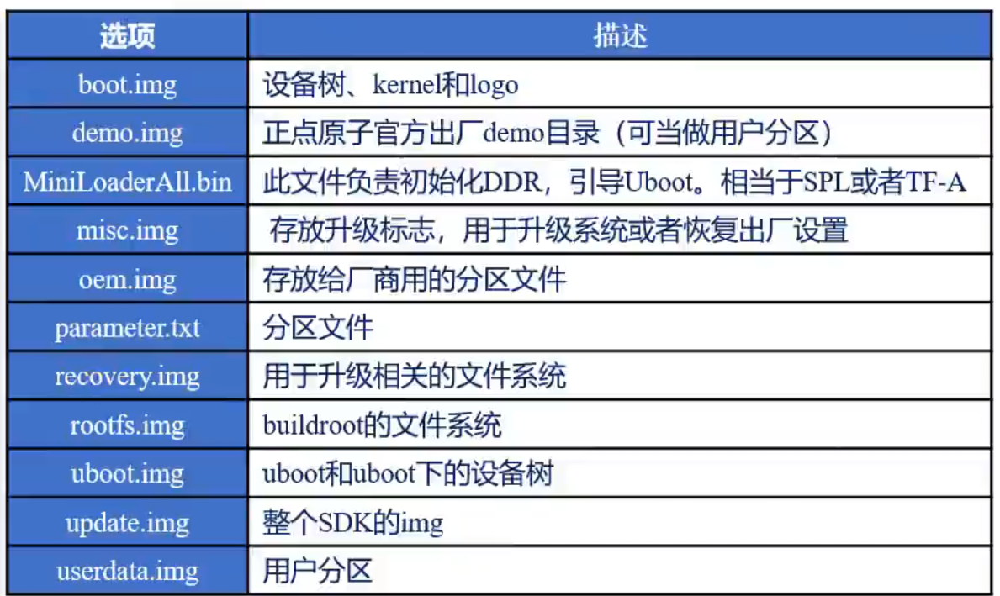      
 - rv1126进行学习
# 1、 图像相关知识点
## 1-1、 RKAIQ宏定义
        图像传感器获取的数据是raw数据，没有经过任何处理的图像数据。是光源信号转化为数字信号最原始的数据，如果raw图像没有经过任何的优化，没有经过任何的处理，是无法被人类查阅的。
        raw数据是无损画质的图像，但是占的空间很大

## 1-2、文件系统分区
文件系统可以使用ls /dev查看，文件分区分为用户层区和保存一些签名的，内      
核ubot相关的分区，      
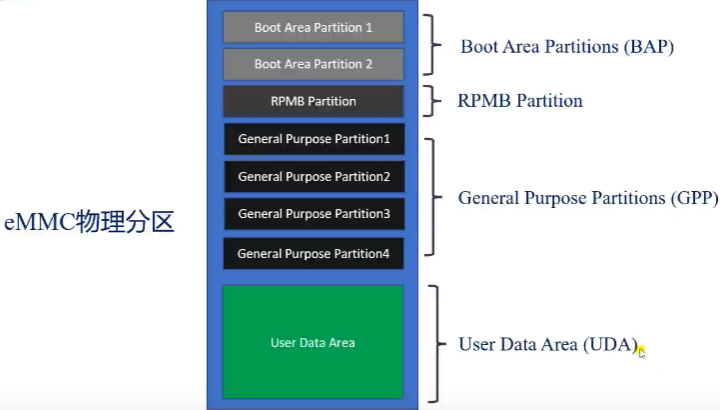     
在linux系统中可以采用以下的方式查看分区信息     
```

一、查看设备节点 `ls /dev/`

二、使用命令 `lsblk`

三、`fdisk -l`` 查看（UDA）分区列表

四、查看（UDA）分区情况 `cat /proc/partitions` 或者 `fdisk /proc/partitions`

五、查看已经挂载的文件系统磁盘占用情况`df -h`

六、查看已挂载的文件系统格式`df -h -T`

七、查看对应分区的文件系统的格式`fsck -N /dev/mmcblk0p1`

八、查看文件系统的分区表 `vi /etc/fstab`

九、也可以采用 `more /etc/fstab`

十、也可以采用`mount`查看


```
rk1126的分区文件parameter.txt存放在sdk中的rockdev中，

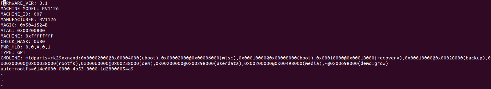     
        
        CMDLINE为分区的配置。
     分区表的格式为：
     分区大小@所在地址（分区名）
     最后的-@所在地址（分区名：grow）的"-"代表将剩余的内存留给该分区，"grow"的写法只能放在CMDLINE最后。
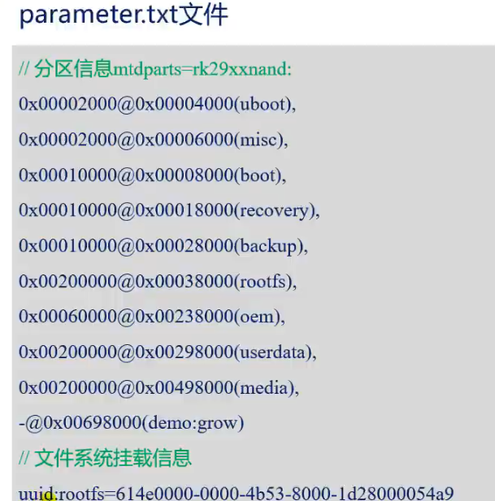     
        
        `blkid`可以查看分区的uuid

### 1-2-1、尝试修改分区

添加一个分区    
第一步：修改分区文件parameter.txt文件。    
第二步：烧录系统    
第三步：格式化分区（格式化为某种格式的文件系统）    
第四步：查看是否格式化成功    
第五步：挂载    

### 1-2-2、镜像烧录
`在添加配置文件的时候，注意镜像存在的位置，配置文件添加上后，后面的镜像地址不一定是对的。`

`loader需要注意的是在编译出来的文件中并没有，镜像名字叫做MiniLoaderAll.bin，是二进制文件。`

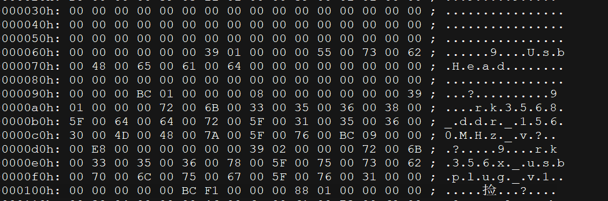

        这个配置文件的修改方法是导入完配置后，修改自己镜像路径，然后在导出自
        己的配置。
 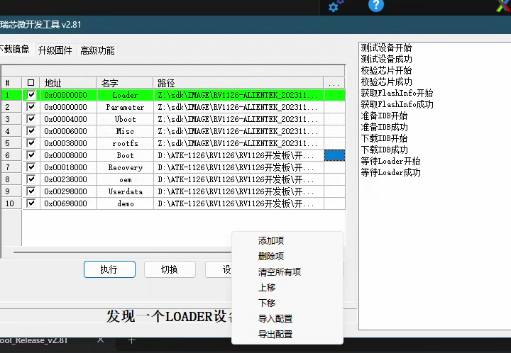   
* 烧写有两种模式：“LOADER”和“MASKROM，LOADER是使用uboot为基础的。     
更改分区一定要是用MASKROM模式。

烧录完成后，就能在/dev下看到新增加的分区，    
使用fdisk -l可以看到分区的名字。     
这个时候就完成了上面所说的第二步，    
如果这个时候去挂在，很大概率是挂在不上的，    
这里使用fsck -N /dev/mmcblk0p10看下设置的分区的格式，       

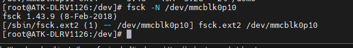          
* 格式化

使用mkfs.xxx -F /dev/mmcblk0p10进行格式化操作。     

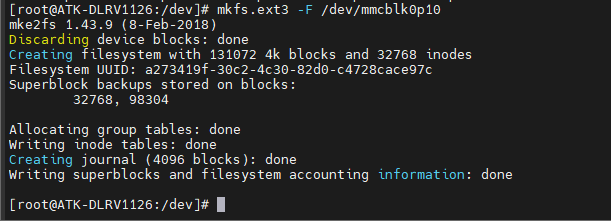
* 挂载

mkdir XXX    
mount /dev/mmcblk0p10 xxx     
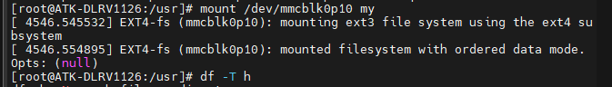       

## 1-3、开机自启动
linux启动第一个运行的进程是init,它是所有进程的父进程，程序最先启动的就是它，   
命令在/sbin/init，它启动之后要去读/etc/inittab配置文件     。   
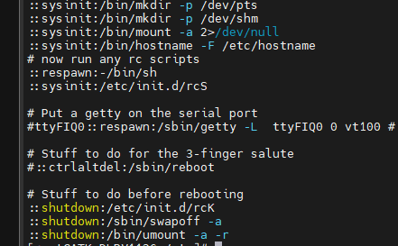        
/etc/inittab文件的语法格式     
`标签：运行级别：操作：进程`    
label:runlevel:action:process   
label登记项标识符，表示输入的值     
| 标示项 | 作用 |
| :-------: | :------: |
| id  | 用来定义缺省的init运行级别（runlevel）|
| si  | 系统初始化的进程 |
| ln | 指明该进程可以使用的runlevel的级别 （级别为0-6，共7个运行级别）|
| ud | 升级进程的ud值可以唤醒/sbin/update进程，该进程为了保持磁盘的完整性，对磁盘进行i/o操作前清空了整个的i/o缓冲区|
| ca | 当按下ctrl+alt+del时运行的进程|
| pf | 当ups表明断电时运行的进程|
| pr | 在系统真正关闭之前，ups发出电源恢复信号时需要运行的程序|
| x  | 将系统转入x终端时需要运行的程序|

runlevel运行级别
| 级别 | 作用|
| :-------: | :------: | 
| runlevel 0 | 系统停机状态，系统默认运行级别不能设置为0，否则不能正常启动 |
| runlevel 1 | 单用户工作模式，root权限，用于系统维护，禁止远程登陆 |
| runlevel 2 | 多用户工作模式（但不支持NFS），命令行模式登录 |
| runlevel 3 | 完全的多用户工作模式（有NFS），命令行模式登录 |
| runlevel 4 | 系统未使用的模式。保留| 
| runlevel 5 | x11图形模式，登陆后进入图形GUI模式| 
| runlevel 6 | 系统正常关闭并且重启，默认运行级别不能设置为6，否则不能正常启动|

开发板的文件系统没有设置有文件级别，可以尝试到ubuntu下查看。     
       

使用`runlevel`这个命令可以查看当前的系统处于什么模式下。    
在开发版中，可以不对上面的两项进行设置。 （两项主要时label和runlevel两项）    

action操作      
| 标示项 | 作用 | 
| :------: | :-----: | 
| boot | 只在系统运行时启动 | 
| bootwait | 在系统启动运行时，系统启动后，当第一次从单用户模式 | 
| sysinit  | 在运行boot或者bootwait进程之前运行，指定的进程在访问控制台之前执行（为init提供初始化命令的路径）|
| respawn  | 不管何时终止都重新启动进程 （每当相应的进程终止执行便会重新启动） |
| shutdown | 当关机时要运行的进程 |
| ctrlaltdel | 当ctrl + alt + del 三个键同时按下时运行 | 
| wait | 告诉init 必须等到相应的进程完成之后才能继续执行 |     

process进程
意思就是一些可执行的文件，或者命令什么的。      

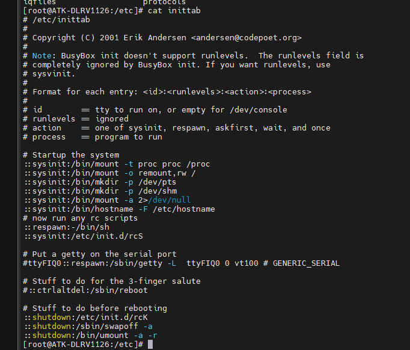         
第一个，挂在proc文件系统。通过这个proc文件系统，内核和用户就可以通讯了。          
第二个，重新挂在，权限可读可写，挂载在根文件目录。
这里的mount -a 2 > /dev/null 相当于黑洞，2是标准输出，定向到/dev/null，意思就是丢弃。     
::sysinit /bin/hostname -F /etc/hostname 显示主机名。     
::respawn :/bin/sh  作用是初始化shell终端。     
::sysinit:/etc/init.d/rcS在访问控制台之前先访问这个脚本(重点)。   

而关机的操作就是下面的stuff to do before rebooting         
操作代号为shutdown           
::shutdown: /etc/init.d/rcK  关机的时候要执行这个脚本。       
::shutdown: /sbin/swapoff -a 在linux下内存管理，必须使用交换区来使用虚拟内存，这个命令就是关闭虚拟内存。    
如果需要打开交换区，使用的命令是swapon命令      
::shutdown: /bin/umont -a -r 表示在关机的时候要卸载所有的内存。      

* 而在于init.d目录下，在inittab中有开机的时候会区执行一个脚本。     
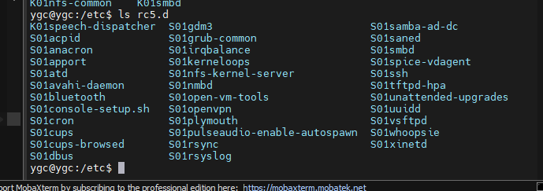        
上图ubutnu系统中，以s开头的代表开机时要运行的脚本，以k开头代表关机时要运行的脚本。
格式是k/s+数字+字符串.sh，这里数字很重要，代表运行的优先级，数字越小优先级越高，如果优先级相同，
则使用后面字符串的ascii码值，码值越小，运行级别越高。从脚本的字符串可以看出运行脚本的作用。

一般执行完更改的操作后，要使用sync同步一下缓存。    
系统中有一个守护进程，start-stop-daemon这个命令就是开启守护进程。    
/sbin/ifup 这个命令一般是用来启动网络的，这些命令一般在系统启动后的开机脚本中都会用到。  

* 扩展
```shell
start-stop-daemon
start-stop-daemon是OpenRC计划的一部分，这个程序最先出现在Debian系的Linux发行版中，这里有个比较古老的手册页面，更详细更直观的办法当然是通过man start-stop-daemon来查看手册了。

start-stop-daemon最基本的两个功能就是--start和--stop，简写为-S和-K，然后再加上一个-s|--signal来给进程发送信号，功德圆满。

-x, --exec daemon，daemon就是真正要执行的进程脚本，比方说启动nginx，那么就是start-stop-daemon -x nginx
-p, --pidfile pidfile，指定pid文件，至于pid文件的用途就多了，stop,status都少不了它。
-n, --name，如果没有指定pid文件，那么就要通过指定name来停止进程了。
-u, --user user[:group]，指定脚本用哪个用户或用户组执行，init脚本是必须使用root权限来执行的，但是它fork出来的子进程我们一般会选择一个权限较低的用户。
-b, --background，强制脚本在后台执行。
-m, --make-pidfile，这个一般和-b配合，用于生成pid文件
-d, --chdir path，切换进程的主目录，这个在构建守护进程的时候是很常用的。
-r, --chroot path，在某些安全性要求较高的情况下，我们就需要用到chroot将进程工作环境与物理环境完全隔离开来。
-1, --stdout logfile，将标准输出记录到log文件，与之相对应的就是-2, --stderr标准错误流。
-w, --wait milliseconds，进程启动后，有这个参数会等待几毫秒来检测进程是否仍然存活。
-x daemon后面跟的执行脚本必须只能是一个文件名，有些程序运行时还需要指定一些参数，比如nginx -c file来指定nginx的配置文件，使用start-stop-daemon -x "nginx -c file"是会报错的，这些程序内的参数以另一种方式加载，start-stop-daemon -x daemon -- $ARGV，这里的双横线--后面跟的所有参数就会被带到程序中了，比如start-stop-daemon -x nginx -c /etc/nginx.conf
```
* 这些文件是通过rcS文件被启动起来的，而rcS文件是通过开机的启动配置，inittab中定义的。   
``` 
[root@ATK-DLRV1126:/etc/init.d]# cat rcS
#!/bin/sh


# Start all init scripts in /etc/init.d
# executing them in numerical order.
#
for i in /etc/init.d/S??* ;do   #这里就是取遍历启动文件，以大S开头的文件

     # Ignore dangling symlinks (if any).
     [ ! -f "$i" ] && continue

     case "$i" in
        *.sh)
            # Source shell script for speed.
            (
                trap - INT QUIT TSTP
                set start   
                . $i      
            )
            ;;
        *)
            # No sh extension, so fork subprocess.
            $i start
            ;;
    esac
done

```
同样的。rcK文件同样类似如此。

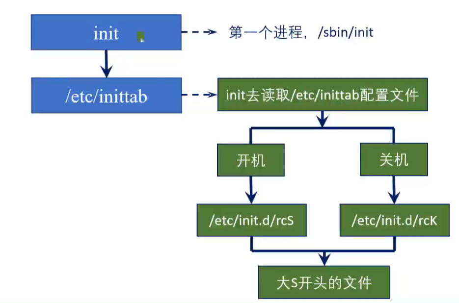   


## 1-4、利用开机自启动，实现静态ip的设置     
* 扩展网络相关点    
  linux下，网络的dns放在了/etc/resolv.conf文件中。
  对于网络的设置，在设置这些之前，需要关闭connman服务，否则可能导致修改不生效。     
  网络网卡也是在初始中启动的（需注意）。
* 设置静态ip
``` 

case "$1" in
  start)
        printf "stop connman: "
        /etc/init.d/S45connman stop
        echo "stop connman ok!"
        echo "nameserver 8.8.8.8">> /etc/resolv.conf
        ;;
  stop)
        printf "nothing ... "
        echo "........."
        ;;   //注意这里的分号        
  *)
        echo "Usage: $0 {start|stop|restart}"
        exit 1
esac

exit $?
```    
在/etc/init.d下，按照规则，创建个脚本，让它开机运行。     

在启动文件中，有一个/sbin/ifup -a，这个命令就是去解析下面要说的文件。   
* 配置/etc/network/interfaces         
这个配置主要有几个参数     

| 参数 | 作用 |  
| :--------: | :--------:|      
| auto | 开机启用loopback网卡 |
| iface lo inet loopback | 将lo接口设置为一个本地回环（loopback）地址 |
|  |  建议：不同的接口之间配置部分必须留有一个空格  |
| auto eth0 |  开机启用eth0网卡   |
| iface eth0 inet static |  指出eth0接口使用静态（static）IP地址 |
| address 192.168.6.100 | 所设置的eth0的静态IP地址 |
| network 192.168.6.0 | 网段 |
| netmask 255.255.255.0 | 子掩码 |
| broadcast 192.168.0.255 | 广播地址 |
| gateway 192.168.6.1 | 网关 | 

* 扩展 1    
shell命令 ip a可以查看网络     
route -n 可以查看网关     
cat /etc/resolv.conf

* 扩展 2    
  同样是去配置/etc/network/interfaces         
              
| 参数  |  作用  |         
| :-----: | :-----: |            
| auto lo | 开机启用loopback网卡 |                      
| iface lo inet loopback | 将lo接口设置为一个本地回环（loopback）地址 |
| |建议： 不同的接口之间配置部分必须留一个空格 |
| auto eth0 | 开机启用eth0 网卡 |
|  iface eth0 inet dhcp  |   指出eth0接口使用动态（dhcp）IP地址   |

有的开发板没有这个文件，例如富瀚，但是可以配置udhcpc代替。

* 扩展 3       
  同样的。网卡可以设置两个ip地址。     
 
 | 参数  |  作用  |
 | :-----:| :------: |
 | 这里接着上面写     |
 | auto eth0:1 | 注意 这里有冒号  这里可以与第一行合并为一行auto eth0 eth0:1 | 
 | iface eth0:1 inet static|    
 |address xxx xxx|
 | 其它类似 |

* 扩展 4    
     同样是去配置/etc/network/interfaces 还有一些高级的操作。可以去执行一些shell命令。


| 选项 | 描述 |
| :-----: | :------|
| pre-up | 网卡启用前的动作 |
| up | 网卡启用时候的动作 |
| post-up | 网卡启用后的动作 |
| pre-down | 网卡关闭前的动作 |
| down | 网卡关闭时动作 |
| post-down | 网卡关闭后动作 |

例如:           
1、设置dns     
post-up echo "nameserver 8.8.8.8">>/etc/resolv.conf        

2、设置默认网关      
post-up echo ip route add default via 192.168.6.1      

3、网卡关闭后删除配置的默认网关      
down route del default gw 192.168.6.1       

或者另一种方式：
```
auto eth0 
iface eth0 inet manual
up ifconfig $IFACE 0.0.0.0 up
up /demo/ip.sh
down ifconfig $IFACE down

```

/demo/ip.sh文件的内容    
```
#!/bin/sh
ifconfig eth0 192.168.6.100 netmask 255.255.255.0 broadcast 192.168.0.25 gateway 192.168.1.1 route add default gw 192.168.6.1 
```
# 2、RKMediak框架及其例程介绍     
RKMedia是RK提供的一种多媒体处理方案，可以实现音视频捕获，音视频输出，音视频编解码等功能。   
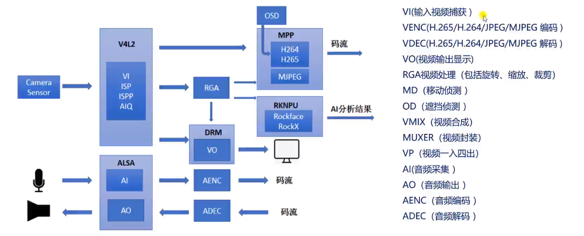  

如MPP主要用于视频的编解码。    
 docs/Common/DISPLAY 中 Rockchip_Developer_Guide_HDMI_CN.pdf记录了hdmi相关信息。（很重要，对lc850开发，客户需要edid支持。相关点内容里面有）。

## 1、sdk中RKMedia例程介绍   
RKMedia在sdk中的源码目录： external/rkmedia/exdample ，里面存放了rk的例程。

sdk一键编译后（./build.sh）后，自动编译了RKMedia了：     
放置在buildroot/output/alientek_rv1126/build/rkmedia.     
可执行文件就在这个目录下buildroot/output/alientek_rv1126/build/rkmedia/examales
打包过的rkmedia文件存放在上面的...../oem/usr/bin中。

1、在终端里输入"rkmedia_",再按TAB键，可以显示命令。    
2、终端里输入"rkmedia_vi_vo_test --help"可以查看命令的使用 。  （在例程中代码中有说明，可以到例程代码中查看）
3、通过rkmedia代码查看命令的使用和例程功能。
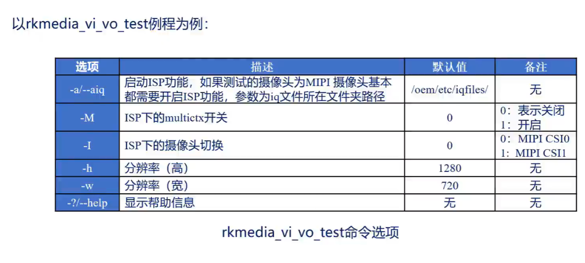  

* 扩展 
  认识iq文件。正点原子的开发板的iq文件在/etc/iqfiles目录下：
```
imx355_.......xml
imx415_.........xml
```  
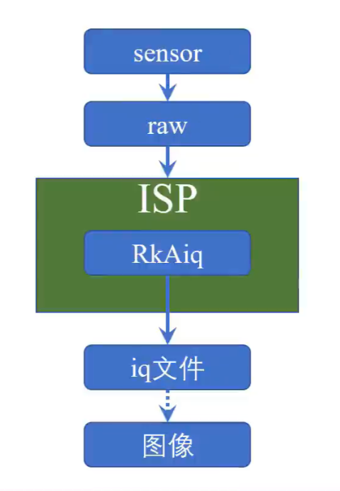  

raw数据不符合人眼效果，使用rkaiq去矫正，矫正需要iq文件。            
iq： image quality 图像质量           
isp： image signal processor 图像信号处理器      
image signal process 图像信号处理器    

`注意，在rv1126上所使用的imx415和；335摄像头，需要通过rkmedia摄像头来调用`
`,因为两个设想头输出的是最原始的raw数据`    
有一个岗位，iq tuning工程师，就是专门调整摄像头的。   
xml参数配置文件就是iq工程师调试的。  

测试例程需要注意的点 ：1、如果开启了正点原子的出场app占用了摄像头应用(isp
占用)，请先关闭应用以后再测试其他摄像头应用，否则运行其他摄像头应用会报错。    
       

2、不能在开启ispserver服务的时候又指定iqfiles，会报错。两者存在冲突。二者选一个，sensor为非HDR模式时，可开启ispserver，sensor为HDR模式时。需要指定iqfiles。           
### 2-1-1、查看ispserver
 服务是否已经开启了：
 ps -aux |grep ispserver     
 开启ispserver服务： 
 ispserveer --no-sync-db & //表示不开启数据库服务dbserver   
 或者 /usr/bin/ispserver & //可能会开启dbserver     

注意 ： 如果开启了摄像头应用（mediaserver）,请先将其关闭后才可以使用RKmedia抓取图片。    
开启和关闭mediaserver的脚本在开发板的/oem目录下：    
```shell
开启摄像头应用（mediaserver）
/oem/RKLunch.sh & //主要使用在ipc开发中的     

关闭摄像头应用（mediaserver）
/oem/RKLunch-stop.sh
```

### 2-1-2 、iq文件
`在不使用ispserver时，那就指定iq文件，指定iq文件时，需要使用sample_common.h和sample_commom_isp.c来对ISP进行初始化。`            
参考rkmedia_vi_vo_test.c中。
```c
   printf("#Rkaiq XML DirPath: %s\n", iq_file_dir);
    printf("#bMultictx: %d\n\n", bMultictx);
    rk_aiq_working_mode_t hdr_mode = RK_AIQ_WORKING_MODE_NORMAL;
    int fps = 30;
    SAMPLE_COMM_ISP_Init(s32CamId, hdr_mode, bMultictx, iq_file_dir);  //初始化isp 
    SAMPLE_COMM_ISP_Run(s32CamId); //运行isp
    SAMPLE_COMM_ISP_SetFrameRate(s32CamId, fps);//设置帧率
```
ips相关文档放在内核doc中。Rockchip_Development_Guide_ISP2x_CN_v1.6.4。     
这个例程rkmedia_vi_vo_test要测试的话，必须指定iq文件。
上面两种方法，都可以。

# 3、编译rkmeida
```shell
//选择环境变量 RV1126_RV1109
source envsetup.sh alientek_rv1126

//清除刚刚编译的rkmedia
make rkmeida-dirclean

//重新编译rkmeida, 去buildroot里的out中找
make rkmedia

//打包到文件系统里面（oem.img）
./build.sh rootfs

//重新烧写oem.img,若有其他包有配置更新，则需要重新烧写rootfs.img

```


在/rv1126/sdk/buildroot/output/alientek_rv1126/build/rkmedia/examples修改例程，然后make -j12就可以编译得到例程的可执行程序，这里的例程代码和external下的类似，猜测这里的代码是哪里拷贝过来的，目前我没有验证。       
总体步骤总结：
在sdk源码buildroot/output/alientek_rv1126/build/rkmedia/examples下操作：   
1、修改对应的.c文件。例如rkmedia_vi_vo_test.c。    
2、保存修改，退出编辑后，直接make。     
3、注意环境变量，如果环境变量变了，应该回到sdk源码根目录下执行source envsetup.sh alientek_rv1126指定环境变量。           
4、使用adb命令或者scp命令拷贝（开发板需要网络连接）到开发板下。


sdk配置文件下查看RKMedia的配置:buildroot/configs/alientek_rv1126_defconfig            
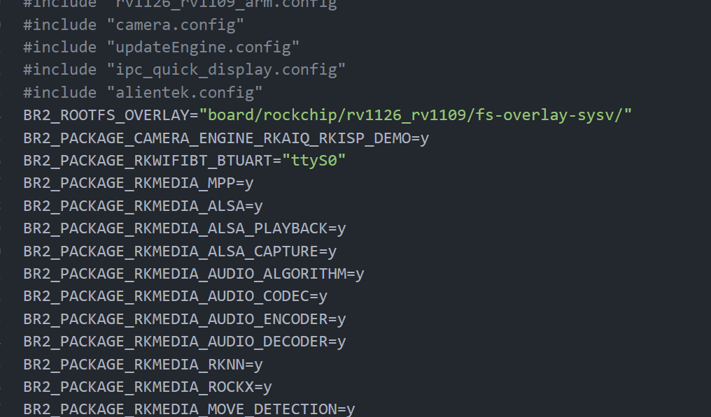      
文件系统相关的配置。             

* 查看和修改RKmedia的配置
```shell
//选择环境变量 envsetup.sh alientek_rv1126
source envsetup.sh alientek_rv1126
//打开buildroot的menuconfig配置菜单界面
make menuconfig
//保存配置文件到buildroot/configs/alientek_rv1126_defconfig
make savedefconfig
//编译文件系统里面
./build.sh rootfs
```
`在配置菜单中按下键盘的/按键可以进行搜索`           
编译文件系统的同时他会去编译Rkmedia。          

# 4、mipi屏幕
在提供的文档中有屏幕的驱动参考和介绍。     
命令行输入fbset可以查看屏幕的分辨率。        
1、正点原子的这块屏幕不需要校准。     
2、触摸输入测试。
3、也可以通过RKmedia例程，摄像头捕获屏幕显示 rkmedia_vi_vo_test -a /etc/iqfiles/  -h 1280 -w 720
```c
//读取input event事件的值
evtest //然后选择1

```

紧接上面第三条：4、测试也可以通过modetest命令进行测试。                      
  
在图中的drm模块，是linux下的一个图形显示框架，也是现在主流的图形显示框架，rkmeida就是通过drm去工作的。
在开发板上有libdrm的库。使用find / -name *libdrm*可以搜过到。


```c
  VO_CHN_ATTR_S stVoAttr = {0};
  // VO[0] for primary plane
  stVoAttr.pcDevNode = "/dev/dri/card0";
  stVoAttr.emPlaneType = VO_PLANE_PRIMARY;
  stVoAttr.enImgType = IMAGE_TYPE_RGB888;
```
上面就显示了用到drm的card0设备，例子rkmedia_vi_vo_test。

而回到modetest这个命令
| 查询选项参数 | 描述|
| :----: | :-----: |
|-p| 列出CRTCs和planes，CRTCs表示VOT（Vide Output Processor）,planes表示图层|
|-e| 查询输出转换器，Encoder表示输出转换器，如RGB、LVDS、DSI等接口（显示接口，类似hdmi等）|
|-f| 列出framebuffers | 
|-c| 查询Connerctor（连接设备）|
就是表示输出转换器和显示面板交互的部分
CRTCs一个屏幕只有一个。


| 通用参数选项 | 描述|
| :----: | :-----: |
|-a | 使能原子操作 |
|-d|模式设置后放置主控器| 
|-f|列出framebuffers| 
|-c|查询Connerctor(连接装备)|
|-M|设置驱动，比如rk的就是rockchip|
|-D|指定对应的ID号|

| 测试参数选项 | 描述|
| :----: | :-----: |
|-P|解析plane参数|
|-S|解析connector参数|
|-C|测试光标|
|-V|测试同步翻页（垂直同步vsync）|
|-W|解析property|

*测试
```
modetest --help //查看帮助
modetest -M rockchip 或者 modetest //查看当前系统DRM情况
modetest -M rockchip|cut -f1|grep -E ^[0-9A-Z] //查看各个模块的id
modetest -M rockchip -s 56@53:720x1280@RG24 //屏幕显示测试
modetest -M rockchip -D 0 -a -s 56@53:720X1280 -P 52@53:720x1280
```
* `扩展：shell命令对于参数，<>表示必填像，[]表示可填，使用--help查看`

# 5、摄像头
 摄像头详细参数看文档    
 在rkmedia的rkmedia_vi_vo_test.c中存在一个RGA示范用例
 ```
  RngInfo.u8Enable = 1;
  RK_MPI_VI_RGN_SetCover(s32CamId, 1, &RngInfo, &CoverInfo);

  // rga0 for primary plane
  RGA_ATTR_S stRgaAttr;
  memset(&stRgaAttr, 0, sizeof(stRgaAttr));
  stRgaAttr.bEnBufPool = RK_TRUE;
  stRgaAttr.u16BufPoolCnt = 3;
  stRgaAttr.u16Rotaion = 90;
  stRgaAttr.stImgIn.u32X = 0;
  stRgaAttr.stImgIn.u32Y = 0;
  stRgaAttr.stImgIn.imgType = IMAGE_TYPE_NV12;
  stRgaAttr.stImgIn.u32Width = video_width;
  stRgaAttr.stImgIn.u32Height = video_height;
  stRgaAttr.stImgIn.u32HorStride = video_width;
  stRgaAttr.stImgIn.u32VirStride = video_height;
  stRgaAttr.stImgOut.u32X = 0;
  stRgaAttr.stImgOut.u32Y = 0;
 ```
 这里的90是利用了RGA功能图形硬件加速做的旋转。          
 板子有两个摄像头插槽。

 # 6、AI模型运行流程
 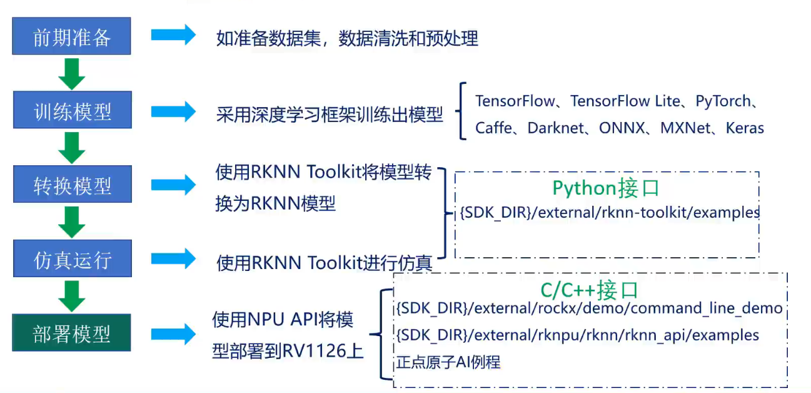  
 假设 ：AI网络模型在pc端运行，运行的模型效果比较理想，也就是`测试集`的`损失值比较低`，正确率比较高。说明模型的泛化能力比较好。这个时候就需要转化操作。
 就是将pc端的网络模型转化为RKNN模型。应为rk的npu不能运行其他框架的模型，只能运行rknn模型。通过RKNN toolkit将模型转化，然后使用这个工具
 进行仿真（主要看内存，cpu情况），然后部署到板子上，
  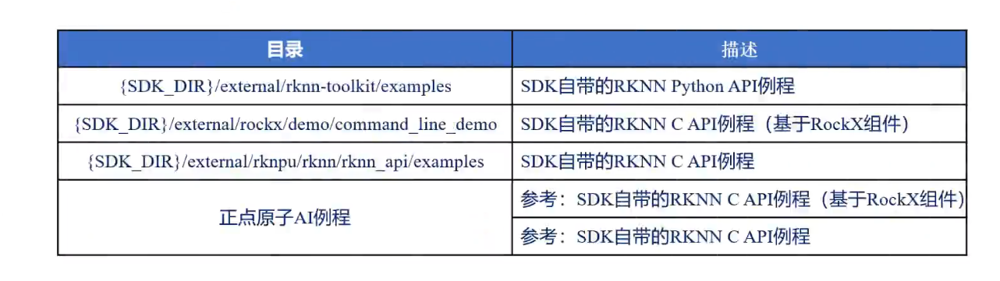 

## 6-1、rv1126芯片介绍
内嵌了硬件视频编码器，由risc-v mcufastboot快速启动。
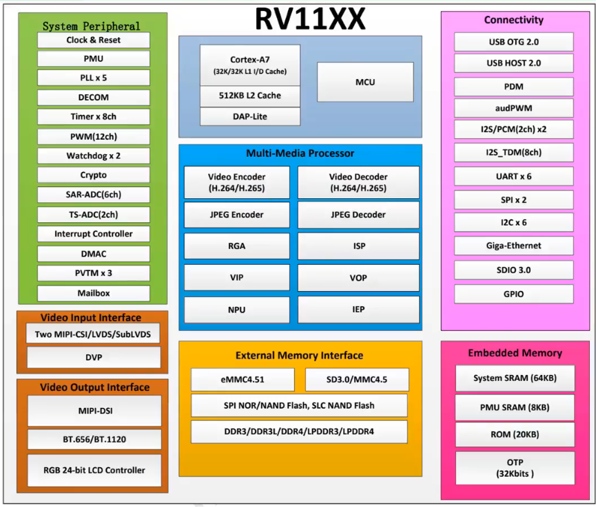 
软件解码和硬件解码区别。软件解码靠cpu，简称软解。同样的，软件编码也是采用cpu处理。而硬件编解码。就是采用硬件或者模块解码。类似gpu。
芯片有通用型和专用型之分，imx6u就是通用控制，在汽车电子行业用的比较多，1126在音视频AI中用的多。
1126支持很多深度学习框架。

* AI例程主要包括三个来源，1、基于RockX进行开发，但是无法获知源码，无法进行更改，2、rockface，要钱不开源。3、采用预训练模型。采用自训练模型。
  一个模型相关的参数，输入输出，均值，标准差，欧式距离，余弦距离，阈值。
  rockx发布的           
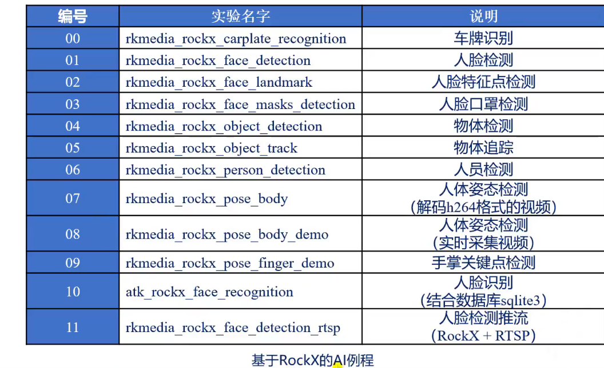 

下面是预训练模型发布的             
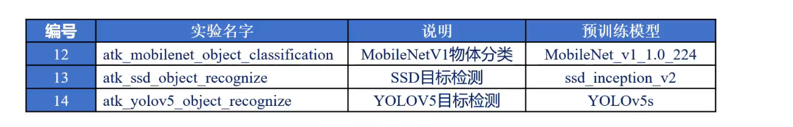

下面是开源的AI模型            


## 6-2、 学习AI必备
1、入门python   
2、学习一种传统图像处理/开源计算机视觉库
opencv 、matlab、dlib（人脸识别算法库）     
3、具有一些高等数学基础     
导数、偏导数、梯度、微积分、卷积、高斯滤波、概率统计、正态分布、均匀分布、熵、激活函数、方差、回归分析、聚类算法、贝叶斯算法、线性代数等        
4、选择一种深度学习框架     
tensorflow tensorflow lite 、pytorch、 caffe等    
5、UI界面开发学习   
qt    
6、其他学习    
数据库
sqlite3  mysql

基于平台进行开发，rk平台的文件系统时buildroot文件系统。在其他模型通过RKNN Toolkit进行转换后，使用RkNN C API进行调用。 

* 交叉编译器我放到了/home/ygc/Desktop/linux-gcc下


 节点1.5第6.37秒