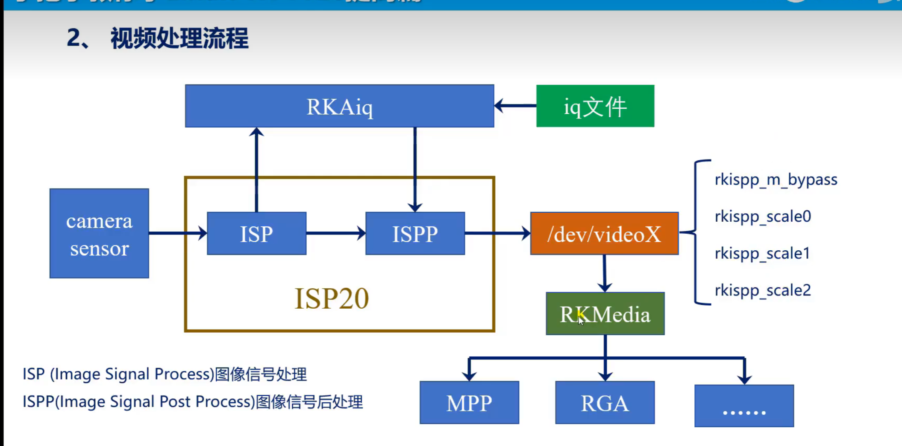
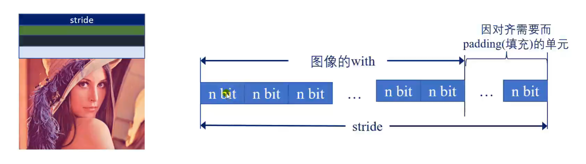
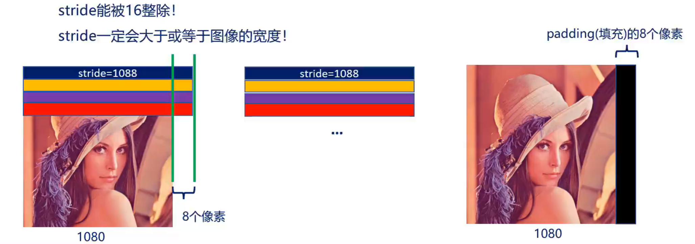

`对与3568没有rkmedia但是有rockit`
# 1、RK宏定义
ips模块，有一些芯片内部是有isp模块，有的没有，例如imx6u，一种是编写软件转换，还有也可以找isp芯片。有的摄像头带有isp模块，如ov5640，有的不带im415，不带的无法直接出图。要使用isp，就需要加载rkaiq模块，aiq模块在cmake中定义。
```CMake
if(USE_RKAIQ)
    find_package(RkAiq REQUIRED)
    include_directories(${RKAIQ_INCLUDE_DIRS})
    add_definitions(-DRKAIQ)
endif()
```
bayer raw 数据，raw数据，同一个意思，因为摄像头拍摄用到了拜耳阵列。拜耳格式有四种BGGR、RGGB、GBRG、GRBG四种。   
码流：简称视频流
  
isp和ispp就是rkisp2.0模块
  
摄像头拍摄到数据，利用iq文件进行初步调整，得到流到/dev/videoX。
RKMedia的rga模块和linux-rga模块一样，是RKMedia去封装linux-rga得到的rga模块。     
RKMedia是数据流的精确加工。    
对于视频编码处理的模块。RK的叫做RKMpp，海思芯片的叫做HiMpp。   
通用邻域，后面需要学习FFMPEG,gstreamer
# 2、Stride的概念
图像的stride（跨度、跨距、步长、步幅），表示在内存中每行像素所占的字节数   
注意：stride能被16整除！   
stride一定会大于或者等于图像的宽度。
  
上图的n代表位宽，可以是8、16、32，列入rgb24的像素位宽就是24位。   
对齐：硬件为了快速访问内存，跨行地址，所以要进行对齐。stride能被16整除，这里的整除16，就是对齐系数       
例如1280跨度，stride就为1280，可以被16整除，只需一行一行读取，而如果是1080，则无法被16整除，1072可以被16整除，所以情况就是，先读取1072个长度，然后读取后8个和下一行的1064个，类似下去就会导致花屏。而如果stride大于了图像宽度，就可以避免这个问题，虽然会浪费一定的内存
  
  

* 举例    
  在RKMedia下，设置采集的图像的宽度能被16整除。且stride = 图像的宽度即可    
  即：
  图像buff宽度 = stride 宽度
  stride 宽度 /16 = 整数NQQ


视频配套文档还没有下载
