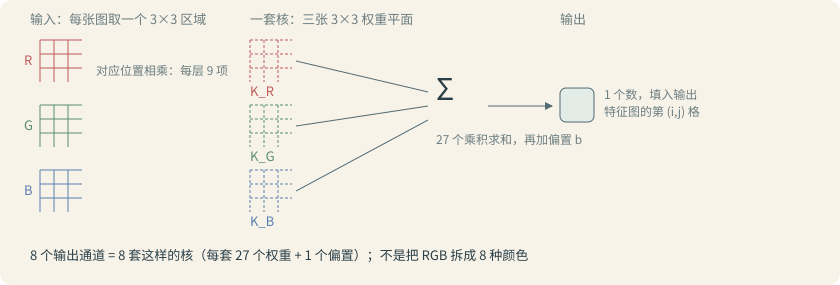

> 本篇于 2026-10-12 完成阅读并发布。配套实验已在 CPU 上运行验证，四道练习补齐折叠参考答案，用于复习，不作为逐题提交的作业记录。下一阶段开始学习训练过程。

在[《图片如何变成张量》](/posts/vision-04-image-tensor.html)中已经得到 `float32 NCHW` 输入。建议先完成[《MLP 入门：从手算到图片输入》](/posts/vision-mlp-basics.html)，熟悉全连接层、ReLU 和 `forward`，再继续本篇的卷积与池化。这次把输入送进自己定义的卷积网络，观察形状和数值怎样变化。如果还分不清通道与维度，可以回看[《从像素到张量的基础概念》](/posts/vision-foundations-pixels-tensors.html)。

本篇把需要的理论放在操作前面：先弄清为什么需要这一层，再用小数据验证。梯度、反向传播和训练循环留到训练章节。

## 本篇要搭建什么

CNN 是卷积神经网络。本篇的网络很小：

```text
RGB 图片 → 卷积 → ReLU → 最大池化 → 展平 → 两个类别分数
```

“前向计算”就是给定输入和当前参数，按顺序算出输出。以一张 32×32 图片为例：

| 步骤 | 张量形状 | 这一步做什么 |
| --- | --- | --- |
| 输入 | `(1, 3, 32, 32)` | 一张 RGB 图片 |
| 卷积 | `(1, 8, 32, 32)` | 计算 8 张特征图 |
| ReLU | `(1, 8, 32, 32)` | 逐元素将负数变成 0 |
| 最大池化 | `(1, 8, 16, 16)` | 每个通道内缩小空间尺寸 |
| 展平 | `(1, 2048)` | 将每张图的特征排成一条向量 |
| 输出层 | `(1, 2)` | 计算两个原始类别分数 |

这里的两个输出只是为后续分类任务预留的位置。本篇没有数据标签，不能把两个位置直接当作已经学会的“猫、狗”。

## 先理解权重：输入不是同等对待的

假设读取到两个数 `x1=2`、`x2=3`，我们定义：

```text
y = w1 × x1 + w2 × x2 + b
```

`w1`、`w2` 叫权重，决定输入怎样参与计算；`b` 叫偏置，是额外加上的数。取 `w1=1`、`w2=-1`、`b=0.5`，结果就是 `2 - 3 + 0.5 = -0.5`。

一个权重就是像 `1`、`-0.4` 这样的一个数字，偏置也是一个数字。后面数一层的参数数量，就是数它存了多少个这样的数字。

可以借用 C/C++ 来理解：输入是传进来的数据，权重和偏置是对象里保存的参数。同一份输入，参数变了，输出就可能改变。本篇只观察参数参与计算；训练章节才学习怎样根据样本调整它们。

矩阵可以先理解为按行、列排列的数表。张量里的某些数是输入数据，另一些张量保存权重；“都是张量”不等于用途一样。

## 卷积：从一小块区域计算一个数

图片中相邻像素常常一起构成边缘或纹理。先观察一个小区域，比立即把所有像素混成一长串更容易保留局部关系。卷积会把同一组小区域权重，重复用在图片的不同位置。

先只看单通道的 4×4 数表，它用于手算，不是 RGB 图片：

```text
输入                  2×2 卷积核
1  2  0  1            1   0
0  1  3  2            0  -1
2  1  0  1
1  0  2  3
```

“卷积核”是保存局部权重的小数组。把它盖在输入左上角，取出 `[[1, 2], [0, 1]]`，对应位置相乘后求和：

```text
1×1 + 2×0 + 0×0 + 1×(-1) = 0
```

向右移动一格，取到 `[[2, 0], [1, 3]]`，得到：

```text
2×1 + 0×0 + 1×0 + 3×(-1) = -1
```

按从左到右、从上到下移动，就得到一张新的二维数表，称为特征图。本例没有偏置；如果有偏置，要在每个位置的加权和上加上它。

这个人为设置的核比较每个区域左上角与右下角的数值。不要以为所有卷积核都做这件事。完整网络中的权重通常先初始化，再通过训练调整。

PyTorch 的 `Conv2d` 实际执行的是不翻转卷积核的互相关运算，深度学习里通常仍称为卷积。本课按这个约定手算。[Conv2d 接口说明](https://docs.pytorch.org/docs/stable/generated/torch.nn.Conv2d.html)

### 步长、填充与输出尺寸

- `kernel_size`：一次观察多大的区域。
- `stride`：窗口每次移动几格。
- `padding`：在输入边缘补几圈；本篇使用默认的补零方式。

本篇只用普通卷积，`dilation=1`。对高、宽分别使用下面的公式：

```text
输出尺寸 = floor((输入尺寸 + 2×padding - kernel_size) / stride) + 1
```

`floor` 表示向下取整。4×4 输入、2×2 核、步长 1、不填充，输出就是 3×3。32×32 输入、3×3 核、步长 1、填充 1，输出仍是 32×32。

填充让核能覆盖边缘位置，也能在合适设置下维持尺寸；它没有给原图补充真实内容。步长变大通常会减少输出位置的数量。这些设置都不改变批次数 N。

### 实验 01：先验证一次卷积

```experiment
manual-convolution
```

代码的核心循环与你熟悉的二维数组遍历很接近：

```python
patch = image[row:row + 2, column:column + 2]
manual[row, column] = (patch * kernel).sum()
```

这里 `*` 是对应元素相乘，`.sum()` 再把它们加起来。它不是 Python 的 `@` 矩阵乘法。

代码随后把同一份核写入 `Conv2d`，比较两种算法的结果。`copy_()` 末尾的下划线表示原地复制；`torch.no_grad()` 让这段初始化和计算不记录求梯度所需的操作。当前只把它当作实验运行设置，梯度机制留到下一阶段。

运行后应看到输入为 `(1, 1, 4, 4)`，输出为 `(1, 1, 3, 3)`，两种计算相同。这里两次 `unsqueeze(0)` 分别补齐通道轴和批次轴。

## 为什么 RGB 三个通道会变成八个通道

完整网络使用：

```python
nn.Conv2d(3, 8, kernel_size=3, stride=1, padding=1)
```

`3` 是输入通道数，`8` 是我们选择的输出通道数。8 是本课为了网络小、容易观察而选的超参数，不是从 RGB 自动计算出来的。8 个输出通道对应 8 套互不相同的卷积核。

默认 `groups=1` 时，每套核都会连接全部三个输入通道，因此核的形状是 `3×3×3`：前两个 3 是空间窗口，最后的 3 来自 R、G、B 三个输入通道。计算某个输出位置时，R、G、B 各取一个 3×3 区域，与核中对应的平面逐项相乘；三组共 27 个乘积求和，再加上该输出通道的偏置，得到特征图上这个位置的值。



因此每套核有 `3×3×3=27` 个权重，8 个输出通道的权重形状是 `(8, 3, 3, 3)`。加上 8 个偏置，本层共有 `8×27+8=224` 个参数。

输入通道有明确的 R、G、B 含义，输出的 8 个通道表示 8 种计算响应。它们不是 8 种颜色，也不能在训练前就指定“第一个一定找边缘，第二个一定找眼睛”。

同一个输出通道的权重会在不同空间位置重复使用，称为权重共享。因此固定输入、输出通道及卷积核后，增大图片高宽不会增加该卷积层的参数数量，但会增加计算量。

## 为什么卷积后要接 ReLU

ReLU 的规则很简单：

```text
ReLU(x) = max(0, x)
[-2, 0, 3] → [0, 0, 3]
```

它逐元素计算，不改变形状，也没有需要训练的参数。[ReLU 接口说明](https://docs.pytorch.org/docs/stable/generated/torch.nn.ReLU.html)

为什么需要它？先看两个简单的线性加偏置运算：

```text
y = 2x + 1
z = 3y - 4
合起来：z = 6x - 1
```

无论叠几次这类运算，仍能合成一个线性加偏置的变换。向量和矩阵也有类似性质。加入 ReLU 这样的非线性操作后，网络才能表达更丰富的关系。

这不是因为“负数是错误数据”。卷积输出本来就可以为负，也可能超过 1；上一章输入被缩放到 `[0, 1]`，不意味着中间特征必须一直在这个区间。

## 池化：保留局部最大响应，减少空间位置

本篇使用 `MaxPool2d(2, 2)`，每个通道独立处理，每个 2×2 区域保留一个最大值，窗口每次移动两格。例如：

```text
输入                输出
1  3  2  0          4  5
4  2  1  5          6  8
0  6  1  2
3  1  8  4
```

它把 4×4 缩小为 2×2，不混合不同通道，也没有权重和偏置。通道数在上一步卷积时已经从 3 变成 8，池化后仍是 8 张特征图，不会变回 R、G、B 三张。[MaxPool2d 接口说明](https://docs.pytorch.org/docs/stable/generated/torch.nn.MaxPool2d.html)

这样能减少后续需要处理的空间位置，但会丢掉窗口内其他数值和最大值的精确位置。本篇选择最大池化来观察这种取舍，不代表每个 CNN 都必须使用它。本例尺寸为偶数，所以高宽恰好减半；换成奇数尺寸时，需要按窗口实际覆盖的位置计算输出尺寸。

## 展平与输出层：每张图得到两个分数

池化后每张图有 `8×16×16=2048` 个数。`nn.Flatten(start_dim=1)` 保留第 0 维 N，把后面的 C、H、W 合并，得到 `(N, 2048)`。

这里改变形状正符合我们的目的：把已经计算好的特征排成向量。它与用 `reshape` 冒充 HWC→CHW 转换是两件事；后者要求改变轴的对应关系。

接着 `nn.Linear(2048, 2)` 为每张图计算两个分数。每个分数都是 2048 个特征的加权和再加偏置，因此这一层有 `2048×2+2=4098` 个参数。

这些原始分数称为 logits，可以为负、可以大于 1、也不要求和为 1。以后可以通过 softmax 把一组分数转换成总和为 1 的概率形式，但转换不会让未训练的网络突然有识别能力。本篇保留原始分数。

## 用 Python 类把网络组织起来

`class TinyCNN(nn.Module)` 可以借助 C++ 的继承来理解：`TinyCNN` 继承 PyTorch 提供的网络模块基类。`super().__init__()` 初始化基类，让框架能管理子模块和参数。

- `__init__`：创建并保存各层，例如 `self.conv`、`self.classifier`。
- `forward`：描述输入依次经过哪些计算。
- `model(images)`：通过模块的调用入口执行前向计算，通常不要绕过入口直接调用 `model.forward(images)`。

把层保存在对象中，才能多次使用同一份参数。不要每次进入 `forward` 都重新创建卷积层，否则会不断得到新参数。模块注册与调用约定见 [Module 官方说明](https://docs.pytorch.org/docs/stable/generated/torch.nn.Module.html)。

配套代码用 `for name, layer in (...)` 顺序调用五个层。你可以把 `layer(features)` 理解为“让当前这层处理 features”，返回值交给下一层；`trace=True` 只是打开本课的逐层形状打印。

### 实验 02：运行完整的小网络

```experiment
tiny-cnn
```

本机已经有上一章依赖，可以在博客根目录运行：

```bash
python3 content/posts/AI-深度学习/从零搭建视觉模型/06-亲手搭建小型CNN/code/01_manual_convolution.py
python3 content/posts/AI-深度学习/从零搭建视觉模型/06-亲手搭建小型CNN/code/02_tiny_cnn.py
```

新环境安装步骤见本篇 `code/README.md`。代码和 `sample.ppm` 都在本篇目录内，可以独立移动并运行。

实验把熟悉的六色小图放大成 32×32，只为提供一个便于检查形状的输入。放大不会创造真实细节，也不把六个像素变成合适的训练数据集。读入自己的图片时也会统一转换成 RGB 并调整为 32×32。

默认形状输出为：

```text
输入: (1, 3, 32, 32)
卷积: (1, 8, 32, 32)
ReLU: (1, 8, 32, 32)
池化: (1, 8, 16, 16)
展平: (1, 2048)
输出分数: (1, 2)
输出类型: torch.float32, 设备: cpu
```

脚本还打印两个分数以及参数总数 `4322`。卷积层 224 个、输出层 4098 个，其余三层没有可训练参数。这 4322 个参数就是网络里保存的 4322 个数字，当前取值只来自随机初始化。

`torch.manual_seed(7)` 固定随机种子，方便同环境复现初始化；它没有进行训练，跨平台或不同版本下，也不保证分数完全一致。

`model.eval()` 设置评估模式；`torch.no_grad()` 关闭这段计算的梯度记录。两者用途不同，本课没有 Dropout 或 BatchNorm，因此 `eval()` 不改变这些层的计算规则。它们都不会自动把参数训练好，也不会自动将数据搬到 GPU。

<details class="exercise-answer">
<summary>点击用三行速记这三层</summary>

```text
MaxPool2d(2, 2)   8 张图各自 2×2 取最大 → 尺寸减半，通道不变，无参数
Flatten(start_dim=1)  把 C、H、W 排成一条 → (N, 2048)，数不变，只是排队
Linear(2048, 2)   两组权重各算一个加权和 → 两个原始分数，4098 个参数
```

第三行输出的两个数是原始分数：训练之前，它们只是随机权重参与计算的结果，不能读作“二分类结论”。

</details>

### 当前网络为什么固定 32×32

卷积层可以处理不同的高宽，但这里 `Linear` 的输入长度写死为 2048。换一个空间尺寸，经过池化再展平的长度可能不再是 2048，从而导致矩阵形状不匹配。

目前由读图函数统一到 32×32，先让每一步容易推算。后续再学习如何使用自适应池化等方式处理这一限制。批次数 N 可以变化，因为它没有被展平进每张图片的特征向量。

## 课后练习

本篇先完成四道短练习。可在 `playground/test.py` 临时练习；需要读取图片时，使用本篇自带的 `code/sample.ppm` 或复制到练习脚本旁边。四题参考答案默认折叠，点击可用于复习。

### 练习 1：手算卷积中的三个位置

使用实验 01 的 4×4 输入和 2×2 核，步长 1、不填充、无偏置：

1. 写出输出形状，包括 N、C、H、W。
2. 计算输出 `[0, 0, 0, 2]`、`[0, 0, 1, 0]`、`[0, 0, 2, 2]`，列出各自覆盖的输入区域和乘加过程。
3. 如果每个位置再加偏置 2，这三个值分别变成多少？

可以先在纸上算，再运行实验 01 核对不加偏置时的结果。

<details class="exercise-answer">
<summary>点击查看第一题参考答案与说明</summary>

输出为 `(1, 1, 3, 3)`，因为 `(4-2)/1+1=3`。

| 输出位置 | 输入区域 | 乘加过程 | 加偏置 2 后 |
| --- | --- | --- | --- |
| `[0,0,0,2]` | `[[0,1],[3,2]]` | `0×1+1×0+3×0+2×(-1)=-2` | 0 |
| `[0,0,1,0]` | `[[0,1],[2,1]]` | `0×1+1×0+2×0+1×(-1)=-1` | 1 |
| `[0,0,2,2]` | `[[0,1],[2,3]]` | `0×1+1×0+2×0+3×(-1)=-3` | -1 |

偏置属于输出通道，在该通道所有空间位置上加同一个数。

```python
import torch
from torch import nn

image = torch.tensor([[[[
    1., 2., 0., 1.], [0., 1., 3., 2.],
    [2., 1., 0., 1.], [1., 0., 2., 3.]
]]])
conv = nn.Conv2d(1, 1, 2, bias=True)
with torch.no_grad():
    conv.weight.copy_(torch.tensor([[[[1., 0.], [0., -1.]]]]))
    conv.bias.fill_(0)
    output = conv(image)
    print(f"形状: {tuple(output.shape)}")
    print(f"三个位置: {output[0, 0, 0, 2].item()}, {output[0, 0, 1, 0].item()}, {output[0, 0, 2, 2].item()}")
    conv.bias.fill_(2)
    shifted = conv(image)
    print(f"加偏置 2: {shifted[0, 0, 0, 2].item()}, {shifted[0, 0, 1, 0].item()}, {shifted[0, 0, 2, 2].item()}")
    assert torch.equal(shifted, output + 2)
```

运行结果：

```text
形状: (1, 1, 3, 3)
三个位置: -2.0, -1.0, -3.0
加偏置 2: 0.0, 1.0, -1.0
```

</details>

### 练习 2：改通道数，同时改对输出层

把 `TinyCNN` 的卷积输出通道从 8 改为 4，其余卷积和池化设置保持不变：

1. 先写出卷积、池化、展平和最终输出的形状。
2. 修改对应的 `Linear` 输入长度，让完整网络运行成功。
3. 解释为什么改输出通道数不会把输入 RGB 变成四种颜色。
4. 计算修改后的卷积层、输出层和整个网络的参数数量，再用 `model.parameters()` 检查。

<details class="exercise-answer">
<summary>点击查看第二题参考答案与说明</summary>

把卷积改为 `nn.Conv2d(3, 4, 3, stride=1, padding=1)`，输出层改为 `nn.Linear(4 * 16 * 16, 2)`。以下用全零输入检查结构，真实图片仍可沿用实验 02 的读取函数。

卷积参数为 `4×3×3×3+4=112`；全连接参数为 `1024×2+2=2050`；总数为 `2162`。RGB 输入仍有三个颜色通道，输出四个通道是四组卷积权重产生的特征响应，不是四种颜色。

```python
import torch
from torch import nn

conv = nn.Conv2d(3, 4, kernel_size=3, stride=1, padding=1)
relu = nn.ReLU()
pool = nn.MaxPool2d(2, 2)
flatten = nn.Flatten(start_dim=1)
classifier = nn.Linear(4 * 16 * 16, 2)
with torch.no_grad():
    images = torch.zeros((1, 3, 32, 32))
    features = conv(images)
    print(f"卷积: {tuple(features.shape)}")
    features = relu(features)
    features = pool(features)
    print(f"池化: {tuple(features.shape)}")
    features = flatten(features)
    print(f"展平: {tuple(features.shape)}")
    scores = classifier(features)
    print(f"输出: {tuple(scores.shape)}")

conv_count = 0
for parameter in conv.parameters():
    conv_count = conv_count + parameter.numel()
linear_count = 0
for parameter in classifier.parameters():
    linear_count = linear_count + parameter.numel()
print(f"参数: 卷积 {conv_count}, 输出层 {linear_count}, 总数 {conv_count + linear_count}")
assert conv_count == 112 and linear_count == 2050
```

运行结果：

```text
卷积: (1, 4, 32, 32)
池化: (1, 4, 16, 16)
展平: (1, 1024)
输出: (1, 2)
参数: 卷积 112, 输出层 2050, 总数 2162
```

</details>

### 练习 3：ReLU 与最大池化

建立形状为 `(1, 1, 4, 4)` 的浮点张量，其唯一通道为：

```text
-1   3   2  -2
 4  -5   1   5
 0   6  -1   2
 3   1   8  -4
```

先写出 ReLU 后的数表，再计算 `MaxPool2d(2, 2)` 的结果，最后用代码验证。分别说明哪一步改变形状、哪一步含有可训练参数。

<details class="exercise-answer">
<summary>点击查看第三题参考答案与说明</summary>

ReLU 后负数变成 0，形状保持 `(1, 1, 4, 4)`；池化后为 `(1, 1, 2, 2)`，结果是 `[[4,5],[6,8]]`。这两个操作都没有可训练的权重或偏置。

```python
import torch
from torch import nn

images = torch.tensor([[[[-1., 3., 2., -2.], [4., -5., 1., 5.],
                         [0., 6., -1., 2.], [3., 1., 8., -4.]]]])
relu = nn.ReLU()
pool = nn.MaxPool2d(2, 2)
active = relu(images)
pooled = pool(active)
print(f"ReLU: {active[0, 0].tolist()}")
print(f"池化: {pooled[0, 0].tolist()}")
print(f"形状: {tuple(active.shape)} → {tuple(pooled.shape)}")
assert torch.equal(pooled, torch.tensor([[[[4., 5.], [6., 8.]]]]))
```

运行结果：

```text
ReLU: [[0.0, 3.0, 2.0, 0.0], [4.0, 0.0, 1.0, 5.0], [0.0, 6.0, 0.0, 2.0], [3.0, 1.0, 8.0, 0.0]]
池化: [[4.0, 5.0], [6.0, 8.0]]
形状: (1, 1, 4, 4) → (1, 1, 2, 2)
```

</details>

### 练习 4：两张图片一起经过网络

回到原来的 8 通道网络。取得一份 `(1, 3, 32, 32)` 输入，用 `clone()` 得到另一份，把副本的 B 通道全部设为 0。

1. 用 `torch.cat([first_batch, second_batch], dim=0)` 沿已有批次轴拼接，得到 `(2, 3, 32, 32)`。这与上一章从 CHW 使用 `stack` 增加轴不同。
2. 送入同一个模型，确认输出为 `(2, 2)`，原输入没有被修改。
3. 在同一个模型、同一组参数和评估模式下，分别输入两张图片，再与批量计算的对应行用 `torch.allclose()` 比较。
4. 如果某个类别分数更大，是否足以证明网络已经会分类？说明理由。

<details class="exercise-answer">
<summary>点击查看第四题参考答案与说明</summary>

下面的代码接在实验 02 的 `main()` 中创建 `images`、`model` 之后运行。`images` 由本篇 `sample.ppm` 读取而来。

```python
first_batch = images
original = first_batch.clone()
second_batch = first_batch.clone()
second_batch[:, 2, :, :] = 0
batch = torch.cat([first_batch, second_batch], dim=0)

model.eval()
with torch.no_grad():
    batch_scores = model(batch)
    first_scores = model(first_batch)
    second_scores = model(second_batch)
    separate_scores = torch.cat([first_scores, second_scores], dim=0)

print(f"输入: {tuple(batch.shape)}")
print(f"输出: {tuple(batch_scores.shape)}")
print(f"原输入未变: {torch.equal(first_batch, original)}")
print(f"两种计算一致: {torch.allclose(batch_scores, separate_scores, atol=1e-6)}")
assert torch.equal(first_batch, original)
assert torch.allclose(batch_scores, separate_scores, atol=1e-6)
```

预期输出：

```text
输入: (2, 3, 32, 32)
输出: (2, 2)
原输入未变: True
两种计算一致: True
```

`clone()` 保证修改第二张图不影响第一张图。输入已经有 N 轴，因此用 `cat` 沿这个轴拼接。批量计算和分别计算必须使用同一个模型，而不是分别新建随机初始化的模型；浮点计算使用容差比较。

输出中每行对应一张图片，每列对应一个分数。当前网络尚未训练，分数较大只表示这组参数的计算结果，不能证明已经具有真实分类能力。

</details>

## 复习记录（2026-10-20）

复习本篇时被三个概念卡住，记录问题与结论，供后续自查：

- **池化后不也是 R、G、B 三张图吗？** 不是。通道数在卷积那一步就从 3 变成 8：每套卷积核同时读入 R、G、B 三个通道，产出一张特征图。池化只是把这 8 张各自独立缩小，不混合通道也不改数量。R、G、B 只存在于进入卷积之前。
- **输出 8 通道就是有 8 个卷积核？** 是。输出通道数与核的套数一一对应，`Conv2d(3, 8, ...)` 的第二个参数就是核数。且“一个核”是跨全部输入通道的整块 `3×3×3`，不是单个 3×3 平面。
- **一个权重就是一个数字？** 是。权重和偏置都是单个数字。卷积层 224 个参数就是 224 个数字，输出层 4098 个就是 4098 个数字。训练做的事就是拿这批数字反复微调取值，网络的“能力”最终就是这堆数字停下来的位置。

## 下一步

下一章《让模型开始学习：损失、梯度与训练循环》已准备为学习草稿。先看一个参数如何更新，再训练小型 CNN 区分横竖条纹：为图片准备标签，计算损失，利用梯度更新参数，最后用没有参与训练的数据检查效果。
