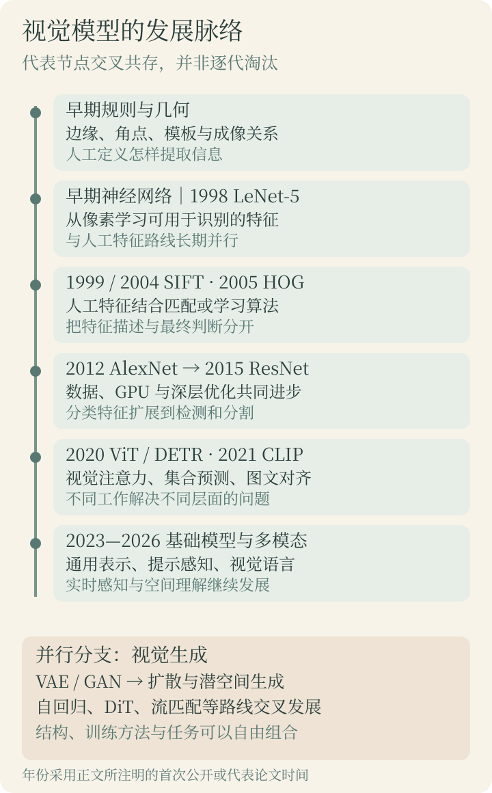
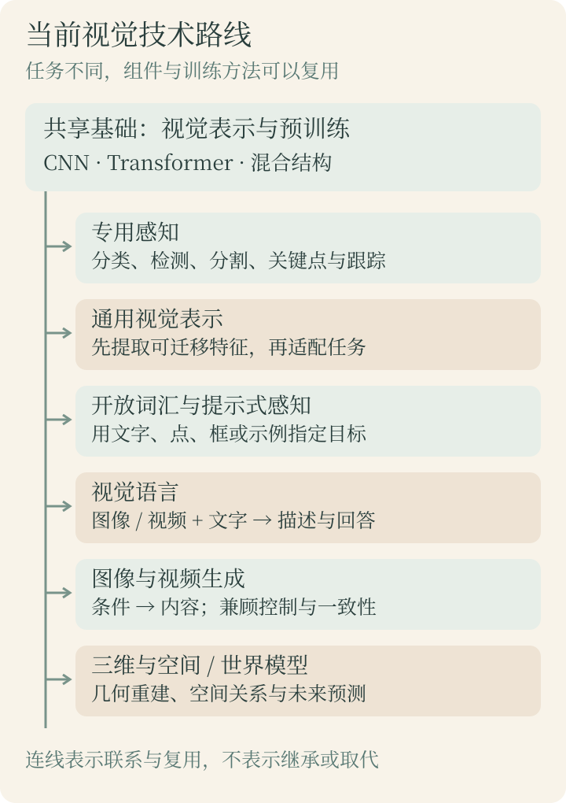

刚开始接触视觉模型时，最容易遇到的困难，往往不是公式，而是名字太多：MLP、CNN、ResNet、YOLO、ViT、CLIP、SAM、扩散模型、视觉大模型……它们有的描述网络结构，有的指一个模型家族，有的描述任务或训练方法。如果直接放在一起背，就很难知道它们是什么关系。

本篇先建立一张地图：视觉模型如何发展到今天，应该从哪些维度分类，当前又有哪些并行发展的方向。阅读不需要先掌握 Python、微积分或深度学习框架。后面的实验课会把这里出现的部分概念拆开，变成可以手算和运行的小模型。

> **资料核对日期：2026-10-18。** 历史年份区分预印本首次公开与会议发表；当前格局选择有论文或官方资料可核对的代表工作，包含 2025—2026 年的进展，不作为全量模型清单或性能排行榜。文中“成熟应用、活跃研究、探索方向”是帮助学习的归纳，同一方向内不同任务的成熟度可能相差很大。

## 1. 先从一张街景图片理解视觉任务

假设图片中有一辆汽车、两名行人和一段道路。像素只是数字，任务决定我们希望模型从数字中得到什么。

### 1.1 分类、检测与分割分别回答什么

**图像分类**关心整张图片的类别。例如把图片分为“街道、室内、森林”，或者判断裁剪出的一块区域是否有人脸。常见单标签分类输出各类别的分数，再选择一个类别；多标签分类则允许同一张图片同时包含“汽车”和“行人”。分类本身通常不告诉我们目标在哪里。

**目标检测**同时回答“是什么”和“在哪里”。输出可能是三个框：一个汽车框和两个人框，每个框带有类别和分数。框的位置通常用坐标表示。分数反映模型的判断强度，不应未经校准就被解释成现实中绝对准确的概率。

**语义分割**把类别分配到像素：这片是道路，那片是汽车，这些是行人。两个行人的像素都标记为“人”，不要求区分谁是谁。**实例分割**进一步区分“第一个人”和“第二个人”，分别给出各自的像素区域，也就是掩码。**全景分割**把这两种需求结合起来，既区分可数的目标实例，也标记道路、天空等背景区域。

因此，分割并不是“画得更精确的框”这么简单，它改变了输出的单位：从一张图、一个目标框，变成一个像素属于哪个区域。

| 任务 | 对这张街景的提问 | 典型输出 |
| --- | --- | --- |
| 图像分类 | 这是哪类场景？ | 场景类别及分数 |
| 目标检测 | 人和车分别在哪里？ | 框、类别、分数 |
| 语义分割 | 哪些像素是道路或行人？ | 像素级类别图 |
| 实例分割 | 两名行人各占哪些像素？ | 每个实例的掩码 |
| 关键点估计 | 行人的肩、肘、膝在哪里？ | 关键点坐标及可见性等信息 |
| 多目标跟踪 | 下一帧里哪个人还是刚才那个人？ | 跨帧目标身份与轨迹 |
| 深度估计 | 场景各处离相机有多远？ | 深度图，可能是相对深度 |
| 文字识别 | 路牌上写了什么？ | 文字内容，常配合文字区域检测 |
| 图像恢复 | 如何去噪、去模糊或提高分辨率？ | 恢复后的图片 |
| 图文检索 | 哪张图片符合“雨中的街道”？ | 匹配分数或检索结果 |
| 视觉问答 | 汽车前方有没有行人？ | 根据图片和问题给出的回答 |
| 图像与视频生成 | 按描述生成一段雨天街景 | 图片或视频 |

### 1.2 输入相同，输出和训练要求可以完全不同

对同一批街景，分类标注可能只需要一个场景名称；检测标注要画目标框；实例分割要描出每个目标的边界。任务变了，数据、输出层、训练目标和评价指标都会跟着变化。

还要区分**模型与系统**。一个门口人数统计系统可能先检测行人，再跟踪目标身份，最后通过过线规则计数。目标检测模型只承担其中一部分。一个文字识别系统也可能由文本检测、方向处理和文字识别多个模块组成。工程项目的名字不一定对应一个独立神经网络。

理解这些任务后，再看发展史就有了参照：技术变化究竟让哪类问题更容易解决了？

## 2. 从人工规则到学习特征：视觉模型的早期道路



图中的节点用于定位代表工作，不表示各阶段严格分隔，也不表示后来的方法会自动淘汰前面的技术。尤其要注意，神经网络和人工特征曾长期并行发展。

### 2.1 先由人告诉计算机应该看什么

早期视觉的一条重要思路，是先把问题写成明确的数学和几何规则。亮度突变可能对应边缘，两个方向都发生明显变化的位置可能是角点；已知相机成像关系后，可以利用多张图片中的对应点估计几何关系。

例如，在固定光照下识别白色背景中的黑色零件，可以先设一个亮度阈值，再找连通区域，最后比较面积和轮廓。这个过程没有必要从大量图片中训练一个网络。它的优点是计算过程明确，在受控条件下容易调试；困难在于，光照、姿态、背景一旦变化，原来的规则可能不再成立。

从这里可以理解“特征”：**把原始像素转换成更适合当前任务判断的信息**。边缘方向、局部纹理、区域形状都可以是特征。特征并不必然由神经网络产生，也不必然能被人直接命名。

### 2.2 人工特征加机器学习：把描述与判断分开

后来，一条有影响的路线是先用人工设计的方法提取特征，再让统计学习模型做判断。其典型流程是：

```text
图片 → 人工设计的特征提取 → 特征向量 → 学习得到的分类器 → 类别
```

SIFT 的早期工作发表于 1999 年，2004 年论文给出了广为引用的完整描述。它围绕局部关键点建立描述，支持在尺度和旋转变化下寻找对应关系，因此常出现在图像匹配与识别的历史中。[SIFT 作者资料](https://www.cs.ubc.ca/~lowe/keypoints/)

2005 年的 HOG 行人检测工作，用局部梯度方向的分布描述外形，并结合分类器区分行人与背景。可以粗略理解为：不去背每个像素的颜色，而去统计一块区域里轮廓主要朝什么方向。[HOG 原论文](https://www.cs.cmu.edu/~efros/courses/LBMV07/Papers/dalal-cvpr-05.pdf)

这里的分类器仍然需要学习。例如 SVM 会根据训练样本寻找分类边界。所以“深度学习以前全是手写判断规则”并不准确；一个主要区别是，特征表示有多少由人设计，有多少能随任务一起从数据中学习得到。

### 2.3 感知机、MLP 与早期 CNN：神经网络不是 2012 年才出现

神经网络的早期发展远早于深度学习热潮。为了理解后面的模型，这里先认识三个层次：单个神经元做加权计算；MLP，即多层感知机，把多个全连接层与非线性变换组合起来；CNN，即卷积神经网络，把局部连接和共享权重引入图像处理。

如果直接把一张图片展平成很长的向量，再接一个宽大的全连接层，参数量可能迅速增长，而且没有显式利用像素原来的邻接关系。卷积则让一组可学习参数在不同位置重复使用：同一种局部模式出现在左边或右边，都可以由同一组参数去响应。

1998 年介绍 LeNet-5 等系统的文档识别论文，已经展示了通过梯度训练卷积网络的实践。它说明“直接从像素学习”早有基础；后来发生的变化还包括训练数据、计算资源和训练方法的共同进步。[LeNet 相关原论文与作者页面](https://bottou.org/papers/lecun-98h)

本系列先讲 MLP，再讲 CNN，是为了逐步建立计算概念，并不代表现实历史严格经历了“所有人先用 MLP，随后一起换成 CNN”的整齐阶段。

## 3. 深度 CNN 为什么成为转折点

### 3.1 AlexNet：数据、计算与模型共同推动突破

2012 年 AlexNet 在 ImageNet 大规模图像识别竞赛中的表现，是视觉深度学习发展中的重要转折点。它把深层卷积网络、GPU 训练、ReLU、数据增强和正则化等实践结合起来，让从大量图片中学习特征的路线显示出明显优势。[AlexNet 原论文](https://proceedings.neurips.cc/paper/2012/hash/c399862d3b9d6b76c8436e924a68c45b-Abstract.html)

这里的关键变化，是特征提取和最终分类可以围绕同一个目标一起优化。早期层学习到的响应会影响后面的判断，而最终判断的误差又能反过来调整前面的参数。通常把这种整体训练称为端到端训练。

不能把这段历史简化成“某一年发明了卷积”或“只要网络更深就会更好”。如果数据很少、标注有问题、训练方法不合适，增加层数也可能没有帮助。

### 3.2 VGG、ResNet：更深的网络也需要更容易训练

VGG 的代表性贡献，是用较统一的小卷积核堆叠来研究网络深度的作用。它让深层 CNN 的结构更加容易看懂，但较大的模型也带来显著计算和存储成本。[VGG 原论文](https://arxiv.org/abs/1409.1556)

ResNet 的残差连接则针对深层网络的优化困难：一个模块可以学习相对于输入的改变量，再把输入沿捷径加回来。它为训练很深的网络提供了有效结构。ResNet 预印本公开于 2015 年，论文发表于 CVPR 2016，所以资料里会出现两个年份。[ResNet 原论文](https://arxiv.org/abs/1512.03385)

学习这一段时，记住“增加表示能力”和“使它能有效训练”是两件相互关联的事。残差连接并不是保证无限加深都能提升精度的魔法，也不只是一个孤立的防梯度消失技巧。

### 3.3 从整图分类走向目标框与像素

分类网络可以提取有用的视觉特征，但检测还要找位置。R-CNN 将候选区域与卷积特征结合，用区域级判断处理检测问题；后续方法不断减少重复计算并改进候选区域生成。YOLO 则以一次网络计算直接预测框和类别的方式推动实时检测。原始 YOLO 预印本在 2015 年公开，会议论文发表于 2016 年。[R-CNN 原论文](https://arxiv.org/abs/1311.2524)、[YOLO 原论文](https://arxiv.org/abs/1506.02640)

分割需要保留或恢复空间细节。FCN 将分类网络改造成输出空间预测的全卷积网络；U-Net 用编码与解码路径，并结合不同尺度的信息来进行精细分割。这里的难点是：抽象语义需要整合较大范围的信息，精确边界又需要局部细节。[FCN 原论文](https://arxiv.org/abs/1411.4038)、[U-Net 原论文](https://arxiv.org/abs/1505.04597)

于是模型开始呈现可复用的分工：前面提取特征的部分常称为**主干网络（backbone）**，后面产生任务输出的部分称为**任务头（head）**；某些模型中间还有融合多尺度特征的部分，常称为 neck。它们是结构角色，不是所有模型都必须遵循的固定三段式。

例如，ResNet 可以作为分类网络，也可以去掉原来的分类输出层，作为检测系统的主干。把“ResNet”和“目标检测”当作互斥选项，就混淆了结构与任务。

### 3.4 轻量化路线：精度之外，还有计算成本

模型进入手机、摄像头和嵌入式设备后，问题不再只是能否识别，还包括能否在给定的内存、功耗与延迟下持续工作。MobileNet 等工作通过更节省计算的卷积设计来应对这类限制。[MobileNet 原论文](https://arxiv.org/abs/1704.04861)

因此，发展史从来不只有“越来越大”一条线。增加能力和减少成本一直并行。后面学习 NPU 部署时，会看到模型的参数量、计算量、内存访问和硬件算子支持共同影响速度；论文里的理论运算量不能直接当成设备上的实际帧率。

## 4. Transformer、预训练与语言如何进入视觉

### 4.1 ViT：把图片变成一组可以交互的信息单元

ViT 将图片划分为图像块，把每块映射成向量，并加入位置信息后交给 Transformer。这里的 token 可以理解为模型处理的一个信息单元，它不一定是自然语言里的一个词。[ViT 原论文，2020 年预印本／ICLR 2021](https://arxiv.org/abs/2010.11929)

卷积通过共享局部计算利用空间结构；自注意力则根据输入计算不同单元之间的信息交互权重。这不意味着 CNN 完全看不到远处，也不意味着注意力权重就是人类理解中的“关注原因”。多层卷积可以扩大感受范围，而注意力的实现也可能受到窗口等限制。

ViT 的早期结果突出体现了大规模预训练的价值。Swin Transformer 进一步采用分层表示和移动窗口注意力，处理不同尺度及计算成本问题；DETR 则把 Transformer 和集合预测用于目标检测。它们分别涉及通用视觉结构与具体检测方法，不是同一个模型换了三个名字。[Swin 原论文](https://arxiv.org/abs/2103.14030)、[DETR 原论文](https://arxiv.org/abs/2005.12872)

CNN 也在继续演化。ConvNeXt 重新研究现代训练和设计条件下的卷积网络，说明卷积仍具有竞争力。更合理的认识是：卷积、注意力及混合结构针对不同数据、任务和硬件约束各有取舍。[ConvNeXt 原论文](https://arxiv.org/abs/2201.03545)

### 4.2 从每个任务单独训练，到先学通用表示

**预训练**是先在一批数据和目标上学习参数，再把这些参数用于后续任务；**微调**是继续训练其中一部分或全部参数，以适应新的数据或任务。它们描述训练过程，不是两种互斥网络结构。

例如，先在大规模图片上预训练一个编码器，再给它接一个零件缺陷分类头。可以冻结编码器，只训练新分类头；也可以解冻部分层进行微调。所谓“迁移”，是把已经学到的表示作为新任务的起点。

自监督学习进一步减少对逐张人工类别标注的依赖：从数据本身构造训练信号，例如遮住部分内容后学习预测，或让同一图片不同视图的表示保持适当一致。它依然有训练目标和损失，并不是说把图片放进去，模型就自动知道什么值得学习。

### 4.3 CLIP：用语言连接视觉概念

CLIP 的代表性思路，是用图像与文字的配对关系训练编码器，让匹配的图文表示更接近。之后可以用不同文字描述与图片比较相似度，而不必只依赖一个固定类别的分类输出层。[CLIP 原论文，2021](https://arxiv.org/abs/2103.00020)

这为零样本迁移和图文检索提供了重要基础。但“零样本”要结合协议理解，通常指没有使用目标任务的标注样本进行再训练，不代表模型从未训练过，更不代表它一定能可靠理解所有新概念。

CLIP 本身也不是一个聊天系统：它主要学习图文对应关系。把视觉编码器与语言生成模型进一步结合，并进行相应训练，才形成可以看图对话的一类视觉语言模型。两者有联系，但输出形式和训练目标不同。

## 5. 与识别并行的另一条历史：生成视觉内容

识别模型通常从图片中提取判断，生成模型则学习如何产生或恢复数据。两者共享很多网络组件，发展目标却不同。理解生成路线，才能知道“扩散模型”为什么不该与“CNN”直接并列比较。

### 5.1 从编码与重建，到学习数据分布

自编码器把输入压缩成潜在表示，再尝试重建输入。普通自编码器能重建，并不自动代表在潜在空间随意采样就能得到合理图片。VAE 在概率建模框架下处理潜在变量与生成，2013 年公开的相关工作是这一方向的重要节点。[VAE 原论文](https://arxiv.org/abs/1312.6114)

2014 年的 GAN 引入生成器与判别器的对抗训练：生成器尝试产生更像真实数据的样本，判别器尝试区分真实与生成样本。这里的“对抗”发生在训练目标之间；使用训练好的生成器时，不一定还需要判别器。[GAN 原论文](https://arxiv.org/abs/1406.2661)

自回归生成是另一种分解方式：按一定顺序预测下一个像素或视觉 token。它并没有因为扩散方法出现而失去研究价值。不同方法在训练、采样速度、细节和条件控制方面有不同取舍。

### 5.2 扩散、潜空间与 Transformer 可以组合

以 DDPM 为代表的扩散模型，通过与逐步加噪相对应的学习过程来生成样本。直观上可以先理解为学习如何从噪声逐步恢复结构；这只是入门描述，具体模型可能预测噪声、干净数据或其他参数化目标。[DDPM 原论文，2020](https://arxiv.org/abs/2006.11239)

潜空间扩散将生成过程移到压缩后的表示中，降低直接在高分辨率像素空间计算的成本，再由解码器恢复图像。文字、布局等条件可以参与生成过程。[潜空间扩散原论文，2021 年预印本／CVPR 2022](https://arxiv.org/abs/2112.10752)

DiT 展示了用 Transformer 作为扩散模型核心网络的路线；Flow Matching 则从学习概率路径上的向量场出发建立生成方法。它与扩散存在联系，但不宜把所有流匹配模型都简单叫作同一种去噪扩散模型。[DiT 原论文](https://arxiv.org/abs/2212.09748)、[Flow Matching 原论文](https://arxiv.org/abs/2210.02747)

至此可以拆成三个层面：**生成目标是做什么，扩散或流匹配是怎样建模与训练，CNN 或 Transformer 是由什么计算结构实现。** 一个系统完全可以同时包含视觉编码器、文本编码器、Transformer 生成网络和图像解码器。

## 6. 怎样给视觉模型分类，才不会越学越乱

### 6.1 四个维度需要分别问

| 分类维度 | 这个维度回答什么 | 常见类别或描述 |
| --- | --- | --- |
| 任务 | 希望得到什么结果？ | 分类、检测、分割、跟踪、恢复、生成、问答 |
| 网络结构 | 信息如何在网络中计算？ | MLP、CNN、Transformer、混合结构 |
| 学习方式 | 监督信号从哪里来？ | 监督、自监督、弱监督、半监督等 |
| 模态与能力范围 | 接收和输出什么，能迁移到哪些任务？ | 纯视觉、视觉语言、视觉语言动作；专用或可迁移模型 |

监督学习使用任务对应的标注，例如图片和类别、图片和框；半监督学习同时利用有标注和无标注数据；弱监督学习使用较弱、不完整或有噪声的监督。网络图文配对常被视为一种弱监督来源。自监督方法也可与这些训练阶段组合，因此一个模型的整个训练过程未必只有一个标签。

“判别式与生成式”又是建模目标上的区分：前者常用于预测输入对应的标签或属性，后者学习产生数据的分布或过程。现代系统可以同时承担理解与生成，不需要强行归入一个永不变化的盒子。

### 6.2 常见名字究竟属于哪一层

| 名称 | 首先应该把它理解成什么 | 容易混淆的地方 |
| --- | --- | --- |
| CNN | 以卷积为重要组成的网络结构类别 | 不等于图像分类任务 |
| ResNet | 使用残差结构的代表网络家族 | 可以充当检测或分割的主干 |
| ViT | 视觉 Transformer 的代表路线 | 不自动等于视觉语言模型 |
| YOLO | 起源于实时检测、不断扩展的模型家族与生态 | 不同团队的版本不能只凭数字比较 |
| U-Net | 编码与解码相配合、带跨层连接的结构 | 可用于分割，也可用于生成网络 |
| CLIP | 图文对齐的训练方法与模型 | 能比较图文不等于能生成回答 |
| DINOv3 | 自监督视觉表示模型 | 与检测领域同名相关工作的含义要区分 |
| SAM 系列 | 提示式分割及其扩展模型 | 不能把某一代的提示能力套到所有版本 |
| 扩散模型 | 生成建模路线 | 核心网络可以使用卷积或 Transformer |
| 视觉基础模型 | 强调可迁移、可复用的能力定位 | 不保证覆盖所有视觉任务 |
| 轻量化模型 | 强调资源与部署成本的描述 | 不属于与 CNN 平行的结构类别 |

“大模型”没有一个适用于所有视觉任务的统一参数门槛。“基础模型”更强调经过较广泛预训练后可适配多种用途，不能简单用参数量替代判断。一个只输出视觉特征的基础模型，可能既不会聊天，也不会生成图片。

### 6.3 用一句完整描述练习分类

例如：“这是一个采用 CNN 主干、通过带框数据监督训练、面向固定类别的轻量目标检测模型。”这句话分别交代了结构、学习方式、类别范围、成本定位和任务。

再例如：“这是一个使用 Transformer 的图像生成模型，通过流匹配训练，根据文字条件生成图片。”这里 Transformer 和流匹配能够同时出现，因为它们描述不同层面。

以后遇到新模型，可以先填写五个问题：**输入是什么，输出是什么，核心结构是什么，训练信号是什么，准备在哪里运行。** 如果论文摘要还不足以回答，继续查模型说明，而不是根据名字猜。

## 7. 当前格局：多条路线共同发展



这张图表达的是能力与组件之间的联系，不是严格的继承关系。下面的“当前”以开头的核对日期为准；选择代表工作是为了说明方向，并不表示它们各自是最新或最强版本。

### 7.1 专用感知：成熟应用仍在追求更好的精度与成本

固定类别分类、检测、分割和关键点估计，仍然是许多应用的直接组成部分。其需求通常很明确：在规定的画面与设备上，把少数任务稳定完成。相比能回答很多开放问题的系统，这类任务更容易定义输入、标注和误差标准，但换一个现场仍需重新验证。

实时检测内部也有不同技术路线。RT-DETR 把端到端 Transformer 检测推向实时场景；2026 年公开的 YOLO26 工作强调免 NMS 的推理和多任务支持，说明专用实时视觉仍在演化。NMS 即非极大值抑制，是许多传统检测流程中消除重复框的后处理步骤。[RT-DETR 原论文](https://arxiv.org/abs/2304.08069)、[YOLO26 原论文，2026-06](https://arxiv.org/abs/2606.03748)

读这类结果要核对硬件、输入尺寸、数值精度、批大小及是否包含前后处理。某篇论文在 GPU 上的毫秒数，不能直接拿来预测嵌入式 NPU 的速度。模型名字里的“实时”，也需要放回具体条件下理解。

### 7.2 通用视觉表示：先获得可复用的特征

这一方向的核心输出常常是向量或特征图。向量可以用来比较图片是否相似，空间特征可以交给后续分类、分割或深度等任务模块。

DINOv3 是 2025 年的代表工作之一，重点包括扩大自监督训练规模，以及保持高质量的稠密视觉特征。稠密表示强调保留多个空间位置的信息，而不只是给整张图一个向量。[DINOv3 原论文](https://arxiv.org/abs/2508.10104)

从使用角度看，这条路线允许先取得预训练编码器，再针对自己的任务训练较小的适配模块。它不等于无需数据：目标领域是否适配、特征是否保留了真正关心的细节，仍需要通过下游实验判断。

### 7.3 开放词汇与提示式感知：用提示指定目标

固定类别模型往往只能输出训练接口规定的类别；开放词汇方法尝试用文字描述等方式扩展可识别概念。例如输入“红色背包”，希望系统找到相关区域。Grounding DINO 是将语言与检测连接的代表工作。[Grounding DINO 原论文](https://arxiv.org/abs/2303.05499)

SAM 系列则需要按代际理解：原始 SAM 的常见公开使用方式是用点、框等提示获取掩码；SAM 2 将提示式分割扩展到图像和视频；SAM 3 进一步围绕文字概念或示例进行提示，在图像和视频中检测、分割和跟踪匹配实例。[SAM 原论文](https://arxiv.org/abs/2304.02643)、[SAM 2 原论文](https://arxiv.org/abs/2408.00714)、[SAM 3 原论文](https://arxiv.org/abs/2511.16719)

这条路线在交互式标注、搜索和编辑中很有吸引力，但开放词汇不表示开放世界的所有情况都已解决。模糊描述、罕见目标、小目标、遮挡和专业领域概念仍需要针对性评估。一个文字匹配能力强的系统，也未必有最精确的像素边界。

### 7.4 视觉语言模型：看图、读文档与理解视频

视觉语言模型常简称 VLM；当强调大语言模型作为核心组成时，也会看到 MLLM。可以先理解为把视觉信息送入能够处理语言的系统，使它根据图片、视频和文字完成问答、描述或其他任务。

Qwen3-VL 的技术报告展示了图像、视频与文字联合处理、多图及视频推理等方向，并提供不同规模的模型。它是理解这类系统的一份代表资料，不必先记住每种参数规模。[Qwen3-VL 技术报告](https://arxiv.org/abs/2511.21631)

这一方向的能力范围比单一分类器更广，评价也更复杂。回答通顺不代表图片证据充分；读懂路牌、数清小物体、判断相对位置和解释长视频，需要分别测试。如果任务最终需要精确坐标或稳定计数，还应检查模型输出是否真正满足要求。

文档理解也不是单纯把图片里的字读出来：它还可能需要保留表格关系、阅读顺序和图表含义。视频理解则增加了时间顺序，抽帧过稀可能漏掉关键动作，因此“能输入视频”和“完整理解所有时刻”不能直接画等号。

### 7.5 视觉生成：从单张图片走向可控编辑和视频

生成方向需要同时关心画质、条件一致性、可编辑性和计算成本。文字生成图片只是一个入口，局部修复、根据参考图保持主体、按布局控制内容，也都是不同的条件生成问题。

视频又增加了时间一致性：每帧单独好看，并不保证人物身份、物体数量、运动方向能够连续保持。Wan 的公开技术报告展示了基于视频表示与生成模型扩展的路线，可作为学习图像生成如何走向视频生成的代表资料。[Wan 技术报告](https://arxiv.org/abs/2503.20314)

扩散、流匹配和自回归等方法都在这一区域发展。不要因为“新方法出现”就推导“旧方法毫无用途”，也不要因为生成视频看起来真实就推导它已经准确掌握了物理规律。视觉逼真、条件遵从和物理一致是不同评价目标。

### 7.6 三维、空间与世界模型：从看到什么走向空间和变化

三维视觉需要处理相机、深度、对应点和空间结构。NeRF 与 3D Gaussian Splatting 推动了基于场景表示的新视角合成：从已有观测重建可渲染的表示，再生成其他视角的图像。它们首先服务于场景表示与渲染，不能直接等同于通用物体识别器。[NeRF 原论文](https://arxiv.org/abs/2003.08934)、[3D Gaussian Splatting 原论文](https://arxiv.org/abs/2308.04079)

VGGT 则展示了从一张或多张图片预测相机参数、深度、点图与点轨迹等几何信息的前馈模型方向。这说明视觉学习正在与传统几何问题更紧密结合。[VGGT 原论文，2025](https://arxiv.org/abs/2503.11651)

世界模型进一步关心状态怎样变化，尤其是动作发生后会看到什么。2026 年一项机器人世界模型工作，将动作对应的机器人运动与场景响应分开处理，利用渲染的机器人几何作为条件来预测后续观测。它提供的是一个研究例子，不能据此推导通用机器人预测已经成熟。[Robot-Factored World Models 原论文，2026-07](https://arxiv.org/abs/2607.22535)

视觉语言动作模型常简称 VLA，目标还包括根据观测和指令产生动作；世界模型则偏向预测状态或观测的演化。两者可以协作，但“输出动作”和“预测动作后果”不是同一件事。对于本系列，先认识这些边界即可，暂不展开机器人控制细节。

### 7.7 怎样理解成熟度，而不被新名字带着走

| 层次 | 可以怎样理解 | 学习时该关心什么 |
| --- | --- | --- |
| 已有成熟应用的任务 | 固定条件下的分类、检测、部分分割与 OCR 等 | 现场误差、数据覆盖、成本和维护 |
| 能力与工具快速扩展的方向 | 通用表示、开放词汇感知、视觉语言、可控生成 | 迁移表现、提示稳定性和可靠评测 |
| 仍有大量开放问题的目标 | 长时一致的世界预测、广泛环境下可靠空间推理与行动 | 实验边界、失败案例、跨场景泛化 |

这不是给整个模型家族打成熟或不成熟的标签。交互式分割可以非常实用，而完全自动、无遗漏地分割任意复杂场景仍很困难；生成短视频可以用于创作，却不能因此直接替代需要精确动力学的模拟器。成熟度要绑定具体任务和使用条件。

## 8. 今天为什么还要学习 MLP、CNN 和训练循环

看到基础模型和多模态进展后，容易觉得小网络已经没有学习价值。但复杂模型依然由参数、层、非线性变换和训练目标组成。只有知道输入怎样变成输出，才能判断问题出在数据、模型结构、训练还是部署。

MLP 提供最容易手算的入口：输入乘权重、加偏置、经过激活，再得到输出。CNN 引入图像空间结构，让我们理解局部计算、通道和特征图。训练循环解释参数如何根据误差更新。后面的模型规模和组件可以变化，这些问题仍然存在。

### 8.1 研究前沿与工程选择关注不同约束

假设需求是让摄像头判断固定区域是否有人。此时最先需要明确的是目标大小、夜间画面、遮挡、误报代价和延迟，而不是先挑参数最多的模型。一个任务匹配、可部署的小模型，可能比通用问答系统更适合这个接口。

如果需求变成“解释现场发生了什么，并根据自然语言找出异常片段”，任务范围就扩大了，视觉语言和视频理解路线会更相关。模型选择应由输入输出和约束推动，而不是仅按发布时间排序。

在 NPU 上还需检查实际计算图：某些算子是否支持，形状是否受限，量化后精度是否满足要求，预处理与训练约定是否一致。即使名称相同，不同导出配置与实现也可能导致不同部署结果。

### 8.2 怎样读性能指标

分类常看准确率，检测常看 AP 或 mAP，分割常看 IoU 或 mIoU。IoU 描述预测区域与真实区域交集相对于并集的比例；AP 综合不同阈值下精确率与召回率的关系；mAP 则按相应评测协议进行平均。具体阈值和平均维度必须看基准定义。

生成与问答任务还需要评价内容质量、条件遵从或答案正确性，不能直接用分类准确率一概而论。不同数据集、划分、输入分辨率、计算预算和训练数据下的数字，也不能因为都叫“精度”就横向比较。

看一个新模型时，至少保留三方面信息：**它声称解决什么问题，在什么条件下证明了效果，在自己的条件下还缺哪些验证。** 这比记住某一周的排行榜更有持续价值。

## 9. 把这张地图接入自己的学习路线

本系列主要围绕“图片分类的小模型”建立基础，再扩展到其他任务与部署。这只是整个视觉领域的一个入口，但输入表示、网络计算与训练方法具有复用价值。完整课程现已按 25 课整理；考虑到初学时术语较多，本篇调整为第 25 课回顾。全部课目现已开放网页阅读，可从[完整合集](/series/vision-learning/)按顺序进入；其中学习初稿仍需继续补齐实测。

| 阅读顺序 | 文章 | 在全景图中补上什么 |
| --- | --- | --- |
| 1 | 图片进入模型后发生了什么（草稿） | 先认识输入、模型计算与输出 |
| 2 | [Python 起步](/posts/vision-02-python-basics.html) | 能读懂和修改后续实验代码 |
| 3 | [从像素到张量的基础概念](/posts/vision-foundations-pixels-tensors.html) | 理解数据、形状、轴与存储 |
| 4 | [图片如何变成张量](/posts/vision-04-image-tensor.html) | 把图片接入模型输入 |
| 5 | [MLP 入门](/posts/vision-mlp-basics.html) | 理解参数、层、激活与前向计算 |
| 6 | [亲手搭建一个小型 CNN](/posts/vision-tiny-cnn.html) | 理解卷积、特征图与空间结构 |
| 7 | 模型怎样预测类别（草稿） | 区分分数、概率与决策 |
| 8 | 让模型开始学习（草稿） | 理解损失、梯度、参数更新与验证 |
| 9～15 | 数据划分、优化、真实分类、泛化、评估与保存（草稿） | 完成分类学习闭环 |
| 16～18 | ResNet、迁移学习与轻量化（草稿） | 理解成熟模型与资源成本 |
| 19～21 | 检测、分割与视觉 Transformer（草稿） | 扩展任务与网络结构 |
| 22～24 | ONNX、量化与部署验收（草稿） | 建立数值和系统验证流程 |
| 25 | 本篇：发展历史、主流分类与当前格局 | 回看技术之间的关系 |

完成这些基础后，可以按需求继续深入：关注摄像头与嵌入式应用，就深化检测、分割和设备部署；关注视觉语言，就继续学习图文对齐；关注生成，则学习潜在表示、概率建模和生成过程。草稿已覆盖表中的课程，但不代表所有真实数据、预训练权重与板端实验都已验证；具体以各篇说明为准。

第一次读完，不需要背下所有年份和缩写。可以尝试解释下面四个问题，再展开答案核对。

### 问题一：CNN、目标检测和监督学习可以同时描述一个模型吗

<details class="exercise-answer">
<summary>查看解释</summary>

可以。CNN 描述结构，目标检测描述任务，监督学习描述训练信号。一个使用 CNN 主干、根据人工目标框训练的检测器，可以同时满足三种描述。它们不是互斥的三种分类。

</details>

### 问题二：同一张图中两个人的像素都标成“人”，是否完成了实例分割

<details class="exercise-answer">
<summary>查看解释</summary>

还没有。如果没有区分两个人各自的身份，这只是语义层面的类别标记。实例分割还需要把属于第一个人和第二个人的像素分开。输出框也不能替代像素掩码。

</details>

### 问题三：一个模型使用 Transformer，就一定能看图聊天吗

<details class="exercise-answer">
<summary>查看解释</summary>

不一定。Transformer 是计算结构，可以用于分类、检测、生成或视觉表示。是否能看图聊天还取决于整个系统的模态连接、输出机制与训练过程。ViT 编码器本身并不自动获得语言回答能力。

</details>

### 问题四：2026 年还使用 CNN，是不是说明项目落后了

<details class="exercise-answer">
<summary>查看解释</summary>

不能这样判断。要看它是否满足任务精度、延迟、内存、功耗与维护要求，并与合适的替代方案比较。历史可以解释方法如何产生，工程选择则必须结合当前约束。较新结构值得评估，但发布时间不能代替实验结果。

</details>

## 10. 参考资料怎样读

正文已在相关论述旁链接原论文或作者资料。首次阅读不必逐篇精读，可以先看摘要、结构示意图、输入输出和实验设置，再按学习进度回到公式与代码。

若只选几份资料回顾主线，建议依次查看文中链接的 LeNet、AlexNet、ResNet、ViT、CLIP 与潜空间扩散：它们分别帮助理解早期卷积学习、深度视觉突破、深层优化、视觉注意力、图文对齐与生成计算方式。随后按兴趣阅读 DINOv3、SAM 3、Qwen3-VL、YOLO26 或 VGGT，比较它们回答的问题有何不同。

维护这篇概览时，历史部分主要修正史实和解释；当前格局部分则需要重新核对代表工作、适用范围与公开证据，并更新开头日期。一个新的版本号只有在帮助说明技术变化时，才值得加入这张地图。

## 配套代码练习

```experiment
practice
```

本篇已附独立实验包，在代码卡片中查看源码、下载或复制运行命令。解压后执行 `python3 main.py`；依赖安装见包内 `README.md`。

**观察目标：** 按任务得到分类与分割两组；同一分类任务包含 CNN 和 Transformer。

**动手修改：** 增加一个使用 Transformer 主干的分割模型和一个自监督预训练配置；说明为什么名称、任务、结构和训练方式不能混成一个分类轴。

所有输入均在本篇代码中构造；运行范围和验证记录见包内 `verification.md`。

## 继续学习嵌入式视觉进阶

完成本系列后，可进入[《嵌入式视觉模型进阶》](/series/edge-vision-advanced/)。30 课从轻量主干、多尺度检测走到目标跟踪、云台控制意图、人脸与 OCR，并通过计算图审查、模型压缩和综合回放完成学习闭环。优先学习第 01～18 课与第 28～30 课，再按项目选学其他专题。


