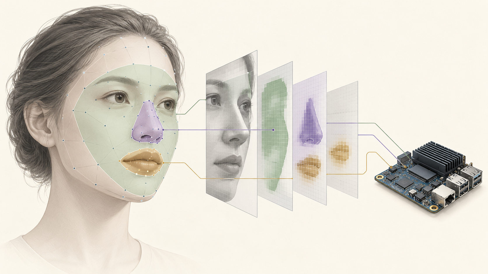
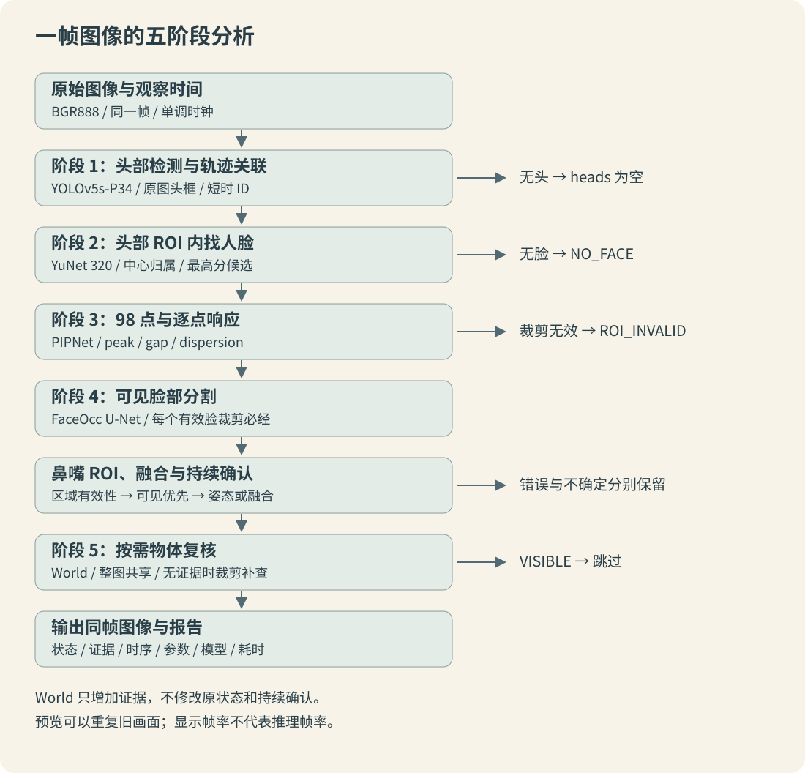

> 系列编排日期为 2026 年 8 月；正文依据 2026-10-12 核对的实现整理。历史实测保留真实日期，教学数字不代表实测；本次未重新执行板端推理。

## 系列目录

- [01 · 需求与判断边界](/posts/nose-mouth-occlusion-01.html)
- [02 · 方案探索与演进](/posts/nose-mouth-occlusion-02.html)
- [03 · 总体架构与完整时序](/posts/nose-mouth-occlusion-03.html)
- [04 · 图像预处理与坐标转换](/posts/nose-mouth-occlusion-04.html)
- [05 · 头部检测与YuNet](/posts/nose-mouth-occlusion-05.html)
- [06 · PIPNet98关键点与响应](/posts/nose-mouth-occlusion-06.html)
- [07 · FaceOcc分割与口鼻覆盖率](/posts/nose-mouth-occlusion-07.html)
- [08 · 姿态与几何分析](/posts/nose-mouth-occlusion-08.html)
- [09 · 多证据融合规则](/posts/nose-mouth-occlusion-09.html)
- [10 · 跟踪与持续确认](/posts/nose-mouth-occlusion-10.html)
- [11 · YOLO-World物体复核](/posts/nose-mouth-occlusion-11.html)
- [12 · 模型转换与海思部署](/posts/nose-mouth-occlusion-12.html)
- [13 · 板端运行与调试闭环](/posts/nose-mouth-occlusion-13.html)
- [14 · 测试评估与问题复盘](/posts/nose-mouth-occlusion-14.html)
- [A · 附录A-参数字典](/posts/nose-mouth-occlusion-a.html)
- [B · 附录B-状态与结果字段](/posts/nose-mouth-occlusion-b.html)
- [C · 附录C-模型与代码索引](/posts/nose-mouth-occlusion-c.html)
- [D · 附录D-完整教学样例](/posts/nose-mouth-occlusion-d.html)

## 先定义我们究竟在判断什么

口鼻遮挡分析的输入是一帧摄像头图像，输出应当包含对象、部位、证据、状态和持续情况。例如：“轨迹 7 的嘴部可见覆盖不足，关键点响应也可疑，连续观测已满足确认条件。”如果只输出一个红框，就无法区分没有找到脸、关键点漂移、分割异常和真正的局部遮挡。

本系列记录 Hi3516CV610 上的五模型级联：头部检测、YuNet、PIPNet98、FaceOcc U-Net、YOLO-World。核心策略标识为 `unet_first_then_response`。这里的“五阶段”按模型职责计数；几何计算、证据融合、跟踪和持续确认是配套后处理，并不是额外的神经网络。

封面是 AI 生成的概念插图，点位、绿色分割和处理器外观不代表真实推理结果或具体开发板。

## 系统问题与模型问题分开定义

业务关注嘴和鼻是否受到遮挡，但现成模型分别解决不同问题：检测器回答目标在哪，关键点模型回答五官位置，分割模型回答哪些像素像可见脸部，物体检测器回答附近有什么物体。把这些输出组合起来才形成工程判定。

| 问题 | 当前证据 | 不能直接推出的结论 |
| --- | --- | --- |
| 图像中是否存在头部 | 头部检测框与分数 | 人是否清醒、是否面向镜头 |
| 头部附近能否找到脸 | YuNet 检测结果 | 找不到脸就是口鼻遮挡 |
| 鼻嘴可能在什么位置 | PIPNet98 坐标及逐点响应 | 输出坐标就代表五官可见 |
| 鼻嘴 ROI 内有多少可见脸部像素 | FaceOcc 概率与区域覆盖率 | 低覆盖必然由手或口罩造成 |
| 附近是否存在可能遮挡的物体 | World 类别、检测框、分数、区域重叠 | 二维重叠就证明物体在脸前方 |
| 异常是否持续 | 短时轨迹与时间统计 | 已经触发了外部业务告警 |

“可见”是当前规则给出的图像分析状态，不是对呼吸、健康或睡眠状态的测量。侧向规则也没有床面检测和睡眠分类输入，不能将 `SIDE_*_SUSPECTED` 写成“已确认侧睡”。

## 从模型到判定的流程

头部检测先建立分析对象。每个头框在扩大后的区域中执行 YuNet；找到有效人脸后，PIPNet 和 U-Net 共用同一个人脸裁剪。先计算鼻嘴区域的有效性和分割覆盖率，再执行判定策略。完成持续统计之后，World 才对符合条件的对象添加物体证据。

当前规则有一个非常明确的优先级：鼻、嘴区域都有效，且各自覆盖率达到阈值，就输出 `VISIBLE`。侧脸、歪头、弱响应以及轮廓不完整，均不能否决这次放行。该取舍降低了姿态与响应波动导致的误判，但也意味着鼻嘴点漂到其他可见皮肤时可能误放行。

## 状态应当承载明确含义

| 情况 | 对外可解释的含义 |
| --- | --- |
| 没有头框 | 本帧没有形成头部分析对象，不构造一个虚假的正常人脸 |
| `NO_FACE` | 有头框，未找到符合选择条件的人脸 |
| `ROI_INVALID` | 找到脸，但人脸裁剪无法进入后续分析 |
| `UNCERTAIN` | 鼻嘴区域无效，或有效区域的证据冲突 |
| `VISIBLE` | 两个有效区域的可见覆盖均达到当前阈值 |
| `*_OCCLUSION_SUSPECT` | 对应部位低覆盖与弱响应一致 |
| `SIDE_*` / `POSE` | 几何代理规则发现侧向或倾斜形态 |
| `INFERENCE_ERROR` | 某个人头的模型运行、输出校验或后处理发生错误 |

帧级 `status=OK` 只表示外层流程完成，不能解释成所有人头均正常。每个 `heads[]` 仍可能包含 `NO_FACE` 或 `INFERENCE_ERROR`。`persistence.confirmed` 则是时间确认标记，不是与上述状态平级的模型分类。

## 阅读顺序与复现范围

先读前四章，建立问题、版本和坐标约定；第五至十一章讲算法与规则；第十二至十四章讲转换、运行和验证。四份附录用于查参数、字段、源码和教学样例。

本系列以整理时的本地源码为实现基线，日期按系列编排放在 2026 年 8 月。2026 年 9 月的转换与板端测试明确按实际日期引用，不能据此推断五阶段系统八月已经完成。

本文整理没有重新操作测试板。历史实测数据来自项目记录；教学数字不冒充实测；生产准确率仍缺少具有代表性的独立标注测试集。完整流程可被记录下来，但这三类证据需要始终分开。

## 本章核对入口

主流程见 `application/Apps/Stream/Src/Npu/Common/StreamNpuOcclusionProcessor.cpp`；决策入口为 `FaceOcclusionPolicy.cpp::evaluateFace()`；第五阶段为 `WorldOcclusionReview.cpp::run()`。模型、配置及源码指纹见附录 C。

---

[系列目录](/posts/nose-mouth-occlusion-01.html) · [下一篇：方案探索与演进](/posts/nose-mouth-occlusion-02.html)
