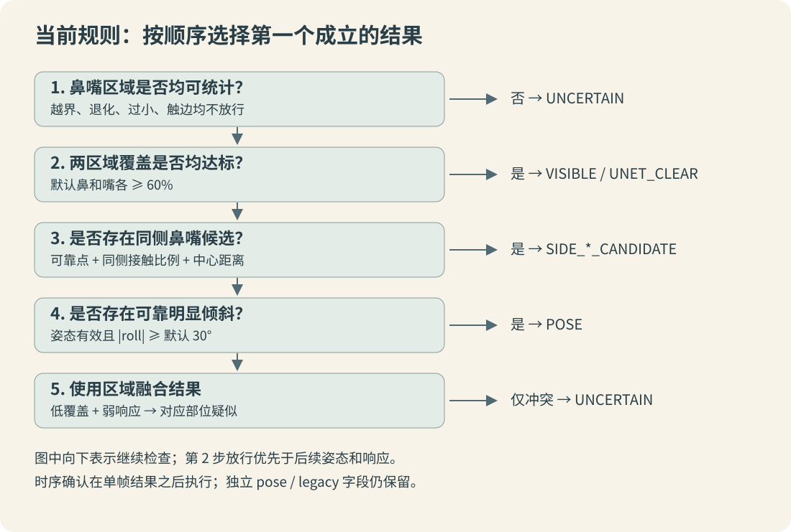

> 系列编排日期为 2026 年 8 月；正文依据 2026-10-12 核对的实现整理。历史实测保留真实日期，教学数字不代表实测；本次未重新执行板端推理。

[返回系列目录](/posts/nose-mouth-occlusion-01.html) · 本篇为 14 章＋4 份附录中的一篇。

## 把“规则融合”写成可检查的决策

当前规则不训练一个新的融合网络，而是将区域有效性、U-Net 覆盖、PIPNet 响应和姿态条件按固定优先级组合。要读懂结果，必须同时看条件与顺序。只列出阈值而不列分支顺序，无法重现同一状态。



## 第一步：验证鼻嘴区域

鼻、嘴分别拥有 `valid`、失败原因、覆盖率和平均概率。任何一个区域不能统计时，最终 `state=UNCERTAIN`、`decision_source=INVALID_REGION`。全脸裁剪有效并不保证局部 ROI 有效。

`unet_clearance.valid` 是两区域均有效，`unet_clearance.clear` 是两者均有效且覆盖达标。它们不是“U-Net 是否成功运行”的同义字段；执行成功可以得到无法放行的结果。

## 第二步：两区域覆盖均达标直接放行

当前默认鼻嘴阈值均为 0.6，比较使用 `>=`：

```python
# 教学伪代码：说明顺序，不替代生产实现。
if not (nose.valid and mouth.valid):
    state, source = "UNCERTAIN", "INVALID_REGION"
elif nose.visible >= nose_threshold and mouth.visible >= mouth_threshold:
    state, source = "VISIBLE", "UNET_CLEAR"
else:
    state, source = select_pose_or_fusion(), "FUSION"
```

覆盖充分的部位不会因为弱响应重新变成遮挡候选；其 `response_checked=false`。代码仍计算了逐点统计供诊断，这个字段表示响应是否参与本次区域判定，不表示 PIPNet 是否执行。

## 第三步：对低覆盖部位检查响应

| 部位覆盖 | 区域弱点比例 | 部位证据 |
| --- | --- | --- |
| 达标 | 任意 | 放行该部位，不由响应否决 |
| 不足 | 达到 `weak_fraction` | 低覆盖与弱响应一致，形成该部位疑似遮挡 |
| 不足 | 未达到 `weak_fraction` | 分割与响应冲突 |
| 无法统计 | 任意 | 区域无效，不进入正常覆盖判定 |

鼻嘴合成时，只要任一部位形成一致的遮挡候选，`segmentation_state` 就包含该部位。另一个部位即使证据冲突，也不会取消这个候选。两个部位都没有一致候选、但存在低覆盖冲突时，才得到 `UNCERTAIN`。

例如鼻覆盖 20% 且弱点 4/9，嘴覆盖 30% 但弱点 0/20：分割融合结果是 `NOSE_OCCLUSION_SUSPECT`，不能写成“两个部位都有冲突所以整体不确定”。嘴部冲突仍需要从指标中读取。

## 第四步：未放行时的姿态优先级

计算出 `segmentation_state` 后，当前 `selectState()` 依次选择：

1. 有同侧候选，输出 `SIDE_LEFT_CANDIDATE` 或 `SIDE_RIGHT_CANDIDATE`。
2. 否则，可靠姿态明显倾斜，输出 `POSE`。
3. 否则，使用前面的分割融合状态。

这一分流只发生在未被 U-Net 放行、且鼻嘴 ROI 有效时。低覆盖同时伴随侧向候选时，最终主状态可能是 SIDE，而不是 OCCLUSION；第五阶段按最终主状态触发，所以也不会只因为 `segmentation_state` 中存在遮挡就强制复核。

## 一张决策表贯穿所有分支

以下都是教学数据，鼻嘴阈值均为 60%，没有给定的几何条件视为不触发。

| 鼻/嘴 ROI | 鼻/嘴覆盖 | 鼻/嘴响应 | 额外条件 | 主状态 |
| --- | --- | --- | --- | --- |
| 均有效 | 90% / 85% | 均弱 | 侧向候选 | `VISIBLE` |
| 鼻无效 | — / 90% | 任意 | 无 | `UNCERTAIN` |
| 均有效 | 85% / 20% | 正常 / 弱 | 无 | `MOUTH_OCCLUSION_SUSPECT` |
| 均有效 | 20% / 85% | 弱 / 正常 | 无 | `NOSE_OCCLUSION_SUSPECT` |
| 均有效 | 20% / 20% | 均弱 | 无 | `NOSE+MOUTH_OCCLUSION_SUSPECT` |
| 均有效 | 85% / 20% | 均正常 | 无 | `UNCERTAIN` |
| 均有效 | 20% / 20% | 均弱 | 同侧候选 | `SIDE_*_CANDIDATE` |
| 均有效 | 85% / 20% | 正常 / 弱 | 可靠倾斜 | `POSE` |

## 为什么保留 old、pose 与 source

`legacy_state` 是旧规则对照，`pose_state` 是独立姿态观察，`decision_source` 是当前规则进入哪个大分支。一个结果完全可能同时是：`state=VISIBLE`、`pose_state=TILTED`、`legacy_state=POSE`、`decision_source=UNET_CLEAR`。这不是数据自相矛盾，而是不同字段承担不同职责。

持续时序处理在 `evaluateFace()` 之后，不会给 `legacy_state` 自动追加确认时间。因此不能拿一个时序确认后的主状态，与没有时序确认的旧状态直接统计优劣。

## 当前取舍与验证重点

这套规则优先减少可靠可见区域被姿态和弱响应否决的情况；它依赖鼻嘴定位具有足够语义正确性。区域几何有效只是“能统计”，没有证明“统计的就是嘴”。

至少要分别测试：高覆盖弱响应、低覆盖强响应、鼻嘴分别遮挡、一侧冲突一侧一致、贴边侧脸、张嘴、胡须阴影，以及关键点漂到脸颊。调一个阈值要同时观察放行率与误放行，不能只展示一个改善案例。

实现依据：`FaceOcclusionPolicy.cpp::segmentation()`、`selectState()`、`evaluateFace()`；回归入口见 `head_pipnet_unet/test_visible_priority.py`、`test_policy.py`。

---

[上一篇：姿态与几何分析](/posts/nose-mouth-occlusion-08.html) · [系列目录](/posts/nose-mouth-occlusion-01.html) · [下一篇：跟踪与持续确认](/posts/nose-mouth-occlusion-10.html)
