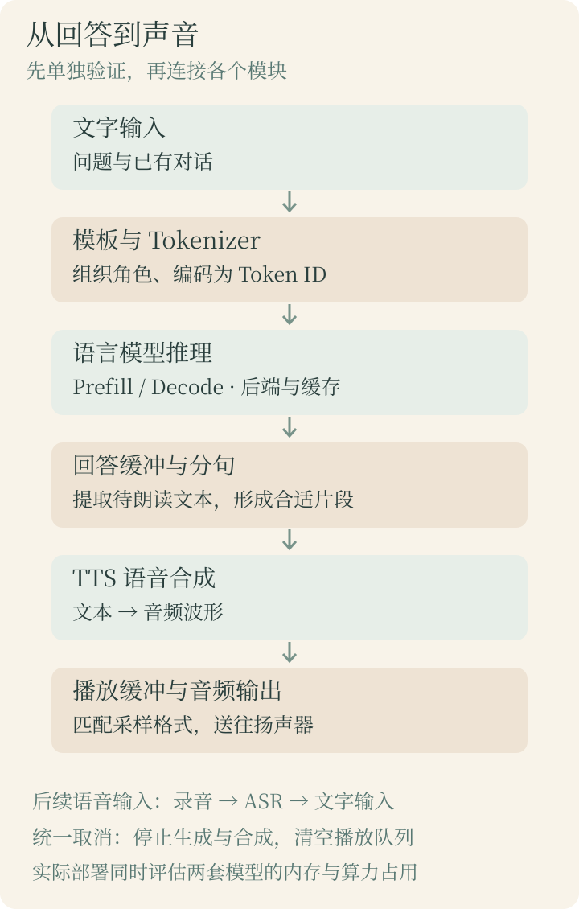
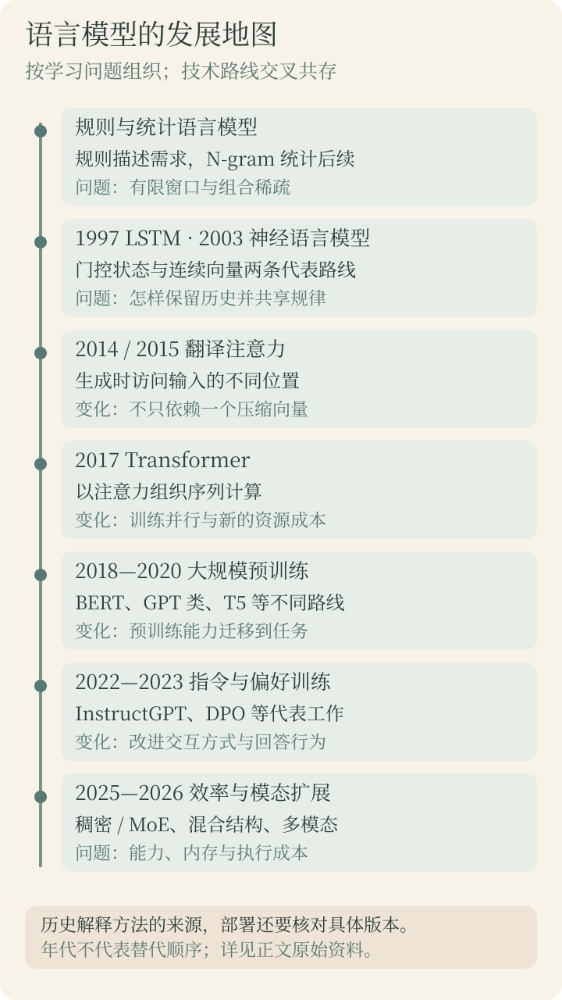

这个系列的目标，是把一个适合设备的大语言模型运行在板子上：输入问题，获得回答，再把回答转换成语音播放。为了做到这一点，需要理解模型怎样计算、资源消耗在哪里，以及硬件和工具链允许我们执行什么。

第一课先建立地图。像[视觉模型全景](/posts/vision-history-landscape.html)一样，我们从历史出发，理解各类方法为什么出现，再把常见名称放回各自的位置。阅读本篇不要求先掌握微积分，也不要求已经安装推理框架。

> **资料核对日期：2026-10-18。** 本文选择有原论文或官方资料支持的历史节点和当前代表路线，不做最新模型排行榜。历史中预印本公开与会议发表可能跨年；涉及具体板卡、模型和 Runtime 的支持范围，实际实验时还需按版本核对。

> **今天怎么读：** 第一次学习先读第 1～4 节，理解语言模型、早期发展、注意力和 Transformer，再做第 10 节的第一组思考题。第 5～9 节作为本篇后半课继续学习。第一天不需要背下所有缩写或推导注意力公式。

## 1. 先看最终目标：回答问题，然后播放语音

我们先实现的系统可以拆成三个部分：语言模型生成文本、语音合成模型生成音频、播放程序把音频送到扬声器。



| 部分 | 输入与输出 | 它负责什么 |
| --- | --- | --- |
| 语言模型 | 文字上下文 → 回答文本 | 根据输入生成内容 |
| TTS，文字转语音 | 待朗读文本 → 音频波形 | 把文本转换成可听的声音 |
| 音频播放 | PCM 等音频数据 → 声音 | 缓冲、设备输出与播放控制 |
| ASR，自动语音识别 | 录音 → 文字 | 以后增加语音输入时再接入 |

普通文本语言模型输出的字符串不能直接送进扬声器。TTS 也不会自动代替音频设备驱动和播放队列。即使一个多模态系统整合了其中几项能力，工程上仍然需要知道数据如何流动。

我们的第一阶段是文字输入，所以暂时不需要先学习麦克风阵列、语音唤醒和 ASR。先把各部分单独跑通，再连起来，出问题时才容易判断是哪一个环节。

## 2. 语言模型究竟在预测什么

### 2.1 从一句没写完的话开始

看到“请把房间的灯”，人可能接“打开”，也可能接“关掉”。上下文改变，合理的后续内容也会改变。语言模型的一项基本任务，就是对序列以及给定上下文的后续内容建立概率模型。

对本系列重点学习的自回归文本生成模型，可以先用一句话描述：**根据已有 Token，预测下一个 Token 的分布，再按生成策略选出一个，接回上下文，继续预测。**

```text
输入上下文 → 模型计算 → 下一个 Token 的分数
                        ↓
                  生成策略选择
                        ↓
              接到上下文中，继续计算
```

这不等于每次只看前一个字。模型可以利用当前上下文窗口内的许多位置。也不意味着每一步都必须选择最高分候选：可以采用贪心选择，也可以按经过调整的分布采样。生成在遇到停止条件、结束标记或长度上限时结束。

后面会看到，某些加速技术能一次验证多个候选 Token；这里先学习逐步生成的逻辑基线，而不是把所有实现都理解成完全相同的循环。

### 2.2 Token 不是固定的一个汉字或一个英文单词

模型通常不直接计算屏幕上的字符，而是先用 Tokenizer 将文字转换成一串整数 ID。词表为这些 ID 赋予对应的文本片段或特殊含义。

一个 Token 可能对应一个字、一段词、标点、字节片段或特殊标记；具体划分取决于 Tokenizer。不能只数汉字就得到准确的上下文长度，也不能把一个模型的 Token ID 直接交给另一套不匹配的词表。

为了理解过程，可以先使用下面的示意：

```text
文字 → Tokenizer → [若干 Token ID]
                     ↓
                 Embedding
                     ↓
                一组数字向量
```

这里没有给出假装来自千问的具体 ID。实际分词结果在[下一课的本地输入检查实验](/posts/llm-02-local-inference.html)中，通过模型服务对应的 Tokenizer 打印验证。**ID 是编号，Embedding 才是模型使用的向量表示。** 编号 100 并不表示比编号 50 的词“重要两倍”。

### 2.3 为什么预测后续内容可以用于回答问题

问答、翻译、摘要和代码，都可以组织成一个上下文加后续文本的形式。例如把问题和助手角色标记放进上下文，期望后续生成回答。在训练中，模型通过大量样本学习统计关联、结构和任务模式，再经过相应训练提高指令遵从能力。

但“预测目标很简单”不等于模型内部只是一张短语查找表，也不等于它给出的内容必然正确。生成目标与事实核验是不同事情；一段通顺回答可能仍包含错误。所以我们的部署验收不能只看它是否能不断输出文字，还要用任务样例检查内容。

并非所有语言模型都以自由续写为主要使用方式。后面介绍的 BERT 类模型就有不同的训练目标和典型用途；本节主要描述即将用于对话生成的自回归路线。

## 3. 早期历史：怎样表示上下文



图中按学习问题组织节点，不表示每一项都在上一项之后才出现。LSTM 的代表论文发表于 1997 年，早于这里列出的 2003 年前馈神经语言模型；这些技术曾并行发展。

### 3.1 规则系统与统计语言模型

早期语言处理可以用词典、语法规则和模板组织。例如在限定命令中匹配“打开灯”，就执行相应动作。这类系统在封闭需求下很直接，但表达一旦变化，往往需要补规则。

统计语言模型则从语料中估计序列出现的规律。以 N-gram 为例，预测后续内容时，只保留有限长度的历史。二元模型近似只看前一个单位，三元模型近似看前两个单位。这里的单位可以是词或其他符号，取决于系统设计。

用一个人为构造的小语料说明：假设“打开”后面出现“灯”8 次、“门”2 次，那么最朴素的计数估计会给这两个后续分别分配 0.8 和 0.2。这只是教学统计，不是实际汉语的概率，也没有处理未出现的候选。

当上下文变长，可能组合的数量迅速增加，很多组合在语料中一次都没有出现。平滑、回退等方法可以缓解稀疏问题，但仍需要在上下文长度和统计可靠性之间取舍。一个远处出现的主语或限制条件，也可能落在固定窗口之外。

这段历史提出了后面的核心问题：能不能让相似上下文共享信息，而不必为每一种组合都单独积累足够计数？

### 3.2 神经语言模型：用向量共享统计规律

2003 年的神经概率语言模型工作，将词映射到连续向量，并用神经网络预测后续词。可学习表示帮助模型在没有见过的词组合上进行泛化，而不只依靠完全相同组合的频数。[Bengio 等，神经概率语言模型原论文](https://jmlr.org/papers/v3/bengio03a.html)

可以把区别理解成：原来许多判断依赖离散的词和计数，现在增加了一个能随训练调整的向量空间。词的表示不必由人逐一手工定义。但向量的每个分量通常没有“第一维是情绪、第二维是颜色”这样的固定含义。

这与视觉模型从人工特征走向学习特征有相似之处：表示本身成为优化对象。它也解释了为什么先学过 MLP 有帮助——Embedding 后面的计算仍然可以包含矩阵乘法、偏置和非线性变换。

### 3.3 RNN：用状态传递历史

循环神经网络 RNN 按顺序读取输入，每读一个位置，就结合旧状态和当前输入得到新状态。可以把状态理解为一份不断更新的摘要，但它是由模型学习得到的数字表示，不是人写出的文字总结。

```text
当前输入 + 上一步状态 → 新状态 → 后续输出
```

相比固定长度的输入窗口，递归状态提供了传递历史信息的途径。然而，普通 RNN 在学习长距离依赖时会遇到优化困难，状态容量也有限；逐步更新还限制了序列方向的并行处理。

LSTM，即长短期记忆网络，通过门控机制管理信息的写入、保留与输出，改善长期信息学习。1997 年的工作是这一方向的重要节点。它并不保证无限长度的所有信息都能无损保存。[LSTM 作者机构的论文目录](https://www.jku.at/institut-fuer-machine-learning/forschung/publikationen/older/)

### 3.4 编码器与解码器：先读输入，再生成输出

在翻译中，输入句子和输出句子可能长度不同。编码器负责表示源句，解码器根据这些信息生成目标句子，这就是一种编码器—解码器分工。

早期某些模型试图把整个输入压缩进一个固定长度向量。句子变长后，重要细节可能难以保留。需要注意，这只是特定设计的问题，不能据此说所有编码器—解码器结构都只有一个固定向量接口。

注意力机制的一项关键改进，就是让生成过程能按需要访问输入不同位置的信息，而不是只依赖一个压缩结果。

## 4. 注意力与 Transformer 改变了什么

### 4.1 注意力：生成当前位置时，按需要汇总输入

Bahdanau 等人的神经翻译工作在 2014 年公开、发表于 ICLR 2015，利用软对齐让解码过程选择与当前输出相关的输入信息。这是理解注意力历史的代表节点。[注意力翻译原论文](https://arxiv.org/abs/1409.0473)

直观上，每生成一个位置，都可以对源句不同位置计算权重，然后汇总表示。权重来自模型计算，随着输入和当前状态变化；它不是人提前规定“翻译第一个词就只看第一个词”。

当信息交互发生在同一序列内部时，常称为自注意力；当一组表示访问另一组表示时，常称为交叉注意力。Q、K、V 是注意力计算中不同角色的向量，下一阶段会用小矩阵解释，第一课只需知道它们不是三个独立聊天模型。

### 4.2 2017 年的 Transformer

Transformer 原论文用注意力机制构建序列转换网络，替代主要依赖循环的设计。原始模型同时有编码器与解码器，面向机器翻译，并不等同于今天所有聊天模型的完整结构。[Attention Is All You Need](https://arxiv.org/abs/1706.03762)

在训练时，目标文本已经给定，可以通过掩码组织多个位置的预测，利用并行计算。对于标准自回归生成，未知的后续 Token 仍依赖之前的生成结果，因此不能推导出“Transformer 聊天时能一次无条件算出全部答案”。

初学时可以先认识一个典型模块的几项组成：

| 组成 | 第一课先理解的作用 |
| --- | --- |
| 注意力 | 在不同位置之间交换和汇总信息 |
| 前馈网络 | 对每个位置的表示进一步变换 |
| 残差连接 | 保留输入通路，帮助信息和梯度传播 |
| 归一化 | 调整数值尺度，配合稳定训练与计算 |
| 位置信息 | 让模型区分序列中不同位置和顺序 |

这些是结构角色，不代表所有新模型都使用相同的排列和实现。后面读具体千问模型配置时，还会遇到不同归一化、位置编码和注意力形式。

### 4.3 Transformer 也有资源成本

标准全注意力需要考虑序列位置间的关系，长序列会增加计算负担。推理时为了避免重复计算历史位置的部分信息，通常会保存 Key 和 Value，也就是 KV Cache。

因此，长上下文能力不只是模型说明中的一个数字，还涉及运行时内存、计算和缓存管理。优化注意力、共享部分 K/V、使用不同缓存策略，以及发展混合结构，都是后续效率路线的一部分。例如 GQA 通过分组共享键和值来折中多头与多查询注意力的特点。[GQA 原论文](https://arxiv.org/abs/2305.13245)

本课先记住：**上下文窗口是可以处理的范围约束，不是运行起来免费的记忆容量。** 权重与缓存也不是同一种数据；权重在普通推理中不更新，缓存则随当前输入与生成过程变化。

## 5. 从预训练模型到会对话的模型

### 5.1 预训练：先获得可迁移的能力

预训练是先用较大规模的数据和目标学习参数，再把结果用于后续任务。不同模型的预训练目标并不相同：因果语言模型学习预测后续 Token，掩码语言模型学习根据上下文恢复被遮住的内容，其他模型还可以采用去噪等目标。

2018 年公开的 BERT 使用双向上下文学习语言表示，之后适配分类、问答等任务；它的典型使用方式与逐 Token 自由生成不同。GPT 类工作突出自回归生成与迁移，2020 年 GPT-3 的工作则展示了在提示中给出任务描述或少量示例的能力。T5 将多种文本任务统一成文本到文本形式。[BERT 原论文](https://arxiv.org/abs/1810.04805)、[GPT-3 原论文](https://arxiv.org/abs/2005.14165)、[T5 原论文](https://arxiv.org/abs/1910.10683)

**在提示中给例子通常不等于训练权重。** 模型可以利用上下文中的示范生成结果，而参数保持不变。真正的微调则通过优化过程更新一部分或全部可训练参数。

### 5.2 为什么基础模型不一定是好的聊天助手

基础模型已经学会大量语言模式，但对一段“问题：……”的输入，它可能继续补写题目、模仿某种文档，或产生与期望不同的续写。用户则希望它按照指令回答，并区分对话角色。

监督微调常简称 SFT，可以用指令与回答等示例进一步训练，让模型学习期望的交互形式。它仍然需要实际的数据和优化过程，不是简单在模型文件名后面加上 Instruct。

偏好对齐进一步利用对回答优劣的反馈来调整行为。2022 年 InstructGPT 的工作包含示范数据、偏好反馈与强化学习步骤；2023 年的 DPO 则提供了直接利用偏好数据优化的方法。后训练并不只有一条固定流程，也不必每个模型都使用同样的 RLHF 配方。[InstructGPT 原论文](https://arxiv.org/abs/2203.02155)、[DPO 原论文](https://arxiv.org/abs/2305.18290)

对齐可以改善指令遵从等表现，但不意味着模型自动获得事实保证。部署时仍需检查任务正确率、格式要求和失败案例。

### 5.3 聊天模板是模型输入的一部分

应用中的消息可能写成“角色 + 内容”，模型最终接收的仍是一段按特定规则组织的 Token 序列。聊天模板规定如何插入角色、分隔符、结束标记以及助手开始生成的位置。

同样的文字，模板不匹配可能导致模型续写用户消息、重复角色标记或停止异常。不能随意把所有轮次直接拼成一个字符串，也不能假设同一品牌各模型都使用同一套特殊标记。[Transformers 聊天模板官方说明](https://huggingface.co/docs/transformers/chat_templating)

这也是为什么移植时要连同配置、Tokenizer 和生成约定一起保存。一个权重文件通常不能独立说明完整的应用接口。

## 6. 当前有哪些主要分类

分类的目的，是帮助判断模型能做什么、怎样运行。下面几个维度需要分别看，不能把“MoE、聊天模型、量化模型”当成同一层的互斥选项。

### 6.1 按整体结构分类

| 结构 | 典型认识 | 部署时关注什么 |
| --- | --- | --- |
| 仅编码器 | BERT 类表示模型，常适配分类、匹配等任务 | 输出是否是特征或任务结果 |
| 仅解码器 | 许多自回归文本生成模型采用的路线 | 逐步生成、缓存与停止条件 |
| 编码器—解码器 | T5 等输入到输出转换路线 | 两部分计算与交叉注意力 |
| 混合结构 | 结合不同序列建模机制 | 算子、状态与缓存是否受支持 |

“Decoder-only”不等于把原始 Transformer 解码器原封不动搬过来。具体模型会改变模块细节，也不一定保留面向独立编码器的交叉注意力。

2026 年 Qwen3.5 的官方发布资料强调混合架构与原生多模态方向。这提醒我们：即使都叫千问，也不能假设新旧代际具有完全相同的算子图和缓存结构。[Qwen3.5 官方发布说明](https://qwen.ai/blog?id=qwen3.5)

### 6.2 按参数参与计算的方式分类

**稠密模型**在常见的每 Token 前向路径上使用其大部分相关网络模块；**混合专家模型 MoE**会通过路由机制选择部分专家参与计算，同时还有共享模块。

MoE 的激活参数量与总参数量是不同概念。减少每 Token 参与的专家计算，不意味着其他专家权重在存储和部署上不存在。权重如何驻留或换入、路由是否高效，都需要运行时支持。

Qwen3 的技术报告同时介绍稠密与 MoE 模型，并讨论思考与非思考模式。它是理解这些维度如何组合的一个代表，而不是所有千问模型的统一配置表。[Qwen3 技术报告](https://arxiv.org/abs/2505.09388)

例如，“小规模稠密指令模型”和“较大总参数量的 MoE 推理模型”可能都能聊天，但对内存、计算和后端的要求有很大差别。不能只比较宣传中的激活参数数字。

### 6.3 按训练用途、模态和计算预算分类

| 维度 | 常见描述 | 应避免的误解 |
| --- | --- | --- |
| 训练阶段与用途 | Base、Instruct、Chat | Base 不自动等于开箱即用的助手 |
| 能力侧重 | 通用、代码、数学、推理等 | 名称不是任务正确性的保证 |
| 模态 | 文本、视觉语言、语音、多模态 | 文本输出不自动具有音频输出能力 |
| 推理行为 | 思考、非思考或可切换模式 | 模式、模板与预算依模型而异 |
| 数值表示 | FP16、BF16、各种低比特量化 | 相同位数不代表相同文件和内核 |
| 资源定位 | 云端、高性能本地、端侧 | 没有跨所有设备统一的“小模型”门槛 |

生成更长的中间推理序列可能增加时间和缓存开销，不能只用最终回答长度估算延迟。如果模型提供独立的思考与回答字段，后续语音播放还应按接口提取真正待朗读的回答内容。

当前值得关注的方向包括更有效的后训练、多模态连接、长上下文、稀疏与混合结构，以及量化和推理运行时优化。这些方向不是简单竞争同一个“最大模型”称号，而是在能力、成本和接口之间做不同取舍。

## 7. 从一个模型名字走到板端运行，还缺哪些东西

### 7.1 模型、文件、框架和硬件分别是什么

| 名称 | 在系统中的位置 | 可以怎样理解 |
| --- | --- | --- |
| 千问某个具体模型 | 网络结构、参数及相关约定 | 要执行的计算和学到的参数 |
| 权重与配置文件 | 参数和结构描述的存储 | 不是可直接由 CPU 执行的程序 |
| Tokenizer 与聊天模板 | 文本接口 | 决定文字如何编码与组织 |
| GGUF 等模型文件格式 | 权重及元数据的容器 | 格式支持不等于所有结构都支持 |
| llama.cpp 等推理框架 | 加载、调度、缓存与生成 | 把模型计算组织成可执行流程 |
| CPU/GPU/NPU 后端 | 具体计算实现 | 决定运算在哪里、怎样执行 |
| 驱动与 Runtime | 硬件运行接口 | 必须与工具链和设备兼容 |

llama.cpp 提供 C/C++ 推理、量化和多种计算后端；RKLLM 则提供面向其支持平台的转换与运行接口。使用哪条路线，要看具体芯片、模型结构和版本支持，不能因为有 NPU 就默认所有模型都能交给它。[llama.cpp 官方仓库](https://github.com/ggml-org/llama.cpp)、[RKLLM 官方仓库](https://github.com/airockchip/rknn-llm)

本课不指定板卡型号，也不提供未经目标硬件验证的下载与转换命令。真正进入实验时，需要先固定模型完整名称、版本、量化格式、板卡内存以及 SDK 和驱动版本，建立可复现的基线。

### 7.2 推理分成 Prefill 与 Decode

对使用 KV Cache 的典型自回归 Transformer，**Prefill** 先处理已有提示词，建立相应缓存并获得下一步预测；**Decode** 在生成过程中逐步计算后续 Token，并更新缓存。

首 Token 延迟可能包含排队、分词、Prefill 等过程，冷启动时还可能包含模型加载。因此报告性能时，需要注明是冷启动还是模型已经加载。生成速度则常用 Token/s，但它不能直接换算成固定的汉字每秒。

长输入主要增加提示处理负担；长输出需要更多生成步骤。模型不同，缓存策略和瓶颈也会变化，混合结构还可能包含非传统 KV 的状态，不能把一个缓存公式套到所有模型。

### 7.3 模型装得下，不等于运行内存足够

先只估算权重的理想存储量：

```text
权重字节数 ≈ 参数数量 × 每参数位数 ÷ 8

1B 参数、理想 4 bit：约 0.5 GB
3B 参数、理想 4 bit：约 1.5 GB
```

这里 B 表示十亿参数，GB 按十进制计算。实际量化还有分组尺度等元数据，部分张量也可能保留更高精度。运行时还要加入缓存、激活、临时工作区、框架与操作系统的占用；有些后端还会重排或复制权重。

因此，不能看到模型文件 1.5 GB，就认定一块 2 GB 板子必然够用。后面还要接 TTS，两套模型是否同时驻留，也会改变峰值内存与响应时间。

量化能降低存储与部分计算开销，但速度依赖实际内核和硬件。低位数文件更小，不保证反量化、搬移及计算的总时间更短；量化后还需检查任务质量。

### 7.4 NPU 算子不支持时怎样判断

先区分导出表达、算子版本、数据类型、形状与真正的硬件能力缺口。一个 RMSNorm 复合运算可能可以拆成受支持的基础运算；一个动态长度问题可能需要使用厂商支持的固定配置或分桶；关键状态更新不支持则可能牵涉整个运行时。

等价改写应保持计算含义，并检查中间张量和最终输出误差。直接把归一化、注意力或激活换成另一种结构，已经改变了模型，不能只因为转换通过就认为结果正确。

部分框架支持把子图分配给专用后端，剩余运算由 CPU 执行，例如 ONNX Runtime 的执行提供程序机制。但前提是存在对应硬件集成、可执行的 CPU 算子以及正确的数据交换路径，厂商整图编译器并不会自动获得这种回退能力。[ONNX Runtime 架构说明](https://onnxruntime.ai/docs/reference/high-level-design.html)

如果每层、每个 Token 都发生 CPU 与 NPU 来回切换，计算同步和数据转换可能抵消加速收益。后面学习的目标是能定位并测量这些问题；自行开发 NPU 内核属于进阶，不是今天的前置要求。

## 8. 语音模型需要学多深

### 8.1 把 TTS 当成独立的部署任务

文字转语音的输入是待朗读文本，输出最终需要落到音频波形。有些路线先生成声学表示，再用声码器产生波形；其他路线可能生成离散语音 Token，再通过解码器重建音频。不要认为所有 TTS 都有完全相同的模块边界。

2026 年 Qwen3-TTS 的技术报告给出了多语言、可控与流式语音合成的代表路线。它说明语音生成也在使用语言模型与语音编码技术，但并不意味着选择千问文本模型后，就必须选择同品牌 TTS，也不代表它适合任意小内存板卡。[Qwen3-TTS 技术报告](https://arxiv.org/abs/2601.15621)

第一阶段优先实现固定声音朗读中文，不需要先训练 TTS 或做声音克隆。模型选择应结合中文发音质量、资源成本、许可证和目标后端支持。

### 8.2 应该掌握的音频基础

采样率描述每秒包含多少个采样点，声道数描述同时有几路信号，采样格式描述每个采样怎样存储。PCM 是音频采样数据的一种表示；WAV 是容器，可以包含常见的 PCM 数据，也并非只允许一种编码。

例如，假设音频是 24 kHz、单声道、16 位整数 PCM，那么一秒采样数据约为：

```text
24,000 × 1 × 2 = 48,000 字节
```

这只是一个格式计算示例，不是在规定所有 TTS 的输出。若把 24 kHz 音频错误地按 48 kHz 播放，会改变播放速度和音调；需要按模型输出配置设备，必要时正确重采样。

板端先播放一段已知格式的 WAV，可以把声卡、输出通路和模型问题分开验证。音频设备工作正常之后，再接入合成模型。

### 8.3 中文文本处理与流式播放需要重点学习

“温度 23.5℃”“2026-10-18”“设备 IP 为 192.168.1.10”不能都按同一种数字读法处理。TTS 前端需要处理文本规范化、缩写、多音字、标点和中英文混读。具体由模型还是外围程序完成，要看模型接口。

语言模型逐步输出，不代表每个 Token 都适合立即交给 TTS。过短的片段可能拆断词语，语调也缺少后续上下文。可以先按句子或适当片段缓冲，等一个语义和发音较完整的单位形成，再启动合成；等待策略需要兼顾首段延迟与听感。

工程上还要处理队列：合成比播放快时不能无限积压，合成比播放慢时可能断音；取消时需要停止生成和合成，并清空旧音频队列。进入多轮对话后，还应避免上一轮剩余声音混进新回答。

语音合成常用实时率 RTF，即合成耗时除以生成音频时长。例如用 2 秒合成 5 秒声音，RTF 为 0.4。RTF 小于 1 有助于持续播放，但单次平均值不能证明首包延迟足够低，也不能保证每个音频块都不会迟到。

## 9. 我们要学到哪里，再开始板端实验

### 9.1 必须理解、能够操作与暂缓深入

| 程度 | 内容 | 具备能力的表现 |
| --- | --- | --- |
| 必须理解 | Token、Embedding、注意力、训练与推理 | 能讲清文字到预测的基本链路 |
| 必须理解 | Prefill、Decode、缓存、量化、聊天模板 | 能解释耗时、内存和输出异常 |
| 能够操作 | 加载模型、设置上下文与生成参数 | 在 PC 上建立稳定基线 |
| 能够操作 | 转换、编译、部署、后端验证 | 在指定板上完成离线推理 |
| 能够验证 | 首 Token 延迟、Token/s、峰值内存、任务质量 | 能判断方案是否满足实际需求 |
| 后续补齐 | TTS、PCM、分句、播放和取消 | 完成回答到声音的闭环 |
| 暂缓深入 | 大规模预训练、分布式训练、自定义 NPU 内核 | 有明确需要时再扩展 |

数学先补向量、矩阵乘法、概率、Softmax 和基本导数概念。我们会手算一个小注意力例子，但不要求先推导完整训练系统。微调和 LoRA 在现成模型确实不能满足任务时再讨论；RAG 是检索资料辅助回答的系统路线，也不是本地运行的必要条件。

已有的[Python 起步](/posts/vision-02-python-basics.html)、[张量基础](/posts/vision-foundations-pixels-tensors.html)和[MLP 入门](/posts/vision-mlp-basics.html)可以复用。CNN 不作为语言模型的必修前置，C/C++、交叉编译和设备调试经验则可以直接用于部署阶段。

### 9.2 后续课程规划

学习顺序按嵌入式工程实践调整：先运行已有模型，再围绕具体问题补原理。第 2 课已提供文章与代码，后续项目仍是规划，不表示已发布或已完成板端验证。

| 顺序 | 主题 | 可验证的学习结果 |
| --- | --- | --- |
| 1 | 本篇：历史、分类与部署地图 | 能解释各部分的角色 |
| 2 | [PC 上运行第一个本地 LLM](/posts/llm-02-local-inference.html) | 单轮问答、流式显示、取消与运行记录 |
| 3 | 独立运行 TTS | 固定中文文本合成 WAV，再播放声音 |
| 4 | 将 LLM 回答接入 TTS | 分句、合成队列、连续播放与取消 |
| 5 | 推理原理与性能定位 | 结合实际输入理解 Token、采样、Prefill、Decode 与缓存 |
| 6 | 量化与设备资源预算 | 比较模型文件、运行内存、延迟和任务质量 |
| 7 | 目标板最小推理与算子兼容 | 分别跑通 LLM 与 TTS，确认计算位置 |
| 8 | C/C++ 集成与音视频资源协调 | 管理生命周期、队列、超时与资源竞争 |
| 后续分支 | 麦克风、ASR 与摄像头业务 | 完成语音交互或具体音视频任务 |

大规模训练不作为前置要求。TTS 可独立推进，现成模型能够满足使用目标时，不需要先实现训练或声码器；后续是否微调由实际任务差距决定。

最终验收不是截图证明“出现了一句回答”。要能在选定设备上重复离线运行，记录完整配置与资源数据，处理错误和取消，并对自己的任务给出质量评估。接入 TTS 后，还要测两套模型同时工作时的资源竞争。

## 10. 今天的思考题

第一组对应第 1～4 节，适合今天先做；第二组在读完后半篇后再回答。答案默认折叠，建议先用自己的话解释，再展开对照。本篇尚未记录完成状态，参考答案不代表已经完成学习。

### 第一组：理解语言模型与历史转变

**题 1：语言模型预测下一个 Token，是否表示它只看前一个字？Token 又是否等于一个汉字？**

<details class="exercise-answer">
<summary>查看参考答案</summary>

都不是。“下一个”描述预测的位置，不限制只看前一个位置。模型可以利用当前有效上下文中的多个 Token。Token 的边界由 Tokenizer 决定，可能是字、词片段、字节片段或特殊标记，因此不能用汉字数量直接代替 Token 数量。

</details>

**题 2：N-gram、RNN 和注意力分别怎样处理上下文？**

<details class="exercise-answer">
<summary>查看参考答案</summary>

N-gram 使用有限长度的局部历史来估计后续；RNN 用递归状态传递先前信息；注意力按当前计算需要对可访问位置的信息加权汇总。这是理解三种机制的简化比较，并不表示所有混合系统只能选一种。

</details>

**题 3：Transformer 在训练时可以并行处理多个位置，为什么标准自回归生成仍要逐步进行？**

<details class="exercise-answer">
<summary>查看参考答案</summary>

训练时目标序列已知，可以用掩码组织多个位置的预测；生成时未来 Token 尚未确定，下一个位置依赖已经选择的结果。训练并行性与生成依赖是两件事，推理加速方法还可以在此基础上做进一步优化。

</details>

### 第二组：把概念放进部署链路

**题 4：把一段示例问答放进提示词，与使用问答数据微调模型有什么区别？**

<details class="exercise-answer">
<summary>查看参考答案</summary>

前者通常只改变本次上下文，推理时模型权重保持不变；后者通过训练优化更新可训练参数。上下文里学会模仿一种格式，不代表模型参数永久记住了这段例子。

</details>

**题 5：一个 3B 模型量化到理想 4 bit 后，权重约 1.5 GB，能否据此判定 2 GB 内存板卡够用？**

<details class="exercise-answer">
<summary>查看参考答案</summary>

不能。这只是理想权重大小，还没计入量化元数据、其他精度张量、缓存、工作区、系统和运行时开销，也没考虑 TTS。应以固定上下文、生成长度和后端配置下的峰值内存实测为准，并留出余量。

</details>

**题 6：同一模型在 PC 上能运行，NPU 转换失败，是否说明模型坏了？**

<details class="exercise-answer">
<summary>查看参考答案</summary>

不一定。PC 与 NPU 的执行路径不同，需要检查模型结构支持、导出形式、形状、数据类型、编译器和 Runtime。能够在一套后端执行，只证明那条路径可用；不能证明另一套硬件支持全部计算。

</details>

**题 7：千问已经能输出中文，是否就能直接从扬声器播放？如果平均 TTS 实时率小于 1，是否保证不会断音？**

<details class="exercise-answer">
<summary>查看参考答案</summary>

文本输出需要经过 TTS 生成音频，再由正确配置的播放程序输出。平均 RTF 小于 1 说明整体合成速度快于音频时长，但首包过慢、分块耗时波动、调度争用或缓冲不足仍可能造成等待和断音。

</details>

下一课从真实 Tokenizer 开始：输入一句中文、一个数字和一段混合文本，观察它们怎样变成 ID，再连接到向量与模型输入。历史提供方向，接下来用实际数据把概念落到可以观察的计算上。


[下一课：在 PC 上运行第一个本地 LLM](/posts/llm-02-local-inference.html)
