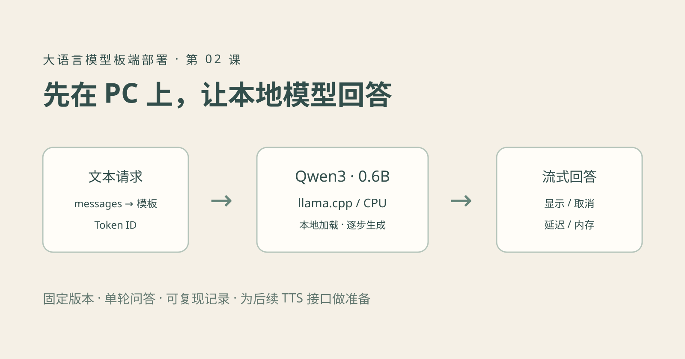

这一课从使用开始：在 Linux PC 上加载现成的小语言模型，输入问题，看到回答，再观察延迟与内存。你不需要先学会大模型训练，也不用先实现 Transformer。

对于嵌入式音视频工程师，第一步是建立一套可复现的 PC 基线。以后移到板端，才知道回答异常、速度变化或内存增长来自模型本身，还是来自运行时、配置和硬件差异。

本篇固定模型与工具版本，具体实测情况见配套 `verification.md`。它是本地文本推理实验；TTS 将作为独立实验学习，再接到这里的文本输出上。

## 1. 今天先做成什么

完成后应该能够：

1. 启动一个只监听本机的模型服务。
2. 发送一个问题，分别获得完整回答和流式回答。
3. 中途停止接收，并继续发送下一次请求。
4. 看懂回答因结束标记停止，还是因输出上限截断。
5. 查看真实聊天模板、Token ID、服务端计数和进程内存。



这里的 HTTP 服务在你自己的 PC 上执行推理，不是调用云端模型。第一次下载源码和权重需要网络，准备完成后使用本地路径即可运行。兼容某种 HTTP 接口格式也不表示请求被发送到该接口格式所属的云服务。

## 2. 先把四个东西分清

| 对象 | 本篇选择 | 作用 |
| --- | --- | --- |
| 模型 | Qwen3-0.6B | 决定模型结构与已经学到的参数 |
| 模型文件 | 官方 Q8_0 GGUF | 存放量化权重与模型相关元数据 |
| 推理引擎 | llama.cpp v0.7.0 源码构建 | 加载模型，管理计算与生成过程 |
| 客户端 | Python 标准库脚本 | 发请求、显示回答、保存运行记录 |

选择这个小模型是为了先跑通接口与测量，不是宣称它能可靠解决全部嵌入式问题。官方模型仓库提供本篇使用的 GGUF 文件；我们固定 revision 和文件 SHA-256，不跟随同名文件自动更新。[官方模型仓库](https://huggingface.co/Qwen/Qwen3-0.6B-GGUF)

本篇直接使用已有 GGUF，不需要先把它转换为 ONNX。部署格式由所选运行时决定；将来选择某款 NPU 时，再按其 SDK 支持范围决定转换流程。

## 3. 准备环境和模型

下载本篇完整代码包，在解压目录打开终端。需要 Linux、Python 3.10+、C/C++ 编译器、CMake、curl、tar 和 sha256sum。

```bash
bash setup.sh
```

脚本执行三件事：下载固定源码归档并校验、编译 CPU 版 `llama-server`、下载官方模型并校验。全部写入本目录 `.runtime/`，不安装系统软件。

模型文件大小为 639446688 字节，约 639 MB，或 610 MiB。磁盘还要容纳源码与编译文件，应预留数 GB。**文件大小不是运行内存需求**：模型运行还要使用缓存、工作区和框架自身内存。

配置固定为：

```text
模型仓库：Qwen/Qwen3-0.6B-GGUF
revision：23749fefcc72300e3a2ad315e1317431b06b590a
模型文件：Qwen3-0.6B-Q8_0.gguf
模型 SHA-256：9465e63a22add5354d9bb4b99e90117043c7124007664907259bd16d043bb031
推理引擎：llama.cpp v0.7.0
```

源码归档的校验值也写在 `setup.sh` 和 README。因为使用源码归档而不是 Git 工作树，构建时可能提示找不到 Git 元信息，`--version` 可能显示 `0.7.0-dev / commit unknown`；此时用固定归档版本和 SHA-256 记录来源，不能据此谎称某个自动生成的提交号。

已有引擎和相同模型文件时，可以跳过下载，在启动脚本中传入绝对路径。第一课先使用这套固定基线，避免同时改变模型、量化和后端。

## 4. 终端一：启动服务，等待模型就绪

```bash
python3 serve.py
```

启动脚本默认配置：

| 参数 | 本篇取值 | 学习目的 |
| --- | --- | --- |
| 监听地址 | `127.0.0.1:18080` | 本机访问，避免与博客 8080 端口冲突 |
| GPU 层数 | 0 | 建立 CPU 基线 |
| CPU 线程 | 4 | 固定比较条件，可按机器调整 |
| 上下文容量 | 2048 Token | 控制初始缓存规模 |
| 并行请求槽位 | 1 | 先观察单请求行为 |
| 模型别名 | `local-qwen` | 供客户端请求指定模型 |
| 思考模式 | 关闭 | 第一课直接观察可见回答 |

等看到“模型已就绪”再发请求。程序会检查健康状态并记录启动时间，终端保持运行。端口被占用时应先确认占用者，不能把另一个服务的就绪状态当成当前模型已加载。

实际等效命令、模型大小和版本输出会写入 `outputs/server-*.json`，完整运行日志保存为同名 `.log`。GPU 层数为 0 加上本篇 CPU 构建配置，说明这里测试的是 CPU；不要把别处的 GPU 或 NPU 指标套进来。

有现成文件时：

```bash
python3 serve.py --server /你的路径/llama-server   --model /你的路径/Qwen3-0.6B-Q8_0.gguf
```

## 5. 终端二：先拿到一次完整回答

在另一个终端进入同一代码目录：

```bash
python3 client.py --no-stream
```

默认问题来自 `prompt.txt`：

> 请用三条简短建议说明：嵌入式摄像头没有声音时，应该先检查哪些地方？每条不超过25字。

程序把 system 与 user 消息交给本地服务器，服务器应用模型聊天模板，再进行生成。这里没有将问题当作命令执行，也没有接入设备控制。

也可以换一个问题：

```bash
python3 client.py --prompt '请用一句话解释 PCM 音频。' --no-stream
```

先判断回答是否符合问题、是否包含错误，而不是只看中文是否流畅。这个小模型可能遗漏重要步骤，也可能把不确定的内容说得很肯定；本课首先检查接口与运行链路。

每次调用都是独立单轮请求。第二次问“刚才说的是什么意思”，脚本不会自动拥有第一次的历史。多轮对话需要由客户端保存并重新提交 messages，后面再做。

## 6. 再观察流式输出

```bash
python3 client.py
```

这次请求设置 `stream=true`，服务通过 SSE 逐段发送数据。客户端解析事件，取出 `delta.content`，立即显示，并收集最终 usage 与结束原因。

注意三个区别：

- 一次 SSE 事件可能没有正文，例如只有角色或统计信息。
- 一个文本片段不一定等于一个 Token，更不能按回调次数计算 token/s。
- 流式输出缩短的是用户等待可见内容的时间，不表示整个回答的计算量必然减少。

客户端遇到提前断流会标记失败，并保留已经收到的文本，不把半段回答当作正常结束。协议处理对应 `test_client.py` 中的独立检查。

llama.cpp 的服务器支持同步与流式对话接口，本篇固定使用 `/v1/chat/completions`，启动脚本与请求字段按固定版本核对。[固定版本服务器文档](https://github.com/ggml-org/llama.cpp/blob/v0.7.0/tools/server/README.md)

## 7. 让模型停止：长度上限与用户取消

先故意把输出限制得很短：

```bash
python3 client.py --max-tokens 8
```

观察记录中的 `finish_reason`。`length` 表示达到长度上限，脚本记为 `truncated`；正常生成结束通常是 `stop`。上限是生成 Token 数，不是汉字数，也不是完整句子的数量。

随后发一个较长请求，在回答过程中按 Ctrl+C：

```bash
python3 client.py --prompt '请分十条解释嵌入式音频系统排查步骤。' --max-tokens 512
```

客户端关闭连接，保存已接收的部分回答，记录 `cancelled` 并以 130 退出。服务仍然运行，可以重新执行一次短问题。

这一步只实现客户端取消。服务器何时停止计算、释放请求槽位，要结合服务日志和后续请求确认；不能把“终端不再打印”当成整个设备的取消延迟已达标。关闭模型服务则在终端一按 Ctrl+C，启动脚本会回收它启动的子进程。

这正是后面接 TTS 的基础：取消一次回答时，还要同步处理待合成文本和待播放音频。今天先把文本端的状态区分清楚。

## 8. 观察聊天模板和 Token，而不是背术语

保持服务运行：

```bash
python3 inspect_input.py
```

脚本调用本地 `/apply-template` 展开 messages，再调用 `/tokenize` 打印真实 Token 数及前 24 个 ID。不要自己伪造一串数字来代表这个模型的分词结果。

聊天模板负责把 system、user、assistant 的角色边界组织成模型期望的格式。Token ID 是离散编号，不是 Embedding 向量；这里只检查文本接口，不展开模型中间张量。

本篇在服务与请求中明确关闭 Qwen3 思考模式，减少入门时“模型计算了很久却没有看到最终回答”的混淆。换用其他模型时，需要重新确认其模板与模式开关，不能机械照搬这些字段。

采样参数也固定记录：temperature=0.7、top_p=0.8、top_k=20、min_p=0、presence_penalty=1.5、seed=7。先保持不变，等链路稳定后再一次改变一个参数。固定种子有助于比较，但不保证跨硬件和版本字节级相同。[模型使用说明](https://huggingface.co/Qwen/Qwen3-0.6B-GGUF)

## 9. 第一份性能记录应该怎样读

每次请求都会生成 `outputs/request-*.json`，包含实际问题、参数、回答、状态和计时。

| 指标 | 本篇如何获得 | 不要误解成什么 |
| --- | --- | --- |
| 模型启动时间 | 创建服务进程到健康检查就绪 | 单次问答生成时间 |
| 首段可见文本延迟 | 客户端发请求到首段非空正文 | 纯模型计算的严格首 Token 延迟 |
| 整次请求时间 | 发请求到完成、取消或失败 | 单独的 Decode 时间 |
| Token 数 | 服务端返回的 `usage` | 汉字数或 SSE 事件数 |
| 生成速度 | 服务端 `timings` 中的指标（若提供） | 用整次请求耗时随意换算的纯生成速度 |
| 进程内存高水位 | Linux `/proc/PID/status` 的 VmHWM | 整机内存或 GPU 显存 |

非流式请求只能在完整响应返回时看到内容，所以 `first_content_seconds` 留空。服务没有返回某项统计时，同样保留空值，不编造数字。

服务脚本每 250 ms 采样 RSS，并记录进程报告的高水位。采样最大值可能漏掉瞬时峰值；RSS 的口径也不包含整个系统的全部资源。文件大小、RSS、系统剩余内存要分别看。

第一次请求可能比后续请求慢，因为页面缓存和运行时状态不同。本篇设置 `cache_prompt=false`，降低重复提示缓存对比较的影响，但这仍然不是严格的冷启动基准。比较时至少固定模型、线程、上下文、输入、输出限制和运行环境。

先记录自己的数据，再分析是否需要减小模型、调整上下文或更换后端。不要先追求某个网上截图中的 token/s。

### 本次实测：流程通了，答案仍需检查

2026-10-23，在本机 Linux x86_64、4 个 CPU 线程、上述固定配置下，完整响应耗时约 0.90 秒；随后流式请求首段可见文本约 0.28 秒，总耗时约 0.88 秒。服务端报告输入 64 Token、输出 31 Token，生成速度约 49.94 Token/s；服务进程内存高水位约 911.3 MiB。

这是一次具体环境的记录，没有清理系统缓存，也没有做重复采样统计，不代表其他 PC 或目标板的速度。完整版本、计时与模板输出见配套 `verification.md`。

更值得注意的是，同一问题的真实回答为：

```text
1. 检查电源是否正常；
2. 确认传感器是否工作；
3. 测试摄像头信号输出。
```

它虽然满足“三条建议”的形式，却没有聚焦麦克风、音频采集和播放等关键环节。因此本次证明的是本地加载、问答、流式协议和测量链路可用，并没有证明该小模型足以胜任音频排障。后续需要用固定业务问题评价模型质量。

长度截断、取消后释放任务、继续处理下一问均完成实测。程序退出时也检查了服务子进程正常结束。

## 10. 出问题时按链路排查

| 现象 | 优先检查 |
| --- | --- |
| 下载或校验失败 | 网络、文件是否完整、revision 与 SHA-256 是否匹配 |
| 找不到引擎或模型 | 是否完成 setup，默认路径是否正确 |
| 服务没就绪就退出 | 查看 server 日志，检查内存与模型格式 |
| 连接失败 | 服务是否运行、端口是否为 18080、是否使用本机地址 |
| 没有可见回答 | 思考模式、聊天模板、输出上限及服务端错误 |
| 回答中途结束 | 区分 length、正常 stop、取消和连接断开 |
| 回答重复或内容不可靠 | 先核对模板和参数，再评估模型是否适合任务 |
| 长输入变慢或内存上升 | 上下文容量、实际 Token 数和缓存使用 |
| Ctrl+C 后下一问仍很慢 | 看服务端是否还在处理旧请求，而不只看客户端输出 |

## 11. 今天完成哪些练习就可以继续

1. 跑通一次完整响应和一次流式响应，找到各自的 JSON 记录。
2. 用 8 Token 上限制造一次截断，解释它和正常停止的区别。
3. 取消一次长回答，再发送短问题，确认服务可继续使用。
4. 打印模板与 Token ID，指出 system/user 的内容分别在哪里。
5. 记录模型来源、文件大小、上下文、线程数、首段延迟和进程内存。

做到这些，就可以进入下一次实践：**输入一句固定中文，单独运行 TTS 并播放声音**。之后再将本篇流式文本按句缓冲，送入语音合成与音频播放队列。Token、Prefill、Decode 和 KV Cache 的细节可以围绕实际测量继续补充，不必成为先跑通系统的门槛。

---

[完整阅读目录](/series/llm-edge-deployment/) · [上一篇：发展历史与部署地图](/posts/llm-01-history-deployment-map.html)
