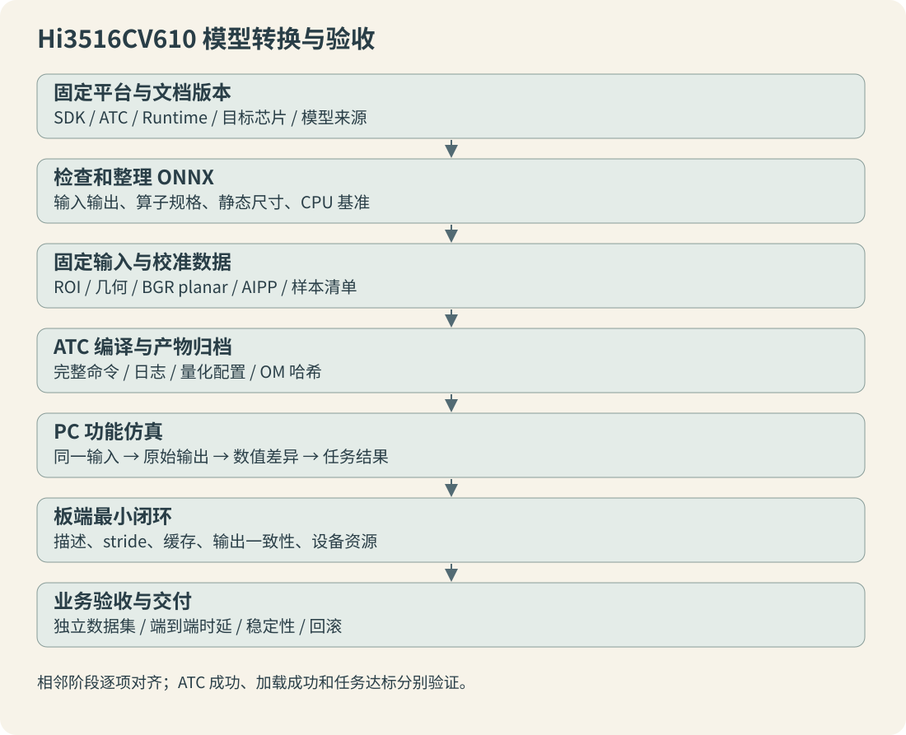

> 系列编排日期为 2026 年 8 月；技术基线核对与教学代码 CPU 验证日期为 2026-10-12。适用 Hi3516CV610 与本系列注明的 SDK/工具版本，实测范围见第 12 章。

## 系列目录

- [01 平台工具与文档地图](/posts/hi3516-npu-convert-01.html)
- [02 搭建转换环境](/posts/hi3516-npu-convert-02.html)
- [03 拿到模型后的检查](/posts/hi3516-npu-convert-03.html)
- [04 导出和整理ONNX](/posts/hi3516-npu-convert-04.html)
- [05 预处理与AIPP](/posts/hi3516-npu-convert-05.html)
- [06 校准数据与量化](/posts/hi3516-npu-convert-06.html)
- [07 执行ATC转换](/posts/hi3516-npu-convert-07.html)
- [08 输出与后处理约定](/posts/hi3516-npu-convert-08.html)
- [09 PC仿真与精度比对](/posts/hi3516-npu-convert-09.html)
- [10 板端最小推理闭环](/posts/hi3516-npu-convert-10.html)
- [11 转换失败与性能排查](/posts/hi3516-npu-convert-11.html)
- [12 项目案例与交付清单](/posts/hi3516-npu-convert-12.html)
- [A 附录A文档检索表](/posts/hi3516-npu-convert-a.html)
- [B 附录BATC与AIPP参数表](/posts/hi3516-npu-convert-b.html)
- [C 附录C错误现象与排查表](/posts/hi3516-npu-convert-c.html)
- [D 附录D项目目录及交付模板](/posts/hi3516-npu-convert-d.html)

海思模型转换的交付物是一套能复现的推理约定：模型、输入处理、输出解码、工具版本、校准样本和验收结果必须同时成立。本系列以 **Hi3516CV610** 为目标，把拿到 ONNX 后的检查、ATC 转换、PC 仿真和板端验证串成一条可执行路线。

## 本系列的平台范围

基线 SDK 为 `Hi3516C V610R001C01SPC020`，PC 工具包为 `SVP_NNN_PC_V5.0.2.3`。`SVP_NNN` 是包名，不能据此把项目当作旧 NNIE 工作流。项目通过 SVP ATC 产生 OM，通过 `svp_acl_*` 接口执行。通用 Ascend、其他海思 SoC 或不同版本文档中的参数，不应直接套用。

| 对象 | 用途 | 必须记录的内容 |
| --- | --- | --- |
| 训练框架和权重 | 定义原始计算和训练输入 | 框架版本、权重哈希、网络配置 |
| ONNX | 跨框架计算图 | opset、IR、输入输出、外置权重文件 |
| ATC | 检查、优化、量化、编译 | 实际可执行文件、版本、完整命令 |
| AIPP | 图像输入预处理 | 通道、均值、缩放、几何配置 |
| OM | 目标工具链的模型产物 | SHA-256、目标芯片、配套 Runtime |
| SVP ACL 和驱动 | 板端加载与执行 | SDK、库、驱动、板级内存配置 |

## 先看哪些文档

本地文档根目录是：

```text
Hi3516C V610R001C01SPC020/ReleaseDoc/zh/01.software/pc/SVP_NPU/
```

| 阅读顺序 | 文档 | 先看内容 | 解决的问题 |
| --- | --- | --- | --- |
| 1 | 快速上手指南.pdf | 第 1～3 章、第 5 章 | 各工具怎样配合，转换后怎样验证 |
| 2 | 驱动和开发环境安装指南.pdf | 主机环境、安装、环境变量 | 工具能否在正确依赖下运行 |
| 3 | ATC工具使用指南.pdf | 2.1、2.2、2.3 | 最小转换与输出文件 |
| 4 | ATC工具使用指南.pdf | 3.2.4～3.2.6、3.2.9.1 | 输入、输出、量化、目标芯片 |
| 5 | ATC工具使用指南.pdf | 5.2.1、5.2.2 | ONNX 算子及属性限制 |
| 6 | 应用开发指南.pdf | 第 3 章、第 4 章 | 内存、上下文、加载、执行、释放 |
| 7 | MindCmd 使用指南.pdf | 环境配置、样例、一键推理、ONNX 推理 | 官方自动化验证路线 |

遇到精度退化再读 `AMCT使用指南（PyTorch）.pdf`；使用 Caffe 才查对应 Caffe 版。需要改图或扩展算子时，再查 `ATC Graph开发指南.pdf` 与 `ATC自定义算子开发指南.pdf`。`图像分析引擎使用差异说明.pdf` 用于核对平台差异。自定义算子应在确认常规导出、等价改图和已支持算子都无法满足时再考虑。

本系列引用的 ATC 手册为 2025-03-19 的 11 版，快速上手为同日 06 版，应用开发指南为 2025-03-28 的 07 版。PDF 阅读器页码可能包含封面和目录；查找时优先用节号和参数名。完整检索入口见[附录 A](/posts/hi3516-npu-convert-a.html)。

## 从模型到设备的检查关口



每个阶段保存上一阶段可重放的输入。原始框架与 ONNX 不一致时先修导出；ONNX 与量化仿真不一致时检查量化和 AIPP；仿真与板端不一致时检查运行库、字节布局和缓存；原始输出相同而框不同，则检查解码、坐标和 NMS。这样可以把故障限制在两个相邻阶段之间。

“ATC 返回 0”“OM 加载成功”“能够看到框”是三种不同证据。第一种只证明该命令成功产生编译结果；第二种还证明当前运行环境能加载它；第三种仍不能证明准确率、时延和长期运行达标。

## 开始前建立一张模型卡

```text
target: Hi3516CV610
sdk: Hi3516C V610R001C01SPC020
tool_bundle: SVP_NNN_PC_V5.0.2.3
source_model: 文件名与 SHA-256
input: 名称 / shape / dtype / layout / 通道 / 数值范围
geometry: ROI 选择 / resize / pad / 插值 / 坐标逆变换
outputs: 名称 / shape / dtype / 含义 / 解码版本
calibration: 清单哈希 / 样本来源 / 预处理版本
acceptance: 数值指标 / 任务指标 / 时延 / 内存
```

没有这些信息时可以做工具冒烟测试，但不能把结果当作可部署模型。尤其不能从网络名称猜测 RGB/BGR，也不能从后缀推测输出是否带 Sigmoid 或 NMS。

## 建议的阅读和执行顺序

首次接触按 01～10 章推进，第 11 章用来定位异常，第 12 章提供完整 YuNet 实例和教学脚本。已有模型但转换失败时，从报错对应的附录 C 返回正文；需要交接时使用附录 D 的目录和清单。

每次实验建立新目录，不覆盖前一次的模型与日志。正式验收至少保留一组真实样本的原始图、模型输入字节、CPU 输出、仿真输出、板端输出和解码结果。合成样本适合检验文件格式和变换等价性，不能代替真实人脸场景精度评估。

[系列目录](/posts/hi3516-npu-convert-01.html) · [下一篇 搭建转换环境](/posts/hi3516-npu-convert-02.html)
