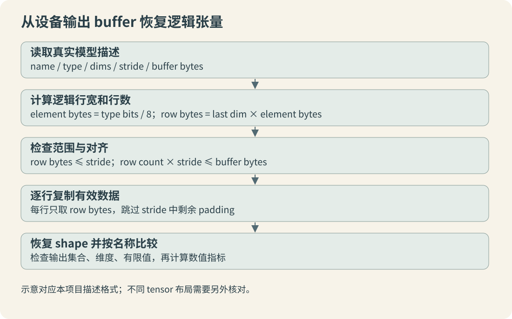

> 系列编排日期为 2026 年 8 月；技术基线核对与教学代码 CPU 验证日期为 2026-10-12。适用 Hi3516CV610 与本系列注明的 SDK/工具版本，实测范围见第 12 章。

[返回系列目录](/posts/hi3516-npu-convert-01.html) · 本篇属于 12 章与 4 份附录。

后处理是模型接口的一部分。转换后的输出名称、顺序、类型、维度和物理步长都要重新确认，不能只依赖训练工程里的一段解码代码。

## 先确定输出处于哪一层

检测模型可能输出原始 logits、激活后的类别分数、解码后的框，或者完成 NMS 的检测结果。分割模型可能输出 logits 或概率；关键点模型可能输出热图、偏移或坐标。形状相似并不代表语义相同。

查《ATC工具使用指南》3.2.5 的 `output_type`、`out_nodes`、`output_reorder`，以及第 4 章后处理硬化。若采用硬化路线，记录具体配置、阈值、最大输出数量和硬化后的描述。不要同时在 CPU 重做已经固化的 Sigmoid、解码或 NMS。

## 输出顺序与名称

默认 `output_reorder=1` 可能调整输出顺序，本系列使用 0 保持原图顺序。即便如此，运行时仍应打印并核对输出名及 shape。代码优先按已知名字建立映射；必须用索引的模型则把索引表写进版本化的模型卡。

YuNet 320 有 12 个输出，按 stride 8、16、32 分成 cls、obj、bbox、kps 四组。cls 与 obj shape 分别为 `[1,N,1]`，bbox 为 `[1,N,4]`，kps 为 `[1,N,10]`。`N` 依次为 1600、400、100。

cls 与 obj 已包含相应激活，检测分数和框解码应遵从当前 `YuNet.cpp`，不要按 YOLO 的习惯再添加一个 objectness 字段。本文配套比较器只比较原始输出，不负责检测解码。

## 逻辑张量和物理 buffer



以逻辑 shape `[1,1600,1]`、FP32 为例，每个逻辑行只有 4 字节，但设备可能要求更大的行步长。原始 buffer 的大小由描述接口返回，不一定是 `1*1600*1*4`。

对本项目描述格式的连续化处理为：

```text
element_bytes = svp_acl_data_type_size(type) / 8
row_bytes = dims[last] * element_bytes
row_count = product(dims[0:last])
检查 row_bytes <= stride
检查 row_count * stride <= buffer_size
逐行复制 buffer[row * stride : row * stride + row_bytes]
```

`svp_acl_data_type_size` 返回 bit 数，不能把返回值直接当字节数。不同 tensor 格式可能需要不同解释，上面对应当前工程已验证的描述与复制方式，任意自定义布局都应另外核对。

## 比较原始输出前先去掉对齐填充

工程 `benchmark.cpp` 保存的是包含 stride padding 的完整输出 buffer。直接 `np.fromfile(...).reshape(shape)` 可能报元素数量不匹配，也可能把填充当数值读进去。

第 12 章的 `compare_outputs.py` 读取 benchmark 日志中的名称、字节数、stride、类型和 dims，按名称匹配 NPZ，再逐行去 padding。它仅支持本 SDK `type=0` 的 FP32 固定形状输出，遇到类型、长度、shape 或输出集合不匹配会报错，不会静默截断。

## 解码和坐标验证

先确认逐输出数值接近，再比较解码前候选、置信度、NMS 前后数量、最终框与关键点。阈值附近的小量化误差可能改变候选集合，应同时观察原始分数与任务指标，不能只看某个框“消失”。

保存每一层坐标空间：原图、头部 ROI、人脸 ROI、网络输入。对左上填边，padding 偏移为零；对居中填边，必须减去相应偏移。框裁边、宽高定义和整数取整也应与原工程一致。

YOLO-P34、Pose、World 和 PIPNet 的输出约定各不相同。Pose 的 `[1,56,8400]` 与转置布局需要显式分辨；PIPNet 五个输出还依赖点位和邻居定义；World 必须绑定词表与类别元数据。单独替换 OM 而不更新这些约定，会形成能够运行但解释错误的系统。

## 输出接口的完成条件

模型卡中能够从每个输出名追踪到 shape、dtype、布局、物理读取方法和业务含义；固定输入的原始输出与解码结果均可重放；硬化与 CPU 后处理的职责明确。所有这些信息与 OM 的哈希一起交付。

[上一篇 执行ATC转换](/posts/hi3516-npu-convert-07.html) · [系列目录](/posts/hi3516-npu-convert-01.html) · [下一篇 PC仿真与精度比对](/posts/hi3516-npu-convert-09.html)
