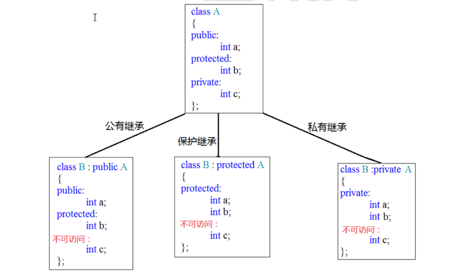
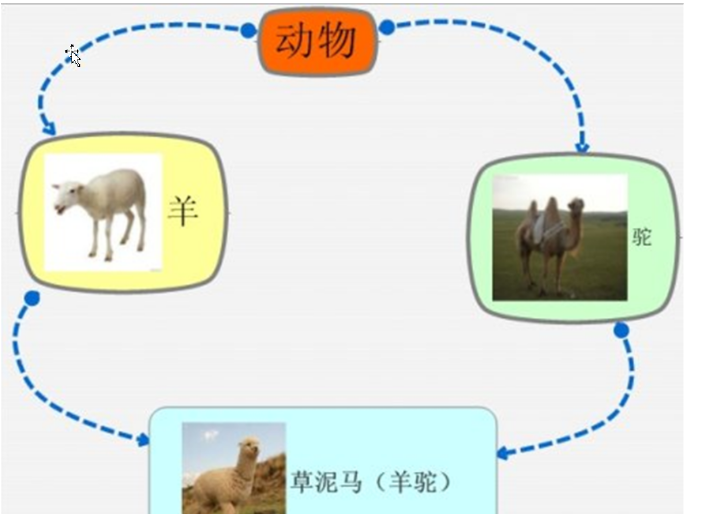

# 1、c++对c的扩展
## 1-1、冒号作用域
    :: 运算符是一个作用域,::代表是全局作用域。

```cpp
#include <iostream>
using namespace std;
int a = 100;
void test01()
{
    int a = 10;
    cout << a << endl;//输出局部变量a
    cout << ::a << endl;//输出全局变量a
}
int main()
{
   test01();
   return 0;
}
```

## 1-2、名字控制
```cpp
#include <iostream>
using namespace std;
namespace A
{
    int a = 1;
    void fun ( )
    {
        cout << "hello namespace " << endl;
    }
    void foo ( int agr );

    class obj
    {

    };
}
void A::foo ( int arg )
{
    cout << arg << endl;
}

//命名空间是可以取别名的
namespace newA = A;
namespace B
{
    int a = 10;
    int b = 20;
}
namespace B
{
    int c = 30;
};
namespace C
{
    int a = 10;
    int b = 20;
    namespace D
    {
        int a = 20;
    }
}
//注意: 如果命名空间没有名字 name这个命名空间内的所有成员都被编译器加上了static修饰,//只能被当前文件调用 这个属于内部链接属性
namespace
{
    int a = 10;
    void fun ( )
    {
        cout << "hello" << endl;
    }
}
void test03 ( )
{
    A::foo ( 222 );
    newA::foo ( 333 );
}
void test02 ( )
{
    cout << C::a << endl;
    cout << C::D::a << endl;
}
void test01 ( )
{
    cout << A::a << endl;
    cout << B::a << endl;
    cout << B::b << endl;
    A::fun ( );
    cout << B::c << endl;
}
int main ( )
{
    test03 ( );
    test02 ( );
    test01 ( );
    return 0;
}


```

## 1-3、全局变量检测增强

c++的编译器对于全局变量的声明和定义有严格的区分,检测会增强              

c语言下的全局变量的声明和定义        

```c
//全局变量
int a;//定义
int a;//声明
int a;//声明
```
c++下全局变量声明和定义     

```cpp
//全局变量
int a;//定义
extern int a ; //声明
extern int a; //声明
```
c+++ 定义为如下将报错    

```cpp
int a;
int a;
int a;
```

## 1-4、更严格的类型转换检测
比如malloc()申请的内存一定要做强转。     
```cpp
char *p =(char *)malloc(100);
```

## 1-5、struct类型增强
在c++中使用结构体类型时，可以不写struct关键字，定义的时候要写。

## 1-6、三目运算符有所不同
在c++中可以返回变量。而c++常量返回常量    
```cpp
void test05 ( )
{
    int a = 10;
    int b = 20;
    printf ( "%d\n" , a < b ? a : b );
    //在c语言中三目运算符返回的是表达式的值，是一个常量
    //( a < b ? a : b) = 100; //c++可以正常编译。
    *( a < b ? &a : &b ) = 100;

}

```

## 1-7、c/c++中const
### 1-7-1、const概述    
const修饰的对象为一个常量。不能被改变。   
### 1-7-2、c/c++中const的区别     
#### 1-7-2-1、c语言中的const
1 const修饰的局部变量,存在栈区,虽然不能通过const修饰的变量去修改栈区内容,但是可以
通过地址去修改const修饰的    
2 const修饰的全局变量是保存在常量区,不能通过变量名去修改.也不能通过地址去修改     
3 const修饰的全局变量,如果其他文件想使用,直接extern声明外部可用即可   

#### 1-7-2-2、c++中的const
1 const修饰的局部变量赋值常量时,局部变量保存在符号表中,修改不了,是一个常量
2  const修饰的全局变量保存在常量区,不能被修改
3 const修饰的全局变量默认是内部链接属性,加上extern修饰变成外部链接属性

#### 1-7-2-3、相同的点:
c和c++中的const修饰的全局变量都是保存在常量区,不能被修改            
#### 1-7-2-4、不同的点:        
c语言中const修饰的局部变量赋值为常量时,,局部变量保存在栈区,可以被指针修                     
改                       
c++中,const修饰的局部变量赋值为常量时,局部变量保存符号表中,不能被修改                  
c语言中const修饰的全局变量默认是外部链接属性              
c++语言中const修饰的全局变量默认是内部链接属性                             
c++中const修饰的变量,分配内存情况                  
const修饰的全局变量在常量区分配了内存                
对const修饰的局部变量赋值为常量时,对其取地址,会在栈区分配临时的内存空间                 
const修饰的局部变量赋值为变量时,局部变量保存在栈区                     
const修饰的局部变量时一个自定义变量,也是在栈区分配内存      
只有一种情况,const'修饰的局部变量被赋值为常量时,这个局部变量保存在符号表中    

#### 1-7-2-5、尽量以const替换define
有两点原因:
1.  const修饰的全局变量或const修饰的局部变量赋值为常量,是有类型的,而define的
宏没有 类型
2. const修饰的全局变量或const修饰的局部变量赋值为常量有作用域的,而define的
宏没有作用域

### 1-7-2-6、引用的用法
注意事项：   
* 1、应用一旦初始化，就不可以更改引用指向  
* 2、引用定义的时候必须要初始化  
* 3、原类型 &别名 = 旧名  引用的实质就职取别名
* 4、引用不能使用NULL
* 5、引用可以引用任意类型包括数组
* 6、&在等号的左边是引用，在等号的右边是取地址
* 7、引用可以作为函数形参
* 8、不能返回局部变量的引用
* 9、引用的本质是一个指针常量
* 10、

```c++

引用的本质是一个指针常量
type &b = a;
 编译器底层这么实现的:
type *const b = &a;
 
``` 
* 11、指针的引用
套用引用公式：type &q=p
假设：type为指针类型
```c++
 void fun (int* &q) // int* &q = p
 {

 }
 void test()
 {
  int *p=NULL;
  fun(p);
 }
```
* 12、常量引用
const type &p=q;   
常量引用代表不能通过引用取修改引用标示的那块空间

```c++
#include <iostream>
using namespace std;
void test01()
{
 int a = 10;   
 // const 修饰的是引用& 不能通过引用去修改引用的这块空间的内容
 const int &b= a;
//b=1000;//err
}

void test02()
{
//int b& = 100;//不能应用常量
const int &b = a;
//b=1000;//err
}

```


## 1-8、内联函数
* 1、为什么要有内联函数  
 第一个在c中也会出现，宏看起来像一个函数调用，但是会有隐藏一些难以发现的错误。           
 第二个问题是c++特有的，预处理器不允许访问类的成员，也就是说预处理器宏不能用作
类类的成员函数。        
内联函数就是继承了宏函数的高效,并且不会出错,还可以当成类的成员函数用  
* 2、宏函数和内联函数的区别  
宏函数的替换是发生在预处理阶段   
内联函数的替换是发生在编译阶段  
宏函数容易出错,内联函数不会     
内联函数和宏函数一样,都省去了调用函数的开销     

```
#include <iostream>
using namespace std;
#define myadd(a,b) a+b
inline int myadd(int a,int b)
{
    return a+b;J
}
void test01()
{
    int a = 10;
    int b = 20;
    //int c= myadd (a,b)*5;//a+b*5 替换发生在预处理阶段
    int c = myadd(a,b)*5;//(a+b)*5替换发生在编译阶段 也和宏函数一样不会有函数调用的开销
    cout<<c<<endl;
}

```
在c++中，预定义宏的概念是用内联函数来实现的，而内联函数本身也是一个真正的函数。     
内联函数具有普通函数的所有行为。唯一不同之处在于内联函数会在适当的地方像预定义宏
一样展开，所以不需要函数调用的开销。因此应该不使用宏，使用内联函数。    
在普通函数(非成员函数)函数前面加上inline关键字使之成为内联函数。但是必须注意必须
函数体和声明结合在一起，否则编译器将它作为普通函数来对待。      
`inline void func(int a);`        
以上写法没有任何效果，仅仅是声明函数，应该如下方式来做:     
`inline int func(int a){return ++;} `     
注意: 编译器将会检查函数参数列表使用是否正确，并返回值(进行必要的转换)。这些事预
处理器无法完成的。    
内联函数的确占用空间，但是内联函数相对于普通函数的优势只是省去了函数调用时候的压
栈，跳转，返回的开销。我们可以理解为内联函数是以空间换时间。        
### 1-8-1、类的成员函数默认编译器会将它做成内联函数
任何在类内部定义的函数自动成为内联函数。

```
1 class Person{
2 public:
3 Person(){ cout << "构造函数!" << endl; }
4 void PrintPerson(){ cout << "输出Person!" << endl; }
5 }

```

#### 1-8-2、内联函数和编译器
内联函数并不是何时何地都有效，为了理解内联函数何时有效，应该要知道编译器碰到内联
函数会怎么处理？            
对于任何类型的函数，编译器会将函数类型(包括函数名字，参数类型，返回值类型)放入到
符号表中。同样，当编译器看到内联函数，并且对内联函数体进行分析没有发现错误时，也
会将内联函数放入符号表。        
当调用一个内联函数的时候，编译器首先确保传入参数类型是正确匹配的，或者如果类型不
正完全匹配，但是可以将其转换为正确类型，并且返回值在目标表达式里匹配正确类型，或
者可以转换为目标类型，内联函数就会直接替换函数调用，这就消除了函数调用的开销。假
如内联函数是成员函数，对象this指针也会被放入合适位置。          
类型检查和类型转换、包括在合适位置放入对象this指针这些都是预处理器不能完成的。      
但是c++内联编译会有一些限制，以下情况编译器可能考虑不会将函数进行内联编译。     
`不能存在任何形式的循环语句`    
 `不能存在过多的条件判断语句`     
 `函数体不能过于庞大`        
 `不能对函数进行取址操作`         
 内联仅仅只是给编译器一个建议，编译器不一定会接受这种建议，如果你没有将函数声明为
内联函数，那么编译器也可能将此函数做内联编译。一个好的编译器将会内联小的、简单的函数。

## 1-9、函数的默认参数
c++中的函数,形参可以设置默认参数,设置时需要注意以下几点:    
* 设置默认参数时,某个参数设置了默认参数,从这个参数开始,后面的每一个都要设置。        
* 函数的声明和定义处设置默认参数只能一处设置  
* 有实参传入则使用实参,实参没有传入使用默认参数       
```c++
#include <iostream>
using namespace std;
//void fun01(int a = 1, int b = 2);
//默认参数 在设置时 声明和定义只能一处设置默认参数
//设置默认参数时 有一个参数设置了默认参数,从这个参数往后的每一个参数都要设置默认参数
void fun01(int a=1,int b=2)
{
 cout << a << " "<<b << endl;
}
 void test01()
 {
  fun01(1,2);
  fun01(1, 3);
  fun01(1, 4);
  fun01(1);
  fun01();
 }
 int main()
 {
  test01();
  return 0;
 }


```

## 1-10、占位参数
占位参数给函数形参设置的,调用时需要传参,也可以设置占位参数为默认参数;        
占位参数在符号重载++时会用到        

```c++
#include <iostream>
using namespace std;
void fun(int a, int=4)
{
}
void test01()
{
 fun(1,2);
  fun(2);
 }
 int main()
 {


  return 0;
 }
```

## 1-11、函数的重载
* 1、函数的重载     
在c++中函数的名字是刻印重名的,也就是可以有多个相同函数名的函数存在,
重载: 名字相同,意义不一样   
* 2、函数重载的条件 
实现函数重载的条件：
 同一个作用域   
 参数个数不同   
 参数类型不同   
 参数顺序不同   
 函数的返回值不能成为函数重载的条件 
 默认参数作为函数重载的条件可能发生二义性   

 ```c++
  #include <iostream>
 using namespace std;

 // 函数名一样 意义 不一样
 //函数的重载发送必须在同一个作用域
 //参数的个数不一样可以发送函数的重载
 //参数 的类型不一样可以发生函数的重载
 //参数的顺序不一样可以发生函数的重载
 //返回值不能作为函数重载的条件
 //默认参数作为函数重载的条件需要注意二义性

 void fun(double a, int b)
 {
  cout << " fun(double a, int b)" << endl;
 }
 void fun( int a, double b)
 {
  cout << " void fun( int a, double b)" << endl;
 }
 void fun(double a)
 {
  cout << " void fun(double a)" << endl;
 }

 void fun(int a)
 {
  cout << "void fun(int a) " << endl;
 }
 //int fun(int a)
 //{
 // cout << "void fun(int a) " << endl;
 //}
 void fun(int a,int b)
 {
  cout << "void fun(int a,int b) " << endl;
 }
 //void fun(int a, int b=2)
 //{
 // cout << "void fun(int a,int b) " << endl;
 //}

 void test01()
 {
  fun(1);
  fun(2,3);
  fun(3.14);
  fun(1, 3.14);
  fun(3.14, 1);
 }
 int main()
 {
  test01();
  return 0;
 }
 ```

 编译器为了实现函数重载，也是默认为我们做了一些幕后的工作，编译器用不同的参数类型       
来修饰不同的函数名，比如void func(); 编译器可能会将函数名修饰成func，当编译器碰到       
void func(int x),编译器可能将函数名修饰为funcint,当编译器碰到void func(int x,char c),编译器     
可能会将函数名修饰为funcintchar我这里使用”可能”这个字眼是因为编译器如何修饰重载     
的函数名称并没有一个统一的标准，所以不同的编译器可能会产生不同的内部名。        
void func(){}       
void func(int x){}      
void func(int x,char y){}       
 以上三个函数在linux下生成的编译之后的函数名为:     
_Z4funcv //v 代表void,无参数        
_Z4funci //i 代表参数为int类型      
_Z4funcic //i 代表第一个参数为int类型，第二个参数为char类型     

## 1-12、extern "c"浅析
c++编辑器编译.c的函数时,需要声明为 extern "C"
main.cpp            

```cpp

 #include <iostream>
 #include "test.h"
 using namespace std;

 int main()
 
  cout << myadd(2, 3) << endl;
  return 0;
 


```
test.c

```c
 int myadd(int a, int b)
 {

  return a + b;
 }
```

test.h

```c
#pragma once
#if __cplusplus
extern "C" {
#endif
 int myadd(int a, int b);
 #if __cplusplus
 }
 #endif

```

# 2、类和对象
##  2-1、c和c++中struct的区别
* c语言中结构体中不能存放函数,也就是数据(属性)和行为(方
法)是分离的
* c++中结构体中是可以存放函数的,也就是数据(属性)和行为
(方法)是封装在一起的

```c++

 #define _CRT_SECURE_NO_WARNINGS
 #include <iostream>
 #include <string.h>
 using namespace std;
 //c语言中 不能放函数
 struct _stu
 {
  int a;
  int b[5];

 }
 //c++中 可以放函数
 struct _stu1
 {
  int a;
  int b[5];
  void print_stu()
  {
  cout << a << endl;
  }

 };

 struct student
 {
  //学生的属性和数据
  int age;
  int id;
  char name[256];
  //操作属性的叫做 方法或行为‐函数
  void print()
  {
  cout << age << id << name << endl;
  }


 };
 void test01()
 {
  student obj;
  obj.age = 10;
  obj.id = 20;
  strcpy(obj.name,"lucy");
  obj.print();

 }
 int main()
 {
  test01();
  return 0;
 }
```
## 2-2、C语言中表示事物的方法存在的问题
c语言中表示事物时,将属性和行为分离,有可能行为调用出错   
```c++
#include <stdio.h>
//表示人
struct Person
{
 int age;
 char name[128];
};
void Person_eat(struct Person *p)
{
  printf("%s 在吃饭\n",p‐>name);
 }

 //表示dog
 struct Dog
 {
  int age;
  char name[128];
 };
 void Dog_eat(struct Dog *p)
 {
  printf("%s 在吃粑粑\n", p‐>name);
 }


 void test01()
 {
  struct Person p1;
  p1.age = 20;
  strcpy(p1.name,"bob");
  Person_eat(&p1);

  struct Dog d1;
  d1.age = 7;
  strcpy(d1.name,"旺财");
  Dog_eat(&d1);
  Dog_eat(&p1);//人 调用了狗的行为
 }
 int main()
 {
  test01();
  return 0;
 }
```
## 2-3、c++中对事物的封装-类
* c++将事物的属性和行为封装在一起
* 类和结构体的一个区别在于,类对成员可以进行访问的权限控
制,结构体不可以
* 类 = 类型 (事物的行为和属性)   类实例化出来的变量叫对象
* 类中的函数 可以访问类里面的成员

```c++
#define _CRT_SECURE_NO_WARNINGS
#include <iostream>
#include <string.h>
using namespace std;
//c++中对事物的封装 将属性和行为封装在一起
//类 将事物抽象成属性和行为,并且封装在一起
//结构体中所有成员默认都是公有的 类中的所有成员默认是私有的,也可以修改成员的访问权限
// struct Person
class Person
 {
 public://公有的
  //类中的所有成员 访问的权限都是私有的 private
  //属性
  int age;
  char name[128];
  //行为
  void Person_eat()
  {
  printf("%s 吃饭\n",name);
  }
 };
 struct Dog
 {
  //属性
  int age;
  char name[128];
  //行为
  void Dog_eat()
  {
  printf("%s 吃粑粑\n", name);
  }
 };

 void test01()
 {
  //通过类 实例化出一个变量 这个变量叫对象
  Person p1;
  p1.age = 10;
  strcpy(p1.name, "lucy");
  p1.Person_eat();

  Dog d1;
  d1.age == 6;
  strcpy(d1.name,"旺财");
  d1.Dog_eat();


 }


 int main()
 {
  test01();


 }
```

## 2-4、类中的成员权限

|访问属性   | 属性 | 对象内部 | 对象外部 |
| :----: | :----: | :----: | :-----|    
| public | 公有 | 可访问 | 可访问 |
| protected | 保护 | 可访问 | 不可访问 |
| privata | 私有 | 可访问 | 不可访问 |


```cpp
#define _CRT_SECURE_NO_WARNINGS
#include <iostream>
#include <string.h>
using namespace std;
class person
{
public: //公有的 类内类外都可访问
 int mTall; //多高，可以让外人知道
protected: // 保护的 类外不可访问 类内是可以访问的 子类可以访问
  int mMoney; // 有多少钱,只能儿子孙子知道
 private: //私有的 类外不可访问 类内是可以访问的 子类不可访问
  int mAge; //年龄，不想让外人知道

  void show()
  {
  cout << mTall << " ";
  cout << mMoney << " ";
  cout << mAge << " ";
  }

 };
 void test01()
 {
  person p;
  p.mTall = 180;


 }

 int main()
 {

  return 0;
 }


```

## 2-5、尽量设置成员变量为私有权限
设置成员变量为私有，有点：   
*  对变量的设置时的控制
*  可以给变量设置只读权限
*  可以给变量设置只写权限
*  可以给变量设置可读可写权限 
  
```cpp
class AccessLevels{
public:
//对只读属性进行只读访问
int getReadOnly(){ return readOnly; }
//对读写属性进行读写访问
void setReadWrite(int val){ readWrite = val; }
int getReadWrite(){ return readWrite; }
//对只写属性进行只写访问
void setWriteOnly(int val){ writeOnly = val; }
 private:
 int readOnly; //对外只读访问
 int noAccess; //外部不可访问
 int readWrite; //读写访问
 int writeOnly; //只写访问
 };


```
简单示例
 ```cpp
#define _CRT_SECURE_NO_WARNINGS
#include <iostream>
#include <string.h>
using namespace std;
class Person
{
    public:
    void person_init ( int age , char* name )
    {
        if ( age >= 0 && age <= 100 )
            m_age = age;
        strcpy ( m_name , name );
    }
    void show_person ( )
    {
        cout << m_name << " " << m_age << endl;
    }
    int get_age ( )
    {
        return m_age;
    }
    void set_age ( int age )
    {
        if ( age >= 0 && age <= 100 )
        {
            m_age = age;
        }
    }
    char* get_name ( )
    {
        return m_name;
    }
    void set_name ( char* name )
    {
        strcpy ( m_name , name );
    }

    private:
    int m_age;
    char m_name[ 128 ];

};
void test01 ( )
{
    Person p1;
    p1.person_init ( 20 , "lucy" );
    p1.show_person ( );
    p1.set_age ( 30 );
    p1.set_name ( "bob" );
    p1.show_person ( );
}
int main ( )
{
    test01 ( );
    return 0;
}

 ```

判断两个立方体是否相等
```cpp
#define _CRT_SECURE_NO_WARNINGS
#include <iostream>
#include <string.h>
using namespace std;
class Cube
{
    public:
    void set_L ( int l )
    {
        L = l;
    }
    void set_W ( int w )
    {
        W = w;
    }
    void set_H ( int h )
    {
        H = h;
    }
    int get_L ( )
    {
        return L;
    }
    int get_W ( )
    {
        return W;
    }
    int get_H ( )
    {
        return H;
    }
    //求立方体的体积
    int get_cube_V ( )
    {
        return L * W * H;
    }
    //求立方体面积
    int get_cube_S ( )
    {
        return 2 * W * L + 2 * W * H + 2 * L * H;
    }
    //判断两个立方体是否相等
    bool compare_cube ( Cube& c1 )
    {
        return c1.get_L ( ) == L && c1.get_W ( ) == W && c1.get_H ( ) == H;
    }

    private:
    int L;
    int W;
    int H;
};

bool comapre_cube ( Cube& c1 , Cube& c2 )
{

    return c1.get_L ( ) == c2.get_L ( ) && c1.get_W ( ) == c2.get_W ( ) &&
        c1.get_H ( ) == c2.get_H ( );
}

void test01 ( )
{
    Cube c1;
    c1.set_L ( 10 );
    c1.set_W ( 20 );
    c1.set_H ( 30 );
    cout << c1.get_cube_S ( ) << endl;
    cout << c1.get_cube_V ( ) << endl;

    Cube c2;
    c2.set_L ( 20 );
    c2.set_W ( 20 );
    c2.set_H ( 30 );

    if ( c1.compare_cube ( c2 ) )
    {

        cout << "立方体相等" << endl;
    }
    else
    {
        cout << "立方体不相等" << endl;
    }

    if ( comapre_cube ( c1 , c2 ) )
    {
        cout << "立方体相等" << endl;
    }
    else
    {
        cout << "立方体不相等" << endl;
    }


}
int main ( )
{
    test01 ( );
    return 0;
}


```

点和圆关系

```cpp

#define _CRT_SECURE_NO_WARNINGS
#include <iostream>
#include <string.h>
using namespace std;
//定义点类
class Point
{
    public:
    void setX ( int x )
    {
        mX = x;
    }
    void setY ( int y )
    {
        mY = y;
    }
    int getX ( )
    {
        return mX;
    }
    int getY ( )
    {
        return mY;
    }
    private:
    int mX;
    int mY;
};

//圆类
class Circle
{
    public:
    void setP ( int x , int y )
    {
        mP.setX ( x );
        mP.setY ( y );
    }
    void setR ( int r )
    {
        mR = r;
    }
    Point& getP ( )
    {
        return mP;
    }
    int getR ( )
    {
        return mR;
    }
    //判断点和圆的关系
    void IsPointInCircle ( Point& point )
    {
        int distance = ( point.getX ( ) - mP.getX ( ) ) * ( point.getX ( ) - mP.getX ( ) ) + ( point.getY ( ) - mP.getY ( ) ) * ( point.getY ( ) - mP.getY ( ) );
        int radius = mR * mR;
        if ( distance < radius )
        {
            cout << "Point(" << point.getX ( ) << "," << point.getY ( ) << ")在圆内!" << endl;
        }
        else if ( distance > radius )
        {
            cout << "Point(" << point.getX ( ) << "," << point.getY ( ) << ")在圆外!" << endl;
        }
        else
        {
            cout << "Point(" << point.getX ( ) << "," << point.getY ( ) << ")在圆上!" << endl;
        }
    }
    private:
    Point mP; //圆心
    int mR; //半径
};

void test ( )
{
    //实例化圆对象
    Circle circle;
    circle.setP ( 20 , 20 );
    circle.setR ( 5 );
    //实例化点对象
    Point point;
    point.setX ( 25 );
    point.setY ( 20 );

    circle.IsPointInCircle ( point );
}
int main ( )
{
    test ( );
    return 0;
}
```
理解：类，相当于作用域
在 C++ 中，类确实可以被视为一种作用域。类作用域定义了类成员（包括数据成员和成员函数）的可见性和可访问性范围。以下是关于类作用域的一些关键点：

1、成员的可见性：

* 类的成员默认是私有的（private），这意味着它们只能被类内的其他成员访问。
* 可以通过使用 public、protected 和 private 关键字来控制成员的访问级别。
* 类的公有成员（public）可以从类外部访问。
* 类的受保护成员（protected）可以从类外部的派生类访问。
* 类的私有成员（private）只能从类内部访问。

2、成员的访问：

* 非静态成员通常通过对象、对象指针或对象引用访问。
* 静态成员可以通过类名直接访问，也可以通过对象访问。
* 使用作用域解析运算符（::）来明确指定类名访问静态成员或类型别名等。

3、命名冲突解决：

* 类作用域帮助避免命名冲突，因为不同类中的成员可以有相同的名字，只要它们不互相干扰。

4、封装：

* 类作用域支持封装的概念，即隐藏实现细节并暴露有限的接口供外部使用。


# 3、 构造和析构
## 3-1 、构造和析构的概念
* 创建对象时,对对象进行初始化的工作,就是构造
* 销毁对象时,对对象进行清理工作,就是析构
* 一般需要人为提供,如果不提供,那么编译器也会给提供,只是编
* 译器提供的构造和析构函数不会做任何操作
* 创建对象时和释放对象时,构造函数和析构函数自动会调用,不需要人为调用
## 3-2 构造函数和析构函数
 构造函数:          
* 没有返回值
* 函数名和类名一致
* 有参数,参数可以有多个
* 可以发送函数的重载
* 创建对象时,会自定调用
 析构函数:
* 没有返回值
* 函数名: 类名前面加上~
* 没有参数
* 不能发送函数的重载
* 销毁对象之前,回被自动调用

```cpp

#define _CRT_SECURE_NO_WARNINGS
#include <iostream>
#include <string.h>
#include <string>
using namespace std;
class Person
{
public:
  //构造函数 1 函数名和类名一致 没有返回值 不能写void 可以有参数 可以发生函数重载
  Person(int age,string name)
  {
  cout << "person的构造函数" << endl;
  m_age = age;
  m_name = name;
  }
  //析构函数 函数名: 类名前面加上~ 没有返回值 不可以有参数 不能发生函数重载
  ~Person()
  {
  cout << "析构函数" << endl;
  }
  int m_age;
  string m_name;
 };

 void test01()
 {
  Person p1(10, "lucy"); //构造函数是在实例化对象时会创建,就是在内存开辟空间时会被调用

  //销毁之前 自动调用析构函数
 }
 int main()
 {
  test01();

  return 0;
}

```
## 3-3、构造函数的分类 
无参构造和有参构造
普通沟通和拷贝构造
拷贝构造函数的写法:
```
类名（const 类名 &ob）
{

}
```
注意:
* 如果自定义了一个构造函数,系统将不再提供默认的构造函数
* 如果自定义了一个拷贝构造,系统将不再提供默认的拷贝构造
* 默认的拷贝构造是简单的值拷贝
* 如果创建对象时,不能调用对应的构造函数,将不能创建出对象

```cpp

#define _CRT_SECURE_NO_WARNINGS
#include <iostream>
#include <string.h>
#include <string>
using namespace std;
class Person
{
    public:
    //有参和无参构造
    Person ( )
    {
        cout << "无参构造" << endl;
    }

    Person ( int a , string n )
    {
        cout << "有参构造" << endl;
        age = a;
        name = n;
    }
    // 拷贝构造的调用时机 : 旧对象初始化新对象
    //如过自定义了一个拷贝构造,那么系统不再提供默认的拷贝构造
    Person ( const Person& p )// Person p = p2
    {

        //拷贝构造做了简单的值拷贝
        age = p.age;
        name = p.name;
        cout << "拷贝构造" << endl;

    }
    int age;
    string name;

};
void test01 ( )
{
    //如果人为提供了一个有参和有参构造,系统将不再提供默认的无参构造
    Person p1;//调用无参构造时 不能使用括号法
    Person p2 ( 10 , "lucy" );
    Person p3 ( p2 );//调用系统提供的默认拷贝构造

}
int main ( )
{
    test01 ( );
    return 0;
}


```
```cpp
//explicit 关键字 修饰构造函数  作用是不能通过隐式法调用构造函数
explicit Person ( const Person& p )
{
}
}
void test02 ( )
{
    //匿名对象 没有名字 生命周期在当前行
    Person ( 10 , "lucy" );// 调用了有参构造创建了一个匿名对象
    Person ( );//调用了无参构造创建了一个匿名对象
    Person p1 ( 20 , "heihei" );
    //Person (p1);//在定义时匿名对象不能使用括号法调用拷贝构造
}
//显示法调用构造函数

void test03 ( )
{
    Person p1 = Person ( 10 , "lucy" );//显示法调用有参构造
    Person p2 = Person ( p1 );//显示法调用拷贝构造
    Person p3 = Person ( );//显示法调用无参构造

}

// 隐式法调用构造函数
void test04 ( )
{
    Person p1 = { 10, "lucy" };// 隐式法调用有参构造
    Person p2 = p1;// 隐式法调用拷贝构造
    //Person p3 ;// 隐式法不能调用无参构造

}
```

```cpp
class Complex
{
    public:
    explicit Complex ( double real ) : _real ( real ) , _imag ( 0 )
    {
    } // 使用 explicit
    double real ( ) const
    {
        return _real;
    }
    double imag ( ) const
    {
        return _imag;
    }

    private:
    double _real;
    double _imag;
};

int main ( )
{
    // 下面的语句不会编译，因为构造函数被标记为 explicit
    // Complex c = 3.14; 

    // 显式调用构造函数
    Complex c ( 3.14 );
    return 0;
}


```

这段C++代码定义了一个名为Complex的类，用于表示复数。具体功能如下：

1、构造函数:
`explicit Complex(double real) : _real(real), _imag(0)`
* 这个构造函数接收一个double类型的参数real，用来初始化复数的实部。
* _real和_imag分别是存储复数实部和虚部的私有成员变量。
* 使用explicit关键字是为了避免无意间的类型转换。

2、成员方法:
`double real() const`
* 返回复数的实部。
`double imag() const`
* 返回复数的虚部。

3、成员变量:
* _real: 存储复数的实部。
* _imag: 存储复数的虚部。
综上所述，这个类可以创建复数对象并获取其实部和虚部。

4、在这个上下文中，冒号 (:) 用于初始化列表 (Initializer List)。
在构造函数的定义中，explicit Complex(double real) : _real(real), _imag(0) 中的冒号后面跟着的是初始化列表。
这里的意思是：
* _real 成员变量被初始化为传入的 real 参数的值。
* _imag 成员变量被初始化为 0。
这样做的好处是在构造函数执行之前就直接给成员变量赋值，而不是在构造函数体内通过赋值语句来设置它们的值。这种方式更加高效且安全

5、在C++中，成员函数后面的const关键字表示该成员函数不会修改类的任何成员变量。具体来说：
* double real() const 和 double imag() const 中的 const 表示这两个成员函数是“常量成员函数”。
* 常量成员函数保证不会修改对象的状态，即不会修改类中的非静态数据成员。
* 这样的设计允许这些函数在一个常量对象上调用，或者在对象被声明为const的情况下调用。
简单来说，这里的const告诉编译器和程序员这两个函数是安全的，不会改变对象的状态。

6、如果去掉explicit关键字，并使用Complex c = 3.14;这样的语句，会发生以下情况：
隐式类型转换:
* 不带explicit的单参数构造函数允许从double类型隐式转换到Complex类型。
* 在这种情况下，3.14会被隐式转换为Complex对象，其实部为3.14，虚部为0。

对象创建:
* Complex c = 3.14; 将创建一个Complex类型的对象c。
* 对象c的实部将被初始化为3.14，虚部默认为0。
总结：

* 如果不使用explicit，上述语句将成功编译，并创建一个实部为3.14、虚部为0的Complex对象c。

7、如果保留explicit关键字，并使用Complex c = 3.14;这样的语句，会发生以下情况：

显式构造函数:

* explicit关键字阻止了从double类型到Complex类型的隐式转换。
* 因此，Complex c = 3.14;这样的语句会导致编译错误，因为不允许隐式转换。

编译错误:
* 编译器会报告一个错误，指出不能将double类型隐式转换为Complex类型。
总结：

* 如果保留explicit，上述语句会导致编译错误，因为不允许从double类型隐式转换到Complex类型。
## 3-4、拷贝构造函数的调用时机 
 总结一种情况:  旧对象初始化新对象
分类:
* 旧对象初始化新对象
* 形参是一个对象
* 返回局部对象

```cpp
#define _CRT_SECURE_NO_WARNINGS
#include <iostream>
#include <string.h>
#include <string>
using namespace std;
class Person
{
    public:
    Person ( )
    {
        cout << "no param contructor!" << endl;
        mAge = 10;
    }
    Person ( int age )
    {
        cout << "param constructor!" << endl;
        mAge = age;
    }
    Person ( const Person& person )
    {
        cout << "copy constructor!" << endl;
        mAge = person.mAge;
    }
    ~Person ( )
    {
        cout << "destructor!" << endl;
    }
    public:
    int mAge;
};
//1. 旧对象初始化新对象
void test01 ( )
{

    Person p ( 10 );
    Person p1 ( p );//调用拷贝构造函数
    Person p2 = Person ( p );//调用拷贝构造函数
    Person p3 = p; // 相当于Person p2 = Person(p);调用拷贝构造函数
}

//2. 传递的参数是普通对象，函数参数也是普通对象，传递将会调用拷贝构造
void doBussiness ( Person p )
{
}//Person p = p

void test02 ( )
{
    Person p ( 10 );
    doBussiness ( p );
}

//3. 函数返回局部对象
Person MyBusiness ( )
{
    Person p ( 10 );
    cout << "局部p:" << ( int* )&p << endl;
    return p;
}
void test03 ( )
{
    //vs release、qt下没有调用拷贝构造函数
    //vs debug下调用一次拷贝构造函数
    Person p = MyBusiness ( );
    cout << "局部p:" << ( int* )&p << endl;
}
int main ( )
{
    test03 ( );
    return 0;
}

```

## 3.5、c++默认增加的函数
默认情况下，c++编译器至少为我们写的类增加3个函数
1．默认构造函数(无参，函数体为空)
2．默认析构函数(无参，函数体为空)
3．默认拷贝构造函数，对类中非静态成员属性简单值拷贝
 如果用户定义拷贝构造函数，c++不会再提供任何默认构造函数
 如果用户定义了普通构造(非拷贝)，c++不在提供默认无参构造，但是
会提供默认拷贝构造

## 3-6、构造函数的深拷贝和浅拷贝
在C++中，深拷贝和浅拷贝指的是在对象复制过程中如何处理对象内部数据的不同方式，特别是当对象包含指向动态分配内存的指针时。

1、浅拷贝：

* 浅拷贝指的是当复制一个对象时，仅仅是复制了对象的数据成员的值，对于对象中的指针成员，也只是进行了简单的地址复制。
* 如果对象中包含指向动态分配内存的指针，那么浅拷贝会导致两个对象都指向同一块内存区域。
* 这种情况下，当其中一个对象的生命周期结束或显式调用析构函数时，这块内存被释放，另一个对象的指针就变成了野指针，可能导致程序崩溃或未定义行为。

2、深拷贝：

* 深拷贝在复制对象时不仅复制对象的数据成员的值，还会为那些指向动态分配内存的指针成员重新分配新的内存，并且复制这些数据到新的内存位置。
* 这样，原始对象和复制的对象各自拥有自己的内存资源，修改一个对象的内容不会影响到另一个对象。
* 深拷贝确保了每个对象拥有独立的资源，避免了浅拷贝带来的问题。
为了实现深拷贝，通常需要自定义类的拷贝构造函数和赋值运算符重载，以确保在复制对象时能够正确地管理资源。例如，拷贝构造函数可能看起来像这样：
```cpp
class MyClass {
private:
    int* data;
public:
    // 拷贝构造函数
    MyClass(const MyClass& other) {
        // 分配新的内存并复制数据
        data = new int;
        *data = *(other.data);
    }

    // 析构函数
    ~MyClass() {
        delete data;
    }
    
    // 其他成员函数...
};
```
这里，MyClass 的拷贝构造函数为 data 分配了新的内存，并从 other 对象中复制了数据，这就是一个深拷贝的例子。如果只是简单地执行了 data = other.data;，那就是浅拷贝。

## 3-7、多个对象构造和析构
### 3-7-1、初始化列表
注意:
* 初始化列表,先声明 在调用构造函数时定义并初始化 ,定义初
始化的顺序和声明的顺序一致
* 普通的构造函数,先定义,在赋值

```cpp

#define _CRT_SECURE_NO_WARNINGS
#include <iostream>
#include <string.h>
#include <string>
using namespace std;
class person
{
public:
 //先定义了int m_a; int m_b;int m_c; 然后在分别赋值
  /*person(int a,int b,int c)
  {
  m_a = a;
  m_b = b;
  m_c = c;
  }*/
  //先声明了int m_a; int m_b;int m_c 在根据声明的顺序进行定义初始化
  //调用构造函数是 定义并初始化,顺序和声明的顺序一致
  person(int a, int b, int c) :m_a(a), m_b(b), m_c(c) {}//int m_a=a;int m_c=c;int m_b=b

  void show()
  {
  cout << m_a << " " << m_b << " " << m_c << endl;
  }
  int m_a;int m_c;
  int m_b;
 };
 void test01()
 {

  person p1(2,3,5);
  p1.show();
 }
 int main()
 {
  test01();
  return 0;
 }

```
 ### 3-7-2、类对象成为另一个类的成员
* 类中有多个对象时,构造的顺序是先构造里面的对象,在构造外
面的对象
* 类中有多个对象时,析构时顺序是先析构外面的对象,在析构里
面的对象

```cpp

#define _CRT_SECURE_NO_WARNINGS
#include <iostream>
#include <string.h>
#include <string>
using namespace std;
class Phone
{
    public:
    Phone ( string name )
    {
        cout << "Phone的构造函数" << endl;
        pho_name = name;
    }
    ~Phone ( )
    {
        cout << "Phone的析构" << endl;
    }
    string pho_name;

};
class Game
{
    public:
    Game ( string name )
    {
        cout << "Game的构造函数" << endl;
        game_name = name;
    }
    ~Game ( )
    {
        cout << "Game的析构" << endl;
    }
    string game_name;
};
class Person
{
    public:
    /*Person(string per_name1,string pho_name,string g_name)
    {
    per_name = per_name1;
    phone.pho_name = pho_name;
    game.game_name = g_name;
    }*/
    Person ( string per_name1 , string pho_name , string g_name ) :per_name ( per_name1 ) , phone ( pho_name ) , game ( g_name )
    {
        cout << "person的构造函数" << endl;
    }
    void show ( )
    {
        cout << per_name << phone.pho_name << " 玩着" << game.game_name << endl;
    }
    ~Person ( )
    {
        cout << "Person的析构" << endl;
    }
    string per_name;
    Game game;
    Phone phone;
};
void test01 ( )
{

    Person p1 ( "bob" , "诺基亚" , "贪吃蛇" );
    p1.show ( );

}

int main ( )
{
    test01 ( );

    return 0;
}
```

## 3-8 、explicit
c++提供了关键字explicit，禁止通过构造函数进行的隐式转换。声明为
explicit的构造函数不能在隐式转换中使用。
[explicit注意]
 explicit用于修饰构造函数,防止隐式转化。
 是针对单参数的构造函数(或者除了第一个参数外其余参数都有默认值
的多参构造)而言。`之前有提到过`

## 3-9、动态对象创建
### 3-9-1、malloc和free动态申请对象和释放对象
使用malloc和free函数去动态申请对象,和释放申请的对象,不会调用构
造函数和析构函数

```cpp
#define _CRT_SECURE_NO_WARNINGS
#include <iostream>
#include <string.h>
#include <stdlib.h>
#include <string>
using namespace std;
class person
{
    public:
    person ( )
    {
        cout << "person无参构造" << endl;
    }
    ~person ( )
    {
        cout << "person析构" << endl;
    }
    int a;

};
void test01 ( )
{
    person* p = ( person* )malloc ( sizeof ( person ) );
    free ( p );
}
int main ( )
{
    test01 ( );
    return 0;
}
```
### 3-9-2、++中动态申请对象和释放对象
类型 *p = new  类型;
delete p;
申请数组:
类型 *p  = new 类型[n];
delete []p;
```cpp
#define _CRT_SECURE_NO_WARNINGS
#include <iostream>
#include <string.h>
#include <stdlib.h>
#include <string>
using namespace std;
class person
{
    public:
    person ( )
    {
        cout << "无参构造" << endl;
    }
    ~person ( )
    {
        cout << "析构" << endl;
    }

    int age;

};
void test01 ( )
{
    int* p = new int;//申请一块内存 sizeof(int)大小 并且对这块空间进行初始化
    cout << *p << endl;
    *p = 100;
    cout << *p << endl;
    delete p;//释放申请的空间

}


//申请一个对象
void test02 ( )
{
    person* p = new person;//sizeof(person)
    delete p;
}

//申请一个数组
void test03 ( )
{
    //new一个数组时,返回的是该数组的首元素的地址
    int* p = new int[ 10 ];
    for ( int i = 0; i < 10; i++ )
    {
        p[ i ] = i + 100;
    }
    for ( int i = 0; i < 10; i++ )
    {
        cout << p[ i ] << " ";
    }
    cout << endl;
    delete [ ]p;

}
int main ( )
{
    test03 ( );
    return 0;
}
```
### 3-9-3、new和delete

```cpp
 void test04()
 {
  //new时调用有参构造
  person *p = new person(10);
  delete p;
  person *p1 = new person[10];//注意new对象的数组时不能调用有参构造 只能调用无参构造
  delete []p1;

 }

```
### 3-9-4、delete void *问题
 void test05()
 {
  void *p = new person;
  delete p;// p的类型是void *所有不会调用析构函数
 }

 ###  3-9-5、使用new和delete采用相同形式
* new单一对象时,使用delete释放单一的对象
* new一个数组时,使用delete []释放这个数组

## 3-10、静态成员
在类定义中，它的成员（包括成员变量和成员函数），这些成员可以用
关键字static声明为静态的，称为静态成员。
不管这个类创建了多少个对象，静态成员只有一个拷贝，这个拷贝被所
有属于这个类的对象共享。

### 3-10-1、静态成员变量
* 静态成员变量在内存中只有一份,多个对象共享一个静态变量
* 静态成员变量,必须类内声明,类外定义
* 静态成员变量可以通过类的作用域访问
* 静态成员变量可以通过类的对象访问

```cpp
#define _CRT_SECURE_NO_WARNINGS
#include <iostream>
#include <string.h>
#include <stdlib.h>
#include <string>
using namespace std;
class person
{
    public:
    int a;
    //静态成员变量不能再类内初始化 类内只能声明,定义在全局 声明的作用只是限制静态成员变量作用域
    static int b;//静态成员变量 在编译阶段就分配内存 存在静态全局区
};
int person::b = 10;//类中成员变量的定义
void test01 ( )
{
    person p1;
    p1.b = 100;
    cout << p1.b << endl;

}
void test02 ( )
{
    cout << person::b << endl;//通过类的作用域访问类的静态成员函数
    //cout << person::a << endl;

}

using namespace std;
int main ( )
{
    test02 ( );

    return 0;
}

```
### 3-10-2、静态成员函数
* 静态成员函数能访问静态成员变量不能访问普通的成员变量
* 可以通过类的作用域访问静态成员函数
* 可以通过对象访问静态成员函数

```cpp
#define _CRT_SECURE_NO_WARNINGS
#include <iostream>
#include <string.h>
#include <stdlib.h>

using namespace std;

class person
{
    public:
    int a;
    //静态成员变量不能再类内初始化 类内只能声明,定义在全局 声明的作用只是限制静态成员变量作用域
    static int b;//静态成员变量 在编译阶段就分配内存 存在静态全局区
    void show ( )
    {
        cout << a << " " << b << endl;;
    }
    static void static_show ( )//静态成员函数 可以访问静态成员变量 不能访问普通的成员变量
    {
        cout << " " << b << endl;;
    }

};
int person::b = 100;
void test01 ( )
{
    person::static_show ( );//通过流类的作用域访问静态成员函数
    person p1;
    p1.static_show ( );//通过对象访问静态成员函数

}
int main ( )
{
    test01 ( );
    return 0;
}

```
### 3-10-3、const修饰的静态变量
* const修饰的静态成员变量保存在常量区,只读的,在内存中只有一份
* const修饰的静态成员变量可以在类内定义且初始化
* const修饰的静态成员变量可以通过类的作用域访问
* const修饰的静态成员变量可以通过对象访问
* 静态成员函数可以访问const修饰的静态成员变量

```cpp

const int num = 10;//const修饰的全局变量保存在常量区 不可更改
class person
{
    public:
    int a;
    //静态成员变量不能再类内初始化 类内只能声明,定义在全局 声明的作用只是限制静态成员变量作用域
    static int b;//静态成员变量 在编译阶段就分配内存 存在静态全局区
    const static int c = 1000;//const修饰的静态成员变量 是保存在常量区 不可修改(只读) 在内存中只有一份
};
int person::b = 10;//类中成员变量的定义

void test ( )
{
    cout << person::c << endl;
    person p1;
    cout << p1.c << endl;

}

```
### 3-10-4、单例模式
单例模式: 一个类只能创建出一个对象
单例模式实现的步骤:
* 将无参构造私有化
* 将拷贝构造私有化
* 定义一个静态的成员指针变量指向new出来的一个唯一对象
* 将静态的成员指针变量私有化,提供获得唯一对象的地址的静态接口

```cpp

#define _CRT_SECURE_NO_WARNINGS
#include <iostream>
#include <string.h>
#include <stdlib.h>
#include <string>
using namespace std;
class Feifei
{
public:
  int age;
  int yanzhi;
  static Feifei * instance()
  {
  return single;
  }
 private:
  static Feifei *single;
  Feifei() //无参构造私有化
  {}
  Feifei(const Feifei &p)
  {}


 };
 Feifei * Feifei::single = new Feifei;

 void test03()
 {
  Feifei * p = Feifei::instance();
  p->age = 10;
  p->yanzhi = 20;

  Feifei * p1 = Feifei::instance();
  cout << p1->age << " " << p1->yanzhi << endl;
 }
 void test02()
 {
  //Feifei::single->age = 100;
  //Feifei::single->yanzhi = 100;

  //Feifei p1(*Feifei::single);//调用拷贝构造实例化出一个对象
  // Feifei::single = NULL;

 }
 void test01()
 {
  //Feifei p1;//需要调用无参构造
  //Feifei p2;

 }
 int main()
 {
  test03();
  return 0;
 }


```

# 4、类对象成员的初探
##  4-1、成员变量和函数的存储

* 类对象成员-普通成员变量占用对象空间大小
* 类对象成员-静态成员变量不占用对象空间大小
* 类对象成员-普通成员函数不占用对象空间大小
* 类对象成员-静态成员函数不占用对象空间大小

```cpp
#define _CRT_SECURE_NO_WARNINGS
#include <iostream>
#include <string.h>
#include <stdlib.h>
#include <string>
using namespace std;
class person
{
    public:
    int a;//普通的成员变量
    static int b;//静态成员不存在类实例化的对象中
    void show ( )//普通成员函数不存在类实例化的对象中
    {
        cout << a << " " << b << endl;
    }
    static void show1 ( )//静态成员函数 不存在类实例化的对象中
    {
        cout << b << endl;
    }
};
int person::b = 1;
void test01 ( )
{
    person p;
    p.show ( );
    //空类的大小不是0 而是1
    cout << sizeof ( person ) << endl;

}
int main ( )
{
    test01 ( );

}

```
## 4-2、this指针的工作原理
* 类的成员函数默认编译器都加上了一个this指针,这个this指针
指向调用该成员函数的对象

## 4-3、this指针的用法
```cpp
#define _CRT_SECURE_NO_WARNINGS
#include <iostream>
#include <string.h>
#include <stdlib.h>
#include <string>
using namespace std;
class person
{
    public:
    person ( int age , string name )// this
    {
        this-> age = age;
        this-> name = name;
    }
    void show ( )
    {
        cout << age << " " << name << endl;
    }
    person person_add ( person& p2 )//this ‐‐‐‐‐‐> p1
    {
        person p ( this-> age + p2.age , this-> name + p2.name );//"helloworld"
        return p;
    }

    int age;
    string name;

};
person person_add ( person& p1 , person& p2 )
{
    person p ( p1.age + p2.age , p1.name + p2.name );//"helloworld"
    return p;
}
void test02 ( )
{
    person p1 ( 10 , "hello" );
    person p2 ( 20 , "world" );
    //p3 = p1 + p2 30,"helloworld"
    //person p3 = person_add(p1,p2);
    //p3.show();
    person p3 = p1.person_add ( p2 );
    p3.show ( );


}
void test01 ( )
{
    person p1 ( 10 , "lucy" );
    p1.show ( );

}
int main ( )
{
    test02 ( );

    return 0;
}

```

## 4-4、cconst修饰的成员函数
* 在函数后面加上const,这个是一个常函数
* 这个const修饰的是指针 const type * const  this,代表不能
通过this指针去修改this指针指向对象的内容

```cpp
 //常函数 不能通过this指针修改this指针指向的对象内容
  //常量指针常量
  person person_add( person &p2)const//const person * const this ‐‐‐‐‐‐> p

  {
  //this‐>age = 200;
  person p(this‐>age+p2.age,this‐>name+p2.name);//"helloworld"
  return p;
  }
```

# 5、有元
类的主要特点之一是数据隐藏，即类的私有成员无法在类的外部(作用
域之外)访问。但是，有时候需要在类的外部访问类的私有成员，怎么
办？
解决方法是使用友元函数，友元函数是一种特权函数，c++允许这个特
权函数访问私有成员。这一点从现实生活中也可以很好的理解：
比如你的家，有客厅，有你的卧室，那么你的客厅是Public的，所有来
的客人都可以进去，但是你的卧室是私有的，也就是说只有你能进去，
但是呢，你也可以允许你的闺蜜好基友进去。
如果想要让全局函数或一个类的成员函数访问另一个类私有成
员,只需要声明友元即可

## 5-1、 友元的语法
### 5-1-1、全局函数成为类的友元
```cpp
#define _CRT_SECURE_NO_WARNINGS
#include <iostream>
#include <string.h>
#include <stdlib.h>
#include <string>
using namespace std;
class Building
{
    friend void print_Building ( Building& b );
    public:
    Building ( string hall , string bedroom )
    {
        this-> bedroom = bedroom;
        this-> hall = hall;
    }
    string hall;
    private:
    string bedroom;

};

void print_Building ( Building& b )
{
    cout << b.hall << " " << b.bedroom << endl;
}

void test01 ( )
{
    Building b1 ( "凌霄殿" , "闺房" );
    print_Building ( b1 );
}
int main ( )
{
    test01 ( );
    return 0;
}
```

## 5-2、类成为另一个类的友元,类的成员函数成为另一个类的友元
```cpp

#define _CRT_SECURE_NO_WARNINGS
#include <iostream>
#include <string.h>
#include <stdlib.h>
#include <string>
using namespace std;
class Building;
class Goodgay
{
    public:
    Goodgay ( string hall , string bedroom );

    void visit ( );
    Building* b;
};
class Building
{
    //friend void print_Building(Building &b);
    //friend class Goodgay; //一个类成为另一个类的友元
    friend void Goodgay::visit ( );//类的成员函数成为另一类的友元
    public:
    Building ( string hall , string bedroom )
    {
        this-> bedroom = bedroom;
        this-> hall = hall;
    }
    string hall;
    private:
    string bedroom;

};

Goodgay::Goodgay ( string hall , string bedroom )
{
    b = new Building ( hall , bedroom );
}

void Goodgay::visit ( )
{
    cout << b-> hall << " " << b-> bedroom << endl;
}
void test01 ( )
{
    Goodgay gd ( "凌霄殿" , "闺房" );
    gd.visit ( );

}
int main ( )
{
    test01 ( );

    return 0;
}

```
# 6、运算符重载
## 6-1、 运算符重载的基本概念
运算符重载: 就是给运算符赋予一个新的意义
int  a =1;
int   b=2;'
int  c = a +b;
person p1;
person p2;
person p3= p1+p2;
运算符只能运算内置的数据类型,对于自定义的数据类型,不能运算,所以
我们可以重载运算符

## 6-2、重载加号运算符
```cpp
#define _CRT_SECURE_NO_WARNINGS
#include <iostream>
#include <string.h>
#include <stdlib.h>
#include <string>
using namespace std;
class person
{
    public:
    person ( int age )
    {
        this-> age = age;
    }

    person operator+( person& p2 )
    {
        person p ( this-> age + p2.age );
        return p;
    }

    int age;

};

//person operator+(person &p1, person &p2)
//{
 // person p(p1.age+p2.age);
 // return p;
 //}

void test01 ( )
{
    person p1 ( 10 );
    person p2 ( 20 );
    person p3 = p1 + p2;// operator+(p1,p2) p1.operator+(p2)
    cout << p3.age << endl;
}


int main ( )
{
    test01 ( );
    return 0;
}

```
## 6-3、重载左移运算符和算符重载碰上友元函数
友元相当于声明

```cpp

#define _CRT_SECURE_NO_WARNINGS
#include <iostream>
#include <string.h>
#include <stdlib.h>
#include <string>
using namespace std;
class person
{
    friend ostream& operator<<( ostream& cout , person& p );
    public:
    person ( int age )
    {
        this->age = age;
        this ->num = 1;
    }
    private:
    int age;
    int num=20;

};
ostream& operator<<( ostream& cout , person& p )
{
    cout << p.age << " " << p.num;
    return cout;
}
void test01 ( )
{
    person p1 ( 10 );
    cout << p1 << endl;
    // operator<<(cout,p1) //cout.operator<<(p1)

}
int main ( )
{
    test01 ( );

    return 0;
}

```

## 6-4、 可以重载的运算符
`几几乎C中所有的运算符都可以重载，但运算符重载的使用时相当受限制的。特别是不能使用C中当前没有意义的运算符(例如用**求幂)不能改变运算符优先级，不能改变运算符的参数个数。这样的限制有意义，否则，所有这些行为产生的运算符只会混淆而不是澄清寓语意乎C中所有的运算符都可以重载，但运算符重载的使用时相当受限制的。特别是不能使用C中当前没有意义的运算符(例如用**求幂)不能改变运算符优先级，不能改变运算符的参数个数。这样的限制有意义，否则，所有这些行为产生的运算符只会混淆而不是澄清寓语意`
## 6-5、重载自加自减运算符
++a   ; 先自加 在使用 
a++;//先使用 在自加
前置加加返回的是引用
后置加加返回的是对象
前置加加调用TYPE& operator++()函数
后再加加调用的是TYPE operator++(int)函数,也就是后置加
加多了一个占位参数

```cpp

#define _CRT_SECURE_NO_WARNINGS
#include <iostream>
#include <string.h>
#include <stdlib.h>
#include <string>
using namespace std;
class Myint
{
    public:
    Myint ( int num )//this
    {
        this-> num = num;
    }
    Myint& operator++( )
    {
        this->num = this->num + 1;
        return *this;
    }
    Myint operator++( int )
    {
        Myint tmp = *this;
        //加加
        this-> num = this-> num + 1;
        return tmp;

    }
    int num;
};
ostream& operator<<( ostream& cout ,const Myint& p )
{
    cout << p.num;
    return cout;

}
void test01 ( )
{
    Myint p1 ( 10 );
    cout << p1 << endl;
    ++p1;//operator++(p1) p1.operator++()
    cout << ++p1 << endl;
    // cout << p1++ << endl;//p1.operator++(int)
    cout << p1++ << endl;
    cout << p1 << endl;
    
}
int main ( )
{
    test01 ( );

    return 0;
}

```
## 6-6、智能指针
我们经常new一个对象,忘记释放,所以我们使用智能指针来维护
智能指针实质是一个局部对象,这个局部对象维护了new出来的对象的
地址,在局部对象的析构函数中,会帮忙释放new出来的对象
对于智能指针我们重载了-> 和* 让指针指针和普通指针一样使用
```cpp

#define _CRT_SECURE_NO_WARNINGS
#include <iostream>
#include <string.h>
#include <stdlib.h>
#include <string>
using namespace std;
class person
{
    public:
    person ( int age )
    {
        this-> age = age;
    }
    int age;
};
class Smartpointer
{
    public:
    Smartpointer ( person* p1 )
    {
        this-> p = p1;
    }
    ~Smartpointer ( )
    {
        delete p;
        cout << "释放了p" << endl;
    }
    person* operator-> ( )
    {
        return p;
    }
    person& operator*( )
    {
        return *p;
    }
    person* p;
};
void test01 ( )
{
    // 局部对象 在释放之前可以帮助释放 p,
    //person *p = new person(10);
    Smartpointer sp ( new person ( 10 ) );
    //cout << p‐>age << endl;
    cout << sp-> age << endl;//sp‐> 返回的是p p sp.operator‐>()
    cout << ( *sp ).age << endl;//sp.operator*()
    //忘记释放p指向申请的对象
}
int main ( )
{
    test01 ( );
    return 0;
}

```
## 6-7、重载=号运算符
编译器默认给每一个类加上了4个函数
* 默认无参构造
* 默认的拷贝构造
* 析构
* operator=()
```cpp
#define _CRT_SECURE_NO_WARNINGS
#include <iostream>
#include <string.h>
#include <stdlib.h>
#include <string>
using namespace std;
class person
{
    public:
    person ( )
    {
    }
    person ( int age1 , char* name1 )
    {
        age = age1;
        name = new char[ strlen ( name1 ) + 1 ];
        strcpy ( name , name1 );
    }
    person& operator=( person& p1 )//this- ..> p2
    {
        this->age = p1.age;
        this->name = new char[ strlen ( p1.name ) + 1 ];
        strcpy ( this->name , p1.name );

        return *this;
    }
    ~person ( )
    {
        delete [ ]name;
    }
    int age;
    char* name;

};
void test01 ( )
{
    person p1 ( 10 , "bob" );
    person p2;
    p2 = p1;//p2.operator=(p1)
    cout << p2.age << " " << p2.name << endl;

}
int main ( )
{
    test01 ( );
    return 0;
}


```

## 6-8、重载不等号

```cpp

#define _CRT_SECURE_NO_WARNINGS
#include <iostream>
#include <string.h>
#include <stdlib.h>
#include <string>
using namespace std;
class person
{
    public:
    person ( int age , string name )
    {
        this->age = age;
        this->name = name;
    }
    bool operator==( person& p2 )//this->>>p1
    {
        return this->age == p2.age && this->name == p2.name;
    }
    bool operator!=( person& p2 )//this->>>p1
    {
        return this->age != p2.age || this->name != p2.name;
    }
    int age;
    string name;
};
void test01 ( )
{
    person p1 ( 10 , "lucy" );
    person p2 ( 20 , "lucy" );
    if ( p1 == p2 )//p1.operator==(p2)
    {
        cout << "p1 == p2" << endl;
    }
    if ( p1 != p2 )//p1.operator!=(p2)
    {
        cout << "p1 != p2" << endl;
    }


}
int main ( )
{
    test01 ( );
    return 0;
}

```
## 6-9、函数对象
一个类中重载了()的类,那么整个类定义处来的对象可以像函数一样使用,本质是调用了operator()整个函数
```cpp

#define _CRT_SECURE_NO_WARNINGS
#include <iostream>
#include <string.h>
#include <stdlib.h>
#include <string>
using namespace std;
class Myadd
{
public:

  int add(int a, int b)
  {
  return a + b;
  }
  int operator()(int x, int y)
  {
  return x+ y;
  }
 };

 void test()
 {
  //Myadd p;
  //cout << p.add(3, 4) << endl;
  // p() 可以像函数一样调用的对象 函数对象
  //cout << p(3, 4) << endl;//p.operator()(3,4)
  cout << Myadd ()(3, 4) << endl;//匿名对象 Myadd ().operator()(3,4)

 }
 int main()
 {
  test();

  return 0;
 }


```
### 6-10、不要重载&&和||
不能重载operator&& 和 operator|| 的原因是，无法在这两种情况下
实现内置操作符的完整语义。说得更具体一些，内置版本版本特殊之处
在于：内置版本的&&和||首先计算左边的表达式，如果这完全能够决
定结果，就无需计算右边的表达式了‐‐而且能够保证不需要。我们都已
经习惯这种方便的特性了。
我们说操作符重载其实是另一种形式的函数调用而已，对于函数调用总
是在函数执行之前对所有参数进行求值
```cpp

 #define _CRT_SECURE_NO_WARNINGS
 #include <iostream>
 #include <string.h>
 #include <stdlib.h>
 #include <string>
 using namespace std;
class Complex{
public:
Complex(int flag){
this->flag = flag;
}
Complex& operator+=(Complex& complex){
this->flag = this->flag + complex.flag;
return *this;
}
 bool operator&&(Complex& complex){
 return this->flag && complex.flag;
 }
 public:
 int flag;
 };
 int main(){

 Complex complex1(0);  //flag 0
 Complex complex2(1);  //flag 1

 //原来情况，应该从左往右运算，左边为假，则退出运算，结果为假
 //这边却是，先运算（complex1+complex2），导致，complex1的flag变为complex1+complex2的值， complex1.a = 1
 // 1 && 1
 //complex1.operator&&(complex1.operator+=(complex2))
 if (complex1 && (complex1 += complex2)){  
         //complex1.operator+=(complex2)
 cout << "真!" << endl;
 }
 else{
 cout << "假!" << endl;
 }

 return EXIT_SUCCESS;
 }


```
## 6-11、重载运算符建议
=, [], () 和 ‐> 操作符只能通过成员函数进行重载
  << 和 >>只能通过全局函数配合友元函数进行重载
  不要重载 && 和 || 操作符，因为无法实现短路规则

## 6-12、封装string类
略
##  6-13、优先级
略

# 7、继承
### 7-1、继承概念
### 7-1-1、为什么需要继承为什么需要继承
全部都重新定义，代码重复比较严重

### 7-1-2、继承的好处
c++最重要的特征是代码重用，通过继承机制可以利用已有的数据类型
来定义新的数据类型，新的类不仅拥有旧类的成员，还拥有新定义的成
员。
一个B类继承于A类，或称从类A派生类B。这样的话，类A成为基类（父
类）， 类B成为派生类（子类）。
派生类中的成员，包含两大部分：
  一类是从基类继承过来的，一类是自己增加的成员。
  从基类继承过过来的表现其共性，而新增的成员体现了其个性。

### 7-2、继承方法
派生类定义格式：
```cpp
   Class 派生类名 :  继承方式 基类名{
         //派生类新增的数据成员和成员函数
   }
```
三种继承方式：
  public ： 公有继承
  private ： 私有继承
  protected ： 保护继承

### 7-2-1、派生类访问权限控制



```cpp
#define _CRT_SECURE_NO_WARNINGS
#include <iostream>
#include <string.h>
#include <stdlib.h>
#include <string>
using namespace std;
class Base
{
  public:
  int a;
  protected:
  int b;
  private:
  int c;
};
//公有的继承方式 基类中是什么控制权限,继承到子类中也是什么控制权限
class A :public Base
{
  /*
  public:
  int a;
  protected:
  int b;
  private:
  int c;
  */
  public:
  int d;
  void show ( )
  {
    //子类的成员函数去访问父类的成员 子类不可以访父类的私有成员
    //cout << a << b << c << endl;
  }

};
class B :protected Base
{
  public:
  /*
  //公有继承 将父类中的公有的权限变成保护的,其他不变
  protected:
  int a;
  protected:
  int b;
  private:
  int c;
  */


  int d;
  void show ( )
  {
    //子类访问父类 不能访问父类的私有成员
    //cout << a << b << c << d << endl;
  }
};

class C : private Base
{
  //私有继承 会将所有的权限都变成私有的
  /*
  private:
  int a;
  private:
  int b;
  private:
  int c;
  */
  public:
  int d;
  void show ( )
  {
    //cout << a << b << c << d << endl;
  }

};
void test01 ( )
{
  A p;
  //p通过类外可以访问公有的权限
  p.a = 10;
  p.d = 20;
  B p1;
  //p1.a = 100;
  p1.d = 200;

  C p2;
  //p2.a = 100;
  p2.d = 100;

}


int main ( )
{

  return 0;
}
```
## 7-3、继承中的析构和构造
### 7-3-1、继承中的对象模型
在C++编译器的内部可以理解为结构体，子类是由父类成员叠加子类新成员而成：
```cpp

#include <iostream>
using namespace std;
class Aclass
{
  public:
  int mA;
  int mB;
};
class Bclass : public Aclass
{
  public:
  int mC;
};
class Cclass : public Bclass
{
  public:
  int mD;
};
void test ( )
{
  cout << "A size:" << sizeof ( Aclass ) << endl;//8
  cout << "B size:" << sizeof ( Bclass ) << endl;//12
  cout << "C size:" << sizeof ( Cclass ) << endl;//16
}

main ( )
{
  test();
}

```

### 7-3-2、对象构造和析构的调用原则

继承中的构造和析构
 子类对象在创建时会首先调用父类的构造函数,父类构造函数执行完毕后，才会调用子类的构造函数
 当父类构造函数有参数时，需要在子类初始化列表(参数列表)中显示调用父类构造函数
 析构函数调用顺序和构造函数相反
 ```cpp
#define _CRT_SECURE_NO_WARNINGS
#include <iostream>
#include <string.h>
#include <stdlib.h>
#include <string>
using namespace std;
class Base
{
  public:
  Base ( int age , string name )
  {
    this->age = age;
    this->name = name;
    cout << "Base的构造函数" << endl;
  }
  ~Base ( )
  {
    cout << "Base的析构函数" << endl;
  }
  int age;
  string name;

};
//创建子类对象时,必须先构建父类 需要调用父类的构造函数
class Son :public Base
{
  public:
  Son ( int id , int age , string name ) :Base ( age , name )
  {
    this->id = id;
    cout << "Son 的构造函数" << endl;
  }
  ~Son ( )
  {
    cout << "Son 的析构函数" << endl;
  }
  int id;

};
void test01 ( )
{
  Son p ( 10 , 18 , "lucy" );

}
int main ( )
{
  test01 ( );
  return 0;
}

 ```

 ### 7-3-3、继承中同名成员的处理问题
 如果子类和父类有同名的成员变量和成员函数,发送继承时,父类的成员变量和成员函数会被
隐藏

### 7-3-4、非自动继承的函数
发送继承时,子类不会继承父类的构造函数 ,析构函数和operator=函数

### 7-3-5、继承中的静态成员特性
发送继承时,子类和父类有同名的静态成员函数或静态成员变量.父类中的静态成员函数或静
态成员变量会被隐藏
```cpp

#define _CRT_SECURE_NO_WARNINGS
#include <iostream>
#include <string.h>
#include <stdlib.h>
#include <string>
using namespace std;
class Base
{
  public:
  static int getNum ( )
  {
    return sNum;
  }
  static int getNum ( int param )
  {
    return sNum + param;
  }
  public:
  static int sNum;
};
int Base::sNum = 10;

class Derived : public Base
{
  public:
  static int sNum; //基类静态成员属性将被隐藏
#if 0
  //重定义一个函数，基类中重载的函数被隐藏
  static int getNum ( int param1 , int param2 )
  {
    return sNum + param1 + param2;
  }
#else
  //改变基类函数的某个特征，返回值或者参数个数，将会隐藏基类重载的函数
  static void getNum ( int param1 , int param2 )
  {
    cout << sNum + param1 + param2 << endl;
  }
#endif
};
int Derived::sNum = 20;
void test01 ( )
{
  Derived p1;
  //如果子类和父类有同名的静态成员变量,父类中的静态成员变量会被隐藏
  cout << p1.sNum << endl;
  //如果子类和父类有同名的静态成员函数,父类中的静态成员函数都会被隐藏
  p1.getNum ( 1 , 2 );

}

int main ( )
{
  test01 ( );
  return 0;
}
```

## 7-4、多继承
### 7-4-1、多继承的概念
一个类继承了多个类

```cpp
#define _CRT_SECURE_NO_WARNINGS
#include <iostream>
#include <string.h>
#include <stdlib.h>
#include <string>
using namespace std;
class A
{
  public:
  int a;

};

class B
{
  public:
  int a;

};

class C :public A , public B
{
  public:
  int c;

};
void test01 ( )
{

  C p;
  p.A::a = 10;
  p.B::a = 10;
  //p.b = 20;
  p.c = 30;
}
int main ( )
{
  test01 ( );
  return 0;
}

```
### 7-4-2、菱形继承和虚继承

```cpp
#define _CRT_SECURE_NO_WARNINGS
#include <iostream>
#include <string.h>
#include <stdlib.h>
#include <string>
using namespace std;
class animal
{
  public:
  int age;
};
class sheep :virtual public animal
{
  public:
  int id;
};
class camel :virtual public animal
{
  public:
  int camel_num;

};
class Shenshou :public sheep , public camel
{
  public:
  int a;
};
void test01 ( )
{

  Shenshou p;
  //p.sheep::age = 100;
  p.age = 100;
}
int main ( )
{

  return;
}

```

### 7-4-3、虚继承的实现原理
`有点难理解`
遇到再说

# 8、多态
## 8-1、多态的概念
多态: 一种接口,多种形态
静态多态:  编译时,地址早绑定(静态联编)  foo(int)    foo()
动态多态:   运行时,才确定需要调用的地址(动态联编)

发送多态的四个条件:
父类中有虚函数
必须发送继承
子类必须重写虚函数(函数的返回值 函数名 参数一致 函数内容可以不一致)
父类的指针或引用指向子类的对象

```cpp

#define _CRT_SECURE_NO_WARNINGS
#include <iostream>
#include <string.h>
#include <stdlib.h>
#include <string>
using namespace std;
class Animal
{
  public:
  virtual void speak ( ) //虚函数
  {
    cout << "动物在说话" << endl;
  }

};

class Dog :public Animal
{
  public:
  //重写虚函数 函数的返回值 参数 函数名一致
  void speak ( )
  {
    cout << "狗在说话" << endl;
  }

};

class Cat :public Animal
{
  public:
  void speak ( )
  {
    cout << "猫在说话" << endl;
  }

};
//如果两个类发生了继承 父类和子类编译器会自动转换.不需要人为转换
void do_work ( Animal& obj )
{
  obj.speak ( );//地址早绑定 ‐> 加上函数前面加上virtual关键字 地址晚绑定
}

void test01 ( )
{
  Animal p1;
  do_work ( p1 );

  Dog p2;
  do_work ( p2 );

  Cat p3;
  do_work ( p3 );
}
int main ( )
{
  test01 ( );
  return 0;
}
```

## 8-2、多态实现计算器的案例
```cpp
#define _CRT_SECURE_NO_WARNINGS
#include <iostream>
#include <string.h>
#include <stdlib.h>
#include <string>
using namespace std;
//开发时 对源码的修改是关闭的 对扩展是开发的
class Mycalc
 {
 public:
  int calc(int a, int b,string cmd)
  {
    if ( cmd == "+" )
  {
  return a + b;
  }
  else if (cmd == "-")
  {
  return a - b;
  }
  else if (cmd == "*")
  {
  return a * b;
  }
  }
 };
 void test01()
 {
  Mycalc p;
  cout << p.calc(3, 4, "+") << endl;
  cout << p.calc(3, 4, "-") << endl;
 }
 /*******************************************************************/
 //多态实现计算器案例
 class Calc
 {
 public:
  virtual int mycalc(int a, int b)
  {
  return 0;
  }
 };

 class Add :public Calc
 {
 public:

  int mycalc(int a, int b)
  {
  return a + b;
  }
 };
 class Sub :public Calc
 {
 public:
  int mycalc(int a, int b)
  {
  return a - b;
  }
 };
 class Mul :public Calc
 {
 public:
  int mycalc(int a, int b)
  {
  return a * b;
  }
 };

 int do_calc(int a, int b, Calc &obj)
 {

  return obj.mycalc(a, b);
 }

 void test02()
 {
  Add p;
  cout << do_calc(2,3,p) <<endl;
  Sub p1;
  cout << do_calc(2, 3, p1) << endl;
  Mul p2;
  cout << do_calc(2, 3, p2) << endl;
 }

 int main()
 {
  test02();

 }
```
### 8-3、 c++如何实现动态绑定
略

### 8-4、纯虚函数和抽象类
纯虚函数: 将虚函数 等于0  实质是将虚函数 表的函数入口地址置为NULL
抽象类:一个类中如果有纯虚函数,那么这个类就是一个抽象类,抽象类不能实例化对象
继承抽象类的子类也是一个抽象类,如果子类重写了虚函数,那么子类就不是抽象类


```cpp
//多态实现计算器案例
class Calc
{
  public:
  virtual int mycalc ( int a , int b ) = 0;//虚函数等于0 纯虚函数
  /*{
  return 0;
  }*/
};
class Mod :public Calc
{
  public:
  //子类继承了抽象类,那么子类也是一个抽象类
  int mycalc ( int a , int b )
  {
  }//如果子类重写类虚函数 就不是抽象类
};

//如果有纯虚函数的类 叫做抽象类 抽象类不能实例化对象
void test03 ( )
{
  //Calc p;
  Mod p1;
}
```
### 8-5、纯虚函数和多继承
多继承带来了一些争议，但是接口继承可以说一种毫无争议的运用了。
绝大数面向对象语言都不支持多继承，但是绝大数面向对象对象语言都支持接口的概念，
c++中没有接口的概念，但是可以通过纯虚函数实现接口。
接口类中只有函数原型定义，没有任何数据定义。
多重继承接口不会带来二义性和复杂性问题。接口类只是一个功能声明，并不是功能实现，
子类需要根据功能说明定义功能实现。
`注意:除了析构函数外，其他声明都是纯虚函数。`

### 8-6、虚析构
作用:在调用基类的析构函数之前,会先调用子类的析构函
```cpp
#define _CRT_SECURE_NO_WARNINGS
#include <iostream>
#include <string.h>
#include <stdlib.h>
#include <string>
using namespace std;
class Animal
{
  public:
  virtual void speak ( ) //虚函数
  {
    cout << "动物在说话" << endl;
  }
  virtual ~Animal ( )//虚析构 作用 在调用基类的析构函数之前,会先调用子类的析构函数
  {
    cout << "Animal的析构" << endl;
  }
};

class Dog :public Animal
{
  public:
  //重写虚函数 函数的返回值 参数 函数名一直
  void speak ( )
  {
    cout << "狗在说话" << endl;
  }
  ~Dog ( )
  {
    cout << "狗的析构" << endl;
  }

};

void do_work ( Animal& obj )
{
  obj.speak ( );//地址早绑定 -> 加上函数前面加上virtual关键字 地址晚绑定
}
void test01 ( )
{
  Animal* p = new Dog;
  p->speak ( );
  delete p;

}
int main ( )
{
  test01 ( );
  return 0;
}


```
### 8-7、纯虚析构
虚析构函数等于0
```cpp

class Animal
{
  public:
  virtual void speak ( ) //虚函数
  {
    cout << "动物在说话" << endl;
  }
  virtual ~Animal ( ) = 0;//纯虚析构
  /*{
   cout << "Animal的析构" << endl;
   }*/
};
```
###  8-8、重载 重定义 重写
重载:
* 函数名相同
* 同一个作用域
* 参数的个数,顺序,类型不一致
* const也可以成为重载的条件
重定义:
* 发生继承
* 子类和父类有同名的变量和函数,父类中同名的变量和函数会
被隐藏
重写:
* 父类中有虚函数
* 发生了继承
* 子类重写了虚函数  函数名 返回值 参数一致,函数体不一致

# 第九章 模板
## 9-1、模板的简单介绍
函数模板: 形参的类型不具体指定,用通用类型代替,在调用时,编译器会
根据实参的类型推导出形参的类型(类型参数化)

## 9-2、函数模板
### 9-2-1、什么是函数模板
```cpp
#define _CRT_SECURE_NO_WARNINGS
#include <iostream>
#include <string.h>
#include <stdlib.h>
#include <string>
using namespace std;
void swap ( int& x , int& y )
{
  int temp = x;
  x = y;
  y = temp;
}

void swap ( char& x , char& y )
{
  char temp = x;
  x = y;
  y = temp;
}
void test01 ( )
{
  int a = 1;
  int b = 2;
  swap ( a , b );
  cout << a << " " << b << endl;
}
void test02 ( )
{
  char a = 1;
  char b = 2;
  swap ( a , b );
  cout << a << " " << b << endl;
}
//函数模板来实现
template <class T>//定义一个模板 模板的通用类型为T
//紧跟函数的定义
void swap_temp ( T& a , T& b )
{
  T temp = a;
  a = b;
  b = temp;
}
void test03 ( )
{
  char a = 1;
  char b = 2;
  int c = 3;
  int d = 4;
  swap_temp ( a , b );//自动推导
  //swap_temp(a,c); 自动类型推导的结果不一致
  swap_temp ( c , d );
}

int main ( )
{
  test01 ( );
  return 0;
}


```

# 10 、模板
## 10-1、模板的简单介绍
函数模板: 形参的类型不具体指定,用通用类型代替,在调用时,编译器会根据实参的类型推导出形参的类型(类型参数化)

## 10-2、函数模板
### 10-2-1、什么是函数模板
```cpp
#define _CRT_SECURE_NO_WARNINGS
#include <iostream>
#include <string.h>
#include <stdlib.h>
#include <string>
using namespace std;
void swap ( int& x , int& y )
{
  int temp = x;
  x = y;
  y = temp;
}

void swap ( char& x , char& y )
{
  char temp = x;
  x = y;
  y = temp;
}
void test01 ( )
{
  int a = 1;
  int b = 2;
  swap ( a , b );
  cout << a << " " << b << endl;
}
void test02 ( )
{
  char a = 1;
  char b = 2;
  swap ( a , b );
  cout << a << " " << b << endl;
}
//函数模板来实现
template <class T>//定义一个模板 模板的通用类型为T
//紧跟函数的定义
void swap_temp ( T& a , T& b )
{
  T temp = a;
  a = b;
  b = temp;
}
void test03 ( )
{
  char a = 1;
  char b = 2;
  int c = 3;
  int d = 4;
  swap_temp ( a , b );//自动推导
  // swap_temp(a,c); //自动类型推导的结果不一致
  swap_temp ( c , d );
}

int main ( )
{
  test01 ( );
  return 0;
}
```

### 10-2-2、函数模板练习
```cpp

#define _CRT_SECURE_NO_WARNINGS
#include <iostream>
#include <string.h>
#include <stdlib.h>
#include <string>
using namespace std;
//函数模板 用于排序
template <class T>
void array_sort ( T* a , int n )
{
  for ( int i = 0; i < n - 1; i++ )
  {
    for ( int j = i + 1; j < n; j++ )
    {
      if ( a[ i ] > a[ j ] )
      {
        T temp = a[ i ];
        a[ i ] = a[ j ];
        a[ j ] = temp;
      }
    }

  }
}
template <class T>
void print_array ( T* p , int n )
{
  for ( int i = 0; i < n; i++ )
  {
    cout << p[ i ] << " ";
  }
  cout << endl;
}
void test01 ( )
{
  int a[ 10 ] = { 1,4,3,34,5,88,17,2,69,0 };
  array_sort ( a , sizeof ( a ) / sizeof ( a[ 0 ] ) );
  print_array ( a , sizeof ( a ) / sizeof ( a[ 0 ] ) );
}
void test02 ( )
{
  double b[ 5 ] = { 3.1 ,4.5 ,2.1 ,5.6 ,1.1 };
  array_sort<double> ( b , sizeof ( b ) / sizeof ( b[ 0 ] ) );
  print_array<double> ( b , sizeof ( b ) / sizeof ( b[ 0 ] ) );
}
int main ( )
{
  test01 ( );
  return 0;
}


```

### 10-2-3、函数模板区别

* 函数模板不能自动进行类型转换
* 普通函数可以自动进行类型转换

```cpp
#define _CRT_SECURE_NO_WARNINGS
#include <iostream>
#include <string.h>
#include <stdlib.h>
#include <string>
using namespace std;
int Myadd ( int a , int b )
{
  cout << "普通函数" << endl;
  return a + b;
}
template <class T>
T Myadd ( T a , T b )
{
  cout << "模板函数" << endl;
  return a + b;
}
void test01 ( )
{
  int a = 10;
  char b = 20;
  Myadd ( a , a );//调用普通函数 不用推导
  Myadd<> ( a , a );//指定调用模板函数
  Myadd<int> ( a , a );//指定调用模板函数
  Myadd ( a , b );//调用普通函数 因为普通的函数可以自动类型转换
  Myadd<char > ( a , b );//函数模板不会做自动类型转换

}

int main ( )
{
  test01 ( );
  return 0;
}

```

### 10-2-4、函数模板和普通函数在一起的调用规则
* c++编译器优先考虑普通函数
* 可以通过空模板实参列表的语法限定编译器只能通过模板匹配
* 函数模板可以像普通函数那样可以被重载
* 函数模板如果有更好的匹配,优先使用函数模板


### 10-2-5、编译过程和函数模板本质
就是进行二次编译
第一次对函数模板进行编译,第二次在调用处对函数模板展开,进行二次
编译

### 10-2-6、模板具体化
```cpp
class Person
{
  public:
  Person ( string name , int age )
  {
    this-> mName = name;
    this-> mAge = age;
  }
  string mName;
  int mAge;
};

//普通交换函数
template <class T>
void mySwap ( T& a , T& b )
{
  T temp = a;
  a = b;
  b = temp;
}
//第三代具体化，显示具体化的原型和定意思以template<>开头，并通过名称来指出类型
//具体化优先于常规模板
template<>void  mySwap<Person> ( Person& p1 , Person& p2 )
{
  string nameTemp;
  int ageTemp;

  nameTemp = p1.mName;
  p1.mName = p2.mName;
  p2.mName = nameTemp;

  ageTemp = p1.mAge;
  p1.mAge = p2.mAge;
  p2.mAge = ageTemp;

}

void test ( )
{
  Person P1 ( "Tom" , 10 );
  Person P2 ( "Jerry" , 20 );

  cout << "P1 Name = " << P1.mName << " P1 Age = " << P1.mAge << endl;
  cout << "P2 Name = " << P2.mName << " P2 Age = " << P2.mAge << endl;
  mySwap ( P1 , P2 );
  cout << "P1 Name = " << P1.mName << " P1 Age = " << P1.mAge << endl;
  cout << "P2 Name = " << P2.mName << " P2 Age = " << P2.mAge << endl;
}

```

### 10-2-7、类模板
#### 10-2-7-1、类模板的实现
```cpp


#define _CRT_SECURE_NO_WARNINGS
#include <iostream>
#include <string.h>
#include <stdlib.h>
#include <string>
using namespace std;
template <class T1 , class T2>
class Animal
{
  public:
  Animal ( T1 a , T2 b )
  {
    age = a;
    data = b;
  }
  T1 age;
  T2 data;
};

void test01 ( )
{
  //类模板不能自动类型推导
  Animal<int , int> dog ( 10 , 10 );//显示指定
  Animal<int , string> cat ( 4 , "lili" );


}
int main ( )
{

  return 0;
}
```
#### 10-2-7-2、类模板作为函数参数
类模板作为函数的形参,该函数需要写成韩顺模板

```cpp

template <class T1 , class T2>
class Animal
{
  public:
  Animal ( T1 a , T2 b )
  {
    age = a;
    data = b;
  }
  T1 age;
  T2 data;
};

void show ( Animal<int , int>& p )
{
  cout << p.age << " " << p.data << endl;
}
template <class T1 , class T2>
void show ( Animal<T1 , T2>& p )
{
  cout << p.age << " " << p.data << endl;
}

template <class T1>
void show1 ( T1& p )
{
  cout << p.age << " " << p.data << endl;
}

```
#### 10-2-7-3、类模板遇到继承
* 类模板遇到继承  在继承时,继承的类必须是一个模板类<>
* 类模板遇到继承,可以将子类写成类模板

```cpp
#define _CRT_SECURE_NO_WARNINGS
#include <iostream>
#include <string.h>
#include <stdlib.h>
#include <string>
using namespace std;
template <class T>
class Base
{
  public:
  Base ( T a )
  {
    this-> a = a;
  }
  T a;
};

class Son1 :public Base<int>
{
  public:
  Son1 ( int x1 , int a ) :Base<int> ( a ) , x ( x1 )
  {
  }
  int x;
};

template <class T1 , class T2>
class Son2 :public Base<T2>
{
  public:
  Son2 ( T1 x1 , T2 a ) :Base<T2> ( a ) , x ( x1 )
  {

  }
  T1 x;
};
void test01 ( )
{
  Son1 p ( 10 , 20 );
  Son2<int , string> p2 ( 10 , "lucy" );
}
int main ( )
{
  test01 ( );
  return 0;
}
```
#### 10-2-7-4、类模板的成员函数类内实现
```cpp
#define _CRT_SECURE_NO_WARNINGS
#include <iostream>
#include <string.h>
#include <stdlib.h>
#include <string>
using namespace std;
template <class T1 , class T2>
class Person
{
  public:
  Person ( T1 a , T2 b )
  {
    this-> a = a;
    this-> b = b;
  }
  void show ( )
  {
    cout << a << " " << b << endl;
  }
  T1 a;
  T2 b;

};
void test01 ( )
{
  Person<int , string> p ( 10 , "hello" );
  p.show ( );

}
int main ( )
{
  test01 ( );
  return 0;
}

```
#### 10-2-7-5、类模板的成员函数类外实现
类模板的成员函数放在类外实现需要写成函数模板

```cpp
#define _CRT_SECURE_NO_WARNINGS
#include <iostream>
#include <string.h>
#include <stdlib.h>
#include <string>
using namespace std;
template <class T1 , class T2>
class Person
{
  public:
  Person ( T1 a , T2 b );

  void show ( );
  T1 a;
  T2 b;

};
//类模板的成员函数在类外实现 需要写成函数模板
template <class T1 , class T2>
Person<T1 , T2>::Person ( T1 a , T2 b )
{
  this->a = a;
  this->b = b;
}
template <class T1 , class T2>
void Person<T1 , T2>::show ( )
{
  cout << a << " " << b << endl;
}
void test01 ( )
{
  Person<int , string> p ( 10 , "hello" );
  p.show ( );

}
int main ( )
{
  test01 ( );
  return 0;
}
```
#### 10-2-7-6、类模板成员函数的创建时机
类模板成员函数的创建时机是在调用时,没有调用,编译器不会创建这个函数,只有函数的声明
```cpp
#define _CRT_SECURE_NO_WARNINGS
#include <iostream>
#include <string.h>
#include <stdlib.h>
#include <string>
using namespace std;
class A
{
  public:
  void showA ( )
  {
    cout << "showA" << endl;
  }
};
class B
{
  public:
  void showB ( )
  {
    cout << "showB" << endl;
  }
};
template <class T>
class C
{
  public:
/*   void foo1 ( )
  {
    obj.showA ( );
  } */
  void foo2 ( )
  {
    obj.showB ( );
  }
  T obj;
};
void test01 ( )
{
  C<B> p;
  // p.foo1 ( );//调用foo1
  p.foo2();
}
int main ( )
{
  test01 ( );
  return 0;
}
```
#### 10-2-7-7、类模板的分文件问题
注意: 类模板的分文件,必须将函数的定义和类的声明写到一个文件
在person.h中
```cpp

#pragma once
#define _CRT_SECURE_NO_WARNINGS
#include <iostream>
#include <string.h>
#include <stdlib.h>
#include <string>
using namespace std;
template <class T1 , class T2>
class person
{
  public:
  person ( T1 a , T2 b );
  void show ( );
  T1 a;
  T2 b;

};

template <class T1 , class T2>
person<T1 , T2>::person ( T1 a , T2 b )
{
  this->a = a;
  this->b = b;
}

template <class T1 , class T2>
void person<T1 , T2>::show ( )
{
  cout << a << " " << b << endl;
}

```
main.cpp中

```cpp
#include "person.hpp"

int main ( )
{
  //调用构造函数和show函数需要创建,但是没有这两个函数的定义,不能创建
  person<int , int> p ( 10 , 20 );//
  p.show ( );

  return 0;
}

```
#### 10-2-7-8、类模板遇到友元
```cpp
#define _CRT_SECURE_NO_WARNINGS
#include <iostream>
#include <string.h>
#include <stdlib.h>
#include <string>
using namespace std;
template <class T1 , class T2>
class Person;
template <class T1 , class T2>
void showPerson1 ( Person<T1 , T2>& p );

//类模板作为函数形参 函数需要学成 函数模板
template <class T1 , class T2>
void showPerson ( Person<T1 , T2>& p )
{
  cout << p.a << " " << p.b << endl;
}


template <class T1 , class T2>
class Person
{
  friend void showPerson1<> ( Person<T1 , T2>& p );
  friend void showPerson<> ( Person<T1 , T2>& p );
  friend void showPerson2 ( Person<T1 , T2>& p )//定义一个全局函数并且声明为类的元
  {
    cout << p.a << " " << p.b << endl;
  }
  public:
  Person ( T1 a , T2 b )
  {
    this-> a = a;
    this-> b = b;
  }
  private:
  T1 a;
  T2 b;
};

template <class T1 , class T2>
void showPerson1 ( Person<T1 , T2>& p )
{
  cout << p.a << " " << p.b << endl;
}

void test01 ( )
{
  Person<int , string> p ( 10 , "lucy" );
  showPerson ( p );
  showPerson1 ( p );
  showPerson2 ( p );
}

int main ( )
{
  test01 ( );
  return 0;
}
```

# 11、c++转换
static_cast<待转换的类型>(待转换的数据)
* static_cast可以用来转换基本的内置数据类型 int char  double...
* static_cast不能转换没有发生继承关系之间的类
* static_cast可以用来转换发送继承关系之间的类,但是不保存安全性
* 不能用来转换指针
```cpp
#define _CRT_SECURE_NO_WARNINGS
#include <iostream>
#include <string.h>
#include <stdlib.h>
#include <string>
using namespace std;
void test01 ( )
{
  //static_cast 用来转换内置的数据类型 和c语言的强制类型转换一样
  int a = 1;
  char b = 2;
  double c = 3.14;
  a = static_cast< int >( b );
  a = static_cast< int >( c );
  c = static_cast< double >( a );
}
class A
{
  public:
  int a;
};
class B :public A
{
  public:
  int b;
};
void test02 ( )
{
  A* p1 = new A;
  B* p2 = new B;
  //static_cast不能转换没有发生继承关系之间的类
  //如果两个类之间发生了继承关系,可以类型转换 但是static_cast不会保证转换的安全
  p1 = static_cast< A* >( p2 );//子转父 向上转换 是安全的
  p2 = static_cast< B* >( p1 );//父转子 向下转换 是不安全的
}
void test03 ( )
{
  int* p1 = NULL;
  char* p2 = NULL;
  //static_cast不能用来转指针
  //p1 = static_cast<int *>(p2);

}

int main ( )
{
  test01 ( );

  return 0;
}

```

## 11-1、动态转换
* 不能用于转换基本的数据类型
* 可以用于转换发送继关系之间的类,保证转换是安全的 子转父是可以的
* 如果发生了多态,子转父和父转子总是安全的
```cpp

//动态转换 dynamic_cast
void test04 ( )
{
  //动态转换不能转内置的基本数据类型
  int a = 1;
  char b = 2;
  //a = dynamic_cast<int>(b);
}
void test05 ( )
{
  A* p1 = new A;
  B* p2 = new B;
  //dynamic_cast不能用于没有发生继承关系之间的类转换
  //dynamic_cast可以用于发生继承关系之间的类号转换

  p1 = dynamic_cast< A* >( p2 );//子转父 是安全的
  //p2 = dynamic_cast<B*>(p1);//父转子 不安全 不允许

}
```
## 11-2、常量转换
const_cast 一般用来加const或去除const

```cpp

//const转换
void test06 ( )
{
  int* p1 = NULL;
  const int* p2 = NULL;
  //int *p1 = static_cast<int *>(p2);
  p1 = const_cast< int* >( p2 );
  p2 = const_cast< const int* >( p1 );
}
```
## 11-3、重新解释转换
reinterpret_cast  
一般用来转换指针 整数和指针之间都可以转换
```cpp
void test07 ( )
{
  int* p = NULL;
  char* p2 = NULL;
  p = reinterpret_cast< int* >( p2 );
  p2 = reinterpret_cast< char* >( p );
  int c = 0;
  c = reinterpret_cast< int >( p2 );
}

```
## 11-4、总结
* static_cast 一般用来转换内置的基本数据类型
* dynamic_cast 一般用来转发生继承关系之间的自定义的数据类型
* const_cast  一般用来转换加const和去除const
* reinterpret_cast   一般用来转指针

# 12、异常
异常: 出错后,将出错问题返回给调用处
c语言的异常处理比较简单,容易出错,c++处理异常不容易出错
```cpp
#define _CRT_SECURE_NO_WARNINGS
#include <iostream>
#include <string.h>
#include <string>
using namespace std;
int mydive(int a, int b)
{
 if (b == 0)
 return -1; //errno = 2

  return a / b;
 }

 void test01()
 {
  int ret = mydive(1,-1);
  if (ret == -1)
  {
  cout << "除数为0" << endl;//perror("");

  }
 }

 int main() {

  test01();

 }
```
c语言一般方式
```c
#include <stdio.h>
#include <stdlib.h>

// 定义错误码
typedef enum {
    ERROR_NONE = 0,
    ERROR_INVALID_INPUT,
    ERROR_OUT_OF_MEMORY,
    // 可以添加更多错误码
} ErrorCode;

// 全局错误码变量
ErrorCode g_errorCode = ERROR_NONE;

// 设置错误码的宏
#define SET_ERROR_CODE(code) do { \
    g_errorCode = code;           \
    return;                       \
} while (0)

// 模拟异常抛出
void ThrowException(ErrorCode code) {
    SET_ERROR_CODE(code);
}

// 模拟异常处理
void HandleException() {
    switch (g_errorCode) {
        case ERROR_INVALID_INPUT:
            fprintf(stderr, "Invalid input detected.\n");
            break;
        case ERROR_OUT_OF_MEMORY:
            fprintf(stderr, "Out of memory.\n");
            break;
        default:
            break;
    }
}

// 示例函数
void ExampleFunction() {
    if (/* 某些条件 */) {
        ThrowException(ERROR_INVALID_INPUT);
    } else {
        // 正常执行
    }
}

int main() {
    ExampleFunction();
    HandleException();

    return 0;
}
```

## 12-1、c++处理异常
```cpp
#define _CRT_SECURE_NO_WARNINGS
#include <iostream>
#include <string.h>
#include <string>
using namespace std;
int mydive ( int a , int b )
{
  if ( b == 0 )
    throw 'a';//处理异常 抛出异常 抛出一个类型

  return a / b;
}
void test01 ( )
{
  //尝试捕获异常
  try
  {
    mydive ( 2 , 0 );
  }
  catch ( char )//如果没有捕获的抛出的异常 程序会被终止
  {
    //cout << "捕获了一个char类型的异常" << endl;
    throw 'a';

  }

}
int main ( )
{
  try
  {
    test01 ( );
  }
  catch ( char )
  {
    cout << "捕获了一个char类型的异常" << endl;
  }
}

```
## 12-2、异常严格类型匹配
```cpp
#define _CRT_SECURE_NO_WARNINGS
#include <iostream>
#include <string.h>
#include <string>
using namespace std;
int mydive ( int a , int b )
{
  string str = "hello";
  if ( b == 0 )
    throw str;//处理异常 抛出异常 抛出一个类型

  return a / b;
}
void test01 ( )
{
  //尝试捕获异常
  try
  {
    mydive ( 2 , 0 );
  }
  catch ( char )//如果没有捕获的抛出的异常 程序会被终止
  {
    //cout << "捕获了一个char类型的异常" << endl;
    throw 'a';

  }
  catch ( int )
  {
    cout << "捕获了一个int类型的异常" << endl;
  }
  catch ( double )
  {
    cout << "捕获了一个double类型的异常" << endl;
  }
  catch ( ... )
  {
    cout << "捕获了一个其他类型的异常" << endl;
  }


}
int main ( )
{
  try
  {
    test01 ( );
  }
  catch ( char )
  {
    cout << "捕获了一个char类型的异常" << endl;
  }
}

```
## 12-3、栈解旋
在try到throw之间定义的对象,在throw之后会被释放
```cpp

#define _CRT_SECURE_NO_WARNINGS
#include <iostream>
#include <string.h>
#include <string>
using namespace std;
class Person
{
  public:
  Person ( string name )
  {
    cout << "构造" << endl;
    this-> name = name;
  }
  ~Person ( )
  {
    cout << "析构" << endl;
  }
  string name;
};
void fun ( )
{
  Person p2 ( "bob" );
  Person p3 ( "peter" );
  cout << "001" << endl;
  throw 1;
}

void test01 ( )
{
  try
  {
    Person p1 ( "lucy" );
    fun ( );
  }
  catch ( int )
  {
    cout << "002" << endl;
    cout << "捕获到异常" << endl;
  }

}

int main ( )
{
  test01 ( );
  return 0;
}
```
## 12-4、异常接口的声明
```cpp
//本例程用不了了，不符合c++的最新标准了。已经移除
#define _CRT_SECURE_NO_WARNINGS
#include <iostream>
#include <string.h>
#include <string>
using namespace std;
//可抛出所有类型异常
void TestFunction01(){
throw 10;
}
//只能抛出int char char*类型异常
void TestFunction02() throw(int ,char, char*){
string exception = "error!";
throw exception;
 }

 //不能抛出任何类型异常
 void TestFunction03() throw(){
 throw 10;
 }

 int main(){

 try{
//  TestFunction01();
 TestFunction02();
 //TestFunction03();
 }
 catch (...){
 cout << "捕获异常!" << endl;
 }

 system("pause");
 return EXIT_SUCCESS;
 }
```
修改后
```cpp
#define _CRT_SECURE_NO_WARNINGS
#include <iostream>
#include <string>
using namespace std;

// 可抛出所有类型异常
void TestFunction01() {
    throw 10;
}

// 只能抛出 int, char, char* 类型异常
void TestFunction02() {
    string exception = "error!";
    const char* c_exception = exception.c_str(); // 转换为 char* 类型
    throw c_exception;
}

// 不能抛出任何类型异常
void TestFunction03() noexcept {
    // 不应该抛出任何异常
}

int main() {
    try {
        // TestFunction01();
        TestFunction02(); // 测试 TestFunction02
        // TestFunction03(); // 测试 TestFunction03
    }
    catch (int e) {
        cout << "捕获整数异常: " << e << endl;
    }
    catch (const char* e) {
        cout << "捕获 C 风格字符串异常: " << e << endl;
    }
    catch (...) {
        cout << "捕获其他类型异常!" << endl;
    }

    system("pause");
    return EXIT_SUCCESS;
}
```

## 12-5、异常变量生命周期
抛出的匿名对象的生命周期在catch里面
```cpp
#define _CRT_SECURE_NO_WARNINGS
#include <iostream>
#include <string.h>
#include <string>
using namespace std;
class Myexception
{
  public:
  Myexception ( )
  {
    cout << "构造函数" << endl;
  }
  ~Myexception ( )
  {
    cout << "析构函数" << endl;
  }
  void error ( )
  {
    cout << "my error" << endl;
  }

};
void fun ( )
{
  Myexception p1;
  //throw Myexception();//如果抛出匿名对象 他的声明周期在catch里面
  throw p1;//p1声明周期在throw之后
}
void test01 ( )
{
  try
  {
    fun ( );

  }
  catch ( Myexception& p )
  {
    p.error ( );
  }
}
int main ( )
{
  test01 ( );
  return 0;
}
```
## 12-6、异常的多态使用
```cpp
#define _CRT_SECURE_NO_WARNINGS
#include <iostream>
#include <string.h>
#include <string>
using namespace std;
//基类
class Myexception
{
  public:
  virtual void error ( ) = 0;
};

class Out_of_range :public Myexception
{
  public:
  void error ( )
  {
    cout << "Out_of_range" << endl;
  }
};

class Bad_cast :public Myexception
{
  public:
  void error ( )
  {
    cout << "Bad_cast" << endl;
  }
};
void fun ( )
{
  throw Out_of_range();
  // throw Bad_cast ( );
}
void test01 ( )
{
  try
  {
    fun ( );
  }
  catch ( Myexception& p )
  {
    p.error ( );
  }
}
int main ( )
{
  test01 ( );
  return 0;
}
```

回顾多态
```cpp
#include <iostream>

// 基类
class Base {
public:
    virtual void display() const {
        std::cout << "Base::display()" << std::endl;
    }
    virtual ~Base() {}  // 虚析构函数，确保派生类对象正确释放
};

// 派生类
class Derived : public Base {
public:
    void display() const override {
        std::cout << "Derived::display()" << std::endl;
    }
};

int main() {
    Base* basePtr;  // 基类指针

    Base baseObj;
    Derived derivedObj;

    basePtr = &baseObj;
    basePtr->display();  // 输出 "Base::display()"

    basePtr = &derivedObj;
    basePtr->display();  // 输出 "Derived::display()"

    return 0;
}
```
## 12-7、c++的异常库
异常库使用
#define _CRT_SECURE_NO_WARNINGS
#include <iostream>
#include <string.h>
#include <string>
//exception
#include <stdexcept>
using namespace std;

void fun ( )
{
  /**/
  // throw out_of_range("越界");
  throw invalid_argument ( "段错误" );
}
void test01 ( )
{
  try
  {
    fun ( );
  }
  catch ( exception& p )
  {
    cout << p.what ( ) << endl;
  }
}
int main ( )
{
  test01 ( );
  return 0;
}

编写自己的异常类

```cpp

#define _CRT_SECURE_NO_WARNINGS
#include <iostream>
#include <string.h>
#include <string>
//exception
#include <stdexcept>
using namespace std;
class Longlongerror :public exception
{
  public:
  Longlongerror ( string data )
  {
    this-> data = data;
  }
  Longlongerror ( char* data )
  {
    this-> data = data;
  }
  const char* what ( ) const noexcept
  {
    return data.c_str ( );
  }
  string data;

};

void fun ( )
{
  throw Longlongerror ( "长长的错误" );
}
void test01 ( )
{
  try
  {
    fun ( );
  }
  catch ( exception& p )
  {
    cout << p.what ( ) << endl;
  }
}
int main ( )
{
  test01 ( );
  return 0;
}
```

# 13、STL模板

## 13-1、容器map
由关键字和其对应的值构成的一个键值对，通过关键字来查找对应的值。
`关键字别名：first。`
`值别名：second。`
例子:
abacsdffjkalsjdfajsdjla
统计每个字母出现的次数：
```cpp
map<char, int> cnt;//把各个字母出现的次数存入cnt中
cnt.inser(std::make_pair('a', 1));//插入键值对
cnt.insert(std::make_pair('b', 1));
cnt['a']++;//a出现的次数加一
cnt['c']++; //可以取代cnt.insert(std::make_pair('c', 1));
```
插入元素有多种方式
1. 插入元素;
```cpp
map<int, string>student;
//方式一：用inser函数插入pair
student.insert(pair<int , string>(1, "Alice"));

方式二：用insert函数插入value_type数据
studen.insert(map<int , string>::value_type('2', "Bob"));

方式三：用类似数组的方式插入数据
student[3] = "Tom";
```
2、查找元素;
find()返回一个迭代器,指向查找的元素,如果没找到则返回map::end()位置（NULL）;
注意，值的别名是second。通过迭代器去访问。
```cpp
iter = student.find(1);
if(iter != student.end())
{
  cout <<"找到" <<iter->second << endl;
}
else
{
  cout <<"没找到" << endl;
}
```
注意：如果关键字是整型，也可以通过student[1]读取关键字1对应的数据。

几种引用情况：
第一种：
```cpp
map<int, int> mp1;
int sum = 100;
mp1[10] = 3;
sum += mp1[10];//mp1中存在关键字10，他对应的数据是3，所以sum = 100 + 3 = 103
```
第二种：
```cpp
map<int, int> mp1;
int sum = 100;
sum += mp1[10];//mp1中不存在关键字10，所以sum = 100 + 0 = 100
```
第三种：
```cpp
map<int, int> mp1;
mp1[10] = 3;
mp1[10] ++ ;//mp1中存在关键字10，他对应的数据是3，所以mp1[10] = 4
```
第四种：
```cpp
map<int, int> mp1;
map[20] ++ ;//mp1中不存在关键字20，所以mp1[20] = 1
//也就是mp1会增加一个元素，关键字是20，值是1
```

扩展：如果关键字是自己构造的类型，那么需要自己写比较函数。需要重载。
