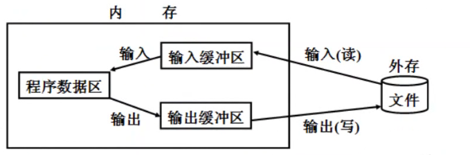
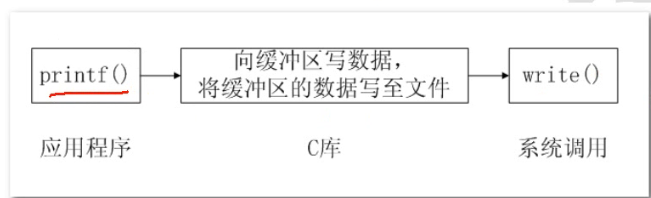

# 1 、系统调用和库函数
## 1-1 、库函数由两类函数组成
* 1、不需要调用系统调用,不需要切换到内核空间即可完成函数的全部功能，并且将结果反馈给应用程序，如strcpy、bzero等字符串操作函数。
			
* 2、需要调用系统调用,需要切换到内核空间,这类函数通过封装的系统调用去实现相应的功能,如printf、fread等
			  	
## 1-2、系统调用与库函数的关系
* 并不是所有系统调用都被封装成为库函数，
* 系统提供的很多功能必须通过系统调用才能实现。
* 也就是大部分的库函数都是由系统调用封装而来。
* 只不过库函数拥有缓冲区，
* 减少了系统调用的次数
### 1-2-1、系统调用特点
* 系统调用是需要时间的，
* 频繁的系统调用会降低程序的运行效率。
* 当运行内核代码时，
* cpu工作在内核态，
* 在系统调用发生前需要保存用户态的栈和内存环境，
* 然后转入内核态工作。
* 结束调用后又返回用户态。
### 1-2-2、库函数的好处
* 库函数访问文件的时候需要根据需要设置不同类型的缓存区，
* 从而减少了直接调用io系统调用
* 的次数，
* 提高了访问的效率。


如：应用程序调用printf时，如下图

# 1、进程
当一个系统启动后，会先后创建3个文件描述符。0、1、2，也就是终端输出，终端输入，错误输出。
## 1-1、进程的定义
* 程序和进程的区别：
程序：是静态的，存放在磁盘上的可执行文件
进程：是动态的，是运行在内存中的程序的执行实例
			 
程序是一些指令的有序集合，而进程是执行程序的过程。进程的状态是变化的。
只要程序运行，此时就是进程，程序每运行一次，就会创建一个进程。
			 
在linux系统中，进程是管理事务的基本单元。进程拥有自己独立的处理环境和系统资源
 （处理器、存储器、io设备、数据、程序）。
##	1-2、进程的状态及转换
进程可以划分为三中状态：
* 就绪态：进程已经具备执行的一切条件，正在等待分配cpu的处理时间。
* 执行态：该进程正在占用cpu运行。
* 等待态：进程因不具备某些执行条件而暂时无法继续执行的状态。比如scanf输入，在没有输入时就是等待态。

## 1-3、进程的调度机制
时间片轮转：如单核cpu，同一时间段内只能运行一个进程，下一个时间段运行第二个进程。上下文切换：
就是比如上部分程序运行了，下部分程序还没有运行被切换到另一个进程中去了。


## 1-4、进程控制块
进程控制块就是用于保存一个进程信息的结构体，又称之为PCB。进程控制块就是一个保存进程信息=结构体，存放在task_struct结构体中。

PCB结构体中的部分数据
	调度数据
		进程的状态、标志、优先级、调度策略等。
	时间数据
		创建该进程的时间、
		在用户态的运行时间
		、在内核态的运行时间等。
	文件系统数据
		umask掩码、文件描述符表等。
		内存数据、进程上下文、进程标识（进程号）
## 1-5、进程号
		每一个进程都由一个进程号来标识，
		类型为pid_t，凡时下划线为_t的数据类型都称为类整型。
		进程号是唯一的，
		但是在一个进程终止后可以重复使用。
		进程号是由操作系统随机给程序分配的。
		
`凡时下划线为_t的数据类型都称为类整型.`

```
ps ajx
```


		PPID：当前进程的父进程的进程号
		PID：当前进程的进程号
		PGID：当前进程组所在的进程组ID，进程组是一个或者多个进程的集合，相互关联，
			进程组可以接收同一个终端信号。
		COMMAND：当前进程的名字
		
		特殊的进程号：
				在linux系统中进程号由0开始。
				进程号0和1由进程创建。
				进程号0通常称之为调度进程，交换进程。
				进程号为1的进程通常是init进程。init是所有进程的祖先。
				除了调度进程外，所有进程都由init进程直接或间接创建。
		
		父子进程的关系就是由谁创建了谁的关系。
	
```
Linux操作系统提供了三个获得进程号的函数
getpid()、getppid()、getpgid()。

linux下提供三个获得进程号的函数 
 #include <sys/types.h>
 #include <unistd.h>
 pid_t getpid(void);
 功能：获取当前进程的进程号
 pid_t getppid(void);
 功能：获取当前进程的父进程的进程号
 pid_t getpgid(pid_t pid);
 功能：获取当前进程所在进程组的id
```

```
/******* 示例 *********/
#include <stdio.h>
#include <sys/types.h>
#include <unistd.h>
int main(int argc,char const *argv[])
{
/********* 获取当前进程的进程号  **********/
printf("pid = %d\n",getpid());
/************ 获取当前进程的父进程id *************/
printf("ppid = %d\n",getppid());
/************ 获取当前进程所在组的id  *************/
printf("pgid = %d\n",getpgid(getpid()));
while(1)
{}

}
```
## 2-6、进程的创建fork函数
		创建进程的方法主要是调用一下两个函数：
```
#include <unistd.h>
pid_t fork(void);
功能：在已有的进程基础上有创建一个子进程
参数：
无
返回值：
成功：
>0 子进程的进程号，标识父进程的代码区
0 子进程的代码区
 失败：
 ‐1 返回给父进程，子进程不会创建
```
	使用fork函数得到的子进程是父进程的一个复制品，
	它从父进程处继承了整个进程的地址空间
	地址空间:
		包括进程上下文、
		进程堆栈、
		打开的文件描述符、
		信号控制设定、
		进程优先级、
		进程组号等。
		子进程所独有的只有它的进程号，
	计时器等。
	因此，
	使用fork函数的代价是很大的。
	fork函数执行完毕后父子进程的空间示意图：
		使用fork函数后：

		
```
#include <stdio.h>
#include <stdlib.h>
#include <unistd.h>
int main(int argc,char const *argv)
{
    /******  通过fork函数创建一个子进程 *******/
     /***********     **************/
 #if 0   
 fork();
    printf("hello world\n");
    while(1);
    return 0;
 #endif
 /****** 通过fork函数的返回值来确定父子进程的独立区代码 ********/
 /********  父子进程是来回交替运行的，谁先允许，后允许，这个是不确定的   **************/
    pid_t pid;
    pid = fork();
    if(pid < 0)
    {   
        perror("fork error");
        return -1;
    }
    else if(pid > 0)
    {
        while(1)
        {
        printf("parent :pid = %d,ppid = %d\r\n",getpid(),getppid());    
        printf("pid = %d\r\n",pid);
        printf("this is parent\n");
        sleep(2);
        printf("**********************************");
        }
    }
    else
    {
     while (1)
     {
        printf("son :pid = %d,ppid = %d\r\n",getpid(),getppid());   
        printf("this is child\n");
        sleep(2);
        printf("**********************************");
     }
return 0;
    }

}
```

```
#include <stdio.h>
#include <stdlib.h>
#include <unistd.h>
int a = 1;
int main(int argc,char const *argv)
{
    /******  通过fork函数创建一个子进程 *******/
     /***********     **************/
 #if 0   
 fork();
    printf("hello world\n");
    while(1);
    return 0;
 #endif
 /****** 通过fork函数的返回值来确定父子进程的独立区代码 ********/
 /********  父子进程是来回交替运行的，谁先允许，后允许，这个是不确定的   **************/
    int b = 2;
    static int c = 3;
    /************** 同时，在fork之前的数据，子进程都会保留，后面无论父进程怎么变（
      堆区栈区数据区），都不会影响子进程***************/
    pid_t pid;
    pid = fork();
    if(pid < 0)
    {   
        perror("fork error");
        return -1;
    }
    else if(pid > 0)
    {

        {
        a++;
        b++;
        c++;
        printf("this is parent a = %d ,b = %d ,c = %d\r\n", a, b, c);
        }
    }
    else
    {
     
     {
        sleep(1);
     printf("this is son a = %d ,b = %d ,c = %d\r\n",a, b, c);
     }
    }
while(1);
return 0;
}
```

```
执行结果
ygc@ygc:~/network/07_fork2$ ./a.out 
this is parent a = 2 ,b = 3 ,c = 4
this is son a = 1 ,b = 2 ,c = 3
^C
```
		从上面可以看出，子进程会在fork之前做数据的继承
		而有内核空间，磁盘空间是进程所共有的，改变偏移量，
		会将偏移指针保存在内核中，所以父进程改变的偏移量会继承到子进程中。
		

```
#include <string.h>
#include <stdio.h>
#include <stdlib.h>
#include <unistd.h>
#include <sys/types.h>
#include <sys/stat.h>
#include <fcntl.h>


int main(int argc,char const *argv)
{
    int fd;
    if((fd = open("file.txt",O_RDONLY)) == -1)
    {
        perror("open file.txt");
        goto filed_open;
    } 
    pid_t pid;
    pid = fork();
    if(pid < 0)
    {   
        perror("filed_fork");
        goto filed_fork;
    }
    else if(pid > 0)
    {
        char buf[32] = " ";
        memset(buf,0,sizeof(buf));
        printf("this is parent\r\n");
        if(read(fd,buf,30) == -1)
        {
            perror("filed_read\r\n");
            goto filed_read;
        }
        printf("buf = [%s]\r\n",buf);

    }
    else
    {
       sleep(1);

        printf("this is son\r\n");    

         char buf[32] = " ";
        memset(buf,0,sizeof(buf));
        printf("this is parent\r\n");
        if(read(fd,buf,30) == -1)
        {
            perror("filed_read\r\n");
            goto filed_read;
        }
        printf("buf = [%s]\r\n",buf);

    }
    
    close(fd);
    while(1);
    return 0;
    filed_read:
    close(fd);
    filed_fork:
    filed_open:
    return -1;
}

```
##	1-7、进程的挂起	
		进程在一段时间内没有任何的动作，称为进程的挂起。
```
 #include <unistd.h>
unsigned int sleep(unsigned int seconds);
 功能：进程在一定的时间内没有任何动作，称为进程的挂起（进程处于等待态）
参数：
 seconds：指定要挂起的秒数
 返回值：
 若进程挂起到sec指定的时间则返回0，若有信号中断则返回剩余秒数
 注意：
 进程挂起指定的秒数后程序并不会立即执行，系统只是将此进程切换到就绪态
```

## 1-8、进程的等待
	Linux进程有时候需要简单的进程之间的同步，如父进程等待子进程的结束。
###	wait函数
```
 #include <sys/types.h>
 #include <sys/wait.h>
 pid_t wait(int *status);
 功能：等待子进程终止，如果子进程终止了，此函数会回收子进程的资源。
 调用wait函数的进程会挂起，直到它的一个子进程退出或收到一个不能被忽视的信号时才
被唤醒。
若调用进程没有子进程或它的子进程已经结束，该函数立即返回。
参数：
status：函数返回时，参数status中包含子进程退出时的状态信息。
子进程的退出信息在一个int中包含了多个字段，
 用宏定义可以取出其中的每个字段
 子进程可以通过exit或者_exit函数发送退出状态
 返回值：
 成功：子进程的进程号。
 失败：‐1
```
	取出子进程的退出信息
	WIFEXITED(status)
	如果子进程是正常终止的，
	取出的字段值非零。
	WEXITSTATUS(status)
	返回子进程的退出状态，
	退出状态保存在status变量的8~16位。
	在用此宏前应先用宏WIFEXITED判断子进程是否正常退出，
	正常退出才可以使用此宏。
	注意：
	此status是个wait的参数指向的整型变量。

```
#include <stdio.h>
#include <stdlib.h>
#include <unistd.h>
#include <sys/types.h>
#include <sys/wait.h>
int main(int argc, char *argv[])
{
    pid_t pid;

    pid=fork();
    if(pid<0)
     {
    perror("fail to fork");
    return ‐1;
    }
    if(pid == 0)
    {
        int i = 0;
        for(i=0;i<5;i++)
         {
          printf("this is son process\n");
         sleep(1);
         }

         //使用exit退出当前进程并设置退出状态
         exit(2);
    }
    else
    {
//使用wait在父进程中阻塞等待子进程的退出
 //不接收子进程的退出状态
 //wait(NULL);

 //接收子进程的退出状态，子进程中必须使用exit或者_exit函数退出进程是发送退出状态
    int status = 0;
    wait(&status);

    if(WIFEXITED(status) != 0)
    {
     printf("The son process return status: %d\n", WEXITSTATUS(status));


    printf("this is father process\n");
    }
    return 0;
    }
}
```
### waitpid函数

```
 #include <sys/types.h>
 #include <sys/wait.h>
 pid_t waitpid(pid_t pid, int *status,int options)
 功能：等待子进程终止，如果子进程终止了，此函数会回收子进程的资源。
 参数：
 pid：指定的进程或者进程组
 pid>0：等待进程ID等于pid的子进程。
 pid=0：等待同一个进程组中的任何子进程，如果子进程已经加入了别的进程组，waitpid
不会等待它。
pid=‐1：等待任一子进程，此时waitpid和wait作用一样。
 pid<‐1：等待指定进程组中的任何子进程，这个进程组的ID等于pid的绝对值
 status：保存子进程退出时的状态信息
 options：选项
 0：同wait，阻塞父进程，等待子进程退出。
 WNOHANG：没有任何已经结束的子进程，则立即返回。
 WUNTRACED：如果子进程暂停了则此函数马上返回，并且不予以理会子进程的结束状态。
（跟踪调试，很少用到）
 返回值：
 成功：返回状态改变了的子进程的进程号；如果设置了选项WNOHANG并且pid指定的进程存
在则返回0。
 失败：返回‐1。当pid所指示的子进程不存在，或此进程存在，但不是调用进程的子进
程，waitpid就会出错返回，这时errno被设置为ECHILD。

 wait(status) <==> waitpid(‐1, status, 0)
```

```
#include <stdio.h>
#include <stdlib.h>
#include <unistd.h>
#include <sys/types.h>
#include <sys/wait.h>
int main(int argc, char *argv[])
{
    pid_t pid;

     pid=fork();
     if(pid < 0)
        {
        perror("fail to fork");
        return ‐1;
        }
     if(pid == 0)
        {
        int i = 0;
        for(i=0;i<5;i++)
            {
            printf("this is son process\n");
            sleep(1);
            }
        exit(0);
        }
     else
        {
        waitpid(pid, NULL, 0);
        printf("this is father process\n");
        }
     return 0;
 }
```


```
两个函数
wait（）、waitpid（）
如果父进程先结束，会打印终端提示符
有返回值。
子进程可以通过exit和_exit发送退出状态。
也可以用宏来取出子进程的退出信息
WIFEXITED(status)
如果子进程是正常终止的，取出的字段值非零。
WEXITSTATUS(status)
返回子进程的退出状态，退出状态保存在status变量8~16位。在
使用前先用宏判断WIFEXITED判断子进程是否正常退出，正常退
出才能使用此宏
```

### 注意
	两个函数都可以回收子进程的资源
#### 特殊进程
	僵尸进程
		子进程已经运行结束，
		父进程没有wait或者waitpid。
		进行子进程资源的回收，就称为僵尸进程。
	孤儿进程
		父进程运行结束，但子进程未运行结束的进程。
	守护进程（精灵进程）
		守护进程是个特殊的孤儿进程，这种进程脱离了终端，在后台运行。
## 1-9、进程的终止
### exit函数
```
 #include <unistd.h>
 void _exit(int status);
 功能：退出当前进程
 参数：
 status：退出状态，由父进程通过wait函数接收这个状态
 一般失败退出设置为非0
 一般成功退出设置为0
 返回值：
 无
```
### _exit函数

```
 #include <stdlib.h>
 void exit(int status);
 功能：退出当前进程
 参数：
 status：退出状态，由父进程通过wait函数接收这个状态
 一般失败退出设置为非0
 一般成功退出设置为0
 返回值：
 无
```
###	exit和_exit函数的区别：
	exit为库函数，而_exit为系统调用
	exit会刷新缓冲区，但是_exit不会刷新缓冲区
	一般会使用exit


```
 #include <stdio.h>
 #include <unistd.h>
 #include <stdlib.h>

 void myfun()
    {
    printf("nihao beijing");

    //使用return
    //return除了可以返回值以外，在主函数中使用可以退出进程，但是在子函数中使用只能退出当前函数
    //return ;

    //使用exit
    //exit可以退出一个进程并且可以刷新缓冲区
    //exit(0);

    //使用_exit
    //_exit可以退出一个进程，但是不会刷新缓冲区
    _exit(0);

    printf("welcome to 1000phone\n");
    }

 int main(int argc, char const *argv[])
    {
    printf("hello world\n");
    
    myfun();
    
    printf("hello kitty\n");
    
    return 0;
    }
```

`return是退出函数，并不是退出进程`
`exit为退出当前的进程`
		
	Linux下可以通过 ：void  exit(int value)
	void _exit(int value)
	
	区别在于：exit为库函数，exit为系统调用
	在文章《进程的退出及错误打印》中有具体用法。
## 1-10、进程退出清理

```
 #include <stdlib.h>
 int atexit(void (*function)(void));\
 功能：注册进程正常结束前调用的函数，进程退出执行注册函数
 参数：
 function：进程结束前，调用函数的入口地址。
 一个进程中可以多次调用atexit函数注册清理函数，
 正常结束前调用函数的顺序和注册时的顺序相反
 返回值：
 成功：0
 失败：非0
```

```
#include <stdio.h>
#include <stdlib.h>
#include <unistd.h>

void clear_fun1(void)
{
	printf("perform clear fun1 \n");
}

void clear_fun2(void)
{
	printf("perform clear fun2 \n");
}

void clear_fun3(void)
{
	printf("perform clear fun3 \n");
}

int main(int argc, char *argv[])
{
    //atexit函数在进程结束时才会去执行参数对应的回调函数
    //atexit多次调用后，执行顺序与调用顺序相反
	atexit(clear_fun1);
	atexit(clear_fun2);
	atexit(clear_fun3);
	printf("process exit 3 sec later!!!\n");
	sleep(3);
	return 0;
}
```


## 1-11、进程的创建---vfork

```
 #include <sys/types.h>
 #include <unistd.h>
 pid_t vfork(void);
 功能：vfork函数和fork函数一样都是在已有的进程中创建一个新的进程，但它们创建的子
进程是有区别的。
 参数：
 无
 返回值:
 成功：子进程中返回0,父进程中返回子进程ID
 失败：‐1。
```
fork和vfork函数的区别：
vfork保证子进程先运行，
在它调用exec或exit之后，
父进程才可能被调度运行。
vfork和fork一样都创建一个子进程，
但它并不将父进程的地址空间完全复制到子进程中，
因为子进程会立即调用exec(或exit)，
于是也就不访问该地址空间。
相反，
在子进程中调用exec或exit之前，
它在父进程的地址空间中运行，
在exec之后子进程会有自己的进程空间。

### 1-11-1、子进程在父进程之前运行

```
#include <stdio.h>
#include <stdlib.h>
#include <unistd.h>
int main(int argc, char *argv[])
    {
    pid_t pid;
    //使用vfork函数创建完子进程后
    //子进程会先执行，直到子进程执行exit或者exec后，父进程才会执行
     pid = vfork();
     if(pid < 0)
         {
         perror("fail to vfork");
         exit(1);
         }
     if(pid == 0) //子进程的代码区
         {
         int i = 0;
         for(i=0;i<5;i++)
            {
            printf("this is son process\n");
            sleep(1);
            }
         exit(0);
         }
     else //父进程代码区
         {
         while(1)
            {
            printf("this is father process\n");
            sleep(1);
            }
         }

     return 0;
     }

```

### 1-11-2、子进程和父进程共享同一块空间

```
#include <stdio.h>
#include <stdlib.h>
#include <unistd.h>
int a = 10;
int main(int argc, char *argv[])
    {
    pid_t pid;
    int b = 9;

     //使用vfork创建完子进程
     //在子进程执行exit或者exec之前，父子进程共有同一块地址空间
     pid = vfork();
     if(pid < 0)
        {
        perror("fail to vfork");
        exit(1);
        }
     if(pid == 0)
        {
        a++;
        b++;
        printf("in son process a=%d, b=%d\n", a, b);
        exit(0);
        }
     else
         {
         printf("in father process a=%d, b=%d\n", a, b);
         }
     return 0;
     }

```

### 1-12、 进程的替换
	进程的替换：
	exec函数族，
	是由六个exec函数组成的。
	1、exec函数族提供了六种在进程中启动另一个程序的方法。
	2、exec函数族可以根据指定的文件名或目录名找到可执行文件。
	3、调用exec函数的进程并不创建新的进程，
	故调用exec前后，进程的进程号并不会改变，
	其执行的程序完全由新的程序替换，
	而新程序则从其main函数开始执行。
	exec函数族取代调用进程的数据段、
	代码段和堆栈段。


	一个进程调用exec后，除了进程ID，进程还保留了下列特征不变：
	父进程号
	进程组号
	控制终端
	根目录
	当前工作目录
	进程信号屏蔽集
	未处理信号
	...

```
exec函数族
#include <unistd.h>
int execl(const char *path, const char *arg, .../* (char *) NULL */);
int execlp(const char *file, const char *arg, .../* (char *) NULL */);
int execv(const char *path, char *const argv[]);
int execvp(const char *file, char *const argv[]);
int execle(const char *path, const char *arg, .../*, (char *) NULL*/, cha
* const envp[] );
int execvpe(const char *file, char *const argv[], char *const envp[]);
功能：在一个进程里面执行另一个程序，主要用于执行命令
 参数：
 path：命令或者程序的路径
 l：如果是带l的函数，对应的命令或者程序是通过每一个参数进行传
 递的，最后一个为NULL表示结束
 例如："ls", "‐l", NULL
 v:如果是带v的函数，对应的命令或者程序是通过一个指针数组来传递的，
 指针数组的最后一个元素为NULL标识结束
 char *str[] = {"ls", "‐l", NULL};
 p：如果是不带p的函数，第一个参数必须传当前命令或者程序的绝对路径，
 如果是带p的函数，第一个参数既可以是绝对路径，也可以是相对路径
 返回值：
 失败：‐1
```

	案例：
	

```
 #include <stdio.h>
 #include <stdlib.h>
 #include <unistd.h>
 #include <sys/types.h>
 #include <sys/wait.h>

 int main(int argc, char const *argv[])
    {
    pid_t pid;
     if((pid = fork()) < 0)
        {
        perror("fail to fork");
        exit(1);
         }
     else if(pid > 0) //父进程
        {
        printf("This is parent process\n");

        wait(NULL);
        printf("The child process has quited\n");
        }
     else //子进程
        {
        printf("This is child process\n");

        //调用exec函数族中的函数，执行其他命令或者程序
        //查看命令的路径：whereis 命令或者which 命令

        //***************exec函数族调用shell命令******************
        //不带p的函数，命令的路径一定要用绝对路径
        #if 0
        if(execl("/bin/ls", "ls", "-l", NULL) == -1)
            {
            perror("fail to execl");
            exit(1);
            }
        #endif

        //带p的函数，第一个参数既可以是相对路径，也可以是绝对路径
        #if 0
        if(execlp("ls", "ls", "-l", NULL) == -1)
            {
            perror("fail to execlp");
            exit(1);
            }
        #endif

        //带v的函数需要使用指针数组来传递
        #if 0
        char *str[] = {"ls", "-l", NULL};
        if(execv("/bin/ls", str) == -1)
            {
            perror("fail to execv");
            exit(1);
            }
        #endif
        //***************exec函数族调用可执行文件******************
        #if 0
        if(execlp("./hello", "./hello", NULL) == -1)
            {
            perror("fail to execlp");
            exit(1);
            }
        #endif

        #if 0
        if(execl("./hello", "./hello", NULL) == -1)
            {
            perror("fail to execl");
            exit(1);
            }
        #endif

        //***************exec函数族调用shell脚本******************
        #if 1
        if(execlp("./myshell.sh", "./myshell.sh", NULL) == -1)
            {
            perror("fail to execl");
            exit(1);
            }
        #endif
        //exec函数族取代调用进程的数据段、代码段和堆栈段
        //所以当exec函数执行完毕后，当前进程就结束了，所以原本进程中的代码不会再执行
        printf("hello world\n");
        }
    
     return 0;
     }
```
### 1-13、system函数

```
 #include <stdlib.h>
 int system(const char *command);
 功能：执行一个shell命令（shell命令、可执行文件、shell脚本）
 system会调用fork函数产生子进程，
 子进程调用exec启动/bin/sh ‐c string
 来执行参数string字符串所代表的命令，
 此命令执行完后返回原调用进程
 参数：
 command：要执行的命令的字符串
 返回值：
 如果command为NULL，则system()函数返回非0，一般为1。
 如果system()在调用/bin/sh时失败则返回127，其它失败原因返回‐1
```
` 此命令执行完后返回原调用进程`
`与exec区别`


```
#include <stdio.h>
#include <stdlib.h>
int main(int argc, char const *argv[])
{
//使用system执行shell命令
system("clear");
system("ls -l");

 system("./hello");

 system("./myshell.sh");

 return 0;
 }
```
# 2、进程之间的通信
	进程间通信(IPC:Inter Processes Communication)
	进程是一个独立的资源分配单元，
	不同进程（这里所说的进程通常指的是用户进程）之间的资源是独立的，
	没有关联，
	不能在一个进程中直接访问另一个进程的资源
	（例如打开的文件描述符）。
	进程不是孤立的，
	不同的进程需要进行信息的交互和状态的传递等，
	因此需要进程间通信。


	进程间通信功能：
	数据传输：一个进程需要将它的数据发送给另一个进程。
	资源共享：多个进程之间共享同样的资源。
	通知事件：一个进程需要向另一个或一组进程发送消息，
	通知它们发生了某种事件。
	进程控制：有些进程希望完全控制另一个进程的执行（如Debug进程），
	此时控制进程。
	希望能够拦截另一个进程的所有操作，
	并能够及时知道它的状态改变。

	Linux操作系统支持的主要进程间通信的通信机制


	
	进程间通信的实质：
	系统只要创建一个进程，
	就会给当前进程分配4G的虚拟内存（32位操作系统），
	虚拟内存不是常说的内存条的空间，
	内存条的空间称之为物理内存，
	虚拟内存和物理内存之间存在映射关系
	4G的虚拟内存分为3G的用户空间
	（0~3G）和1G（3~4G）的内核空间，
	用户空间是进程所私有的，
	每一个进程的用户空间只能自己访问和使用，
	我们之前说的栈区、堆区、数据区、
	代码区等都是用户空间的区域内核空间是所有进程所公有的，
	也就意味着绝大多数进程间通信方式，
	本质就是对内核空间的操作
	特殊的进程间通信方式：
	socket通信可以实现不同主机的进程间通信，
	其他六个只能在一台主机的多个进程间通信
	信号通信是唯一的一种异步通信机制
	共享内存是所有进程间通信方式中效率最高的，
	他是直接对物理内存进行操作。

## 2-1、信号
### 2-1-1、信号的概念：
	信号是软件中断，
		它是在软件层次上对中断机制的一种模拟。
	信号可以导致一个正在运行的进程被另一个正在运行的异步进程中断，
	转而处理某一个突发事件。
	信号是一种异步通信方式。
	进程不必等待信号的到达，
	进程也不知道信号什么时候到达。
	信号可以直接进行用户空间进程和内核空间进程的交互，
	内核进程可以利用它来通知用户空间进程发生了哪些系统事件。
	每个信号的名字都以字符SIG开头。
	每个信号和一个数字编码相对应，
	在头文件signum.h中，
	这些信号都被定义为正整数。
	信号名定义路径：
	/usr/include/i386-linux-gnu/bits/signum.h （ubuntu12.04）
	/usr/include/x86_64-linux-gnu/bits/signum.h （ubuntu16.04）

	在Linux下，要想查看这些信号和编码的对应关系，可使用命令：kill ­l


	
	信号是由当前系统已经定义好的一些标识，
	每一个标识都会在特定的场合使用
	并且都会对进程有一定的影响，
	当信号产生时，
	会让当前信号做出相应的操作
	这些信号都是已经定义好的，
	我们不能自己再去创造，
	直接使用这些就可以。

### 2.1.2 产生信号的方式
	1、当用户按某些终端键时，
	将产生信号
	例如：终端上按“Ctrl+c”组合键通常产生中断信号SIGINT、
	终端上按"Ctrl+\"键通常产生中断信号SIGQUIT、
	终端上按"Ctrl+z"键通常产生中断信号SIGSTOP。
	2、硬件异常将产生信号除数为0，
	无效的内存访问等。
	这些情况通常由硬件检测到，
	并通知内核,然后内核产生
	适当的信号发送给相应的进程。
	3、软件异常将产生信号。
	当检测到某种软件条件已发生，
	并将其通知有关进程时，
	产生信号。
	4、调用kill函数将发送信号。
	注意：接收信号进程和发送信号进程的所有者必须相同，
	或发送信号进程的所有者必须是超级用户。
	5、运行kill命令将发送信号。
	此程序实际上是使用kill函数来发送信号。
	也常用此命令终止一个失控的后台进程。


### 2-1-3 信号的默认（缺省）处理方式
	当进程中产生了一个信号，
	就会让当前进程做出一定的反应，
	默认处理进程的方式如下
	1、终止进程：当信号产生后，
	当前进程就会立即结束。
	2、缺省处理：当信号产生后，
	当前进程不做任何处理。
	3、停止进程：当信号产生后，
	使得当前进程停止。
	4、让停止的进程回复运行：当信号产生后，
	停止的进程会回复执行（后台进程）。
	注意：每一个信号只有一个默认的处理方式

### 2-1-4 进程接收到信号后的处理方式
	1、执行系统默认动作
	对大多数信号来说，
	系统默认动作是用来终止该进程。
	2、忽略此信号
	接收到此信号后没有任何动作。
	3、执行自定义信号处理函数
	用用户定义的信号处理函数处理该信号。
	注意：	
	SIGKILL和SIGSTOP这两个信号只能以默认的处理方式执行，
	不能忽略也不能自定义
### 2-1-5 常见的信号
	信号 		值 			性质 												默认处理方式
	SIGKILL 	9		 当产生这个信号后，当前进程会退出，不能被缺省和捕捉		退出进程
	SIGSTOP 	19		 当产生这个信号后，当前进程会停止，不能被缺省和捕捉		停止进程
	SIGINT		 2		 键盘输入ctrl+c时产生信号 								退出进程
	SIGQUIT		 3 		 键盘输入ctrl+\时产生信号 								退出进程
	SIGTSTP		 20		 键盘输入ctrl+z时产生信号 								停止进程
	SIGCONT		 18		 当产生当前信号后，当前停止的进程会恢复运行				停止的进程恢复运行
	SIGALRM 	14		 当调用alarm函数设置的时间到达时会产生当前信号				退出进程
	SIGPIPE		 13 	当管道破裂时，会产生当前信号 								退出进程
	SIGABRT 	6		 当调用abort函数时会产生当前信号 							退出进程
	SIGCHLD 	17		当使用fork创建一个子进程时，如果子进程状态改变（退出），
	会产生当前信号																缺省
	SIGUSR1 	10		用户自定义信号，不会自动产生，只能
	使用kill函数或者命令给指定的进程发送当前信号									缺省
	SIGUSR2 	12		用户自定义信号，不会自动产生，
	只能使用kill函数或者命令给指定的进程发送当前信号								缺省

## 2-2、 kill函数
	kill并不是杀死的意思，
	是表示对进程发送一个信号。
```
#include <sys/types.h>
#include <signal.h>
int kill(pid_t pid, int sig);
功能：给指定的进程或者进程组发送信号
参数：
pid：
pid>0: 将信号传送给进程ID为pid的进程。
pid=0: 将信号传送给当前进程所在进程组中的所有进程。
pid=‐1: 将信号传送给系统内所有的进程，除了init进程
 pid<‐1: 将信号传给指定进程组的所有进程。这个进程组号等于pid的绝对值。
 sig：指定的信号
 返回值：
 成功：0
 失败：‐1
```
	案例
```
#include <stdio.h>
#include <stdlib.h>
#include <unistd.h>
#include <signal.h>
#include <sys/types.h>
int main(int argc, char *argv[])
    {
    pid_t pid;

     pid = fork();
     if(pid < 0)
        {
        perror("fail to fork");
        exit(1);
        }
     else if(pid > 0) //父进程的代码区
        {
        while(1)
            {
            printf("This is parent peocess\n");

            sleep(1);
            }
        }
     else //子进程的代码区
         {
         printf("This is son process\n");

         //子进程在3秒之后，让父进程退出
         sleep(3);

         //使用kill给父进程发送信号，然后父进程接收到信号后直接退出就可以了
         kill(getppid(), SIGINT);
         }

     return 0;
     }
```


## 2-3、alarm函数

```
 #include <unistd.h>
 unsigned int alarm(unsigned int seconds);
 功能：定时器，闹钟，当设定的时间到达时，会产生SIGALRM信号
 参数：
 seconds：设定的秒数
 返回值：
 如果alarm函数之前没有alarm设置，则返回0
 如果有，则返回上一个alarm剩余的时间
```
	案例
```
 #include <stdio.h>
 #include <unistd.h>

 int main(int argc, char *argv[])
     {
     unsigned int sec;
     //当执行到alarm之后，代码会接着往下执行，当设定的时间到后，会产生SIGALRM信号

     //如果alarm之前没有设置其他闹钟，则返回0，如果之前设置了，则返回之前剩余的秒数
     //如果一个程序中出现多个alarm闹钟，第一个如果没有到达指定的时间就遇到第二个
     //则第一个的闹钟时间清除，按照第二个alarm闹钟的时间继续向下运行

     sec = alarm(5);
     printf("sec = %d\n", sec);

     sleep(3);

     sec = alarm(6);
     printf("sec = %d\n", sec);

     while(1)
         {
         printf("hello world\n");
         sleep(1);
         }

     return 0;
     }
```

	
	第二个定时被重重了，
	剩余时间被清楚，
	按照第二个的时间进行。
	
## 2-4、 raise函数

```
#include <signal.h>
int raise(int sig);
功能：给调用进程本身发送信号
参数：
sig：指定的信号
返回值：
成功：0
失败：非0
 raise(sig) <==> kill(getpid(), sig)
```

```
#include <stdio.h>
#include <stdlib.h>
#include <signal.h>
#include <unistd.h>
#include <sys/types.h>
int main(int argc, char const *argv[])
{
int num = 0;

 while(1)
    {  
    printf("hello world\n");
    sleep(1);
    num++;
    
    //当循环执行5秒后，进程退出
    if(num == 5)
        {
        //使用raise给当前进程本身发送信号
        raise(SIGALRM);
        //kill(getpid(), SIGALRM);
        }
    }
    
    return 0;
 }
```

## 2-5、 abort函数

```
 #include <stdlib.h>
void abort(void);
功能：向进程发送一个SIGABRT信号，默认情况下进程会退出。
参数：无
返回值：无
```

	注意：
	即使SIGABRT信号被加入阻塞集，一旦进程调用了abort函数，进程也还是会被终止，
	且在终止前会刷新缓冲区，关闭文件描述符。

```
#include <stdio.h>
#include <stdlib.h>
#include <signal.h>
#include <unistd.h>
#include <sys/types.h>
int main(int argc, char const *argv[])
{
int num = 0;

 while(1)
 {
 printf("hello world\n");
 sleep(1);
 num++;

 //当循环执行5秒后，进程退出
 if(num == 5)
 {
 abort();
 }
 }

 return 0;
 }
```

## 2-6、 pause函数

```
 #include <unistd.h>
 int pause(void);
 功能：阻塞等待一个信号的产生
 参数：
 无
 返回值：
 当有信号产生时，函数返回‐1
```

```
#include <stdio.h>
#include <stdlib.h>
#include <unistd.h>
#include <signal.h>
#include <sys/types.h>
int main(int argc, char *argv[])
    {
    pid_t pid;

     pid = fork();
     if(pid < 0)
        {
        perror("fail to fork");
        exit(1);
        }
     else if(pid > 0) //父进程的代码区
        {
        printf("This is parent peocess\n");

        //使用pause阻塞等待捕捉信号
        pause();
        }
     else //子进程的代码区
         {
         printf("This is son process\n");

         sleep(3);

         kill(getppid(), SIGINT);
         }

     return 0;
     }
```

## 2-7、 signal函数
```
#include <signal.h>
void (*signal(int sig, void (*func)(int)))(int);
‐‐>
typedef void (*sighandler_t)(int);
sighandler_t signal(int signum, sighandler_t handler);
功能：当进程中产生某一个信号时，对当前信号进行处理
参数：
sig：指定要处理的信号                                                                                                                                                                                                                                                                                                                                                                                                                                                
handler：处理方式
 SIG_IGN 当信号产生时，以缺省（忽略）的方式处理
 SIG_DFL 当信号产生时，以当前信号默认的方式处理
 void handler(int sig)：当信号产生时，通过信号处
 理函数自定义方式处理，函数名可以随便写，
 参数表示当前的信号
 返回值：
 成功：返回函数地址，该地址为此信号上一次注册的信号处理函数的地址
 失败：SIG_ERR
```
	案例
```
#include <stdio.h>
#include <signal.h>
#include <unistd.h>
#include <stdlib.h>
void handler(int sig);
int main(int argc, char const *argv[])
{
 //以默认的方式处理信号
 #if 0
 if(signal(SIGINT, SIG_DFL) == SIG_ERR)
    {
    perror("fail to signal");
    exit(1);
    }
 if(signal(SIGQUIT, SIG_DFL) == SIG_ERR)
    {
    perror("fail to signal");
    exit(1);
    }
 if(signal(SIGTSTP, SIG_DFL) == SIG_ERR)
    {
    perror("fail to signal");
    exit(1);
    }
 #endif

 //以忽略的方式来处理信号
 #if 0
 if(signal(SIGINT, SIG_IGN) == SIG_ERR)
    {
    perror("fail to signal");
    exit(1);
    }
 if(signal(SIGQUIT, SIG_IGN) == SIG_ERR)
     {
     perror("fail to signal");
     exit(1);
     }
 if(signal(SIGTSTP, SIG_IGN) == SIG_ERR)
    {
    perror("fail to signal");
    exit(1);
    }

 //注意：SIGKILL和SIGSTOP这两个信号只能以默认的方式处理，不能忽略或者捕捉
 // if(signal(SIGKILL, SIG_IGN) == SIG_ERR)
 // {
 // perror("fail to signal");
 // exit(1);
 // }

 #endif

 //以用户自定义方式处理信号
 #if 1
 if(signal(SIGINT, handler) == SIG_ERR)
     {
     perror("fail to signal");
     exit(1);
     }
 if(signal(SIGQUIT, handler) == SIG_ERR)
    {
    perror("fail to signal");
    exit(1);
    }
 if(signal(SIGTSTP, handler) == SIG_ERR)
     {
     perror("fail to signal");
     exit(1);
     }
 #endif
 while(1)
     {
     printf("hello world\n");
     sleep(1);
     }

 return 0;
 }

 void handler(int sig)
 {
 if(sig == SIGINT)
    {
    printf("SIGINT正在处理\n");
    }

 if(sig == SIGQUIT)
     {
     printf("SIGQUIT正在处理\n");
     }

 if(sig == SIGTSTP)
     {
     printf("SIGTSTP正在处理\n");
     }
 }
```
	返回值
	

```
#include <stdio.h>
#include <stdlib.h>
#include <signal.h>
#include <unistd.h>
void *ret_handler;
void handler(int sig)
{
    printf("**********************\n");
    printf("nihao beijing\n");
     printf("welcome to 1000phone\n");
     printf("**********************\n");

     if(signal(SIGINT, ret_handler) == SIG_ERR)
    {
    perror("fail to signal");
    exit(1);
    }
 }

 int main(int argc, char const *argv[])
 {
 if((ret_handler = signal(SIGINT, handler)) == SIG_ERR)
    {
    perror("fail to signal");
    exit(1);
    }

 while(1)
    {
    printf("hello world\n");
    sleep(1);
    }

 return 0;
 }
```
`	signal的返回值返回的是当前处理方式的上一次处理的方式`


## 2-8、 可重入函数
	可重入函数是指函数可以由多个任务并发使用，
	而不必担心数据错误。
	可重入函数就是可以被中断的函数，
	当前函数可以在任何时刻中断它，
	并执行另一块代码，
	当执行完毕后，
	回到原本的代码还可以正常继续运行。

	编写可重入函数：
	1、不使用（返回）静态的数据、全局变量（除非用信号量互斥）。
	2、不调用动态内存分配、释放的函数。
	3、不调用任何不可重入的函数（如标准I/O函数）。
	注：
		即使信号处理函数使用的都是可重入函数（常见的可重入函数），也要注意进入处理函
	数时，首先要保存errno的值，结束时，再恢复原值。因为，信号处理过程中，errno值随
	时可能被改变。


	案例
```
#include <stdio.h>
#include <stdlib.h>
#include <unistd.h>
#include <sys/types.h>
#include <sys/stat.h>
#include <fcntl.h>
#include <signal.h>
void handler(int sig)
 {
 printf("SIGINT\n");
 }

 int main(int argc, char *argv[])
 {
 signal(SIGINT, handler);

 //案例1：
 #if 0
 //sleep是一个可重入函数，但是当执行信号处理函数之后，不会回到原本的位置继续睡眠
 //sleep(10);

 //alarm函数是一个可重入函数，当他执行时，如果有信号产生并执行信号处理函数，执行完毕后，会继续运行
 alarm(10);

 while(1)
    {
    printf("hello world\n");
    sleep(1);
    }
 #endif

 //案例2：
 #if 1
 char buf[32] = "";

 //read也是一个可重入函数，在等待终端输入时，如果产生信号并执行信号处理函数，信号处理
 //函数执行完毕后，可以继续输入数据，read可以读取到信号处理函数之后的数据
 if(read(0, buf, 20) == -1)
     {
     perror("fail to read");
     exit(1);
     }

 printf("buf = [%s]\n", buf);
 #endif
 return 0;
 }
```

## 2-9、 信号集
	信号集概述
	一个用户进程常常需要对多个信号做出处理。
	为了方便对多个信号进行处理，
	在Linux系统中引入了信号集。
	信号集是用来表示多个信号的数据类型。

	信号集数据类型
	sigset_t
	定义路径：
	/usr/include/i386-linux-gnu/bits/sigset.h (ubuntu 12.04)
	/usr/include/x86_64-linux-gnu/bits/sigset.h (ubuntu16.04)

信号集相关的操作主要有如下几个函数：
`sigemptyset`
`sigfillset`
`sigismember`
`sigaddset`
`sigdelset`

```
1 ‐‐ sigemptyset()
#include <signal.h>
int sigemptyset(sigset_t *set)；
功能：
初始化由set指向的信号集，清除其中所有的信号即初始化一个空信号集。
参数：
set：信号集标识的地址，以后操作此信号集，对set进行操作就可以了。
返回值:
成功返回 0
 失败返回 ‐1

 2 ‐‐ sigfillset()
 #include <signal.h>
 int sigfillset(sigset_t *set)；
 功能：
 初始化信号集合set, 将信号集合设置为所有信号的集合。
 参数：
 信号集标识的地址，以后操作此信号集，对set进行操作就可以了。
 返回值:
 成功返回 0
 失败返回 ‐1

 3 ‐‐ sigismember()
 #include <signal.h>
 int sigismember(const sigset_t *set,int signum);
 功能：
 查询signum标识的信号是否在信号集合set之中。
 参数：
 set：信号集标识符号的地址。
 signum：信号的编号。
 返回值:
 成功：在信号集中返回 1，不在信号集中返回 0
 错误：返回 ‐1

 4 ‐‐ sigaddset()
 #include <signal.h>
 int sigaddset(sigset_t *set, int signum);
 功能：
 将信号signum加入到信号集合set之中。
 参数：
 set：信号集标识的地址。
 signum：信号的编号。
 返回值:
 成功返回 0
 失败返回 ‐1

 5 ‐‐ sigdelset()
 #include <signal.h>
 int sigdelset(sigset_t *set, int signum);
 功能：
 将signum所标识的信号从信号集合set中删除。
 参数：
 set：信号集标识的地址。
 signum：信号的编号。
 返回值:
 成功：返回 0
 失败：返回 ‐1
```
	案例
```
#include <signal.h>
#include <stdio.h>
int main(int argc, char *argv[])
{
//创建一个信号集
sigset_t set;
int ret = 0;
 //初始化一个空的信号集
 sigemptyset(&set);

 //判断SIGINT信号是否在信号集中
 ret = sigismember(&set, SIGINT);
 if(ret == 0)
 {
 printf("SIGINT is not a member of sigprocmask \nret = %d\n", ret);
 }

 //将指定的信号添加到信号集中
 sigaddset(&set, SIGINT);
 sigaddset(&set, SIGQUIT);

 ret = sigismember(&set, SIGINT);
 if(ret == 1)
 {
 printf("SIGINT is a member of sigprocmask \nret = %d\n", ret);
 }

 return 0;
 }
```

## 2-10、 信号阻塞集
	每个进程都有一个阻塞集，
	它用来描述哪些信号递送到该进程的时候被阻塞(在信号发生时记住它，
	直到进程准备好时再将信号通知进程)。
	所谓阻塞并不是禁止传送信号, 
	而是暂缓信号的传送。
	若将被阻塞的信号从信号阻塞集中删除，
	且对应的信号在被阻塞时发生了，
	进程将会收到相应的信号。

```
 #include <signal.h>
 int sigprocmask(int how, const sigset_t *set, sigset_t *oldset)；
 功能：检查或修改信号阻塞集，根据how指定的方法对进程的阻塞集合进行修改，新的信号阻塞集由set指定，而原先的信号阻塞集合由oldset保存。
 参数：
 how：信号阻塞集合的修改方法。
 SIG_BLOCK：向信号阻塞集合中添加set信号集
 SIG_UNBLOCK：从信号阻塞集合中删除set集合
 SIG_SETMASK：将信号阻塞集合设为set集合
 set：要操作的信号集地址。
 oldset：保存原先信号集地址。
 注：若set为NULL，则不改变信号阻塞集合，函数只把当前信号阻塞集合保存到oldset中。
 返回值:
 成功：返回 0
 失败：返回 ‐1
```

```
#include <stdio.h>
#include <stdlib.h>
#include <unistd.h>
#include <signal.h>
int main(int argc, char *argv[])
{
int i=0;
 //创建信号集并在信号集中添加信号
 sigset_t set;
 sigemptyset(&set);
 sigaddset(&set, SIGINT);

 while(1)
    {
    //将set信号集添加到信号阻塞集中
    sigprocmask(SIG_BLOCK, &set, NULL);
    for(i=0; i<5; i++)
         {
         printf("SIGINT signal is blocked\n");
         sleep(1);
         }

    //将set信号集从信号阻塞集中删除
    sigprocmask(SIG_UNBLOCK, &set, NULL);
    for(i=0; i<5; i++)
        {
        printf("SIGINT signal unblocked\n");
        sleep(1);
        }
    }
 return 0;
 }
```


# 3、管道
## 3-1、无名管道概述
	管道(pipe)又称无名管道。
	无名管道是一种特殊类型的文件，
	在应用层体现为两个打开的文件描述符。
	任何一个进程在创建的时候，
	系统都会 给他分配4G的虚拟内存，分为3G的用户空间和1G
	的内核空间，内核空间是所有进程公有的，
`无名管道就是创建在内核空间的`,
	
	多个进程知道同一个无名管道的空间，
	就可以利用他来进行通信


	无名管道虽然是在内核空间创建的，
	但是会给当前用户进程两个文件描述符，
	一个负责执行读操作，
	一个负责执行写操作。

管道是最古老的UNIX IPC方式，其特点是:
1、半双工，数据在同一时刻只能在一个方向上流动。
`2、数据只能从管道的一端写入，从另一端读出。`
3、写入管道中的数据遵循先入先出的规则。
4、管道所传送的数据是无格式的，这要求管道的读出方与写入方必须事先约定好数据的格
式，如多少字节算一个消息等。
`5、管道不是普通的文件，不属于某个文件系统，其只存在于内存中。`
6、管道在内存中对应一个缓冲区。不同的系统其大小不一定相同。
7、从管道读数据是一次性操作，数据一旦被读走，它就从管道中被抛弃，释放空间以便写
更多的数据。
`8、管道没有名字，只能在具有公共祖先的进程之间使用`

```
1 #include <unistd.h>
2 int pipe(int pipefd[2]);
3 功能：创建一个有名管道，返回两个文件描述符负责对管道进行读写操作
4 参数：
5 pipefd：int型数组的首地址，里面有两个元素
6 pipefd[0] 负责对管道执行读操作
7 pipefd[1] 负责对管道执行写操作
8 返回值：
9 成功：0
10 失败：‐1
```
	案例
```
#include <stdio.h>
#include <stdlib.h>
#include <unistd.h>
#include <string.h>
int main(int argc, char const *argv[])
{
//使用pipe创建一个无名管道
int fd_pipe[2];
 if(pipe(fd_pipe) == -1)
     {
     perror("fail to pipe");
     exit(1);
     }

 printf("fd_pipe[0] = %d\n", fd_pipe[0]);
 printf("fd_pipe[1] = %d\n", fd_pipe[1]);

 //对无名管道执行读写操作
 //由于无名管道给当前用户进程两个文件描述符，所以只要操作这两个文件
 //描述符就可以操作无名管道，所以通过文件IO中的read和write函数对无名管道进行操作

 //通过write函数向无名管道中写入数据
 //fd_pipe[1]负责执行写操作
 //如果管道中有数据，再次写入的数据会放在之前数据的后面，不会把之前的数据替换
 if(write(fd_pipe[1], "hello world", 11) == -1)
     {
     perror("fail to write");
     exit(1);
     }

 write(fd_pipe[1], "nihao beijing", strlen("nihao beijing")+1);

 //通过read函数从无名管道中读取数据
 //fd_pipe[0]负责执行读操作
 //读取数据时，直接从管道中读取指定个数的数据，如果管道中没有数据了，则read函数会阻塞等待
 char buf[32] = "";
 ssize_t bytes;
 if((bytes = read(fd_pipe[0], buf, 20)) == -1)
    {
    perror("fail to read");
    exit(1);
    }

 printf("buf = [%s]\n", buf);
 printf("bytes = %ld\n", bytes); 

 bytes = read(fd_pipe[0], buf, sizeof(buf));
 printf("buf = [%s]\n", buf);
 printf("bytes = %ld\n", bytes);

 bytes = read(fd_pipe[0], buf, sizeof(buf));
 printf("buf = [%s]\n", buf);
 printf("bytes = %ld\n", bytes);

 return 0;
 }

```
## 3-2、 无名管道实现进程间通信

```
#include <stdio.h>
#include <stdlib.h>
#include <unistd.h>
#include <string.h>
//使用无名管道实现父子进程间的通信
//由于无名管道创建之后给当前进程两个文件描述符，所以如果是完全不相关的进程
//无法获取同一个无名管道的文件描述符，所以无名管道只能在具有亲缘关系的进程间通信
 int main(int argc, char const *argv[])
 {
 //创建一个无名管道
 int pipefd[2];
 if(pipe(pipefd) == -1)
    {
    perror("fail to pipe");
    exit(1);
    }

 //使用fork函数创建子进程
 pid_t pid;
 if((pid = fork()) < 0)
     {
     perror("fail to fork");
     exit(1);
     }
 else if(pid > 0) // 父进程
     {
     //父进程负责给子进程发送数据
     char buf[128] = {};
     while(1)
         {
         fgets(buf, sizeof(buf), stdin);
         buf[strlen(buf) - 1] = '\0';
        
         if(write(pipefd[1], buf, sizeof(buf)) == -1)
             {
             perror("fail to write");
             exit(1);
             }
         }
     }
 else //子进程
     {
     //子进程接收父进程的数据
     char buf[128] = "";
     while(1)
         {
         if(read(pipefd[0], buf, sizeof(buf)) == -1)
            {
            perror("fail to read");
            exit(1);
            }

         printf("from parent: %s\n", buf);
         }
     }

 return 0;
 }
```


	可以在上面的基础上再创建一个无名管道，
	两个进程之间进行互相读写操作。
	注意：
	利用无名管道实现进程间的通信，
	都是父进程创建无名管道，
	然后再创建子进程，
	子进程继承父进程的无名管道的文件描述符，
	然后父子进程通过读写无名管道实现通信。
## 3-3、无名管道的读写规律
### 3-3-1、读写端都存在，只读不写

```
#include <stdio.h>
#include <stdlib.h>
#include <unistd.h>
int main(int argc, char const *argv[])
{
int pipefd[2];
if(pipe(pipefd) == -1)
{
 perror("fail to pipe");
 exit(1);
 }

 //读写端都存在，只读不写
 //如果管道中有数据，会正常读取数据
 //如果管道中没有数据，则读操作会阻塞等待，直到有数据为止

 write(pipefd[1], "hello world", 11);

 char buf[128] = "";
 if(read(pipefd[0], buf, sizeof(buf)) == -1)
 {
 perror("fail to read");
 exit(1);
 }

 printf("buf = %s\n", buf);

 if(read(pipefd[0], buf, sizeof(buf)) == -1)
 {
 perror("fail to read");
 exit(1);
 }

 printf("buf = %s\n", buf);

 return 0;
 }
```


	读完之后会阻塞

### 3-3-2、读写端都存在，只写不读

```
#include <stdio.h>
#include <stdlib.h>
#include <unistd.h>
int main(int argc, char const *argv[])
{
int pipefd[2];
if(pipe(pipefd) == -1)
{
 perror("fail to pipe");
 exit(1);
 }

 //读写端都存在，只写不读
 //如果一直执行写操作，则无名管道对应的缓冲区会被写满，写满之后，write函数会阻塞等待
 //默认无名管道的缓冲区64K字节

 int num = 0;
 while(1)
 {
 if(write(pipefd[1], "6666", 1024) == -1)
 {
 perror("fail to write");
 exit(1);
 }
 num++;
 printf("num = %d\n", num);
 }

 return 0;
 }
```


### 3-3-3、只有读端，没有写端

```
#include <stdio.h>
#include <stdlib.h>
#include <unistd.h>
#include <string.h>
int main(int argc, char const *argv[])
{
int pipefd[2];
if(pipe(pipefd) == -1)
 {
 perror("fail to pipe");
 exit(1);
 }

 write(pipefd[1], "hello world",11);

 //关闭写文件描述符，只有读端
 //如果原本管道中有数据，则读操作正常读取数据
 //如果管道中没有数据，则read函数会返回0
 close(pipefd[1]);

 char buf[128] = "";
 ssize_t bytes;
 if((bytes = read(pipefd[0], buf, sizeof(buf))) == -1)
 {
 perror("fail to read");
 exit(1);
 }

 printf("bytes = %ld\n", bytes);
 printf("buf = %s\n", buf);

 //清除字符串中的内容，用来清除内存的函数
 memset(buf, 0, sizeof(buf));

 if((bytes = read(pipefd[0], buf, sizeof(buf))) == -1)
 {
 perror("fail to read");
 exit(1);
 }


 printf("bytes = %ld\n", bytes);
 printf("buf = %s\n", buf);

 return 0;
 }
```


### 3-3-4、只有写端，没有读端

```
#include <stdio.h>
#include <stdlib.h>
#include <unistd.h>
#include <signal.h>
void handler(int sig)
{
printf("SIGPIPE信号产生了，管道破裂了\n");
}

 int main(int argc, char const *argv[])
 {
 signal(SIGPIPE, handler);

 int pipefd[2];
 if(pipe(pipefd) == -1)
 {
 perror("fail to pipe");
 exit(1);
 }

 //关闭写操作文件描述符，只有写端
 //如果关闭读端，一旦执行写操作，就会产生一个信号SIGPIPE（管道破裂），
 //这个信号的默认处理方式是退出进程
 close(pipefd[0]);

 int num = 0;
 while(1)
 {
 if(write(pipefd[1], "hello world", 1024) == -1)
 {
 perror("fail to write");
 exit(1);
 }
 num++;
 printf("num = %d\n", num);
 }

 return 0;
 }
```


## 3-4、通过fcntl函数设置文件的阻塞特性
	设置为阻塞：
	fcntl(fd, F_SETFL, 0);
	设置为非阻塞：
	fcntl(fd, F_SETFL, O_NONBLOCK);
	非阻塞：
	如果是阻塞，
	管道中没有数据，read会一直等待，
	直到有数据才会继续运行，
	否则一直等待.
	如果是非阻塞，
	read函数运行时，
	会先看一下管道中是否有数据，
	如果有数据，
	则正常运行读取数据，
	如果管道中没有数据，
	则read函数会立即返回，
	继续下面的代码运行

```
#include <stdio.h>
#include <string.h>
#include <unistd.h>
#include <stdlib.h>
#include <sys/types.h>
#include <sys/wait.h>
#include <fcntl.h>
int main(int argc, char *argv[])
 {
 int fd_pipe[2];
 char buf[] = "hello world";
 pid_t pid;

 if (pipe(fd_pipe) < 0)
     {
     perror("fail to pipe");
     exit(1);
     }

 pid = fork();
 if (pid < 0)
    {
    perror("fail to fork");
    exit(0);
    }
 if (pid == 0)
    {
    while(1)
        {
        sleep(5);
        write(fd_pipe[1], buf, strlen(buf));
        }
    }
 else
     {
     //将fd_pipe[0]设置为阻塞
     //fcntl(fd_pipe[0], F_SETFL, 0);
     //将fd_pipe[0]设置为非阻塞
     fcntl(fd_pipe[0], F_SETFL, O_NONBLOCK);

     while(1)
         {
         memset(buf, 0, sizeof(buf));
         read(fd_pipe[0], buf, sizeof(buf));
         printf("buf=[%s]\n", buf);
         sleep(1);
         }
     }
 return 0;
 }
```

# 4、文件描述符概述

	文件描述符是非负整数，
	是文件的标识。
	用户使用文件描述符（file descriptor）来访问文件。
	利用open打开一个文件时，
	内核会返回一个文件描述符。
	每个进程都有一张文件描述符的表，
	进程刚被创建时，标准输入、
	标准输出、标准错误输出。
	设备文件被打开，
	对应的文件描述符0、1、2 记录在表中。
	在进程中打开其他文件时，
	系统会返回文件描述符表中最小可用的文件描述符，
	并将此文件描述符记录在表中。
	注意：
	Linux中一个进程最多只能打开NR_OPEN_DEFAULT
	（即1024）个文件，
	故当文件不再使用时应及时调用close函数关闭文件。
	
	echo log > /dev/null 2>&1
	>  ：表示将输出结果重定向到哪里，
	例如：echo "123" > /home/123.txt
	/dev/null ：表示空设备文件
	所以 echo log > /dev/null 表示把日志输出到空文件设备，
	也就是将打印信息丢弃掉，屏幕上什么也不显示。

	1  ：表示stdout标准输出
	2  ：表示stderr标准错误
	&  ：表示等同于的意思
	所以  2>&1 表示2的输出重定向等同于1，
	也就是标准错误输出重定向到标准输出。
	因为前面标准输出已经重定向到了空设备文件，
	所以标准错误输出也重定向到空设备文件。
```
#include <stdio.h>
#include <sys/types.h>
#include <sys/stat.h>
#include <fcntl.h>
#include <unistd.h>
#include <stdlib.h>
int main(int argc, char const *argv[])
{
 //在进程中打开其他文件时，
 //系统会返回文件描述符表中最小可用的文件描述符，
 //并将此文件描述符记录在进程的文件描述符表中。
 //注意：新创建的文件描述符的值不一定是最大的
 #if 0
 close(0);

 int fd1, fd2, fd3;
 fd1 = open("file.txt", O_RDONLY | O_CREAT, 0664);
 fd2 = open("file.txt", O_RDONLY | O_CREAT, 0664);
 fd3 = open("file.txt", O_RDONLY | O_CREAT, 0664);

 printf("fd1 = %d\n", fd1);
 printf("fd2 = %d\n", fd2);
 printf("fd3 = %d\n", fd3);
 #endif

 //Linux中一个进程最多只能打开NR_OPEN_DEFAULT（即1024）个文件，
 //故当文件不再使用时应及时调用close函数关闭文件
 int fd;
 while(1)
    {
    if((fd = open("file.txt", O_RDONLY | O_CREAT, 0664)) < 0)
        {
        perror("fail to open");
        exit(1);
        }

    printf("fd = %d\n", fd);
    }

 return 0;
 }
```

## 4-1、dup函数

```
 dup函数
 #include <unistd.h>
 int dup(int oldfd);
 功能：复制oldfd文件描述符，并分配一个新的文件描述符，新的文件描述符是调用进程文件描述符表中最小可用的文件描述符。
 参数：
 要复制的文件描述符oldfd。
 返回值：
 成功：新文件描述符。
 失败：返回－1，错误代码存于errno中。
```
### 案例1：
```
#include <stdio.h>
#include <unistd.h>
#include <stdlib.h>
#include <sys/types.h>
#include <sys/stat.h>
#include <fcntl.h>
#include <string.h>
int main(void)
 {
 //通过dup函数复制一个文件描述符
 int fd;
 //dup执行后给返回值文件描述符分配的值是文件描述符表中最小可用的文件描述符
 fd = dup(1);
 printf("fd = %d\n", fd);
 //由于通过dup函数将1这个文件描述符复制了一份为fd，所以fd现在就相当于1，所以写数据就是想终端写入数据
 write(fd, "nihao beijing\n", strlen("nihao beijing\n"));

 return 0;
 }
```

### 案例2：实现输出重定向的功能

```
#include <stdio.h>
#include <unistd.h>
#include <stdlib.h>
#include <sys/types.h>
#include <sys/stat.h>
#include <fcntl.h>
int main(int argc, char *argv[])
{
 //如果需要实现输出重定向的功能
 //首先像printf函数是操作文件描述符1所对应的文件，
 //默认是操作终端，只要能够把1对应标识的文件改变，就可以实现输出重定向
 //所以实现创建好文件对应的文件描述符之后，将1文件描述符关闭，接着通过dup
 //函数复制的新的文件描述符就是1，这样printf函数对1操作，就写到了文件中
 int fd_file;
 fd_file = open("test.txt", O_WRONLY | O_CREAT | O_TRUNC, 0664);
 if(fd_file == -1)
 {
 perror("fail to open");
 exit(1);
 }

 close(1);

 int fd = dup(fd_file);
 printf("hello world\n");
 printf("fd = %d\n", fd);

 return 0;
 }
```
### 案例3：实现输出重定向后，还想标准输出，如何实现

```
#include <stdio.h>
#include <unistd.h>
#include <stdlib.h>
#include <sys/types.h>
#include <sys/stat.h>
#include <fcntl.h>
int main(int argc, char *argv[])
{
 int fd1;
 int fd2;
 fd2 = dup(1);
 printf("new:fd2 = %d\n",fd2);

 fd1 = open("test.txt", O_RDWR | O_CREAT, 0664);

 close(1);
 int fd3 = dup(fd1);
 printf("hello world\n");
 printf("fd = %d\n", fd3);

 close(1);
 int fd4 = dup(fd2);
 printf("nihao beijing\n");
 printf("fd = %d\n", fd4);

 return 0;
 }
```
## 4-2、dup2函数

```
#include <unistd.h>
int dup2(int oldfd, int newfd)
功能：复制一份打开的文件描述符oldfd，
并分配新的文件描述符newfd，newfd也标识oldfd所标识的文件。
注意：
newfd是小于文件描述符最大允许值的非负整数，
如果newfd是一个已经打开的文件描述符，则首先关闭该文件，然后再复制。
参数：
oldfd：要复制的文件描述符
 newfd：分配的新的文件描述符
 返回值：
 成功：返回newfd
 失败：返回‐1，错误代码存于errno中
```
### 实现输出重定向

```
#include <stdio.h>
#include <unistd.h>
#include <stdlib.h>
#include <sys/types.h>
#include <sys/stat.h>
#include <fcntl.h>
int main(void)
{
 int fd1;
 int fd2;

 fd1 = open("test.txt", O_CREAT | O_WRONLY, 0664);
 if (fd1 < 0)
 {
 perror("fail to open");
 exit(1);
 }

 //首先关闭1文件描述符，然后将fd1复制给1，意味着1和fd1都标识test.txt文件,返回值跟1是一样的
 fd2 = dup2(fd1, 1);
 printf("hello world\n");
 printf("fd2 = %d\n", fd2);

 return 0;
 }
```
###  实现输出重定向后，再恢复标准输出

```
#include <stdio.h>
#include <unistd.h>
#include <stdlib.h>
#include <sys/types.h>
#include <sys/stat.h>
#include <fcntl.h>
int main(int argc, char *argv[])
{
 int fd1;
 //如果使用dup2，则需要实现给第二个参数对应的变量赋一个初始值
 int fd2 = 3;

 //将1复制一份为fd2，所以fd2标识的是标准输出
 dup2(1, fd2);
 printf("fd2 = %d\n", fd2);

 fd1 = open("test.txt", O_CREAT | O_RDWR, 0664);

 //输出重定向：关闭文件描述符1，将fd1复制一份为1，所以1此时标识的是test.txt文件
 dup2(fd1, 1);
 printf("hello world\n");

 //再次实现标准输出：关闭文件描述符1，将fd2复制一份为1，所以1此时标识的是标准输出
 dup2(fd2, 1);
 printf("你好北京\n");
 return 0;
 }
```
# 5、有名管道
## 5-1、有名管道概述
	命名管道(FIFO)和管道(pipe)基本相同，
	但也有一些显著的不同，
	其特点是:
	1、半双工，数据在同一时刻只能在一个方向上流动。
	2、写入FIFO中的数据遵循先入先出的规则。
	3、FIFO所传送的数据是无格式的，
		这要求FIFO的读出方与写入方必须事先约定好数据的格式，
		如多少字节算一个消息等。
	4、FIFO在文件系统中作为一个特殊的文件而存在并且在文件系统中可见，
		所以有名管道可以实现不相关进程间通信，
		但FIFO中的内容却存放在内存中。
	5、管道在内存中对应一个缓冲区。
		不同的系统其大小不一定相同。
	6、从FIFO读数据是一次性操作，
		数据一旦被读，
		它就从FIFO中被抛弃，
		释放空间以便写更多的数据。
	7、当使用FIFO的进程退出后，
		FIFO文件将继续保存在文件系统中以便以后使用。
	8、FIFO有名字，
		不相关的进程可以通过打开命名管道进行通信。
`linux中有7种文件类型`


## 5-2、有名管道的创建

```
方法1：用过shell命令mkfifo创建有名管道
mkfifo 文件名
方法2：使用函数mkfifo
#include <sys/types.h>
#include <sys/stat.h>
int mkfifo(const char *pathname, mode_t mode);
功能：创建一个有名管道，产生一个本地文件系统可见的文件pathname
参数：
pathname：有名管道创建后生成的文件，可以带路径
mode：管道文件的权限，一般通过八进制数设置即可，例如0664
返回值：
 成功：0
 失败：‐1
```

```
#include <stdio.h>
#include <stdlib.h>
#include <sys/types.h>
#include <sys/stat.h>
#include <fcntl.h>
#include <unistd.h>
#include <errno.h>
int main(int argc, char const *argv[])
 {
 //通过mkfifo函数创建有名管道
 if(mkfifo("fifo_file", 0664) == -1)
    {
    //printf("errno = %d\n", errno);
    //如果管道文件已经存在，不需要报错退出，直接使用即可，所以需要在错误输之前把
    //因为文件存在的错误排除
    if(errno != EEXIST)
        {
        perror("fail to mkfifo");
        exit(1);
        }
    }

 return 0;
 }
```
## 5-3、有名管道的基本读写操作
由于有名管道在本地创建了一个管道文件，
所以系统调用的IO函数基本都可以对有名管道进行操作，
但是不能使用lseek修改管道文件的偏移量
注意：有名管道创建的本地的文件只是起到标识作用，
真正有名管道实现进程间通信还是在内核空间开辟内存，
所以本地产生的文件只是一个标识，
没有其他作用，
对本地管道文件的操作实质就是对内核空间的操作。

```
#include <stdio.h>
#include <stdlib.h>
#include <sys/types.h>
#include <sys/stat.h>
#include <fcntl.h>
#include <unistd.h>
#include <errno.h>
#include <string.h>
 #define FIFONAME "fifo_file"

 int main(int argc, char const *argv[])
 {
 //通过mkfifo函数创建有名管道
 if(mkfifo(FIFONAME, 0664) == -1)
    {
    if(errno != EEXIST)
        {
        perror("fail to mkfifo");
        exit(1);
        }
    }

 //对有名管道进行操作
 //管道后写入的数据会保存在之前写入数据的后面，不会替换
 //如果管道中没有数据了，读操作会阻塞

 //通过open函数打开管道文件并得到文件描述符
 int fd;
 fd = open(FIFONAME, O_RDWR);
 if(fd == -1)
    {
    perror("fail to open");
    exit(1);
    }

 //通过write函数向管道中写入数据
 if(write(fd, "hello world", strlen("hello world")) == -1)
    {
    perror("fail to write");
    exit(1);
    }

 write(fd, "nihao beijing", strlen("nihao beijing"));

 //通过read函数读取管道中的数据
 char buf[32] = "";
 if(read(fd, buf, sizeof(buf)) == -1)
     {
     perror("fail to read");
     exit(1);
     }
 printf("buf = [%s]\n", buf);

 if(read(fd, buf, sizeof(buf)) == -1)
     {
     perror("fail to read");
     exit(1);
     }
 printf("buf = [%s]\n", buf);

 //使用close函数关闭文件描述符
 close(fd);

 return 0;
 }
```

## 5-4、有名管道实现进程间通信
	由于有名管道在本地创建了一个管道文件，
	所以不相关的进程间也可以实现通信。
### send

```
#include <stdio.h>
#include <stdlib.h>
#include <sys/types.h>
#include <sys/stat.h>
#include <errno.h>
#include <fcntl.h>
#include <unistd.h>
#include <string.h>
 int main(int argc, char const *argv[])
 {
 //如果没有创建有名管道，则创建有名管道
 //为了实现两个进程都可以收发数据，所以需要创建两个有名管道
 if(mkfifo("myfifo1", 0664) == -1)
 {
 if(errno != EEXIST)
 {
 perror("fail to mkfifo");
 exit(1);
 }
 }

 if(mkfifo("myfifo2", 0664) == -1)
 {
 if(errno != EEXIST)
 {
 perror("fail to mkfifo");
 exit(1);
 }
 }

 //打开两个有名管道并得到文件描述符
 int fd_w, fd_r;
 if((fd_w = open("myfifo1", O_WRONLY)) == -1)
 {
 perror("fail to open");
 exit(1);
 }

 if((fd_r = open("myfifo2", O_RDONLY)) == -1)
 {
 perror("fail to open");
 exit(1);
 }

 char buf[128] = "";
 ssize_t bytes;
 while(1)
 {
 fgets(buf, sizeof(buf), stdin);
 buf[strlen(buf) - 1] = '\0';

 //send进程负责将数据写入myfifo1，接着从myfifo2中读取数据
 if((bytes = write(fd_w, buf, sizeof(buf))) == -1)
 {
 perror("fail to write");
 exit(1);
 }

 if((bytes = read(fd_r, buf, sizeof(buf))) == -1)
 {
 perror("fail to read");
 exit(1);
 }

 printf("from recv: %s\n", buf);
 }

 return 0;
 }
```

### recv
```
#include <stdio.h>
#include <stdlib.h>
#include <sys/types.h>
#include <sys/stat.h>
#include <errno.h>
#include <fcntl.h>
#include <unistd.h>
#include <string.h>
 int main(int argc, char const *argv[])
 {
 if(mkfifo("myfifo1", 0664) == ‐1)
 {
 if(errno != EEXIST)
 {
 perror("fail to mkfifo");
 exit(1);
 }
 }

 if(mkfifo("myfifo2", 0664) == ‐1)
 {
 if(errno != EEXIST)
 {
 perror("fail to mkfifo");
 exit(1);
 }
 }

 int fd_w, fd_r;

 if((fd_r = open("myfifo1", O_RDONLY)) == ‐1)
 {
 perror("fail to open");
 exit(1);
 }

 if((fd_w = open("myfifo2", O_WRONLY)) == ‐1)
 {
 perror("fail to open");
 exit(1);
 }

 char buf[128] = "";
 ssize_t bytes;
 while(1)
 {
 if((bytes = read(fd_r, buf, sizeof(buf))) == ‐1)
 {
 perror("fail to read");
 exit(1);
 }

 printf("from send: %s\n", buf);

 fgets(buf, sizeof(buf), stdin);
 buf[strlen(buf) ‐ 1] = '\0';

 write(fd_w, buf, sizeof(buf));
 }

 return 0;
 }
```
## 5-5、有名管道的读写规律（阻塞）
### 5-5-1、读写端都存在，只读不写

```
#include <stdio.h>
#include <stdlib.h>
#include <sys/types.h>
#include <sys/stat.h>
#include <errno.h>
#include <fcntl.h>
#include <unistd.h>
int main(int argc, char const *argv[])
 {
 if(mkfifo("myfifo", 0664) == -1)
 {
 if(errno != EEXIST)
 {
 perror("fail to mkfifo");
 exit(1);
 }
 }

 //读写端都存在，只读不写
 //如果原本管道中有数据，则正常读取
 //如果管道中没有数据，则read函数会阻塞等待

 int fd;
 if((fd = open("myfifo", O_RDWR)) == -1)
 {
 perror("fail to open");
 exit(1);
 }

 write(fd, "hello world", 11);

 char buf[128] = "";
 read(fd, buf, sizeof(buf));
 printf("buf = %s\n", buf);

 read(fd, buf, sizeof(buf));
 printf("buf = %s\n", buf);

 return 0;
 }
```


### 5-5-2、读写端都存在，只写不读

```
#include <stdio.h>
#include <stdlib.h>
#include <sys/types.h>
#include <sys/stat.h>
#include <errno.h>
#include <fcntl.h>
#include <unistd.h>
int main(int argc, char const *argv[])
 {
 if(mkfifo("myfifo", 0664) == -1)
 {
 if(errno != EEXIST)
 {
 perror("fail to mkfifo");
 exit(1);
 }
 }

 //读写端都存在，只写不读
 //当有名管道的缓冲区写满后，write函数会发生阻塞
 //默认有名管道的缓冲区为64K字节

 int fd;
 if((fd = open("myfifo", O_RDWR)) == -1)
 {
 perror("fail to open");
 exit(1);
 }

 int num = 0;
 while(1)
 {
 write(fd, "", 1024);
 num++;
 printf("num = %d\n", num);
 }

 return 0;
 }
```

### 5-5-3、在一个进程中，只有读端，没有写端

```
#include <stdio.h>
#include <stdlib.h>
#include <sys/types.h>
#include <sys/stat.h>
#include <errno.h>
#include <fcntl.h>
#include <unistd.h>
int main(int argc, char const *argv[])
 {
 if(mkfifo("myfifo", 0664) == -1)
 {
 if(errno != EEXIST)
 {
 perror("fail to mkfifo");
 exit(1);
 }
 }

 //在一个进程中，只有读端，没有写端
 //会在open函数的位置阻塞

 printf("***********************\n");

 int fd;
 if((fd = open("myfifo", O_RDONLY)) == -1)
 {
 perror("fail to open");
 exit(1);
 }

 printf("------------------------\n");

 char buf[128] = "";
 ssize_t bytes;
 while(1)
 {
 if((bytes = read(fd, buf, sizeof(buf))) == -1)
 {
 perror("fail to read");
 exit(1);
 }

 printf("bytes = %ld\n", bytes);
 printf("buf = %s\n", buf);
 }
 return 0;
 }
```

### 5-5-4、在一个进程中，只有写端，没有读端

```
#include <stdio.h>
#include <stdlib.h>
#include <sys/types.h>
#include <sys/stat.h>
#include <errno.h>
#include <fcntl.h>
#include <unistd.h>
int main(int argc, char const *argv[])
 {
 if(mkfifo("myfifo", 0664) == -1)
 {
 if(errno != EEXIST)
 {
 perror("fail to mkfifo");
 exit(1);
 }
 }

 //在一个进程中，只有写端，没有读端
 //会在open函数的位置阻塞

 printf("*****************************\n");

 int fd;
 if((fd = open("myfifo", O_WRONLY)) == -1)
 {
 perror("fail to open");
 exit(1);
 }

 printf("-----------------------------\n");
 while(1)
 {
 write(fd, "hello world", 11);
 printf("666\n");
 }
 return 0;
 }
```

### 5-5-5、 一个进程只读，一个进程只写

	将上面5-5-3和5-5-4两个代码一起运行，
	保证有名管道读写端都存在
	规律：
	只要保证有名管道的读写端都存在，
	不管是几个进程，都不会再open这阻塞了
	如果一个进程只读，
	一个进程只写，都运行后，
	如果关闭写端，读端read会返回0
	如果一个进程只读，
	一个进程只写，都运行后，
	如果关闭读端，写端会立即产生
	SIGPIPE信号，默认的处理方式是退出进程

### 5-5-6、有名管道的读写规律（非阻塞）

```
#include <stdio.h>
#include <string.h>
#include <unistd.h>
#include <sys/types.h>
#include <sys/stat.h>
#include <fcntl.h>
#include <errno.h>
#include <stdlib.h>
 int main(int argc, char *argv[])
 {
 int fd;

 if(mkfifo("myfifo", 0664) == -1)
 {
    if(errno != EEXIST)
         {
         perror("fail to mkfifo");
         exit(1);
         }
 }
 #if 0
 //如果open标志位设置为非阻塞，并且以只读的方式打开管道文件
 //open函数和read函数都不会阻塞
 fd = open("myfifo", O_RDONLY | O_NONBLOCK);
 if(fd < 0)
 {
 perror("open fifo");
 exit(1);
 }

 while(1)
 {
 char recv[100];

 bzero(recv, sizeof(recv));
 read(fd, recv, sizeof(recv));
 printf("read from my_fifo buf=[%s]\n",recv);
 sleep(1);
 }
 #endif

 #if 1
 //如果open标志位设置为非阻塞，并且以只写的方式打开管道文件
 //open函数会直接报错
 //如果open设置为可读可写，那么跟阻塞是一样的效果
 char send[100] = "Hello I love you";

 fd = open("myfifo", O_WRONLY | O_NONBLOCK);
 //fd = open("myfifo", O_RDWR | O_NONBLOCK);
 if(fd < 0)
    {
    perror("open fifo");
    exit(1);
    }
 write(fd, send, strlen(send));

 char recv[100];
 read(fd, recv, sizeof(recv));
 printf("read from my_fifo buf=[%s]\n",recv);
 #endif

 return 0;
 }
```


# 6、消息队列
	除了最原始的进程间通信方式信号、
	无名管道和有名管道外，
	还有三种进程间通信方式，
	这三种方式称之为IPC对象。
	IPC对象分类：消息队列、共享内存、信号灯集
	IPC对象也是在内核空间开辟区域，
	每一种IPC对象创建好之后都会将其设置为全局，
	并且会给其分配一个编号，
	只要找到唯一的这个编号就可以进行通信，
	所以不相关的进程可以通过IPC对象通信
	IPC对象创建好之后，
	会在当前系统中可见，
	只要不删除或者不关闭系统，
	就会一直存在。


	查看已经创建的IPC对象：	
	

```
 ipcs 查看当前系统中所有创建的IPC对象
 ipcs ‐q 查看创建的消息队列
 ipcs ‐m 查看创建的共享内存
 ipcs ‐s 查看信号量

 ipcrm 删除IPC对象
 例如：ipcrm ‐q msqid 删除标号为msqid的消息队列
```

### 6-1、消息队列概述
	消息队列是消息的链表，
	存放在内存中，
	由内核维护。

	消息队列的特点
	1、消息队列中的消息是有类型的。
	2、消息队列中的消息是有格式的。
	3、消息队列可以实现消息的随机查询。
		消息不一定要以先进先出的次序读取，
		编程时可以按消息的类型读取。
	4、消息队列允许一个或多个进程向它写入或者读取消息。
	5、与无名管道、命名管道一样，从消息队列中读出消息，
		消息队列中对应的数据都会被删除。
	6、每个消息队列都有消息队列标识符，
		消息队列的标识符在整个系统中是唯一的。
	7、只有内核重启或人工删除消息队列时，
		该消息队列才会被删除。
		若不人工删除消息队列，
		消息队列会一直存在于系统中。

	在ubuntu 12.04中消息队列限制值如下:
	每个消息内容最多为8K字节
	每个消息队列容量最多为16K字节
	系统中消息队列个数最多为1609个
	系统中消息个数最多为16384个
	System V提供的IPC通信机制需要一个key值，
	通过key值就可在系统内获得一个唯一的消息队列标识符。
	key值可以是人为指定的，也可以通过ftok函数获得。
	如果多个进程想通过IPC对象通信，则必须找到唯一的标识，
	而唯一的标识是由key决定的，
	所以只要key知道，则就可以实现多个进程通信.

### 6-2、ftok函数

```
#include <sys/types.h>
#include <sys/ipc.h>
key_t ftok(const char *pathname, int proj_id);
功能：通过文件名和目标值共同创造一个键值并返回值
参数：
pathname：任意一个文件名（文件名或者目录名）
proj_id：目标值，范围一般是0~127
返回值：
成功：键值
 失败：‐1

 如果使用ftok函数获取键值，得到的键值是由ftok的第一个
 参数对应文件的信息和第二个参数一起决定的
```
### 6-3、消息队列的操作
#### 6-3-1、创建消息队列 -- msgget( )
```

#include <sys/types.h>
#include <sys/ipc.h>
#include <sys/msg.h>
int msgget(key_t key, int msgflg);
功能：创建一个消息队列，得到消息队列的id
参数：
key：键值，唯一的键值确定唯一的消息队列
方法1：任意指定一个数
方法2：使用ftok函数获取键值
 msgflg：消息队列的访问权限，
 一般设置为 IPC_CREAT | IPC_EXCL | 0777 或者 IPC_CREAT | 0777
 返回值：
 成功：消息队列的id
 失败：‐1
```

```
#include <stdio.h>
#include <stdlib.h>
#include <unistd.h>
#include <sys/types.h>
#include <sys/ipc.h>
#include <sys/msg.h>
int main(int argc, char const *argv[])
{
 //通过ftok函数获取ipc键值
 key_t mykey;
 if((mykey = ftok(".", 100)) == -1)
    {
    perror("fail to ftok");
    exit(1);
    }

 printf("mykey = %#x\n", mykey);

 //通过msgget函数创建一个消息队列
 int msqid;
 if((msqid = msgget(mykey, IPC_CREAT | 0666)) == -1)
     {
     perror("fail to msgget");
     exit(1);
     }

 printf("msqid = %d\n", msqid);

 system("ipcs");

return 0;
}
```
#### 6-3-2、发送消息 -- msgsnd( )
```
#include <sys/types.h>
#include <sys/ipc.h>
#include <sys/msg.h>
int msgsnd(int msqid, const void *msgp, size_t msgsz, int msgflg);
功能：向指定的消息队列发送数据（写操作）
参数：
msqid：消息队列的id
msgp：要写入的数据，需要自己定义结构体
struct struct_name{
 long mtype; //消息的编号，必须大于0
 char mtext[128]; //消息正文，可以定义多个成员
 ...
 }
 msgsz：消息正文的大小，不包括消息的编号长度
 msgflg：标志位
 0 阻塞
 IPC_NOWAIT 非阻塞
 返回值：
 成功：0
 失败：‐1
```

```
#include <stdio.h>
#include <stdlib.h>
#include <unistd.h>
#include <sys/types.h>
#include <sys/ipc.h>
#include <sys/msg.h>
#define N 128
 typedef struct{
 long msg_type; //消息类型，必须在结构体的第一个位置并且类型必须是long
 char msg_text[N]; //消息正文，也可以有多个成员并且类型也可以是任意
 }MSG;

 #define MSGTEXT_SIZE (sizeof(MSG) - sizeof(long))

 int main(int argc, char const *argv[])
 {
 //使用ftok函数获取键值
 key_t key;
 if((key = ftok(".", 100)) == -1)
    {
    perror("fail to ftok");
    exit(1);
    }

 //使用msgget函数创建一个消息队列
 int msgid;
 if((msgid = msgget(key, IPC_CREAT | 0777)) == -1)
    {
    perror("fail to msgget");
    exit(1);
    }

 system("ipcs -q");

 //使用msgsnd函数向消息队列中发送数据（写操作）
 MSG msg1 = {1, "hello world"};
 MSG msg2 = {4, "nihao beijing"};
 MSG msg3 = {2, "hello kitty"};
 MSG msg4 = {3, "welcome to 1000phone"};
 if(msgsnd(msgid, &msg1, MSGTEXT_SIZE, 0) == -1)
    {
    perror("fail to msgsnd");
    exit(1);
    }
 if(msgsnd(msgid, &msg2, MSGTEXT_SIZE, 0) == -1)
    {
    perror("fail to msgsnd");
    exit(1);
    }
 if(msgsnd(msgid, &msg3, MSGTEXT_SIZE, 0) == -1)
    {
    perror("fail to msgsnd");
    exit(1);
    }
 if(msgsnd(msgid, &msg4, MSGTEXT_SIZE, 0) == -1)
    {
    perror("fail to msgsnd");
    exit(1);
    }
 system("ipcs -q");
 return 0;
 }
```
#### 6-3-3、接收消息 -- msgrcv( )

```
#include <sys/types.h>
#include <sys/ipc.h>
#include <sys/msg.h>
ssize_t msgrcv(int msqid, void *msgp, size_t msgsz,
long msgtyp, int msgflg);
功能：从消息队列中接收数据（读操作），接收的数据会从消息队列中删除
参数：
msqid：消息队列id
msgp：保存接收到的数据的结构体
 struct struct_name{
 long mtype; //消息的编号，必须大于0
 char mtext[128]; //消息正文，可以定义多个成员
 }
 msgsz：消息正文的大小
 msgtyp：设置要接收哪个消息
 0 按照写入消息队列的顺序依次读取
 >0 只读取消息队列中消息编号为当前参数的第一个消息
 <0 只读取消息队列中小于等于当前参数的绝对中内最小的第一个消息
 msgflg：标志位
 0 阻塞
 IPC_NOWAIT 非阻塞
 返回值：
 成功：接收到的消息正文的长度
 失败：‐1
```
# 7、共享内存
	共享内存允许两个或者多个进程共享给定的存储区域。
	共享内存的特点
	1、 共享内存是进程间共享数据的一种最快的方法。
		一个进程向共享的内存区域写入了数据，
		共享这个内存区域的所有进程就可以立刻看到其中的内容。
	2、使用共享内存要注意的是多个进程之间对一个给定存储区访问的互斥。
		若一个进程正在向共享内存区写数据，
		则在它做完这一步操作前，
		别的进程不应当去读、写这些数据。

共享内存示意图

	总结：共享内存是进程间通信方式中效率最高的，
	原因在于进程是直接在物理内存上进行操作，
	将物理地址映射到用户进程这，
	所以只要对其地址进行操作，
	就是直接对物理地址操作。

	在ubuntu 12.04中共享内存限制值如下
	1、共享存储区的最小字节数：1
	2、共享存储区的最大字节数：32M
	3、共享存储区的最大个数：4096
	4、每个进程最多能映射的共享存储区的个数：4096


## 7-1、 获得一个共享存储标识符

```
#include <sys/ipc.h>
#include <sys/shm.h>
int shmget(key_t key, size_t size, int shmflg);
功能：创建一个共享内存
参数：
key：键值，唯一的键值确定唯一的共享内存
size：创建的共享内存的大小
shmflg：共享内存的访问权限，
一般为 IPC_CREAT | 0777
 返回值：
 成功：共享内存的id
 失败：‐1
```
	使用shell命令操作共享内存:
	 查看共享内存
	 ipcs ‐m
	 删除共享内存
	 ipcrm ‐m shmid
	 
案例
```
#include <stdio.h>
#include <stdlib.h>
#include <unistd.h>
#include <sys/ipc.h>
#include <sys/shm.h>
int main(int argc, char const *argv[])
{
//使用ftok函数获取键值
 key_t mykey;
 if((mykey = ftok(".", 100)) == -1)
    {
   perror("fail to ftok");
   exit(1);
    }

 //通过shmget函数创建或者打开一个共享内存，返回一个共享内存的标识符
 int shmid;
 if((shmid = shmget(mykey, 500, IPC_CREAT | 0666)) == -1)
   {
   perror("fail to shmget");
   exit(1);
   }

 printf("shmid = %d\n", shmid);

 system("ipcs -m");

 return 0;
 }


```

## 7-2、 共享内存映射(attach)

```
#include <sys/types.h>
#include <sys/shm.h>
void *shmat(int shmid, const void *shmaddr, int shmflg);
功能：映射共享内存
参数
shmid：共享内存的id
shmaddr：映射的地址，设置为NULL为系统自动分配
shmflg：标志位
0：共享内存具有可读可写权限。
 SHM_RDONLY：只读。
 返回值：
 成功：映射的地址
 失败：‐1
```

	注意：
		shmat函数使用的时候第二个和第三个参数一般设为NULL和0，
		即系统自动指定共享内存地址，
		并且共享内存可读可写。

## 7-3、解除共享内存映射(detach)

```
 #include <sys/types.h>
 #include <sys/shm.h>
 int shmdt(const void *shmaddr);
 功能：解除共享内存的映射
 参数：
 shmaddr：映射的地址，shmat的返回值
 返回值：
 成功：0
 失败：‐1
```
## 7-4、案例：使用共享内存实现读写操作
写入
```
#include <stdio.h>
#include <stdlib.h>
#include <unistd.h>
#include <sys/ipc.h>
#include <sys/shm.h>
#include <string.h>
typedef struct{
int a;
 char b;
 }MSG;

 int main(int argc, char const *argv[])
 {
 //使用ftok函数获取键值
 key_t mykey;
 if((mykey = ftok(".", 100)) == -1)
 {
 perror("fail to ftok");
 exit(1);
 }

 //通过shmget函数创建或者打开一个共享内存，返回一个共享内存的标识符
 int shmid;
 if((shmid = shmget(mykey, 500, IPC_CREAT | 0666)) == -1)
 {
 perror("fail to shmget");
 exit(1);
 }

 system("ipcs -m");

 //使用shmat函数映射共享内存的地址
 //char *text;
 MSG *text;
 if((text = shmat(shmid, NULL, 0)) == (void *)-1)
 {
 perror("fail to shmat");
 exit(1);
 }

 //通过shmat的返回值对共享内存操作
 //strcpy(text, "hello world");
 text->a = 100;
 text->b = 'w';

 //操作完毕后要结束共享内存的映射
 if(shmdt(text) == -1)
 {
 perror("fail to shmdt");
 exit(1);
 }

 system("ipcs -m");

 return 0;
 }
```
读出

```
#include <stdio.h>
#include <stdlib.h>
#include <unistd.h>
#include <sys/ipc.h>
#include <sys/shm.h>
typedef struct{
int a;
char b;
 }MSG;

 int main(int argc, char const *argv[])
 {
 //使用ftok函数获取键值
 key_t mykey;
 if((mykey = ftok(".", 100)) == -1)
     {
     perror("fail to ftok");
     exit(1);
     }

 //通过shmget函数创建或者打开一个共享内存，返回一个共享内存的标识符
 int shmid;
 if((shmid = shmget(mykey, 500, IPC_CREAT | 0666)) == -1)
     {
     perror("fail to shmget");
     exit(1);
     }

 system("ipcs -m");

 //映射共享内存的地址
 //char *text;
 MSG *text;
 if((text = shmat(shmid, NULL, 0)) == (void *)-1)
     {
     perror("fail to shmat");
     exit(1);
     }

 //获取共享内存中的数据
 //printf("text = %s\n", text);
 printf("a = %d, b = %c\n", text->a, text->b);

 //解除共享内存映射
 if(shmdt(text) == -1)
     {
     perror("fail to shmdt");
     exit(1);
     }

 system("ipcs -m");

 return 0;
 }
```
## 7-5、共享内存控制

```
#include <sys/ipc.h>
#include <sys/shm.h>
int shmctl(int shmid, int cmd, struct shmid_ds *buf);
功能：设置或者获取共享内存你的属性
参数：
shmid：共享内存的id
cmd：执行操作的命令
IPC_STAT 获取共享内存的属性
IPC_SET 设置共享内存的属性
 IPC_RMID 删除共享内存
 shmid_ds：共享内存的属性结构体
 返回值：
 成功：0
 失败：‐1
```
例程
```
#include <stdio.h>
#include <stdlib.h>
#include <unistd.h>
#include <sys/ipc.h>
#include <sys/shm.h>
int main(int argc, char const *argv[])
{
//使用ftok函数获取键值
 key_t mykey;
 if((mykey = ftok(".", 100)) == ‐1)
 {
 perror("fail to ftok");
 exit(1);
 }

 //通过shmget函数创建或者打开一个共享内存，返回一个共享内存的标识符
 int shmid;
 if((shmid = shmget(mykey, 500, IPC_CREAT | 0666)) == ‐1)
 {
 perror("fail to shmget");
 exit(1);
 }

 printf("shmid = %d\n", shmid);

 system("ipcs ‐m");

 //通过shmctl函数删除共享内存
 if(shmctl(shmid, IPC_RMID, NULL) == ‐1)
 {
 perror("fail to shmctl");
 exit(1);
 }

 system("ipcs ‐m");

 return 0;
 }
```
# 8、线程
	每个进程都拥有自己的数据段、
	代码段和堆栈段，
	这就造成进程在进行创建、切换、撤销操作时，
	需要较大的系统开销。
	为了减少系统开销，从进程中演化出了线程。
	线程存在于进程中，共享进程的资源。
	线程是进程中的独立控制流，
	由环境（包括寄存器组和程序计数器）和一系列的执行指
	令组成。
	每个进程有一个地址空间和一个控制线程。

## 8-1、线程和进程的比较
	调度：
	线程是CPU调度和分派的基本单位。
	拥有资源：
	进程是系统中程序执行和资源分配的基本单位。
	线程自己一般不拥有资源（除了必不可少的程序计数器，
	一组寄存器和栈），但它可以去访问其所属进程的资源，
	如进程代码段，数据段以及系统资源（已打开的文件，
	I/O设备等）。
	系统开销：
	同一个进程中的多个线程可共享同一地址空间，
	因此它们之间的同步和通信的实现也变得比较容易。

	在进程切换时候，
		涉及到整个当前进程CPU环境的保存以及新被调度运行的进程的CPU环境的设置；
		而线程切换只需要保存和设置少量寄存器的内容，并不涉及存储器管理方面的操作，
		从而能更有效地使用系统资源和提高系统的吞吐量。
	并发性：
		不仅进程间可以并发执行，而且在一个进程中的多个线程之间也可以并发执行。
	总结：
		一般把线程称之为轻量级的进程
		一个进程可以创建多个线程，
		多个线程共享一个进程的资源，
		每一个进程创建的时候系统会给其4G虚拟内存，
		3G用户空间是私有的，所以进程切换时，
		用户空间也会切换，所以会增加系统开销，
		而一个进程中的多个线程共享一个进程的资源，
		所以线程切换时不用切换这些资源，效率会更高，
		线程的调度机制跟进程是一样的，多个线程来回切换运行。

## 8-2、多线程的用处
	使用多线程的目的主要有以下几点：
	多任务程序的设计
		一个程序可能要处理不同应用，要处理多种任务，
		如果开发不同的进程来处理，系统开销很大，
		数据共享，程序结构都不方便，
		这时可使用多线程编程方法。
	并发程序设计
		一个任务可能分成不同的步骤去完成，
		这些不同的步骤之间可能是松散耦合，
		可能通过线程的互斥，同步并发完成。
		这样可以为不同的任务步骤建立线程。
	网络程序设计
		为提高网络的利用效率，
		我们可能使用多线程，
		对每个连接用一个线程去处理。
	数据共享
		同一个进程中的不同线程共享进程的数据空间，
		方便不同线程间的数据共享。
	在多CPU系统中，实现真正的并行。

## 8-3、线程的基本操作
### 8-3-1、线程的创建

```
#include <pthread.h>
int pthread_create(pthread_t *thread, const pthread_attr_t *attr,
void *(*start_routine) (void *), void *arg);
功能：创建一个新的子线程
参数：
thread：当前创建的线程id
attr：线程的属性，设置为NULL表示以默认的属性创建
start_routine：线程处理函数，如果当前函数执行完毕，则子线程也执行完毕
arg：给线程处理函数传参用的
 返回值：
 成功：0
 失败：非0
```
	注意事项：
	与fork不同的是pthread_create创建的线程不与父线程在同一点开始运行，
	而是从指定的函数开始运行，
	该函数运行完后，该线程也就退出了。
	线程依赖进程存在的，
	如果创建线程的进程结束了，线程也就结束了。
	线程函数的程序在pthread库中，
	故链接时要加上参数-lpthread。
```
#include <stdio.h>
#include <stdlib.h>
#include <pthread.h>
//由于线程库原本不是系统本身的，所以在链接时需要手动链接库文件 gcc *.c ‐lpthread
void *thread_fun(void *arg)
{
printf("子线程正在运行\n");
 }

 int main(int argc, char const *argv[])
 {
 printf("主控线程正在执行\n");

 pthread_t thread;

 //通过pthread_create函数创建子线程
 if(pthread_create(&thread, NULL, thread_fun, NULL) != 0)
 {
 perror("fail to pthread_create");
 exit(1);
 }

 //由于进程结束后，进程中所有的线程都会强制退出，所以现阶段不要让进程退出
 while(1);

 return 0;
 }
```
### 8-3-2、线程调度机制的验证

```
#include <stdio.h>
#include <stdlib.h>
#include <pthread.h>
#include <unistd.h>
//一个进程中的多个线程执行顺序是不确定的，没有先后顺序可言
//多线程执行时跟进程一样，是来回切换运行的，跟进程的调度机制一样
void *pthread_fun1(void *arg)
 {
 printf("子线程1正在运行\n");
 sleep(1);
 printf("**********************\n");
 }

 void *pthread_fun2(void *arg)
 {
 printf("子线程2正在运行\n");
 sleep(1);
 printf("-----------------------\n");
 }

 int main(int argc, char const *argv[])
 {
 pthread_t thread1, thread2;

 if(pthread_create(&thread1, NULL, pthread_fun1, NULL) != 0)
   {
   perror("fail to pthread_create");
   }
   
 if(pthread_create(&thread2, NULL, pthread_fun2, NULL) != 0)
    {
    perror("fail to pthread_create");
    }

 while(1);

 return 0;
 }
```
### 8-3-3、线程处理函数传参

```
#include <stdio.h>
#include <stdlib.h>
#include <pthread.h>
#include <unistd.h>
int num = 100;
//线程处理函数可以认为就是一个普通的全局函数，只不过与普通函数最大的区别
//在于，线程处理函数是并行执行，来回交替执行，但是普通函数一定是按照顺序一个一个执行
 void *pthread_fun1(void *arg)
 {
 printf("子线程1：num = %d\n", num);
 num++;

 int n = *(int *)arg;
 printf("1 n = %d\n", n);
 *(int *)arg = 111;
 }

 void *pthread_fun2(void *arg)
 {
 sleep(1);
 printf("子线程2：num = %d\n", num);

 int n = *(int *)arg;
 printf("2 n = %d\n", n);
 }

 int main(int argc, char const *argv[])
 {
 pthread_t thread1, thread2;

 int a = 666;

 if(pthread_create(&thread1, NULL, pthread_fun1, (void *)&a) != 0)
    {
    perror("fail to pthread_create");
    }

 if(pthread_create(&thread2, NULL, pthread_fun2, (void *)&a) != 0)
   {
    perror("fail to pthread_create");
   }

 while(1);

 return 0;
 }
```
### 8-3-4、线程等待

```
#include <pthread.h>
int pthread_join(pthread_t thread, void **retval);
功能：阻塞等待一个子线程的退出，
可以接收到某一个子线程调用pthread_exit时设置的退出状态值
参数：
thread：指定线程的id
retval：保存子线程的退出状态值，如果不接受则设置为NULL
返回值：
成功：0
 失败：非0
```

```
#include <stdio.h>
#include <stdlib.h>
#include <pthread.h>
#include <unistd.h>
void *thread_fun(void *arg)
{
printf("子线程正在运行\n");
 sleep(3);

 printf("子线程要退出了\n");
 }

 int main(int argc, char const *argv[])
 {
 printf("主控线程正在执行\n");

 pthread_t thread;

 if(pthread_create(&thread, NULL, thread_fun, NULL) != 0)
    {
    perror("fail to pthread_create");
    exit(1);
    }

 //通过调用pthread_join函数阻塞等待子线程退出
 if(pthread_join(thread, NULL) != 0)
   {
   perror("fail to pthread_join");
   exit(1);
   }

 printf("进程要退出了\n");

 return 0;
 }
```
### 8-3-5、线程的返回值

```
#include <stdio.h>
#include <stdlib.h>
#include <pthread.h>
#include <unistd.h>
void *thread_fun(void *arg)
{
static int num = 666;
printf("子线程正在运行\n");

 sleep(3);

 printf("子线程要退出了\n");

 //子线程如果要返回退出状态，可以通过返回值或者通过pthread_exit函数
 return (void *)&num;
 }

 int main(int argc, char const *argv[])
 {
 printf("主控线程正在执行\n");

 pthread_t thread;

 if(pthread_create(&thread, NULL, thread_fun, NULL) != 0)
 {
 perror("fail to pthread_create");
 exit(1);
 }

 int *num;
 if(pthread_join(thread, (void **)&num) != 0)
 {
 perror("fail to pthread_join");
 exit(1);
 }

 printf("ret_val = %d\n", *num);
 printf("进程要退出了\n");

 return 0;
 }
```
### 8-3-6、线程分离
	线程的结合态和分离态
	linux线程执行和windows不同，pthread有两种状态：
	可结合的（joinable）或者是分离的（detached），
	线程默认创建为可结合态。
	如果线程是joinable状态，
	当线程函数自己返回退出时或pthread_exit时都不会
	释放线程所占用堆栈和线程描述符（总计8K多）。
	只有当你调用了pthread_join之后这些资源才会被释放。
	若是detached状态的线程，
	这些资源在线程函数退出时或pthread_exit时自动会被释放，
	使用pthread_detach函数将线程设置为分离态。
	创建一个线程后应回收其资源，
	但使用pthread_join函数会使调用者阻塞，
	故Linux提供了线程分离函数：pthread_detach
	

```
 #include <pthread.h>
 int pthread_detach(pthread_t thread);
 功能：使调用线程与当前进程分离，使其成为一个独立的线程，
 该线程终止时，系统将自动回收它的资源。
 参数：
 thread：指定的子线程的id
 返回值：
 成功：0
 失败：非0
```

```
#include <stdio.h>
#include <stdlib.h>
#include <pthread.h>
#include <unistd.h>
void *thread_fun(void *arg)
{
printf("子线程正在运行\n");
 sleep(3);

 printf("子线程要退出了\n");
 }

 int main(int argc, char const *argv[])
 {
 printf("主控线程正在执行\n");

 pthread_t thread;

 if(pthread_create(&thread, NULL, thread_fun, NULL) != 0)
   {
   perror("fail to pthread_create");
   exit(1);
   }

 //通过pthread_detach函数将子线程设置为分离态，既不用阻塞，也可以自动回收子线程退出的资源
 if(pthread_detach(thread) != 0)
    {
    perror("fail to pthread_detach");
    exit(1);
    }

 //如果原本子线程是结合态，需要通过pthrad_join函数回收子线程退出的资源，
 //但是这个函数是一个阻塞函数，如果子线程不退出，就会导致当前进程（主控线程）
 //无法继续执行，大大的限制了代码的运行效率
 //如果子线程已经设置为分离态，就不需要再使用pthread_join了
 #if 0
 if(pthread_join(thread, NULL) != 0)
   {
   perror("fail to pthread_join");
   exit(1);
   }
 #endif

 while(1)
   {
   printf("hello world\n");
   sleep(1);
   }

 return 0;
 }
```
### 8-3-7、线程的退出

```
 #include <pthread.h>
 void pthread_exit(void *retval);
 功能：退出正在执行的线程
 参数：
 retval：当前线程的退出状态值，
 这个值可以被调用pthread_join函数的线程接收到
 返回值：无
```
	注：
		一个进程中的多个线程是共享该进程的数据段，
	因此，通常线程退出后所占用的资源并不会释放。
	如果要释放资源，结合态需要通过pthread_join函数，
	分离态则自动释放。

```
#include <stdio.h>
#include <stdlib.h>
#include <pthread.h>
#include <unistd.h>
void *thread_fun(void *arg)
{
printf("子线程正在运行\n");
 static char buf[] = "This thread has quited";

 int i;
 for(int i = 0; i < 10; i++)
   {
   if(i == 5)
      {
      //通过pthread_exit函数退出当前线程
      //pthread_exit(NULL);
      pthread_exit(buf);
      }
   printf("*******************\n");
   sleep(1);
   }
 }

 int main(int argc, char const *argv[])
 {
 printf("主控线程正在执行\n");

 pthread_t thread;

 if(pthread_create(&thread, NULL, thread_fun, NULL) != 0)
   {
   perror("fail to pthread_create");
   exit(1);
   }

 //pthread_join(thread, NULL);
 char *str;
 pthread_join(thread, (void **)&str);
 printf("str = %s\n", str);

 printf("进程要退出了\n");

 return 0;
 }
```
### 8-3-8、线程的取消

```
 #include <pthread.h>
 int pthread_cancel(pthread_t thread);
 功能：取消线程
 参数：
 thread：要销毁的线程的id
 返回值：
 成功：0
 失败：非0
```

	pthread_cancel函数的实质是发信号给目标线程thread，
	使目标线程退出。
		此函数只是发送终止信号给目标线程，
		不会等待取消目标线程执行完才返回。
	然而发送成功并不意味着目标线程一定就会终止，
	线程被取消时，
		线程的取消属性会决定线程能否被取消以及何时被取消。
	线程的取消状态
		即线程能不能被取消。
	线程取消点
		即线程被取消的地方。
	线程的取消类型
		在线程能被取消的状态下，
		是立马被取消结束还是执行到取消点的时候被取消结束。

```
#include <stdio.h>
#include <stdlib.h>
#include <pthread.h>
#include <unistd.h>
void *pthread_fun(void *arg)
{
while(1)
{
 printf("子线程正在运行\n");

 sleep(1);
 }
 }

 int main(int argc, char const *argv[])
 {
 pthread_t thread;

 if(pthread_create(&thread, NULL, pthread_fun, NULL) != 0)
 {
 perror("fail to pthread_create");
 }

 //通过调用pthread_cancel函数取消另一个线程
 sleep(3);
 pthread_cancel(thread);

 pthread_join(thread, NULL);

 return 0;
 }
```
#### 8-3-8-1、设置线程是否可以被取消pthread_setcancelstate()
线程的取消状态
在Linux系统下，线程默认可以被取消。
编程时可以通过pthread_setcancelstate函数
设置线程是否可以被取消。

```
#include <pthread.h>
int pthread_setcancelstate(int state, int *oldstate);
功能：设置线程是否被取消
参数：
state：新的状态
PTHREAD_CANCEL_DISABLE：不可以被取消
PTHREAD_CANCEL_ENABLE：可以被取消
oldstate：保存调用线程原来的可取消状态的内存地址
返回值：
 成功：0
 失败：非0
```

```
#include <stdio.h>
#include <stdlib.h>
#include <pthread.h>
#include <unistd.h>
void *pthread_fun(void *arg)
{
//通过pthread_setcancelstate设置取消的状态
//设置为可以取消
 //pthread_setcancelstate(PTHREAD_CANCEL_ENABLE, NULL);
 //设置为不可取消
 pthread_setcancelstate(PTHREAD_CANCEL_DISABLE, NULL);

 while(1)
 {
 printf("子线程正在运行\n");

 sleep(1);
 }
 }

 int main(int argc, char const *argv[])
 {
 pthread_t thread;

 if(pthread_create(&thread, NULL, pthread_fun, NULL) != 0)
 {
 perror("fail to pthread_create");
 }

 sleep(3);
 pthread_cancel(thread);

 pthread_join(thread, NULL);

 return 0;
 }
```
#### 8-3-8-2、设置线程的取消点pthread_testcancel()
	线程的取消点
	线程被取消后，
	该线程并不是马上终止，
	默认情况下线程执行到消点时才能被终止。
	编程时可以通过pthread_testcancel函数设置线程的取消点。
	void pthread_testcancel(void);
	当别的线程取消调用此函数的线程时候，
	被取消的线程执行到此函数时结束。
```
 #include <pthread.h>
 void pthread_testcancel(void);
 功能：设置线程的取消点
 参数：无
 返回值：无
```

```
#include <stdio.h>
#include <stdlib.h>
#include <pthread.h>
#include <unistd.h>
void *pthread_fun(void *arg)
{
while(1)
{
 printf("子线程从循环开始正在运行\n");

 sleep(1);

 pthread_testcancel();
 printf("子线程从循环末尾正在运行\n");
 }
 }

 int main(int argc, char const *argv[])
 {
 pthread_t thread;

 if(pthread_create(&thread, NULL, pthread_fun, NULL) != 0)
 {
 perror("fail to pthread_create");
 }

 sleep(3);
 pthread_cancel(thread);

 pthread_join(thread, NULL);

 return 0;
 }
```
#### 8-3-8-3、设置线程是否可以被立即取消 pthread_setcanceltype()
	线程被取消后，该线程并不是马上终止，
	默认情况下线程执行到消点时才能被终止。
	编程时可以通过pthread_setcanceltype函数设置线程是否可以立即被取消。
	

```
#include <pthread.h>
int pthread_setcanceltype(int type, int *oldtype);
功能：设置线程是否可以立即被取消
参数：
type：类型
PTHREAD_CANCEL_ASYNCHRONOUS：立即取消、
PTHREAD_CANCEL_DEFERRED：不立即被取消
oldtype：保存调用线程原来的可取消类型的内存地址
返回值：
 成功：0
 失败：非0
```

```
#include <stdio.h>
#include <stdlib.h>
#include <pthread.h>
#include <unistd.h>
void *pthread_fun(void *arg)
{
pthread_setcancelstate(PTHREAD_CANCEL_ENABLE, NULL);
 //设置线程取消的类型
 //设置为立即取消
 //pthread_setcanceltype(PTHREAD_CANCEL_ASYNCHRONOUS, NULL);
 //设置为不立即取消
 pthread_setcanceltype(PTHREAD_CANCEL_DEFERRED, NULL);
 while(1)
 {
 printf("子线程正在运行\n");

 sleep(1);
 }
 }

 int main(int argc, char const *argv[])
 {
 pthread_t thread;

 if(pthread_create(&thread, NULL, pthread_fun, NULL) != 0)
 {
 perror("fail to pthread_create");
 }

 sleep(3);
 pthread_cancel(thread);

 pthread_join(thread, NULL);

 return 0;
 }
```
### 8-3-9、线程的退出pthread_cleanup_push()
	和进程的退出清理一样，
	线程也可以注册它退出时要调用的函数，
	这样的函数称为线程清理处理程序(thread cleanup handler)。
	注意:
		线程可以建立多个清理处理程序。
		处理程序在栈中，故它们的执行顺序与它们注册时的顺序相反。
		当线程执行以下动作时会调用清理函数：
		1、调用pthread_exit退出线程。
		2、响应其它线程的取消请求。
		3、用非零execute调用pthread_cleanup_pop。
#### 8-3-9-1、pthread_cleanup_push()

```
 #include <pthread.h>
 void pthread_cleanup_push(void (* routine)(void *), void *arg);
 功能:将清除函数压栈。即注册清理函数。
 参数:
 routine：线程清理函数的指针。
 arg：传给线程清理函数的参数。
 返回值：无
```
#### 8-3-9-2、pthread_cleanup_pop()

```
 #include <pthread.h>
 void pthread_cleanup_pop(int execute);
 功能：将清除函数弹栈，即删除清理函数。
 参数：
 execute:线程清理函数执行标志位。
 非0，弹出清理函数，执行清理函数。
 0，弹出清理函数，不执行清理函数。
 返回值：无
```
#### 8-3-9-3、案例：验证线程调用pthread_exit函数时，系统自动调用线程清理函数

```
#include <stdio.h>
#include <stdlib.h>
#include <unistd.h>
#include <pthread.h>
#include <string.h>
void mycleanup(void *arg)
{
printf("clean up ptr = %s\n", (char *)arg);
 free((char *)arg);
 }

 void *thread(void *arg)
 {
 /*建立线程清理程序*/
 printf("this is new thread\n");

 char *ptr = NULL;
 ptr = (char*)malloc(100);
 pthread_cleanup_push(mycleanup, (void*)(ptr));
 bzero(ptr, 100);//内存清除与memset的区别是，memset可以设置为设置为其他数，不一定为0
 strcpy(ptr, "memory from malloc");

 sleep(3);
 printf("before exit\n");

 pthread_exit(NULL);

 /*注意push与pop必须配对使用，即使pop执行不到*/
 printf("before pop\n");
 pthread_cleanup_pop(1);
 }

 int main(int argc, char *argv[])
 {
 pthread_t tid;
 pthread_create(&tid, NULL, thread, NULL); // 创建一个线程
 pthread_join(tid,NULL);
 printf("process is dying\n");
 return 0;
 }
```
#### 8-3-9-4、案例：验证线程被取消时，系统自动调用线程清理函数

```
#include <stdio.h>
#include <stdlib.h>
#include <unistd.h>
#include <pthread.h>
#include <string.h>
void cleanup(void *arg)
{
printf("clean up ptr = %s\n", (char *)arg);
 free((char *)arg);
 }

 void *thread(void *arg)
 {
 char *ptr = NULL;

 /*建立线程清理程序*/
 printf("this is new thread\n");
 ptr = (char*)malloc(100);
 pthread_cleanup_push(cleanup, (void*)(ptr));
 bzero(ptr, 100);
 strcpy(ptr, "memory from malloc");

 sleep(10);

 /*注意push与pop必须配对使用，即使pop执行不到*/
 printf("before pop\n");
 pthread_cleanup_pop(1);
 return NULL;
 }

 int main(int argc, char *argv[])
 {
 pthread_t tid;
 pthread_create(&tid, NULL, thread, NULL); // 创建一个线程
 sleep(5);
 printf("before cancel\n");
 /*子线程响应pthread_cancel后，会执行线程处理函数*/
 pthread_cancel(tid);
 pthread_join(tid,NULL);
 printf("process is dying\n");
 return 0;
 }
```
#### 8-3-9-5、案例：验证调用pthread_cleanup_pop函数时，系统自动调用线程清理函数

```
#include <stdio.h>
#include <stdlib.h>
#include <unistd.h>
#include <pthread.h>
#include <string.h>
void cleanup_func1(void *arg)
{
printf("in cleanup func1\n");
 printf("clean up ptr = %s\n", (char *)arg);
 free((char *)arg);
 }

 void cleanup_func2(void *arg)
 {
 printf("in cleanup func2\n");
 }

 void *thread(void *arg)
 {
 char *ptr = NULL;

 /*建立线程清理程序*/
 printf("this is new thread\n");
 ptr = (char*)malloc(100);
 pthread_cleanup_push(cleanup_func1, (void*)(ptr));
 pthread_cleanup_push(cleanup_func2, NULL);
 bzero(ptr, 100);
 strcpy(ptr, "memory from malloc");
 /*注意push与pop必须配对使用，即使pop执行不到*/
 sleep(3);
 printf("before pop\n");
 pthread_cleanup_pop(1);
 printf("before pop\n");
 pthread_cleanup_pop(1);
 return NULL;
 }

 int main(int argc, char *argv[])
 {
 pthread_t tid;
 pthread_create(&tid, NULL, thread, NULL); // 创建一个线程
 pthread_join(tid,NULL);
 printf("process is dying\n");
 return 0;
 }
```
# 9、多任务同步与互斥
	在多任务操作系统中，
	同时运行的多个任务可能都需要访问/使用同一种资源。
	多个任务之间有依赖关系，
	某个任务的运行依赖于另一个任务。
	同步和互斥就是用于解决这两个问题的。
	互斥:
	一个公共资源同一时刻只能被一个进程或线程使用，
	多个进程或线程不能同时使用公共资源。
	POSIX标准中进程和线程同步和互斥的方法,主要有信号量和互斥锁两种方式。
	同步:
	两个或两个以上的进程或线程在运行过程中协同步调，按预定的先后次序运行。
	同步就是在互斥的基础上有顺序。
## 9-1、互斥锁
### 9-1-1 互斥锁的概念
	mutex是一种简单的加锁的方法来控制对共享资源的访问，
	mutex只有两种状态,
	即上锁(lock)和解锁(unlock)。
	在访问该资源前，
	首先应申请mutex，
	如果mutex处于unlock状态，
	则会申请到mutex并立即lock；
	如果mutex处于lock状态，
	则默认阻塞申请者。
	unlock操作应该由lock者进行。
### 9-1-2、 互斥锁的操作
#### 9-1-2-1、 初始化互斥锁
	mutex用pthread_mutex_t数据类型表示，
	在使用互斥锁前,必须先对它进行初始化。
	静态分配的互斥锁：
	pthread_mutex_t mutex = PTHREAD_MUTEX_INITIALIZER;
	动态分配互斥锁:
	pthread_mutex_t mutex;
	pthread_mutex_init(&mutex, NULL);
	在所有使用过此互斥锁的线程都不再需要使用时候，
	应调用pthread_mutex_destroy销毁互斥锁。
```
 #include <pthread.h>
 int pthread_mutex_init(pthread_mutex_t *mutex, const pthread_mutexattr_t*mutexattr);
 功能：初始化一个互斥锁
 参数：
 mutex：指定的互斥锁
 mutexattr：互斥锁的属性，为NULL表示默认属性
 返回值：
 成功：0
```
#### 9-1-2-2、互斥锁上锁

```
#include <pthread.h>
int pthread_mutex_lock(pthread_mutex_t *mutex);
功能：对互斥锁上锁，若已经上锁，则调用者一直阻塞到互斥锁解锁
参数：
mutex：指定的互斥锁
返回值：
成功：0
失败：非0
 #include <pthread.h>
 int pthread_mutex_trylock(pthread_mutex_t *mutex);
 功能：对互斥锁上锁，若已经上锁，则上锁失败，函数立即返回。
 参数：
 mutex：互斥锁地址。
 返回值：
 成功：0
 失败：非0。
```
#### 9-1-2-3、互斥锁解锁

```
 #include <pthread.h>
 int pthread_mutex_unlock(pthread_mutex_t * mutex);
 功能：对指定的互斥锁解锁。
 参数：
 mutex：互斥锁地址。
 返回值：
 成功：0
 失败：非0
```
#### 9-1-2-4、销毁互斥锁

```c
1 #include <pthread.h>
2 int pthread_mutex_destroy(pthread_mutex_t *mutex);
3 功能：销毁指定的一个互斥锁。
4 参数：
5 mutex：互斥锁地址。
6 返回值：
7 成功：0
8 失败：非0。
```
#### 测试
	若不上锁
```c
#include <stdio.h>
#include <stdlib.h>
#include <unistd.h>
#include <pthread.h>
int money = 10000;
void *pthread_fun1(void *arg)
{
 int get, yu, shiji;
 get = 10000;

 printf("张三正在查询余额...\n");
 sleep(1);
 yu = money;

 printf("张三正在取钱...\n");
 sleep(1);
 if(get > yu)
   {
   shiji = 0;
   }
 else
  {
  shiji = get;
  yu = yu - get;
  money = yu;
  }

 printf("张三想取%d元，实际取了%d元，余额为%d元\n", get, shiji, yu);

 pthread_exit(NULL);
 }

 void *pthread_fun2(void *arg)
 {
 int get, yu, shiji;
 get = 10000;

 printf("李四正在查询余额...\n");
 sleep(1);
 yu = money;

 printf("李四正在取钱...\n");
 sleep(1);
 if(get > yu)
   {
   shiji = 0;
   }
 else
  {
   shiji = get;
   yu = yu - get;
   money = yu;
   }

 printf("李四想取%d元，实际取了%d元，余额为%d元\n", get, shiji, yu);

 pthread_exit(NULL);
 }

 int main(int argc, char const *argv[])
 {
 pthread_t thread1, thread2;

 if(pthread_create(&thread1, NULL, pthread_fun1, NULL) != 0)
   {
   perror("fail to pthread_create");
   exit(1);
   }

 if(pthread_create(&thread2, NULL, pthread_fun2, NULL) != 0)
  {
  perror("fail to pthread_create");
  exit(1);
  }

 pthread_join(thread1, NULL);
 pthread_join(thread2, NULL);

 return 0;
 }
```

	
	使用了互斥锁
	

```c
#include <stdio.h>
#include <stdlib.h>
#include <unistd.h>
#include <pthread.h>
//通过互斥锁解决线程间互斥问题
int money = 10000;
 //第一步：创建互斥锁(由于两个线程操作同一个互斥锁，所以定义在全局更加方便一点)
 pthread_mutex_t mymutex;

 void *pthread_fun1(void *arg)
 {
 int get, yu, shiji;
 get = 10000;

 //第三步：对共享资源的操作进行上锁
 pthread_mutex_lock(&mymutex);

 printf("张三正在查询余额...\n");
 sleep(1);
 yu = money;

 printf("张三正在取钱...\n");
 sleep(1);
 if(get > yu)
  {
  shiji = 0;
  }
 else
  {
  shiji = get;
  yu = yu - get;
  money = yu;
  }

 printf("张三想取%d元，实际取了%d元，余额为%d元\n", get, shiji, yu);

 //第四步：当共享资源的操作执行完毕后，对互斥锁执行解锁操作
 pthread_mutex_unlock(&mymutex);

 pthread_exit(NULL);
 }

 void *pthread_fun2(void *arg)
 {
 int get, yu, shiji;
 get = 10000;

 //第三步：对共享资源的操作进行上锁
 pthread_mutex_lock(&mymutex);

 printf("李四正在查询余额...\n");
 sleep(1);
 yu = money;

 printf("李四正在取钱...\n");
 sleep(1);
 if(get > yu)
   {
   shiji = 0;
   }
 else
  {
  shiji = get;
  yu = yu - get;
  money = yu;
  }

 printf("李四想取%d元，实际取了%d元，余额为%d元\n", get, shiji, yu);

 //第四步：当共享资源的操作执行完毕后，对互斥锁执行解锁操作
 pthread_mutex_unlock(&mymutex);

 pthread_exit(NULL);
 }

 int main(int argc, char const *argv[])
 {
 //第二步：初始化互斥锁
 pthread_mutex_init(&mymutex, NULL);

 pthread_t thread1, thread2;

 if(pthread_create(&thread1, NULL, pthread_fun1, NULL) != 0)
  {
  perror("fail to pthread_create");
  exit(1);
  }

 if(pthread_create(&thread2, NULL, pthread_fun2, NULL) != 0)
  {
  perror("fail to pthread_create");
  exit(1);
  }

 pthread_join(thread1, NULL);
 pthread_join(thread2, NULL);

 //第五步：当互斥锁使用完毕后，要销毁
 pthread_mutex_destroy(&mymutex);

 return 0;
 }
```

## 9-2、信号量
### 9-2-1、信号量的概念
	信号量广泛用于进程或线程间的同步和互斥，
	信号量本质上是一个非负的整数计数器，
	它被用来控制对公共资源的访问。
	编程时可根据操作信号量值的结果判断是否对公共资源具有访问的权限，
	当信号量值大于０时，则可以访问，否则将阻塞。
	信号量又称之为PV操作，
	ＰＶ原语是对信号量的操作，
	一次Ｐ操作使信号量sem减１，
	一次Ｖ操作使信号量sem加１，
	对于P操作，如果信号量的sem值为小于等于0，
	则P操作就会阻塞，如果信号量的值大于0，才可以执行P操作进行减1
	信号量主要用于进程或线程间的同步和互斥这两种典型情况。
	1、若用于互斥，几个进程（或线程）往往只设置一个信号量。
	2、若用于同步操作，往往会设置多个信号量，
	并且安排不同的初始值，来实现它们之间的执行顺序。

信号量用于互斥


信号量用于同步

### 9-2-2、信号量的操作
#### 9-2-2-1、信号量的初始化

```
#include <semaphore.h>
int sem_init(sem_t *sem, int pshared, unsigned int value);
功能：初始化一个信号量
参数：
sem：指定的信号量
pshared：是否在线程间或者进程间共享
0 线程间共享
1 进程间共享
value：信号量的初始值
 返回值：
 成功：0
 失败：‐1
```
#### 9-2-2-2、信号量的p操作

```
#include <semaphore.h>
int sem_wait(sem_t *sem);
功能：将信号量的值减1，若信号量的值小于等于0，此函数会引起调用者阻塞
参数：
sem：指定的信号量
返回值：
成功：0
失败：‐1
 #include <semaphore.h>
 int sem_trywait(sem_t *sem);
 功能：将信号量的值减1，若信号量的值小于0，则对信号量的操作失败，函数立即返回。
 参数：
 sem：信号量地址。
 返回值：
 成功：0
 失败：‐1
```
#### 9-2-2-3、信号量的v操作

```
 #include <semaphore.h>
 int sem_post(sem_t *sem);
 功能：执行V操作，执行一次，信号量的值加1
 参数：
 sem：指定的信号量
 返回值：
 成功：0
 失败：‐1
```
#### 9-2-2-3、获取信号量的计数

```
 #include <semaphore.h>
 int sem_getvalue(sem_t *sem, int *sval);
 功能：获取sem标识的信号量的值，保存在sval中。
 参数：
 sem：信号量地址。
 sval：保存信号量值的地址。
 返回值：
 成功：0
 失败：‐1。
```
#### 9-2-2-4、信号量的销毁

```
 #include <semaphore.h>
 int sem_destroy(sem_t *sem);
 功能：
 删除sem标识的信号量。
 参数：
 sem：信号量地址。
 返回值：
 成功：0
 失败：‐1。
```
### 9-2-3、信号量的使用
	
#### 信号量实现互斥功能
	

```
#include <stdio.h>
#include <pthread.h>
#include <unistd.h>
#include <semaphore.h>
//通过信号量实现互斥操作
//第一步：创建一个信号量
sem_t sem;

 void printer(char *str)
 {
 //第三步：执行P操作
 //由于使用信号量实现互斥，信号量的初始值设置为1，则两个线程执行P操作，
 //先执行P操作的线程继续执行，后执行P操作的先阻塞等待
 sem_wait(&sem);
 while(*str)
 {
 putchar(*str);
 fflush(stdout);
 str++;
 sleep(1);
 }
 //第四步：执行V操作
 sem_post(&sem);
 }

 void *thread_fun1(void *arg)
 {
 char *str1 = "hello";
 printer(str1);
 }

 void *thread_fun2(void *arg)
 {
 char *str2 = "world";
 printer(str2);
 }

 int main(void)
 {
 //第二步：初始化信号量
 sem_init(&sem, 0, 1);

 pthread_t tid1, tid2;

 pthread_create(&tid1, NULL, thread_fun1, NULL);
 pthread_create(&tid2, NULL, thread_fun2, NULL);

 pthread_join(tid1, NULL);
 pthread_join(tid2, NULL);

 printf("\n");

 //第五步：使用完毕后销毁信号量
 sem_destroy(&sem);

 return 0;
 }
```
#### 信号量实现同步

```
#include <stdio.h>
#include <unistd.h>
#include <pthread.h>
#include <semaphore.h>
//使用信号量实现同步功能，如果两个线程实现同步，需要通过两个信号量
char ch = 'A';
 //第一步：创建两个信号量
 sem_t sem_g, sem_p;

 void * pthread_g(void *arg)
 {
 while(1)
 {
 //第四步：后执行的线程中，信号量的初始值设置为0的信号量执行P操作
 sem_wait(&sem_g);

 ch++;
 sleep(1);

 //第六步：后执行的线程执行完毕后，信号量初始值为1的信号量执行V操作
 sem_post(&sem_p);
 }
 }
 void * pthread_p(void *arg) //此线程打印ch的值
 {
 while(1)
 {
 //第三步：先执行的线程中，信号量初始值设置为1的信号量执行P操作
 sem_wait(&sem_p);

 printf("%c",ch);
 fflush(stdout);

 //第五步：当先执行的线程执行完毕后，信号量初始值为0的信号量执行V操作
 sem_post(&sem_g);
 }
 }

 int main(int argc, char *argv[])
 {
 //初始化信号量
 sem_init(&sem_g, 0, 0);
 sem_init(&sem_p, 0, 1);

 pthread_t tid1,tid2;

 pthread_create(&tid1,NULL,pthread_g,NULL);
 pthread_create(&tid2,NULL,pthread_p,NULL);

 pthread_join(tid1,NULL);
 pthread_join(tid2,NULL);

 printf("\n");

 //第七步：使用完毕后销毁信号量
 sem_destroy(&sem_g);
 sem_destroy(&sem_p);

 return 0;
 }
```
