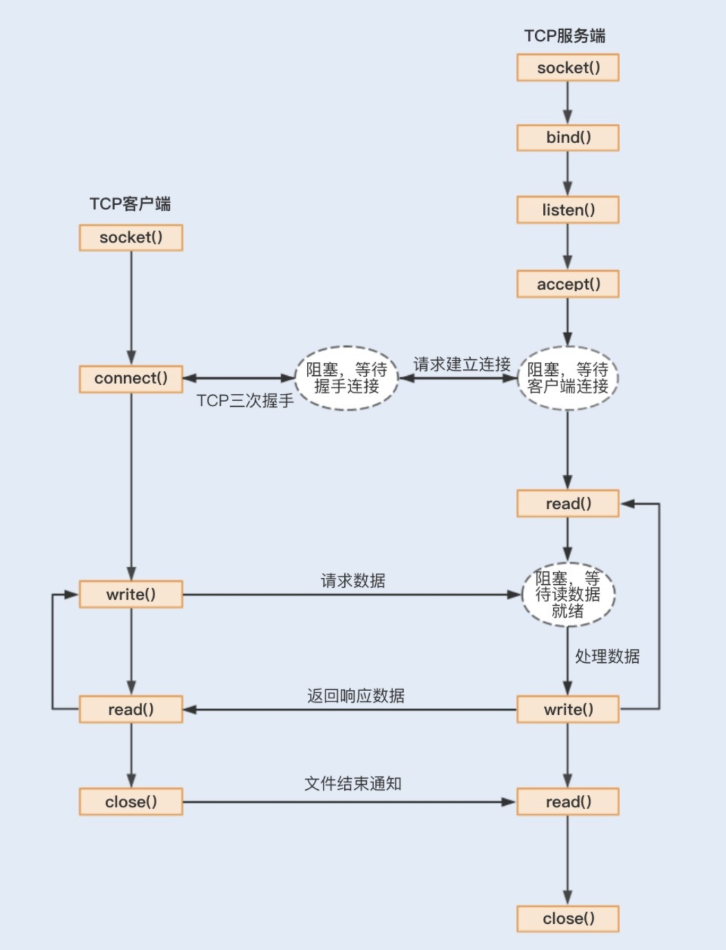

# 1、同步阻塞（bio）、同步非阻塞（nio）、select、poll、epoll、信号驱动式io、异步io
## 1.1 同步阻塞
1、阻塞式IO，客户端发送请求，服务端接收请求，服务端处理请求，服务端返回结果，客户端接收结果。

客户端会先去访问文件描述符状态，如果文件描述符就绪，则读取数据；如果文件描述符未就绪，则会阻塞等待。
数据经过网卡，dma拷贝到内核环形缓冲区后，触发一个中断，将文件描述符改到就绪态，将数据拷贝到用户空间，然后返回。

## 1.2 同步非阻塞
相比与阻塞式IO，非阻塞式IO在等待数据就绪时不会阻塞。直接在发送或者读的时候返回负1，然后通过轮询的方式来检查数据是否就绪。
注意`文件描述符是需要同步内核的`
本质上，也还是会阻塞，读的时候就是阻塞的，只不过是在等待的过程中没有
阻塞

## 1.3 select
select本身是阻塞的，它通过一个数组，将一组文件描述符加入到这个数组中
，然后发给内核，内核去同步有没有写或者读事件，如果有，就将对应数据的描述符位置为1，然后返回。这样就知道那个文件描述符就绪了。select的缺点是每次都要将所有的文件描述符都发给内核，然后内核再去同步。

## 说明 
select这些函数要配合fctl来使用，设置文件描述符的状态为非阻塞。