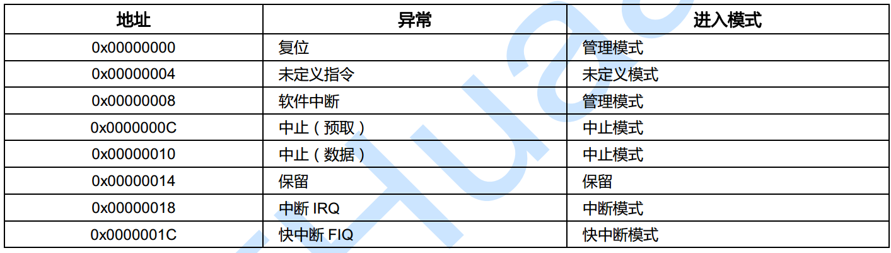

# Linux中中断
在linux在中，嵌套中断被被禁止。  
回顾：单片机中，嵌套中断是当前中断发生时，被优先级更高的中断打断，  
优先执行级别更高的中断。

由于Linux的异步I/O、进程调度等很多重要操作都依赖于中断，中断对于内核的运行非常重要，在屏蔽中断期间所有的中断都无法得到处理，因此长时间屏蔽中断是很危险的，这有可能造成数据丢失乃至系统崩溃等后果。这就要求在屏蔽了中断之后，当前的内核执行路径应当尽快地执行完临界区的代码。

向量表中保存了一系列的跳转指令，当系统发生异常时，由处理器负责将程序执行流转到向量表中的跳转指令，最常见的就是中断向量，应用工程师只需要使用固定的函数名编写中断处理程序，在中断发生时该中断处理程序就会被自动调用，这背后的实现就是中断向量表的功劳。

在 armv7 中，中断向量表可以设置在两个地址：0x00000000 和 0xffff0000，由协处理器 cp15 的 SCTLR 的 bit13 来控制，默认情况下，中断向量表的位置在 0x00000000，实际上，对于操作系统而言，比如 linux，会更倾向于将中断向量表放在 0xffff0000 处，因为 0x0 处在用户空间下，需要额外做一些限制，而 0xffff0000 处在内核空间，另一方面，0 地址通常是 NULL 指针访问的地址，这需要 MMU 做相应的访问限制规则，总之，将向量表放在高地址处会更方便。


当对应的 exception event 发生时，系统会自动地修改 CPSR 状态寄存器，并跳转到上表中的地址执行指令，而软件上要做的，就是在该地址上放置对应的代码，除了 FIQ 之外，其它模式对应的都是一条跳转指令，如果存放多于 4 字节的指令，将会覆盖调用后续的异常向量，因为 FIQ 是最后一条异常向量，根据其特殊性，FIQ 的处理指令可以直接放置在以 oxffff001c 处，当然，具体怎么做由软件的实现来决定。

比如，在 U-boot 中，armv7 对应的 vector.S 中(启动代码)可以看到这样的代码(uboot中向量表配置在0地址处)：
```
_start:
    b   reset
    ldr pc, _undefined_instruction
    ldr pc, _software_interrupt
    ldr pc, _prefetch_abort
    ldr pc, _data_abort
    ldr pc, _not_used
    ldr pc, _irq
    ldr pc, _fiq
```
因为在链接脚本中定义了 ENTRY(_start)，所以程序的第一条指令就是 b reset，尽管后续的指令得不到执行，但是它们在编译链接之后就被放置在以 0x4 开始的地址处，每一条指令占4字节，从指令内容可以看出这些指令都是跳转指令。

在汇编中标号表示标号之后的第一条指令的地址，比如，当发生 irq 中断时，处理器会强制跳转执行 ldr pc, _irq 这条指令，它的内容是这样的：
```
_irq:           .word irq   //./word为定义变量

irq:
    get_irq_stack
    irq_save_user_regs      //保存断点
    bl  do_irq
    irq_restore_user_regs  //恢复断点
```


# 1、概念
## 1-1、异常和中断
在Linux中，异常（Exception）和中断（Interrupt）是两个不同但又相关的概念，它们的主要区别如下：

- **产生原因**

    - **异常**：通常是由程序自身的错误或特殊情况导致的，例如除以零、访问非法内存地址、断点指令等。这些情况是在程序执行过程中由内部因素引发的。

    - **中断**：一般是由外部硬件设备发出的信号引起的，比如键盘输入、鼠标点击、定时器超时、网络数据包到达等。它是由外部事件触发的，与当前正在执行的程序没有直接关系。

- **处理时机**

    - **异常**：通常在指令执行过程中被检测到，一旦发生异常，CPU会立即停止当前程序的执行，转而执行相应的异常处理程序。

    - **中断**：CPU在执行完当前指令后，会检查是否有中断请求到来。如果有中断请求，CPU会暂停当前程序的执行，保存现场，并跳转到相应的中断处理程序。

- **优先级**

    - **异常**：异常通常具有较高的优先级，因为它们往往表示程序出现了严重的错误或特殊情况，需要立即处理。例如，除数为零的异常必须在当前指令执行完毕后马上处理，否则程序将无法继续正确执行。

    - **中断**：中断的优先级相对较低，且可以根据不同的设备或事件设置不同的优先级。例如，系统时钟中断可能具有较高的优先级，以确保系统的时间管理准确无误；而一些次要设备的中断，如打印机中断，优先级则相对较低。

- **处理方式**

    - **异常**：异常处理程序通常由操作系统或编程语言的运行时环境提供，用于处理特定类型的异常。例如，在C语言中，当出现除以零的异常时，程序会调用相应的信号处理函数来处理该异常。

    - **中断**：中断处理程序是由设备驱动程序或操作系统内核提供的，用于处理特定设备的中断请求。例如，当键盘按下一个按键时，键盘驱动程序中的中断处理程序会被调用，以读取按键信息并将其传递给相应的应用程序。

- **对程序的影响**
    - **异常**：异常通常会导致当前程序的执行流程被改变，可能会使程序终止、进行错误处理或者尝试恢复执行。例如，当程序访问非法内存地址时，操作系统可能会终止该程序，并报告错误信息。

    - **中断**：中断一般不会改变程序的执行流程，只是在中断处理程序执行完毕后，CPU会返回到被中断的程序继续执行。当然，在某些情况下，中断处理程序可能会对程序的执行产生间接影响，比如更新一些共享资源的状态等。


## 1-2、中断处理函数

在Linux系统中，当中断发生时，中断处理程序的调用过程如下：
1. **中断信号产生**：外部硬件设备（如键盘、鼠标、定时器等）通过中断控制器向CPU发送中断信号，告知有事件发生需要处理。

2. **CPU响应中断**：CPU在执行完当前指令后，会检测到中断信号。如果当前中断的优先级高于正在执行的程序或任务的优先级，并且CPU处于允许中断的状态，CPU就会暂停当前程序的执行，并保存当前的程序状态，包括程序计数器（PC）、寄存器等信息，以便在中断处理完成后能够恢复到原来的执行状态。

3. **查找中断向量表**：CPU根据中断信号的类型，在中断向量表中查找对应的中断处理程序的入口地址。中断向量表是一个存储中断处理程序入口地址的表格，通常位于内存的特定区域。每个中断类型都有一个唯一的编号，通过这个编号可以在中断向量表中找到相应的中断处理程序的地址。

4. **调用中断处理程序**：找到中断处理程序的入口地址后，CPU将控制权转移到该地址，开始执行中断处理程序。中断处理程序通常是一段汇编语言或C语言编写的代码，用于处理特定类型的中断事件。例如，对于键盘中断，中断处理程序可能会读取键盘缓冲区中的数据，并将其传递给相应的应用程序。

5. **中断处理程序执行**：中断处理程序在执行过程中，会根据具体的中断事件进行相应的处理。这可能包括读取或写入硬件寄存器、更新系统状态、通知相关进程或线程等操作。为了避免中断处理时间过长影响系统的响应性能，中断处理程序通常会尽量简短，只完成必要的处理工作。如果有更复杂的任务需要处理，中断处理程序可能会将任务交给其他线程或进程去完成，以尽快释放CPU资源。

6. **中断处理完成**：当中断处理程序执行完毕后，它会恢复之前保存的CPU寄存器等状态信息，并将控制权返回给被中断的程序。CPU继续执行被中断的程序，就像没有发生过中断一样。

整个过程是由硬件和软件共同协作完成的，它使得Linux系统能够及时响应外部设备的事件，保证系统的稳定性和实时性。
中断函数就是一个普普通通的函数.

## 1-3、中断的上半步和下半步

### 上半部

#### 特点
- **响应及时**：当中断信号到来时，上半部会立即执行。这是为了能第一时间对中断做出反应，保证系统可以迅速感知并处理外部设备的请求，满足硬件实时性要求。例如，当网卡接收到一个数据包时，上半部需要马上对其进行初步处理，避免数据包丢失。

- **执行时间短**：为了尽量减少对其他任务的影响，上半部代码会设计得较为精简，仅处理那些必须立刻完成的关键操作。因为在执行上半部时，通常会屏蔽部分甚至全部中断，若执行时间过长，可能导致其他重要中断无法及时响应，影响系统的整体性能。

- **运行在中断上下文**：上半部运行在中断上下文环境中，这意味着它不能进行睡眠操作（如调用`sleep()`函数）。因为中断上下文没有自己的进程描述符，睡眠后无法被唤醒，会导致系统崩溃。

- **高优先级**：上半部在执行期间具有较高的优先级，会暂时屏蔽部分或全部其他中断，以保证关键的中断处理流程不被打断，确保硬件操作的完整性和准确性。

#### 作用

- **处理紧急硬件操作**：上半部负责对硬件进行直接的控制和操作，如读取或写入硬件寄存器。例如，在键盘中断发生时，上半部会读取键盘扫描码，将其从键盘控制器的寄存器中取出，为后续处理做准备。

- **初步数据处理**：对中断产生的初始数据进行简单处理和保存，确保数据的完整性和及时性。例如，在定时器中断中，上半部可以记录中断发生的时间戳，方便后续进行时间统计和调度。

- **通知硬件中断已接收**：及时告知硬件设备，其发出的中断已被系统接收，使硬件能够继续进行后续操作。例如，在磁盘控制器完成一次数据传输后发出中断，上半部处理时会向磁盘控制器发送确认信号，允许磁盘继续进行下一次传输。

### 下半部

#### 特点

- **可延迟执行**：下半部的执行并不要求与中断发生的时刻紧密相连，它可以在系统相对空闲时执行。这使得系统能够合理安排资源，优先处理紧急任务，提高整体性能。

- **执行时间较长**：由于不需要像上半部那样追求极致的速度，下半部可以处理一些较为复杂和耗时的任务。例如，对网络数据包进行详细的解析和处理，或者更新系统的一些统计信息。

- **运行在软中断或内核线程上下文**：下半部可以运行在软中断上下文或者内核线程上下文中，在这些上下文中可以进行适当的睡眠操作，以便等待某些资源或事件的发生。

- **可被中断**：下半部在执行过程中不会像上半部那样屏蔽大部分中断，它可以被其他中断打断，这使得系统能够及时响应新的紧急事件。


#### 作用

- **处理非紧急任务**：将那些不影响硬件正常运行的任务推迟到下半部处理，避免上半部负担过重。例如，在网卡接收到数据包后，上半部完成初步接收，下半部可以进行协议解析、数据缓存和转发等操作。

- **提高系统并发能力**：下半部可以在系统有空闲资源时并行执行，多个下半部任务可以在不同的CPU核心上同时运行，从而提高系统的并发处理能力。

- **平衡系统负载**：通过将中断处理的一部分工作推迟到下半部，使得系统在处理中断时能够更加灵活地分配资源，避免因集中处理所有中断任务而导致系统负载过高。例如，在高流量网络环境下，下半部可以将数据包处理任务分散到不同的时间段执行，减轻系统瞬间压力。 

## 1-4、中断处理函数的注册
在 Linux 中，中断处理程序的注册过程主要涉及内核提供的相关接口函数，下面为你详细介绍注册步骤和代码示例：

### 注册步骤

#### 1. 分配中断号
中断号用于标识不同的硬件中断源，系统中每个外部设备都有一个对应的中断号。你可以通过查阅硬件文档或者内核源代码来确定具体设备的中断号。

#### 2. 编写中断处理函数
中断处理函数是实际处理中断事件的代码逻辑，它需要遵循特定的函数原型。其一般形式如下：
```c
irqreturn_t irq_handler(int irq, void *dev_id);
```
其中，`irq` 是中断号，`dev_id` 是设备标识符，返回值 `irqreturn_t` 表示中断处理的结果。

#### 3. 注册中断处理函数
使用内核提供的 `request_irq` 函数来注册中断处理函数。该函数的原型如下：
```c
int request_irq(unsigned int irq, irq_handler_t handler, unsigned long flags,
                const char *name, void *dev);
```
参数解释如下：
- `irq`：要注册的中断号。
- `handler`：中断处理函数指针。
- `flags`：中断处理的标志，例如 `IRQF_SHARED` 表示允许多个设备共享同一个中断号。
- `name`：中断处理程序的名称，通常用于在 `/proc/interrupts` 中显示。
- `dev`：设备标识符，用于在共享中断时区分不同的设备。

#### 4. 卸载中断处理函数
当不再需要使用某个中断处理程序时，需要使用 `free_irq` 函数来卸载它。该函数的原型如下：
```c
void free_irq(unsigned int irq, void *dev_id);
```
参数 `irq` 是要卸载的中断号，`dev_id` 是设备标识符。

### 代码示例
下面是一个简单的中断处理程序注册和卸载的示例代码：

```c
#include <linux/init.h>
#include <linux/module.h>
#include <linux/interrupt.h>

#define MY_IRQ_NUMBER 12  // 假设使用中断号 12

// 中断处理函数
irqreturn_t my_irq_handler(int irq, void *dev_id)
{
    printk(KERN_INFO "Interrupt %d occurred!\n", irq);
    return IRQ_HANDLED;
}

// 模块初始化函数
static int __init my_module_init(void)
{
    int ret;
    // 注册中断处理函数
    ret = request_irq(MY_IRQ_NUMBER, my_irq_handler, IRQF_SHARED, "my_irq_handler", &my_irq_handler);
    if (ret) {
        printk(KERN_ERR "Failed to register interrupt %d\n", MY_IRQ_NUMBER);
        return ret;
    }
    printk(KERN_INFO "Interrupt %d registered successfully\n", MY_IRQ_NUMBER);
    return 0;
}

// 模块退出函数
static void __exit my_module_exit(void)
{
    // 卸载中断处理函数
    free_irq(MY_IRQ_NUMBER, &my_irq_handler);
    printk(KERN_INFO "Interrupt %d unregistered\n", MY_IRQ_NUMBER);
}

module_init(my_module_init);
module_exit(my_module_exit);

MODULE_LICENSE("GPL");
MODULE_AUTHOR("Your Name");
MODULE_DESCRIPTION("A simple interrupt handler example");      

```

### 代码解释
1. **中断处理函数 `my_irq_handler`**：当指定的中断发生时，该函数会被调用，并打印一条信息表示中断已发生。
2. **模块初始化函数 `my_module_init`**：在模块加载时，调用 `request_irq` 函数注册中断处理函数。如果注册失败，会打印错误信息并返回错误码。
3. **模块退出函数 `my_module_exit`**：在模块卸载时，调用 `free_irq` 函数卸载中断处理函数。

将上述代码保存为 `.c` 文件，使用内核编译工具链进行编译，然后加载和卸载内核模块，就可以测试中断处理程序的注册和卸载功能。 


### 对于中断号说明
对于硬件的中断来说，中断号一般是确定好的。而如果是软件模拟的中断，则需要自己定义中断号。


## 1-5、中断的释放

在 Linux 系统里，中断释放通常指的是注销中断处理程序，从而停止对特定中断源的响应。下面为你详细介绍释放中断的相关步骤与方法。

### 释放中断的步骤

1. **确定中断号**：要明确你想要释放的中断对应的中断号。这个中断号一般在注册中断处理程序时就已经确定，并且不同的硬件设备可能对应着不同的中断号。

2. **调用 `free_irq` 函数**：在 Linux 内核里，可使用 `free_irq` 函数来释放中断处理程序。该函数会停止对指定中断号的中断响应，并且释放相关的资源。

### `free_irq` 函数介绍
`free_irq` 函数的原型如下：
```c
void free_irq(unsigned int irq, void *dev_id);
```
- **参数说明**：
  - `irq`：这是要释放的中断号。
  - `dev_id`：它是一个设备标识符，在注册中断处理程序时会用到。这个标识符用于区分不同的中断处理程序，确保在释放中断时能够准确找到对应的处理程序。

### 代码示例
以下是一个简单的示例，展示了如何注册和释放中断处理程序：
```c
#include <linux/init.h>
#include <linux/module.h>
#include <linux/interrupt.h>

#define IRQ_NUMBER 12  // 假设中断号为 12
static void *my_dev_id;

// 中断处理程序
static irqreturn_t my_interrupt_handler(int irq, void *dev_id)
{
    printk(KERN_INFO "Interrupt handler called for IRQ %d\n", irq);
    return IRQ_HANDLED;
}

static int __init my_module_init(void)
{
    int ret;
    my_dev_id = (void *)&my_interrupt_handler;

    // 注册中断处理程序
    ret = request_irq(IRQ_NUMBER, my_interrupt_handler, IRQF_SHARED, "my_interrupt", my_dev_id);
    if (ret) {
        printk(KERN_ERR "Failed to request IRQ %d\n", IRQ_NUMBER);
        return ret;
    }

    printk(KERN_INFO "Interrupt handler registered for IRQ %d\n", IRQ_NUMBER);
    return 0;
}

static void __exit my_module_exit(void)
{
    // 释放中断处理程序
    free_irq(IRQ_NUMBER, my_dev_id);
    printk(KERN_INFO "Interrupt handler unregistered for IRQ %d\n", IRQ_NUMBER);
}

module_init(my_module_init);
module_exit(my_module_exit);

MODULE_LICENSE("GPL");
MODULE_AUTHOR("Your Name");
MODULE_DESCRIPTION("A simple interrupt handler module");
```
### 代码解释
1. **注册中断处理程序**：在 `my_module_init` 函数里，调用 `request_irq` 函数来注册中断处理程序。这里使用 `IRQF_SHARED` 标志，表示该中断处理程序可以和其他处理程序共享同一个中断号。
2. **释放中断处理程序**：在 `my_module_exit` 函数中，调用 `free_irq` 函数来释放中断处理程序。传入的参数为之前注册时使用的中断号和设备标识符。

### 注意事项
- **中断共享情况**：若中断是共享的（使用 `IRQF_SHARED` 标志注册），`free_irq` 函数只会移除当前设备的中断处理程序，只有当所有共享该中断号的设备都释放了中断处理程序后，中断才会被完全禁用。
- **权限问题**：通常只有内核模块或者具有足够权限的程序才能注册和释放中断处理程序。 

### 注意事项
对于共享中断，`free_irq` 函数只会移除当前设备的中断处理程序，只有当所有共享该中断号的设备都释放了中断处理程序后，中断才会被完全禁用。

### 中断的重入
当给定的中断处理程序被调用时，内核会检查该中断处理程序是否正在运行。如果正在运行，则内核会等待该处理程序完成，然后再次调用该处理程序。也就是说，中断发生时，相应的中断线会在所有的处理器上屏蔽，直到中断处理程序完成。
总结来说：同一个中断不会被同时调用以处理嵌套中断。

## 1-6 中断共享
在Linux中，共享中断处理是一种允许多个设备共享同一个中断线的机制。以下是对它的详细介绍：

### 背景及原理
- 在传统的中断处理机制下，每个设备都有自己独立的中断线，当设备数量增加时，中断线数量也随之增加，导致中断处理复杂性增加，资源利用率降低。为解决此问题，Linux引入共享中断概念。通过硬件支持，当共享同一中断线的多个设备中的一个产生中断请求时，系统能够识别出具体是哪个设备发生了中断，然后对相应设备进行处理，并通知其他设备继续等待。

### 实现方式
- Linux操作系统采用中断链表的数据结构来实现共享中断机制。多个设备的中断处理函数链接在一起，共享同一个中断向量。每个设备的中断请求通过中断控制器传递给中断链表中的相应设备的中断处理函数。

### 相关函数及参数
- 注册共享中断时，需要使用`request_irq()`函数，其参数`flags`必须设置`IRQF_SHARED`标志，用于表明这是一个共享中断。`dev_id`参数必须唯一，通常选择设备私有数据结构，因为它是唯一的，且中断处理程序可能会用到它，不能给共享的处理程序传递`NULL`值。

### 硬件和软件要求
- 硬件层面，需要芯片或者总线控制器提供相应的功能，支持中断的共享。软件层面，操作系统需要对设备进行正确的中断处理和识别。内核提供了相应的接口和机制来实现共享中断的功能，例如通过中断链表来管理共享同一中断线的多个设备的中断处理函数。

### 优点
- **减少中断线数量**：当系统中的设备增加时，只需要增加中断控制器的数量，而不需要增加中断线的数量，降低了中断处理的复杂性。
- **提高资源利用率**：设备共享中断，每个设备都可以利用其他设备的中断线，避免了资源的浪费。
- **提升系统可扩展性**：当有新的设备加入系统时，只需添加相应的中断处理函数到中断链表中即可，无需重新分配中断向量，简化了系统的维护工作。

### 缺点
- **影响处理速度**：当一个设备产生中断请求时，可能会影响其他设备的处理速度，从而影响系统的响应速度和性能。
- **增加实施难度**：共享中断需要复杂的硬件和软件支持，在实施和调试过程中需要一定的技术经验和知识。


## 1-7、/proc/interrupts
在Linux中，`/proc`是一个虚拟文件系统，它提供了有关系统进程和内核的信息，
这些信息在系统运行时动态生成，存储在内存中，不占用物理存储空间。
`/proc/interrupts`文件包含了系统中与硬件中断相关的统计信息。以下是对其内容的详细解释：

- **irq编号**：文件的第一列是irq（Interrupt Request，中断请求）编号，每个硬件设备在请求CPU服务时都会使用一个特定的中断号。

- **CPU列**：从第二列开始，每一列对应一个CPU核心。这表示每个CPU核心上对应中断号的中断发生次数。例如，在多处理器系统中，你可以看到不同CPU核心处理中断的负载情况。

- **中断类型和设备名称**：最后一列包含了中断的类型以及产生中断的设备名称（如果已知）。
常见的中断类型有`xt - pic`（旧的AT计算机中断）、
`io - apic - edge`（基于IO高级可编程中断控制器的边缘触发中断）、
`io - apic - level`（基于IO高级可编程中断控制器的电平触发中断）等。
设备名称则有助于你确定是哪个硬件设备产生了相应的中断，如`timer`（定时器）、`keyboard`（键盘）、`eth0`（网络接口）等。


下面是一个`/proc/interrupts`文件内容的示例：

```
           CPU0       CPU1
  0:   1366814704        0  xt - pic  timer
  1:     128        340  io - apic - edge  keyboard
  2:       0        0  xt - pic  cascade
  8:       0        1  io - apic - edge  rtc
 12:     5323       5793  io - apic - edge  ps/2 mouse
 13:       1        0  xt - pic  fpu
 16:   11184294    15940594  io - apic - level  intel etherexpress pro 10/100 ethernet
 20:    8450043    11120093  io - apic - level  megaraid
 30:     10432       10722  io - apic - level  aic 7 xxx
 31:        23        22  io - apic - level  aic 7 xxx
NMI:       0
ERR:       0
```

通过查看`/proc/interrupts`文件，系统管理员和开发人员可以了解系统中各个硬件设备的中断负载情况，及时发现可能存在的性能问题，比如某个设备的中断次数异常增多，可能表示该设备出现了故障或者工作负荷过重。同时，也可以帮助开发人员进行系统调优和故障排查，找出系统中存在的瓶颈，进而优化系统性能并提高系统稳定性。


## 1-8、中断的控制api
在Linux内核中，操作中断主要涉及注册、注销和管理中断处理程序，以及控制中断的状态（启用/禁用）。以下是内核提供的主要接口及其功能：


### 1. 中断处理程序注册与注销
#### **request_irq()**
注册一个中断处理程序，使设备能够响应特定的中断号（IRQ）。
```c
int request_irq(unsigned int irq, irq_handler_t handler, 
                unsigned long flags, const char *name, void *dev_id);
```
- **参数**：
  - `irq`：中断号（如`1`对应键盘中断）。
  - `handler`：中断处理函数（回调函数）。
  - `flags`：中断标志（如`IRQF_SHARED`表示共享中断）。
  - `name`：设备名称（显示在`/proc/interrupts`中）。
  - `dev_id`：设备标识符（用于共享中断时区分不同设备）。
- **返回值**：0 表示成功，负值表示错误。

#### **free_irq()**
注销中断处理程序，释放资源。
```c
void free_irq(unsigned int irq, void *dev_id);
```


### 2. 中断处理函数类型
#### **irq_handler_t**
中断处理函数的原型：
```c
typedef irqreturn_t (*irq_handler_t)(int irq, void *dev_id);
```
- **返回值**：
  - `IRQ_NONE`：未处理该中断。
  - `IRQ_HANDLED`：已处理该中断。


### 3. 中断状态控制
#### **禁用/启用本地CPU中断**
```c
local_irq_disable();  // 禁用本地CPU中断
local_irq_enable();   // 启用本地CPU中断
```
- **注意**：仅影响当前CPU核心，且需成对使用，避免死锁。

#### **保存并禁用中断状态**
```c
unsigned long flags;
local_irq_save(flags);  // 保存当前中断状态并禁用中断
// ... 临界区代码 ...
local_irq_restore(flags);  // 恢复中断状态
```

#### **禁用/启用特定中断线**
```c
void disable_irq(unsigned int irq);    // 禁用中断线（等待当前中断处理完成）
void disable_irq_nosync(unsigned int irq);  // 立即禁用中断线
void enable_irq(unsigned int irq);     // 启用中断线
```


### 4. 中断底半部（Bottom Half）处理
为避免中断处理程序执行时间过长，可将耗时操作延迟到"底半部"执行。

#### **软中断（Softirq）**
```c
open_softirq(NR_SOFTIRQS, my_softirq_handler);  // 注册软中断
raise_softirq(NR_SOFTIRQS);                     // 触发软中断
```

#### **任务队列（Tasklet）**
```c
DECLARE_TASKLET(my_tasklet, tasklet_handler, data);  // 定义任务队列
tasklet_schedule(&my_tasklet);                        // 调度任务队列
```

#### **工作队列（Workqueue）**
```c
DECLARE_WORK(my_work, work_handler);  // 定义工作队列
schedule_work(&my_work);              // 调度工作队列
```


### 5. 中断共享（Shared IRQ）
允许多个设备共享同一中断线。
- **注册共享中断**：
  ```c
  request_irq(irq, handler, IRQF_SHARED, "shared_device", dev_id);
  ```
- **要求**：
  - 所有共享设备必须使用`IRQF_SHARED`标志。
  - `dev_id`必须唯一（通常指向设备结构体）。
  - 中断处理函数需通过硬件状态判断是否为自己的中断。


### 6. 中断控制器操作
#### **获取中断控制器描述符**
```c
struct irq_chip *chip = irq_get_chip(irq);
```

#### **设置中断触发类型**
```c
irq_set_irq_type(irq, IRQ_TYPE_EDGE_RISING);  // 边缘触发（上升沿）
irq_set_irq_type(irq, IRQ_TYPE_LEVEL_LOW);    // 电平触发（低电平）
```


### **7. 中断亲和性（CPU绑定）**
将中断处理固定到特定CPU核心，提高性能。
```c
irq_set_affinity_hint(irq, cpumask_of(cpu_id));  // 设置亲和性提示
irq_set_affinity(irq, cpumask_of(cpu_id));        // 强制绑定CPU
```


### 8. 中断状态查询
#### **检查中断是否启用**
```c
int irqs_disabled(void);  // 返回非零值表示中断被禁用
```

#### **获取中断统计信息**
```c
/proc/interrupts  // 显示系统中断统计
/proc/softirqs    // 显示软中断统计
```


### **示例：注册中断处理程序**
```c
static irqreturn_t my_interrupt_handler(int irq, void *dev_id) {
    // 中断处理逻辑
    return IRQ_HANDLED;
}

// 设备初始化时注册中断
static int __init my_device_init(void) {
    int ret;
    ret = request_irq(MY_DEVICE_IRQ, my_interrupt_handler, 
                     IRQF_SHARED, "my_device", &my_device);
    if (ret) {
        printk(KERN_ERR "Failed to register IRQ\n");
        return ret;
    }
    return 0;
}

// 设备卸载时注销中断
static void __exit my_device_exit(void) {
    free_irq(MY_DEVICE_IRQ, &my_device);
}
```


### **注意事项**
1. **中断处理程序应尽可能短**，耗时操作移到底半部。
2. **共享中断**需确保每个设备能正确识别自己的中断。
3. **禁用中断**会影响系统响应性，应尽量减少禁用时间。
4. **中断上下文**中不能使用睡眠函数（如`msleep()`）。

这些接口是内核与硬件交互的基础，合理使用它们对驱动开发和系统性能至关重要。


# 下半部
## 1、中断底半部（下半部）
在Linux内核中，中断处理分为**上半部（Top Half）** 和**下半部（Bottom Half）**。上半部处理紧急的硬件相关操作（如确认中断、读取数据），而下半部处理耗时操作（如数据处理、状态更新），以避免长时间占用CPU导致其他中断被延迟。以下是Linux内核提供的几种主要的下半部实现机制及其特点：


### **1. 软中断（Softirq）**
- **特点**：
  - 性能最高，由内核直接调度，运行在中断上下文。
  - 可在多CPU上并行执行（同一类型或不同类型）。
  - 禁止睡眠，处理函数必须快速完成。
- **适用场景**：高频、耗时短、需并行的任务（如网络数据包处理）。
- **注册与触发**：
  ```c
  // 注册软中断处理函数（在模块初始化时）
  open_softirq(NET_RX_SOFTIRQ, my_softirq_handler);
  
  // 触发软中断（通常在硬中断处理程序中）
  raise_softirq(NET_RX_SOFTIRQ);
  ```


### **2. 任务队列（Tasklet）**
- **特点**：
  - 基于软中断实现（使用`TASKLET_SOFTIRQ`），同一类型的任务队列串行执行。
  - 不同类型的任务队列可在不同CPU并行，但同一类型不会并发。
  - 禁止睡眠，比软中断更易用。
- **适用场景**：耗时操作，但无需并行（如设备状态更新）。
- **使用示例**：
  ```c
  // 定义任务队列处理函数
  void my_tasklet_handler(unsigned long data) {
      // 处理逻辑
  }
  
  // 静态定义并初始化任务队列
  DECLARE_TASKLET(my_tasklet, my_tasklet_handler, data);
  
  // 调度任务队列（通常在硬中断处理程序中）
  tasklet_schedule(&my_tasklet);
  ```


### **3. 工作队列（Workqueue）**
- **特点**：
  - 由内核线程（`kworker`）执行，运行在进程上下文。
  - 允许睡眠（如访问文件系统、获取信号量）。
  - 性能开销高于软中断和任务队列。
- **适用场景**：需要睡眠的任务（如DMA完成后的IO操作）。
- **使用示例**：
  ```c
  // 定义工作队列处理函数
  void my_work_handler(struct work_struct *work) {
      // 可睡眠的处理逻辑
      msleep(10); // 示例：休眠10ms
  }
  
  // 静态定义工作队列
  DECLARE_WORK(my_work, my_work_handler);
  
  // 调度工作队列
  schedule_work(&my_work);
  
  // 延迟执行（单位：jiffies）
  schedule_delayed_work(&my_work, 100); // 约100ms后执行
  ```


### **4. 传统底半部（BH，Bottom Half）**
- **特点**：
  - 早期Linux内核的实现，现已被软中断和任务队列替代。
  - 所有BH串行执行，性能较差。
- **现状**：仅保留兼容性支持，新代码不建议使用。


### **5. 线程化中断（Threaded IRQ）**
- **特点**：
  - 中断处理程序分为两部分：
    - **快速上半部**：禁止中断，执行紧急操作。
    - **线程化下半部**：由内核线程执行，允许睡眠。
  - 通过`request_threaded_irq()`注册。
- **适用场景**：需要睡眠且对实时性要求较高的中断（如键盘、鼠标）。
- **使用示例**：
  ```c
  static irqreturn_t my_irq_handler(int irq, void *dev_id) {
      // 快速处理部分（禁止睡眠）
      return IRQ_WAKE_THREAD; // 唤醒线程化下半部
  }
  
  static irqreturn_t my_irq_thread(int irq, void *dev_id) {
      // 线程化处理部分（可睡眠）
      return IRQ_HANDLED;
  }
  
  // 注册线程化中断
  request_threaded_irq(irq, my_irq_handler, my_irq_thread, 
                      flags, "my_device", dev_id);
  ```


### **选择建议**
| **机制**       | **是否可并行** | **是否可睡眠** | **适用场景**                     | **性能开销** |
|----------------|----------------|----------------|----------------------------------|--------------|
| **软中断**     | 是             | 否             | 高频、耗时短、需并行的任务       | 最低         |
| **任务队列**   | 同类型串行     | 否             | 耗时操作，无需并行               | 低           |
| **工作队列**   | 是             | 是             | 需要睡眠的任务                   | 高           |
| **线程化中断** | 否             | 是             | 需要睡眠且对实时性要求高的中断   | 较高         |


### **总结**
- **优先使用任务队列**：简单易用，适合大多数场景。
- **高频任务用软中断**：如网络栈、定时器处理。
- **需要睡眠用工作队列**：如文件IO、复杂计算。
- **对实时性敏感用线程化中断**：如人机交互设备。

合理选择下半部机制能显著提升系统性能和响应性。

## 2、软中断
在Linux内核中，**软中断（Softirq）** 是一种用于实现中断底半部（Bottom Half）处理的机制，其目的是将耗时的中断处理任务从硬中断上下文（关闭中断的临界区）中分离出来，在更安全的环境下异步执行，从而提高系统响应性。


### **软中断的特点**
1. **异步执行**：软中断在中断处理程序返回后由内核在特定时机触发执行。
2. **执行时机**：
   - 硬中断返回时（`irq_exit()`）。
   - 内核线程`ksoftirqd`周期性触发（处理积压的软中断）。
3. **禁止睡眠**：软中断上下文不能休眠，必须快速执行。
4. **可在多CPU并行**：同类型的软中断在不同CPU上可并行执行（需注意同步）。


### **软中断的注册与使用**

#### **1. 预定义的软中断类型**
Linux内核预定义了一些常用的软中断类型（定义在`include/linux/interrupt.h`）：
```c
enum {
    HI_SOFTIRQ=0,     // 高优先级软中断
    TIMER_SOFTIRQ,    // 定时器软中断
    NET_TX_SOFTIRQ,   // 网络发送软中断
    NET_RX_SOFTIRQ,   // 网络接收软中断
    BLOCK_SOFTIRQ,    // 块设备软中断
    IRQ_POLL_SOFTIRQ, // IRQ轮询软中断
    TASKLET_SOFTIRQ,  // 任务队列软中断
    SCHED_SOFTIRQ,    // 调度器软中断
    HRTIMER_SOFTIRQ,  // 高精度定时器软中断
    RCU_SOFTIRQ,      // RCU锁软中断
    NR_SOFTIRQS       // 软中断总数
};
```

#### **2. 注册软中断处理函数**
在模块初始化时，使用`open_softirq()`注册软中断处理函数：
```c
#include <linux/interrupt.h>

static void my_softirq_handler(struct softirq_action *h) {
    // 软中断处理逻辑（禁止睡眠）
    // 例如：处理网络数据包、更新统计信息等
}

static int __init my_module_init(void) {
    // 注册软中断处理函数（以NET_RX_SOFTIRQ为例）
    open_softirq(NET_RX_SOFTIRQ, my_softirq_handler);
    return 0;
}

module_init(my_module_init);
```

#### **3. 触发软中断**
在硬中断处理程序或其他代码中，使用`raise_softirq()`触发软中断：
```c
static irqreturn_t my_irq_handler(int irq, void *dev_id) {
    // 硬中断快速处理部分
    // ...
    
    // 触发软中断，将耗时操作交给底半部处理
    raise_softirq(NET_RX_SOFTIRQ);
    
    return IRQ_HANDLED;
}
```


### **软中断与其他底半部机制的对比**
| **机制**   | **特点**                              | **适用场景**                     |
|------------|---------------------------------------|----------------------------------|
| **软中断** | 性能最高，可并行执行，禁止睡眠        | 高频、耗时短、需并行的任务       |
| **任务队列** | 基于软中断实现，同一类型串行执行       | 耗时操作，无需并行               |
| **工作队列** | 由内核线程执行，可睡眠                | 需要睡眠的任务（如访问文件系统） |


### **注意事项**
1. **软中断优先级**：软中断执行时允许响应硬中断，但禁止其他软中断（同类型或不同类型）。
2. **同步问题**：若软中断处理函数访问共享资源，需使用原子操作或自旋锁（`spin_lock_irqsave()`）。
3. **避免长时间执行**：软中断长时间运行会导致`ksoftirqd`线程占用CPU，影响系统响应。
4. **动态创建软中断**：内核不推荐动态创建新的软中断类型（预定义类型已足够），通常使用任务队列或工作队列。


### **调试与监控**
- **查看软中断统计**：
  ```bash
  cat /proc/softirqs
  ```
- **性能分析工具**：
  - `perf`：分析软中断耗时。
  - `top`/`htop`：监控`ksoftirqd`线程CPU使用率。


### **总结**
软中断是Linux内核中高效的底半部处理机制，适用于对性能要求极高且无需睡眠的场景。通常情况下，驱动开发者更常使用任务队列（`tasklet`）或工作队列（`workqueue`），因为它们更易用且安全。只有在需要极致性能时才考虑直接使用软中断。

## tasklet
在Linux内核中，**Tasklet** 是一种基于软中断实现的下半部（Bottom Half）机制，用于处理不需要立即执行的耗时任务。它比软中断更易用，且同一类型的tasklet不会并发执行，适合大多数驱动开发场景。以下是tasklet的详细使用方法：


### **1. Tasklet的特点**
- **基于软中断**：使用`TASKLET_SOFTIRQ`类型的软中断实现。
- **串行执行**：同一类型的tasklet在多CPU上不会并行（自动同步）。
- **禁止睡眠**：运行在中断上下文，不能使用可能引起睡眠的函数。
- **执行时机**：硬中断返回时或`ksoftirqd`内核线程触发。


### **2. 定义Tasklet处理函数**
```c
#include <linux/interrupt.h>

// 处理函数原型：void func(unsigned long data)
static void my_tasklet_handler(unsigned long data) {
    // 处理逻辑（禁止睡眠）
    struct my_device *dev = (struct my_device *)data;
    
    // 例如：处理设备数据、更新状态
    process_device_data(dev);
}
```


### **3. 初始化Tasklet**
有两种方式初始化tasklet：

#### **静态初始化（推荐）**
```c
// 定义并初始化tasklet（使用DECLARE_TASKLET）
DECLARE_TASKLET(my_tasklet, my_tasklet_handler, (unsigned long)&my_device);
```
- 参数1：tasklet名称（`my_tasklet`）。
- 参数2：处理函数（`my_tasklet_handler`）。
- 参数3：传递给处理函数的数据（需转换为`unsigned long`）。

#### **动态初始化**
```c
struct tasklet_struct my_tasklet;

// 在运行时初始化（如模块加载时）
tasklet_init(&my_tasklet, my_tasklet_handler, (unsigned long)&my_device);
```


### **4. 调度Tasklet执行**
在硬中断处理程序或其他代码中调度tasklet：
```c
static irqreturn_t my_irq_handler(int irq, void *dev_id) {
    // 快速处理硬中断（如读取数据寄存器）
    
    // 调度tasklet执行下半部处理
    tasklet_schedule(&my_tasklet);
    
    return IRQ_HANDLED;
}
```


### **5. 控制Tasklet执行**
#### **延迟调度**
```c
// 重新调度已在队列中的tasklet（安全）
tasklet_hi_schedule(&my_tasklet);  // 高优先级版本
```

#### **禁用/启用Tasklet**
```c
// 临时禁用tasklet（禁止执行，但不取消已调度的）
tasklet_disable(&my_tasklet);
// ... 临界区代码 ...
tasklet_enable(&my_tasklet);

// 禁用并等待tasklet完成（若正在执行则等待结束）
tasklet_disable_nosync(&my_tasklet);  // 不等待
tasklet_kill(&my_tasklet);            // 取消调度并等待完成
```


### **6. 示例：完整Tasklet使用流程**
```c
#include <linux/module.h>
#include <linux/interrupt.h>

struct my_device {
    int data;
    // 其他设备信息
};

static struct my_device dev;

// Tasklet处理函数
static void my_tasklet_handler(unsigned long data) {
    struct my_device *dev = (struct my_device *)data;
    
    // 模拟耗时操作（禁止睡眠）
    dev->data++;
    printk(KERN_INFO "Tasklet executed. Data: %d\n", dev->data);
}

// 静态定义tasklet
DECLARE_TASKLET(my_tasklet, my_tasklet_handler, (unsigned long)&dev);

// 中断处理函数
static irqreturn_t my_irq_handler(int irq, void *dev_id) {
    // 快速处理硬中断
    printk(KERN_INFO "Interrupt received\n");
    
    // 调度tasklet执行下半部
    tasklet_schedule(&my_tasklet);
    
    return IRQ_HANDLED;
}

// 模块初始化
static int __init my_module_init(void) {
    // 注册中断处理函数（假设IRQ为123）
    int ret = request_irq(123, my_irq_handler, 
                         IRQF_SHARED, "my_device", &dev);
    if (ret) {
        printk(KERN_ERR "Failed to request IRQ\n");
        return ret;
    }
    
    printk(KERN_INFO "Module initialized\n");
    return 0;
}

// 模块退出
static void __exit my_module_exit(void) {
    // 取消tasklet调度并等待完成
    tasklet_kill(&my_tasklet);
    
    // 释放中断
    free_irq(123, &dev);
    
    printk(KERN_INFO "Module exited\n");
}

module_init(my_module_init);
module_exit(my_module_exit);
MODULE_LICENSE("GPL");
```


### **7. 注意事项**
1. **禁止睡眠**：tasklet运行在中断上下文，不能使用`msleep()`、`mutex_lock()`等可能引起睡眠的函数。
2. **共享资源保护**：若tasklet访问共享数据，需使用原子操作或自旋锁（如`spin_lock_irqsave()`）。
3. **避免递归调度**：不要在tasklet处理函数中调用`tasklet_schedule()`，可能导致死循环。
4. **优先级**：`tasklet_schedule()`是普通优先级，`tasklet_hi_schedule()`是高优先级（更快执行）。


### **8. 调试与监控**
- **查看软中断统计**：
  ```bash
  cat /proc/softirqs
  ```
  观察`TASKLET`行的计数是否增加。

- **性能分析**：
  使用`perf`工具分析tasklet耗时：
  ```bash
  perf record -g -a sleep 10  # 记录10秒
  perf report                 # 查看报告
  ```


### **总结**
Tasklet是Linux内核中最简单、最常用的下半部机制，适合大多数无需睡眠的异步处理场景。通过合理使用tasklet，可以显著提升系统响应性和稳定性。

## ksoftirqd机制
`ksoftirqd`是Linux内核中的一个重要内核线程，用于处理软中断。以下是关于它的详细介绍：

### 功能
- **处理软中断**：负责执行系统中累积的软中断任务。软中断是一种在中断处理程序中延迟执行的机制，用于将一些非紧急但又需要在中断上下文完成的工作推迟到更合适的时机执行，以避免影响硬中断的处理速度。`ksoftirqd`线程会不断检查是否有软中断需要处理，并在有任务时执行相应的软中断处理函数。

### 工作原理
- **触发时机**：当系统中有软中断被触发时（例如通过`raise_softirq`函数），并不立即执行软中断处理程序，而是将软中断标记为 pending 状态。在硬中断处理完成后，会检查是否有 pending 的软中断，如果有，则会唤醒`ksoftirqd`线程来处理这些软中断。
- **执行频率**：`ksoftirqd`线程会在系统空闲时被调度执行，它会循环执行，不断检查是否有软中断任务需要处理。如果没有软中断任务，它会进入睡眠状态，以节省CPU资源；当有软中断任务时，它会被唤醒并执行相应的处理函数。

### 与其他机制的关系
- **与硬中断的关系**：硬中断用于处理紧急的外部事件，如硬件设备的中断请求。软中断则是在硬中断处理的基础上，将一些可以延迟处理的任务放到软中断中执行，以提高系统的响应速度和整体性能。`ksoftirqd`作为软中断的执行者，与硬中断处理程序协同工作，共同完成系统对各种外部事件的处理。
- **与Tasklet的关系**：Tasklet是基于软中断实现的一种下半部机制，它是软中断的一种具体应用形式。`ksoftirqd`在处理软中断时，也会处理与Tasklet相关的软中断任务。Tasklet通过`tasklet_schedule`函数将任务添加到软中断队列中，然后由`ksoftirqd`线程在合适的时机执行。

### 查看与监控
- **查看线程状态**：可以通过`ps -ef | grep ksoftirqd`命令查看`ksoftirqd`线程的状态，包括其进程ID、运行状态、所属用户等信息。
- **监控软中断负载**：通过`cat /proc/softirqs`命令可以查看系统中软中断的统计信息，包括各种类型软中断的触发次数等。这有助于了解系统中软中断的负载情况，以及`ksoftirqd`线程的工作负担。如果发现某些软中断的计数增长过快，可能意味着系统中存在频繁触发软中断的情况，需要进一步分析原因，可能是某些设备驱动程序或内核模块存在问题，导致软中断被过度使用。

### 配置与优化
- **内核参数调整**：一些内核参数可以影响`ksoftirqd`的行为和性能。例如，`/proc/sys/kernel/softirq_maxcpus`参数可以限制软中断在多CPU系统中的分布范围，通过调整该参数，可以根据系统的硬件配置和工作负载特点，优化软中断在不同CPU核心上的分配，以提高系统的整体性能。
- **根据负载调整策略**：根据系统的实际负载情况，可以采取不同的优化策略。如果系统中软中断负载较高，可以考虑优化相关的设备驱动程序或内核模块，减少不必要的软中断触发；或者调整系统的资源分配，例如增加CPU核心、优化内存分配等，以提高系统处理软中断的能力。同时，也可以通过调整`ksoftirqd`的调度优先级等方式，使其能够更及时地处理软中断任务，但需要注意不要对其他重要任务的调度产生负面影响。

## 工作队列
在Linux内核中，**工作队列（Workqueue）** 是一种用于实现中断下半部（Bottom Half）处理的机制，它允许内核代码在进程上下文执行耗时操作，并且支持睡眠。与软中断和Tasklet不同，工作队列由内核线程执行，因此更适合处理需要较长时间或可能睡眠的任务。


### **工作队列的特点**
1. **进程上下文执行**：工作队列在专门的内核线程（`kworker`）中执行，属于进程上下文，因此可以使用可能引起睡眠的函数（如`kmalloc(GFP_KERNEL)`、信号量、`msleep()`等）。
2. **异步执行**：任务通过`schedule_work()`调度后，会在后续某个时间点由内核线程执行，不阻塞当前代码路径。
3. **支持延迟执行**：可以通过`schedule_delayed_work()`指定任务延迟执行的时间。
4. **可配置性**：支持自定义工作队列和内核线程，以满足不同场景的需求。


### **工作队列的基本概念**
- **工作项（Work Item）**：表示一个需要执行的任务，由`struct work_struct`结构体表示。
- **工作队列（Workqueue）**：管理多个工作项的队列，每个工作队列对应一个或多个内核线程。
- **内核工作线程（kworker）**：负责执行工作队列中的任务，默认情况下每个CPU核心有一个`kworker`线程。


### **工作队列的使用方法**

#### **1. 定义工作队列处理函数**
```c
#include <linux/workqueue.h>

// 处理函数原型：void func(struct work_struct *work)
static void my_work_handler(struct work_struct *work) {
    // 获取包含work_struct的父结构体（如果有）
    struct my_device *dev = container_of(work, struct my_device, work);
    
    // 处理逻辑（可睡眠）
    msleep(10); // 示例：休眠10ms
    process_device_data(dev);
}
```

#### **2. 初始化工作项**
有两种方式初始化工作项：

##### **静态初始化（推荐）**
```c
// 定义并初始化工作项（使用DECLARE_WORK）
DECLARE_WORK(my_work, my_work_handler);
```

##### **动态初始化**
```c
struct work_struct my_work;

// 在运行时初始化（如模块加载时）
INIT_WORK(&my_work, my_work_handler);
```

#### **3. 调度工作项执行**
```c
// 立即执行
schedule_work(&my_work);

// 延迟执行（单位：jiffies）
schedule_delayed_work(&my_work, msecs_to_jiffies(100)); // 100ms后执行
```

#### **4. 取消工作项**
```c
// 取消未执行的工作项（若已执行则等待完成）
cancel_work_sync(&my_work);

// 取消延迟工作项
cancel_delayed_work_sync(&my_work);
```


### **自定义工作队列**
默认情况下，工作队列使用内核全局工作队列（`system_wq`）。若需要专用的内核线程，可以创建自定义工作队列：

```c
// 创建自定义工作队列
struct workqueue_struct *my_wq;

// 初始化（在模块加载时）
my_wq = alloc_workqueue("my_wq", WQ_UNBOUND, 0);
if (!my_wq) {
    return -ENOMEM;
}

// 使用自定义工作队列调度工作项
queue_work(my_wq, &my_work);

// 释放工作队列（在模块卸载时）
destroy_workqueue(my_wq);
```


### **工作队列 vs 其他下半部机制**
| **机制**       | **执行上下文** | **是否可睡眠** | **是否并行**         | **适用场景**                     |
|----------------|----------------|----------------|----------------------|----------------------------------|
| **软中断**     | 中断上下文     | 否             | 可在多CPU并行       | 高频、耗时短、需并行的任务       |
| **Tasklet**    | 中断上下文     | 否             | 同类型串行，不同并行 | 耗时操作，无需并行               |
| **工作队列**   | 进程上下文     | 是             | 是                   | 需要睡眠的任务（如文件IO）       |
| **线程化中断** | 进程上下文     | 是             | 否                   | 需要睡眠且对实时性要求高的中断   |


### **注意事项**
1. **避免死锁**：若工作队列处理函数获取了锁，需确保不会与其他代码路径产生死锁。
2. **资源管理**：自定义工作队列使用完毕后需调用`destroy_workqueue()`释放资源。
3. **延迟精度**：`schedule_delayed_work()`的延迟时间受内核调度影响，精度约为10ms级别。
4. **性能开销**：工作队列的调度开销高于软中断和Tasklet，因此对于高频、短耗时的任务，建议使用Tasklet。


### **调试与监控**
- **查看内核线程**：
  ```bash
  ps -ef | grep kworker
  ```
  例如，`kworker/0:1H`表示CPU0的高优先级工作线程。

- **监控工作队列负载**：
  ```bash
  cat /proc/schedstat
  ```
  查看`kworker`线程的调度统计信息。


### **总结**
工作队列是Linux内核中处理需要睡眠或长时间运行任务的首选机制，它提供了简单易用的接口，同时保证了系统的稳定性。在驱动开发中，若下半部处理需要访问文件系统、等待IO完成或进行复杂计算，工作队列是最适合的选择。

## 其他接口
老的BH接口，任务队列目前仍然存在，但已经不建议使用。

## 下半部机制选择
目前就三种选择：软中断，tasklet，工作队列。
有休眠等情况， 只能选择工作队列。其他情况优先tasklet，然后才是软中断。

## 禁止下半部
单纯的禁止下半部不可以，为了保证数据安全，一般是得到锁禁止。
在Linux内核中，禁止下半部（Bottom Half）是指临时阻止软中断、Tasklet或工作队列的执行。这通常用于需要完全排除下半部干扰的临界区，例如修改软中断状态或操作共享数据结构时。以下是禁止下半部的主要方法及其适用场景：


### **1. 禁止软中断和Tasklet**
#### **local_bh_disable() / local_bh_enable()**
- **功能**：禁止当前CPU上的软中断和Tasklet执行，但不影响工作队列。
- **作用范围**：仅针对当前CPU，不会影响其他CPU核心。
- **使用场景**：当需要保护临界区不被软中断或Tasklet打断时使用。
- **注意事项**：必须成对使用，且不能嵌套调用（会导致引用计数错误）。

```c
#include <linux/bottom_half.h>

local_bh_disable();  // 禁止软中断和Tasklet
// 临界区代码
local_bh_enable();   // 恢复软中断和Tasklet
```


### **2. 禁止工作队列**
工作队列由内核线程执行，无法直接禁止。但可以通过以下方式控制：
#### **取消/暂停工作项**
```c
// 取消未执行的工作项（已执行的会等待完成）
cancel_work_sync(&my_work);

// 取消延迟工作项
cancel_delayed_work_sync(&my_delayed_work);
```

#### **自定义工作队列的暂停/恢复**
```c
// 暂停自定义工作队列
freeze_workqueue(my_wq);

// 恢复自定义工作队列
thaw_workqueue(my_wq);
```


### **3. 同时禁止硬中断和下半部**
#### **local_irq_save() / local_irq_restore()**
- **功能**：保存当前中断状态，禁用硬中断和下半部。
- **作用范围**：仅针对当前CPU。
- **使用场景**：极端临界区，需要完全禁止中断和下半部。

```c
unsigned long flags;

local_irq_save(flags);  // 禁用硬中断和下半部
// 临界区代码
local_irq_restore(flags);  // 恢复中断状态
```


### **4. 禁止下半部的高级方法**
#### **raw_local_bh_disable() / raw_local_bh_enable()**
- **功能**：与`local_bh_disable()`类似，但不进行中断状态检查，适用于中断已被禁用的场景。
- **注意事项**：需自行确保中断状态，否则可能导致死锁。

#### **irq_work**
- **功能**：一种特殊的下半部机制，可以通过`irq_work_queue()`调度，但只能在特定上下文使用。


### **使用建议**
1. **最小化禁用时间**：长时间禁止下半部会导致系统响应性下降，甚至引发软锁死。
2. **避免嵌套禁用**：多次调用`local_bh_disable()`会增加引用计数，必须对应次数的`local_bh_enable()`才能恢复。
3. **优先使用更细粒度的锁**：例如自旋锁（`spin_lock_bh()`），它仅在持有锁期间禁止下半部，而非整个临界区。

```c
// 示例：使用自旋锁保护共享资源，同时禁止下半部
spin_lock_bh(&my_lock);
// 临界区代码
spin_unlock_bh(&my_lock);
```


### **调试与监控**
- **查看下半部状态**：
  ```bash
  cat /proc/softirqs  # 查看软中断计数
  ps -ef | grep kworker  # 查看工作队列线程
  ```

- **检测下半部长时间禁用**：
  内核可能会通过`softlockup`机制检测并报告长时间（通常>20秒）禁用中断或下半部的情况。


### **总结**
禁止下半部是一种强力但危险的操作，应谨慎使用。通常情况下，优先使用锁机制（如自旋锁、互斥锁）保护共享资源，而非直接禁止下半部。只有在确实需要完全排除下半部干扰的极少数场景下，才考虑使用`local_bh_disable()`或`local_irq_save()`。