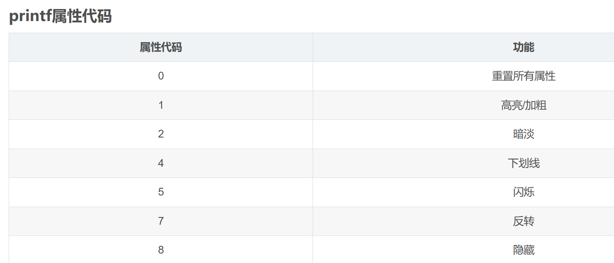
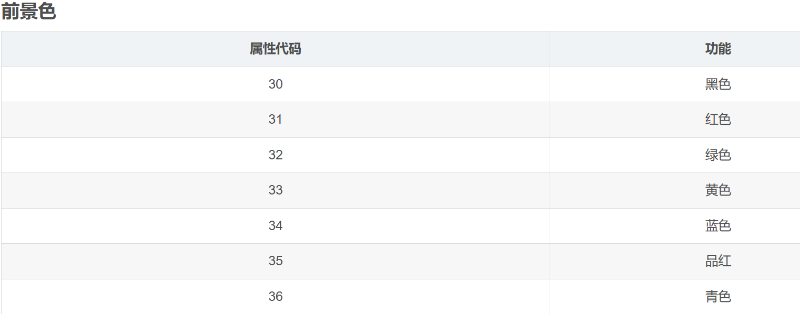
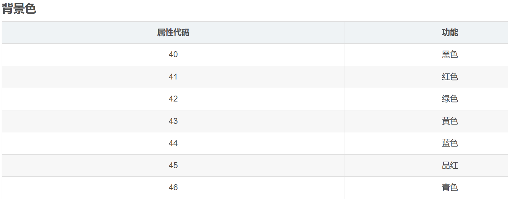

# 调试篇
## 1、log彩色打印

	命令
	我们常用的printf函数输出来的颜色是终端的配色。
	如果想要输出不同的颜色进行区分，
	就需要用到printf的控制命令：\033[m。
	控制命令以\033[开头，
	以m结尾，
	而中间则是属性码，
	属性代码之间使用;分隔，
	如\033[1;34;42m。而属性代码的含义见下面的表格




示例：
```c
#include <stdio.h>

void printf_red(const char *s)
{
    printf("\033[0m\033[1;31m%s\033[0m", s);
}

void printf_green(const char *s)
{
    printf("\033[0m\033[1;32m%s\033[0m", s);
}

void printf_yellow(const char *s)
{
    printf("\033[0m\033[1;33m%s\033[0m", s);
}

void printf_blue(const char *s)
{
    printf("\033[0m\033[1;34m%s\033[0m", s);
}

void printf_pink(const char *s)
{
    printf("\033[0m\033[1;35m%s\033[0m", s);
}

void printf_cyan(const char *s)
{
    printf("\033[0m\033[1;36m%s\033[0m", s);
}

int main()
{
    printf_red("Hello World.\n");
    printf_green("Hello World.\n");
    printf_yellow("Hello World.\n");
    printf_blue("Hello World.\n");
    printf_pink("Hello World.\n");
    printf_cyan("Hello World.\n");
    return 0;
}

```

# 常用库

## 1、内存管理库 valgrind
编译需要将修改configure： armv7*)改成 armv7*|arm
```
注意指定编译器的浮点点类型
export CXXFLAGS="-mfloat-abi=hard -mfpu=vfpv3-d16 -marm -march=armv7-a -mcpu=cortex-a7"
```

## 2、文字编w码库：iconv


## 3、openssl 加密库

## 4、zbar 条码扫描库