# linux命令类和shell技巧类
## 1、dd命令
可以拷贝一切，内存，磁盘，当设备出现问题，可以通过dd命令将内存数据拷贝出，无敌。

## 2、软连接
自己想要的软件直接到官网下载，或者交叉编译器可以直接使用此方法 。

```shell
ln -s 【目标】  【链接到目标地址】
```
都是绝对地址。

另一种是设置环境变量的方式，设置的地址在`/etc/profile`

类似:`export PATH=$PATH:/usr/local/arm/gcc-linaro-4.9.4-2017.01-x86_64_arm-linux-gnueabihf/bin`        

`/usr/local/bin/`放置了一些软件的启动地址。    
~/bashrc放置的是用户的一些个性化设置，也可以将环境变量放到里面。            

bashrc的作用：1、可以在利用命名函数alias定制需要的指令；2、设定环境路径；3、提示符设置。
## 3、vim中w ! sudo tee %
%为当前文件，上面的作用主要是缺少sudo时，可以直接采用上面命令保存vim，避免尴尬。

## 4、grep -nR可以查看引用的字符串

## 5、find ./ -name "test" 可以查找文件

## 6、unzip解压乱码问题
unzip有时候需要去指定编码 unzip -O GBK xxxxx.zip

## 7、file 命令
查看可执行程序是否有动态库依赖

## 8、scp命令
* 使用git工具。模拟windos下的linux开发环境。常用的操作有scp操作将文件拷贝到开发版中。要求是开发板有ssh协议。

## 9、dig命令
查询域名解析

## 10、nm命令
查看可执行程序是否有动态库依赖,可查询函数在是否被引用过。

# ubuntu设置

## 1、tftp
```shell
sudo apt-get install tftp-hpa 
```
创建配置文件：/etc/xinetd.d/tftp
和nfs不同，不能配置多个。
配置/etc/default/tftpd-hpa
```shell
# /etc/default/tftpd-hpa
TFTP_USERNAME="tftp"
TFTP_DIRECTORY="/home/ygc/Desktop/project/tftp"
TFTP_ADDRESS=":69"
TFTP_OPTIONS="-1 -c -s"
```
最后：
```shell
sudo systemctl start tftpd-hpa
sudo systemctl enable tftpd-hpa
sudo service tftpd-hpa restart
```
# 1、共享文件
从ubuntu20.04开始，设置共享文件就很麻烦

第一步：
安装samba：
```shell
sudo apt install samba
```

第二步;
创建一个共享文件夹
我以桌面Desktop为例子

第三步：
设置密码：
```shell
sudo smbpasswd -a ygc
```
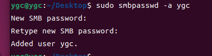

第四步：

```shell
sudo vim /etc/samba/smb.conf
```

```shell
[shared_tuling]
path = /home/tuling
browseable = yes
read only = no
writable = yes
writable = yes
create mask = 0777
directory mask = 0777
guest ok = yes

[shared_ygc]
path = /home/ygc
read only = no
writable = yes
browseable = yes
writable = yes
create mask = 0777
directory mask = 0777
guest ok = yes


```
开启samba服务
```shell
sudo systemctl restart smbd nmbd
sudo systemctl enable smbd nmbd
```

## 在win11上有时候要输入这个才能正常的共享
```shell
Set-SmbClientConfiguration -RequireSecuritySignature $false
```

# linux命令
使用git工具。模拟windos下的linux开发环境。常用的操作有scp操作将文件拷贝到开发版中。要求是开发板有ssh协议。

## 1、vscode阅读源码  ubuntu
插件
1、c/c++   
2、gnu global
3、gtags
需要https://ftp.gnu.org/pub/gnu/global/或者wget https://ftp.gnu.org/pub/gnu/global/global-6.6.6.tar.gz               

```shell
[hezz@ubu global-6.6 16:46]$ ./configure
[hezz@ubu global-6.6 16:46]$ sudo make install
[hezz@ubu global-6.6 16:46]$ make 


```
然后global --version查看版本    
gnu global扩展配置中  
Auto Update配置为“Disable”   
这是因为我们的工程文件太大，一般的文件大于50MB就要禁用此项功能。                           
completion配置为“Disable”               
是为了启用VSCode自带的代码自动补全功能，因为不禁用global自动补全功能的话，有些变量输入时无法进行自动补全。
详细百度安装配置。    
## 2、其他扩展插件
```shell
1)、C/C++，这个肯定是必须的。
2)、C/C++ Snippets，即 C/C++重用代码块。
3)、C/C++ Advanced Lint,即 C/C++静态检测 。
4)、Code Runner，即代码运行。
5)、Include AutoComplete，即自动头文件包含。
6)、Rainbow Brackets，彩虹花括号，有助于阅读代码。
7)、One Dark Pro，VSCode 的主题。
8)、GBKtoUTF8，将 GBK 转换为 UTF8。
9)、ARM，即支持 ARM 汇编语法高亮显示。
10)、Chinese(Simplified)，即中文环境。
11)、vscode-icons，VSCode 图标插件，主要是资源管理器下各个文件夹的图标。
12)、compareit，比较插件，可以用于比较两个文件的差异。
13)、DeviceTree，设备树语法插件。
14)、TabNine，一款 AI 自动补全插件，强烈推荐，谁用谁知道。
15)、ssh扩展。
16)、var-translate 中英文翻译
17)、comment translate 翻译
18}、vim插件
```
### clangd插件
步骤：
1、下载clangd
```shell
sudo apt install clangd
```
2、利用bear生成compile_commands.json
```shell
bear -- make
```
这里的bear只用去执行编译文件就可以


## 3、使用vim开发
第一步
	vim控制光标流畅运行
第二部


第三步
快捷键
 h j

 第四步
 删除 复制 粘贴 撤销快捷键

 za zR zM zo za zf zd zj zk zz zb zt zc

 搜索 /字符串  n/N 上下移动

## 4、vim的控制命令--s --c --d --y
操作
初始文本

```shell
"hello world!"
```

将光标移动到双引号内，按`cs"'`
```shell
'hello world!'
```

接着将光标放入其中，按`cs'<q>`
```shell
<q>hello world!</q>
```

移除它，`cst"`
```shell
hello world!
```

光标移动到 hello上，按`ysiw]`
```shell
[hello] world!
```

将整行外加括号同时括号内再加一个空格 `yss(`
```shell
( [hello] world! )
```

删除括号 `ds[ds)`
```shell
hello world!
```
`a`命令包括，`i`命令内部
```shell
ca{

ci{
```
## 4、cmake添加-g编译选项  
有时候我们需要用gdb调试程序，需要为程序添加“-g”编译选项，那么cmake构建的项目该如何添加“-g”编译选项呢？此处收集了两种方式；

第一种

修改CMakelist.txt， 添加“add_definitions("-Wall -g")”行；

第二种

 执行cmake时，添加-DCMAKE_BUILD_TYPE=Debug编译选项。

cmake -DCMAKE_BUILD_TYPE=Debug ......

建议使用第二种，可以不用改变CMakelist.txt。

cmake编译生成的makefile如何打印详细信息呢？在执行make 时添加“VERBOSE=1”，如果想加速编译速度，可以添加 -j 10 选项，后面的数字的最大值为本机的处理器核数。

## 5、file命令
file命令可以查看文件的格式，属于什么架构等等信息


## 6、服务器安装gitlab
* 第一步 安装依赖     
打开终端，运行如下命令：
```shell 
sudo apt update

sudo apt-get upgrade

sudo apt-get install curl openssh-server ca-certificates postfix

```

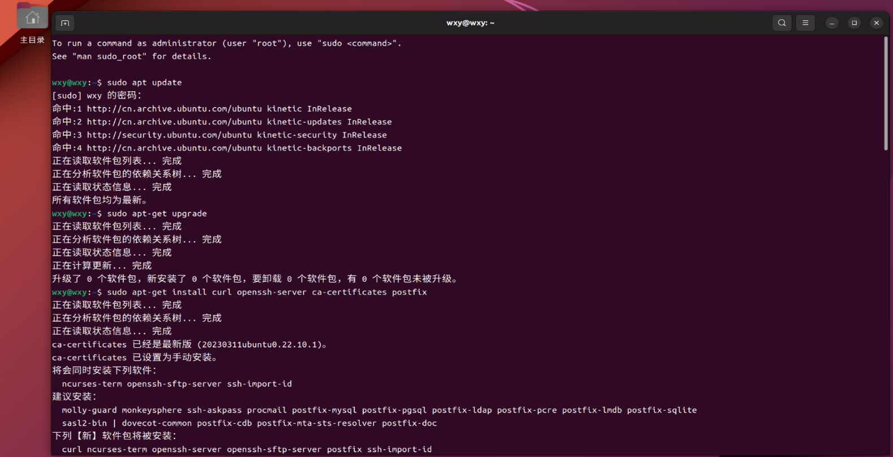

接下来会遇到如下界面，Tab切换到“确定”按钮，然后回车。

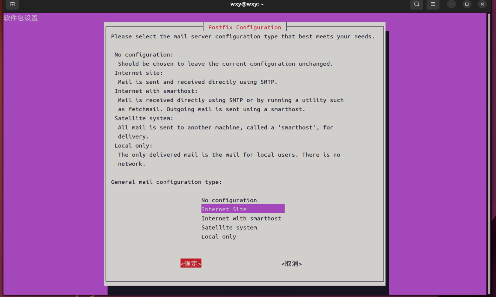
照样Tab切换到“确定”按钮，然后回车。   
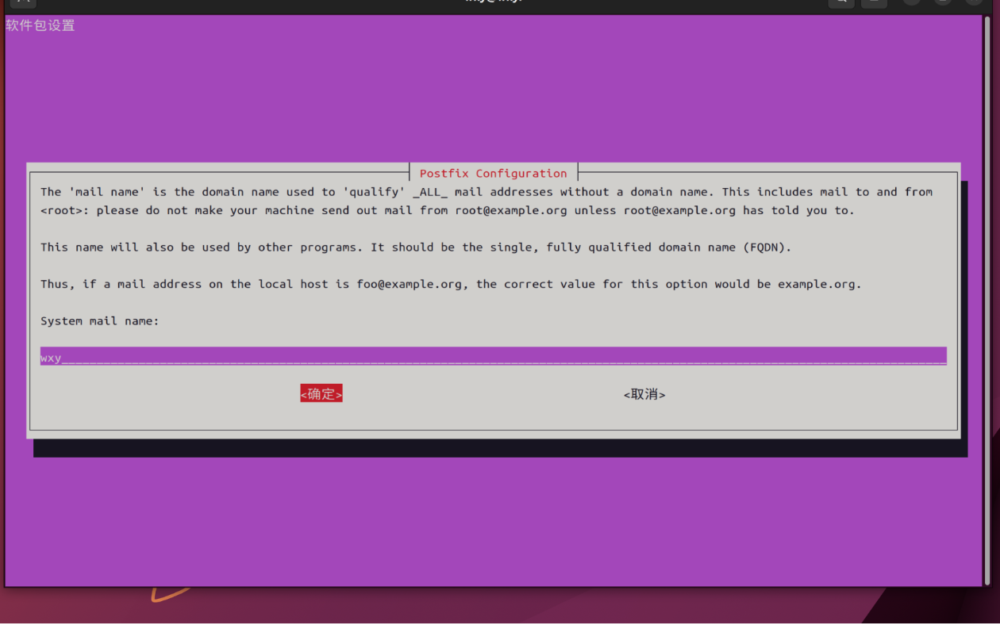

*第二步  安装Gitlab

先执行命令
```shell
curl -s https://packages.gitlab.com/install/repositories/gitlab/gitlab-ce/script.deb.sh | sudo bash
```
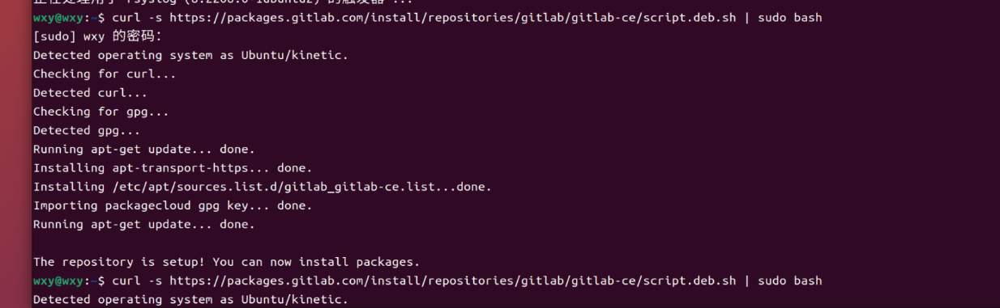         
前往Gitlab官网：https://packages.gitlab.com/gitlab/gitlab-ce，找到最新版本的gitlab-ce安装包，注意版本是ubuntu/focal。           

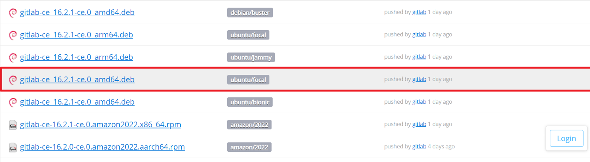
通过wget方式在线安装gitlab，复制wsgt下载命令。       
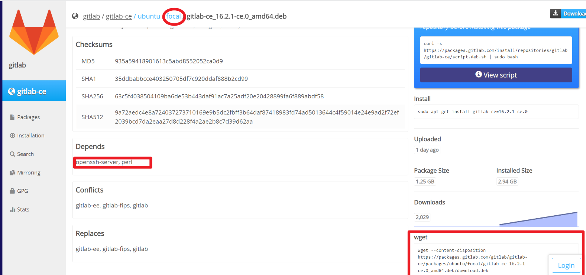


安装命令：   
```shell
wget --content-disposition https://packages.gitlab.com/gitlab/gitlab-ce/packages/ubuntu/focal/gitlab-ce_16.2.1-ce.0_amd64.deb/download.deb
```
然后再解压：sudo dpkg -i gitlab-ce_16.2.1-ce.0_amd64.deb
运行完sudo dpkg后如果出现下面的界面就表示gitlab安装成功。
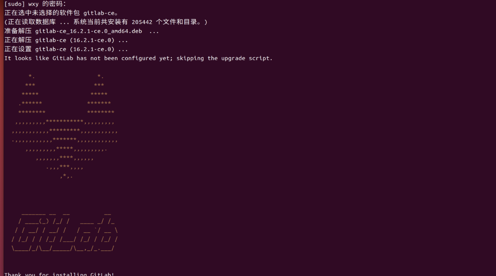

* 最后一步 配置gitlab        
运行sudo vim /etc/gitlab/gitlab.rb来查看当前gitlab网页ip和端口号。
如果运行上述命令出现权限问题，运行下列命令即可：
```shell
chmod -R 755 /var/log/gitlab
```
然后再运行
```shell
sudo vim /etc/gitlab/gitlab.rb
```
进入gitlab的配置文件修改界面，输入i进入编辑模式，然后找到external_url字段（在第32行），改成自己需要设置的IP和端口号，IP我设置为本机的ipv4地址。
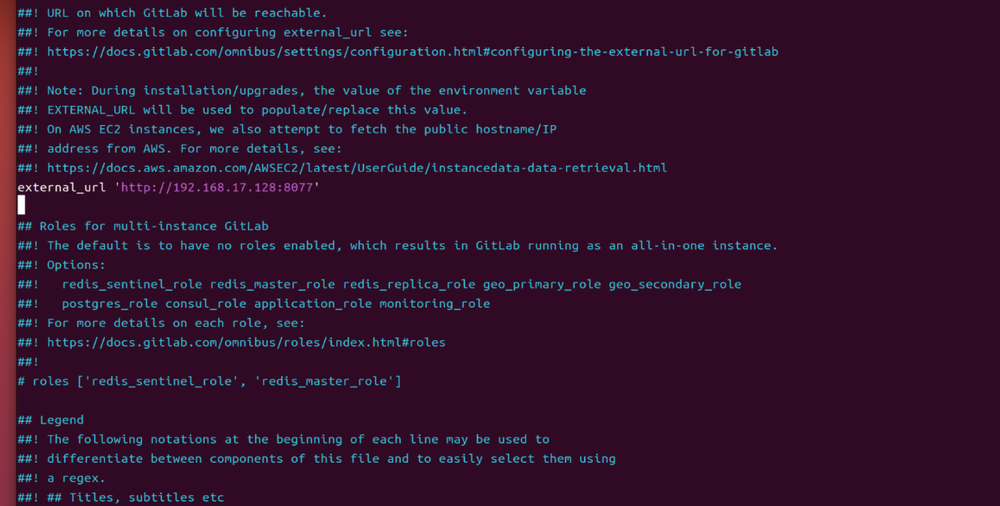

修改完毕以后按esc键退出编辑模式，然后输入:wq保存即可。接下来通过下列命令重启服务。
```shell
# 停止gitlab服务 
sudo gitlab-ctl stop ​

# 启动gitlab服务 
sudo gitlab-ctl reconfigure ​

# 重启所有gitlab组件 
sudo gitlab-ctl restart ​

# 启动所有gitlab组件 
sudo gitlab-ctl start

# 启用开机自启动
sudo systemctl enable gitlab-runsvdir.service
```
初始化管理员账户密码    
```shell
#切换路径
cd /opt/gitlab/bin/ ​

#打开控制台
sudo gitlab-rails console -e production ​
 
#查询用户账号信息并赋值给u
u=User.where(id:1).first​

#设置root的密码
u.password='wxy123456'

#确认密码
u.password_confirmation='wxy123456'

#保存信息(注意有个感叹号）
u.save!

#退出
exit
```
* 最后登录验证
接下来就可以通过http://192.168.17.128:8077来登录gitlab了。登录的地址是你之前设置external_url字段的值。
按下面的步骤将gitlab语言设置为中文：
注意点击Preferences     
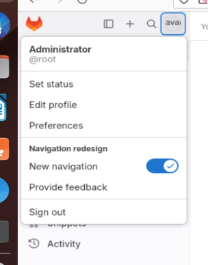
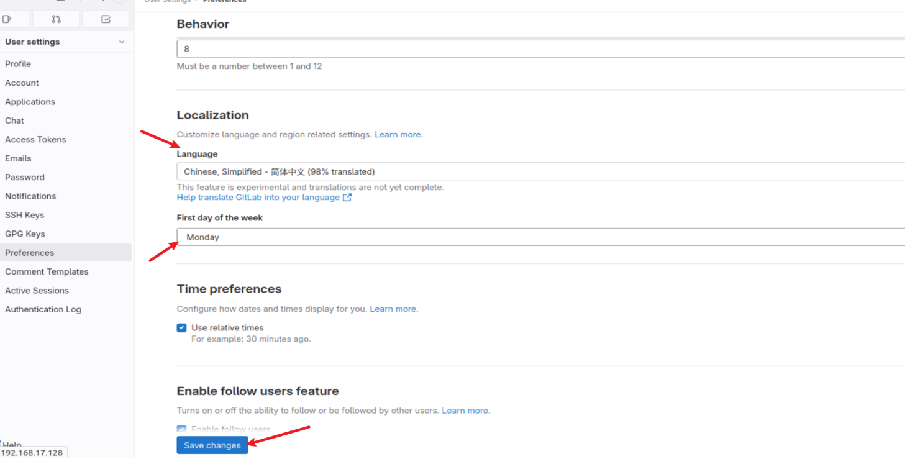
点击Save changes，刷新即可。    

在账户搜索阶段，搜索root可能会出错，如果出错看下面解决办法     
* 对于账户来说          
1.进入控制台：                                                      
```shell
[root@hostname ~]# gitlab-rails console production          
或者：          
[root@hostname ~]# gitlab-rails console                                 
```
2.定位到需要修改的用户
方法一：

通过用户名查找（推荐）：
```shell
irb(main):001:0> user=User.where(username:'root').first
```
另一种写法（只能定位到普通用户，很容易出错造成找不到用户，返回 => nil，没有此用户的结果）：
```shell
irb(main):002:0> User.where(name:'doudou').first
```
方法二：

通过id查找（一般修改root使用，因为root id=1）：         
```shell
irb(main):003:0> user=User.where(id:1).first

=> #<User id:1 @root>
```
方法三：        

通过邮箱查找：  
```shell
irb(main):004:0> user=User.find_by(email:'123@qq.com')

=> #<User id:92 @doudou>
```shell
3.重置密码：            
一般数字密码就不用加引号：          
```
irb(main):005:0>user.password=12345678

=> 12345678
有字符的密码一定要有引号（等号两边有空格）：

irb(main):006:0>user.password = 'root@123'

=> “root@123”
```
4.确认新密码（可以省略）：      
```shell
irb(main):007:0>user.password_confirmation = 'root@123'
=> “root@123”
```
5.保存新密码：
```shell
irb(main):022:0>user.save!

Enqueued ActionMailer::DeliveryJob (Job ID: 04e11d87-7fc0-47a5-a792-aff11918335d) to Sidekiq(mailers) with arguments: “DeviseMailer”, “password_change”, “deliver_now”, #<GlobalID:0x00007fe595b63078 @uri=#<URI::GID gid://gitlab/User/10>>
=> true
```
最后是true就保存可以了！！！
```shell
irb(main):023:0>exit
```
扩展：
用脚本实现非交互式重置密码：
1.脚本需要使用到expect和spawn，yum安装一些包：
```shell
[root@hostname~]# yum install -y tcl tclx tcl-devel expect              
[root@gmc-repository test]# vim gitlab.sh                
```

## 7、安装runner
打开gitlab pages功能    
```shell
sudo vim /etc/gitlab/gitlab.rb
```

```shell
# Pages 服务地址
pages_external_url "http://git.liuweigl.cn"
# 启用 pages
gitlab_pages['enable'] = true
```
重新配置完重启  
```
sudo gitlab-ctl reconfigure
```
安装runner 
```shell
# For Debian/Ubuntu/Mint
curl -L https://packages.gitlab.com/install/repositories/runner/gitlab-runner/script.deb.sh | sudo bash
sudo apt-get install gitlab-runner
apt-cache madison gitlab-runner
sudo apt-get install gitlab-runner
sudo gitlab-runner run #启动Runner
```
这部分在gitlab新建流水线的时候出现的token复制，按照上面提示的步骤       
```shell
sudo gitlab-runner register  
# 接下来会要求填入url和token:项目-设置-CI/CD-Runner展开复制url和token粘贴过来
# 执行器选择shell
sudo gitlab-runner start
# 此时gitlab-runner就配置完成了，代码库中有push就会触发持续集成
```

配置文件选择在gitlab的流水线上下，不单独去写配置运行文件   


## 8、运行脚本
```shell
cache:
  paths:
    - node_modules/

before_script:
    - hexo clean

pages:
  script:
    - hexo generate
  artifacts:
    paths:
      - public
  only:
    - main

```


## 9、gitlab-runner一直处于pending状态原因分析
项目触发runner，一直处于pending         
初步怀疑是runner卡住了，也有可能是因为服务器资源不足，在服务器上执行gitlab-ci-multi-runner list发现runer还在，      
在执行gitlab-ci-multi-runner verify，发现runer还活着，但是就是一直不执行流程            
有两个方法解决：        
    1、执行gitlab-ci-multi-runner run（不推荐使用）         
        他会去执行runner任务，但是每次都需要运行次命令才回去执行任务        
    2、执行gitlab-ci-multi-runner restart           
        重启runner，发现他会自动去执行触发runner的任务          
## 10、vscode屏蔽不需要的文件
点击设置齿轮，点击设置，又上角json。

```json
{
    "search.exclude": {   //搜索  true 屏蔽 false 不屏蔽
        "**/node_modules": true,       
        "**/*.o": true,
        "**/*.so": true,  
        "**/bower_components": true,  //默认配置
        "/arch/avr32" : true,         //被禁止搜寻的文件/文件夹
    },
    "files.exclude": { //文件显示  true 屏蔽 false 不屏蔽
        "**/.git": true,
        "**/.svn": true,
        "**/.hg": true,
        "**/*.o": true,
        "**/*.so": true,  
        "**/CVS": true,
        "**/.DS_Store": true,  //默认配置
        "arch/avr32" : true,   //被禁止看见的文件/文件夹
    }
}
```
`下面为跳转相关--很重要`
```json
{
    "configurations": [
        {
            "name": "Linux",
            "includePath": [
                "${workspaceFolder}/**"  //包含的头件
            ],
            "defines": [],
            "compilerPath": "/home/ygc/Desktop/linux-gcc/atk-dlrv1126-toolchain-arm-buildroot-linux-gnueabihf-x86/bin/arm-linux-gnueabihf-c++",  //编译器地址
            "cStandard": "c17",
            "cppStandard": "gnu++14",
            "intelliSenseMode": "linux-gcc-x64"
        }
    ],
    "version": 4
}
```

## git工具
```
git init   // 初始化一个仓库
git clone  <url>  //从地址克隆一个项目
git pull //命令尽量少用


git log -a //查看所有的log
git branch -a //查看所有的分支，包括远程分支
git branch test //test为分支名字
git git branch --set-upstream-to=main/分支 本地分支   //远程仓库分支和本地分支合并

git checkout test //切换分支test

git remote -v  //查看远程仓库地址
git remote add 名称 url 添加远程仓库 
git remote rm name  //删除远程仓库
git remote rename old_name new_name   //修改仓库名
git remote set-url --delete //删除地址
git remote set-head origin -a        将 origin/HEAD 指向 远程仓库的 默认分支（-a 即 --auto）
git remote set-head origin dev       将 origin/HEAD 指向 （origin/dev）  
git remote set-head origin -d        删除 origin/HEAD


git merge  name name1  //合并分支
git stash  //添加到储藏区
git stash pop //储藏区的内容恢复到当前区

新建分支后
git branch -u //进行远程分支关联
git push 远程仓库 -d 远程分支  //删除远程分支
git push //会直接推远程分支
```

一般上传出问题，缺少关联，解决办法
```
git remote rm 关联

git remote add 关联

git remote set-head origin -a 自动关联
```

远程版本先于本地版本，切换远程分支，查看更新log，然后拉远程代码和本地合并，解决完冲突在上传
          
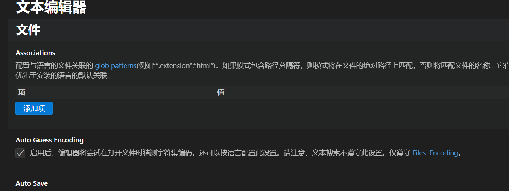


## 13、gdb调试
```shell
gdb ./a.out  //调试文件
r //运行
b main //打断点
n //单步执行
p i //打印变量i的值
p &i //打印变量i的地址
p *p //打印指针的值
q //退出
gdb ./a.out core //调试core文件
target remote localhost:1234 //连接调试
gdbserver multi //启动gdbserver
```
调试core，有的代码出现段错误后没有生成core文件，需要修改配置文件，执行`ulimit -c unlimited`

调试进程
```shell
gdb -p 1234
1234为进程号
```
调试线程
```shell
info threads //查看线程
thread id //切换线程
set scheduler-locking off|on //关闭线程|开启线程
thread apply id comand //对id线程执行command
```
gdb设置日志
```shell
set logging file /tmp/gdb.log
set logging on
set logging off
```
gdb设置shell
```shell
shell cmd
```

## 14、yazi
```shell
sudo snap install yazi
```


## 15、nfs
安装
```shell
sudo apt update
sudo apt install -y nfs-kernel-server rpcbind
```

配置/etc/exports
可以设置多个目录
```shell
/home/tuling/nfs *(rw,sync,no_subtree_check,no_root_squash,insecure)
/home/tuling/nfs2 *(rw,sync,no_subtree_check,no_root_squash,insecure)
```

启动
```shell
sudo exportfs -a
sudo systemctl restart nfs-kernel-server
```

查看是否生效
```shell
sudo exportfs -v
```

## 16 、 给千问装上mcp
千问可以装插件
比如markitdown


## 17、 AI规则
---
trigger: manual
---
请严格遵守以下规则：
我当前在 Ubuntu 2204 开发环境，使用富瀚NPU做音视频流媒体开发。
1、我用的C++版本是C++17以下包括C++17
2、代码运行环境：linux嵌入式
3、尽量用c++设计模式、但是不要过度设计
4、尽量用c++17高级写法，要帅，但是不要过于花哨，毕竟是嵌入式环境
5、如果需要在终端执行python,那你需要将结果输出到文件，然后你去读取文件后再删除中间文件
6、c++注释不要采用//，请采用/**/
7、我是做嵌入式开发，代码最终运行在板子上。
8、代码采用接口式开发，一个函数尽量不要超过100行
9、要用资源安全的写法写代码，尽量用RAII模式，文件，锁，描述符，系统层 等，能用的必须用。杜绝不安全管理。
10、修改代码直接在工作区中改，尽量不要用终端改，比如sed等，需要在工作区中给我确认
11、开发完后，将架构图你需要的文件保存，方便以后你读取直接知道整个代码设计思路。