`下面出现代码均为c语言`
# 1、计算机网络发展

* 最早的计算机网络是ARPA，但是最早的ARPA无法连接不同类型的计算机和不同的操作系统。

## 1-1、数据交换

* 通过标有地址的分组进行路由选择传输数据，使得通信通道仅在传送期间被占用的一种交换方式。

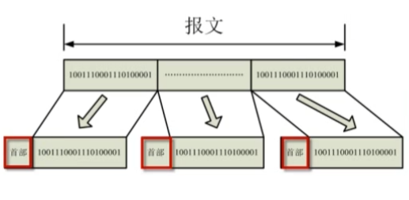


## 1-2、交换方式

•交换的方式为存储转发，节点收到分组，先暂时存储下来，再检查它的头部，然后按照首部中的地址，找到合适的节点转发出去。

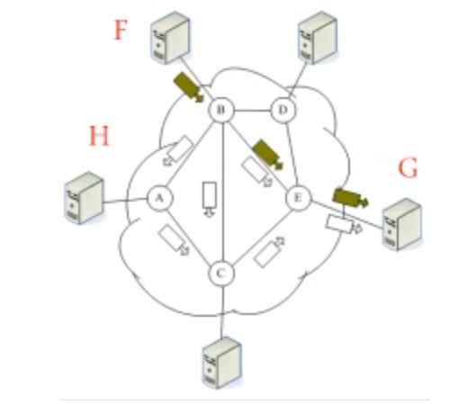


### 1-2-3、特点

1、以分组作为传输单位。

2、独立选择转发路由。

3、逐段占用，动态分配传输带宽。

## 1-3、发展过程
•从单个ARPA发展为tcp/ip的ARPAnei的标注协议。
# 2、英特网的结构
## 2-1、三级结构英特网
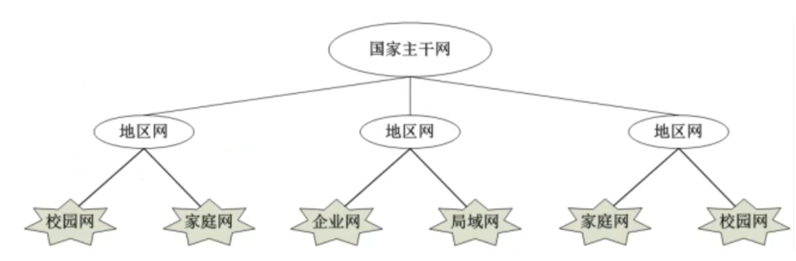

•每个国家都有一个主干网，然后层级下发。

## 2-2、多级英特网
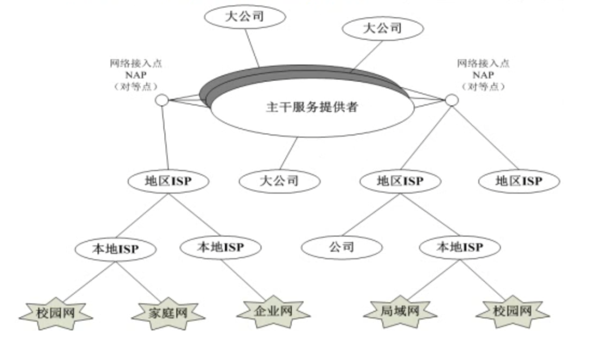


# 3、TCP/IP协议族

## 3-1、分层结构

•由来：主要是为了解决不同计算机之间和不同操作系统直接的差异，就进行分层，只需要保证某些层次是一样的，
就可以进行通讯。
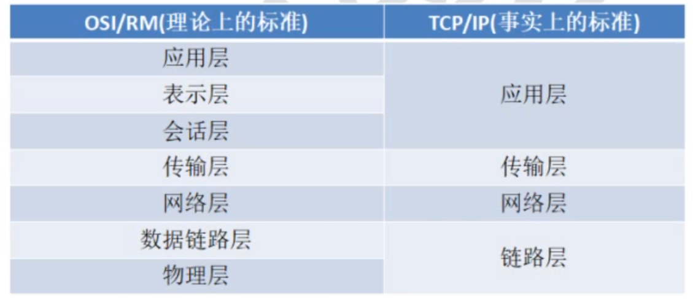

•最早的分层体系是osi开放系统互联模型，是由国际化标准组织（iso）指定，由于osi过于
复杂，所以到现在也没有使用，而是使用的是TCP/IP协议族。

•应用层：应用程序沟通的 例如：FTP、HTTP、Telnet等。

•FTP：文件传输协议，如app的上传和下载功能。

•HTTP：超文本协议，通过浏览器访问其他网站，必须通过http协议。

•传输层：提供程序间数据的传输逻辑通讯，例如TCP、UDP。

•网络层：提供基本的数据包传送功能，最大可能的能让每个数据报都能到达主机，例如IP、ICMP等。

•IP：用来找到目的主机。

•链路层：负责数据帧的发送和接收。一个数据称为一帧数据。

•每层完成自己的任务，最终完成不同层次的处理完成数据的收发。
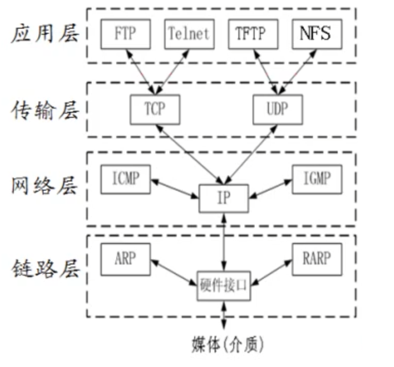

•上图的ARP协议是通过对方的ip地址找对方MAC地址，
而RARP则是通过MAC地址找ip地址。

•数据是从应用层到传输层，一直到链路层，
整体把数据交给链路层之后，将数据传给对方，
然后最后层层解封。

## 3-2、 IP协议

•特指为实现一个相互连接的网络系统上从源地址到
目的地传输数据包所提供的必要协议。
也称为网际协议。

•特点：	不可靠：它不能保证IP数据包能成功地到达它的目的地，
仅提供尽力而为的传输服务。

•无连接：IP并不维护任何关于后续数据包的状态信息。
每个数据包的处理是相互独立的。
IP数据包可以不按发送顺序接收
IP数据包中含有发送它主机的IP地址（源地址）和接收它主机的IP地址（目的地址）。

## 3-3、tcp协议简介

•tcp协议是面向连接的，可靠的传输层通讯协议。

•功能：提供不同主机上的进程间通讯。

•特点：  
1、建立链接->使用链接->释放链接（虚电路）。

2、tcp数据包中包含序号和确认序号。

3、对包经行排序并检错，而损坏的包可以被重传。

•服务对象
需要高度可靠并面向连接的服务。  
如：http、ftp、smtp等。
smtp为简单邮件传输协议。

## 3-4、udp协议简介
•udp是一种面向无连接的传输层通讯协议。也称用户数据报协议。

•功能：  
提供不同主机上的进程间通讯。

•特点：  
1、发送数据前不需要建立链接。  

2、不对数据包的顺序进行检查。

3、没有错误检测和重传机制。

•服务对象：
主要用于查询应答服务。
如：nfs、ntp、dns等

## 3-5、mac地址

•mac地址类似于身份证号。出场的时候标出，理论上全球唯一。

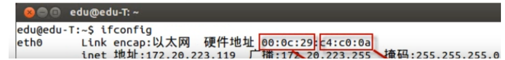

•组成：以太网内的MAC地址是一个48bit的值。mac地址是可以修改的，但是一般情况下不建议修改mac地址。

•总共分成6组，通过 : 隔开，前三组称为厂商ID，后三组称为设备ID。

•如果是我们自己识别的话是分组识别，如果是输入给计算机的话就是48位的值。

## 3-6、ip地址

•ip地址是一种internet上的主机编址，也称为网际协议地址。

•ip地址在网络中具有唯一标识。

### 3-6-1、IP地址的分类

•ipv4，占32位

•ipv6，占128位

#### 3-6-1-1、ipv4组成

•ipv4一般使用点分十进制字符串来标识，如192.168.1.135。

### 3-6-2、ip组成

•使用32位，有{网络id，主机id}两部分组成

•子网：IP地址中由1覆盖的连续位

•主机：由ip地址中0覆盖的连续位

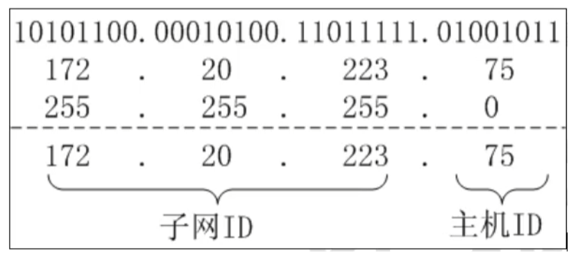


•子网ID不同的网络不能直接通讯，如果要通讯要通过路由器转发。

•主机id全为0表示网段地址。

•主机id全为1的ip地址表示该网段的广播地址。

•如192.168.1.0为表示网段，192.168.1.255为广播地址。

### 3-6-3、ipv4的地址分类（依据前8位进行区分）

•A类地址：默认8位子网id，
第一位为0，前8位00000000 - 0111 1111，
范围0.x.x.x - 127.x.x.x

•B类地址：默认16位子网id，
前两位为10，前8位1000 0000  -  1011 1111，
范围128.x.x.x  -  191.x.x.x

•C类地址：默认24位子网id，
前三位为110，前8位为1100 0000   -  1101 1111 ，
范围192 .x.x.x  -  223.x.x.x

•D类地址：前四位为1110，
多播地址，前8位1110 0000 -  1110 1111，
范围224.x.x.x  -  239.x.x.x

•E类地址：前五位为1111 0，
保留为今后使用，前八位为1111 0000  -  1111 1111 ，
范围240 .x.x.x -  255.x.x.x
 	
•ip地址特点：  
子网ID不同的网络不能直接通信，
如果要通信则需要路由器转发
主机ID全为0的IP地址表示网段地址
主机ID全为1的IP地址表示该网段的广播地址。
### 3-6-4、私有ip

•公有ip(可直接联网)：
经由internet同意规划的ip。

•私有ip（不可直接连接internet）：
主要用于局域网络内的主机联机规划。		

​	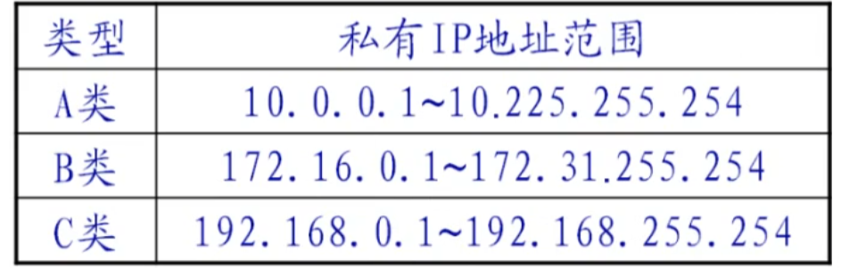


### 3-6-5、回环ip地址

•通常127.0.0.1称为回环地址

•功能：
主要是测试本机的网络配置，能ping通127.0.0.1说明本机的网卡和ip协议的安装没有问题。

•注意：
127.0.0.1----127.255.255.254中的任何地址都将回环到本机的地址中，不属于任何一个有类别的地址类，
它代表着设备的本地接口。

### 3-6-6、子网掩码

•子网掩码又称为网络掩码、地址掩码是一个有32位由1和0组成的数值，并且1和0分别连续。

•作用：

​用于指明ip地址中那些是子网，那些是主机号。

•特点：

​必须结合ip地址一起使用，不能单独存在。

​ip地址中由子网掩码中1覆盖的连续位为子网id，其余为主机id。

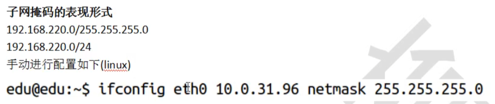

## 3-7、端口

### 3-7-1、端口概述

•tcp/ip采用端口标识通信进程，用于区分一个系统里的多个进程。

•特点：  
1、对于同一个端口，在不同的系统中对应着不同的进程。

2、对于同一个系统，一个端口只能被一个进程拥有。

3、一个进程拥有一个端口后，传输层送到该端口的数据全部被该进程接收，同样，
进程送交传输层的数据也通过该端口被送出。

### 3-7-2、端口号

•类似pid标识一个进程：在网络程序中，用端口号（port）来标识一个运行的网络程序。

•特点  
1、端口号是无符号短整型的类型。

2、每个端口都拥有一个端口号。

3、TCP、UDP维护各自的端口号。

4、网络应用程序至少要占用一个端口号，也可以占用多个端口号。

•知名端口（1-1023）
由互联网数字分配机构根据用户需求进行同意分配。
如：ftp --21，http----80等
服务器通常使用的范围；若强制使用，须加root特权

• 动态端口（1024 -65535）
应用程序通常使用的范围。
注意：端口号类似于进程号，同一时刻只能标记一个进程。
可以重复使用。

​	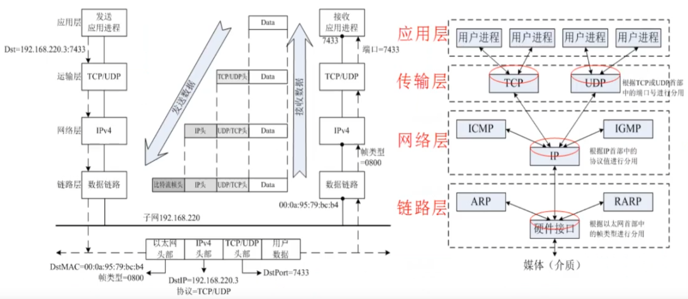


### 3-7-3、链路层封包格式

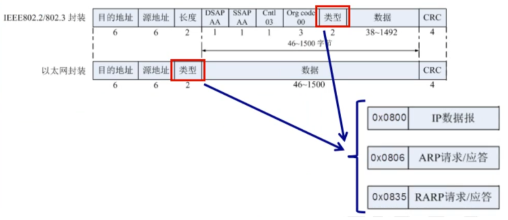


• 目的地址：目的mac地址

• 源地址：源mac地址

• 类型：  
以太网后面跟的是那个协议，占两个字节
0x0800 ip协议（对应到网络层）
0x0806 arp协议
0x835 rarp协议

• 注意：

1、IEEE802.2/802.3封装常用的无线

2、以太网封装常用在线局域网

### 3-7-4、网络层的数据报封装

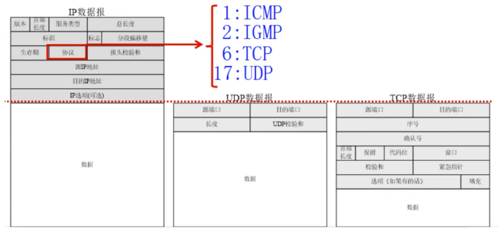


•当协议改为6，或者17后，ip数据报后面紧跟的就是udp数据报或者tcp数据报。

## 3-8、c/s架构

•无论是tcp还是udp，都是通过c/s架构运行的，client客户端，server服务器端。服务器是被动运行的，
客户端是主动运行的。
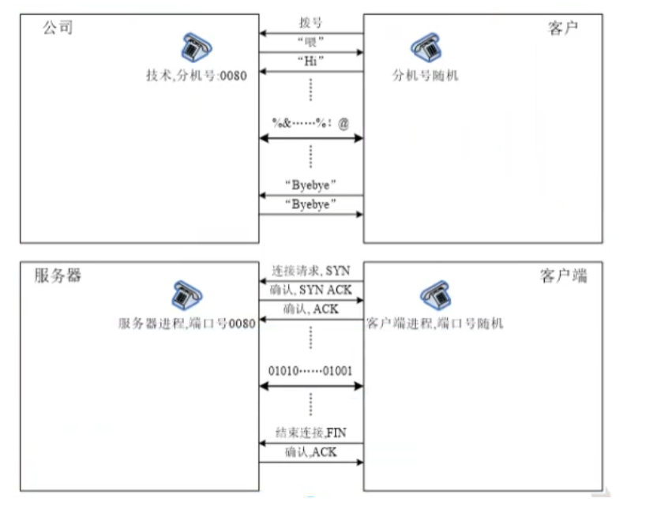

•server工作过程：  
打开一通信通道并告知本地主机，它愿意在一特定端口（如80）上接收客户请求，
等待客户请求到达该端口，受客户请求，并发送应答信号，激活一新的线程处理客
户的这个请求，服务完成后，关闭新线程的客户的通信链路。

•client工作过程:  
打开一通信通道并连接到服务器特定的端口，并向服务器发出服务请求，等待并接
收应答，根据需要继续提出请求，请求结束后关闭通信通道并终止。

# 4、字节序、地址转换

•多数据的存储顺序称之为字节序

•分类：  
大端格式：将高位字节数据存储低地址  
小端格式：将低位字节数据存储在低地址

•注意：  
lsb：低地址  
msb：高地址

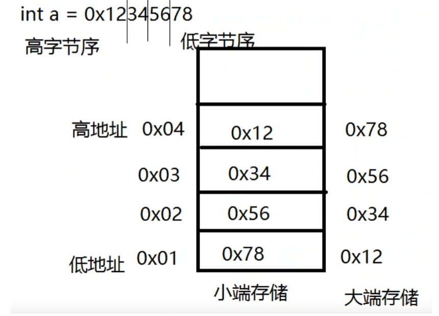

•如何判断存储字节序

```
include <stdio.h>

union k{
int a;
char b;
};
int main()
{
union k j;
j.a = 0x12345678;
printf("j.b = %#x\r\n",j.b);
if(j.b == 0x78)
{
printf("小端存储\r\n");
}

return 0;
}
```

运行的结果：

```
ygc@ygc:~$ ./a.out 
j.b = 0x78
小端存储
```

一个地址位存储一个字节，一个字节8位。

## 4-1、字序转换

•特点：

1、协议指定了通讯字节序为大端存储。

2、只有在多字节数据处理的时候才需要考虑字节序。

3、运行在同一台计算机上的进程互相通讯时，一般不用考虑字节序。

4、异构计算机之间的通讯，需要转换自己的字节序为网络字节序。

在需要字节序转换的时候一般调用特定字节序转换函数。

```
host ‐‐> network
1 ‐‐ htonl
#include <arpa/inet.h>
uint32_t htonl(uint32_t hostint32);
功能:
将32位主机字节序数据转换成网络字节序数据
参数：
hostint32：待转换的32位主机字节序数据
返回值：
 成功：返回网络字节序的值

 2 ‐‐ htons
 #include <arpa/inet.h>
 uint16_t htons(uint16_t hostint16);
 功能：
 将16位主机字节序数据转换成网络字节序数据
 参数：
 uint16_t：unsigned short int
 hostint16：待转换的16位主机字节序数据
 返回值：
 成功：返回网络字节序的值

 network ‐‐> host
 3 ‐‐ ntohl
 #include <arpa/inet.h>
 uint32_t ntohl(uint32_t netint32);
 功能：
 将32位网络字节序数据转换成主机字节序数据
 参数：
 uint32_t： unsigned int
 netint32：待转换的32位网络字节序数据
 返回值：
 成功：返回主机字节序的值

 4 ‐‐ ntohs
 #include <arpa/inet.h>
 uint16_t ntohs(uint16_t netint16);
 功能：
 将16位网络字节序数据转换成主机字节序数据
 参数：
 uint16_t： unsigned short int
 netint16：待转换的16位网络字节序数据
 返回值：
 成功：返回主机字节序的值
```

```
#include <stdio.h>
#include <arpa/inet.h>
int main()
{
int a = 0x12345678;
short int b =0x1234;
printf("%#x\n",htonl(a));
printf("%#x\r\n",htons(b));
return 0;
}
```

运行结果

```
ygc@ygc:~$ ./a.out 
0x78563412
0x3412
```

## 4-2、地址转换
•ip地址人为识别的时候是字符串。

•交给计算机识别时，要将它转化整型数据。
如192.168.3.104 

•交给计算机时，转化位四个字节的整型数据，以点好（.）为分割。

### 4-2-1、转换函数1

```
inet_pton函数

字符串ip转整型数据

inet_ntop函数
整型数据转字符串格式IP地址 

```

```
#include <stdio.h>
#include <arpa/inet.h>
/****************将字符串地址转化为电脑能识别的无符号整形数据**********************/
int main()
{
char ip[] = "192.168.3.103";
unsigned int unip = 0;
unsigned int *nip = NULL;
inet_pton(AF_INET, ip, &unip);
printf("%d\r\n",unip);/******       一个字节一个字节的取出，不然看不懂       *********/
nip = &unip;
printf("unip = %d.%d.%d.%d\r\n",*(nip),*(nip+1),*(nip+2),*(nip+3));

return 0;
}
/////////////////////////////////

结果
///////////////////////////////////////
ygc@ygc:~/network$ ./a.out 
1728293056
unip = 1728293056.-1553161620.32767.959575536
```

```
#include <stdio.h>
#include <arpa/inet.h>
int main()
{
    unsigned char nip[] = {192,168,3,103};
    char ip[16];
    inet_ntop(AF_INET,&nip,ip,16);
printf("%s\r\n",ip);
    return 0;
}
```

		结果

```
ygc@ygc:~/network$ ./a.out 
192.168.3.103
```
#### 地址转换：
•我们输入认为识别的ip地址是点分十进制的字符串形式，
但是计算机或者网络中识别的ip地址是整形数据，
所以需要转化。
```
字符串ip地址转整型数据
#include <arpa/inet.h>
int inet_pton(int family,const char *strptr, void *addrptr);
功能：
将点分十进制数串转换成32位无符号整数
参数：
family 协议族
AF_INET IPV4网络协议
AF_INET6 IPV6网络协议
 strptr 点分十进制数串
 addrptr 32位无符号整数的地址
 返回值：
 成功返回1
 失败返回其它
```

```
#include <stdio.h>
#include <arpa/inet.h>
int main()
{
char ip_str[]="192.168.3.103";
unsigned int ip_int = 0;
unsigned char *ip_p = NULL;
//将点分十进制ip地址转化为32位无符号整形数据
 inet_pton(AF_INET,ip_str,&ip_int);

 printf("ip_int = %d\n",ip_int);

 ip_p = (char *)&ip_int;
 printf("in_uint = %d,%d,%d,%d\n",*ip_p,*(ip_p+1),*(ip_p+2),*
(ip_p+3));

 return 0;
 }
```
#### inet_ntop()

```
整型数据转字符串格式ip地址
#include <arpa/inet.h>
const char *inet_ntop(int family, const void *addrptr,
char *strptr, size_t len);
功能：
将32位无符号整数转换成点分十进制数串
参数：
family 协议族
addrptr 32位无符号整数
 strptr 点分十进制数串
 len strptr缓存区长度
 len的宏定义
 #define INET_ADDRSTRLEN 16 //for ipv4
 #define INET6_ADDRSTRLEN 46 //for ipv6
 返回值：
 成功:则返回字符串的首地址
 失败:返回NULL
```

```
案例：
#include <stdio.h>
#include <arpa/inet.h>
int main()
{
unsigned char ip_int[]={192, 168, 3, 103};
char ip_str[16] = ""; //"192.168.3.103"
inet_ntop(AF_INET, &ip_int, ip_str, 16);
 printf("ip_s = %s\n", ip_str);

 return 0;
 }
```

### 4-2-2、转换函数2

•inet_addr和inet_ntoa用的更多。只能用在ipv4上。比较重要。
```
这两个函数只能用在ipv4地址的转换
#include <sys/socket.h>
#include <netinet/in.h>
#include <arpa/inet.h>
in_addr_t inet_addr(const char *cp);
功能：将点分十进制ip地址转化为整形数据
参数：
cp：点分十进制的IP地址
返回值：
 成功：整形数据

 char *inet_ntoa(struct in_addr in);
 功能：将整形数据转化为点分十进制的ip地址
 参数：
 in：保存ip地址的结构体
 返回值：
 成功：点分十进制的IP地址
```

# 5、udp

•udp的应用：  
dns域名解析，nfs网络文件系统，rtp流媒体
		

## 5-1、网络编程接口socket
	面向无连接的用户数据报协议，
	在传输数据前不需要先建立连接；
	目地主机的运输层收到
	UDP报文后，
	不需要给出任何确认
	UDP特点
	1、相比TCP速度稍快些
	2、简单的请求/应答应用程序可以使用UDP
	3、对于海量数据传输不应该使用UDP
	4、广播和多播应用必须使用UDP
	UDP应用
	DNS(域名解析)、
	NFS(网络文件系统)、
	RTP(流媒体)等
	一般语音和视频通话都是使用udp来通信的

		socket作用：
		
			提供不同主机上的进程之间的通讯

		socket 特点：
				1、socket也称“套接字”。

				2、是一种文件描述符，
				代表了一个个管道的端点。

				3、类似对文件的操作一样，
				可以使用read、write、close等函数对socket套接
				字进行网络数据的收取和发送等操作。

				4、得到socket套接字（描述符）的方法调用socket

		socket分类：

				1、SOCK_STREAM,流式套接字，用于tcp

				2、SOCK_DGRAM,数据报套接字，用于udp
				
				3、SOCK_RAW,原始套接字，
				对于其他层次的协议操作需要使用到这个类型

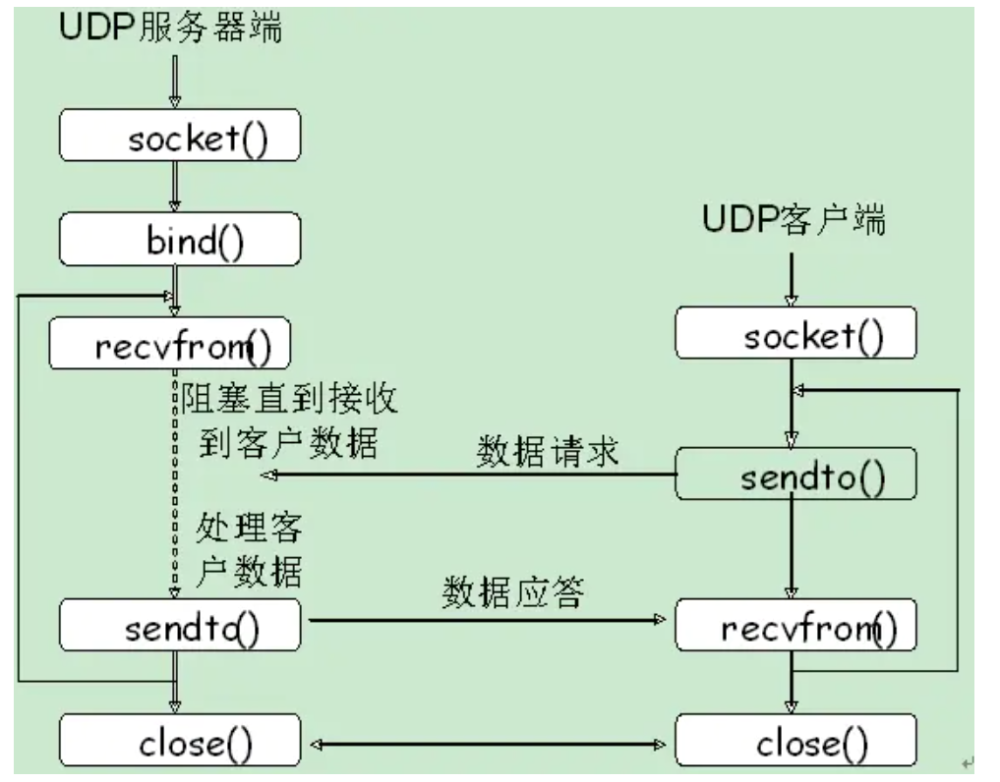


		编程流程：

		一、	服务器：
		1、创建套接字socket                                                             
		2、将服务器的ip地址、端口号与套接字进行绑定bind
		3、接收数据recvfrom
		4、发送数据sendto

		二、	客户端：

		1、创建套接字socket
		2、发送数据sendto
		3、	接收数据recvfrom
		4、	关闭套接字close

		服务器创建套接字默认属性是主动的，就是当发起服务请求；当作为服务器时，往往需要改成被动的。
### 5-1-1 创建socket套接字

```
 创建socket套接字
#include <sys/types.h>
#include <sys/socket.h>
int socket(int domain, int type, int protocol);
功能：创建一个套接字，返回一个文件描述符
参数：
domain：通信域，协议族
AF_UNIX 本地通信
AF_INET ipv4网络协议
AF_INET6 ipv6网络协议
 AF_PACKET 底层接口
 type：套接字的类型
 SOCK_STREAM 流式套接字（tcp）
 SOCK_DGRAM 数据报套接字（udp）
 SOCK_RAW 原始套接字（用于链路层）
 protocol：附加协议，如果不需要，则设置为0
 返回值：
 成功：文件描述符
 失败：‐1
特点：
创建套接字时，系统不会分配端口
创建的套接字默认属性是主动的，
即主动发起服务的请求;当作为服务器时，
往往需要修改为被动的
```
	案例：
```
#include <stdio.h>
#include <sys/socket.h>
#include <sys/types.h>
#include <stdlib.h>
int main(int argc, char const *argv[])
{
//使用socket函数创建套接字
//创建一个用于UDP网络编程的套接字
 int sockfd;
 if((sockfd = socket(AF_INET, SOCK_DGRAM, 0)) == -1)
 {
 perror("fail to socket");
 exit(1);
 }

 printf("sockfd = %d\n", sockfd);

 return 0;
 }
```
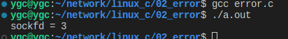

## 5-2、ipv4套接字的地址结构

		再网络编程中，
		为了使不同格式的地址能够被传入套接字函数，
		地址需要强制转换成通用套接字地址结构，
		原因是因为不同的场合所使用的结构体不一样，
		但是调用的函数却是同一个，
		所以定义一个通用的结构体，
		在指定场合使用时，
		再根据要求传入指定的结构体就行。

	在网络编程中经常使用的结构体sockaddr_in
	
```
头文件#include <netinet/in.h>
struct in_addr
{
in_addr_t s_addr; //ip地址，4个字节
}
struct sockaddr_in
{
sa_famila_t sin_family ;//协议族2个字节
in_port sin_port ;//端口号 2个字节
struct in_addr sin_addr;//ip地址 4个字节
char sin_zero[8];填充不起什么作用 8字节
}

下面这个是通用结构体
struct sockaddr
{
sa_family_t sa_family; //2字节
char sa_data[14]//14字节
}
```
#### 两种地址结合
	在定义源地址和目的地址结构的时候，选用struct sockaddr_in;
	例：
	struct sockaddr_in my_addr;
	当调用编程接口函数，且该函数需要传入地址结构时需要用struct sockaddr进行强制转换
	例：
	bind(sockfd,(struct sockaddr*)&my_addr,sizeof(my_addr));

		注意事项：

		1、在定义源地址和目的地址结构的时候，选用struct  sockaddr_in。
		如：struct sockaddr_in my_addr;

		2、当调用编程接口函数，且该函数需要传入地址结构时需要用struct sockaddr进行强制转换。
		如：bind(sockfd,(struct sockaddr *)&my_addr,sizeof(my_addr))
## 5-3、服务器向客户端发送数据
```
#include <stdio.h>
#include <stdlib.h>
#include <sys/types.h>
#include <sys/socket.h> //
#include <netinet/in.h>  //sockaddr_in
#include <arpa/inet.h>  //htons iner_addr
#include <unistd.h>  //close
#include <string.h>
#define N   8
int main(int argc,char *argv[])
{
    int sockfd;
    /********** 用socket创建 ***************/
    /******* AF_INET 作用是使用ipv4的地址 *****/
/**************  SOCK_DGRAM 数据报套接字 ********************/
    if((sockfd = socket(AF_INET, SOCK_DGRAM, 0)) == -1)  
        {
            perror("fail to socket\r\n");
        }
        printf("socket = %d\r\n",sockfd);
  /******************  第二步 ：填充服务器网络信息结构体  sockaddr——in  *************/

  struct sockaddr_in serveraddr;
    socklen_t addrlen = sizeof(serveraddr);
    serveraddr.sin_family = AF_INET;
     serveraddr.sin_addr.s_addr = inet_addr("192.168.1.135"); /************ ip地址转化为整形  ************/
      serveraddr.sin_port = htons(8080);
        /**********  第三步 发送数据 *************/
        char buf[N] = "";
    while(1)
    {
        fgets(buf,N,stdin);
        buf[strlen(buf)-1] = '\0';
        if(sendto(sockfd, buf, N,0,(struct sockaddr *)&serveraddr,addrlen) == -1)
        {
           perror("send_fail\r\n");
           exit(1);
        }
        printf("send_ok\r\n");
    }

    return 0;
}
```
#### 常用函数
 ###### 1、发送数据—sendto函数
```
#include <sys/types.h>
#include <sys/socket.h>
ssize_t sendto(int sockfd, const void *buf, size_t len, int flags,
const struct sockaddr *dest_addr, socklen_t addrlen);
功能：发送数据
参数：
sockfd：文件描述符，socket的返回值
buf：要发送的数据
len：buf的长度
 flags：标志位
 0 阻塞
 MSG_DONTWAIT 非阻塞
 dest_addr：目的网络信息结构体（需要自己指定要给谁发送）
 addrlen：dest_addr的长度
 返回值：
 成功：发送的字节数
 失败：‐1
```

## 5-4、绑定--bind函数

		由于服务器是被动的，
		客户端时主动的，
		客户端要找到服务器才能通讯，
		一般不需要要bind绑定，
		只有服务器才需要bind绑定。
```
#include <sys/types.h>
#include <sys/socket.h>
int bind(int sockfd, const struct sockaddr *addr, socklen_t addrlen);
功能：将套接字与网络信息结构体绑定
参数：
sockfd：文件描述符，socket的返回值
addr：网络信息结构体
通用结构体（一般不用）
struct sockaddr
 网络信息结构体 sockaddr_in
 #include <netinet/in.h>
 struct sockaddr_in
 addrlen：addr的长度
 返回值：
 成功：0
 失败：‐1
```


```
#include <stdio.h>
#include <stdlib.h>
#include <sys/types.h>
#include <sys/socket.h> //
#include <netinet/in.h>  //sockaddr_in
#include <arpa/inet.h>  //htons iner_addr
#include <unistd.h>  //close
#include <string.h>
int main(int argc,char const *argv[])
{
    if(argc < 3)
    {
        fprintf(stderr,"usage: %s ip port\n",argv[0]);
        exit(1);
    }
    /*******创建套接字*******/
    int sockfd;
    if((sockfd = socket(AF_INET,SOCK_DGRAM,0)) == -1)
    {
        perror("fail to socket\r\n");
        exit(1);
    }
    /*************将服务器的网络信息结构体进行绑定******************/
    struct sockaddr_in serveraddr;
    serveraddr.sin_family = AF_INET;
    serveraddr.sin_addr.s_addr = inet_addr(argv[1]);
    serveraddr.sin_port = htons(atoi(argv[2]));

    /********将网络信息结构体与网络套接字绑定************/
    if(bind(sockfd,(struct sockaddr *)&serveraddr, sizeof(serveraddr)) == -1)
    {
        perror("bind failed\r\n");
        exit(1);

    }
    return 0;
}
```
		给定的IP必须与服务器IP一致，不然就会发生报错。
## 5-5、接收数据-recvfrom
```
#include <sys/types.h>
#include <sys/socket.h>
ssize_t recvfrom(int sockfd, void *buf, size_t len, int flags,
struct sockaddr *src_addr, socklen_t *addrlen);
功能：接收数据
参数：
sockfd：文件描述符，socket的返回值
buf：保存接收的数据
 len：buf的长度
 flags：标志位
 0 阻塞
 MSG_DONTWAIT 非阻塞
 src_addr：源的网络信息结构体（自动填充，定义变量传参即可）
 addrlen：src_addr的长度
 返回值：
 成功：接收的字节数
 失败：‐1
```
## 5-6、客户端向服务器发送数据
```
#include <stdio.h>
#include <stdlib.h>
#include <sys/types.h>
#include <sys/socket.h> //
#include <netinet/in.h>  //sockaddr_in
#include <arpa/inet.h>  //htons iner_addr
#include <unistd.h>  //close
#include <string.h>
#define N 128
int main(int argc,char const *argv[])
{
    if(argc < 3)
    {
        fprintf(stderr,"usage: %s ip port\n",argv[0]);
        exit(1);
    }
    /*******创建套接字*******/
    int sockfd;
    if((sockfd = socket(AF_INET,SOCK_DGRAM,0)) == -1)
    {
        perror("fail to socket\r\n");
        exit(1);
    }
    /*************将服务器的网络信息结构体进行绑定******************/
    struct sockaddr_in serveraddr;
    serveraddr.sin_family = AF_INET;
    serveraddr.sin_addr.s_addr = inet_addr(argv[1]);
    serveraddr.sin_port = htons(atoi(argv[2]));

    /********将网络信息结构体与网络套接字绑定************/
    if(bind(sockfd,(struct sockaddr *)&serveraddr, sizeof(serveraddr)) == -1)
    {
        perror("bind failed\r\n");
        exit(1);
    }
    /*************接收客户端发送的数据*********************/
    char buf[N] = "";
    struct sockaddr_in clientaddr;
    socklen_t addrlen = sizeof(struct sockaddr_in);
    while(1)
    {
    if(recvfrom(sockfd,buf,N,0,(struct sockaddr *)&clientaddr,&addrlen) == -1)
    {
        perror("recvfrom_faile");
        exit(1);
        }
        /*******s_addr在计算机中是个32为的无符号的整数，需要转为点分十进制整数   inet_ntoa与其他转换函数不同，直接传结构体就可以*********/
    printf("ip:%s  port:%d\r\n",inet_ntoa(clientaddr.sin_addr),ntohs(clientaddr.sin_port));
    printf("from client:%s\n",buf);
    }
    return 0;
}
```
## 5-7、c/s架构
	•在上面两个例子中发送数据的是client，接收数据的是server，
	其实在网络开发中，client和server都可以收发数据，只是一
	般认为吧提供服务的一方称为server，接受服务的一方称为client。
## 5-8、udp客户端注意点
	1、本地ip、本地端口（我是谁）。
	2、目的ip、目的端口（发给谁）。
	3、在客户端的代码中、本地port是我们调用sendto的时候linux
	系统自动给客户端分配的，分配端口的方式为随机分配，即
	每次运行系统给的port不一样。
	客户端信息可以指定，也可以不指定，一般不需要。
	

```
#include <stdio.h>
#include <stdlib.h>
#include <sys/types.h>
#include <sys/socket.h> //
#include <netinet/in.h>  //sockaddr_in
#include <arpa/inet.h>  //htons iner_addr
#include <unistd.h>  //close
#include <string.h>
#define N   8
int main(int argc,char *argv[])
{
    int sockfd;
    /********** 用socket创建 ***************/
    /******* AF_INET 作用是使用ipv4的地址 *****/
/**************  SOCK_DGRAM 数据报套接字 ********************/
    if((sockfd = socket(AF_INET, SOCK_DGRAM, 0)) == -1)  
        {
            perror("fail to socket\r\n");
        }
        printf("socket = %d\r\n",sockfd);
  /*****  第二步 ：填充服务器网络信息结构体  sockaddr——in  *******/
/******一般不需要******/
  struct sockaddr_in serveraddr;
    socklen_t addrlen = sizeof(serveraddr);
    serveraddr.sin_family = AF_INET;
     serveraddr.sin_addr.s_addr = inet_addr("192.168.1.135"); /******** ip地址转化为整形  *********/
      serveraddr.sin_port = htons(8080);
        /**********  第三步 发送数据 *************/
        char buf[N] = "";
    while(1)
    {
        fgets(buf,N,stdin);
        buf[strlen(buf)-1] = '\0';
        if(sendto(sockfd, buf, N,0,(struct sockaddr *)&serveraddr,addrlen) == -1)
        {
           perror("send_fail\r\n");
           exit(1);
        }
        printf("send_ok\r\n");
    }

    return 0;
}
```
## 5-9、服务器注意点
	1、服务器之所以bind是因为它的本地port需要固定，
	不能是随机的。
	2、服务器也可以主动给客户端发送信息。
	3、客户端也可以使用bind绑定，
	这样客户端的本地端口就固定了，
	但是一般不这样做。
## 5-10、TFTP协议
		tftp：简单文本传送协议（传输小文件，基于udp）。
		ftp：文件传输协议（传输大文件，基于tcp）。
		
		数据传输模式：
		octet：二进制模式。
		netascii：文本模式。
		tftp协议：端口号port 69。
		
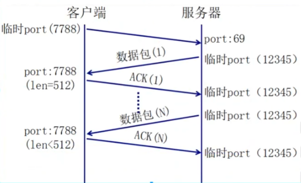
	
	tftp通讯总结：
		1、服务器在69号端口等待客户端请求。
		2、服务器若批准此请求，则使用临时端口与客户端进行通信。
		3、每个数据包的编号都有变化（从1开始）。
		4、每个数据包都要得到ACK的缺认，如果出现超时，则需要
		重新发送最够的包（数据或者ACK）。
		5、数据包的长度以521byte传输。
		6、小于512byte的数据意味着传输结束。
	
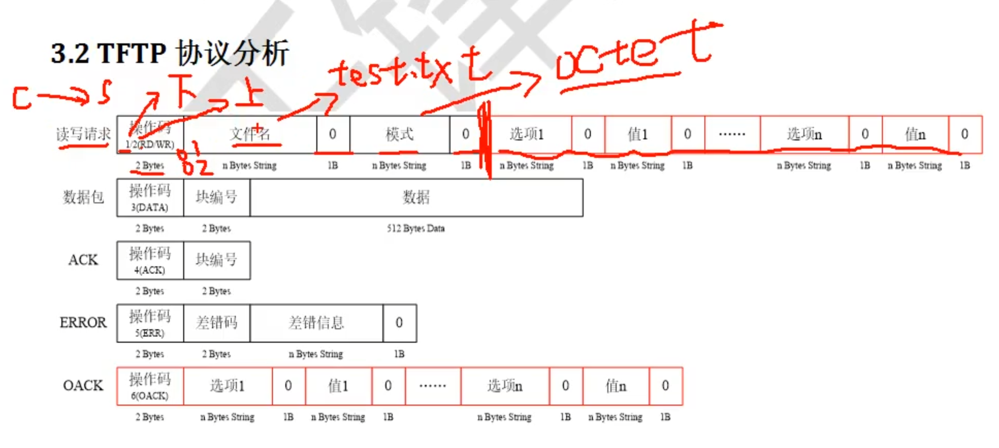
		
		以上的0代表的是‘\0’。不同的差错码对应不同的错误信息。
	


```
错误码：
0 未定义,参见错误信息
1 File not found.
2 Access violation.
3 Disk full or allocation exceeded.
4 illegal TFTP operation.
5 Unknown transfer ID.
6 File already exists.
7 No such user.
8 Unsupported option(s) requested.
```

## 5-11、使用TFTP下载
	要求：使用tftp协议，下载server上的文件到本地。
	思路：
		1、构造请求报文，发送到69端口。
		2、等待服务器回应。
		3、分析服务器回应。
		4、接收数据，直到数据小于512字节。
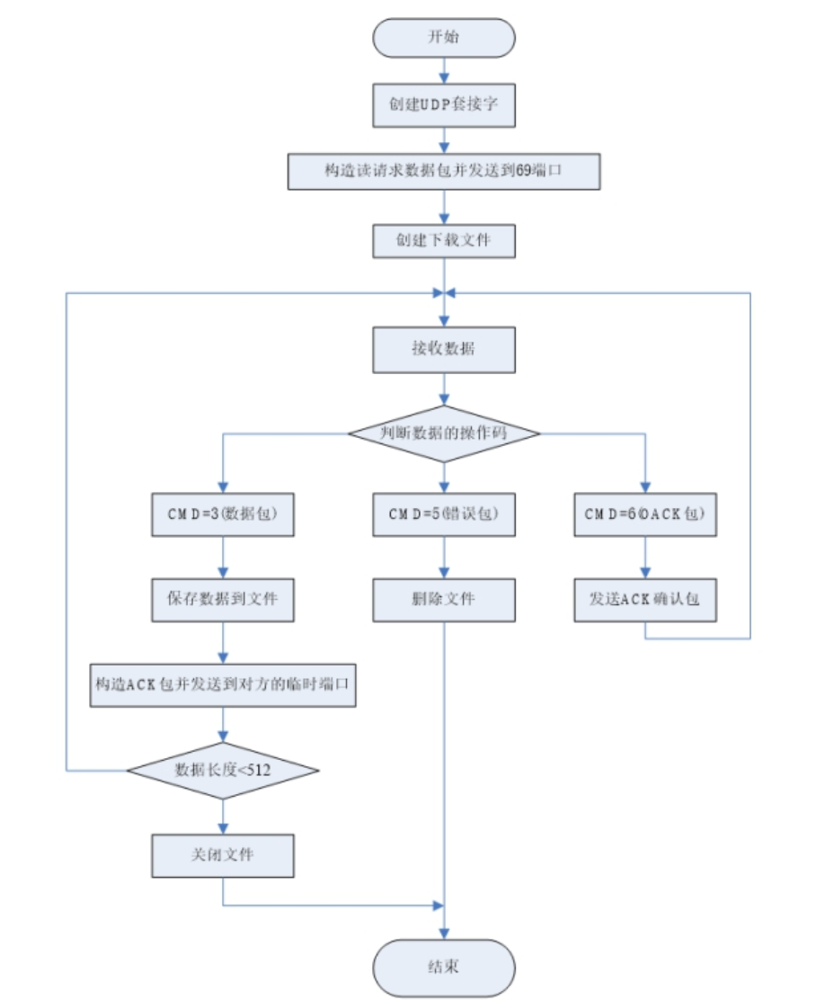

```
#include <stdio.h>  /**** printf ***/
#include <stdlib.h> /**  exit  **/
#include <sys/types.h>
#include <netinet/in.h> /** socket **/
#include <sys/socket.h> /**  sockaddr_in **/
#include <arpa/inet.h> /** htons inet_addr **/
#include <unistd.h> /** close**/
#include <string.h>
#include <sys/stat.h>
#include <fcntl.h>

void download(int sockfd,struct sockaddr_in serveraddr)
{
    char filename[128] = "";
    printf("请输入要下载的文件名:\r\n");
    scanf("%s",filename);
    unsigned char text[1024] = "";
    int text_len;
    socklen_t addrlen = sizeof(struct sockaddr_in);
    int fd;
    int flags = 0;
    int num =0;
    ssize_t bytes;
    /********* 构建发给服务器的tftp指令，如：01test.txt0octet0 ***************/
    text_len = sprintf(text,"%c%c%s%c%s%c",0,1,filename,0,"octet",0);//////////////////
    if(sendto(sockfd,text,text_len,0,(struct sockaddr *)&serveraddr,addrlen) < 0)
    {
        perror("fail to sendto");
        exit(1);
    }
    while(1)
    {
        /*** 接收服务器发来的信息并处理****/
        bytes = recvfrom(sockfd,text,sizeof(text),0,(struct sockaddr *)&serveraddr,&addrlen);
        if(bytes == -1)
        {
            perror("recvfrom_filed");
            exit(1);
        }
    
        /*** 判断操作码*****/
        if(text[1] == 5)
        {
        printf("error:%s\n",text+4);
        return ;
        }
        else if(text[1] == 3)
       {
         {
            if(flags == 0)/*** 创建文件的，flags为标志位，防止重复创建***/
            {/**创建文件***/
                if((fd = open(filename,O_WRONLY | O_CREAT | O_TRUNC,0664)) < 0) 
                {
                    perror("failed_open");
                    exit(1);
                }
            }
            flags = 1;
        }
        /**  对比块编号和接收的数据大小并将文件内容写入文件***/
        if((num + 1 ==ntohs(*(unsigned short *)(text + 2)))&&(bytes == 516))/** 接收到的数据包还要加上操作码和块编号，所以是516 ***/
            {
                num = ntohs(*(unsigned short *)(text + 2));
                if(write(fd,text + 4,bytes - 4) < 0)
                {
                    perror("fail to write");
                    exit(1);
                }
                text[1] = 4;
                if(sendto(sockfd,text,4,0,(struct sockaddr *)&serveraddr,addrlen))
                {
                    perror("fail to send");
                    exit(1);
                }
            }
            if((num + 1 ==ntohs(*(unsigned short *)(text + 2)))&&(bytes < 516))/**判断是否是最后一次传输**/
            { 
                 num = ntohs(*(unsigned short *)(text + 2));
                if(write(fd,text + 4,bytes - 4) < 0)
                {
                    perror("fail to write");
                    exit(1);
                }
                text[1] = 4;
                if(sendto(sockfd,text,4,0,(struct sockaddr *)&serveraddr,addrlen) < 0)
                   {
                        perror("failed_sento");
                        exit(1);
                    }
                printf("文件下载完成\r\n");
                return ;
            } 
            }
       }

}
int main(int argc,char const *argv[])
{
    if(argc < 2)
    {
        fprintf(stderr,"using: %s\r\n",argv[0]);
        exit(1);
    }
    /** 创建套接字 **/
    int sockfd;
    struct sockaddr_in serveraddr;
    sockfd = socket(AF_INET,SOCK_DGRAM,0);
    if(sockfd < 0)
    {
        perror("sockfd_fail\r\n");
        exit(1);
    }
    /*** 填充服务器信息结构体 **/
    serveraddr.sin_addr.s_addr = inet_addr(argv[1]);/*** tftp服务器端地址 ***/
    serveraddr.sin_family = AF_INET;
    serveraddr.sin_port = htons(69);
   // if(bind(sockfd,(struct sockaddr *)&serveraddr,sizeof(serveraddr)) == -1)
   // {
    //    perror("bind_fail\r\n");
   //    exit(1);   
   // }
    /*** 下载 ***/
    download(sockfd,serveraddr);
    return 0;
}
```

	以下是上传服务器的代码
```
上传服务器
#include <stdio.h>
#include <stdlib.h>
#include <unistd.h>
#include <sys/types.h>
#include <sys/socket.h>
#include <arpa/inet.h>
#include <netinet/in.h>
#include <string.h>
#include <sys/stat.h>
#include <fcntl.h>
#include <errno.h>

#define ERRLOG(errmsg) do{\
                            perror(errmsg);\
                            exit(1);\
                        }while(0)

#define N 128

void do_help()
{
    system("clear");
    printf("---------------------\n");
    printf("------ 1. 下载 ------\n");
    printf("------ 2. 上传 ------\n");
    printf("------ 3. 退出 ------\n");
    printf("---------------------\n");
}

void do_download(int sockfd, struct sockaddr_in serveraddr)
{
    char filename[N] = {};
    printf("请输入要下载的文件名：");
    scanf("%s", filename);

    char data[1024] = "";
    int data_len;
    int fd;
    int flags = 0;
    int num = 0;
    int recv_len;

    //组数据并发送
    data_len = sprintf(data, "%c%c%s%c%s%c", 0, 1, filename, 0, "octet", 0);
    if(sendto(sockfd, data, data_len, 0, (struct sockaddr *)&serveraddr, sizeof(serveraddr)) < 0)
    {
        ERRLOG("fail to sendto");
    }

    //接收数据并分析处理
    socklen_t addrlen = sizeof(serveraddr);
    while(1)
    {
        if((recv_len = recvfrom(sockfd, data, sizeof(data), 0, (struct sockaddr *)&serveraddr, &addrlen)) < 0)
        {
            ERRLOG("fail to recvfrom");
        }

        //printf("%d - %u\n", data[1], ntohs(*(unsigned short *)(data + 2)));
        //printf("%s\n", data + 4);

        if(data[1] == 5)
        {
            printf("error: %s\n", data + 4);
            return ;
        }
        else if(data[1] == 3)
        {
            //防止文件内容清空
            if(flags == 0)
            {
                if((fd = open(filename, O_WRONLY | O_CREAT | O_TRUNC, 0664)) < 0)
                {
                    ERRLOG("fail to open");
                }
                flags = 1;
            }

            //判断数据包的编号是否是上一次的编号加1
            if(num + 1 == ntohs(*(unsigned short *)(data + 2)) && recv_len == 516)
            {
                //向文件写入数据
                write(fd, data + 4, recv_len - 4);
            
                //组数据发送给服务器
                data[1] = 4; 
                if(sendto(sockfd, data, 4, 0, (struct sockaddr *)&serveraddr, addrlen) < 0)
                {
                    ERRLOG("fail to sendto");
                }

                num = ntohs(*(unsigned short *)(data + 2));
            }
            //接收到的最后一次的数据
            else if(num + 1 == ntohs(*(unsigned short *)(data + 2)) && recv_len < 516)
            {
                write(fd, data + 4, recv_len - 4);
                break;
            }
        }
    }

    printf("文件下载成功\n");
}

void do_upload(int sockfd, struct sockaddr_in serveraddr)
{
    char filename[N] = {};
    printf("请输入要上传的文件名：");
    scanf("%s", filename);

    //打开文件并判断文件是否存在
    int fd;
    if((fd = open(filename, O_RDONLY)) < 0)
    {
        if(errno == ENOENT)
        {
            printf("文件%s不存在，请重新输入\n", filename);
            return ;
        }
        else
        {
            ERRLOG("fail to open");
        }
    }

    //组数据并发送给服务器执行上传功能
    char data[1024] = {};
    int data_len;
    socklen_t addrlen = sizeof(serveraddr);

    data_len = sprintf(data, "%c%c%s%c%s%c", 0, 2, filename, 0, "octet", 0);

    if(sendto(sockfd, data, data_len, 0, (struct sockaddr *)&serveraddr, addrlen) < 0)
    {
        ERRLOG("fail to sendto");
    }

    //接收服务器发送的数据并分析处理
    int recv_len;
    int num = 0;
    ssize_t bytes;
    while(1)
    {
        if((recv_len = recvfrom(sockfd, data, sizeof(data), 0, (struct sockaddr *)&serveraddr, &addrlen)) < 0)
        {
            ERRLOG("fail to recvfrom");
        }

        //printf("%d - %d\n", data[1], ntohs(*(unsigned short *)(data + 2)));
        //printf("%s\n", data + 4);

        if(data[1] == 4 && num == ntohs(*(unsigned short *)(data + 2)))
        {
            num++;
            bytes = read(fd, data + 4, 512);
            data[1] = 3;
            *(unsigned short *)(data + 2) = htons(num);

            if(bytes == 512)
            {
                if(sendto(sockfd, data, bytes + 4, 0, (struct sockaddr *)&serveraddr, addrlen) < 0)
                {
                    ERRLOG("fail to sendto");
                }
            }
            else
            {
                if(sendto(sockfd, data, bytes + 4, 0, (struct sockaddr *)&serveraddr, addrlen) < 0)
                {
                    ERRLOG("fail to sendto");
                }
                break;
            } 
        }
    }

    printf("文件上传完毕\n");
}

int main(int argc, char const *argv[])
{
    int sockfd;
    struct sockaddr_in serveraddr;
    //创建套接字
    if((sockfd = socket(AF_INET, SOCK_DGRAM, 0)) < 0)
    {
        ERRLOG("fail to socket");
    }

    //填充服务器网络信息结构体
    serveraddr.sin_family = AF_INET;
    serveraddr.sin_addr.s_addr = inet_addr(argv[1]);
    serveraddr.sin_port = htons(69);

    system("clear");
    printf("------------------------------\n");
    printf("----请输入help查看帮助信息----\n");
    printf("------------------------------\n");
    printf(">>> ");

    char buf[N] = {};
NEXT:
    fgets(buf, N, stdin);
    buf[strlen(buf) - 1] = '\0';
    if(strncmp(buf, "help", 4) == 0)
    {
        do_help();
    }
    else 
    {
        printf("您输入的有误，请重新输入\n");
        goto NEXT;
    }

    int num;
    while(1)
    {
        printf("input>>> ");
        scanf("%d", &num);
        switch (num)
        {
        case 1:
            do_download(sockfd, serveraddr);
            break;
        case 2:
            do_upload(sockfd, serveraddr);
            break;
        case 3:
            close(sockfd);
            exit(0);
            break;
        default:
            printf("您输入的有误，请重新输入\n");
            break;
        }
    }

    return 0;
}
```
# 6、udp广播
•广播：  
由一台主机向该主机所在子网内的所有主机发送数据的方式。
广播只能用 UDP 或原始 IP 实现， 不能用 TCP。
		
•用途：
单个服务器与多个客户主机通信时减少分组流通。
以下几个协议都用到广播  
1、 地址解析协议（ARP）。  
2、 动态主机配置协议（DHCP）。  
3、 网络时间协议（NTP）。  

•特点：  
1、 处于同一子网的所有主机都必须处理数据。  
2、 UDP 数据包会沿协议栈向上一直到 UDP 层。
3、 运行音视频等较高速率工作的应用， 会带来大负担。  
4、 局限于局域网内使用。  

•地址：
{网络 ID， 主机 ID}
网络 ID 表示由子网掩码中 1 覆盖的连续位。  
主机 ID 表示由子网掩码中 0 覆盖的连续位。  
定向广播地址： 主机 ID 全 1  
1、 例： 对于 192.168.220.0/24，   
其定向广播地址为 192.168.220.255。  
2、 通常路由器不转发该广播  
受限广播地址： 255.255.255.255，  
路由器从不转发该广播。  

•广播流程：
	发送者：  
	第一步：创建套接字 socket()  
	第二步：设置为允许发送广播权限 setsockopt()  
	第三步：向广播地址发送数据 sendto()  
	接收者：  
	第一步：创建套接字 socket()  
	第二步：将套接字与广播的信息结构体绑定 bind()  
	第三步：接收数据 recvfrom()  

## 6-1、单播
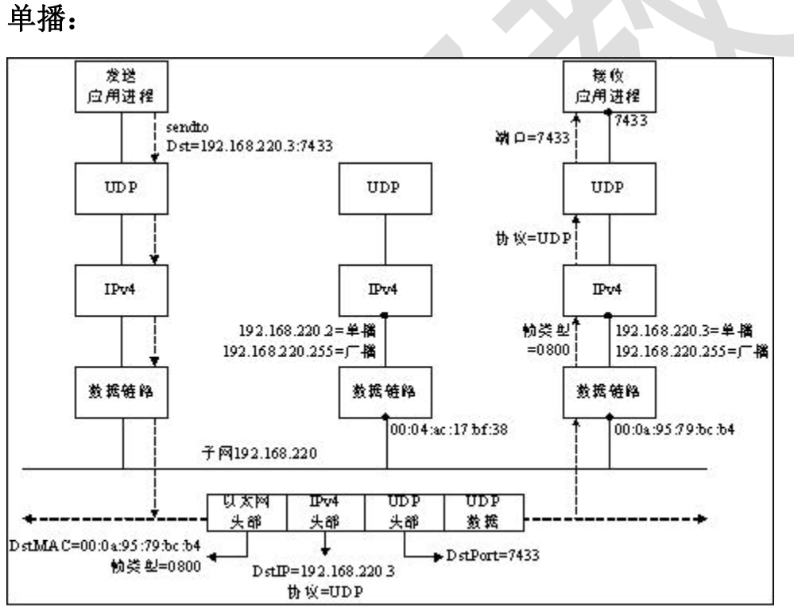

## 6-2、广播
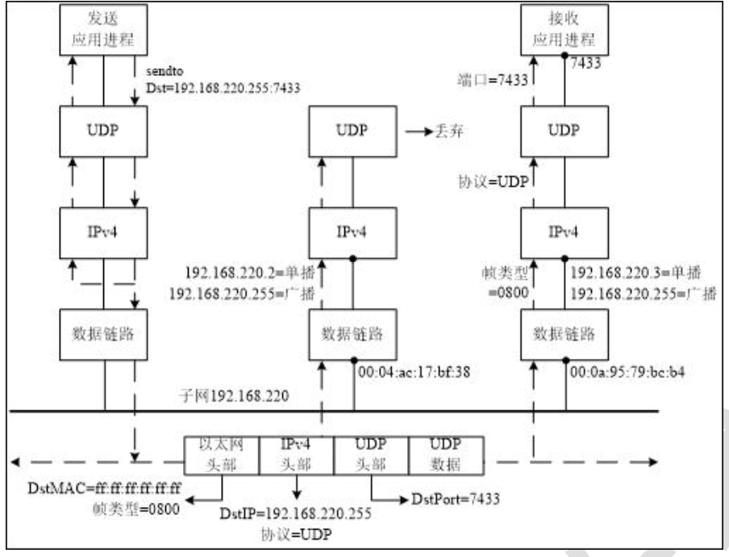
## 6-3、广播流程
•发送者：
		第一步：创建套接字 socket()  
		第二步：设置为允许发送广播权限 setsockopt()  
		第三步：向广播地址发送数据 sendto()  
•接收者：    
		第一步：创建套接字 socket()	  	  
		第二步：将套接字与广播的信息结构体绑定 bind()  
		第三步：接收数据 recvfrom()  


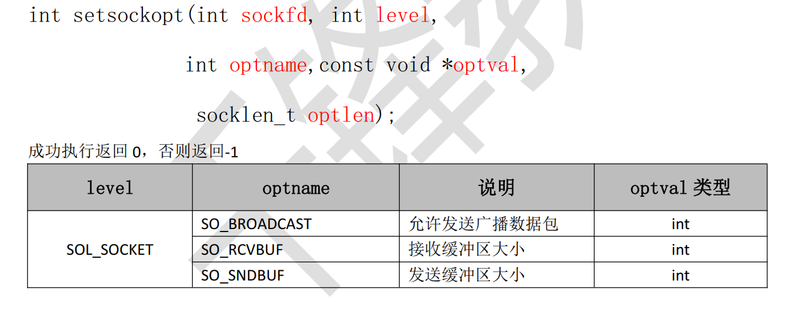


```
套接字选项
#include <sys/socket.h>
int setsockopt(int socket, int level, int option_name,
const void *option_value, socklen_t option_len);
功能：设置一个套接字的选项（属性）
参数：
socket：文件描述符
level：协议层次
SOL_SOCKET 套接字层次
IPPROTO_TCP tcp层次
 IPPROTO_IP IP层次
 option_name：选项的名称
 SO_BROADCAST 允许发送广播数据（SOL_SOCKET层次的）
 option_value：设置的选项的值
 int类型的值，存储的是bool的数据（1和0）
 0 不允许
 1 允许
 option_len：option_value的长度
 返回值：
 成功：0
 失败：‐1
```
### 6-3-1、发送者

```
//广播发送者代码实现
#include <stdio.h> //printf
#include <stdlib.h> //exit
#include <sys/types.h>
#include <sys/socket.h> //socket
#include <netinet/in.h> //sockaddr_in
#include <arpa/inet.h> //htons inet_addr
#include <unistd.h> //close
#include <string.h>

int main(int argc,char const *argv[])
{
    if(argc < 3)
    {
        fprintf(stderr,"using = %s\r\n",argv[0]);
        exit(1);
    }
    int sockfd;
    struct sockaddr_in sendaddr;
    socklen_t addrlen = sizeof(sendaddr);
    int on = 1;
    /**创建套接字**/
    sockfd = socket(AF_INET , SOCK_DGRAM,0);
    if(sockfd < 0)
    {
        perror("failed_sockfd");
        exit(1);
    }
    /**SOL_SOCKET：协议层次**/
    /** SO_BROADCAST：允许发送广播权限**/
    /**on：设置是否允许，设置为1表示允许，0表示不允许**/
    if(setsockopt(sockfd, SOL_SOCKET, SO_BROADCAST,&on,sizeof(on)) < 0)
    {
        perror("failed_sersockopt");
        exit(1);
    }
    /**绑定广播结构体**/    
    sendaddr.sin_family = AF_INET;
    sendaddr.sin_addr.s_addr = inet_addr(argv[1]);
    sendaddr.sin_port = htons(atoi(argv[2]));

    /**进行通讯**/
    char buf[128] = "";
    while(1)
    {
        fgets(buf,sizeof(buf),stdin);
        buf[strlen(buf)-1] = '\0'; /**将输入完的数据用 \0 结尾**/
        if(sendto(sockfd, buf, sizeof(buf), 0,(struct sockaddr *)&sendaddr, addrlen) < 0)
        {
            perror("failed_sendto");
            exit(1);
        }
    }
    return 0;
}
```
### 6-3-2、接收者

```
#include <stdio.h> //printf
#include <stdlib.h> //exit
#include <sys/types.h>
#include <sys/socket.h> //socket
#include <netinet/in.h> //sockaddr_in
#include <arpa/inet.h> //htons inet_addr
#include <unistd.h> //close
#include <string.h>

int main(int argc, char const *argv[])
{
    if(argc < 2)
    {
        fprintf(stderr,"using = %s", argv[0]);
        exit(1);
    }
    int sockfd;
    struct sockaddr_in broadrecv;
    socklen_t socklen;
    /**创建套接字**/
    sockfd = socket(AF_INET,SOCK_DGRAM,0);
    if(sockfd < 0)
    {
        perror("failed_sockfd");
        exit(1);
    }  
    /**填充信息结构体**/
    broadrecv.sin_addr.s_addr = inet_addr(argv[1]);
    broadrecv.sin_family = AF_INET;
    broadrecv.sin_port = htons(atoi(argv[2]));
    /**将信息结构体与结构体绑定**/
    socklen = sizeof(broadrecv);
    if(bind(sockfd,(struct sockaddr *)&broadrecv,socklen) < 0)
    {
        perror("failed_bind");
        exit(1);
    }
    char buf[128] = "";
    struct sockaddr_in sendaddr;/**这里还要在申请的原因是要那来接受发送者的信息**/
    while(1)
    {
        if(recvfrom(sockfd, buf, sizeof(buf), 0 ,(struct sockaddr *)&sendaddr, &socklen) < 0)
        {
            perror("failed_recvfrom");
       //     exit(1);
        } 
        printf("[%s - %d] : %s\r\n", inet_ntoa(sendaddr.sin_addr),ntohs(sendaddr.sin_port),buf);
    }


    return 0;
} 
```
		接收者只能有一个，发送者可以有多个。

# 7、多播
## 7-1、概念
•数据的收发只在同一分组中进行。所以多播又称之为组播。  
	多播的特点：  
		1、多播地址标示一组接口。  
		2、多播可以用于广域网使用。  
		3、在ipv4中，多播是可选的。  
•广播和多播的区别：广播是向所有的人发送。而多播必须加入多播组

    
## 7-1、多播地址
	•ipv4的D类地址是多播地址。
	•多播地址向以太网mac地址的映射：
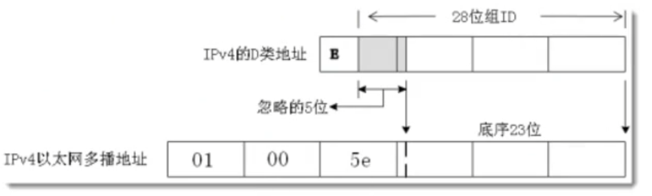
		
		ipv4由32个字节构成，后23位组成以太网的都多播地址的底序23位，然后补一位0。
		广播的发送者必须要设置允许发送广播，而多播必须加入多播组，才能接收到信息。
	
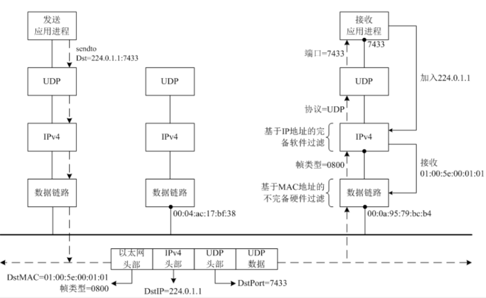

•注意：mac地址后23位由ipv4的后23位构成，   
	在接收者进行mac地址过滤的时候，进行的是不完全过滤，   
	原因就在于23位前面有一位被指0，导致可能的错误，所以会在ipv4进行再次的过滤。   
    比起广播，多播具有可控性，    
	只有加入多播组的接收者才能接收数据。  
## 7-2、多播的流程
•发送者：  
		第一步：创建套接字socket。  
		第二步：向多播地址发送数据sendto。  
•接收者：  
		第一步：创建套接字socket。  
		第二步：设置为加入多播组setsockopt（）。  
		第三步：将套接字与多播信息结构体绑定。  
		第四步：接收数据。   
		
```
多播地址结构体名字
struct in_addr；

struct ip_mreq;

```
	
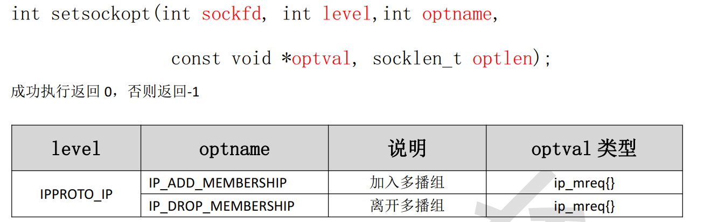
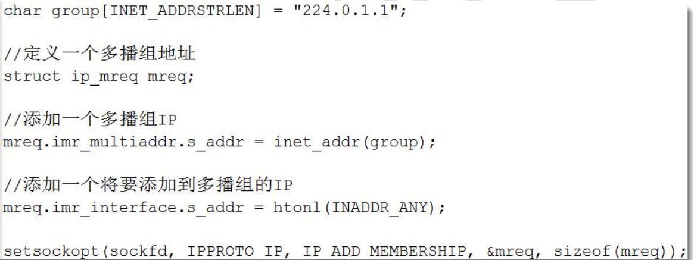
### 7-2-0、 多播套接口选项

```
#include <sys/socket.h>
int setsockopt(int socket, int level, int option_name,
const void *option_value, socklen_t option_len);
功能：设置一个套接字的选项（属性）
参数：
socket：文件描述符
level：协议层次
IPPROTO_IP IP层次
option_name：选项的名称
 IP_ADD_MEMBERSHIP 加入多播组
 option_value：设置的选项的值
 struct ip_mreq
 {
 struct in_addr imr_multiaddr; //组播ip地址
 struct in_addr imr_interface; //主机地址
 INADDR_ANY 任意主机地址（自动获取你的主机地址）
 };
 option_len：option_value的长度
 返回值：
 成功：0
 失败：‐1
```


### 7-2-1、发送者

```
#include <stdio.h> //printf
#include <stdlib.h> //exit
#include <sys/types.h>
#include <sys/socket.h> //socket
#include <netinet/in.h> //sockaddr_in
#include <arpa/inet.h> //htons inet_addr
#include <unistd.h> //close
#include <string.h>

int main(int argc, char const *argv[])
{
    if(argc < 3)
    {
        fprintf(stderr,"using : %s",argv[0]);
        exit(1);
    }
    /**第一步，创建套接字**/
    int sockfd;
    socklen_t addrlen;
    struct sockaddr_in sendaddr;
    sockfd = socket(AF_INET, SOCK_DGRAM, 0);
    if(sockfd < 0)
    {
        perror("failed_socket");
        exit(1);
    }   
    /********* ip地址必须设置为224.xxx.xxx.xxx 到239.... *********/
    sendaddr.sin_addr.s_addr = inet_addr(argv[1]);
    sendaddr.sin_family = AF_INET;
    sendaddr.sin_port = htons(atoi(argv[2]));
    char buf[128] = "";
    addrlen = sizeof(sendaddr);
    /**发送数据**/
    while(1)
    {
        fgets(buf, sizeof(buf),stdin);
        buf[sizeof(buf) - 1] = '\0';
        if(sendto(sockfd,buf,sizeof(buf),0,(struct sockaddr *)&sendaddr,addrlen) < 0)
        {
            perror("sendto");
            exit(1);
        }
    }
    return 0;
}
```
### 7-2-2、接收者

```
#include <stdio.h> //printf
#include <stdlib.h> //exit
#include <sys/types.h>
#include <sys/socket.h> //socket
#include <netinet/in.h> //sockaddr_in
#include <arpa/inet.h> //htons inet_addr
#include <unistd.h> //close
#include <string.h>

int main(int argc,char const *argv[])
{
    if(argc < 0)
    {
        fprintf(stderr,"using: %s",argv[0]);
        exit(1);
    }
    int sockfd;
    socklen_t addrlen;
    struct sockaddr_in recaddr;
    
    /***创建套接字**/
    sockfd = socket(AF_INET, SOCK_DGRAM, 0);
    if(sockfd < 0)
    {
        perror("failed_socket");
        exit(1);
    }
    /***加入多播组**/
    struct ip_mreq mreq;
    mreq.imr_multiaddr.s_addr = inet_addr(argv[1]);
    /** INADDR_ANY表示任意主机**/
    mreq.imr_interface.s_addr = INADDR_ANY;
    if(setsockopt(sockfd, IPPROTO_IP, IP_ADD_MEMBERSHIP, &mreq, sizeof(mreq)) < 0)
    {
        perror("failed_setsockopt");
        exit(1);
    }
    recaddr.sin_addr.s_addr = inet_addr(argv[1]);
    recaddr.sin_family = AF_INET;
    recaddr.sin_port = htons(atoi(argv[2]));
    addrlen = sizeof(recaddr);
    /**绑定组播信息结构体**/
    if(bind(sockfd, (struct sockaddr *)&recaddr, addrlen) < 0)
    {
        perror("failed_bind");
        exit(1);
    }  
    /** 进行通信***/
    char text[128] = "";
    struct sockaddr_in sendaddr;
    while(1)
    {
        if(recvfrom(sockfd, text, sizeof(text), 0 , (struct sockaddr *)&sendaddr,&addrlen) < 0)
        {
            perror("failed_recvfrom");
            exit(1);
        }
        printf("[%s - %d] : %s\r\n",inet_ntoa(sendaddr.sin_addr),ntohs(sendaddr.sin_port),text);
    }

    return 0;
}

```
#  8、tcp
## 8-1、tcp与udp对比
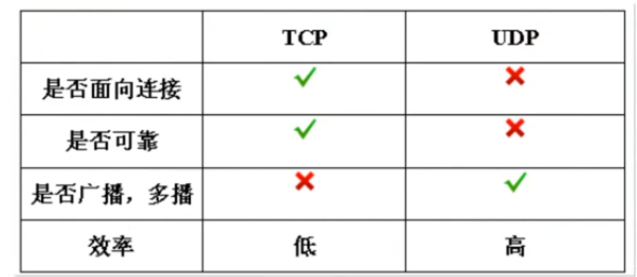
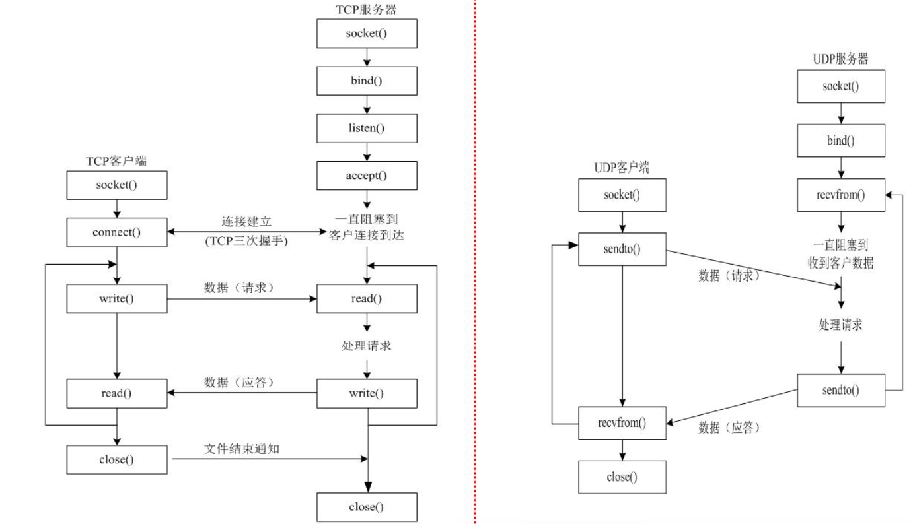
## 8-2、流程
•服务器：  
	创建套接字socket（）。  
		将套接字与服务器网络信息结构体绑定。  
		将套接字设置为监听状态listen（）。  
		阻塞等待客户端的连接请求accept（）。   
		进行通信recv（）/send（）。  
		关闭套接字close（）。  

•客户端：  
		创建套接字socket（）。  
		发送客户端连接请求connect（）。  
		进行通信send（）/recv（）。   
		关闭套接字close。   
		
	1、这里的socket的要使用的tcp的参数。
	2、connect作用是跟服务器建立连接，
		连接成功后才可以进行tcp的数据传输。
		连接成功后不会产生新的套接字。
	3、send函数，ssize_t send(int sockfd, const void *buf, size_t len, int flags);
	功能用于发送数据。
		
	以下为各个函数的详细介绍：

```
#include <sys/types.h>
#include <sys/socket.h>
int socket(int domain, int type, int protocol);
功能：创建一个套接字，返回一个文件描述符
参数：
domain：通信域，协议族
AF_UNIX 本地通信
AF_INET ipv4网络协议
AF_INET6 ipv6网络协议
 AF_PACKET 底层接口
 type：套接字的类型
 SOCK_STREAM 流式套接字（tcp）
 SOCK_DGRAM 数据报套接字（udp）
 SOCK_RAW 原始套接字（用于链路层）
 protocol：附加协议，如果不需要，则设置为0
 返回值：
 成功：文件描述符
 失败：‐1
```
		
```
connect：
	connect函数：
 #include <sys/types.h> 
 #include <sys/socket.h>
 int connect(int sockfd, const struct sockaddr *addr, socklen_t addrlen);
 功能：给服务器发送客户端的连接请求
 参数：
 sockfd：文件描述符，socket函数的返回值
 addr：要连接的服务器的网络信息结构体（需要自己设置）
 addrlen：add的长度
 返回值：
 成功：0
 失败：‐1
```
	注意：
		1、connect建立连接之后不会产生新的套接字
		2、连接成功后才可以开始传输TCP数据
		3、头文件：#include <sys/socket.h>
```
socket
#include <sys/types.h>
#include <sys/socket.h>
 ssize_t send(int sockfd, const void *buf, size_t len, int flags);
 功能：发送数据
 参数：
 sockfd：文件描述符
 客户端：socket函数的返回值
 服务器：accept函数的返回值
 buf：发送的数据
 len：buf的长度
 flags：标志位
 0 阻塞
 MSG_DONTWAIT 非阻塞
 返回值：
 成功：发送的字节数
 失败：‐1
```
		注意：不能用tcp协议发送0长度的数据包。
		


```
send：
 #include <sys/types.h>
 #include <sys/socket.h>
 ssize_t send(int sockfd, const void *buf, size_t len, int flags);
 功能：发送数据
 参数：
 sockfd：文件描述符
客户端：socket函数的返回值
 服务器：accept函数的返回值
 buf：发送的数据
 len：buf的长度
 flags：标志位
 0 阻塞
 MSG_DONTWAIT 非阻塞
 返回值：
 成功：发送的字节数
 失败：‐1
```
	
`不能用TCP协议发送0长度的数据包`
```
recv：
#include <sys/types.h>
 #include <sys/socket.h>
 ssize_t recv(int sockfd, void *buf, size_t len, int flags);
 功能：接收数据
 参数：
 sockfd：文件描述符
 客户端：socket函数的返回值
 服务器：accept函数的返回值
 buf：保存接收到的数据
 len：buf的长度
 flags：标志位
 0 阻塞
 MSG_DONTWAIT 非阻塞
 返回值：
成功：接收的字节数
 失败：‐1
 如果发送端关闭文件描述符或者关闭进程，则recv函数会返回0
```

```
bind：
 #include <sys/types.h>
 #include <sys/socket.h>
 int bind(int sockfd, const struct sockaddr *addr, socklen_t addrlen);
 功能：将套接字与网络信息结构体绑定
 参数：
sockfd：文件描述符，socket的返回值
 addr：网络信息结构体
 通用结构体（一般不用）
 struct sockaddr
 网络信息结构体 sockaddr_in
 #include <netinet/in.h>
 struct sockaddr_in
 addrlen：addr的长度
 返回值：
 成功：0
 失败：‐1
```

```
listen：
 #include <sys/types.h> /* See NOTES */
 #include <sys/socket.h>
 int listen(int sockfd, int backlog);
 功能：将套接字设置为被动监听状态，这样做之后就可以接收到连接请求
 参数：
 sockfd：文件描述符，socket函数返回值
 backlog：允许通信连接的主机个数，一般设置为5、10
 返回值：
 成功：0
 失败：‐1
```


```
accept：
 #include <sys/types.h> /* See NOTES */
 #include <sys/socket.h>
 int accept(int sockfd, struct sockaddr *addr, socklen_t *addrlen);
 功能：阻塞等待客户端的连接请求
 参数：
 sockfd：文件描述符，socket函数的返回值
 addr：接收到的客户端的信息结构体（自动填充，定义变量即可）
 addrlen：addr的长度
 返回值：
 成功：新的文件描述符（只要有客户端连接，就会产生新的文件描述符，
 这个新的文件描述符专门与指定的客户端进行通信的）
 失败：‐1
```

### 8-2-1、客户端
```
客户端代码示例
#include <stdio.h>
#include <stdlib.h>
#include <unistd.h>
#include <sys/types.h>
#include <sys/socket.h>
#include <arpa/inet.h>
#include <netinet/in.h>
#include <string.h>


int main(int argc, char const *argv[])
{
    if(argc < 3)
    {
        fprintf(stderr,"using = %s",argv[0]);
        exit(1);
    }
    int sockfd;
    /***SOCK_STREAM TCP的流式套接字***/
    sockfd = socket(AF_INET,SOCK_STREAM,0);
    if(sockfd < 0)
    {
        perror("failed_socket");
        exit(1);
    }
    struct sockaddr_in serveraddr;
    socklen_t socklen;
    serveraddr.sin_addr.s_addr = inet_addr(argv[1]);
    serveraddr.sin_family = AF_INET;
    serveraddr.sin_port = htons(atoi(argv[2]));
    socklen = sizeof(serveraddr);
    if(connect(sockfd,(struct sockaddr *)&serveraddr,socklen) == -1)
    {
        perror("failed_connect");
        exit(1);
    }
    char buf[128] = "";
    fgets(buf, 128, stdin);
    buf[sizeof(buf)-1] = '\0';
    if(send(sockfd, buf, 128, 0) == -1)
    { 
        perror("failed_send");
        exit(1);
    }
    char text[128] = "";
    if(recv(sockfd, text, 128, 0) == -1)
    {
        perror("failed_recv");
        exit(1);
    }
    printf("from server: %s\r\n",text);
    close(sockfd);
    return 0;
}

```
### 8-2-2、服务器
	做为TCP服务器需要具备那些条件
	1、让操作系统知道是一个服务器，而不是一个客户端。
	2、具备一个明知的地址。
	3、等待连接的到来。

```
#include <stdio.h>
#include <stdlib.h>
#include <unistd.h>
#include <sys/types.h>
#include <sys/socket.h>
#include <arpa/inet.h>
#include <netinet/in.h>
#include <string.h>

int main(int argc,char const *argv[])
{
     if(argc < 3)
     {
        fprintf(stderr,"using = %s\r\n",argv[0]);
        exit(1);
     }
     int sockfd;
     sockfd = socket(AF_INET, SOCK_STREAM, 0);
     if(sockfd < 0)
     {
        perror("failed_socket");
        exit(1);
     }
     struct sockaddr_in serveraddr;
     socklen_t socklen;
     serveraddr.sin_addr.s_addr = inet_addr(argv[1]);
     serveraddr.sin_family = AF_INET;
     serveraddr.sin_port = htons(atoi(argv[2]));
     socklen = sizeof(serveraddr);
     if(bind(sockfd,(struct sockaddr *)&serveraddr,socklen))
     {
        perror("failed_bind");
        exit(1);
     }
     /***将套接字设置为监听状态***/
     /***同一时刻连接的最大数量******/
     if(listen(sockfd,10))
     {
        perror("failed_listen");
        exit(1);
     }
     /****阻塞等待客户端的链接请求****/
     int acceptfd;
     struct sockaddr_in clientaddr;
     acceptfd = accept(sockfd,(struct sockaddr *)&clientaddr,&socklen);
     if(acceptfd == -1)
     {  
        perror("failed_accept");
        exit(1);
     }
     /***打印连接的客户端信息****/
     printf("ip:%s, port = %d",inet_ntoa(clientaddr.sin_addr),htons(clientaddr.sin_port));
     /****进行通讯*******/
     /**tcp服务器与客户端通信时，需要使用accept函数返回值***/
    char buf[128] =  "";
    if(recv(acceptfd, buf, 128,0) == -1)
    {
        perror("failed_recv");
        exit(1);
    }
    strcat(buf,"__ygc");
    printf("from client : %s\r\n",buf);
    if(send(acceptfd, buf, 128, 0) == -1)
    {
        perror("failed_send");
        exit(1);
    }
    /**关闭套接字**/
    close(acceptfd);
    close(sockfd);
    return 0;
}

```


	运行是先运行服务器，进入阻塞等待连接等过程。然后在运行客户端。

## 8-3、 close关闭套接字
•1、使用close函数即可关闭套接字  
`关闭一个代表已连接套接字将导致另一端接收到一个0长度的数据包（很重要）。`  
•2、做服务器时    
1>关闭监听套接字将导致服务器无法接收新的连接，但不会影响已经建立的连接。  
（关闭sockfd，并不影响已经建立的连接）  
2>关闭accept返回的已连接套接字将导致它所代表的连接被关闭，但不会影响服务器的监听  
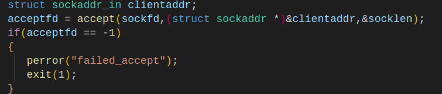  
•3、做客户端时
关闭连接就是关闭连接，不意味着其他

## 8-4、三次握手
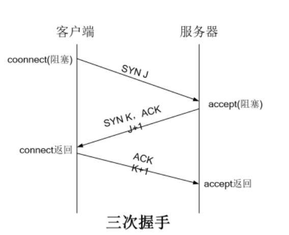

	相当于客户端向服务器说我要连接，服务器回答可以，	
	然后接受连接，问客户端，你连接上了吗？
	客户端回答连接上了。

## 8-5、四次挥手
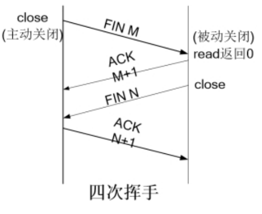

	（客户端说我要关闭了，服务器说知道了，	
		服务器又发那我也关了，客户端回答好的）

# 9、tpc并发服务器
	TCP原本不是并发服务器，
	TCP服务器同一时间只能与一个客户端通信
	原始代码：
### 服务器
```
//tcp服务器的实现
#include <stdio.h>
#include <stdlib.h>
#include <unistd.h>
#include <sys/types.h>
#include <sys/socket.h>
#include <arpa/inet.h>
#include <netinet/in.h>
#include <string.h>
#include <signal.h>

#define N 128
#define ERR_LOG(errmsg) do{\
                            perror(errmsg);\
                            exit(1);\
                        }while(0)

int main(int argc, char const *argv[])
{
    if(argc < 3)
    {
        fprintf(stderr, "Usage: %s <server_ip> <server_port>\n", argv[0]);
        exit(1);
    }    

    int sockfd, acceptfd;
    struct sockaddr_in serveraddr, clientaddr;
    socklen_t addrlen = sizeof(serveraddr);

    //第一步：创建套接字
    if((sockfd = socket(AF_INET, SOCK_STREAM, 0)) < 0)
    {
        ERR_LOG("fail to socket");
    }
    
    //将套接字设置为允许重复使用本机地址或者设置为端口复用
    int on = 1;
    if(setsockopt(sockfd, SOL_SOCKET, SO_REUSEADDR, &on, sizeof(on)) < 0)
    {
        ERR_LOG("fail to setsockopt");
    }

    //第二步：填充服务器网络信息结构体
    serveraddr.sin_family = AF_INET;
    serveraddr.sin_addr.s_addr = inet_addr(argv[1]);
    serveraddr.sin_port = htons(atoi(argv[2]));

    //第三步：将套接字与服务器网络信息结构体绑定
    if(bind(sockfd, (struct sockaddr *)&serveraddr, addrlen) < 0)
    {
        ERR_LOG("fail to bind");
    }

    //第四步：将套接字设置为被动监听状态
    if(listen(sockfd, 5) < 0)
    {
        ERR_LOG("fail to listen");
    }

    //第五步：阻塞等待客户端的连接请求
    if((acceptfd = accept(sockfd, (struct sockaddr *)&clientaddr, &addrlen)) < 0)
    {
        ERR_LOG("fail to accept");
    }

    //打印客户端的信息
    printf("%s -- %d\n", inet_ntoa(clientaddr.sin_addr), ntohs(clientaddr.sin_port));

    //第六步：进行通信
    char buf[N] = "";
    ssize_t bytes;
    while (1)
    {
        //注意：tcp中服务器与客户端通信时，一定要用accept函数的返回值来通信
        if((bytes = recv(acceptfd, buf, N, 0)) < 0)
        {
            ERR_LOG("fail to recv");
        }
        else if(bytes == 0)
        {
            printf("The client quited\n");
            exit(1);
        }

        if(strncmp(buf, "quit", 4) == 0)
        {
            exit(0);
        }

        printf("from client: %s\n", buf);

        strcat(buf, " ^_^");
        if(send(acceptfd, buf, N, 0) < 0)
        {
            ERR_LOG("fail to send");
        }
    }
    
    //第七步：关闭套接字
    close(acceptfd);
    close(sockfd);

    return 0;
}
```
###	客户端
	

```
#include <stdio.h>
#include <stdlib.h>
#include <unistd.h>
#include <sys/types.h>
#include <sys/socket.h>
#include <arpa/inet.h>
#include <netinet/in.h>
#include <string.h>

#define N 128  //这里的\是连接符，工作了这么久竟然不知
#define ERR_LOG(errmsg) do{\
                            perror(errmsg);\
                            exit(1);\
                        }while(0)

int main(int argc, char const *argv[])
{
    if(argc < 3)
    {
        fprintf(stderr, "Usage: %s <server_ip> <server_port>\n", argv[0]);
        exit(1);
    }    

    int sockfd;
    struct sockaddr_in serveraddr;

    //第一步：创建套接字
    if((sockfd = socket(AF_INET, SOCK_STREAM, 0)) < 0)
    {
        ERR_LOG("fail to socket");
    }

    //第二步：填充服务器网络信息结构体
    serveraddr.sin_family = AF_INET;
    serveraddr.sin_addr.s_addr = inet_addr(argv[1]);
    serveraddr.sin_port = htons(atoi(argv[2]));

    //第三步：发送客户端连接请求
    if(connect(sockfd, (struct sockaddr *)&serveraddr, sizeof(serveraddr)) < 0)
    {
        ERR_LOG("fail to connect");
    }

    //第四步：进行通信
    char buf[N] = "";
    while(1)
    {
        fgets(buf, N, stdin);
        buf[strlen(buf) - 1] = '\0';

        if(send(sockfd, buf, N, 0) < 0)
        {
            ERR_LOG("fail to send");
        }

        if(strncmp(buf, "quit", 4) == 0)
        {
            exit(0);
        }

        if(recv(sockfd, buf, N, 0) < 0)
        {
            ERR_LOG("fail to recv");
        }

        printf("from server: %s\n", buf);
    }

    //第四步：关闭套接字
    close(sockfd);

    return 0;
}
```
	以上，代码可以证明测试。tcp并不是一个并发服务器，一次只能和一个客户端进行通信。
	原因：TCP不能实现并发的原因：
	由于TCP服务器端有两个读阻塞函数，accept和recv，两个函数需要先后运行，所以导致运
	行一个函数的时候另一个函数无法执行，所以无法保证一边连接客户端，一边与其他客户端
	通信
	如何实现TCP并发服务器：
	使用多进程实现TCP并发服务器
	使用多线程实现TCP并发服务器

## 9-1、使用进程实现并发服务器操作
	我们设想,要实现并发操作，这个进程fork在哪里去实现，将while的循环位置前移，
	进入父进程什么都不用去执行，目标只要创建一个子进程就足够。

```
 int sockfd = socket()
 bind()
 listen()
	 while(1)
	 {
			 acceptfd = accept() ;
			pid = fork();
			if(pid > 0)
			{
			}
		 else if(pid == 0)
		 {
		 while(1)
		 {
		 recv()/send()
		 }
	 }
 }
 这个是基本流程。
```

```
#include <stdio.h>
#include <stdlib.h>
#include <unistd.h>
#include <sys/types.h>
#include <sys/socket.h>
#include <arpa/inet.h>
#include <netinet/in.h>
#include <string.h>
#include <signal.h>
#include <sys/wait.h>
#include <signal.h>

//使用多进程实现TCP并发服务器

#define N 128
#define ERR_LOG(errmsg) do{\
                            perror(errmsg);\
                            exit(1);\
                        }while(0)

void handler(int sig)
{
    wait(NULL);
}

int main(int argc, char const *argv[])
{
    if(argc < 3)
    {
        fprintf(stderr, "Usage: %s <server_ip> <server_port>\n", argv[0]);
        exit(1);
    }    

    int sockfd, acceptfd;
    struct sockaddr_in serveraddr, clientaddr;
    socklen_t addrlen = sizeof(serveraddr);

    //第一步：创建套接字
    if((sockfd = socket(AF_INET, SOCK_STREAM, 0)) < 0)
    {
        ERR_LOG("fail to socket");
    }

    //将套接字设置为允许重复使用本机地址或者为设置为端口复用
    int on = 1;
    if(setsockopt(sockfd, SOL_SOCKET, SO_REUSEADDR, &on, sizeof(on)) < 0)
    {
        ERR_LOG("fail to setsockopt");
    }

    //第二步：填充服务器网络信息结构体
    serveraddr.sin_family = AF_INET;
    serveraddr.sin_addr.s_addr = inet_addr(argv[1]);
    serveraddr.sin_port = htons(atoi(argv[2]));

    //第三步：将套接字与服务器网络信息结构体绑定
    if(bind(sockfd, (struct sockaddr *)&serveraddr, addrlen) < 0)
    {
        ERR_LOG("fail to bind");
    }

    //第四步：将套接字设置为被动监听状态
    if(listen(sockfd, 5) < 0)
    {
        ERR_LOG("fail to listen");
    }

    //使用信号，异步的方式处理僵尸进程，如果出现子进程断开连接的情况，就进行回收进程资源
    signal(SIGCHLD, handler);

    while(1)
    {
        //第五步：阻塞等待客户端的连接请求
        if((acceptfd = accept(sockfd, (struct sockaddr *)&clientaddr, &addrlen)) < 0)
        {
            ERR_LOG("fail to accept");
        }

        //打印客户端的信息
        printf("%s -- %d\n", inet_ntoa(clientaddr.sin_addr), ntohs(clientaddr.sin_port));

        //使用fork函数创建子进程，父进程继续负责连接，子进程负责与客户端通信
        pid_t pid;
        if((pid = fork()) < 0)
        {
            ERR_LOG("fail to fork");
        }
        else if(pid > 0) //父进程负责执行accept，所以if语句结束后继续在accept函数的位置阻塞
        {
        }
        else //子进程负责跟指定的客户端通信
        {
            char buf[N] = "";
            ssize_t bytes;
            while (1)
            {
                if((bytes = recv(acceptfd, buf, N, 0)) < 0)
                {
                    ERR_LOG("fail to recv");
                }
                else if(bytes == 0)
                {
                    printf("The client quited\n");
                    exit(0);
                }

                if(strncmp(buf, "quit", 4) == 0)
                {
                    exit(0);
                }

                printf("from client: %s\n", buf);

                strcat(buf, " ^_^");
                if(send(acceptfd, buf, N, 0) < 0)
                {
                    ERR_LOG("fail to send");
                }
            }
        }
    }

    return 0;
}
```

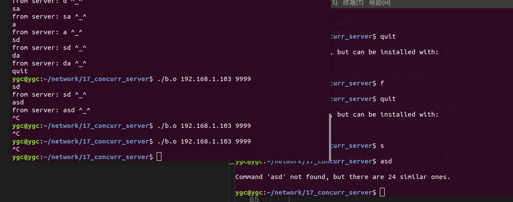

	完美实现

## 9-2、使用多线程实现并发操作

```
void *thread_fun(void *arg)
{
    while(1)
    {
    recv() / send()
    }
}

sockfd = socket()
 bind()
 listen()
 while(1)
    {
    accept()
    //只要有客户端连接上，则创建一个子线程与之通信
    pthread_create(, , thread_fun, );
    pthread_detach();
    }

```
	案例
```
#include <stdio.h>
#include <stdlib.h>
#include <unistd.h>
#include <sys/types.h>
#include <sys/socket.h>
#include <arpa/inet.h>
#include <netinet/in.h>
#include <string.h>
#include <signal.h>
 #include <pthread.h>

 #define N 128
 #define ERR_LOG(errmsg) do{\
 perror(errmsg);\
 exit(1);\
 }while(0)

 typedef struct{
 struct sockaddr_in addr;
 int acceptfd;
 }MSG;

 void *pthread_fun(void *arg)
 {
 char buf[N] = "";
 ssize_t bytes;
 MSG msg = *(MSG *)arg;
 while (1)
    {
    if((bytes = recv(msg.acceptfd, buf, N, 0)) < 0)
        {
        ERR_LOG("fail to recv");
        }
    else if(bytes == 0)
        {
        printf("The client quited\n");
        pthread_exit(NULL);
        }

    if(strncmp(buf, "quit", 4) == 0)
        {
        printf("The client quited\n");
        pthread_exit(NULL);
        }

    printf("[%s - %d]: %s\n", inet_ntoa(msg.addr.sin_addr), ntohs(msg.addr.sin_port), buf);

    strcat(buf, " ^_^");
    if(send(msg.acceptfd, buf, N, 0) < 0)
        {
        ERR_LOG("fail to send");
        }
    }
 }

 int main(int argc, char const *argv[])
 {
 if(argc < 3)
    {
    fprintf(stderr, "Usage: %s <server_ip> <server_port>\n", argv[0]);
    exit(1);
    }

 int sockfd, acceptfd;
 struct sockaddr_in serveraddr, clientaddr;
 socklen_t addrlen = sizeof(serveraddr);

 //第一步：创建套接字
 if((sockfd = socket(AF_INET, SOCK_STREAM, 0)) < 0)
    {
    ERR_LOG("fail to socket");
    }

 //将套接字设置为允许重复使用本机地址或者为设置为端口复用
 int on = 1;
 if(setsockopt(sockfd, SOL_SOCKET, SO_REUSEADDR, &on, sizeof(on)) < 0)
    {
    ERR_LOG("fail to setsockopt");
    }

 //第二步：填充服务器网络信息结构体
 serveraddr.sin_family = AF_INET;
 serveraddr.sin_addr.s_addr = inet_addr(argv[1]);
 serveraddr.sin_port = htons(atoi(argv[2]));

 //第三步：将套接字与服务器网络信息结构体绑定
 if(bind(sockfd, (struct sockaddr *)&serveraddr, addrlen) < 0)
    {
    ERR_LOG("fail to bind");
    }

 //第四步：将套接字设置为被动监听状态
 if(listen(sockfd, 5) < 0)
    {
    ERR_LOG("fail to listen");
    }

 while(1)
    {
     //第五步：阻塞等待客户端的连接请求
     if((acceptfd = accept(sockfd, (struct sockaddr *)&clientaddr, &addrlen)) < 0)
        {
        ERR_LOG("fail to accept");
        }

     //打印客户端的信息
     //printf("%s -- %d\n", inet_ntoa(clientaddr.sin_addr), ntohs(clientaddr.sin_port));

     //创建子线程与客户端进行通信
     MSG msg;
     msg.addr = clientaddr;
     msg.acceptfd = acceptfd;
     pthread_t thread;
     if(pthread_create(&thread, NULL, pthread_fun, &msg) != 0)
         {
         ERR_LOG("fail to pthread_create");
         }
     pthread_detach(thread);
     }

 return 0;
 }
```
# 10、Web服务器
## 10.1 web服务器简介
•Web服务器又称WWW服务器、  
网站服务器等。  

•特点：  
使用HTTP协议与客户机浏览器进行信息交流不仅能存储信息，
还能在用户通过web浏览器提供的信息的基础上运行脚本和程序，
该服务器需可安装在UNIX、Linux或Windows等操作系统上，
著名的服务器有Apache、Tomcat、 IIS等。


## 10.2 HTTP协议
	Webserver—HTTP协议（超文本协议）
	概念：
	一种详细规定了浏览器和万维网服务器之间互相通信的规则，
	通过因特网传送万维网文档的数据传送协议
	特点：
	1、支持C/S架构
	2、简单快速：客户向服务器请求服务时，
	只需传送请求方法和路径 ，常用方法:GET、POST
	3、无连接：限制每次连接只处理一个请求
	4、无状态：即如果后续处理需要前面的信息，
	它必须重传，这样可能导致每次连接传送的数据量会增大

## 10.3 Webserver通信过程

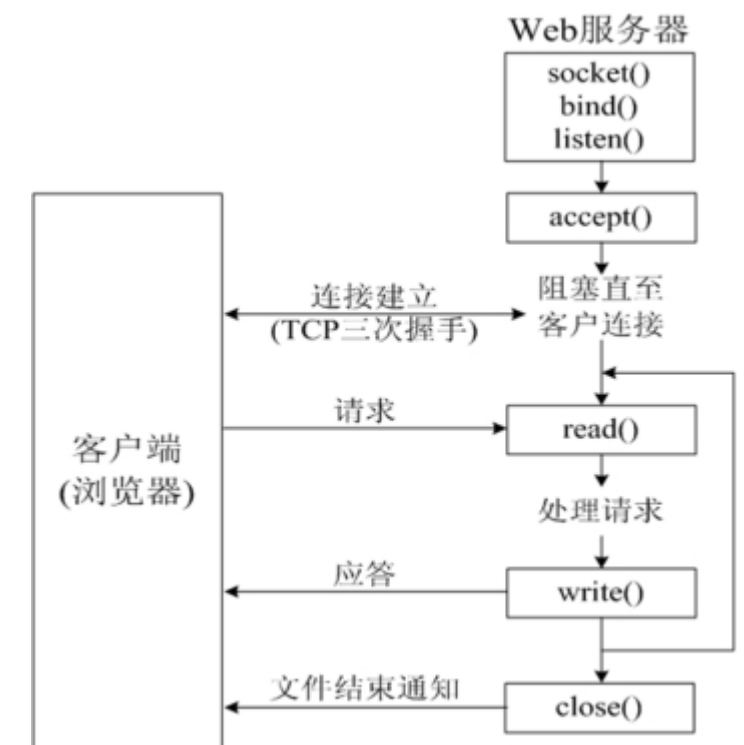

## 10.4 Web编程开发
•网页浏览（使用GET方式）
web服务器的ip地址是192.168.3.103，端口号是9999，要访问的网页是about.html
浏览器输入的格式为：

服务器收到的数据
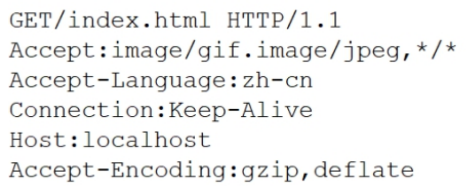

	服务器应答的格式：
	服务器接收到浏览器发送的数据之后，
	需要判断GET/后面跟的网页是否存在，
	如果存在则请求成功，发送指定的指令，
	并发送文件内容给浏览器，如果不存在，
	则发送请求失败的指令。
```
成功
1 "HTTP/1.1 200 OK\r\n" \
2 "Content‐Type: text/html\r\n" \
3 "\r\n";
```

```
失败
1 "HTTP/1.1 404 Not Found\r\n" \
2 "Content‐Type: text/html\r\n" \
3 "\r\n" \
4 "<HTML><BODY>File not found</BODY></HTML>"
```
	
```
案例
#include <stdio.h>
#include <stdlib.h>
#include <unistd.h>
#include <sys/types.h>
#include <sys/socket.h>
#include <arpa/inet.h>
#include <netinet/in.h>
#include <string.h>
#include <pthread.h>
 #include <sys/stat.h>
 #include <fcntl.h>
 #include <errno.h>

 #define N 1024
 #define ERR_LOG(errmsg) do{\
 perror(errmsg);\
 printf("%s ‐ %s ‐ %d\n", __FILE__, __func__, __LINE__);\
 exit(1);\
 }while(0)

 void *pthread_fun(void *arg)
 {
 int acceptfd = *(int *)arg;
 char buf[N] = "";
 char head[]="HTTP/1.1 200 OK\r\n" \
 "Content‐Type: text/html\r\n" \
 "\r\n";
 char err[]= "HTTP/1.1 404 Not Found\r\n" \
 "Content‐Type: text/html\r\n" \
 "\r\n" \
 "<HTML><BODY>File not found</BODY></HTML>";

 //接收浏览器通过http协议发送的数据包
 if(recv(acceptfd, buf, N, 0) < 0)
     {
     ERR_LOG("fail to recv");
     }

 printf("*****************************\n\n");
 printf("%s\n", buf);
 // int i;
 // for(i = 0; i < 200; i++)
 // {
 // printf("[%c] ‐ %d\n", buf[i], buf[i]);
 // }
 printf("\n*****************************\n");

 //通过获取的数据包中得到浏览器要访问的网页文件名
 //GET /about.html http/1.1
 char filename[128] = "";
 sscanf(buf, "GET /%s", filename); //sscanf函数与空格结束，所以直接可以获取文件名

 if(strncmp(filename, "HTTP/1.1", strlen("http/1.1")) == 0)
    {
    strcpy(filename, "about.html");
    }
 printf("filename = %s\n", filename);

 char path[128] = "./sqlite/";
 strcat(path, filename);

 //通过解析出来的网页文件名，查找本地中有没有这个文件
 int fd;
 if((fd = open(path, O_RDONLY)) < 0)
    {
    //如果文件不存在，则发送不存在对应的指令
    if(errno == ENOENT)
       {
       if(send(acceptfd, err, strlen(err), 0) < 0)
       {
       ERR_LOG("fail to send");
       }

       close(acceptfd);
       pthread_exit(NULL);
       }
    else
    {
    ERR_LOG("fail to open");
    }
    }

 //如果文件存在，先发送指令告知浏览器
 if(send(acceptfd, head, strlen(head), 0) < 0)
    {
    ERR_LOG("fail to send");
    }

 //读取网页文件中的内容并发送给浏览器
 ssize_t bytes;
 char text[1024] = "";
 while((bytes = read(fd, text, 1024)) > 0)
    {
    if(send(acceptfd, text, bytes, 0) < 0)
        {
        ERR_LOG("fail to send");
        }
    }

 pthread_exit(NULL);
 }

 int main(int argc, char const *argv[])
 {
 if(argc < 3)
    {
    fprintf(stderr, "Usage: %s <server_ip> <server_port>\n", argv[0])
    exit(1);
    }

 int sockfd, acceptfd;
 struct sockaddr_in serveraddr, clientaddr;
 socklen_t addrlen = sizeof(serveraddr);

 //第一步：创建套接字
 if((sockfd = socket(AF_INET, SOCK_STREAM, 0)) < 0)
    {
    ERR_LOG("fail to socket");
    }

 //将套接字设置为允许重复使用本机地址或者为设置为端口复用
 int on = 1;
 if(setsockopt(sockfd, SOL_SOCKET, SO_REUSEADDR, &on, sizeof(on)) < 0)
    {
    ERR_LOG("fail to setsockopt");
    }

 //第二步：填充服务器网络信息结构体
 serveraddr.sin_family = AF_INET;
 serveraddr.sin_addr.s_addr = inet_addr(argv[1]);
 serveraddr.sin_port = htons(atoi(argv[2]));

 //第三步：将套接字与服务器网络信息结构体绑定
 if(bind(sockfd, (struct sockaddr *)&serveraddr, addrlen) < 0)
    {
    ERR_LOG("fail to bind");
    }

 //第四步：将套接字设置为被动监听状态
 if(listen(sockfd, 5) < 0)
    {
    ERR_LOG("fail to listen");
    }

 while(1)
    {
    //第五步：阻塞等待客户端的连接请求
    if((acceptfd = accept(sockfd, (struct sockaddr *)&clientaddr, &addrlen)) < 0)
        {
        ERR_LOG("fail to accept");
        }

    //打印客户端的信息
    printf("%s ‐‐ %d\n", inet_ntoa(clientaddr.sin_addr), ntohs(clientaddr.sin_port));

    //创建线程接收数据并处理数据
    pthread_t thread;
    if(pthread_create(&thread, NULL, pthread_fun, &acceptfd) != 0)
        {
        ERR_LOG("fail to pthread_create");
        }
    pthread_detach(thread);

    }

 return 0;
 }
```

# 11、网络通信过程
## 11-1、网络通信概述
•网络通信过程分析软件  
Packet Tracer 是由Cisco公司发布的一个辅助学习工具，提供了设计、配置、  
排除网络故障网络模拟环境可以直接使用拖曳方法建立网络拓扑，
并可提供数据包在网络中行进的详细处理过程，
观察网络实时运行情况。  
## 11-2、通信过程（PC+switch）
### 11-2-1、 交换机介绍
	网络交换机（又称“网络交换器”），
	是一个扩大网络的器材，可以把更多的计算机等。
	网络设备连接到当前的网络中。
	具有性价比高、高度灵活、相对简单、易于实现等特点
	以太网技术已成为当今最重要的一种局域网组网技术，
	网络交换机也就成为了最普及的交换机。

### 2.2 交换机功能
	1、转发过滤：
	当一个数据帧的目的地址在MAC地址表中有映射时，
	它被转发到连接目的节点的端口而不是所有端口
	（如该数据帧为广播/组播帧则转发至所有端口）
	2、学习功能：
	以太网交换机了解每一端口相连设备的MAC地址，
	并将地址同相应的端口映射起来存放在交换机缓存中的MAC地址表中
	3、目前交换机还具备了一些新的功能，
	如对VLAN（虚拟局域网）的支持、对链路汇聚的支持，
	甚至有的还具有防火墙的功能

### 2.3 通信过程（PC+switch）

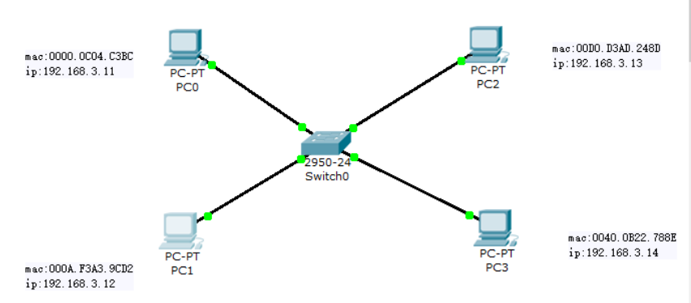

	总结：
	如果PC不知目标IP所对应的MAC，
	那么可以看出，PC会先发送ARP广播，
	得到对方的MAC然后，
	再进行数据的传送，
	当switch第一次收到ARP广播数据，
	会把ARP广播数据包转发给所有端口（除来源端口）；
	如果以后还有PC询问此IP的MAC，
	那么只是向目标的端口进行转发数据
	每台PC都会有一个ARP缓存表，
	用来记录IP所对应的的MAC。 

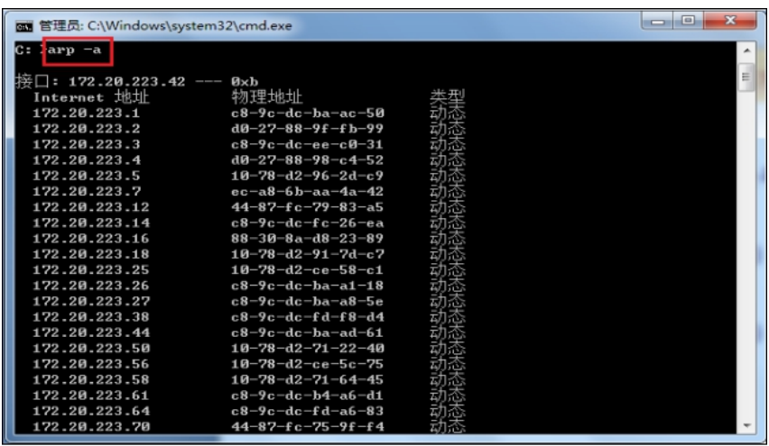
	
	注意：arp表不是永久的，
	过一段时间之后就会将没有通信的主机的ip地址以及其mac地址从表中移除

## 11-3、通信过程（PC+switch+router）
### 11-3-1、 路由器介绍
	路由器（Router）又称网关设备（Gateway）是用于连接多个逻辑上分开的网络
	所谓逻辑网络是代表一个单独的网络或者一个子网。
	当数据从一个子网传输到另一个子网时，
	可通过路由器的路由功能来完成具有判断网络地址和选择IP路径的功能。
	路由器工作在网络层，可以实现不同网段的主机之间进行通信。
### 11-3-2、 通信过程（PC+switch+router）
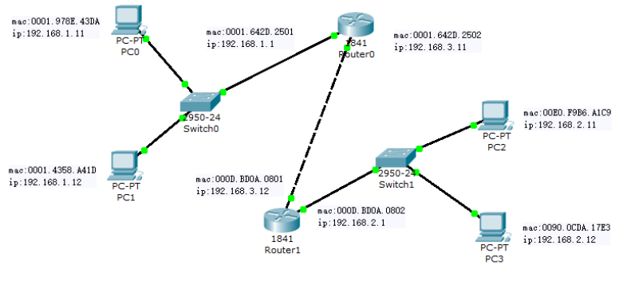
	
	总结：
	不在同一网段的PC，
	需要设置默认网关才能把数据传送过去,通常情况下
	都会把路由器设为默认网关,当路由器收到一个其它网段的数据包时，
	会根据“路由表”来决定把此数据包发送到哪个端口；
	路由表的设定有静态和动态方法
	设置路由表就是设置下一跳，
	指定当前网段的主机与另一个网段主机通信是数据报应该交给那个路由器。
## 11-4、通信过程（浏览器跨网访问Web服务器）
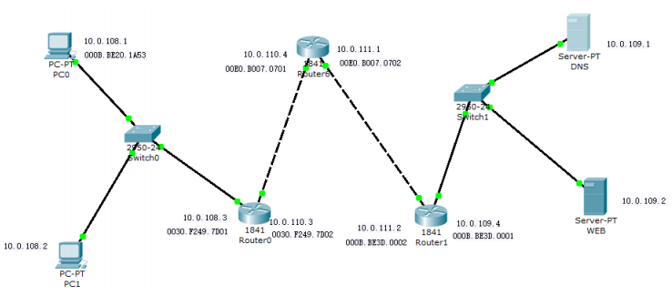
	
	总结
	1、DNS服务器的作用是解析出IP
	2、DFGATEWAY指定发往其它网段的数据包转发的路径
	3、在路由器中路由表指定数据包的“下一跳”的地址
	4、公有IP、私有IP


# 12、原始套接字
## 12-1、TCP、UDP开发回顾
	数据报式套接字（SOCK_DGRAM）
	1、无连接的socket,针对无连接的 UDP 服务
	2、可通过邮件模型来进行对比
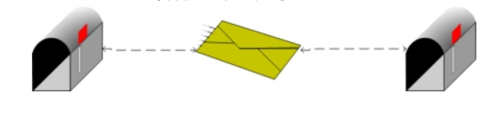
	
	流式套接字（SOCK_STREAM）
	1、面向连接的socket,针对面向连接的 TCP 服务
	2、可通过电话模型来进行对比
	这两类套接字似乎涵盖了TCP/IP 应用的全部

	TCP与UDP各自有独立的port互不影响
	一个进程可同时拥有多个port
	不必关心tcp/ip协议实现的过程
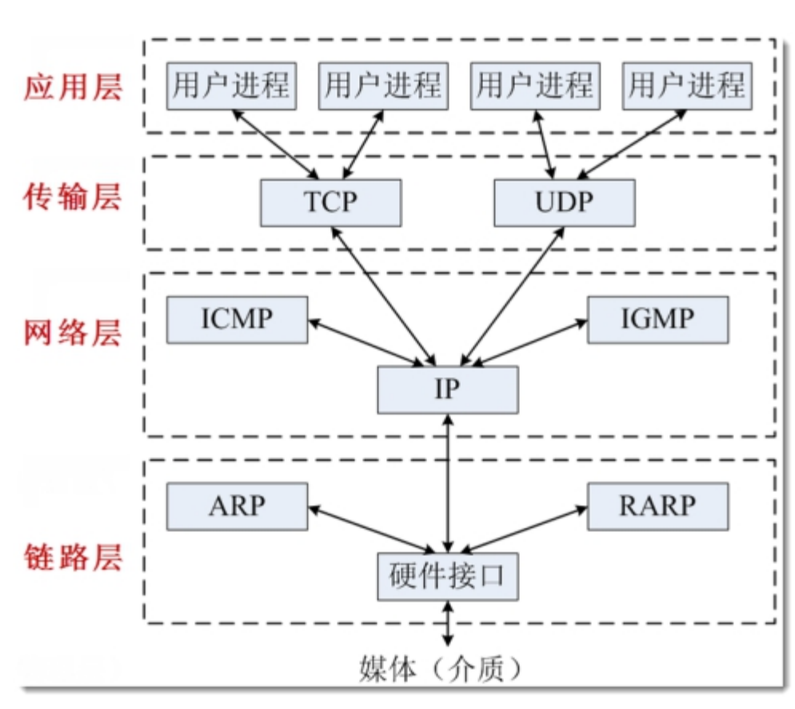

### 12-1-1、 UDP 编程回顾
	client
	1、创建socket接口
	2、定义sockaddr_in变量，其中ip、port为目的主机的信息
	3、可发送0长度的数据包
	server
	1、bind本地主机的ip、port等信息
	2、接收到的数据包中包含来源主机的ip、port信息

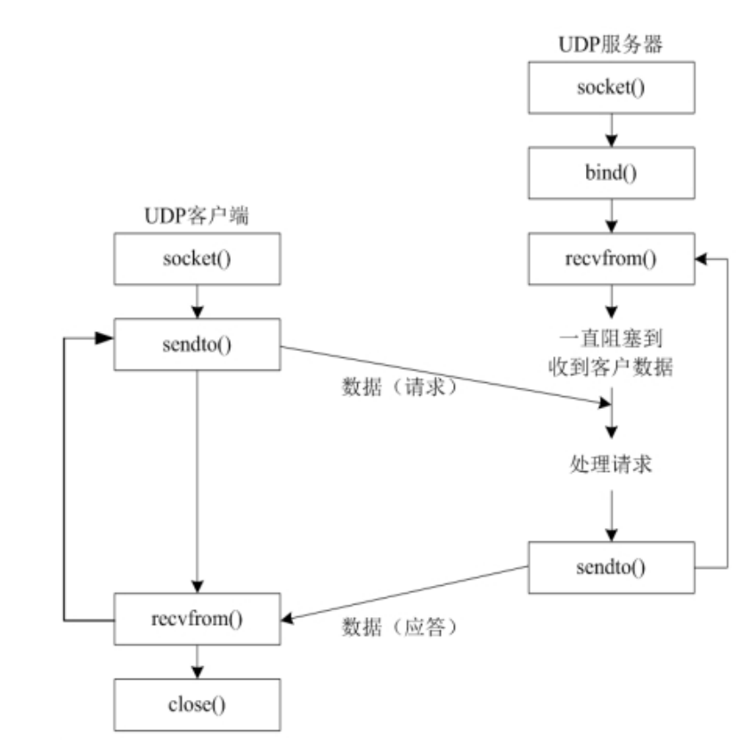
### 12-1-2、 TCP编程回顾
	client
	connect来建立连接
	send、recv收发数据
	不可发送0长度的数据
	server
	bind本地主机的ip、port等信息
	listen把主动套接字变为被动
	accept会有新的返回值
	多进程、线程完成并发
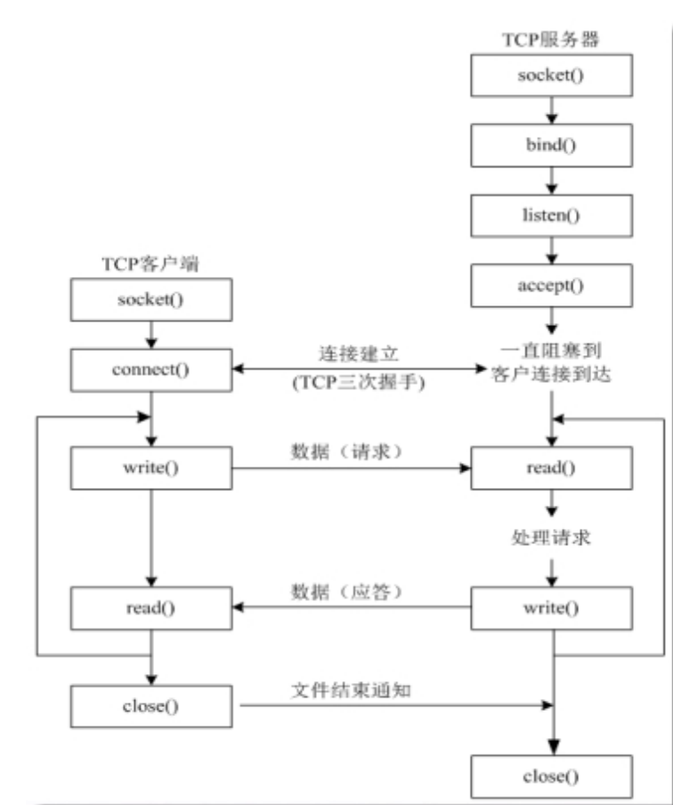
## 12-2、原始套接字概述、创建
	2.1 原始套接字概述
	原始套接字（SOCK_RAW）
	1、一种不同于SOCK_STREAM、SOCK_DGRAM的套接字，
	它实现于系统核心
	2、可以接收本机网卡上所有的数据帧（数据包）,
	对于监听网络流量和分析网络数据很有作用
	3、开发人员可发送自己组装的数据包到网络上
	4、广泛应用于高级网络编程
	5、网络专家、黑客通常会用此来编写奇特的网络程序

`流式套接字只能收发`
`TCP协议的数据`
`数据报套接字只能收发`
`UDP协议的数据`
`原始套接字可以收发`
`1、内核没有处理的数据包，因此要访问其他协议`
`2、发送的数据需要使用，原始套接字(SOCK_RAW)`


# 重要补充
udp在通讯结束后也需要用close关闭描述符。
