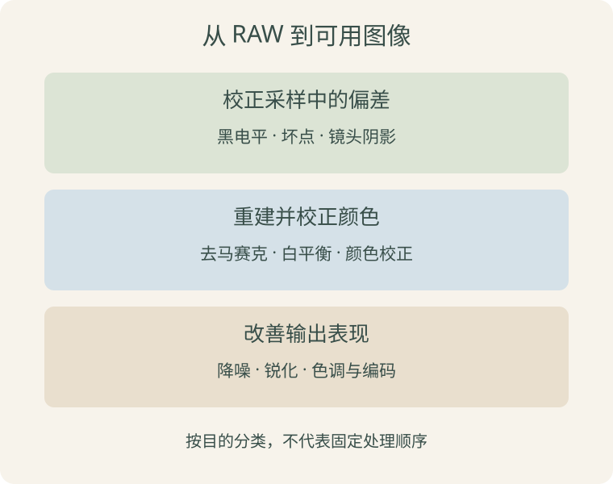

> 2026-10-13 正式发布，练习参考答案已补齐：ISP 基础系列第二篇，接在《从传感器到 RAW》之后。只讲作用、概念与影响，不讲调参方法、设备参数值或厂商工具。文中的数字是教学假设，不是设备配置建议。

上一篇已经认识到：Bayer RAW 每个位置通常只有一个滤色采样值，还带有偏置、噪声等影响。接下来要做的不只是把一个数变成三个数，还要处理成像链路的偏差，让图像适合显示和后续使用。

第一次阅读可以先学到去马赛克，再继续白平衡与颜色处理。

## 先分清三个目标

| 目标 | 典型环节 | 要解决的问题 |
| --- | --- | --- |
| 校正采样中的偏差 | 黑电平、坏点、镜头阴影校正 | 数值基准、异常位置与空间不均匀 |
| 重建并校正颜色 | 去马赛克、白平衡、颜色校正 | 缺失的分量与颜色响应差异 |
| 改善输出表现 | 降噪、锐化、色调与编码 | 噪声、边缘观感及显示范围 |

这个表是概念分类，不是所有 ISP 都必须遵循的固定硬件顺序。降噪可能在 RAW 域、RGB 域或后续亮度／色度域进行，有的操作会融合实现；白平衡也可以直接作用于 Bayer 对应颜色的采样位置。



不同平台的处理顺序和模块边界可能不同，阅读设备资料时应以实际链路为准。本篇只要求知道每个模块在解决什么问题。

## 黑电平校正：先统一数值起点

假设遮住光后，某个通道的基准读数不是 0，而接近 64。正常采样得到 164，如果把 164 全当作受光产生的信号，就把基准偏置也算进去了。

最简单的教学例子是：

```text
校正后的信号 = 原始值 - 黑电平基准
             = 164 - 64 = 100
```

这叫黑电平校正，常简称 BLC。实际系统可能对不同颜色、位置或工作条件使用不同基准，并处理相减后负值或截断的问题。

它是在校正信号起点，不是随意把整张图调暗。减去固定偏置也不会消除每次采样随机变化的噪声，二者需要区分。

## 坏点校正：处理异常采样位置

有些感光位置可能长期异常偏亮、偏暗，或在特定条件下明显偏离周围。坏点校正通常称为 DPC，会检测或使用已有的异常位置记录，再利用邻域信息估计替代值。

可以把它理解为：一个位置读数不可信时，参考附近可信的数据修补。Bayer 邻域中有不同滤色片，实际算法需要考虑颜色位置与边缘，不能把所有邻点不加区分地混合。

但画面里的一个小亮点也可能是真实灯光或细小纹理，不能仅凭“很亮”就认定为坏点。修补本身也是估计，不是找回该位置当时真正测到的光。

## 镜头阴影校正：为什么边缘可能更暗或偏色

同一个均匀场景，画面中心和边缘也可能得到不同的亮度或颜色响应。这与镜头、入射角以及传感器响应等因素有关。

镜头阴影校正通常称为 LSC，按位置、必要时按颜色补偿这种不均匀。它针对成像系统自身的空间响应，不是把真实场景中的阴影一律去掉。

例如真实物体遮挡了光线，在地面投下阴影，这不是 LSC 要恢复成均匀亮度的对象。补偿较弱信号的同时也可能放大噪声，不会凭空增加光子信息。黑电平与镜头阴影的概念可参考 Raspberry Pi 官方相机资料中的相关算法说明；其配置、标定部分不属于本篇学习范围。[官方相机资料入口](https://pip.raspberrypi.com/categories/1259-audio-camera-and-display)

## 去马赛克：估计每个位置缺少的颜色

Bayer 某个 R 位置直接测得的是红色滤光响应，该位置没有同时测出独立的 G、B 分量。去马赛克（Demosaic）利用邻域采样来估计它们。

例如下面这个 RGGB 局部，中心为 R 位置：

```text
B   G   B
G   R   G
B   G   B
```

假设中心 R=100，上下左右四个 G 分别为 80、100、90、110，四个对角 B 为 40、60、50、70。用简单平均演示：

```text
R = 100                       原有采样
G ≈ (80+100+90+110)/4 = 95     由附近绿色采样估计
B ≈ (40+60+50+70)/4 = 55       由附近蓝色采样估计
```

于是这个位置暂时得到 `[100, 95, 55]`。这里假设采样处于可比较的数值域，并忽略边界等问题；真实算法还可能根据边缘方向选择不同估计方式。

这三个数还不是经过完整颜色处理、适合直接解释为标准显示 RGB 的最终结果。去马赛克解决的是“缺少分量”，不是一次解决全部颜色问题。估计不合适时可能出现彩边、锯齿等伪影。[颜色插值概念参考](https://www.phaseone.com/inspiration/bayer-pattern-technology/)

## 白平衡：补偿光源与通道响应带来的偏色

同一张白纸在不同照明下，传感器测到的 R、G、B 比例可能不同。白平衡通过调整通道相对响应，让选定照明条件下的中性物体获得合适的中性表现。

用一个已经扣除基准的中性样本作示意：

```text
测得的相对通道值：[80, 100, 50]
示意倍率：        [1.25, 1, 2]
调整后：          [100, 100, 100]
```

这是为了展示各通道分别缩放的意义，不是让所有像素都变成 R=G=B。红色物体应当仍有颜色，白平衡也不是简单把全图变成灰色。[白平衡说明](https://docs.baslerweb.com/balance-white)

自动白平衡 AWB 是估计合适白平衡的一类控制算法，不等同于具体执行通道缩放的处理模块。一个负责判断，一个负责把结果作用到数据上。

## 颜色校正：白色正常，不代表所有颜色都准确

传感器各滤色通道的光谱响应，与目标颜色空间的定义并不完全一致。即使中性物体已经没有明显偏色，其他颜色仍可能存在偏差。

颜色校正常用颜色校正矩阵 CCM。先不推导矩阵，只看一行的含义：

```text
输出 R = a×输入 R + b×输入 G + c×输入 B
```

另外两行计算输出 G 和 B。这与白平衡中“每个通道主要乘自己的系数”不同：CCM 可以把不同通道组合起来，近似实现从相机颜色响应到目标颜色表达的转换。实际处理可能还结合其他颜色映射。[颜色变换说明](https://docs.baslerweb.com/color-transformation)

可以联系 MLP 中的加权求和理解这条公式，但这里介绍的是颜色变换，不代表 ISP 的 CCM 就是一个正在训练的神经网络。

## 降噪：区分随机波动与真实细节

降噪希望减少信号中的不稳定波动。理解时先分为两种思路：

- 空间降噪：参考同一帧的邻域信息。
- 时间降噪：参考连续多帧的信息，通常还需要考虑物体运动。

邻近位置或连续帧里重复出现的结构，可以帮助估计信号。但细小纹理可能和噪声相似，过度平滑会损失纹理；时间处理若没有正确处理运动，还可能留下拖影。

因此“更干净”和“保留更多真实细节”需要同时观察。具体降噪位置及算法因 ISP 而异，本篇不把所有降噪简化为一个固定的均值滤波。

## 锐化：增强边缘观感，不等于恢复真实分辨率

锐化常增强局部变化，使轮廓显得更清楚。例如灰暗区域和明亮区域的边界，被处理得更突出。

但它不能保证恢复已经因失焦、运动模糊或采样不足而丢失的信息。增强过强可能产生明暗边缘光晕，也可能让噪声更显眼。

降噪与锐化关注的问题不同：前者抑制不希望的波动，后者增强某些边缘表现。它们并非互相替代。厂商图像处理说明中也将二者作为不同功能讨论。[降噪与锐化参考](https://docs.baslerweb.com/pgi-feature-set)

## 色调映射与 Gamma：数值怎样适合输出

采样信号的数值关系，与最终图像编码、显示的数值关系可能不同。色调处理决定暗部、中间调和亮部怎样映射到输出范围，例如压缩亮部或改变局部对比度。

Gamma 常用于描述一类非线性曲线，但并非所有色调映射都是一个 Gamma 幂函数，标准 sRGB 的传递曲线也不是完整范围内的单一幂函数。

仅为观察非线性，设输入已经归一到 `[0,1]`，采用教学曲线：

```text
y = sqrt(x)
x = 0.25 → y = 0.5
x = 1.00 → y = 1.0
```

它改变了不同数值区间的相对分布，不是简单把所有值乘以 2。这不是建议使用某个设备的 Gamma 设置，不同接口对曲线参数的定义也可能不同。[Gamma 概念参考](https://docs.baslerweb.com/gamma)

数值显示得更亮，不意味着采集时增加了曝光；若某处早已截断成同一个数，仅靠后续曲线也无法重新区分原来的亮度差异。

## 自动控制与像素处理不是同一回事

有时会同时看到 AE、AWB、ISP 等名称：

| 名称 | 先这样理解 |
| --- | --- |
| AE，自动曝光 | 根据统计结果判断如何控制曝光等采集条件 |
| AWB，自动白平衡 | 根据图像等信息估计白平衡 |
| ISP 像素处理 | 对采样数据实际执行校正、重建和变换 |

自动控制可利用 ISP 统计信息，再影响后续采集或处理。它不是简单地在每个像素上多做一次滤波。[相机控制与处理架构参考](https://www.raspberrypi.com/documentation/computers/camera_software.html)

本篇了解职责即可，不学习自动控制的参数设置或收敛策略。

## 用一张表区分容易混淆的操作

| 容易混淆的概念 | 区别 |
| --- | --- |
| 黑电平校正与降噪 | 一个处理基准偏置，一个抑制噪声；减偏置不等于消除随机波动 |
| 去马赛克与白平衡 | 一个估计缺失的颜色分量，一个校正通道相对响应 |
| 白平衡与颜色校正 | 中性色不偏不意味着所有颜色都符合目标表达 |
| LSC 与去除场景阴影 | 补偿成像系统不均匀，不是抹掉真实光影 |
| 锐化与增加真实细节 | 边缘看起来更突出，不保证多获得了场景信息 |
| 色调曲线与曝光 | 后期映射数字与采集时收集光是不同步骤 |

不要仅凭一个画面现象就认定某个模块有问题。例如偏色还可能涉及错误的 Bayer 模式或 RGB/BGR 顺序。这里先理解可能的来源，不展开诊断和调参。

## 与模型输入有什么关系

模型最终接收的像素已经受这些环节影响。同一个场景，颜色、噪声与边缘处理不同，送入网络的数据也会不同。画面更符合人的审美，并不自动保证模型指标更好，仍需用目标任务的数据验证。

ISP 的颜色重建和校正，与模型侧的裁剪、尺寸调整、布局转换及归一化不是同一层职责。也不能看到数据已经是 RGB，就认为尺寸、通道顺序和数值范围一定符合某个模型要求。

本篇只走到形成可用图像；RGB、YUV、NV12 以及它们怎样接到模型输入，留到第三篇。

## 课后练习

四道短题检查概念。2026-10-12 已补齐默认折叠的复习参考答案，不作为个人逐题作答记录。

### 练习 1：黑电平校正

假设三个 RAW 采样值为 `[84, 114, 204]`，共同黑电平为 64，只做减法且不需要截断。校正结果是什么？这一步是否已经消除了随机噪声？

<details class="exercise-answer">
<summary>点击查看第一题参考答案</summary>

校正结果为 `[20, 50, 140]`：

```text
84 - 64 = 20
114 - 64 = 50
204 - 64 = 140
```

这一步只扣除了假设的共同黑电平基准，没有消除每次采样的随机波动。不要把基准偏置与随机噪声当成同一个问题。

</details>

### 练习 2：分清颜色处理

分别说明：去马赛克、白平衡、颜色校正在解决什么问题。为什么完成去马赛克后，还不能认为颜色一定正确？

<details class="exercise-answer">
<summary>点击查看第二题参考答案</summary>

| 环节 | 主要解决的问题 |
| --- | --- |
| 去马赛克 | 根据 Bayer 邻域采样，估计各位置缺少的颜色分量 |
| 白平衡 | 补偿照明与通道相对响应造成的偏色，使中性物体呈现合适的中性色 |
| 颜色校正 | 补偿相机颜色响应与目标颜色表达的差异，常用跨通道的矩阵变换 |

去马赛克只补齐分量，估计值仍然与传感器和照明有关，不会自动完成白平衡和颜色校正。中性色正常也不能保证所有其他颜色都准确。

</details>

### 练习 3：判断处理的边界

判断并解释：LSC 应消除地面上真实的树影；锐化能保证恢复运动模糊丢失的全部细节；时间降噪完全不需要考虑物体运动。

<details class="exercise-answer">
<summary>点击查看第三题参考答案</summary>

三句话都不正确：

1. **LSC 不应把真实树影抹掉。** 它补偿镜头和传感器等成像系统造成的空间不均匀；真实树影属于场景中的光照变化。
2. **锐化不能保证恢复丢失的细节。** 它主要增强边缘表现，可能让轮廓更突出，也可能增强噪声或产生光晕；不能据此宣称恢复了全部真实信息。
3. **时间降噪需要考虑运动。** 不同帧同一坐标可能已经不是同一个物体部位。若不恰当地混合这些数据，可能出现拖影或模糊。

</details>

### 练习 4：画面更好看，模型一定更准吗

同一摄像头的画面经过更强的降噪和锐化后，人眼觉得更干净、更清晰。能否直接断言检测准确率提高？说明需要区分哪些现象，以及应该用什么结果确认。

<details class="exercise-answer">
<summary>点击查看第四题参考答案</summary>

不能直接断言检测准确率提高。更强降噪可能同时抹掉模型依赖的细纹理；锐化可能增强轮廓，也可能增加噪声或人为边缘。视觉观感与目标任务的识别指标不是同一个量。

应在同一套有标注、具有代表性的验证数据上，尽量只改变待比较的图像处理条件，保持模型、后续预处理与评估口径一致。比较漏检、误检，以及任务需要的精确率、召回率或 mAP，并检查具体错误样本。不能只凭一张变好看的图片或一次更高的置信度作结论。

这是在说明如何确认效果，不要求本篇进行 ISP 调参实验。

</details>

## 下一篇

[《ISP 基础：从 ISP 输出到模型输入》](/posts/isp-output-model-input.html)继续解释 RGB、YUV、NV12 和存储布局，再接到已经学过的张量预处理流程。本篇没有要求记住唯一处理顺序，重点是分清各环节的目的与能力边界。
