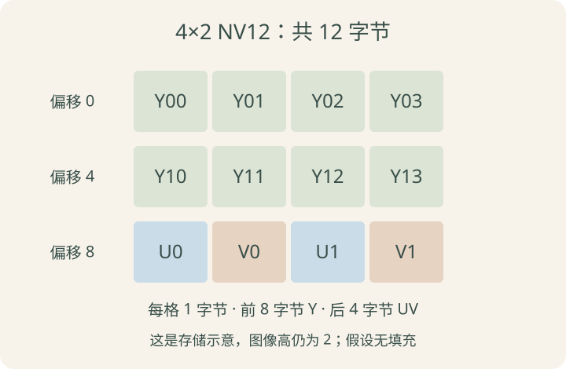

> 2026-10-12 发布：ISP 基础系列第三篇，接在《ISP 怎样形成图像》之后。先理解图像在内存里如何存放，再接到模型预处理；不涉及 ISP 调参，也不要求编写完整的摄像头采集程序。

前两篇认识了 RAW 和 ISP 处理。到了程序这一侧，最容易遇到的问题变成：已经拿到一块图像缓冲区，为什么还不能直接交给模型？

答案是：还需要知道它的颜色含义、存储格式、内存布局，以及模型期待的输入约定。只有地址和宽高通常不够。

## 先把四类信息分开

| 信息 | 例子 | 回答的问题 |
| --- | --- | --- |
| 颜色表达与数值约定 | RGB、YCbCr、BT.709、有限范围 | 数字代表什么颜色 |
| 像素格式 | RGB24、NV12、NV21 | 分量怎样采样、按什么顺序存放 |
| 缓冲区布局 | 平面地址、stride、对齐 | 每行与每块数据在哪里 |
| 模型输入约定 | float32、RGB、NCHW、指定尺寸 | 推理接口期待什么 |

颜色转换、内存读取和张量换轴是三种不同操作。不能通过一次 `reshape` 同时完成它们。

## RGB 与 BGR：顺序不同，颜色解释就不同

先限定为每分量 8 bit、按像素交错存储的 RGB24。两个像素如果分别是红色与绿色，其连续字节可以写成：

```text
RGB24：R0 G0 B0 | R1 G1 B1
数值：255 0 0 | 0 255 0
```

若采用 BGR 顺序，同一个红色像素的三个字节应为 `[0, 0, 255]`。如果把 RGB 的 `[255, 0, 0]` 直接按 BGR 解释，红色就会被当成蓝色。

名字中出现 RGB 不意味着所有 RGB 格式都这样排列；还可能有 16 bit 打包、Alpha 分量或不同位宽。这里一直限定在 RGB24 的简单情形。[Linux RGB 格式说明](https://www.kernel.org/doc/html/latest/userspace-api/media/v4l/pixfmt-rgb.html)

交换 RGB/BGR 顺序也不是 HWC/CHW 换轴。前者改变通道顺序的解释，后者改变通道轴在张量中的位置。

## 工程里说的 YUV 通常是什么

数字视频中常把 YCbCr 一类格式统称为 YUV。为了和设备术语对应，本文沿用 Y、U、V 写法，其中 U、V 对应 Cb、Cr。

- Y：亮度相关的分量，更严格地说是通常记作 Y′ 的 luma，并非直接测得的物理亮度。
- U、V：色度分量，编码颜色与亮度相关分量之间的差异。

Y 不是 RGB 三个数的简单平均；UV 也不是绿色、蓝色通道。转换关系取决于约定的矩阵和数值范围。[视频 YUV 概念参考](https://learn.microsoft.com/en-us/windows/win32/medfound/recommended-8-bit-yuv-formats-for-video-rendering)

把 Y 单独显示，通常能看出灰度结构，但这不表示原图本来没有颜色，也不意味着只拿 Y 就符合一个 RGB 模型的输入要求。

## 4:4:4、4:2:2、4:2:0 描述色度采样

先不用背三个数字的历史记法，理解常见格式里的相对采样密度即可：

| 常见采样方式 | Y 采样 | U、V 各自的采样密度 |
| --- | --- | --- |
| 4:4:4 | 每个图像位置都有 | 与 Y 相同 |
| 4:2:2 | 每个图像位置都有 | 水平方向减半，垂直不变 |
| 4:2:0 | 每个图像位置都有 | 水平、垂直方向都减半 |

对于宽高为偶数的普通 4:2:0 图像，每 2×2 的四个 Y 位置，对应一组 U、V 色度采样。实际采样位置及还原插值方式还取决于格式约定，不应理解为把每四个像素的完整颜色直接复制成一样。

色度下采样减少了颜色采样信息，通常也减少数据量；它不是 JPEG 或 H.264 那样的压缩编码。RGB 转成经过色度下采样的格式后，不能保证再无损还原原来的全部颜色细节。

## NV12：一块 Y，后面是一块交错 UV

本篇只讨论常见的 8 bit、线性存储 NV12：它采用 4:2:0 采样，包含 Y 平面和 UV 交错平面。

先看宽 4、高 2、无任何填充的教学缓冲区：



```text
Y 第 0 行：Y00 Y01 Y02 Y03
Y 第 1 行：Y10 Y11 Y12 Y13
UV 第 0 行：U0 V0 U1 V1
```

Y 部分有 8 个字节；色度有两组 UV，每组 2 字节，共 4 个字节。总计 12 字节，图像尺寸仍然是 4×2，不是因为存储中出现三行就变成 4×3 的图像。

NV21 与 NV12 的一个关键区别是色度排列为 VU，而不是 UV；I420 则分别存放 Y、U、V 三个平面。不能把它们当成同一块数据随意改名。[Linux NV12 与相关格式定义](https://www.kernel.org/doc/html/latest/userspace-api/media/v4l/pixfmt-yuv-planar.html)

### 本次疑问：NV12 和 4:2:0 是什么关系

**NV12 是 YUV 4:2:0 的一种具体存储格式。** 4:2:0 说明色度采样密度，NV12 进一步说明如何排列这些采样值。它们不是两个互相排斥的名称。

| 格式 | 采样方式 | 本篇讨论的 8 bit 分量排列 |
| --- | --- | --- |
| NV12 | 4:2:0 | Y 平面，后接交错的 `U0 V0 U1 V1 …` |
| NV21 | 4:2:0 | Y 平面，后接交错的 `V0 U0 V1 U1 …` |
| I420 | 4:2:0 | Y、U、V 分别存放 |

知道是 4:2:0，还不能确定怎样读取内存；知道是 NV12，才进一步确定了平面与色度顺序。本篇中的 U、V 对应数字视频的 Cb、Cr。

### NV12 与 NV21：主要差在 UV 顺序

对于同样的 4×2 图像，无行填充时：

```text
NV12                     NV21
Y00 Y01 Y02 Y03           Y00 Y01 Y02 Y03
Y10 Y11 Y12 Y13           Y10 Y11 Y12 Y13
U0  V0  U1  V1            V0  U0  V1  U1
```

两种格式的 Y 数据相同，色度采样数量和有效数据大小也相同，区别在于每对 U、V 的存储顺序。如果其他布局与颜色约定一致，互转只需交换每对色度字节，Y 保持不变。

把 NV21 当成 NV12 转成 RGB，会把两个色度分量解释反，通常产生偏色；只看 Y 平面时却可能仍然正常。因此不能仅凭灰度画面正常判断颜色格式读取正确。[NV12／NV21 定义](https://www.kernel.org/doc/html/latest/userspace-api/media/v4l/pixfmt-yuv-planar.html)

### 一个像素几个字节：为什么是平均 1.5

对于本篇的 8 bit NV12／NV21，每个 2×2 区域有四个 Y 采样，对应一组 U、V：

| 数据 | 数量 | 字节数 |
| --- | --- | --- |
| Y | 4 个 | 4 |
| U | 1 个 | 1 |
| V | 1 个 | 1 |
| 合计 | 对应 4 个图像位置 | 6 |

所以无填充时平均每个像素占 `6÷4=1.5` 字节。**不是每个像素后面各自连续放着 1.5 字节**，而是按平面分开存放 Y 与较稀疏的色度采样。RGB24 则为每个像素存放三个 8 bit 分量，平均每像素 3 字节。

### 仍然用像素描述图像吗

仍然用像素描述宽高和位置。宽 4、高 2 的 NV12 图像依然有 8 个像素位置；变化的是颜色信息的采样与存储方式。

```text
RGB24：8 个像素位置，每个存 R、G、B → 24 字节
NV12 ：8 个像素位置，8 个 Y + 2 个 U + 2 个 V → 12 字节
```

**减少的是色度采样数量，不是图像的像素数量。** 写程序时仍可用 `(行, 列)` 描述位置，但访问 NV12 时要分别定位 Y 和相应色度数据，不能像 RGB24 一样用“像素下标乘以 3”取得三个分量。

以上疑问于 2026-10-12 整理。为了方便初学理解，用 2×2 区域说明采样数量；真实颜色还原仍需遵循色度采样位置与插值约定。

### 大小先按有效数据计算

对宽高为偶数、无填充的 8 bit NV12：

```text
Y 字节数  = W × H
UV 字节数 = (W/2) × (H/2) × 2 = W × H / 2
总字节数  = W × H × 3/2
```

同尺寸 RGB24 的有效字节数为 `W×H×3`。例如 640×480：NV12 为 460800 字节，RGB24 为 921600 字节。这里比较的是未压缩的有效像素存储量，不是视频文件大小。

## stride：图像宽度不一定等于一行占用的字节数

以 RGB24 为例，宽 4 像素时每行有效数据为 12 字节，但设备可能分配 16 字节的行跨度：

```text
第 0 行：12 字节像素数据 + 4 字节填充
第 1 行：12 字节像素数据 + 4 字节填充
```

在这种布局下，第二行从偏移 16 开始，而不是偏移 12。填充不是图像右侧多出来的像素。[V4L2 bytesperline 与缓冲区说明](https://www.kernel.org/doc/html/latest/userspace-api/media/v4l/pixfmt-v4l2.html)

对于本例已知 RGB 字节顺序、已知单字节分量的缓冲区，可以用类似 C 的地址思路理解：

```text
某个分量的字节偏移 = row × stride + column × 3 + channel
channel：R=0，G=1，B=2
```

这条公式只适用于这里的交错 RGB24，不能直接套到 NV12。并且这里的 stride 单位是字节，与 NumPy 的字节跨度、PyTorch 通常按元素计的张量 stride，需要分别确认单位。

### NV12 的平面也要按实际布局定位

在特定的“Y 与 UV 紧接、两平面相同 stride、没有额外高度对齐或平面间隔”布局中，UV 起点可以是 `base + stride × H`。

这个前提不能省略。有的接口提供独立平面地址或偏移，还有带 M 后缀的非连续平面格式，以及分块存储变体；具体行跨度、分配高度和缓冲区大小应按接口元数据读取，不能永远使用 `base + W×H`。

宽高和有效字节数描述的是图像内容；平面地址、行跨度等描述的是怎样访问内存。两者都正确，程序才能正确读图。

## NV12 转 RGB 还需要哪些约定

NV12 描述采样与存储，但仅凭这个名字不能完整确定颜色转换。还需要确认：

- 使用哪种 YCbCr 转换矩阵，例如 BT.601 或 BT.709。
- 是有限范围还是全范围。
- 平面顺序、行跨度，以及转换接口支持的实际布局。

常见 8 bit 有限范围的标称 Y 范围是 16～235，Cb、Cr 是 16～240，中性色度中心为 128；缓冲区仍可能包含标称范围外的值。不要因为容器是 `uint8` 就断言有效颜色映射一定按 0～255 全范围解释。[色彩空间、矩阵与量化范围说明](https://www.kernel.org/doc/html/latest/userspace-api/media/v4l/colorspaces-details.html)

实际转换一般交给匹配格式的图像库或硬件模块。输入矩阵、范围或 UV 顺序不匹配时，画面可能偏色、发灰或明暗异常；这类问题不一定来自 ISP 的白平衡。

不必现在背转换系数。先确认“数据按什么约定产生、转换函数按什么约定解释”，比记一条通用公式更重要。

## 接到模型前，分步检查

以明确要求 `float32 RGB NCHW` 的模型为例，可以按下面的逻辑理解：

```text
摄像头缓冲区及格式信息
        ↓ 正确读出各行和各平面
NV12 等输入格式
        ↓ 匹配矩阵、范围与色度顺序的颜色转换
RGB 图像
        ↓ 按模型约定裁剪、缩放或填充
指定尺寸的 RGB
        ↓ 按训练约定转换类型、缩放或标准化
数值符合要求的张量
        ↓ 调整布局并增加批次轴
模型输入
```

这只是教学上的拆分。硬件预处理可能把多个步骤合并完成，也有模型直接接收特定的 YUV 或量化输入；最终以模型和运行时的接口约定为准。

与[《图片如何变成张量》](/posts/vision-04-image-tensor.html)对应，假设已经正确获得 224 高、320 宽的 RGB 数组：

```text
HWC：(224, 320, 3)
CHW：(3, 224, 320)
NCHW：(1, 3, 224, 320)
```

`permute` 只换轴，不会把 NV12 转成 RGB，也不会把 BGR 自动变成 RGB。`.to(float32)` 只改变数据类型；是否除以 255、减均值和除标准差，由模型训练时的预处理决定。

尺寸调整也要一致：直接拉伸、保留比例后填充或裁剪，会给模型不同的输入内容。做目标检测时，还需要记录缩放和填充关系，把输出框正确映射回原图。

## 和 C/C++ 缓冲区联系起来

可以把一帧图像理解成“数据地址加描述信息”，而不仅仅是一个 `unsigned char*`：

```text
数据：各平面的地址或偏移
尺寸：可见的宽、高
格式：RGB24、NV12 等
布局：行跨度、平面长度、对齐方式
颜色：矩阵与范围等约定
生命周期：缓冲区在什么时候仍然有效
```

若张量或图像对象直接共享采集缓冲区，采集端复用内存后，旧视图看到的内容也可能改变。需要复制还是保持缓冲区占用，由接口的所有权规则决定；并非所有“转成张量”操作都会复制数据。设备内存还可能需要专门映射或同步，不能假定任意硬件地址都能直接在 CPU 上读取。

这与前面学过的 NumPy／PyTorch 共享内存概念相通，本篇先理解这种联系，不展开驱动与零拷贝实现。

## 几个常见误解

| 误解 | 正确理解 |
| --- | --- |
| NV12 有 Y、U、V，所以可以直接 reshape 成三通道 | 色度采样数与 Y 不同，还需要颜色转换 |
| 宽度 640，一行一定 640 字节 | 取决于格式、位宽和 stride |
| 文件或缓冲区长度就是 `W×H×1.5` | 该式只描述特定无填充 NV12 的有效数据量 |
| RGB/BGR 与 HWC/CHW 是同一问题 | 一个是颜色通道顺序，一个是轴布局 |
| 能运行推理就代表输入正确 | 错误颜色、范围或尺寸处理也可能让推理正常执行，但输出质量异常 |

## 课后练习

四道短题检查内存与形状，不要求写转换库。2026-10-13 已补齐默认折叠的参考答案，供复习使用。

### 练习 1：计算有效容量

一张宽 8、高 4 的 8 bit NV12，假设线性、紧密、无填充：Y 和 UV 各占多少字节？共有几组 UV？同尺寸 RGB24 需要多少字节？

<details class="exercise-answer">
<summary>点击查看第一题参考答案</summary>

图像共有 `8 × 4 = 32` 个像素位置，8 bit 分量每个占 1 字节：

| 项目 | 计算 | 结果 |
| --- | --- | --- |
| Y 平面 | `8 × 4` | 32 字节 |
| UV 组数 | `(8 ÷ 2) × (4 ÷ 2)` | 8 组 |
| UV 平面 | `8 × 2`，每组含一个 U 和一个 V | 16 字节 |
| NV12 合计 | `32 + 16` | 48 字节 |
| 同尺寸 RGB24 | `8 × 4 × 3` | 96 字节 |

这里每个 2×2 区域对应一组 UV。NV12 平均每像素占 `48 ÷ 32 = 1.5` 字节，不是每个像素都有独立连续的 1.5 字节。本题不计 stride 填充等额外开销。

</details>

### 练习 2：行跨度与起点

一张宽 4、高 2 的 RGB24，stride 为 16 字节。每行有多少有效字节和填充字节？第二行第三个像素的 G 分量相对于缓冲区起点的字节偏移是多少？按从 0 开始的下标计算。

<details class="exercise-answer">
<summary>点击查看第二题参考答案</summary>

- 每行有效数据：`4 × 3 = 12` 字节。
- 每行填充：`16 - 12 = 4` 字节。
- 第二行的行下标是 `1`，第三个像素的列下标是 `2`；RGB24 中 G 的通道下标是 `1`。

```text
偏移 = 行下标 × stride + 列下标 × 3 + 通道下标
     = 1 × 16 + 2 × 3 + 1
     = 23 字节
```

所以读取的是 `buffer[23]`。该像素的 R、G、B 分别位于偏移 22、23、24。不能用有效行长 12 替代 stride 16，否则会忽略行尾填充，读错位置。

</details>

### 练习 3：哪些操作不能互相替代

解释：为什么 `reshape` 不能把 NV12 转成 RGB？为什么交换 HWC／CHW 不能修复 RGB／BGR 颠倒？仅把 `uint8` 转为 `float32` 是否已经完成模型所需的全部预处理？

<details class="exercise-answer">
<summary>点击查看第三题参考答案</summary>

1. **`reshape` 不执行颜色转换。** 它改变形状解释，必要时可能复制数据，但不会补齐 4:2:0 的色度采样，也不会按颜色矩阵把 Y、U、V 转成 R、G、B。相同像素数下，紧密 NV12 与 RGB24 的分量数量本来就不同。
2. **换轴与换颜色通道不同。** HWC 转 CHW 只移动通道轴的位置。原来通道轴上是 B、G、R，换轴后仍然是 B、G、R；需要另外按模型要求重排颜色通道。
3. **转成 `float32` 不等于预处理完成。** 例如 `255` 只会变为 `255.0`。是否除以 255、减均值、除标准差，以及颜色转换、尺寸处理、换轴和增加批次维，都要按模型约定分别确认。

</details>

### 练习 4：列出模型输入路径

摄像头输出 640×480 NV12，模型要求 320×224 RGB、float32、NCHW，并按 0～1 缩放。列出需要确认的信息、处理步骤和最终张量形状。说明为什么还必须确认模型使用拉伸、裁剪还是等比例填充。

<details class="exercise-answer">
<summary>点击查看第四题参考答案</summary>

这里尺寸按“宽×高”描述：输入宽 640、高 480，目标宽 320、高 224。

**先确认缓冲区与模型约定：**

- 输入确实是 8 bit NV12，色度为 UV 顺序；确认 Y／UV 平面的地址、stride、有效尺寸，以及是否线性布局、有无填充。
- 确认 YUV→RGB 使用的颜色矩阵、有限范围／全范围等信息，不能只凭“NV12”决定全部转换参数。
- 确认采集缓冲区的有效期，处理完成前不能被复用覆盖；设备内存还要按接口要求映射或同步。
- 确认模型要求 RGB、float32、NCHW、0～1，以及训练时的尺寸处理方式，是否还存在其他预处理要求。

**一种便于理解的处理顺序：**

```text
640×480 NV12 缓冲区
    ↓ 按平面与 stride 正确读取，使用匹配的颜色转换
RGB，HWC = (480, 640, 3)
    ↓ 按模型约定拉伸、裁剪或等比例填充
RGB，HWC = (224, 320, 3)
    ↓ 将 0～255 的 RGB 转为 float32，再除以 255.0
float32，数值缩放到 0～1
    ↓ HWC → CHW
(3, 224, 320)
    ↓ 增加一个批次轴
NCHW = (1, 3, 224, 320)
```

这里除以 255 的前提是颜色转换后的 RGB 按 0～255 表示；如果转换接口已经输出 0～1 浮点值，就不能再除一次。运行时若要求连续内存，换轴后还需要按接口要求整理存储。

**尺寸相同不代表内容相同。** 原图宽高比 `640/480 = 4/3`，目标为 `320/224 = 10/7`：直接拉伸会改变物体比例，裁剪会丢掉部分画面，等比例填充会产生边缘填充区域。应与训练预处理一致；做检测或关键点定位时，还要记录缩放、裁剪和填充参数，用于把输出坐标映射回原图。

</details>

## 三篇学完之后

现在可以把“传感器采样 → ISP 形成图像 → 输出缓冲区 → 模型输入”连起来。接下来继续模型训练与评估即可，ISP 基础暂时不必扩展成调参课程。遇到具体设备接口时，再核对它实际使用的格式和内存约定。
