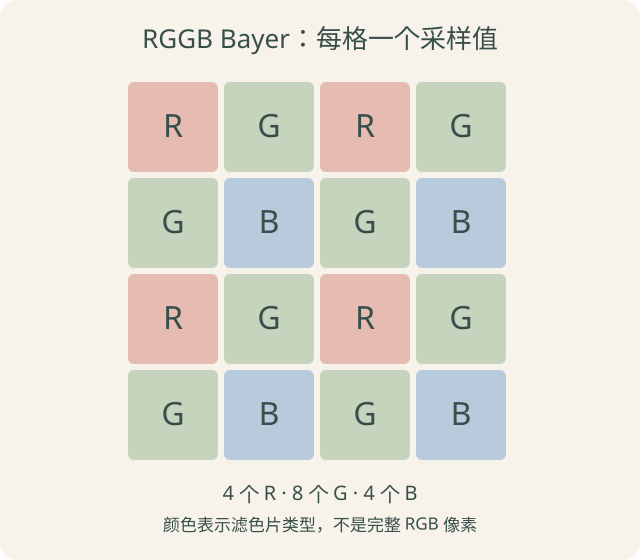

> 2026-10-13 正式发布，练习参考答案已补齐：ISP 基础系列第一篇，介绍常见单传感器 Bayer 彩色相机的成像基础。只解释概念与影响，不涉及参数设置、芯片寄存器、厂商工具或调参流程。可以与模型训练章节并行学习。

在[《图片如何变成张量》](/posts/vision-04-image-tensor.html)中，图片经过解码后，每个像素有 R、G、B 三个值。但摄像头最初产生的数据，通常还不是这种形式。

这一篇先回答三个问题：光怎样变成数值？数值的大小由什么影响？为什么传感器的一个采样位置通常没有完整的 RGB 三个值？

## 先看整条链路的位置

```text
场景中的光 → 镜头 → 传感器感光、读出与数字化 → RAW
                                                   ↓
                                               ISP 处理
                                                   ↓
                                              RGB／YUV 图像
                                                   ↓
                                          显示、编码或模型预处理
```

ISP 是 Image Signal Processor，即图像信号处理器，也常用来指相关图像处理流程。它接收传感器相关数据，进行颜色重建、校正等处理，形成后续环节需要的图像。

这是一张逻辑流程图，不表示每一步必须对应一个独立芯片。有的传感器或相机内部已经集成部分处理；应用拿到的数据可能已经是处理后的 RGB 或 YUV。本篇聚焦到 RAW 形成这一步，下一篇再展开 ISP 的典型处理环节。

## 传感器怎样把光变成数字

可以把传感器先看作由许多感光单元排列成的二维阵列。每个单元对应画面中的一个采样位置。

光经过镜头落到感光区域，光子在半导体中产生电荷。电路把收集到的电荷转换成可读出的信号，再经过模数转换器 ADC，将模拟信号量化成整数。具体电路结构因传感器而异。[传感器工作原理参考](https://www.edmundoptics.com.sg/knowledge-center/application-notes/imaging/understanding-camera-sensors-for-machine-vision-applications/)

```text
到达的光 → 累积的电荷 → 读出的模拟信号 → ADC → 数字采样值
```

例如某个位置得到 700，这个数首先是当前成像链路下的数字码值，不是“700 个光子”，也不能直接解释成某个物体固定的亮度。曝光时间、滤色片响应、增益、偏置与噪声等都会影响结果。

这里的“传感器像素”指感光采样位置；后面 RGB 图像中的“像素”指保存完整颜色分量的位置。两者相关，但包含的数据不同。

## 曝光：在多长时间内收集光

曝光时间表示一次采样收集光的时间长度。可以暂时用“拿小桶接雨水”来理解：雨的强弱类似到达的光强，接多久类似曝光时间，桶里的水量类似累积电荷。

在光照稳定、其他条件不变、没有饱和等理想条件下，曝光时间更长通常能收集更多电荷，输出信号也会更大。考虑去掉固定偏置后的有效信号，可以做一个仅用于理解的假设：

```text
收集 1 份时间：信号约 100
收集 2 份时间：信号约 200
```

真实输出不一定严格翻倍，也不能无限增加。感光单元能容纳的电荷以及后续电路、数字范围都有上限，超过可表达范围会饱和或被截断。

曝光期间如果物体或相机移动，同一个采样位置可能累积不同位置的光，产生运动模糊。所以“更亮”和“细节更清楚”不是同一件事。[曝光与运动模糊说明](https://docs.baslerweb.com/optimizing-image-quality)

帧率则是一秒输出多少帧，与单帧曝光时间不是同一个概念。具体设备的曝光、读出与帧周期关系取决于实现，本篇不展开时序设置。

## 增益：放大已有信号

曝光改变收集光的过程；增益改变已有信号的放大程度。常见的两类是：

| 类型 | 大致位置 | 做什么 |
| --- | --- | --- |
| 模拟增益 | ADC 之前 | 放大模拟信号 |
| 数字增益 | ADC 之后 | 对数字值进行缩放 |

实际设备可能包含多个增益环节。这里先掌握 ADC 前后这一差别。[增益定义参考](https://docs.baslerweb.com/gain)

例如把已有信号理想化地乘以 2，并没有让传感器重新收集到两倍的光子。信号中已有的部分噪声也可能一起被放大；读出电路和量化带来的影响，还与增益所在位置有关。

因此不能把“放大信号”直接当作“恢复丢失细节”，也不能简单认为模拟增益与数字增益在噪声上总是等价。本篇只建立概念，不给出增益大小的选择建议。

## 为什么暗处和亮处都可能丢细节

常见噪声来源包括光子到达的随机波动、读出电路等。暗处信号少时，噪声相对于有效信号更明显，两个相近的细节可能难以分辨。

亮处则可能达到饱和：不同程度的强光都被记录成接近上限的值，区别被压没了。之后降低图像亮度，也不能仅靠缩小这些数恢复已经截断的差异。

先记住两个边界：暗部可能受噪声限制，亮部可能受饱和限制。动态范围大致描述系统能区分的暗到亮的范围；它受传感器和整条链路影响，不能只看位深判断。

没有光时输出也不一定恰好为 0，可能存在黑电平偏置与噪声。黑电平校正的作用放在第二篇讲。

## 位深：一个采样值能用多少级数字表示

本篇使用无符号整数示例。若一个采样值有 n 个有效二进制位，就有 `2^n` 个可能码值：

| 位深 | 可表示的级数 | 码值范围 |
| --- | --- | --- |
| 8 bit | 256 | 0～255 |
| 10 bit | 1024 | 0～1023 |
| 12 bit | 4096 | 0～4095 |

级数与最大值差 1，因为从 0 开始计数。更多位可以提供更多量化级，但不保证每一级都含有可靠的场景信息；噪声和饱和仍然存在。

传感器数字化位深、内部处理位深和对外输出格式的位深也可能不同。例如使用较高位深采样的相机，可以输出较低位深格式。[传感器位深说明](https://docs.baslerweb.com/sensor-bit-depth)

### 10 bit 不一定在内存中只占 10 位

联系你熟悉的 C/C++：一个 0～1023 的值可以放进 `uint16_t`。有效数值只有 10 bit，但容器占 16 bit，也就是 2 字节。

还可以把多个采样值紧密打包，称为 packed 格式。假设没有行填充、元数据和其他开销，4 个 10 bit 样本共 40 bit，紧密存储就是 5 字节；分别放入四个 16 bit 容器则是 8 字节。

这只是容量计算，不规定具体 RAW10 字节排列。解析真实缓冲区还需要知道格式、有效位位置、字节序以及每行跨度 stride，不能只凭“10 bit”就转换成 `uint16_t*`。[像素格式与打包说明](https://docs.baslerweb.com/pixel-format)

## Bayer：一个位置先测一种滤色响应

普通感光单元本身不能像最终 RGB 图像那样，直接同时给出独立的 R、G、B 三个分量。常见单传感器彩色相机在不同感光单元前放置不同的滤色片，形成彩色滤光阵列 CFA。

经典 Bayer 排列在一个 2×2 单元中安排一个 R、两个 G、一个 B，再周期性重复。以 RGGB 为例：



图中 R、G、B 表示滤色片类型，不是这些格子已经保存完整的红、绿、蓝像素。滤色片的光谱响应有重叠，也不是只允许某一个精确波长通过。[Bayer 阵列说明](https://www.phaseone.com/inspiration/bayer-pattern-technology/)

例如一个 4×4 Bayer 阵列共有 16 个采样位置，通常每个位置记录一个值，因此有 16 个数；并不是 16×3=48 个数。

同样尺寸的 RGB 图像，每个位置存放三个分量，才会有 48 个数。去马赛克会利用邻域采样估计每个位置缺少的颜色分量。常规全尺寸重建仍可得到 4×4 RGB 图像，不是必然把每个 2×2 块合成一个像素、缩成 2×2。

### RGGB 不是唯一排列

从当前图像左上角开始观察，常见 2×2 模式有：

```text
RGGB        BGGR        GRBG        GBRG
R G         B G         G R         G B
G B         G R         B G         R G
```

其中两个 G 位于不同空间位置，都是绿色滤色采样，不是 RGB 图像出现了第四种颜色通道。两个 G 的具体差异与处理放到后续再讨论。

裁剪起点和翻转等操作可能改变输出图像对应的 Bayer 模式，不能永远假设左上角是 R。并非所有彩色传感器都使用经典 Bayer；本篇先限定在这个常见情形内。

## RAW 究竟是什么

本篇的 RAW 指靠近传感器采样形式、尚未完成通常彩色图像重建的数字数据。以 Bayer RAW 为例，它携带各位置的单个滤色采样值，通常还需要 Bayer 模式、位深等信息才能正确解释。

RAW 不是全世界统一的一种文件格式，也不保证完全未经处理。某些设备在输出所谓 RAW 前已经做了部分校正；也存在单色 RAW、其他滤色排列等形式。因此不能把“RAW”和“Bayer”视为同义词。

理解一份 Bayer RAW 缓冲区时，至少需要分清：

| 信息 | 解决的问题 |
| --- | --- |
| 宽、高 | 有多少采样位置 |
| Bayer 模式 | 每个位置对应哪种滤色片 |
| 有效位深 | 数字值的表示范围 |
| 存储方式与有效位位置 | packed 还是放在更大的容器中 |
| 行跨度与字节序等格式信息 | 怎样从字节找到正确的值 |

这里不是要求立刻写 RAW 解析器，而是理解：一串字节本身不足以告诉你如何还原图像。

### 为什么不能直接把 RAW 当 RGB 显示

如果把 Bayer 每个值直接当灰度画出来，看到的是不同滤色位置的采样强度，不是正确重建的彩色图像。即使完成去马赛克，通常还需要白平衡、颜色校正和色调处理等步骤，才能获得适合显示的结果。

之前用 Pillow 打开 PPM、转换 RGB 的过程，不等于实现了传感器 RAW 处理。RGB 图片中的 `[255, 128, 0]` 是同一像素的三个分量；Bayer 中相邻的 R、G、B 采样来自不同位置，不能直接随手拼成同一个位置的 RGB。

## 一个小例子：数值个数与字节数分开算

假设一张 **4×4、10 bit、RGGB Bayer RAW**，不计任何额外开销：

```text
采样位置数：4×4 = 16
R 位置：4 个；G 位置：8 个；B 位置：4 个
采样值总数：16 个
紧密打包容量：16×10÷8 = 20 字节
每值用 16 bit 容器：16×2 = 32 字节
```

如果后来重建为 4×4 RGB，每通道使用 8 bit 存储：

```text
通道值总数：4×4×3 = 48 个
纯像素数据容量：48×1 = 48 字节
```

这些是理想化的有效数据容量，不是相机缓冲区或文件大小的通用公式。真实存储可能还有对齐、文件头、元数据或压缩。

## 课后练习

三道短题只检查概念，不涉及调参。2026-10-12 已补齐默认折叠的参考答案，供复习使用，不作为个人作答记录。

### 练习 1：数清 Bayer 采样

一张 6×4 的 RGGB Bayer 图像，宽 6、高 4：有多少采样位置？R、G、B 各有多少位置？原始采样值共有多少个？如果重建成同尺寸 RGB，通道值又是多少个？

<details class="exercise-answer">
<summary>点击查看第一题参考答案</summary>

**参考答案**

- 采样位置：`6×4=24` 个。
- 完整的 RGGB 2×2 单元：`(6÷2)×(4÷2)=6` 个。
- 每个单元含 1 个 R、2 个 G、1 个 B，因此 R 为 6 个，G 为 12 个，B 为 6 个。
- RAW 每个位置记录一个值，共 24 个采样值。
- 重建为同尺寸 RGB 后，共 `6×4×3=72` 个通道值。

这里从 24 个采样值得到 72 个 RGB 分量，并不意味着测到了额外的独立光信号。缺少的颜色分量需要通过邻域信息估计。

</details>

### 练习 2：有效位深与存储容器

沿用上题，假设每个 RAW 采样值为 12 bit。写出最大码值、无额外开销时紧密打包的字节数，以及使用 `uint16_t` 保存每个值时的字节数。解释为什么用了 `uint16_t` 不代表传感器提供了 16 bit 的有效数据。

<details class="exercise-answer">
<summary>点击查看第二题参考答案</summary>

**参考答案**

```text
最大码值：2¹² - 1 = 4095
紧密打包：24 × 12 ÷ 8 = 36 字节
使用 uint16_t：24 × 2 = 48 字节
```

12 bit 描述每个样本的有效位深；`uint16_t` 是保存它的容器，占 16 bit。容器更大不会自动增加传感器的有效量化级数。具体有效位位于容器的哪些位置，仍取决于格式。

本题不计行对齐、文件头等额外开销，所以计算的是理想的数据容量。

</details>

### 练习 3：解释四句话

判断并说明原因：

1. 延长曝光与数字信号乘以 2，本质上都是增加了收集到的光子。
2. Bayer 每个位置只有一个值，因此它就是普通灰度图。
3. 12 bit 图像一定比 8 bit 图像细节更多、噪声更少。
4. 某处已经饱和截断，只要之后把数值降低，就能恢复原来的亮部细节。

<details class="exercise-answer">
<summary>点击查看第三题参考答案</summary>

**四句话均不正确。**

1. **曝光与数字增益不同。** 在其他条件不变时，延长曝光增加收集光的时间；数字信号乘以 2 只改变已经得到的数值，不会补充采集时的光子。
2. **单值不等于普通灰度。** Bayer 不同位置经过不同滤色片，测到的是不同的光谱响应；相邻值并不都代表同一种灰度测量，需要结合 Bayer 模式理解。
3. **位深不能单独决定画质。** 12 bit 提供更多可表示的码值，但实际细节和噪声还受光照、传感器、曝光、镜头及处理等影响，不能保证优于任何 8 bit 图像。
4. **缩小数值不能恢复截断的信息。** 两个不同的强信号若都截成同一个最大值，之后同时乘以较小系数仍是同一个值。单靠降低数值无法重新区分原来丢失的差异。


</details>

## 下一篇

下一篇[《ISP 基础：ISP 怎样形成图像》](/posts/isp-image-pipeline.html)从这些 RAW 采样出发，解释黑电平、坏点、去马赛克、白平衡及其他处理环节各自解决什么问题。继续以概念为主，不进入具体设备的调参流程。
