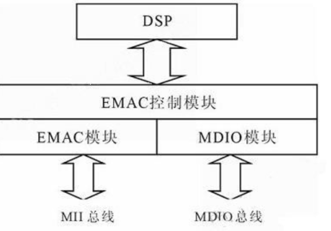

MDIO 的核心作用是 以太网 PHY 芯片的管理与配置，是 CPU / 以太网 MAC 与 PHY 芯片之间的 “控制通道”。
# 一、MDIO 的核心定位
MDIO 全称 Media Independent Interface Management Data Input/Output，中文是“介质无关接口管理数据输入/输出”。
- 它是一套 **标准的双线串行总线**（一条时钟线 MDC，一条数据线 MDIO）。
- 专门用于连接 **以太网MAC控制器**（如内核中的`eth0`对应的硬件模块）和 **PHY芯片**（物理层芯片，负责电信号收发）。
- 核心目的：让CPU/MAC通过这条总线，读取或配置PHY芯片的工作参数，无需直接操作PHY的硬件引脚。

# 二、MDIO 的主要用途（核心功能）
1. **PHY 芯片识别与枚举**
   - CPU通过MDIO读取PHY芯片内部的“标识寄存器”（如OUI、芯片型号寄存器），确认当前连接的PHY型号。
   - 支持总线上挂多个PHY（通过PHY地址区分，最多32个），内核可通过MDIO枚举所有已连接的PHY。

2. **链路状态监测**
   - 实时读取PHY的“状态寄存器”，获取网线连接状态（插/拔）、链路速率（10M/100M/1G）、双工模式（全双工/半双工）。
   - 这些状态会反馈给MAC和内核网络子系统，用于动态调整网络配置（如`ethtool`命令查看的链路信息，就来自MDIO读取）。

3. **PHY 工作参数配置**
   - 配置链路速率和双工模式（强制1G全双工，或自动协商）。
   - 启用/禁用PHY功能（如自动协商、节能模式、环路测试模式）。
   - 配置PHY的中断引脚、LED指示灯（如网线连接时LED常亮，数据传输时闪烁）。

4. **故障诊断与复位**
   - 读取PHY的错误寄存器，定位链路故障（如CRC错误、信号丢失）。
   - 通过MDIO发送复位命令，重启PHY芯片（解决链路异常时的常用手段）。

### 三、内核中的 MDIO 相关实现
- **驱动路径**：内核中MDIO总线驱动位于 `drivers/net/phy/mdio_bus.c`，PHY芯片驱动位于 `drivers/net/phy/`（如通用PHY驱动 `genphy.c`）。
- **ARM架构适配**：ARM平台的MAC控制器（如SGMII、GMAC）会通过设备树（DTB）声明MDIO总线节点，内核通过MDIO驱动解析该节点，建立与PHY的通信。
- **使用场景**：当内核启动网络子系统时，会通过MDIO总线初始化PHY，完成链路协商后，以太网接口（如`eth0`）才能正常工作。

