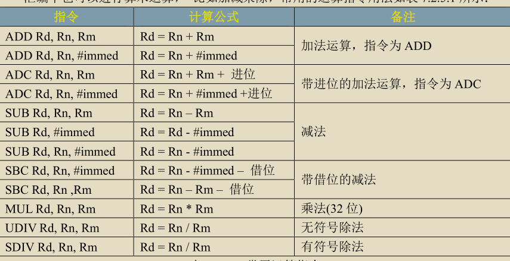
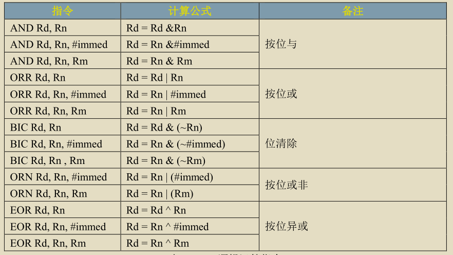
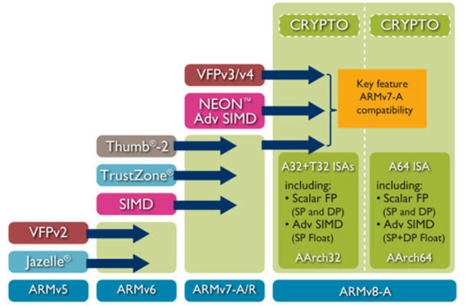

# 0、常用指令
## 0-1、GNU汇编语法：
label:instruction @comment
label:标号，表示地址位置，有的指令前面有标号，通过标号来定位指令位置。
也可以用来表示数据地址,任何以:开头的标号都是数据地址。
instruction:指令，表示一条指令。也可以是伪指令。
@comment:注释，表示对指令的说明。

用户可以使用.section指令来自定义一个段，汇编系统自定义了一些段名字。
.text:定义一个代码段。
.data:定义一个初始化的数据段。
.bss:定义一个未初始化的数据段。
.redata:定义一个只读的只读数据段。

程序默认入口__start,也可以使用链接脚本中ENTRY指令指定程序入口。
```s
.global __start
__start:
    b main
```
.global:全局指令，表示定义一个全局标号。相当于C语言中的extern，全局变量
.byte:定义一个字节，相当于C语言中的char。
.short:定义一个字，相当于C语言中的short。
.long:定义一个双字，相当于C语言中的int。
.equ:定义一个字节，.equ num,0x12 。相当于C语言中的num=0x12。
.align:对齐指令，表示对齐。
.end:表示源文件结束。

GNU汇编函数
```s
函数名:
    函数体
    返回语句
```
## 0-2、移动指令
处理器做的最多的事情就是在处理器内部来回传数据
* 将数据从一个寄存器传送到另一个寄存器
* 将数据从一个存储器传到另一个特殊的存储器，如cpsr寄存器。spsr寄存器。
* 将立即数立刻加载到寄存器

### 0-2-1、MOV指令
```s
MOV R0, R1 @将R0寄存器的内容赋值给R1寄存器。
MOV R0, #12 @将立即数12赋值给R0寄存器。
```
### 0-2-2、MRS指令
```s
MRS R0, CPSR @将cpsr寄存器的内容赋值给R0寄存器。R0=cpsr寄存器的内容。
```
### 0-2-3、MSR指令
```s
MSR CPSR_c, R0 @将R0寄存器的内容赋值给cpsr寄存器的内容。
```
## 0-3、压栈、弹栈
```s
PUSH {R0, R1} @将R0和R1寄存器的内容压入栈中。
PUSH {R0} @将R0寄存器的内容压入栈中。
POP {R2, R3} @将栈中的内容赋值给R2和R3寄存器。
POP {R2} @将栈中的内容赋值给R2寄存器。
```
## 0-4、存储器访问指令
对寄存器、存储器存取数据，无法直接用mov等指令来操作，需要采用特殊的指令来操作。
方法：将值写入通用寄存器Rx（x=0~12）中。然后借助指令，将寄存器写入存储器中。
### 0-3-1、LDR指令
```s
LDR R0, =0x12345678 @将存储器地址0x12345678加载到R0寄存器。
LDR R1, [R0] @将存储器地址[R0]的内容赋值给R1寄存器。
```
和MOV有区别
### 0-3-2、STR指令
```s
LDR R0,=0x12345678 @将R0寄存器的内容赋值给存储器地址0x12345678。
LDR R1,=0x11111111 [R0] @将R0寄存器的内容赋值给存储器地址0x12345678。
STR R1, [R0] @将R1寄存器的内容赋值给存储器地址[R0]。
```
## 0-5、跳转指令
跳转指令：
* b:跳转到标号处执行。
* bl:跳转到标号处执行，并保存当前程序地址。
* bx:跳转到寄存器中存储的地址处执行。
```s
b label @跳转到标号处执行。
bl label @跳转到标号处执行，并保存当前程序地址。
bx R0 @跳转到寄存器中存储的地址处执行。
```
例程
```s
.global __start
__start:
    ldr r0, =0x12345678  @ 将立即数 0x12345678 装载到 R0
    ldr r1, =0x20000000  @ 将立即数 0x20000000 装载到 R1
    str r0, [r1, #0x10]  @ 将 R0 的内容存储到 R1 + 0x10 的地址处
    b .                  @ 无限循环，防止程序退出
```
## 0-6、算数运算


## 0-7、逻辑运算

# 1、arm到底是干啥的？
任何一款ARM芯片都由两大部分组成：ARM内核，外设。

* ARM内核 
ARM内核：包括了寄存器组、指令集、总线、存储器映射规则、中断逻辑和调试组件等。
内核是由ARM公司设计并以销售方式授权给个芯片厂商使用的（ARM公司本身不做芯片）。
比如为高速度设计的Cortex A8、A9都是ARMv7a 架构;
Cortex M3、M4是ARMv7m架构;前者是处理器（就是内核），后者是指令集的架构（也简称架构）。
外设部分包括计时器、A/D转换器、存储器、i2c、UART、SPI、ROM...等等，
则完全由各芯片厂商自己设计并与ARM内核衔接配套。
不同的芯片厂商就有不同的外设，因此构成了数量和规格庞大的ARM芯片产业。        


* ARM指令集架构
指令集的设计是处理器结构中最重要的一个部分，用ARM的术语称之为ISA（Instruction Set Architecture）。指令集可以说是cpu设计的灵魂，是打开CPU这个潘多拉魔盒的咒语，要想使用cpu，
我们只能通过这些指令来操作cpu。对于32位的cpu，这些指令就是一个个32位的01的序列，
不同的值就代表了不同的机器指令，cpu的硬件能完美的解析并执行这些指令，比如寻址、运算、异常处理等等。
当我们用手机玩着王者荣耀的时候，要知道我们的每发的一招，其实最终都是被翻译成了一系列机器指令。
从1985年ARMv1架构诞生起，到2011年，ARM架构已经发展到了第八代ARMv8。
Cortex-A32/35/53/57/72/73/77/78采用的都是ARMv8架构，
这是ARM公司的首款支持64位指令集的处理器架构。



ARM11就是ARMv6，之后都是ARMv7版本。从ARMV7开始，命名方式就有所改变。
新的处理器家族，改以Cortex命名，并分为三个系列，分别是Cortex-A，Cortex-R，Cortex-M。
很巧合，又是这三个字母A、R、M。

* Cortex-A系列（A：Application）
针对日益增长的消费娱乐和无线产品设计，用于具有高计算要求、
运行丰富操作系统及提供交互媒体和图形体验的应用领域，
如智能手机、平板电脑、汽车娱乐系统、数字电视，智能本、
电子阅读器、家用网络、家用网关和其他各种产品。

* Cortex-R系列 （R：Real-time）
针对需要运行实时操作的系统应用，面向如汽车制动系统、动力传动解决方案、
大容量存储控制器等深层嵌入式实时应用。
* Cortex-M系列（M：Microcontroller）该系列面向微控制器领域，
主要针对成本和功耗敏感的应用，如智能测量、人机接口设备、汽车和工业控制系统、
家用电器、消费性产品和医疗器械等。
* Cortex-SC系列（SC：SecurCore）其实，除了上述三大系列之外，
还有一个主打安全的Cortex-SC系列（SC：SecurCore），主要用于政府安全芯片。

## 1-1、什么是soc
SoC的全称叫做：System-on-a-Chip，中文的的意思就是“把系统都做在一个芯片上”。
SoC上集成了很多手机上最关键的部件，
比如CPU、GPU、内存、也就说虽然它在主板上的存在是一个芯片，但是它里边可是由很多部件封装组成的。
比如通常我们所说的高通801，麒麟950，三星的exynos 4412，A6等等。
都只是系统部件打包封装（SoC）后的总称。然而各家的打包封装的内容则不尽相同，原因也不尽相同。

经典的ARM系统级芯片或所谓的Soc包含许多组件，其中只有一些直接源自ARM。
首先，核心本身通常深度嵌入在设备内部，在设备范畴内通常不直接可见，
而调试端口通常是唯一和核心本身相连的外露部分，有一些粘合逻辑，如时钟和复位集成电路。
由于 ARM 核心只有两个中断输入，最常见的外设就是某种中断控制器，在外设内部，
各组件通过芯片上互联总线架构相互连接，对于极大多数基于ARM的设备而言，这就是标准的 AMBA 互联。
AMBA 指定了两个总线，称为AXI的高性能系统总线，和称为APB的低功耗外设总线，
APB通常用于连接所有外设，AXI则用于存储器和其他发高速设备，
大多数设备都有一定数量的芯片上存储以及连接外设存储器设备的接口，
但是注意，与设备的外部连接并不是AMBA总线，这仅在设备内部使用，并不外露。

## 1-2、ARM授权
* 如何来理解ARM授权呢？
就比如我们制造汽车，ARM公司相当于拥有最先进的的'发动机'设计方案，
但是他不'生产发动机'，而是把设计方案授权给各大'汽车厂商'生产，
赚来的钱继续研发更先进的‘发动机’。
* ARM授权分为ARM架构授权、IP核授权、使用层级授权。
一个公司若想使用ARM的内核来做自己的处理器，比如ST、苹果、三星、TI、高通、华为等等，
必须向ARM公司购买其架构下的不同层级授权，根据使用需要购买相应的层级授权。
架构的授权方式有三种：架构层级授权、内核层级授权(ip核授权)、使用层级授权。
*  1.架构层级授权，是指可以对ARM架构进行大幅度改造，甚至可以对ARM指令集进行扩展或缩减，
苹果就是一个很好的例子，在使用ARMv7-A架构基础上，扩展出了自己的苹果swift架构；
* 2.内核层级授权，是指可以以一个内核为基础然后在加上自己的外设，比如USART、GPIO、SPI、ADC等等，
最后形成了自己的MCU，这种公司很多，比如三星、TI;
* 3.使用层级授权，要想使用一款处理器，得到使用层级的授权是最基本的，
这就意味着你只能拿别人提供的定义好的ip来嵌入在你的设计中，不能更改人家的ip，
也不能借助人家的ip创造自己的基于该ip的封装产品。因此，如果华为分别拿到架构授权和ip核授权，
那么意味着它可以在ARM指令集基础上根据需要创建出自己的内核架构，
并可添加各种片内外设比如通信接口、显示器控制接口、GPIO等等，从而生产出自己的“处理器芯片”。
其实就像我写了一篇文章，我告诉甲，你可以拿去修改后使用，便是架构层级授权，我告诉乙，
你可以在你的文章中引用我的文章，便是内核级授权，我告诉丙，你只能对我的文章进行转发，
不能更改，不能添油加醋，便是使用层级授权。

* 总结：ARM公司的名字，叫ARM：Advanced RISC Machines；
1、ARM前身Acorn公司设计的第一款微处理器，叫ARM：Acorn RISC Machine；
2、ARM处理器名字：以前叫ARM9、ARM11,
3、新的命名规则改以Cortex命名，分别是Cortex-A，Cortex-R，Cortex-M；
4、这三个字母A、R、M合到一起又是ARM。ARM指令集，就是ARM架构，比如ARMv8，
5、每个处理器都需要依赖一定的ARM架构来设计；
6、SOC：各大厂商买来ARM的授权，得到ARM处理器的源代码，而后自己搞一些外围设备的IP（或者买或者自己设计），组成一个SOC，比如三星的Exynos 4412，华为的麒麟990。