* 数据的物理结构     
数据存储在存储器当中，而存储器相当于内存而言，而光盘，软盘，硬盘等外部存储器的数据组织通常用文件结构来描述。
* 数据存储的形式有两种：顺序式和链式。、
* 算法的五个特征：输入，输出，有穷性，确定性和可行性。   
  | 特征 | 解释 |
  | :------: | :------: |
  | 输入 | 0个或者多个 |
  | 输出 | 一个或者多个输出 |
  | 有穷性 | 不会无限循环 |
  | 确定性 | 确定性不会有其他含义 |
  | 可行性 | 每一步都是可行的 |

* 算法的设计要求   
  1、没有语法错误。   
  2、算法程序对于合法输入能够产生满足要求的输出。   
  3、算法程序对于非法输入能产生满足规格的说明。  
  4、算法对于故意刁难的测试输入都有满足要求的输出结果。

可读性   
   需要便于后续的修改阅读  

健壮性   
  输入不合理时，算法能够有相应的处理，而不是产生异常、崩溃或者莫名奇妙的结果。   
   时间效率高和存储量


   
# 1、时间复杂度
关键在于认识： 时间=执行次数
T(n)=O(f(n));
这样就可以用O来记时间复杂度
一般情况下，随着输入规模n的增大，T(n)增长最慢的算法为最优算法。
常见的时间复杂度O(1),O(n),O(n^2),O(log(n)),O(nlog(n)),O(n^3),O(2^n),O(n!),O(n^n)

# 2、空间复杂度
关键在于认识： 空间=占用内存
一般不关注。

# 3、线性表
判断方法：如果存在多个元素，且每个元素都有唯一的一个前驱和后继，则该数据结构为线性表。头无前驱，尾无后继。
对数据的操作：增删改查。
```cpp
#include<iostream>
using namespace std;
void test(int value)
{
    value = 2;
    cout << value << endl;
}
int main ( )
{
    int x = 1;
    cout << x << endl;
    test ( x );
    cout << x << endl;
}

```

这里函数修改了元素值，却没有带回来原因是：传递时，test函数里的x是从main中的x复制过来的，所以修改了x的值，但test函数里的x并没有改变。

如果想将参数的结果带回来，需要传入参数的应用“&”。
团队中，自己定义的数据结构如果要让人很方便的使用，自己就必须进行函数封装，方便调用。避免出错。


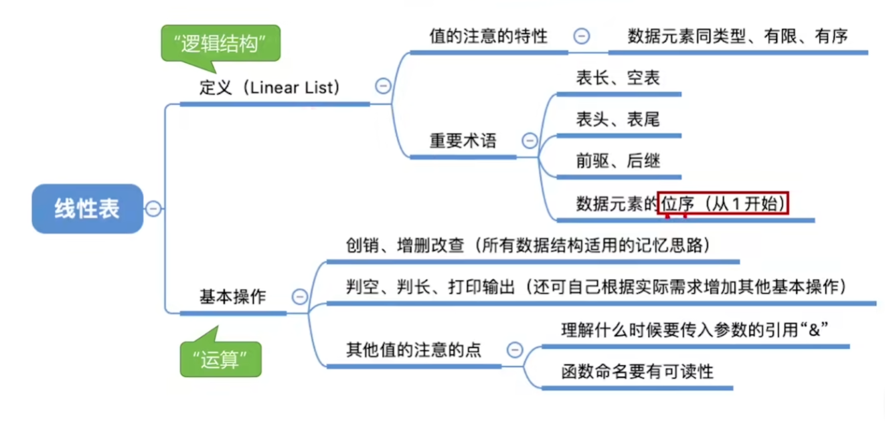

## 3.1、顺序表
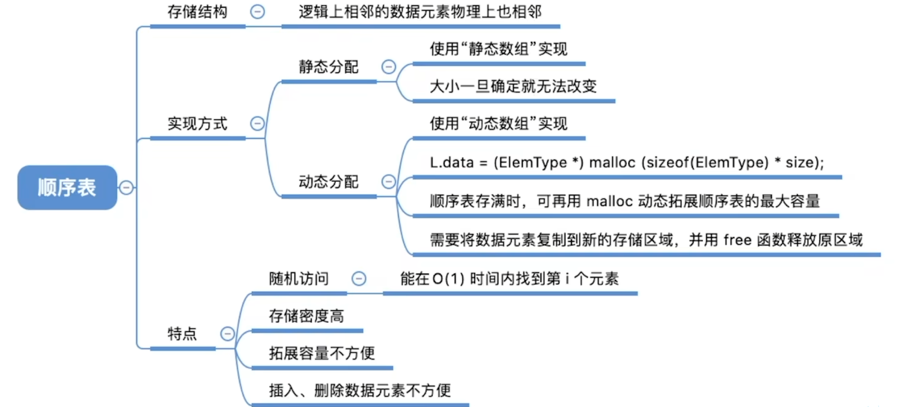

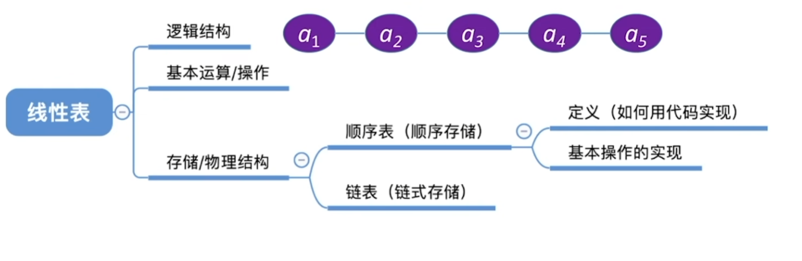

顺序表的实现 -- 静态分配
```cpp
#define maxsize 10 // 定义最大容量
typedef struct
{
    elemtype data[maxsize]; // 定义表类型数组
    int length; // 表当前的长度
}SqList; //顺序表的定义类型 （静态分配的方式）
```

```c

#include <stdio.h>
#define maxsize 10 // 定义最大容量

typedef struct
{
 int data[maxsize]; // 定义表类型数组
 int length; // 表当前的长度   
}sqlist; //顺序表的定义类型 （静态分配的方式）

void Initlist(sqlist &L) // 初始化顺序表
{
    L.length = 0; // 初始长度为0
}

int getelem(sqlist &L, int i) // 获取元素
{
    if(i < 1> || i>L.length)
     return -1;
    return L.data[i - 1];
}
int main()
{
    sqlist L; // 定义顺序表
    Initlist(L);

/*  
    尝试打印“违规”操作，
    必须使用L.length进行限制
    for (int i = 0; i < maxsize; ++i)
    {
        printf("%d lendth : %d\n", L.data[i], L.length);
    } 
*/
//正确方法
    for (int i = 0; i < maxsize; i++)
    {
        int b = getelem(L,i);
        printf ("%d\n",b);
    }
    return 0;
}
```
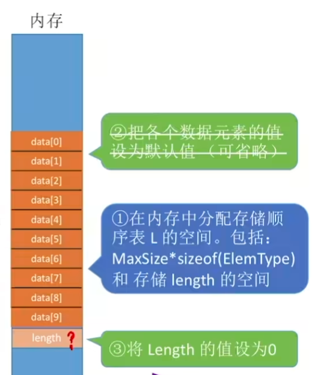

这种分配方式的缺点是：大小无法更改。

就只能采用动态分配的方式。
```cpp
#define InitSize 5 // 定义初始容量
typedef struct
{
    elemtype *data; // 定义表类型数组
    int MaxSize; // 最大容量
    int length; // 表当前的长度
}SqList; //顺序表的定义类型 （动态分配的方式）

```
用c实现
```c
#include <stdio.h>
#include <malloc.h>
#define Initsize  100 // 初始化数组大小

typedef struct 
{
    int *data; //指示动态分配数组的指针
    int maxsize; // 数组的最大容量
    int length; // 数组的当前长度
}sqlist;

void Initlist (sqlist &L)
{
    // malloc 函数申请一片连续的存储空间
    L.data = (int *)malloc(Initsize * sizeof(int));
    L.maxsize = Initsize;
    L.length = 0;
}
void Increasize (sqlist &L, int inc)
{
    int *newdata; // 新分配的数组
    if(inc <= 0) return ;
    newdata = (int *)malloc((L.maxsize + inc) * sizeof(int));
    for (int i = 0; i < L.length; ++i)
    {
        newdata[ i ] = L.data[ i ];
    }
    L.data+=inc;
    free(L.data);

}
int main ()
{
    sqlist L;
    Initlist (L) 
    //...........往顺序表种随便插入几个元素
    Increasize (L,5);
    return 0;
}
```

用c++实现
```cpp

#include <iostream>
using namespace std;

#define InitSize 10

typedef struct {
    int *data;
    int maxsize;
    int length;
}sqlist ;

int  initlist(sqlist &L)
{
    L.data = new int[InitSize];
    if(L.data == NULL)
    {
        return -1;
    }
    L.maxsize = InitSize;
    L.length = 0;
    return 0;
}
int addlist ( sqlist &L , int x )
{
    if ( L.length >= L.maxsize )
    {
        int* newdata = new int[ L.maxsize + x ];
        for ( int i = 0 ; i < L.length ; i++ )
        {
            newdata[ i ] = L.data[ i ];
        }
        delete [] L.data;
        L.data = newdata;
        L.maxsize += x;
    }
    return 0;
}
void adddate ( sqlist& L , int i )
{
    if(L.length >= L.maxsize)
    {
        return ;
    }
    L.data[L.length] = i;
    L.length++;
}
int getelement ( sqlist& L , int i )
{
    if ( i < 1 || i > L.length )
    {
        return -1;
    }
    return L.data[i - 1];
}
int main()
{
    sqlist L;
    initlist ( L );
    for (int i = 0 ; i < 10 ; i++)
    {
        adddate ( L , i);
    }
    addlist ( L , 1 ); //表增加一个空位
    adddate ( L , 10 );
    int k = -1;
    for (int i = 0 ; i < L.length ; i++)
    {
        k = getelement ( L , i + 1 );
        cout << k  << endl;
    }

    //表释放删除
    //·····
    while(1);
}

```
* 顺序表的特点
1、随机访问，时间复杂度为O(1),即通过下标直接访问，效率高。
2、存储密度高，每个节点只存储数据元素。
3、扩展容量不方便（采用动态分配方式实现，时间复杂度较高）。
4、插入、删除操作不方便，需要移动大量的元素。


# 3-1-2、顺序表的插入

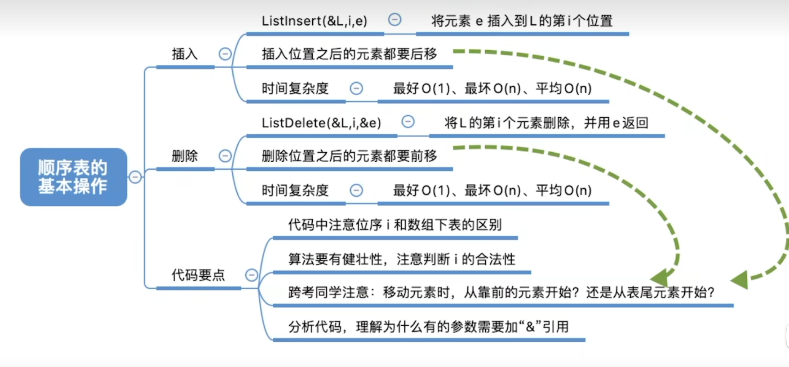
* 顺序表的插入：

```c
#define Maxsize 10 // 定义顺序表的最大容量
typedef struct {
    elemtype data[Maxsize]; // 存储空间
    int length; // 表当前的长度
}SqList;

void Initlist(SqList &L)
{
    sql.length = 0;
}

bool ListInsert(SqList &L, int i, int e)
{
    if (L.length == Maxsize) return false; // 顺序表已满，不能插入
    if (i < 1 || i > L.length + 1) return false; // 位置参数错误

    for (int j = L.length; j >= i; --j)
        L.data[j] = L.data[j - 1];
    L.data[i - 1] = e;
    L.length++;
    return true;
}

int main()
{
    SqList L;
    Initlist(L);
    //...............往顺序表种随便插入几个元素
    bool ret = ListInsert(L, 1, 10); // 在第一个元素之前插入一个值为10的元素
    if(ret == true)
        return 0;
    else
        return -1; 
}

```
顺序表要求插入的时候不能跳跃。

* 时间复杂度情况
最好情况： 插入位置在表尾，时间复杂度为O(1)

最坏情况： 插入位置在表头，时间复杂度为O(n)

平均情况： 插入位置在表中间，时间复杂度为O(n)

* 顺序表的删除
```c
bool ListDelete(SqList &L, int i, int &e)
{
    if (L.length == 0) return false; // 顺序表为空，不能删除
    if (i < 1 || i > L.length) return false; // 位置参数错误
    e = L.data[i - 1];
    for (int j = i; j <= L.length - 1; ++j) // 删除元素后，将后面的元素全部前移
        L.data[j - 1] = L.data[j];
    L.length--; // 删除一个元素，表长度减1
    return true;
}

int main()
{
    SqList L;
    Initlist(L);
    //...............往顺序表种随便插入几个元素
    int e=-1;
    if(ListDelete(L, 1, e) == true)
    {
        cout << "删除的元素为："<<e;
        return 0;
    }
    else
    {
        return -1;
    }

}
```    
函数的传参，需要确定是否需要将参数返回。
不传函数地址或这不取地址，择会重新在内存中复制一份数据。
取地址决定着数据是复制一份还是延用一份。
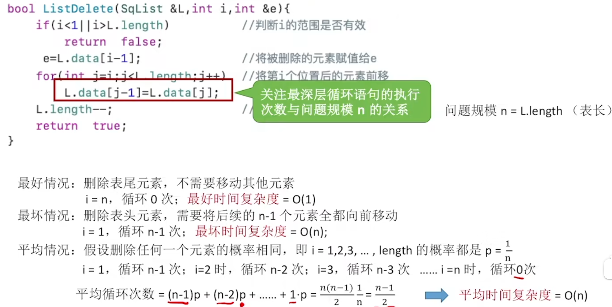

# 3-1-3、顺序表的查找
* 顺序表的按位查找
getElem(SqList L, int i) // 按位查找操作。获取表L中第i个元素的值。

静态：
```c
#define Maxsize 10 // 定义顺序表的最大容量
typedef struct {
    Elemtype data[Maxsize]; // 存储空间
    int length; // 表当前的长度
}SqList;

Elemtype getElem(SqList L, int i) // 按位查找操作。获取表L中第i个元素的值。
{
    return L.data[i - 1];
}
```

动态：
```c
#define InitSize 10 // 定义顺序表的最大容量
typedef struct {
    Elemtype *data; // 存储空间
    int maxsize; // 顺序表的最大容量
    int length; // 表当前的长度
}SqList;

Elemtype getElem(SqList L, int i) // 按位查找操作。获取表L中第i个元素的值。
{
    if (i < 1 || i > L.length)
    {
        return -1; // 位置参数错误，返回-1
    }
    return L.data[i - 1];
    //return *(L.data + i - 1);
}

```

对于malloc得到的内存空间。可以采用数组的方式来进行访问。访问方法和访问普通数组一样。
时间复杂度为O(1)。顺序表随机存取。

* 顺序表按照值查找：
LocateElem(SqList L, Elemtype e) // 按值查找操作。获取表L中第1个值为e的元素位置。
```c
#define InitSize 10 // 定义顺序表的最大容量
typedef struct {
    Elemtype *data; // 存储空间
    int maxsize; // 顺序表的最大容量
    int length; // 表当前的长度
}SqList;

int LocateElem(SqList L, Elemtype e) // 按值查找操作。获取表L中第1个值为e的元素位置。
{
    for (int i = 0; i < L.length; ++i)
        if (L.data[i] == e)
         return i + 1; // 返回该元素在顺序表中的位置
    return 0; // 没有找到
}
```
基本数据类型：int float double char 都可以用==进行比较。

时间复杂度：
最坏情况：O(n)
最好情况：O(1)
平均情况：O(n)

# 3-2、链表
## 3-2-1、单链表的定义

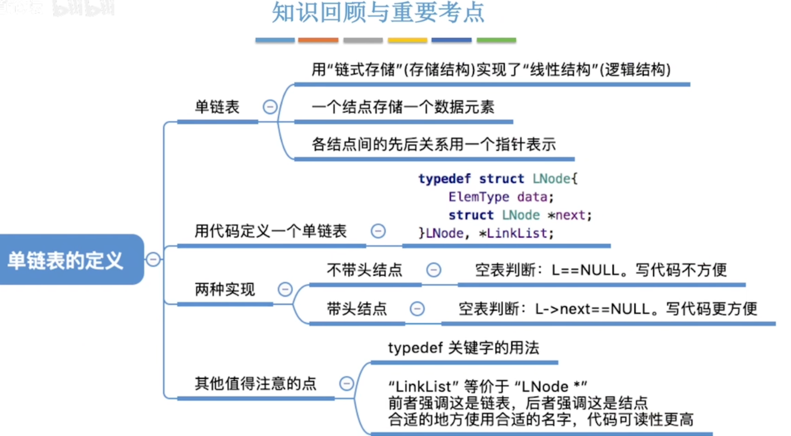

顺序表采用顺序储存，单链表采用链式储存。
```c
typedef struct Node { //节点
    Elemtype data; //数据域
    struct Node *next; //指针域
}  Node,*LinkList;

Node * GetElem(LinkList L, int i)
{
    int j = 1;
    Node *p = L->next;
    if (i < 1) return NULL;
    if (i == 1) return L;
    while (p && j < i)
    {
        p = p->next;
        ++j;
    }
    return p; // 返回第i个节点
}
Node *Linklist; // 定义链表,强调链表
Linklist p; // 定义p，强调节点
```
* 强调这是一个单链表 Linklist
* 强调这是一个节点 Node *

不带头节点的单链表初始化方法:
```c

typedef struct Node {
    Elemtype data;
    struct Node *next;
}Node, *LinkList;

bool InitList(LinkList &L) //取地址是因为需要返回一个链表
{
    L = NULL;
    return true;
}

void main()
{
    LinkList L ;
    InitList(L); // 初始化链表
}

//判断单链表是否为空
bool ListEmpty(LinkList L)
{
    return (L == NULL); // 链表为空，返回true
}
```

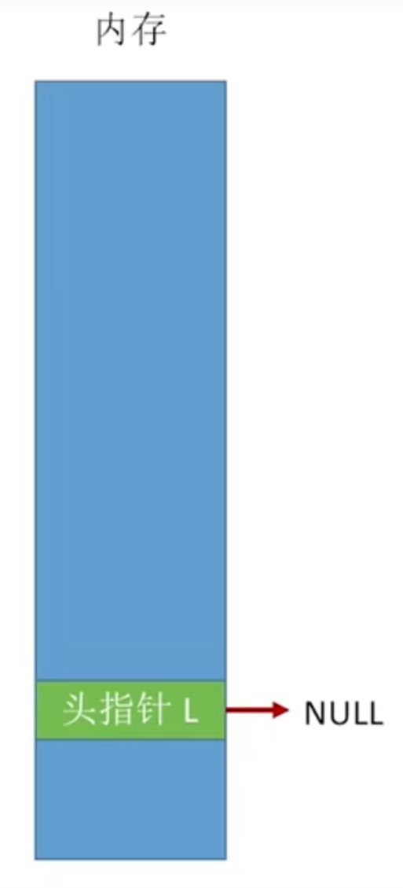

带头节点的单链表初始化方法:
```c
typedef struct Node {
    Elemtype data;
    struct Node *next;
}Node, *LinkList;

bool InitList(LinkList &L) //取地址是因为需要返回一个链表
{
    L = (Node *)malloc(sizeof(Node)); // 初始化头节点
    if (!L) return false;
    L->next = NULL;
    return true;
}

void main()
{
    LinkList L;
    InitList(L); // 初始化链表
}

//判断单链表是否为空
bool ListEmpty(LinkList L)
{
    return (L->next == NULL); // 链表为空，返回true
    // 链表为空，返回true
}
```

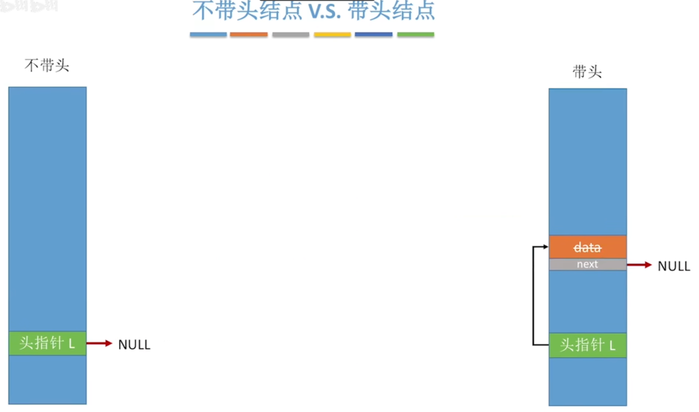
链表不带头节点，操作比较麻烦。

## 3-2-2、单链表的插入和删除

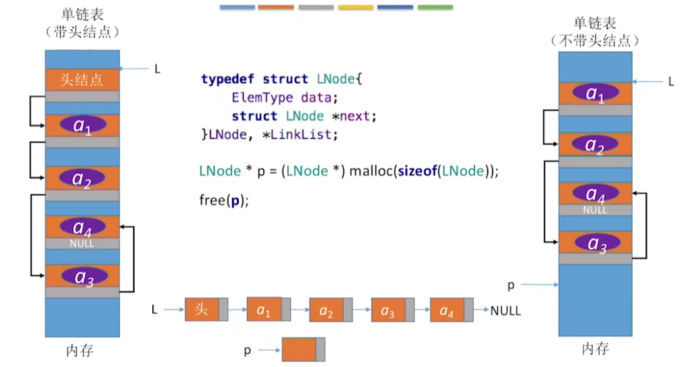

* 带头节点（按位序插入）

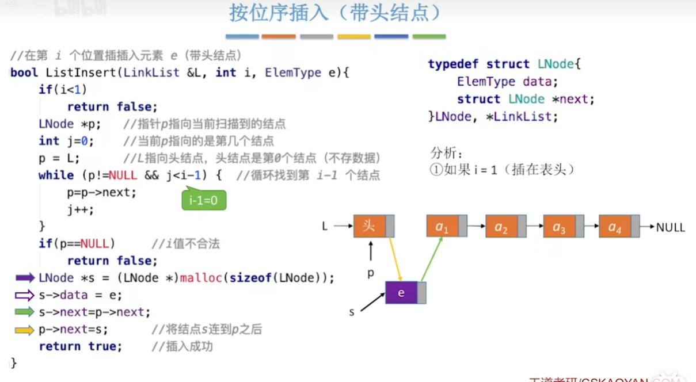

* 不带头节点（按位序插入）
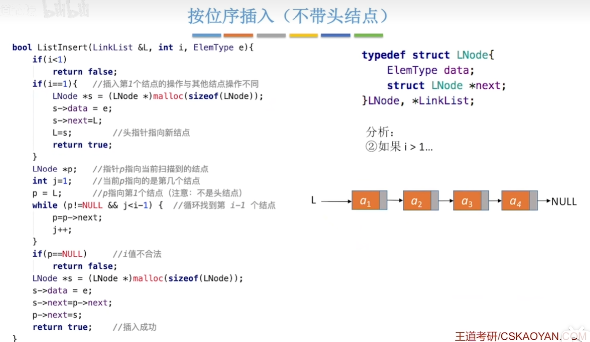

* 指定的结点后插入操作

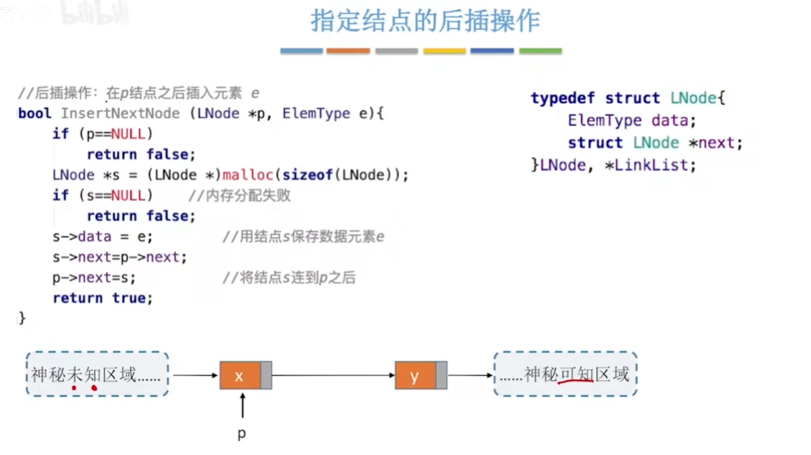

与后面插入操作相比

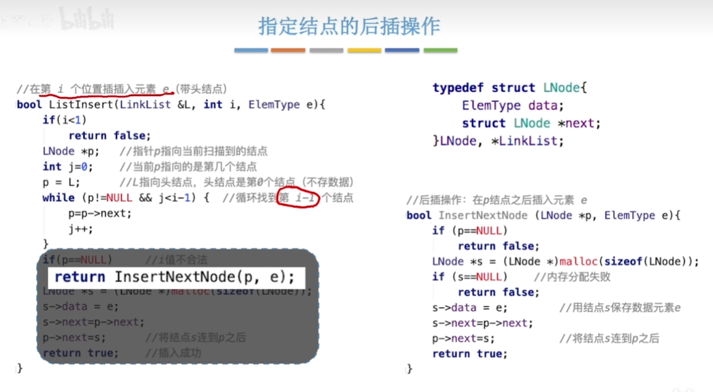

* 指定节点的前插操作 - 1
```c
bool InsertElem(LinkList L, Node *p,ElemTyep e) //前插操作：在节点p的前面插入值为e的节点 ，L位表头指针
然后遍历插入。
时间复杂度：O(1)


```
* 指定节点的前插操作 - 2 (节点没办法跑路。但是数据可以跑路)
```c
bool InsertPriorNode(Lnode *p, Elemtype e) // 前插操作：在节点p的前面插入值为e的节点
{
    if(p == NULL)
    {
        return false; // 参数错误，返回false
    }
    Node *s = (Node *)malloc(sizeof(Node)); // 生成新节点
    if (!s) 
    {
         return false; // 内存分配失败，返回false
    }
    s-next = p->next; // 插入节点
    p->next = s; // 将新节点连接到p的后面
    s->data = p->data; // 讲p的数据赋值给s
    p->data = e; // 将p的数据赋值给e
    return true; // 插入成功，返回true
}
```

.png)

时间复杂度：O(1)

直接传节点方式--原理和带跑数据一样
```c
bool InsertPriorNode(Lnode *p, Node *s) // 前插操作：在节点p的前面插入值为e的节点
{
    if(p == NULL || s == NULL)
    {
        return false; // 参数错误，返回false
    }
    s->next = p->next; // 插入节点
    p->next = s; // 将新节点连接到p的后面
    Elemtype temp = s->data; // 保存数据
    s->data = p->data; // 将p的数据赋值给s
    p->data = temp; // 将s的数据赋值给p
    return true; // 插入成功，返回true

```

* 按位序删除（带头节点）

```c
typedef struct Node {
    Elemtype data;
    struct Node *next;
}Node, *LinkList;
bool ListDelete(LinkList &L, int i,Elemtype &e) // 按位序删除操作,
{
    if( i < 1 )
    {
        return false; // 参数错误，返回false
    }
    Node *p ;// 定义p，指向链表的第i-1个结点
    int j = 0; //当前p的位序
    p = L; // 指向头节点
    while(p! = NULL && j < i-1) // 找到第i-1个结点
    {
        p = p->next; // 指针后移
        ++j;
    }
    if(p ==NULL)
        return false; // 参数错误，返回false
    if(p->next == NULL) //第i-1个结点为尾节点，返回false
        return false; // 参数错误，返回false
   Node *q = p->next; // 定义q，指向第i个结点
   e = q->data; // 将第i个结点的数据赋值给e
   p->next = q->next; // 删除第i个结点
   free(q); // 释放第i个结点
   return true; // 删除成功，返回true
}
```

第二个办法，和带着数据跑插入一样
这次是往要删除的后一个节点的数据赋值到前一个节点，然后删除后一个节点，这样数据就跑到前一个节点了。
```c
bool ListDelete(node *p) // 按位序删除操作,
{
    if(p == NULL || p->next == NULL) //第i-1个结点为尾节点,只能从表头开始遍历
    {
        return false; // 参数错误，返回false
    }
    Node *q = p->next; // 定义q，指向第i个结点
    p->data = q->data; // 将第i个结点的数据赋值给e
    p->next = q->next; // 删除第i个结点
    free(q); // 释放第i个结点
    return true; // 删除成功，返回true
}

```
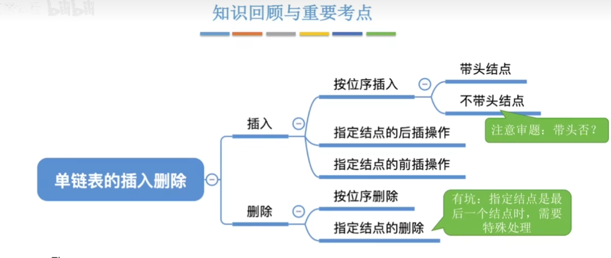


## 3-2-3、单链表的查找
* 1、按位查找
```c

/// 按位查找操作,返回第i个结点的数据（带头节点）
Node *GetElem(LinkList L, int i) // 按位序查找操作
{
    if(i < 0)
    {
        return NULL; // 参数错误，返回NULL
    }
    Node *p; //指针p指向当前扫描到的节点
    int j=0; //当前p指向第几个节点
    p=L; // 指向头节点
    while(p != NULL && j < i) // 找到第i个结点
    {
        p = p->next; // 指针后移
        ++j;
    }
    
    return p; // 返回第i个结点
}

```
平均时间复杂度：O(n)

2、按值查找
```c
/// 按值查找操作,返回值为e的结点（带头节点）
Node *LocateElem(LinkList L, Elemtype e) // 按值查找操作
{
    Node *p; // 定义指针p，指向当前扫描到的节点
    p=L->next; // 指向头节点
    while(p != NULL && p->data != e) // 链表不为空
    {
        p = p->next; // 指针后移
    }
    return p; // 返回值为e的结点
}


```
## 3-2-4、单链表的建立

### 3-2-4-1、尾插法
* 方法：创立一个头节点。设置一个指针，永远指向尾节点。
```c
bool InsertNewElem(Node *p, Elemtype e) // 尾插操作
{
    if(p == NULL)
    {
        return false; // 参数错误，返回false
    }
    Node *s = (Node *)malloc(sizeof(Node)); // 生成新节点
    s->data = e; // 将e赋值给新节点
    s->next = p->next; // 将新节点连接到p的后面
    p->next = s; // 将新节点连接到p的后面
    return true; // 插入成功，返回true
}


```
尾插法建立单链表：
初始化链表
设置变量Length记录链表长度
while 循环{
    每次取一个数据e
    LIstInsert(L, Length++, e);插入尾部
    length++
}

### 3-2-4-2、头插法
方法：对头节点进行后插操作。(元素逆序)
```c
//
Linklist List_Headinsert(LinkList &L) //逆向建立单链表
{
    LNode *s;
    int x;
    L = (Node *)malloc(sizeof(Node)); // 生成头节点
    L->next = NULL; // 头节点无前驱
    while(scanf("%d", &x) != EOF) // 输入数据
    {
        s = (Node *)malloc(sizeof(Node)); // 生成新节点
        s->data = x; // 将x赋值给新节点
        s->next = L->next; // 将新节点连接到L的后面
        L->next = s; // 将新节点连接到L的后面

    }
    return L; // 返回头节点

}
```
## 3-2-5、双链表
```c
typedef struct DNode {
    Elemtype data;
    struct DNode *prior, *next; // 前驱和后继指针
}DNode, *DLinkList;
//注意 DNode *L和DLinkList L等价,只是强调的东西不同

bool InitList_DL(DLinkList &L) // 初始化操作
{
    L = (DNode *)malloc(sizeof(DNode)); // 生成头节点
    if(!L)
        return false; // 内存分配失败，返回false
    L->prior = NULL; // 头节点永远指向NULL
    L->next = NULL; // 头节点后暂时没有节点
    return true; // 初始化成功，返回true
}
//判断双连边表是否为空（带头节点）
bool Empty_DL(DLinkList L) // 判断操作
{
    if(L->next == NULL) // 链表为空，返回true
        return true; // 链表为空，返回true
        return false; // 链表不为空，返回false
}
void main()
{
    DLinkList L; //不带星强调链表,带星强调节点
    InitList_DL(L); //初始化链表


}


```
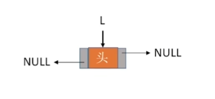

### 3-2-5-1、双链表的插入

```c
bool ListInsert_DL(DNode *p, DNode *s) // 在p节点后插入s节点
{
    if(p == NULL || s == NULL)  // 参数错误，返回false
        return false;

    s->next = p->next; // 将s节点连接到p的后面
    if(p->next != NULL) //p不为尾节点
        p->next->prior = s; //将s节点连接到p的后面

    s->prior = p; // 将p节点赋值给s的前驱
    p->next = s; // 将p节点赋值给s的前驱

    return true; // 插入成功，返回true

}


有点绕，看图理解

```

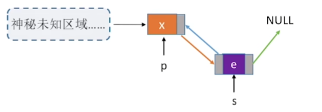

### 3-2-5-2、双链表的删除
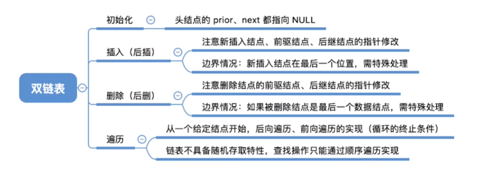
```c

bool Delete_DL(DNode *p) // 删除p节点后的q节点
{
    if(p == NULL) // 参数错误，返回false
        return false;
    DNode *q = p->next; // 定义指针q指向p的后继
    if(q == NULL) // p为尾节点，返回false
        return false;
    p->next = q->next; // 将q节点连接到p的后面
    if(q->next != NULL) // q不为尾节点
        q->next->prior = p; // 将p节点连接到q的后面
    free(q); // 释放节点
    return true; // 删除成功，返回true

}
```

* 双链表销毁
```c
void DestroyList_DL(DLinkList &L) // 销毁操作
{
    DNode *p, *q;
    p = L->next; // 定义指针p指向头节点
    while(p != NULL) // 链表不为空
    {
        q = p->next; // 定义指针q指向p的后继
        free(p); // 释放节点
        p = q; // 指针后移
    }
    L->next = NULL; // 头节点后暂时没有节点
}
```

* 3-2-5-3、双链表的遍历
```c
//向后遍历
    while(p != NULL) // 链表不为空
    {
        p = p->next; // 指针后移
    }

//向前遍历
    while(p != NULL) // 链表不为空
    {
        p = p->prior; // 指针后移
    }
    //向前遍历（跳过带头节点）
    while(p->prior != NULL) // 链表不为空
    {
        p = p->prior; // 指针后移; 
    }
```

 ## 3-2-6、循环链表
 循环链表有两种，循环单链表和循环双链表。
 循环单链表常用操作
尾部节点的next指向头节点
* 判断空
 ```c
 bool Empty_CL(LinkList L) // 判断操作
 {
     if(L->next == L) // 链表为空，返回true
         return true; // 链表为空，返回true
     return false; // 链表不为空，返回false
 }

 ```
* 判断是不是表尾节点
 ```c

 bool Last_CL(LinkList L, LinkList p) // 判断操作
 {
     if(p->next == L) // p是尾节点，返回true
         return true; // p是尾节点，返回true
     return false; // p不是尾节点，返回false
 }
 ```


循环双链表操作
* 初始化
```c
bool InitList_CL(LinkList &L) // 初始化操作
{

    L = (Node *)malloc(sizeof(Node)); // 生成头节点
    if(!L)
        return false; // 内存分配失败，返回false
    L->next = L; // 尾节点指向自己
    L->prior = L; // 前驱节点指向自己
    return true; // 初始化成功，返回true
}
```

* 判断空
```c
bool Empty_CL(LinkList L) // 判断操作
{
    if(L->next == L) // 链表为空，返回true
        return true; // 链表为空，返回true
    return false; // 链表不为空，返回false
}
```
* 插入
```c
bool ListInsert_CL(Dnode *p, Dnode *s) // 在p节点后插入s节点
{
    if(p == NULL || s == NULL)  // 参数错误，返回false
        return false;
    s->next = p->next; // 将s节点连接到p的后面
    p->next->prior = s; //将s节点连接到p的后面
    s->prior = p; // 将p节点赋值给s的前驱
    p->next = s; // 将p节点赋值给s的前驱
    return true; // 插入成功，返回true
}
```

* 删除
```c
bool Delete_CL(Dnode *p) // 删除p节点后的q节点
{
    if(p == NULL) // 参数错误，返回false
        return false;
    Dnode *q = p->next; // 定义指针q指向p的后继
    p->next = q->next; // 将q节点连接到p的后面
    q->next->prior = p; // 将p节点连接到q的后面
    free(q); // 释放节点
    return true; // 删除成功，返回true
}
```
## 3-2-7、静态链表
```c    

#define MAXSIZE 100
typedef int Status; // 状态码
typedef int SElemType; // 存储元素类型

// 静态链表结构体
typedef struct
{
    SElemType data; // 数据域
    int cur; // 当前位置标志
}SLinkList[MAXSIZE];

```

# 4、栈
栈:只允许在一端进行插入和删除操作的线性表，后进先出LIFO(Last In First Out)
术语：栈顶top和栈底base，空栈：top == base
基本操作：
1、初始化：分配栈空间
2、销毁：释放栈空间
3、入栈：将元素压入栈顶
4、出栈：将元素从栈顶弹出
5、读栈顶：读栈顶元素
6、判空：判断栈是否为空

## 4-1、顺序栈

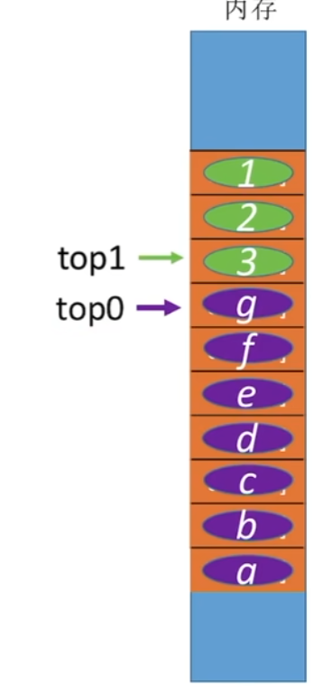

`代码中声明结构体，或者变量，就是开辟内存空间`
```c
#define MAXSIZE 100
typedef struct
{
    SElemType data[MAXSIZE]; // 存储空间
    int top; // 栈顶指针
}SqStack;
```

* 初始化
```c
void InitStack_Sq(SqStack &S) // 初始化操作
{
    S.top = -1; // 栈顶指针置-1
}
```

* 判空
```c
bool Empty_Sq(SqStack S) // 判断操作
{
    if(S.top == -1) // 栈为空，返回true
        return true; // 栈为空，返回true
    return false; // 栈不为空，返回false
}
```
* 判满
```c
bool Full_Sq(SqStack S) // 判断操作
{
    if(S.top == MAXSIZE - 1) // 栈满，返回true
        return true; // 栈满，返回true
    return false; // 栈不满，返回false
}
```
* 入栈
```c
bool Push_Sq(SqStack &S, SElemType e) // 入栈操作
{
    if(S.top == MAXSIZE - 1) // 栈已满，返回false
        return false; // 栈已满，返回false
    S.data[++S.top] = e; // 栈顶指针后移，将元素压入栈顶
    return true; // 入栈成功，返回true
}
```

* 出栈
```c
bool Pop_Sq(SqStack &S, SElemType &e) // 出栈操作
{
    if(S.top == -1) // 栈为空，返回false
        return false; // 栈为空，返回false
    e = S.data[S.top--]; // 栈顶指针前移，将元素弹出
    return true; // 出栈成功，返回true
}
```
* 读栈顶
```c
bool GetTop_Sq(SqStack S, SElemType &e) // 读栈顶操作
{
    if(S.top == -1) // 栈为空，返回false
        return false; // 栈为空，返回false
    e = S.data[S.top]; // 将栈顶元素赋值给e
    return true; // 读栈顶成功，返回true
}
```
### 4-1-1、共享栈
```c
typedef struct
{
    SElemType data[MAXSIZE]; // 存储空间
    int top0;
    int top1; // 队头和队尾指针
}SqQueue;
```
* 初始化
```c
void InitStack_Sq(SqQueue &Q) // 初始化操作
{
    Q.top0 = -1; 
    Q.top1 = MAXSIZE; 
}
```
内存增长方向相反


## 4-2、链栈    
使用链表的一段进行插入，或者删除操作，实现栈操作。


# 5、队列

## 5-1、顺序队列
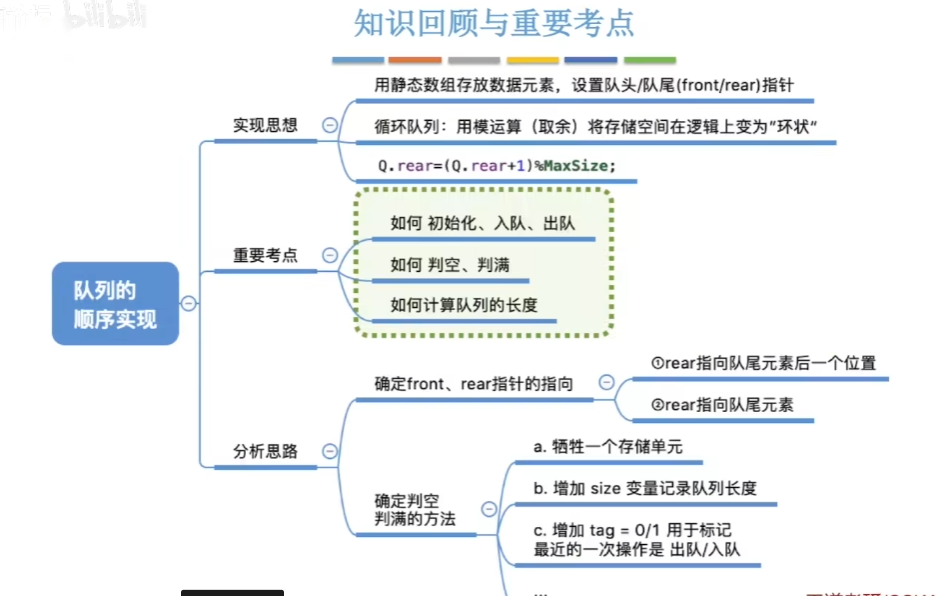
队列：只允许在一端进行插入，在另一端删除的线性表，先进先出FIFO(First In First Out)
术语：队头head和队尾tail，空队列：head == tail
基本操作：
1、初始化：分配栈空间
2、销毁：释放栈空间
3、入队：将元素压入队尾
4、出队：将元素从队首弹出
5、读队首：读队首元素
6、判空：判断栈是否为空

```c
#define MAXSIZE 100
typedef struct
{
    SElemType data[MAXSIZE]; // 存储空间
    int front; // 队首指针
    int rear; // 队尾指针
}SqQueue;
```

* 判空
```c
bool Empty_Sq(SqQueue Q) // 判断操作
{
    if(Q.front == Q.rear) // 队为空，返回true
        return true; // 队为空，返回true
    return false; // 队不为空，返回false
}
```

* 入队
```c
bool EnQueue_Sq(SqQueue &Q, SElemType e) // 入队操作
{
    if((Q.rear + 1) % MAXSIZE == Q.front) // 队已满，返回false，运用中，会浪费一个存储空间
        return false; // 队已满，返回false
    Q.data[Q.rear] = e; // 将元素压入队尾
    Q.rear = (Q.rear + 1) % MAXSIZE; // 队尾指针后移,相当于一个循环队列
    return true; // 入队成功，返回true
}
```
利用取余运算，实现循环队列。逻辑上实现闭环

* 出队
```c
bool DeQueue_Sq(SqQueue &Q, SElemType &e) // 出队操作
{
    if(Q.front == Q.rear) // 队为空，返回false,和入队的条件不同，要注意区分
        return false; // 队为空，返回false
    e = Q.data[Q.front]; // 将队首元素赋值给e
    Q.front = (Q.front + 1) % MAXSIZE; // 队首指针后移,相当于一个循环队列
    return true; // 出队成功，返回true
}

```

* 另一种判断队空的方法
```c
#define MAXSIZE 100
typedef struct
{
    SElemType data[MAXSIZE]; // 存储空间
    int front; // 队首指针
    int rear; // 队尾指针
    int flag; // 标志位,最后一次是入队还是出队
}SqQueue;

```
## 5-2、链队列
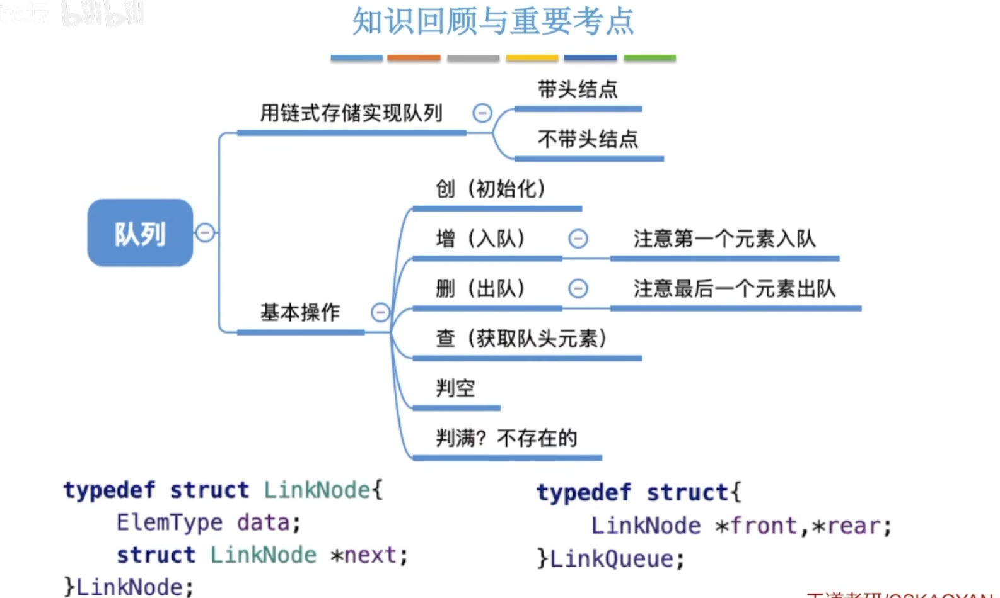
使用链表的一段进行插入，或者删除操作，实现栈操作。
回顾之前的链表，要标记一个链表，只需要保存链表的头指针就可以了。遍历，查询等，这个指针不要动。使用另一个指针，来遍历链表。

* 带头结点
```c
tyepdef struct QNode
{
    SElemType data;
    struct QNode *next;
}QNode, *QueuePtr;

typedef struct
{
    QNode *front; // 队首指针
    QNode *rear; // 队尾指针
}LinkQueue;
/* 初始化 */
bool InitQueue(LinkQueue *Q)
{
    Q->front = Q->rear = (QueuePtr)malloc(sizeof(QNode));
    if(!Q->front) // 分配失败，返回false
        return false; // 分配失败，返回false
    Q->front->next = NULL; // 队空，队首指针指向NULL
    return true; // 初始化成功，返回true
}
/* 判断空 */
bool IsEmpty()
{
    if(Q->front == Q->rear) // 队空，返回true
        return true; // 队空，返回true
    return false; // 队不空，返回false
}
/* 新元素入队 */
void EnQueue(LinkQueue *Q, SElemType e)
{
    QueuePtr s = (QueuePtr)malloc(sizeof(QNode));
    if(!s) // 分配失败，返回false
        return; // 分配失败，返回false
    s->data = e; // 赋值
    s->next = NULL; // 队尾指针指向NULL
    Q->rear->next = s; // 队尾指针指向新节点
    Q->rear = s; // 队尾指针指向新节点
    return; // 入队成功，返回true
}
/* 带头节点的链队首元素出队 */
bool DeQueue(LinkQueue *Q, SElemType &e)
{
    if(Q->front == Q->rear) // 只有一个元素，
        return false; // 头节点，返回false
    QueuePtr *p = Q->front->next; // 队首指针
    e = p->data; // 队首元素赋值给e
    Q->front->next = p->next; // 队首指针指向下一个节点
    if(Q->rear == p) // 只有一个元素，队尾指针指向NULL
        Q->rear = Q->front; // 只有一个元素，队尾指针指向NULL
    free(p); // 释放节点
    return true; // 出队成功，返回true
        


}
void main()
{
    LinkQueue Q;
    InitQueue(&Q); // 初始化操作
}

```
* 不带头节点
```c
/* 初始化 */
void InitQueue(LinkQueue *Q)
{
    Q->front = NULL; // 队空，队首指针指向NULL
    Q->rear = NULL; // 队尾指针指向NULL
}
/* 判空*/
bool IsEmpty(LinkQueue Q)
{
    if(Q.front == NULL) // 队空，返回true
        return true; // 队空，返回true
    return false; // 队不空，返回false

}

/* 入队  */
void EnQueue(LinkQueue *Q, QElemType e)
{
    QueuePtr s = (QueuePtr)malloc(sizeof(QNode));
    if(!s) // 分配失败，返回false
        return; // 分配失败，返回false
    s->data = e; // 赋值
    s->next = NULL; // 队尾指针指向NULL
    if(Q->front == NULL) // 队空，队首指针指向新节点
    {

        Q->front = s;
        Q->rear = s; // 队尾指针指向新节点
    }
    else // 队不空，队尾指针指向新节点
    {
        Q->rear->next = s;
        Q->rear = s; // 队尾指针指向新节点
    }
        return; // 入队成功，返回true
}

/* 出队操作 */
bbool DeQueue(LinkQueue *Q, QElemType &e)
{
    if(Q->front == NULL) // 队空，返回false
        return false; // 队空，返回false
    QueuePtr p = Q->front; // 队首指针
    e = p->data; // 队首元素赋值给e
    Q->front = p->next; // 队首指针指向下一个节点
    if(Q->rear == p) // 只有一个元素，队尾指针指向NULL
    {
        Q->rear = NULL; // 只有一个元素，队尾指针指向NULL
        Q->front = NULL; // 只有一个元素，队首指针指向NULL
    }
    
    free(p); // 释放节点
    return true; // 出队成功，返回true
}
```

## 5-3、双端队列
有多种形式，双端队列：只允许从两端插入、两端删除的线性表。
输入受限的双端队列：只允许一端插入，两端的删除操作。
输出受限的双端队列：只允许一端删除，两端的插入操作。

# 6、栈在括号匹配中的应用
IDE：可视化编程环境

```c
#define MAXSIZE 100
typedef struct
{
    SElemType data[MAXSIZE]; // 存储空间
    int top; // 栈顶指针
}SqStack;
bool bracketCheck(char str[],int length)
{
    SqStack S;
    InitStack(&S);//初始化栈
    for(int i=0;i<length;i++)
    {
        if(str[i] == '(' || str[i] == '[' || str[i] == '{')
            Push(&S,str[i]); // 入栈
        else if(str[i] == ')')
        {
            if(S.top == -1) // 栈空，返回false
                return false; // 
        }
        char topElem = pop(&S); // 获取栈顶元素
        if(str[i] == ')' && topElem != '(') // 栈顶元素不匹配，返回false
            return false; // 
        if(str[i] == ']' && topElem != '[') // 栈顶元素不匹配，返回false
            return false; // 
        if(str[i] == '}' && topElem != '{') // 栈顶元素不匹配，返回false
            return false; // 
    }
    if(S.top != -1) // 栈不空，返回false
        return false; // 

    return true; // 括号匹配，返回true
}
```

# 7、队列在括号匹配中的应用
表达式：由操作数、运算符和界限符组成的序列。

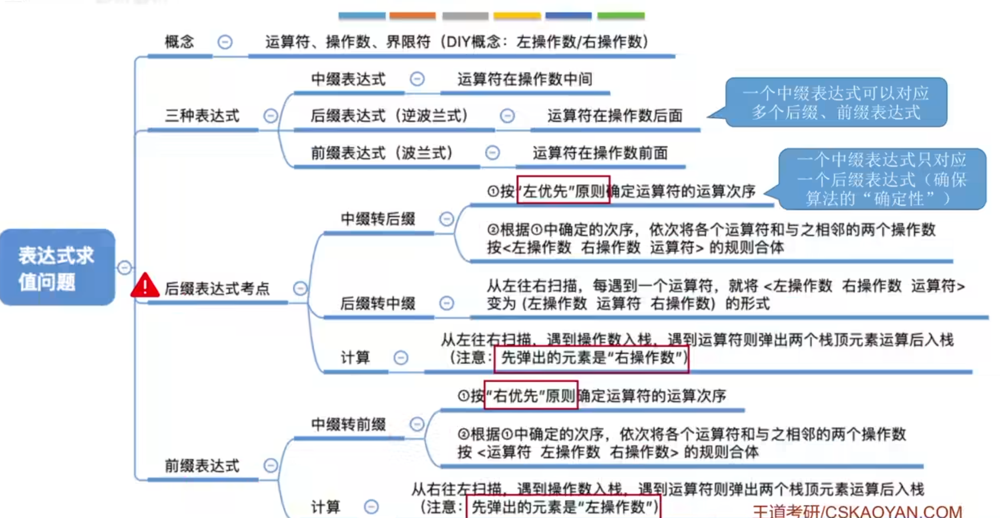


# 8、栈在递归中的应用
函数调用的特点：最后调用的函数最先返回。也就符合栈的先进后出特点。
函数调用时，需要用栈来保存现场信息。
* 调用返回地址
* 函数参数
* 局部变量

# 9、队列应用
在操作系统中，进程调度算法：先来先服务、短作业优先、时间片轮转。
在树中，先序遍历、中序遍历、后序遍历。也是用队列来实现的。

# 10、特殊矩阵的压缩存储
* 一维数组存储结构：线性储存。
* 二维数组存储结构：行优先存储、列优先存储。都是线性。知道行号和列号，能直接得出地址。

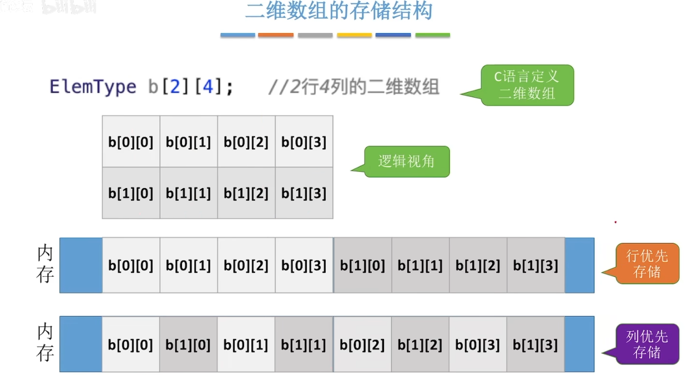

* 矩阵：使用数组存储
特殊矩阵：
1、对称矩阵：对角线元素相同。
策略：只存储对角线元素+下三角元素。按行优先存储或者列优先存储。
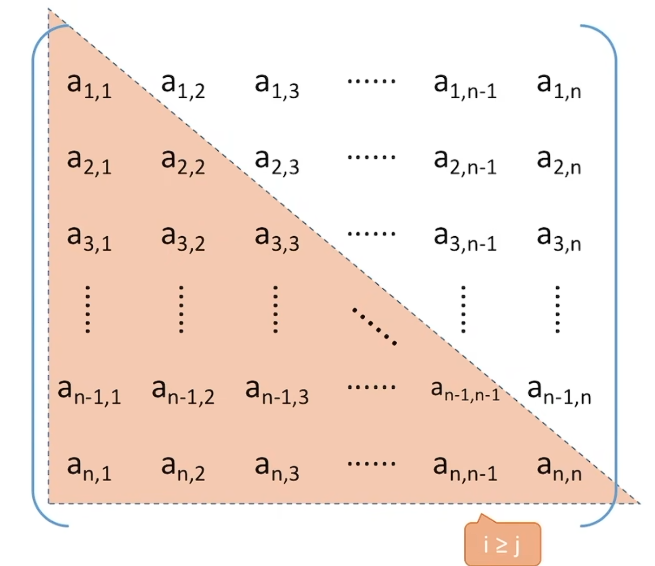

2、三角矩阵：上三角元素和下三角元素都为0。
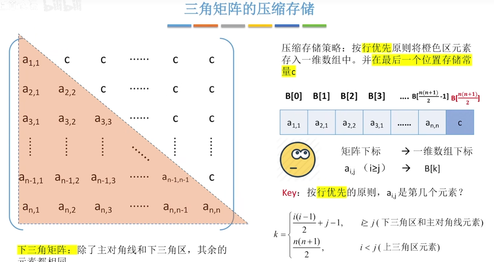

3、对角矩阵：主对角线元素为1，其他元素为0。同样用一维数组存储。

4、稀疏矩阵：元素个数远小于n*m。两种方法存储：顺序存储三元组、链式存储十字链表。
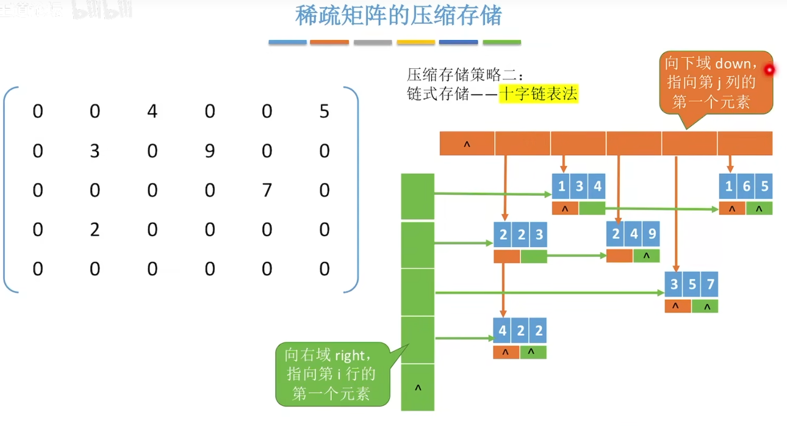


# 11、串
串：就是字符串，由0个或多个字符组成的有限序列。
串名：字符串的名称，是串的首地址。
串的长度：串中字符的个数。
空串：长度为0的串，空格也算字符。有空格不算空串。
子串：串中任意个连续的字符组成的串。
子串在主串中出现的位置：子串第一个字符在主串中的位置。
存储时以线性的方式存储。
主要操作：
假设有串T="",S="iphone 11 pro Max",W = "pro"
StrAssign(T,s)：将串s赋值给串T。
StrEmpty(T)：判断串T是否为空串。
StrLength(T)：求串T的长度。
StrCopy(T,S)：将串S复制给串T。
ClearSring(T)：清空串T。
DestoryString(T)：销毁串T。
Concat(T,S1,S2)：将串S1和S2连接起来，生成新串T。
SubString(&Sub,S,i,j)：求子串Sub，其值等于主串S中从第i个字符开始的子串。
Indext(S,T)：返回串S中与串T相等的第一个子串的起始位置。否则返回0。
StrCompare(S,T)：比较串S和串T的大小关系，逐个字符比较，直到出现大小关系为止。以ASCCII码值大小比较。每个字符的ASCCII码值大小关系。

## 字符集
* 英文和控制符：ASCCII码值。一个字符占1个字节。
* 中英文：Unicode码值。一个字符占3个字节。
基于同一种码值，不同编码方式，有uft-8、utf-16、utf-32。

## 11-1、串的存储结构
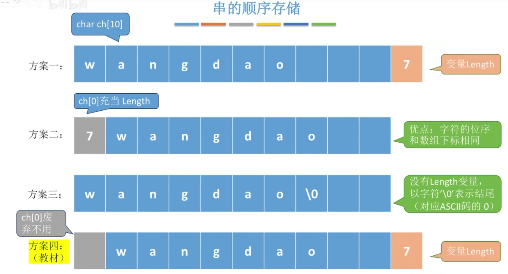
下面11-2采用第四种方法。
* 顺序存储
```c
#define MAXSIZE 100
typedef struct
{
    char data[MAXSIZE]; // 存储空间
    int length; // 串的长度
}SqString;
```

* 顺序存储、堆区
```c
#define MAXSIZE 100
typedef struct Node
{
    char *ch; // 存储空间
    int length; // 串的长度
}LinkNode, *LinkString;

Hstring S;
S.data = (char *)malloc(sizeof(char) * MAXSIZE); // 分配空间
S.length = 0;
```

* 链式存储
```c
tyoedef struct StringNode
{
    char ch[i];//每个节点存储i个字符，提高内存利用率。内存密度。
    struct StringNode *next;
}StringNode, *LinkString;
```
## 11-2、顺序串的功能实现
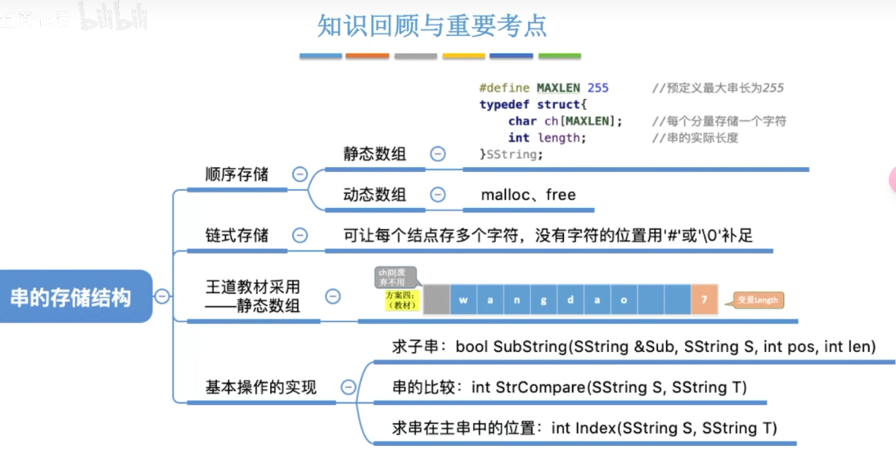
* Substring(&sub,S,i,j)：求子串Sub，其值等于主串S中从第i个字符开始,长度为j的子串。
假设S.ch = "yanggguanchao"
S.length = 14

```c
#define MAXSIZE 100 // 串的长度
typedef struct
{
    char ch[MAXSIZE]; // 存储空间
    int length; // 串的长度
}String;

bool Substring(String &sub,String S,int i,int j)
{
    /*这里的主串从1开始 , 0用来保存长度*/
    if(i+j - 1 > S.length) // 越界，返回
        return false; // 
    for(int k = i; k <= i+j; k++)
        Sub.ch[k-i +1] = S.ch[k]; 
    sub.length = j; // 
    return true; // 

}
```
* 比较串S和串T的大小关系,若S>T，逐个字符比较，直到出现大小关系为止。以ASCCII码值大小比较。
```c
int StrCompare(String S,String T)
{
    for(int i = 0; i < S.length && i < T.length; i++)
    {
        if(S.ch[i] != T.ch[i]) // 比较字符ASCCII码值大小
            return = S.ch[i] - T.ch[i]; // 
    }
    return S.length - T.length; // 
}
```

* 找子串在主串中出现的位置
```c
int Index(String S,String T)
{
    int i = 0;
    int n = StringLength(S);
    int m = StringLength(T);
    while(i <= n - m + 1){
        Substring(Sub,S,i,m); 
        if(StrCompare(Sub,T) != 0)
            i++;
        else 
            return i; // 返回位置
    }
    return 0; //S中没有T串
}
```

## 11-3、串的模式匹配
* 朴素模式暴力匹配算法
子串：一定或者没有在主串中
模式串：找到的不一定是你想要的

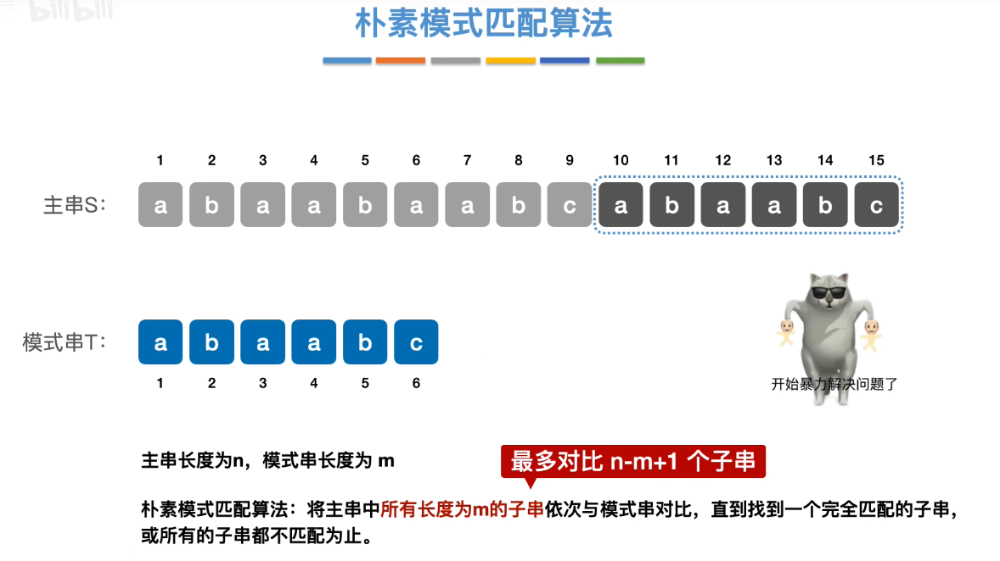

上一节的子串匹配算法，在主串中找子串。即使一个朴素模式匹配算法。

通过数组下标，进行匹配。主串指针在头处，模式串指针
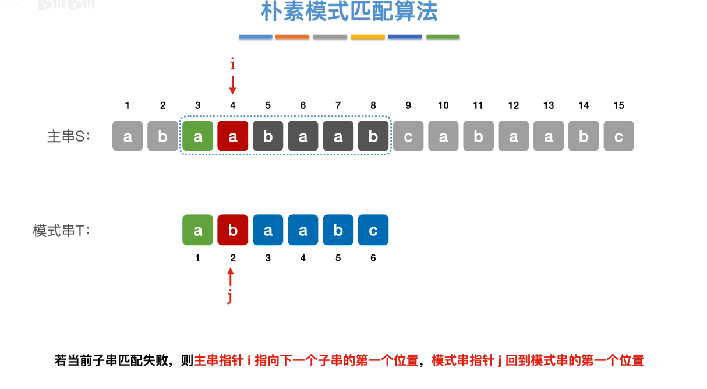

```c
int Index(String S,String T)
{
    int i = 0;
    int j = 0;
    while(i <= S.length - T.length)
    {
        ++j;
        ++i;
    }
    else
    {
        i=i-j+2;//这里字符位置是从1开始，所以要减2，串结构，下标0舍弃
        j = 1；
    }
    if(j > T.length)
        return i - T.length; // 返回位置
    else
        return 0; // S中没有T串
}
```
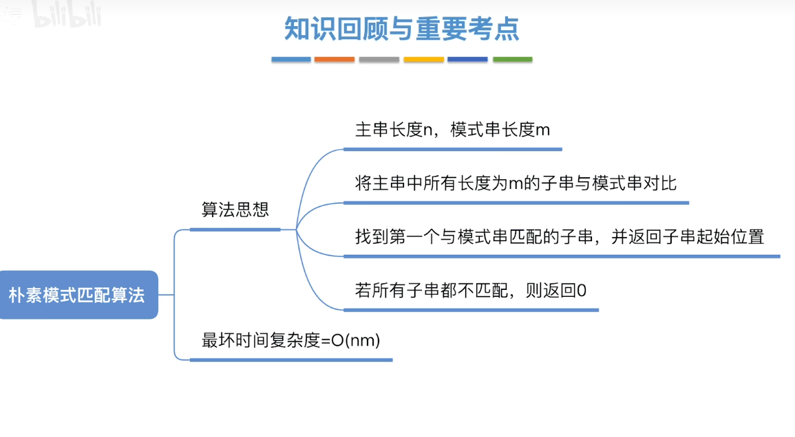

## 11-4、KMP算法
是对朴素模式匹配算法的改进。主串指针不返回，模式串指针返回
扫描过的位置放到数组中。当发生某一位不匹配，模式串指针返回该位置
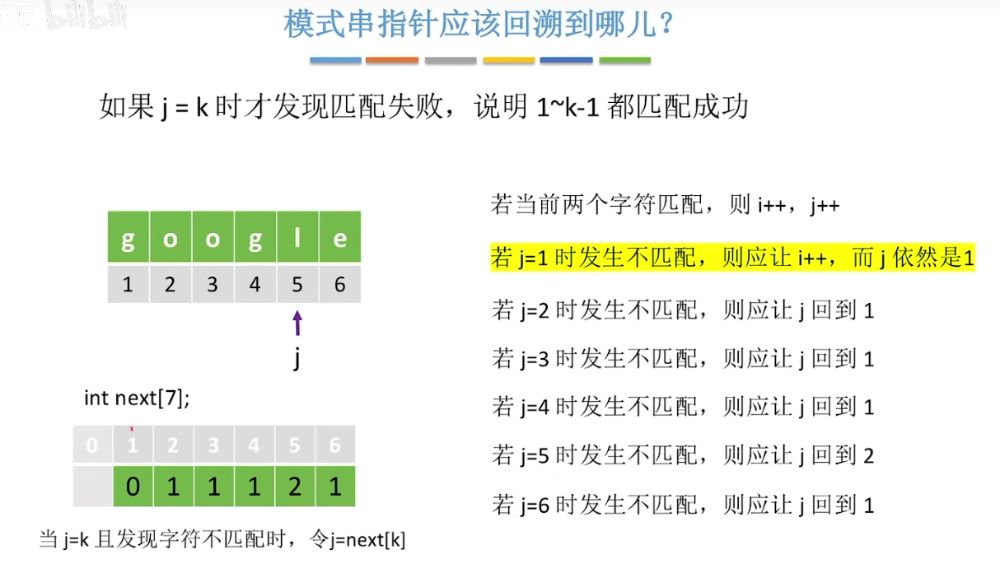

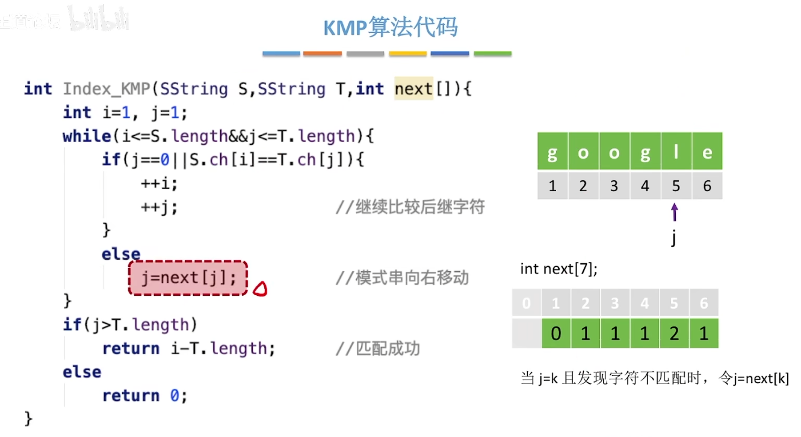
* 求next数组
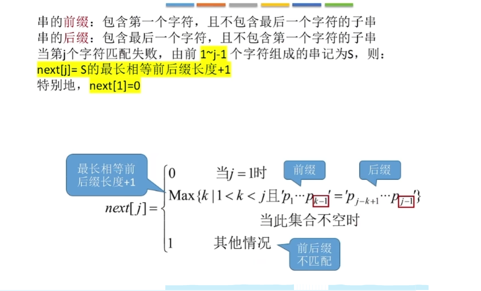

```c
//求模式串T的next数组
void getNext(String T,int next[])
{
    int i = 1;
    int j = 0;
    next[1] = 0;
    while(i < T.length)
    {
        if(j == 0 || T.ch[i] == T.ch[j])
        {
            ++i;
            ++j;
            //若pi = pj，则next[i+1] = next[j+1]
            next[i] = j; // 
        }
        else
            j = next[j]; // 
    }
}

int Index_KMP(String S,String T)
{
    int i = 1;
    int j = 1;
    get_next(T,next); // 求next数组
    while(i <= S.length && j <= T.length)
    {
        if(j == 0 || S.ch[i] == T.ch[j])
        {
            ++i;
            ++j;
        }
        else
            j = next[j]; // 
    }
    if(j > T.length)
        return i - T.length; // 返回位置
    else
        return 0; // S中没有T串
}

```
# 12、树
根节点：开始节点。
叶子节点：没有子节点的节点。
边：连接节点。
分支节点：有子节点的节点。
空树：没有节点的树。

非空树：
* 有节点的树。有且只有一个根节点。
* 没有后继的节点称之为“叶子节点”
* 有后继的节点称之为“分支节点”

树：由n（n>=0）个节点组成的有限集合。n=0时，称为空树。任意一个非空树m，有且仅有一个根节点。任何一个节点都有仅且只有一个父节点。

树形结构应用
* 文件系统
* 国家省市县区镇村
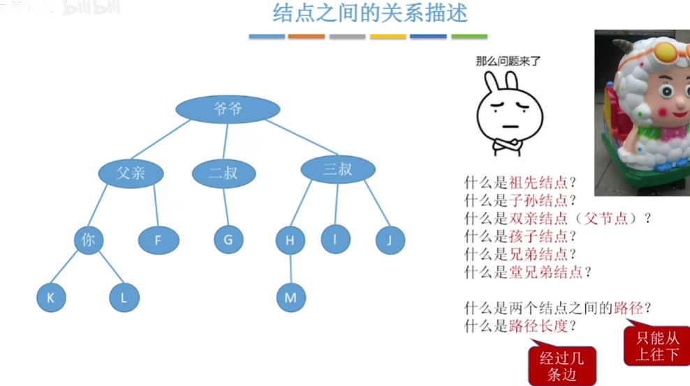
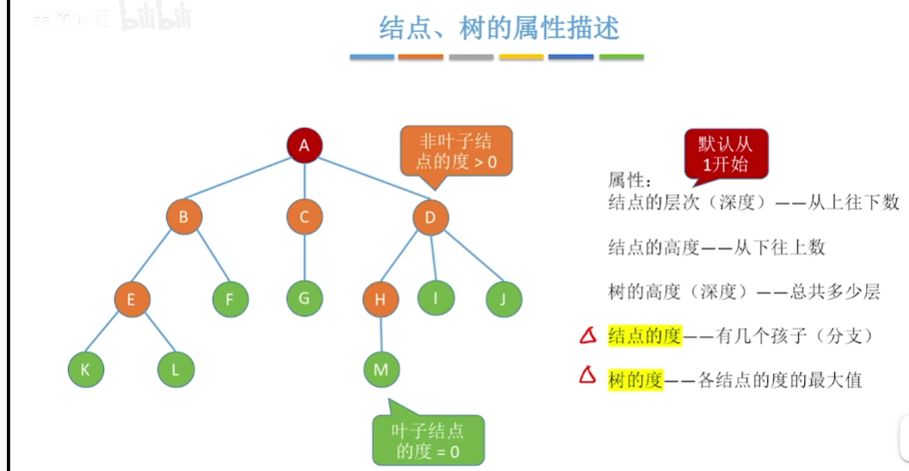

有序树：从逻辑上看，树中结点的各个子树从左到右是有次序的，不能互换。
无序树：从逻辑上看，树中结点的各个子树从左到右是无次序的，可以互换。

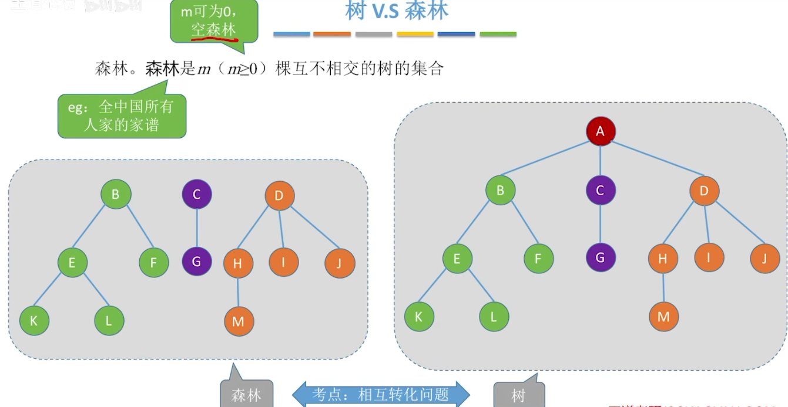

## 12-1、二叉树
* 定义
二叉树：每个节点最多有两个子树的树结构。
* 二叉树的性质
 1、 二叉树的深度为k，则最多有2^k-1个结点。
 2、左右树不能互换。有序树。

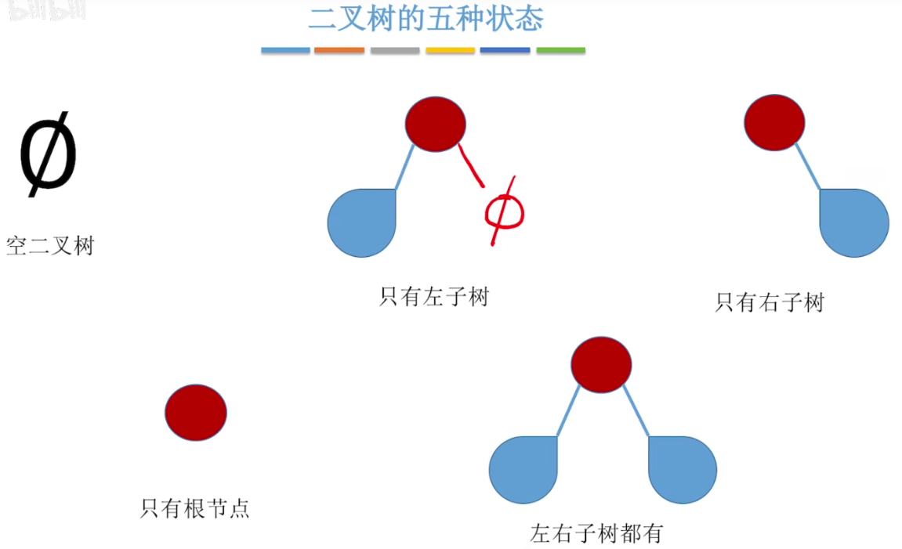

几种特殊的二叉树：

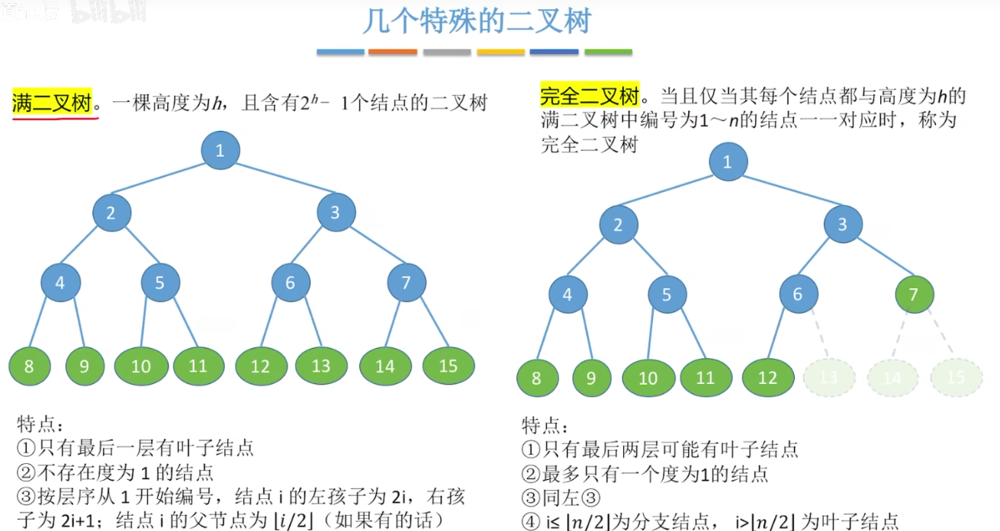
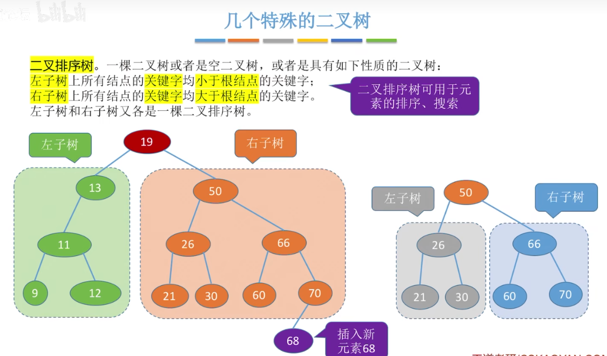
平衡二叉树：左右子树的高度差不超过1。效率很高

## 12-2、二叉树的存储结构
顺序存储结构：用一维数组存储二叉树。（能快速访问，但是会浪费存储空间）
链式存储结构：用指针域存储二叉树。

```c
//链式存储结构
typedef struct {
    int data; /* 数据域 */
    BiTNode *lchild, *rchild; /* 左右孩子指针 */
}BiTNode, *BiTree;

int main()
{
    //创建二叉树
    BiTree root;
    root = (BiTNode *)malloc(sizeof(BiTNode)); // 申请节点空间

    //初始化二叉树
    root->data = 1;
    root->lchild = NULL;
    root->rchild = NULL;

    //创建左子树
    BiTNode *left = (BiTNode *)malloc(sizeof(BiTNode)); // 申请节点空间
    left->data = 2;
    left->lchild = NULL;
    left->rchild = NULL;
    root->lchild = left; // 链接左子树

}

```
在实际过程中，如果二叉树查找父节点很费时间，可以设置一个指针域，指向父节点。
 ```c
 struct BiTNode
 ｛
     ElemType data;
     结构体指针 left;
     结构体指针 right;
     结构体指针 parent;
}
```
## 12-3、二叉树的遍历
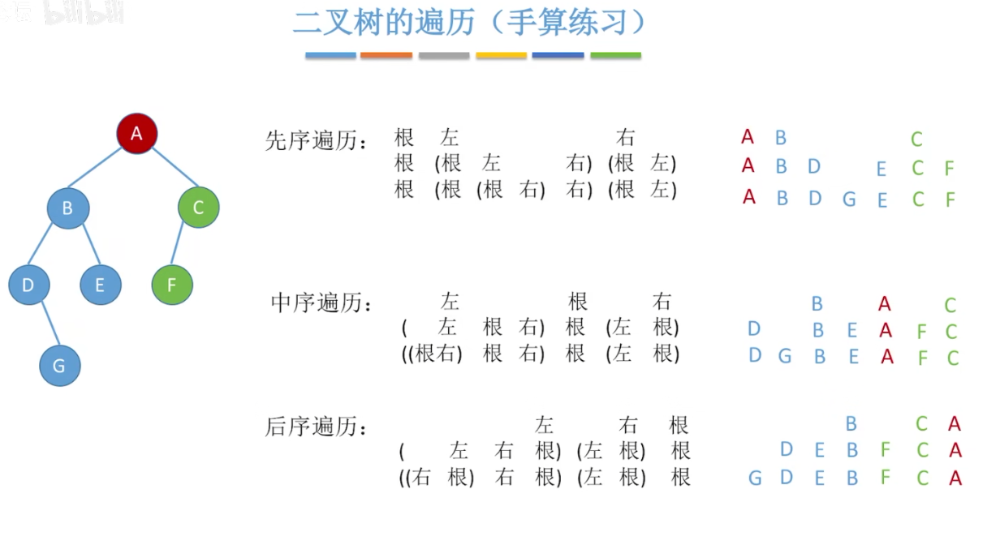


先序遍历：
1、若二叉树为空，则返回空操作；
2、若二叉树非空：
（1）访问根节点；
（2）先序遍历左子树；
（3）先序遍历右子树。
```c
typedef struct BiTNode{
    ElemType data;
    struct BiTNode *lchild, *rchild;
}BiTNode, *BiTree;

//先序遍历
void PreOrder(BiTree T)
{
    if(T != NULL)
    {
        visit(T); // 访问节点
        PreOrder(T->lchild); // 遍历左子树
        PreOrder(T->rchild); // 遍历右子树
    }
}
```
中序遍历：
1、若二叉树为空，则返回空操作；
2、若二叉树非空：
（1）中序遍历左子树；
（2）访问根节点；
（3）中序遍历右子树。

```c
void InOrder(BiTree T)
{
    if(T != NULL)
    {
        InOrder(T->lchild); // 遍历左子树
        visit(T); // 访问节点
        InOrder(T->rchild); // 遍历右子树
    }
}
```

后序遍历：
 1、若二叉树为空，则返回空操作；
 2、若二叉树非空：
 （1）后序遍历左子树；
 （2）后序遍历右子树；
 （3）访问根节点。

```c
viod PostOrder(BiTree T)
{
    if(T != NULL)
    {
        PostOrder(T->lchild); // 遍历左子树
        PostOrder(T->rchild); // 遍历右子树
        visit(T); // 访问节点
    }
}
```

## 12-4、二叉树的层序遍历
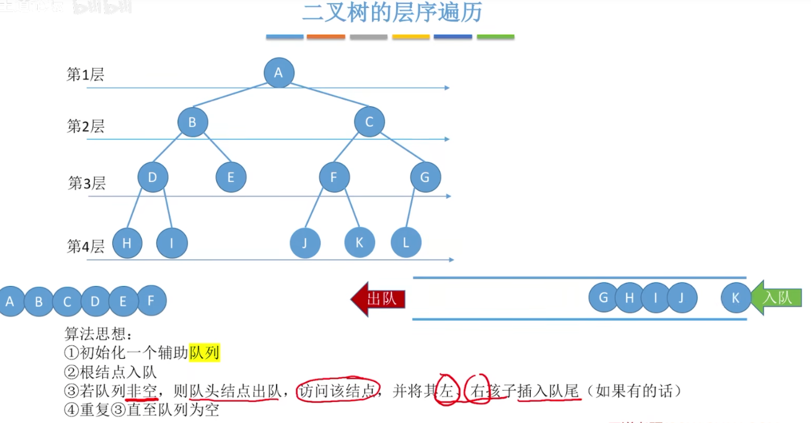

* 算法描述
1、创建一个队列Q，并将根节点入队；
2、根节点入队后
3、若队列非空，则队头元素出队，访问该节点；并判断该节点的左右孩子是否为空，若非空，则将该节点入队；
4、循环3，直到队列为空。
```c
#include <stdio.h>
void LevelOrder(BiTree T)
{
    LinkQueue Q;//创建队列
    InitQueue(&Q);//初始化队列
    BiTree p;
    EnQueue(&Q, T); //根节点入队
    while(!QueueEmpty(Q))
    {
        DeQueue(&Q, &p); //队头元素出队
        visit(p); //访问该节点
        if(p->lchild != NULL)
            EnQueue(&Q, p->lchild); //左孩子入队
        if(p->rchild != NULL)
            EnQueue(&Q, p->rchild); //右孩子入队

    }
    return;
}
```
## 12-5、根据几种遍历序列重建二叉树
中序遍历序列和其他三种方式任意结合一种，都可以唯一确定一棵二叉树。
但是不用中序遍历，其他两种结合无法确定一棵二叉树。
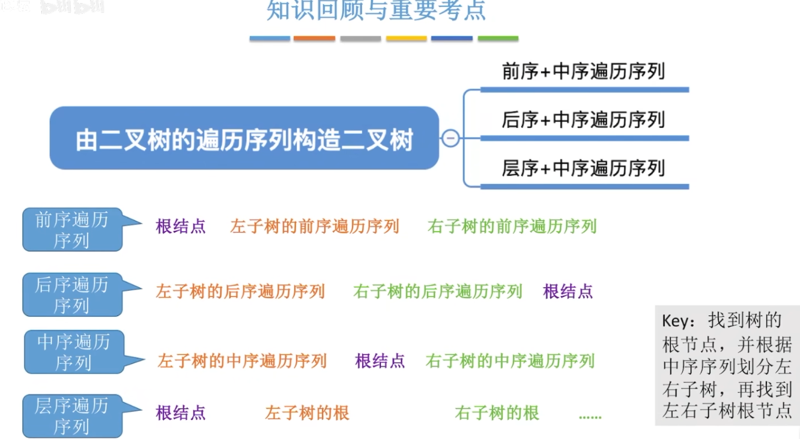

## 12-6、线索二叉树
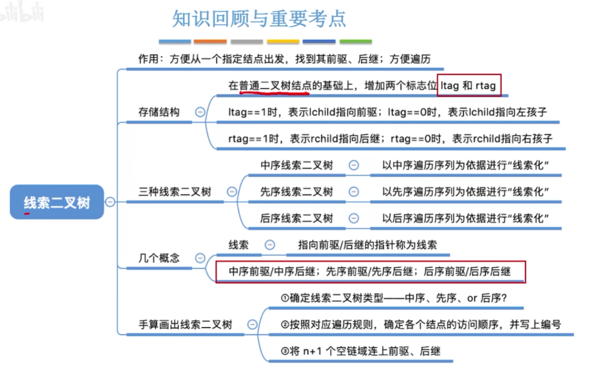
普通二叉树找前驱后继比较麻烦。
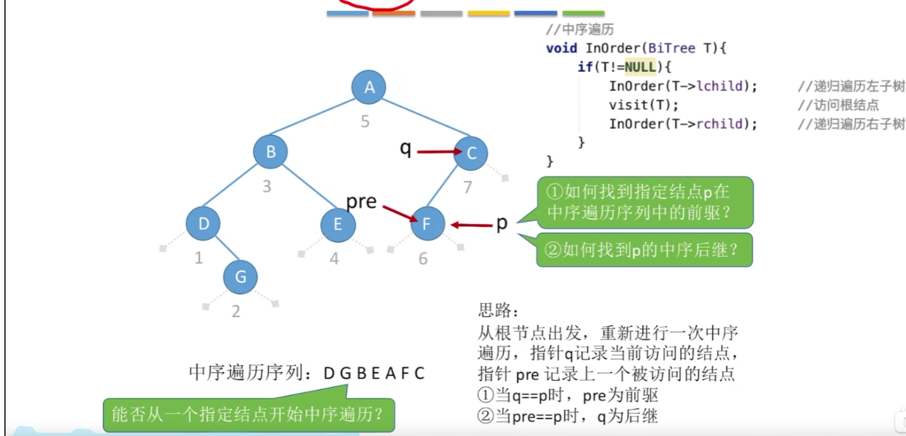

```c
// 创建线索二叉树
typede struct BiTNode{
    ElemType data;
    struct BiTNode *lchild, *rchild;
    int ltag, rtag; // 左右标志

}BiTNode, *BiTree;

```
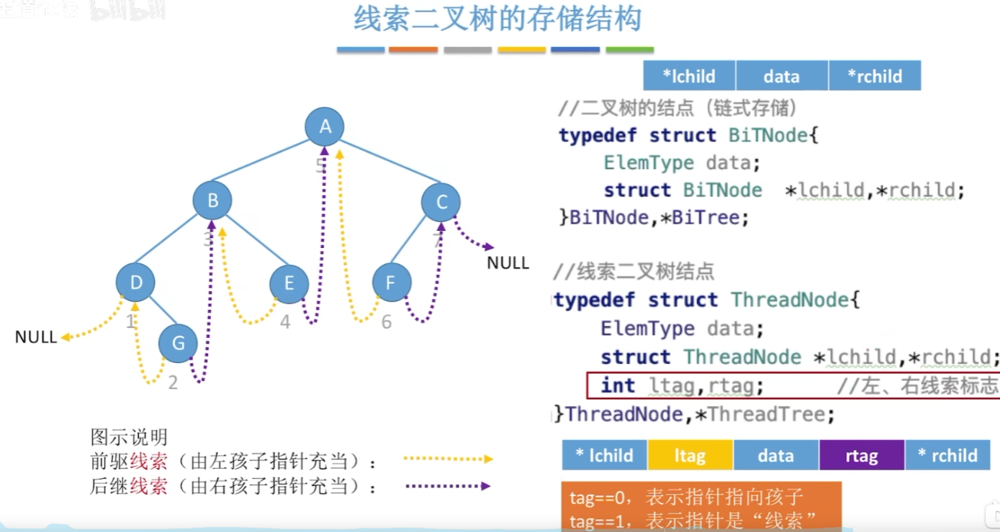
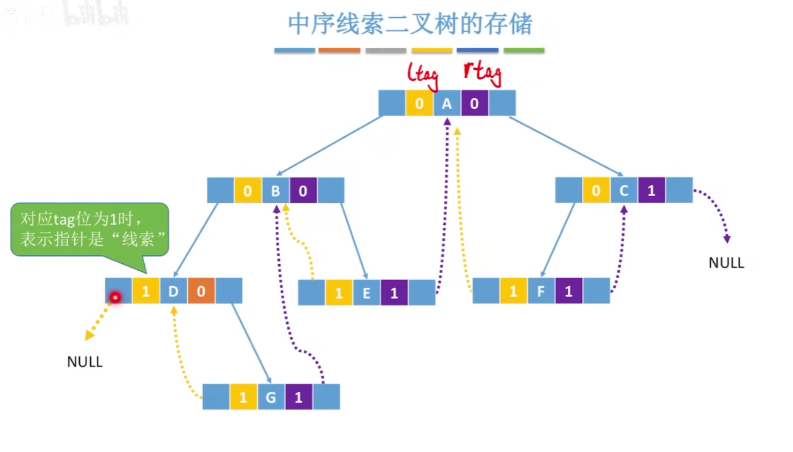

## 12-7、二叉树线索化，对visit函数进行实现

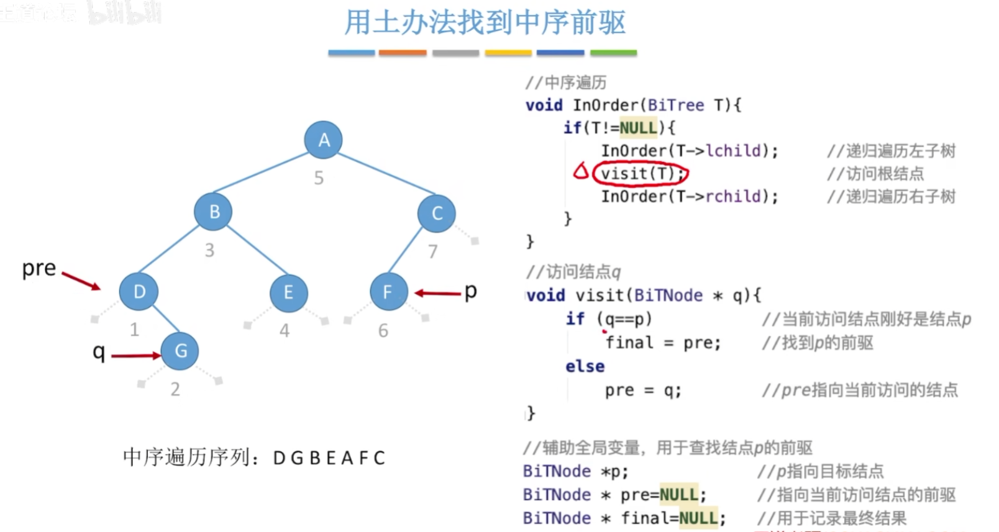
线索化先要对二叉树进行一次完整遍历。
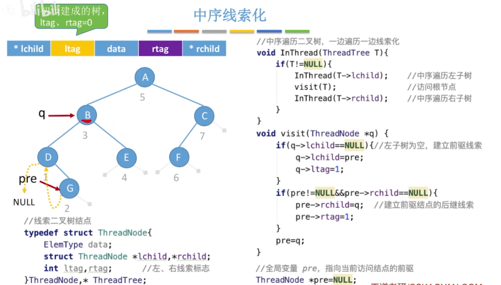

中序线索化完整代码如下：

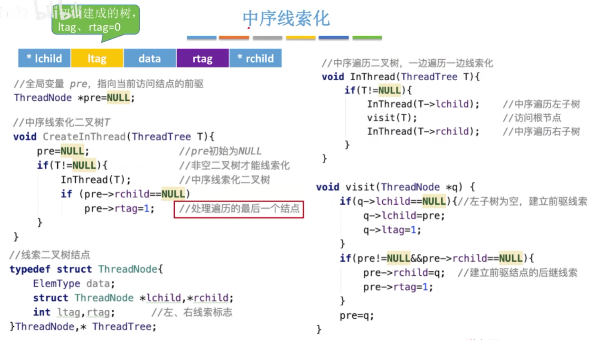

先序线索化代码：


后续线索化代码：


## 12-8、二叉树中序找后继和前驱


## 12-9、树的存储

二叉树的顺序存储，使用数组存储，至于链式存储在上面已经讲过了。


其他树：

二叉树也可以以用这个方法存储。

孩子表示法：顺序+链式存储:


兄弟孩子表示法：链式存储:


树和二叉树的转化：


森林转化成二叉树：


## 12-10、树的遍历
树的先根遍历，实现后达到树和二叉树的转化:


树的后续遍历，实现二叉树和树的转化:


树的层序遍历：


## 12-11、哈夫曼树
节点的权：节点上数据所表示的某种信息量。
节点的带权路径长度：从根节点到该节点的路径长度与该节点上数据的乘积。
哈夫曼树：带权路径长度最小的二叉树。也称为最优二叉树。


应用：哈夫曼编码。（可变长度编码）
一般的ascii码是定长编码，一个字节8位。
哈夫曼编码：将字符按照出现频率从高到低排序，然后两两合并，合并后字符频率和合并前字符频率之和就是合并后字符频率。

