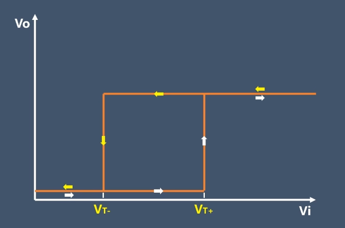
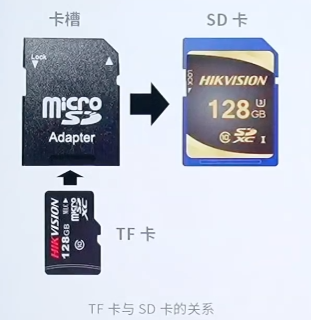
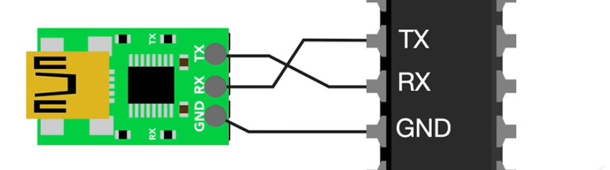

# 1、元器件
## 1-1、施密特触发器:
*  迟滞特性：施密特触发器有两个不同的阈值电压，
一个用于从低电平转换到高电平（称为上阈值电压），
另一个用于从高电平转换到低电平（称为下阈值电压）。
这种迟滞特性使得施密特触发器对输入信号的噪声不敏感。
* 输入输出关系：当输入电压超过上阈值电压时，
输出会跳变到高电平；当输入电压低于下阈值电压时，
输出会跳变到低电平。
* 应用广泛：施密特触发器常用于信号整形、脉冲产生和噪声抑制等场合。
施密特触发器在数字电路和模拟电路中都有广泛应用，
特别是在需要对不稳定的输入信号进行处理的场景中。如将输入信号进行整形、转化为方波。

## 1-2、sd卡
sd卡是一种广泛使用的存储设备，它基于闪存技术。也就是nand闪存。
主要外形有两种，一种是micro sd卡,也就是tf卡，一种是sd卡。
下面是两者的区别：

卡上标签参数解读：c:写速度等级，u：读速度等级，v:视频的读写速度
sd卡和micro sd卡的区别：就是多了一根电源线，sd卡三根电源线，micro sd有两根。

### 1-2-1、总线类型

### 扩展--扇区和簇的关系
**定义**
* 扇区（Sector）
扇区是磁盘（包括 SD 卡等存储设备）物理结构中的最小可寻址存储单元，它是在磁盘格式化时就被划分好的。
从物理层面看，磁盘盘片被划分成许多同心圆的磁道，每个磁道又被等分为若干个扇区。
扇区就像是磁盘上一个个固定大小的 “小格子”，数据在磁盘上实际就是存储在这些扇区里。

* 簇（Cluster）
簇是文件系统中逻辑分配的最小单位，它由一个或多个连续的扇区组成。文件系统在管理磁盘空间和存储文件时，
并不直接操作扇区，而是以簇为单位进行数据的分配和管理。可以把簇看作是文件系统用来组织和管理扇区的一个 “逻辑包裹”。

**大小**
* 扇区
扇区的大小通常是固定的，传统磁盘和大多数 SD 卡的扇区大小为 512 字节。
不过，随着技术发展，现在一些大容量存储设备开始采用 4096 字节（4KB）的扇区大小，
这种被称为 “高级格式化” 或 “4K 扇区”。

* 簇
簇的大小不是固定的，它由文件系统和磁盘格式化时的设置决定。
簇的大小可以是扇区大小的整数倍，例如在 FAT32 文件系统中，
簇的大小可以是 4KB（相当于 8 个 512 字节的扇区）、8KB、16KB 等；在 NTFS 文件系统中，
簇的大小可以根据磁盘容量和用户设置进行调整，一般从 512 字节到 64KB 不等。
通常情况下，磁盘容量越大，簇的大小也会相应增大。

**用途**
* 扇区
扇区主要用于磁盘的物理存储和数据传输。磁盘驱动器在读写数据时，
是以扇区为单位进行操作的。当计算机向磁盘写入数据时，
数据会被分解成一个个扇区大小的数据块，然后依次写入到磁盘的相应扇区中；
读取数据时，也是按扇区从磁盘中读取数据。
* 簇
簇主要用于文件系统对磁盘空间的管理。文件系统在存储文件时，
会为文件分配一定数量的簇，这些簇可能在磁盘上是连续的，也可能是不连续的。
文件系统通过记录每个文件所占用的簇号来跟踪文件在磁盘上的存储位置。
例如，当你在计算机上创建一个新文件时，
文件系统会从可用的簇中为该文件分配足够的簇来存储文件内容。

`扇区是磁盘物理存储的最小单位，而簇是文件系统逻辑分配的最小单位，
一个簇包含一个或多个扇区。`
# 2、协议
## 2-1、串口
串口通讯使用RX和TX交叉相连通讯，串口通讯是全双工通讯，可以同时接收和发送。同时需要接地，作为参考电压。

串口通讯采用TTL（transistor-transistor logic晶体管晶体管逻辑）逻辑。输出的高电平最小2.4V，低电平最大0.4V
