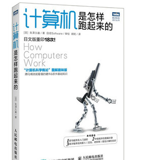
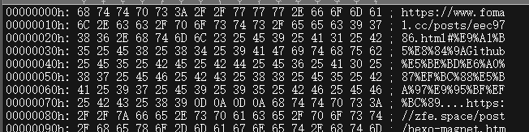

这个是计算机怎么跑起来的读书笔记。
本书由日本作者失泽久雄所写

# 计算机三大原则
## 计算机三大原则：输入、处理(运算)、输出
任何一个计算机都是这样运行的，同理程序也是如此。

输入：输入数据
处理：运算
输出：输出数据

## 程序：本质是指令+数据

这里的十六进制，全是数据。如果是可执行文件，开头前几个字节，基本就是指令。
所有的十六进制。要么是指令，要么是数据，不会有其他的。

## 编码
编码：将数据转换成计算机可识别的二进制数据。
常见的中文编码，颜色编码。本质是让计算机去识别。

## 计算机只认识数字（废话）
所有的程序都是一堆数字,连接这一切的就是编码

## 总结
书上的例子。
微软为新一代互联网提出了.NET技术，作为.NET核心的XMLweb服务使用通用的soap、XML,使得互联网计算机之间协同工作。

这段话初读确实如书中所说的一样，不知道说的是什么。
但是按照计算机的三大原则，就可以说，使用soap规范了指令或者数据，XML规范了数据或者指令。至于为什么soap复杂什么的，那就归为是要计算机去处理的方式。
毕竟计算机只能认识到简答的数字。

# 试着制造一台计算机吧
本次作者留了三个问题

初级问题
1 、 CPU 是什么的缩写？

中级问题
2、 Hz是表示什么的单位？

高级问题
3、 Z80 CPU是多少比特的CPU？

