总览
计算机的硬件组成结构（1、早期冯诺依曼计算机、2、现代计算机的结构）

# 1、计算机网络
## 1.1、计算机网络概述
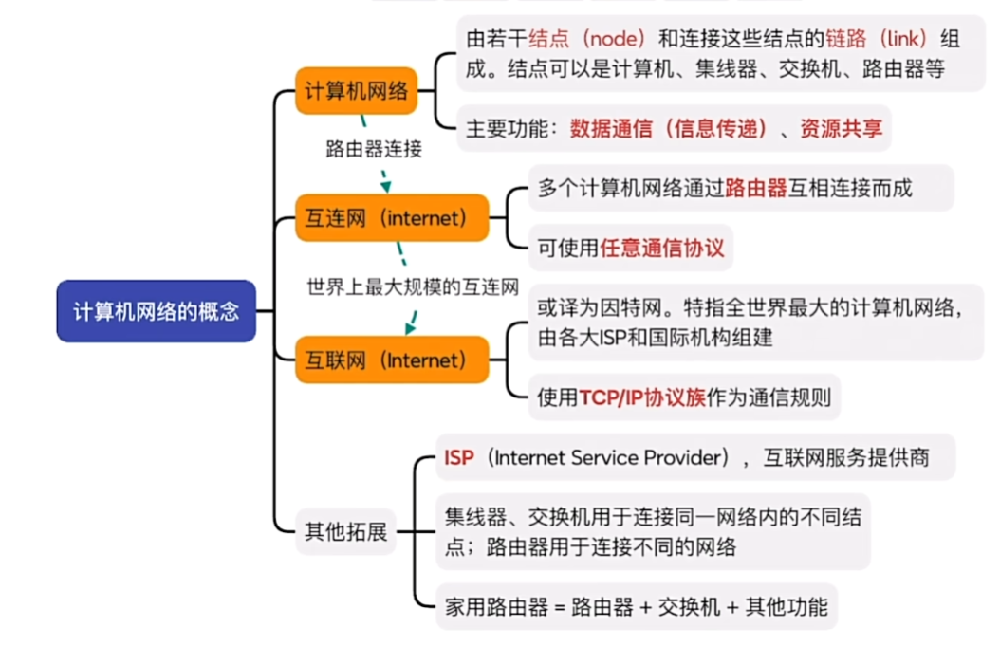
计算机网络 ：由若干结点和连接这些结点的链路组成
互联网：isp：互联网服务提供商干的就是全世界的网络都连接起来，公众只需交网费就可以接入这个网络，必须使用tcp/ip。Internet
互连网：由若干网络和连接这些网络的链路组成,可以使用其他协议。internet

集线器（hub）：允许将多台计算机连接起来，实现数据共享。但是，集线器存在数据传输效率低、容易发生数据碰撞的问题。（工作物理层）
多台设备同时发送时出现数据碰撞，导致数据丢失。

交换机：将数据包转发到目的主机，实现数据传输的高效。组建计算机网络。（ 数据链路层）
构建大的计算机网络就可以使用多台交换机。

路由器：可以将两个或者多个计算机网络连接起来，实现数据传输的高效，也称之为互连网。（ 网络层）

这里的路由器和家用路由器有区别：
家用路由器 = 路由器+交换机+其他功能
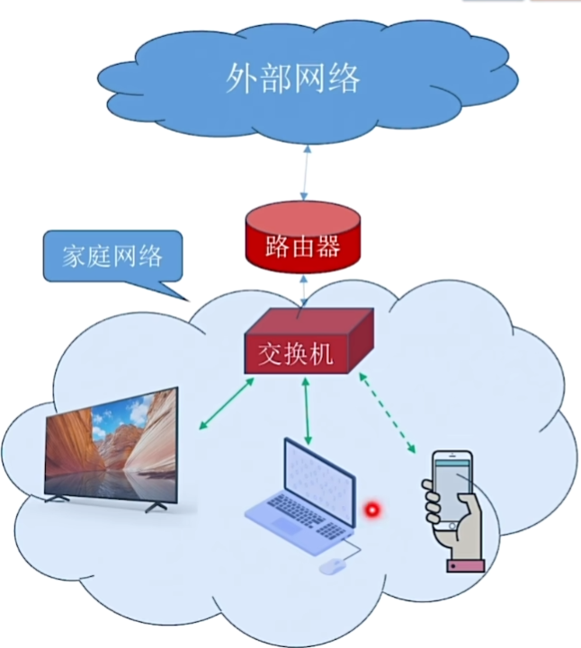

# 2、计算机网络组成
了解就可以：
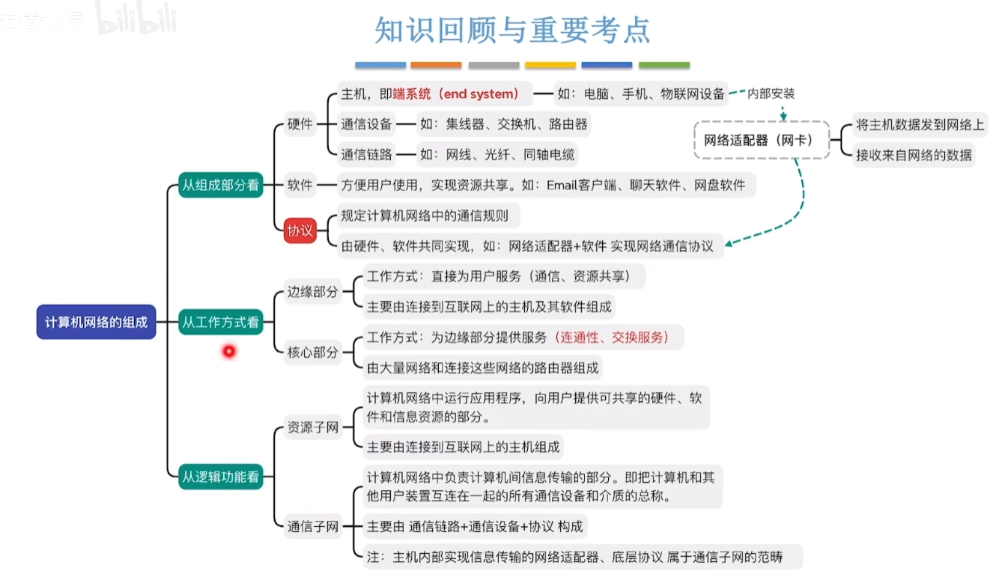

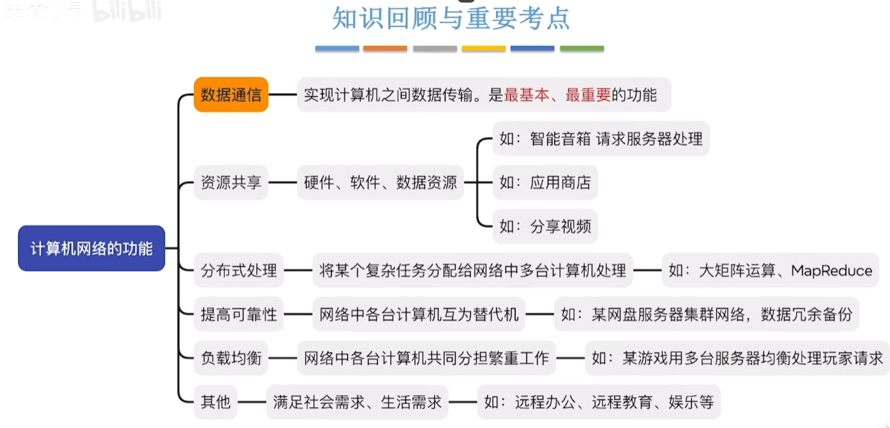

# 3、电路交换，报文交换，分组交换
电路交换：通信主端端之间建立电路，数据传输。通信时间内，通讯线路被占用。没有校验和纠错机制。
报文交换：通信主端端之间不需要先建立连接。先存储再转发。不长时间独占用物理通道。有检验和纠错机制。报文过大，会导致内存和时间开销消耗较大。长报文错误重传概率较大
分组交换：就是在报文交换的基础上，将数据进行分组传输，并且打上组好，这就是现代计算机网络的传输方式。吸收了报文交换的有点。缺点是报文的控制信息较多。

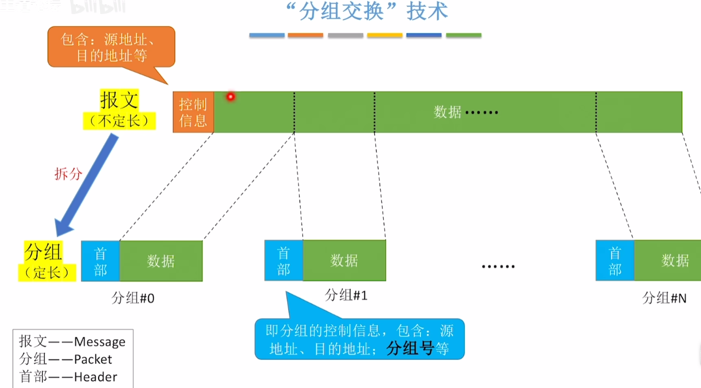

# 3-1、三种交换的性能分析

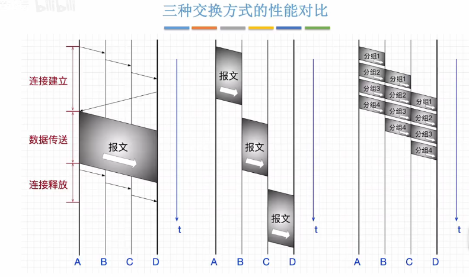

# 4、计算机网络分类
在平常路由器中，wan口是广域网接口。lan口是局域网接口。平常的路由器实际是以太网交换机和路由器的组合。
个域网（wpan）:蓝牙，zigbee，等就是个域网

# 5、计算机网络上的性能指标
速率：指连接到网络上节点在信道上的传输速率。也称数据率或者比特率、数据传输速率。
速率单位：bps（bit per second）(bit/s)(b/s)这几个等价、kbps、mbps、gbps。
* 1B=8b 两者不相同

* 在计算机组成中，k= 2^10，M = 2^20，G=2^30，T=2^40 
带宽：最高传输速率，也称带宽。分为上行带宽和下行带宽。
调制解调器：俗称光猫，用于将光电信号转换为数字信号，用于局域网。

* 在通讯原理中，带宽指的是允许通过的信号频带范围。单位：Hz

吞吐量：指单位时间内通过某个网络（或系统的）的数据量。受到网络和系统的限制，描述的是实际的数据量。
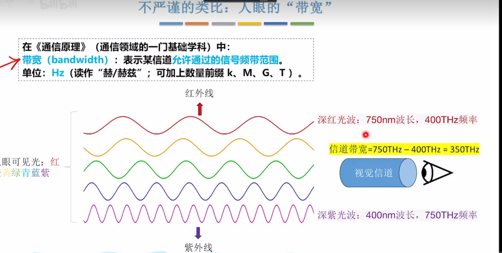

总时延：发送时延（节点将数据发送到信道的时间）+ 传播时延（电磁波在信道中的传播时间） + 处理时延（被路由器处理所花费的时间--分析首部，查找转发储存） + 排队时延（数据排队进入、排队发出路由器的花费的时间）

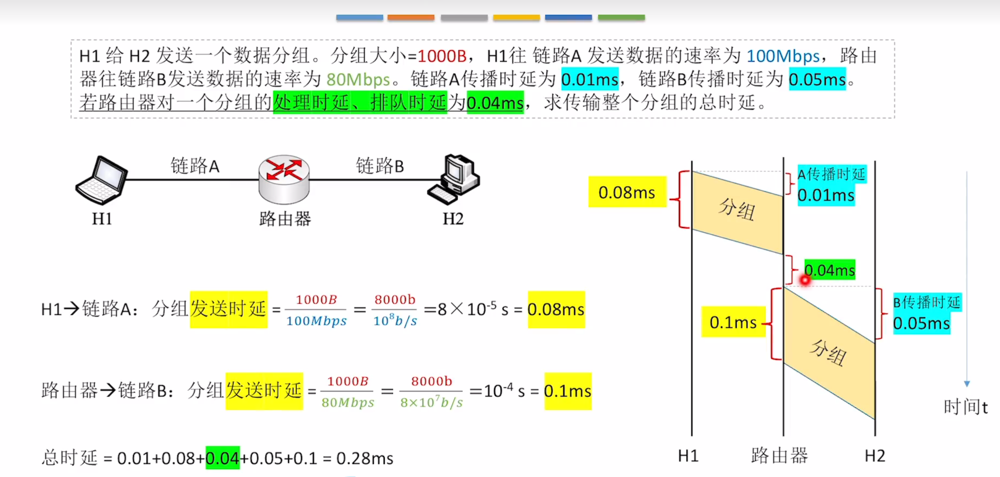

时延带宽积：带宽*发送时延=时延带宽积（与信道长度、电磁波传播速度有关）
时延带宽积的含义：一条链路中，已从发送端发出但是尚未到达接收端的最大比特数

往返时延RTT：表示发送方发送完数据，到发送方收到接收方收到数据的确认所经历的总时间。
游戏延迟就是这个参数。

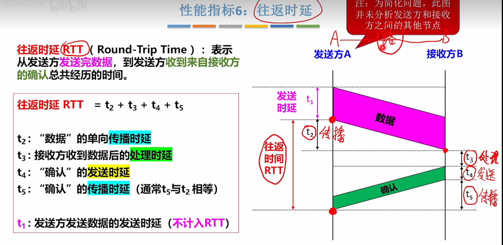

信道利用率：某个信道有百分之几的时间有数据通过。计算方法--有数据通过的时间除以有数据通过的时间和没有数据通过时间的总和。
利用率不能太高也不能太低，太高有堵塞，太低会浪费

# 6、计算机网络的分层结构
类似快递网络。
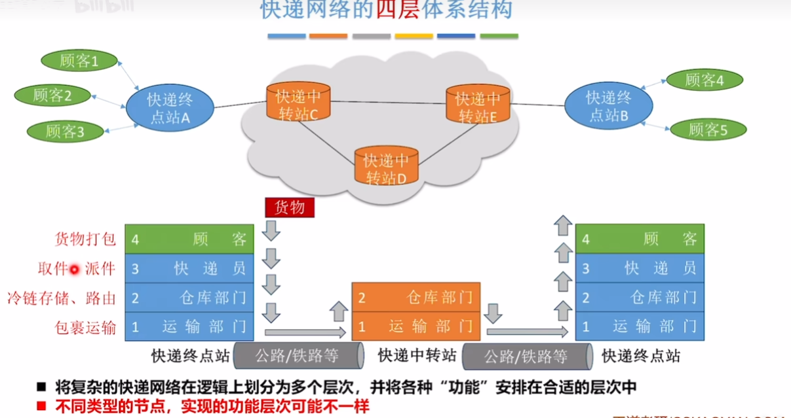

所有计算机网络都要实现五层结构（物理层，数据链路层，网络层，传输层，应用层）,路由器只用实现三层结构（物理层，数据链路层，网络层）。教学用
实际上现在用的互联网模型是四层tcp/ip模型。由美国国防部提出，后来被全世界广泛使用。（网络接口层，网络层，传输层，应用层）
五层结构中，物理层不对数据进行处理。
数据链路层主要实现差错控制功能。
网络层实现的主要是路由功能。
每一层只关心自己的首部信息。
实体：在第n层的软件和硬件的集合称之为第n层实体。如果在不同的机器上，同一层次，叫做对等实体。
协议，是控制对能实体之间通信的规则的集合，是水平的。

接口：同一个节点内相邻两层的实体交换信息的逻辑接口，又称为服务访问点。
服务：服务是指下层为上层提供的功能，是垂直的。

例如应用层通过接口（函数调用），请求相邻下层的传输层服务。
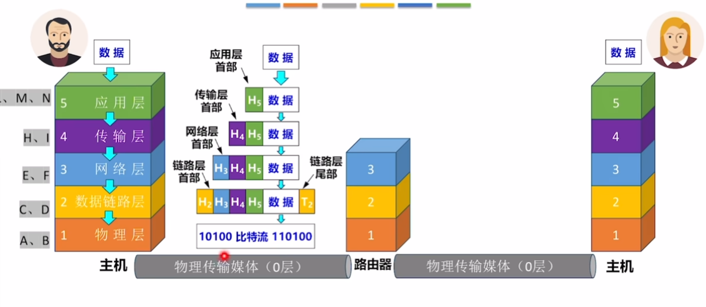

协议数据单元PDU：对等层次之间传送数据单位。第n层的PDU记为nPDU。
服务数据单元SDU：为完成上一层实体所要求的功能而传达的数据。第n层的SDU记为nSDU。
协议控制信息PCI：控制协议操作的信息。第n层的PCI记为nPci。
三者的关系为：nSDU + nPci = nPDU = (n-1)SDU

协议三要素：语法，语义，时序
语法：数据格式
语义：协议语义，协议功能，是否应答
时序：协议操作的时序，协议操作的顺序，协议操作的优先级，协议操作是否同步，如10秒未收到传输回应则失败。
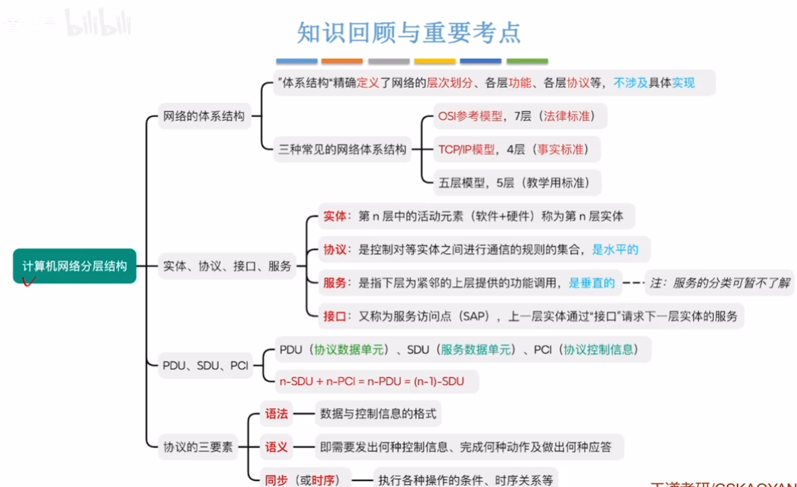

## 6-1、osi七层模型

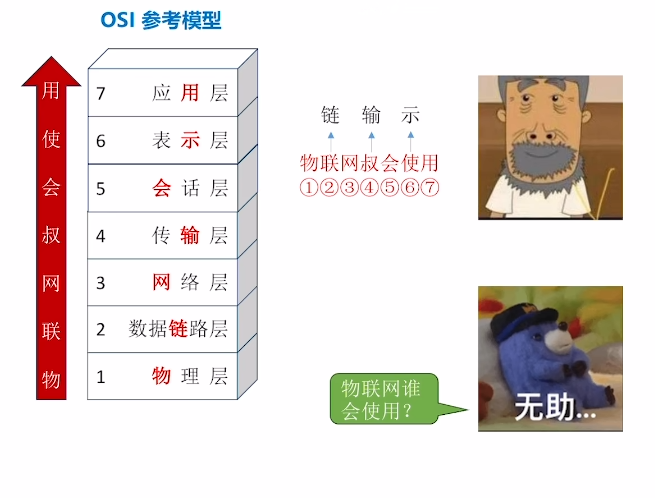
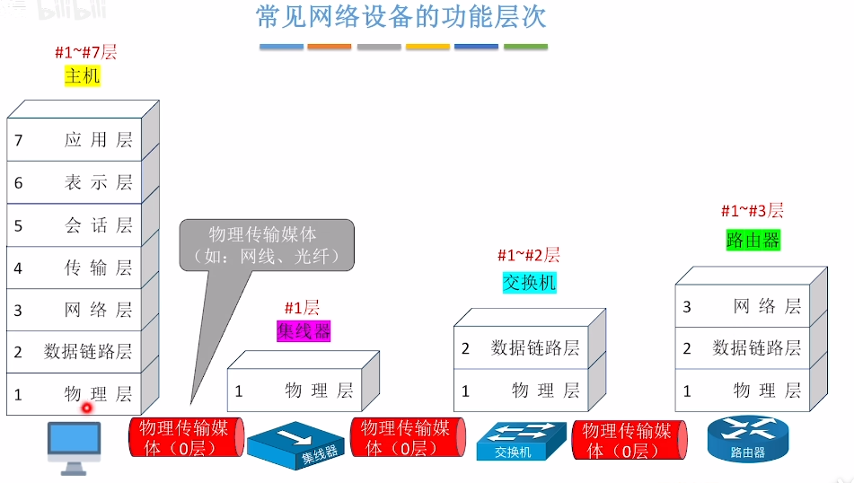

* 物理层：定义电路接口参数，传输信号的含义

* 数据链路层：最主要的任务是进行差错控制，检错，纠错，重传。
含有检验技术进行差错控制。（确保相邻两节点）以帧进行差错控制。
帧为单位进行处理。

* 网络层：路由选择，拥塞控制。分组转发。连接的建立和拆除。（以分组为单位进行差错控制）,可靠性传输。（这里每次进行一个传输都会有一个回答）分组段为单位做处理。

* 传输层：实现端口到端口的通讯。也就是进程到进程的通讯，这一层会将数据分给端口号所在的进程处理。拥有复用和分用功能。发送端几个高层复用一条低层链路，在接受端再进行分用。以报文段为单位进行控制。

* 会话层：建立，管理，终止会话。管理进程间会话。如断网续传。

* 表示层：对数据进行解释，加密，解密。如GBK编码和utf-8编码。

* 应用层：提供应用服务，如文件传输，电子邮件等。

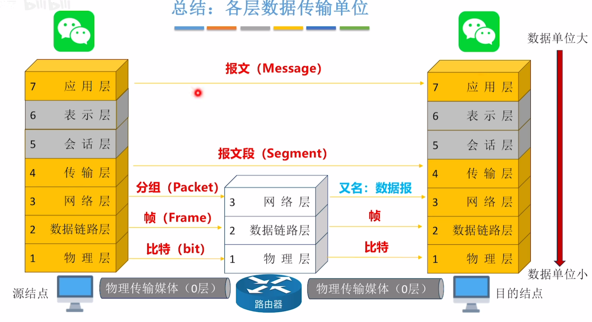
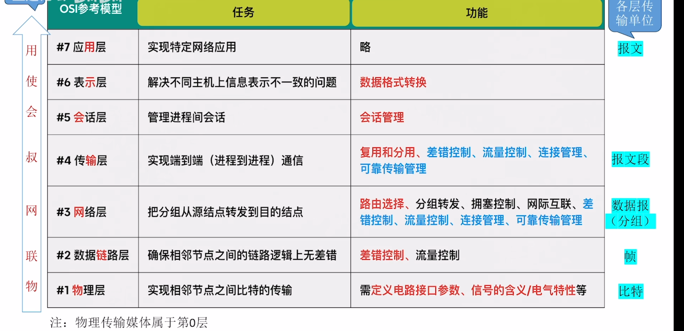

## 6-2、tcp/ip模型

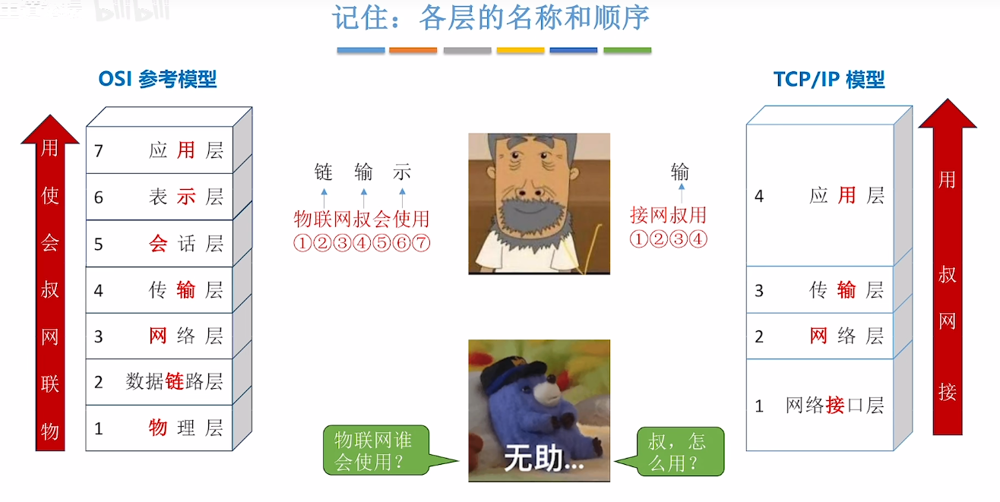

网络接口层相比OSI的物理层和数据链路层，不做限制。只要能正常和网络层交互就可以，而osi模型种，物理层和数据链路层是做了严格限制的。
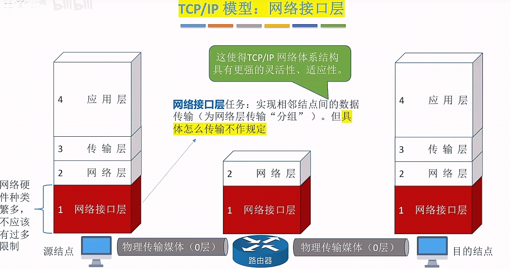
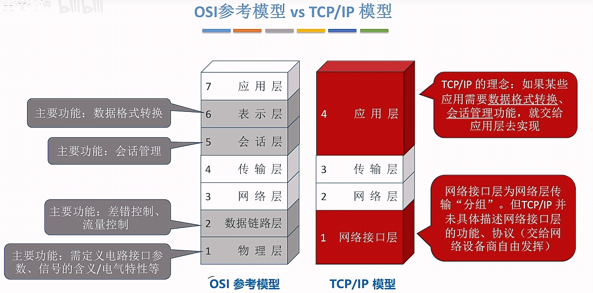
会话层和表示层在tcp/ip模型中不是必有的，交给应用层去做取舍。
在tcp/ip模型中，网络层不再进行差错控制，而是交给传输层进行差错控制。流量管理，连接管理等都去掉了。
保留了tcp/ip模型中的可靠传输，拥塞控制，路由选择，分组转发等。
原因是传输层正确可以保证网络层正确。
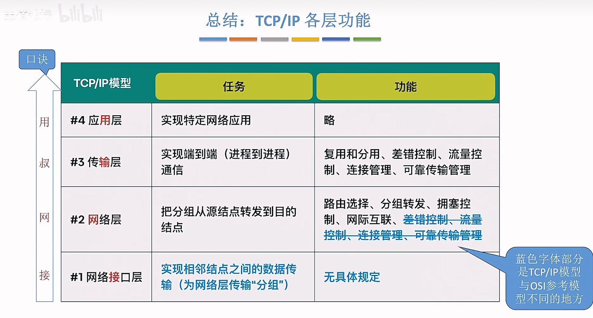

传输层可以向应用层提供UDP（无连接不可靠）和TCP（有链接可靠）服务。

# 7、通信基础
信源：产生信息，发送信息的设备。
信宿：接收信息，接受信息的设备。
信道：信源和信宿之间的传输通道，一条物理线路有两条信道。
信号：在信道中传输的电波。有数字信号和模拟信号。
码元：每一个信号对应一个码元。有四进制的，八进制的，十六进制的。对应功率会增加
速率：有两种 ：
* 波特率：每秒传输的码元数。单位码元/s，或者波特
* 比特率：每秒传输的二进制位数。单位b/s，或者比特，bps

若一个码元携带n比特信息量，波特率为M。则比特率为M*n。

