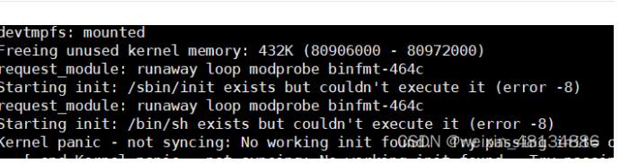

# 1、挂在busybox的时候出现内核崩溃


解决办法， 原因为没有使用交叉编译器进行编译，在Makefile中定义一下
```
CROSS_COMPILE ?= arm-linux-gnueabihf-

ARCH ？= arm
```
如果不定义，需要在编译的时候加上CROSS那一串。
​
# 2、popen函数引发僵尸进程
目前没有好的办法，将调用频率降低，或者使用fork函数。

# 头文件顺序不对编译报缺少相关库
头文件顺序不对，导致编译错误。如系统库必去系统库先，否则会出现缺少库的错误，或者编译错误。

# 立即数乘除加减产生溢出
如64位整数相乘
```c
int64_t a = 1;
int64_t c = a * 10;
/* c 不一定等于 10 */
```
正确的写法
```c
int64_t a = 1;
int64_t c = a * 10ULL;
```
# 锁竞争与饥饿
锁竞争，是指多个进程同时访问同一资源，导致多个进程等待锁的释放，从而导致进程的等待时间过长，从而导致系统资源被饿死。
带锁的进程不能频繁的解锁和上锁，需要加休眠或者延迟。​

你现在明确了核心问题：程序中高频加解锁的线程**没有任何休眠或延迟**，会持续、无间断地争抢并持有锁，导致其他线程几乎没有机会获取锁，陷入长期阻塞——这是典型的“锁饥饿”问题，本质是该线程霸占了CPU和锁资源，没有给其他线程“喘息机会”。

## 问题本质拆解
无休眠的高频加解锁线程会形成这样的执行循环：
```
加锁 → 执行极短的临界区 → 解锁 → 立刻再次尝试加锁 → 加锁成功 → ...
```
由于线程切换和锁争抢的开销远小于“无休眠循环”的执行速度，该线程会**几乎100%霸占锁**，其他线程只能一直阻塞在`lock_guard`的加锁步骤，看似“锁一直被占用”，实际是锁被该线程“秒抢秒放又秒抢”，其他线程根本插不上手。