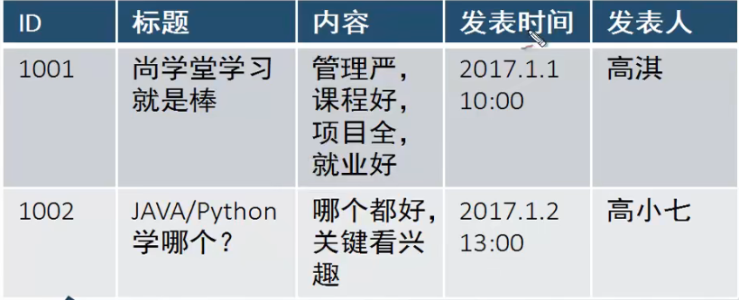

# xml读写规则

		# 避免 ":" 字符。冒号会被转换为命名空间来使用
		表格定义：标签结构
		数据对应：指定元素

	所有的标题都用<>来表示。

	示例
	<新闻>
				<新闻>
							<id><1001><\id>
							<标题><尚......><\标题>
							<>......
							......
				<\新闻>
						<id><1002><\id>
						<标题><JAVA......><\标题>
						<>......
						......
	<\新闻>

		
XML 被设计用来传输和存储数据。
HTML 被设计用来显示数据。
# XML 简化数据传输
		通过 XML，可以在不兼容的系统之间轻松地交换数据。
	对开发人员来说，其中一项最费时的挑战一直是在因特网
	上的不兼容系统之间交换数据。
	由于可以通过各种不兼容的应用程序来读取数据，
	以 XML 交换数据降低了这种复杂性。

# XML 简化平台的变更
		升级到新的系统（硬件或软件平台），总是非常费时的。
	必须转换大量的数据，不兼容的数据经常会丢失。

		XML 数据以文本格式存储。这使得 XML 在不损失数据的情况下，
	更容易扩展或升级到新的操作系统、新应用程序或新的浏览器。
# XML 标签对大小写敏感
	XML 元素使用 XML 标签进行定义。
	XML 标签对大小写敏感。在 XML 中，标签 <Letter> 与标签 <letter> 是不同的。
	必须使用相同的大小写来编写打开标签和关闭标签：
```
<Message>这是错误的。</message>

<message>这是正确的。</message> 
```
# XML 必须正确地嵌套
	在 HTML 中，常会看到没有正确嵌套的元素：
```
<b><i>This text is bold and italic</b></i>
在 XML 中，所有元素都必须彼此正确地嵌套：
<b><i>This text is bold and italic</i></b>
```
		在上例中，正确嵌套的意思是：由于 <i> 元素是在 <b> 元素内打开的，
	那么它必须在 <b> 元素内关闭。
# XML 文档必须有根元素
	XML 文档必须有一个元素是所有其他元素的父元素。该元素称为根元素。

```
<root>
  <child>
    <subchild>.....</subchild>
  </child>
</root>
```
# XML 的属性值须加引号
	与 HTML 类似，XML 也可拥有属性（名称/值的对）。
	XML 元素可以在开始标签中包含属性，类似 HTML。
	属性 (Attribute) 提供关于元素的额外（附加）信息。
	在 XML 中，XML 的属性值须加引号。请研究下面的两个 XML 文档。
	第一个是错误的，第二个是正确的：

```
<note date=08/08/2008>
<to>George</to>
<from>John</from>
</note> 
<note date="08/08/2008">
<to>George</to>
<from>John</from>
</note> 
```

	在第一个文档中的错误是，note 元素中的 date 属性没有加引号。
# XML 属性必须加引号
		属性值必须被引号包围，不过单引号和双引号均可使用。
	比如一个人的性别，person 标签可以这样写：

```
<person sex="female">
或者这样也可以：

<person sex='female'>
注释：如果属性值本身包含双引号，那么有必要使用单引号包围它，就像这个例子：

<gangster name='George "Shotgun" Ziegler'>
或者可以使用实体引用：

<gangster name="George &quot;Shotgun&quot; Ziegler">
```

# XML 中的注释
	在 XML 中编写注释的语法与 HTML 的语法很相似：

```
<!-- This is a comment --> 
```
# 在 XML 中，空格会被保留
	HTML 会把多个连续的空格字符裁减（合并）为一个：

```
HTML:	Hello           my name is David.
输出:	Hello my name is David.
在 XML 中，文档中的空格不会被删节。
```
# XML 文档包含 XML 元素。

		什么是 XML 元素？
	XML 元素指的是从（且包括）开始标签直到（且包括）结束标签的部分。
	元素可包含其他元素、文本或者两者的混合物。元素也可以拥有属性。

```
<bookstore>
<book category="CHILDREN">
  <title>Harry Potter</title> 
  <author>J K. Rowling</author> 
  <year>2005</year> 
  <price>29.99</price> 
</book>
<book category="WEB">
  <title>Learning XML</title> 
  <author>Erik T. Ray</author> 
  <year>2003</year> 
  <price>39.95</price> 
</book>
</bookstore> 
```

			在上例中，<bookstore> 和 <book> 都拥有元素内容，因为它们包含了其他元素。
		<author> 只有文本内容，因为它仅包含文本。
		在上例中，只有 <book> 元素拥有属性 (category="CHILDREN")。

# XML 元素是可扩展的
	XML 元素是可扩展，以携带更多的信息。
请看下面这个 XML 例子：


```
<note>
<to>George</to>
<from>John</from>
<body>Don't forget the meeting!</body>
</note> 
```

让我们设想一下，我们创建了一个应用程序，可将 <to>、<from> 以及 <body> 元素提取出来，并产生以下的输出：

```
MESSAGE
To: George
From: John

Don't forget the meeting!
```

	想象一下，之后这个 XML 文档作者又向这个文档添加了一些额外的信息：

```
<note>
<date>2008-08-08</date>
<to>George</to>
<from>John</from>
<heading>Reminder</heading>
<body>Don't forget the meeting!</body>
</note>
```

	那么这个应用程序会中断或崩溃吗？
	不会。这个应用程序仍然可以找到 XML 文档中的 <to>、
	<from> 以及 <body> 元素，并产生同样的输出。
	XML 的优势之一，就是可以经常在不中断应用程序的情况进行扩展。

# XML 命名空间提供避免元素命名冲突的方法。

		命名冲突
	在 XML 中，元素名称是由开发者定义的，当两个不同的文档使用相同的元素名时，
	就会发生命名冲突。
	这个 XML 文档携带着某个表格中的信息：

```
<table>
   <tr>
   <td>Apples</td>
   <td>Bananas</td>
   </tr>
</table>
```

	这个 XML 文档携带有关桌子的信息（一件家具）：

```
<table>
    <tr>
   <name>African Coffee Table</name>
   <width>80</width>
   <length>120</length>
     </tr>
</table>
```

	假如这两个 XML 文档被一起使用，由于两个文档都包含带有不同内容和
	定义的 <table> 元素，就会发生命名冲突。
	XML 解析器无法确定如何处理这类冲突。

本篇完结！
