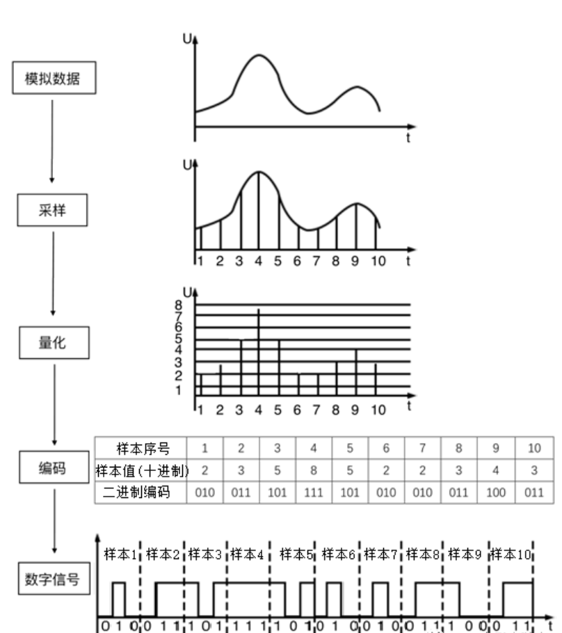

# 入门基础
## 视频
### 视频帧率
视频帧,帧率，帧率一般电视在25帧/秒，电影在24帧/秒，1080P 60帧/秒，720P 30帧/秒。过高无意义。

### 色彩空间
常见的两种色彩空间：RGB 和 YUV。
RGB是彩色空间，RGB三通道，R为红色，G为绿色，B为蓝色。
早期的电视都是黑白的，YUV只有Y亮度值，后来加入两种色度UV，也叫YCbCr。
色度定义了颜色的两个方面：色度，饱和度。
Cr:反应的是输入信号红色部分与RGB信号之间的差异。
Cb:反应的是输入信号蓝色部分与RGB信号之间的差异。

总结：
Y:亮度,也代表一定程度的绿色通道量。
U:与蓝色部分之间的差异。
V:与红色部分之间的差异。

人眼对亮度的敏感度更高，对色度敏感度较低。

RGB和YUV进行线性量化转换。

## 音频
音频数据的承载方式最常见的就是脉冲编码调制，也就是pcm。
pcm的采集可以分为以下
模拟信号->采样->量化->编码->数字信号

### 采样率
根据采样的奈奎斯特定理，采样率必须大于等于2倍的信号频率。人耳20Hz到20KHz之间可以听清。

采样率，就是采样的频率。

### 采样位数
这个直接涉及到振幅的大小。8位，16位，32位。采样位数越高，表示的幅度就越大。还原性越好。但是占用的空间会越大。

### 音频编码
这里就是坑，音频数字化的标准是每个样本16位，96dB信噪比。

### 声道数
声道数，就是音频的通道数。

### 码率
一个数据流中每秒通过的信息量。
码率=采样率*采样位数*声道数

## 音视频编解码
这里的编解码和上面的数字化编码不是一个概念，而是压缩编码。
### 视频编码
主要有两大类。h.26x和mpeg。分别由国际电信联盟和运动图形专家组开发,他们也联合开发过一些标准，如h264,h265。
h265和h264在mpeg中属于第4部分。如h264也称之为mpeg-4 AVC

### 音频编码
原始编码pcm拥有非常大的数据量，但是压缩编码可以减少数据量，从而减少传输时间。
这里讲aac,由pcm压缩而成。
aac格式有两种：ADIF 和ADTS 。区别在于能不能随意插入解码。

### 软解码和硬解码
软件解码兼容性好，硬件解码兼容性差，但是速度更快。