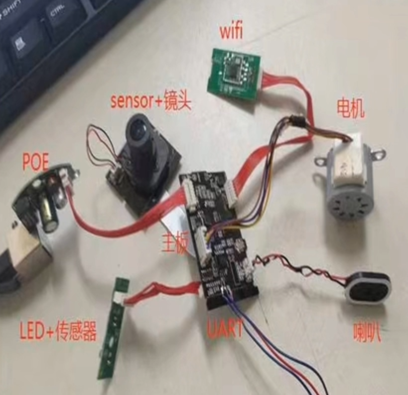
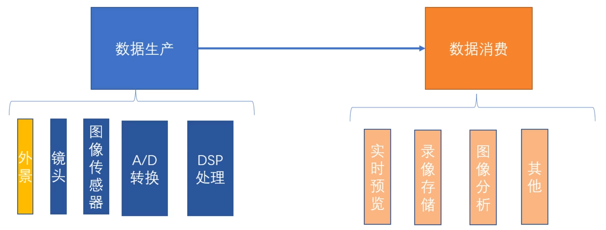

# 1、概述
	  	ipc的英文是ipcamera，没入行之前认为这是嵌入式驱动相关的
		工作，后来才知道不是。
		基本的过程：采集图像，进行存储，进行传输。
		IPC开发为目前嵌入式前沿技术最为密集的领域，
		涉及AI，图像识别，人脸识别，动作识别，各种算法等。
	

## 1-1、原理

			
		首先是外景的光线进入镜头，经过一定调焦，打到图像传感器上，
	也就是sensor，转换成模拟信号，然后通过A/D转换，转换成数字信号。
	然后经过DSP编码处理。（如果出现模糊等各种情况就可以进行追溯，
	比如是镜头问题等）
		数据消费中的其他指的是传给其他的平台，进行协议的对接。
	
## 1-2、方案介绍
	 	当有的人问你，你们公司的摄像机是基于什么方案，什么平台做的
	外围的配件、电机、摄像头、麦克风等一般都是从供应商拿的，而主控芯片，
	就是从方案代理公司拿的，所以就是，主控是什么类型的，方案就是基于什
	么来做的。一般的方案公司有：海思、富瀚、瑞芯微，全志、索尼。
	所以就形成了一个上下游：芯片制造、芯片代理、方案代理、安防公司。
	一般从方案公司拿到芯片和sdk。
	sdk包：具体有arm板文档、uboot、内核、文件系统、busybox、
	驱动、库、工具，硬件上则是有一个demo板。
	
	