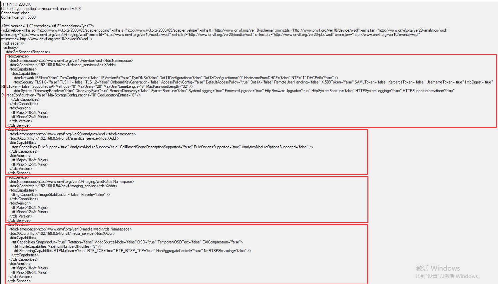
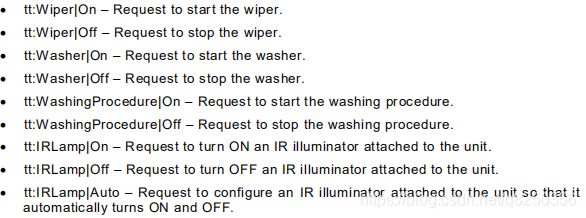
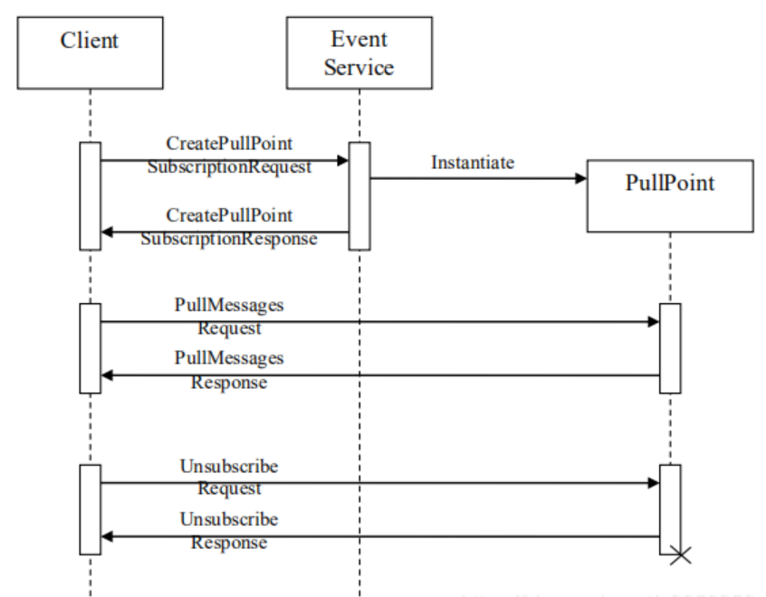
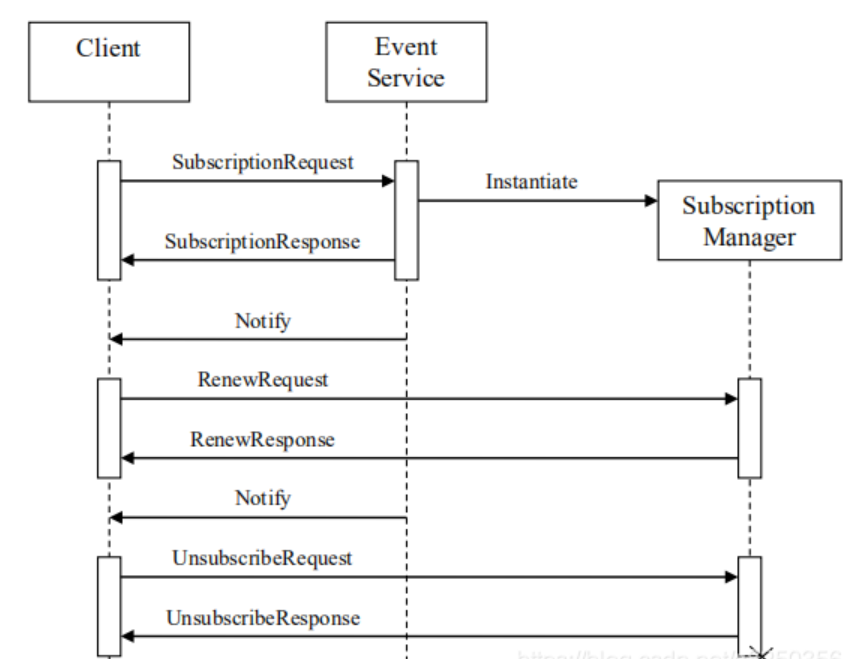

	probe为onvif连接时，会产生一个广播，一般情况下不影响整个协议。
	WSDL的web服务公共接口。
	之间的关系，onvif协议以soap协议为基础，
	而soap又是用WSDL进行规范，所以onvif相当于
	规范了WSDL。

	理解上：onvif = 服务端 +客户端 =（web services + rtsp）+ 客户端 =（ （WSDL + soap）+
	rtsp）+ 客户端
	WSDL是服务端用来向客户描述自己实现那些请求，发送请求时需要带上那些参数xml格式
	soap是客户端向服务器端发送请求时xml的参数格式。
	web services是实现摄像头控制（比如一些参数配置、摄像头上下左右（PTZ）控制）；rtsp
	实现摄像头传输，web services指ipc控制到具体的技术实现，进行技术交互，其实和http差不多，
	客户端类似http post的格式向服务端发送请求，然后服务端响应客户端请求。
	
	onvif中的profiles是什么？
	onvif提供了很多的profiles概要文件，用来规范onvif设备端与onvif客户端的通信标准。目前已经发
	布的profile文件主要包括S，G，C，Q，A，不同的profile文件应用于不同的领域，不同的profile文
	件可以组合使用，profile文件的一致性是确保符合onvif产品兼容性的唯一方法，因此，只有符合
	profile文件的注册产品才被认为是兼容onvif的。

	profile S应用于网络视频系统，内容包括：
	1、视频和音频流
	2、PTZ控制和继电器输出
	3、视频配置和多播
	profile S应用于网络视频系统。profile S的设备（例如：网络摄像机或视频编码器）可以将视频数
	据通过IP网络发送到profile S的客户端。profile S的客户端（例如：视频管理软件）可以配置、请
	求和控制从profile S的设备上的IP网络视频流。

	profile G应用于边缘存储与检索，内容包括：
	1、配置、请求、控制录像
	2、接收视频/音频流
	profile G设备（例如：网络摄像机或视频编码器）可以通过网络存
	储或本地存储录像。profile G客户端（例如：视频管理软件）可以配置、请求和控制profile G设备
	上的录像

	profile C应用网络电子门禁系统，内容包括：
	1、站点信息和配置
	2、事件和警报管理
	3、门禁控制
	profile C应用于电子门禁系统。profile C设备和客户应支持站点信息、门禁控制、事件和报警管理。

	profile Q应用于快速安装，内容包括：
	1、简单的设置
	2、发现、配置和控制设备
	3、先进的安全功能
	profile Q应用于网络视频系统，其目的是提供profile Q产品的快速发现和配置（例如：网路摄像机、
	网络交换机、网络监视器）。profile Q的客户端能够发现、配置和控制profile Q设备。peofile Q也
	支持传输层安全协议（TLS），允许onvif设备与客户端以防止被篡改和窃听的安全方式进行通讯。

	profile 	A应用于更广泛的访问控制配置，内容包括：
	1、授予/撤销证书
	2、创建时间表
	3、指定访问规则
	profie A应用于电子门禁系统。profile A的设备可以检索信息，状态和事件，并配置访问规则、
	凭据和时间表等。profile A的客户端可以访问规则配置、凭据和时间表。profile A客户端还可
	以检索和接收标准化的访问控制相关的事件。

	profile T适用于高级视频流，内容包括：
	1、H.264/H.265视频压缩
	2、成像设置
	3、动作报警和篡改事件
	4、元数据流
	5、双向音频

	profile T专为基于IP的视频系统而设计。profile T支持视频流的功能，	例如使用H.264
	和H.265编码格式，成像设置及诸运动和篡改检测之类的警报事件，设备的强制功能还
	包括屏幕显示和元数据流，而客户端的强制功能还包括PTZ控制。profile T还覆盖了用于HTTOS流，
	PTZ配置，运动区配置，数字输入和继电器输出的onvif规范，以及支持此类功能的符合设备和客
	户端的双向音频。
	
	

# 1、规范的内容
	1、DeviceMgmt（设备管理） 
	2、DeviceIO（设备io服务）
	3、Event（事件服务）
	4、Analytics（视频分析）
	5、AnalyticsDevice（分析设备）
	6、Display（显示服务）
	7、Imaging（图像配置）
	8、Media（媒体配置）
	9、PTZ（PTZ控制）
	10、Receiver（接收端配置）
	11、RemoteDiscovery（设备发现）
	12、Recording（录像控制）
	13、Replay（重新控制）
	14、Search（记录搜索）

## 1-1、怎么查找？
		需要了解那一部分的内容，只需要查找对应的接口文档，
	例如移动侦测就去找event的文档。
	文档已下载。

# 2、web service + wsdl +soap
## 2-1、web service
	web service主要使用HTTP和soap协议使数据在web上传输。
	web service是基于xml和http的一种服务，其通讯协议主要基于soap。
	服务端、客户端传递符合xml的soap消息实现服务的请求与回应。
	客户端根据wsdl描述文档，会生成一个soap请求消息，该请求会被嵌入在
	一个HTTP post请求中，发送到web services所在的web服务器，web services请求处理
	器解析收到的soap请求，调用相应的web services。然后再生成相应的soap应答。
	web服务器得到soap应答后，会再通过http应答的方式把信息送回客户端。
	
## 2-2、wsdl
	是一个用来描述Web服务和说明如何与Web服务通信的XML语言，为用户提供详细的接口说明书
	
# 3、ONVIF 能力集
		ONVIF设备管理标准分为如下子标准，
	其中前5个是ONVIF设备必须实现的，后面2个是可选操作
```
Capabilities			ONVIF设备能力集相关API
Network					网络相关API
System					系统配置相关API
Security				安全相关API
Input/Output(I/O)	
Auxiliary operation	
Storage Configuration
```
## 3-1、交集过程（示例）
### 3-1-1、Getcapabilities
	tds:Getcapabilities
	客户端请求报文：

```
<?xml version="1.0" encoding="UTF-8"?> 
<SOAP-ENV:Envelope xmlns:SOAP-ENV="http://www.w3.org/2003/05/soap-envelope" 
xmlns:tds="http://www.onvif.org/ver10/device/wsdl"> 
	<SOAP-ENV:Body> 
		<tds:GetCapabilities> 
   			<tds:Category>All</tds:Category> 
		</tds:GetCapabilities> 
	</SOAP-ENV:Body> 
</SOAP-ENV:Envelope>
```
		服务器回复报文：

```
<?xml version="1.0" encoding="UTF-8"?> 
<SOAP-ENV:Envelope xmlns:SOAP-ENV="http://www.w3.org/2003/05/soap-envelope" 
xmlns:tt="http://www.onvif.org/ver10/schema" 
xmlns:tds="http://www.onvif.org/ver10/device/wsdl"> 
 <SOAP-ENV:Body> 
  <tds:GetCapabilitiesResponse> 
	<tds:Capabilities> 
		<tt:Device> 
			<tt:XAddr>http://169.254.76.145/onvif/services</tt:XAddr> 
			<tt:Network> 
				<tt:IPFilter>true</tt:IPFilter> 
				<tt:ZeroConfiguration>true</tt:ZeroConfiguration> 
				<tt:IPVersion6>true</tt:IPVersion6> 
				<tt:DynDNS>true</tt:DynDNS> 
			</tt:Network> 
			<tt:System> 
				<tt:DiscoveryResolve>true</tt:DiscoveryResolve> 
   				<tt:DiscoveryBye>true</tt:DiscoveryBye> 
				<tt:RemoteDiscovery>false</tt:RemoteDiscovery> 
				<tt:SystemBackup>false</tt:SystemBackup> 
				<tt:SystemLogging>true</tt:SystemLogging> 
				<tt:FirmwareUpgrade>false</tt:FirmwareUpgrade> 
				<tt:SupportedVersions> 
					<tt:Major>1</tt:Major> 
					<tt:Minor>0</tt:Minor> 
				</tt:SupportedVersions> 
			</tt:System> 
			<tt:IO> 
				<tt:InputConnectors>1</tt:InputConnectors> 
				<tt:RelayOutputs>0</tt:RelayOutputs> 
			</tt:IO> 
			<tt:Security> 
				<tt:TLS1.1>false</tt:TLS1.1> 
				<tt:TLS1.2>false</tt:TLS1.2> 
				<tt:OnboardKeyGeneration>false</tt:OnboardKeyGeneration> 
				<tt:AccessPolicyConfig>false</tt:AccessPolicyConfig> 
				<tt:X.509Token>false</tt:X.509Token> 
				<tt:SAMLToken>false</tt:SAMLToken> 
				<tt:KerberosToken>false</tt:KerberosToken> 
				<tt:RELToken>false</tt:RELToken> 
			</tt:Security> 
		</tt:Device> 
		<tt:Events> 
			<tt:XAddr>http://169.254.76.145/onvif/services</tt:XAddr> 
			<tt:WSSubscriptionPolicySupport>false</tt:WSSubscriptionPolicySupport> 
			<tt:WSPullPointSupport>false</tt:WSPullPointSupport>
			<tt:WSPausableSubscriptionManagerInterfaceSupport>false</tt:WSPausableSubscriptionManagerInterfaceSupport> 
   		</tt:Events>
		<tt:Media> 
   			<tt:XAddr>http://169.254.76.145/onvif/services</tt:XAddr> 
   			<tt:StreamingCapabilities> 
   				<tt:RTPMulticast>true</tt:RTPMulticast> 
   				<tt:RTP_TCP>true</tt:RTP_TCP> 
   				<tt:RTP_RTSP_TCP>true</tt:RTP_RTSP_TCP> 
   			</tt:StreamingCapabilities> 
		</tt:Media> 
	</tds:Capabilities> 
  </tds:GetCapabilitiesResponse> 
 </SOAP-ENV:Body> 
</SOAP-ENV:Envelope>
```

	宇视后端抓取得：

```
POST /onvif/device_service HTTP/1.1
Host: 192.168.1.100:9007
User-Agent: SOAP Client
Content-Type: application/soap+xml; charset=utf-8
Content-Length: 963
Connection: close


<?xml version="1.0" encoding="utf-8" standalone="yes" ?>
<s:Envelope
    xmlns:s="http://www.w3.org/2003/05/soap-envelope"
    xmlns:sc="http://www.w3.org/2003/05/soap-encoding"
    xmlns:tt="http://www.onvif.org/ver10/schema"
    xmlns:wsnt="http://docs.oasis-open.org/wsn/b-2"
    xmlns:wsrf-bf="http://docs.oasis-open.org/wsrf/bf-2"
    xmlns:xop="http://www.w3.org/2004/08/xop/include"
    xmlns:tds="http://www.onvif.org/ver10/device/wsdl"
    xmlns:wsa5="http://www.w3.org/2005/08/addressing"
    xmlns:wstop="http://docs.oasis-open.org/wsn/t-1"
    xmlns:xsi="http://www.w3.org/2001/XMLSchema-instance"
    xmlns:wsu="http://docs.oasis-open.org/wss/2004/01/oasis-200401-wss-wssecurity-utility-1.0.xsd"
    xmlns:wsse="http://docs.oasis-open.org/wss/2004/01/oasis-200401-wss-wssecurity-secext-1.0.xsd"
    xmlns:xsd="http://www.w3.org/2001/XMLSchema"
    xmlns:xmime="http://tempuri.org/xmime.xsd">
    <s:Header/>
    <s:Body>
        <tds:GetCapabilities>
            <tds:Category>All</tds:Category>
        </tds:GetCapabilities>
    </s:Body>
</s:Envelope>HTTP/1.1 200 OK
Server: hsoap/2.8
Access-Control-Allow-Origin: *
Access-Control-Allow-Methods: GET, POST, PUT, OPTIONS
Access-Control-Allow-Headers: Content-Type, Authorization, X-Custom-Header
Content-Type: application/soap+xml; charset=utf-8
Content-Length: 5491
Connection: close


<?xml version="1.0" encoding="UTF-8"?>
<s:Envelope
    xmlns:s="http://www.w3.org/2003/05/soap-envelope"
    xmlns:e="http://www.w3.org/2003/05/soap-encoding"
    xmlns:wsa="http://schemas.xmlsoap.org/ws/2004/08/addressing"
    xmlns:wsa5="http://www.w3.org/2005/08/addressing"
    xmlns:xs="http://www.w3.org/2001/XMLSchema"
    xmlns:xsi="http://www.w3.org/2001/XMLSchema-instance"
    xmlns:wsaw="http://www.w3.org/2006/05/addressing/wsdl"
    xmlns:wsnt="http://docs.oasis-open.org/wsn/b-2"
    xmlns:wstop="http://docs.oasis-open.org/wsn/t-1"
    xmlns:wsntw="http://docs.oasis-open.org/wsn/bw-2"
    xmlns:wsrf-rw="http://docs.oasis-open.org/wsrf/rw-2"
    xmlns:wsrf-r="http://docs.oasis-open.org/wsrf/r-2"
    xmlns:wsrf-bf="http://docs.oasis-open.org/wsrf/bf-2"
    xmlns:wsdl="http://schemas.xmlsoap.org/wsdl"
    xmlns:wsoap12="http://schemas.xmlsoap.org/wsdl/soap12"
    xmlns:http="http://schemas.xmlsoap.org/wsdl/http"
    xmlns:d="http://schemas.xmlsoap.org/ws/2005/04/discovery"
    xmlns:wsadis="http://schemas.xmlsoap.org/ws/2004/08/addressing"
    xmlns:tt="http://www.onvif.org/ver10/schema"
    xmlns:tns1="http://www.onvif.org/ver10/topics"
    xmlns:tds="http://www.onvif.org/ver10/device/wsdl"
    xmlns:trt="http://www.onvif.org/ver10/media/wsdl"
    xmlns:tev="http://www.onvif.org/ver10/events/wsdl"
    xmlns:wsu="http://docs.oasis-open.org/wss/2004/01/oasis-200401-wss-wssecurity-utility-1.0.xsd"
    xmlns:wsse="http://docs.oasis-open.org/wss/2004/01/oasis-200401-wss-wssecurity-secext-1.0.xsd"
    xmlns:timg="http://www.onvif.org/ver20/imaging/wsdl"
    xmlns:tst="http://www.onvif.org/ver10/storage/wsdl"
    xmlns:dn="http://www.onvif.org/ver10/network/wsdl"
    xmlns:tr2="http://www.onvif.org/ver20/media/wsdl"
    xmlns:tptz="http://www.onvif.org/ver20/ptz/wsdl"
    xmlns:tan="http://www.onvif.org/ver20/analytics/wsdl"
    xmlns:axt="http://www.onvif.org/ver20/analytics"
    xmlns:tmd="http://www.onvif.org/ver10/deviceIO/wsdl"
    xmlns:tcr="http://www.onvif.org/ver10/credential/wsdl"
    xmlns:tar="http://www.onvif.org/ver10/accessrules/wsdl"
    xmlns:ewsd="http://www.onvifext.com/onvif/ext/ver10/wsdl"
    xmlns:exsd="http://www.onvifext.com/onvif/ext/ver10/schema"
    xmlns:tnshik="http://www.hikvision.com/2011/event/topics"
    xmlns:hikwsd="http://www.onvifext.com/onvif/ext/ver10/wsdl"
    xmlns:hikxsd="http://www.onvifext.com/onvif/ext/ver10/schema"
    xmlns:ter="http://www.onvif.org/ver10/error">
    <s:Header></s:Header>
    <s:Body>
        <tds:GetCapabilitiesResponse>
            <tds:Capabilities>
                <tt:Analytics>
                    <tt:XAddr>http://192.168.1.100:9007/onvif/Analytics</tt:XAddr>
                    <tt:RuleSupport>true</tt:RuleSupport>
                    <tt:AnalyticsModuleSupport>true</tt:AnalyticsModuleSupport>
                </tt:Analytics>
                <tt:Device>
                    <tt:XAddr>http://192.168.1.100:9007/onvif/device_service</tt:XAddr>
                    <tt:Network>
                        <tt:IPFilter>false</tt:IPFilter>
                        <tt:ZeroConfiguration>false</tt:ZeroConfiguration>
                        <tt:IPVersion6>false</tt:IPVersion6>
                        <tt:DynDNS>false</tt:DynDNS>
                        <tt:Extension>
                            <tt:Dot11Configuration>false</tt:Dot11Configuration>
                        </tt:Extension>
                    </tt:Network>
                    <tt:System>
                        <tt:DiscoveryResolve>false</tt:DiscoveryResolve>
                        <tt:DiscoveryBye>false</tt:DiscoveryBye>
                        <tt:RemoteDiscovery>false</tt:RemoteDiscovery>
                        <tt:SystemBackup>false</tt:SystemBackup>
                        <tt:SystemLogging>false</tt:SystemLogging>
                        <tt:FirmwareUpgrade>false</tt:FirmwareUpgrade>
                        <tt:SupportedVersions>
                            <tt:Major>17</tt:Major>
                            <tt:Minor>12</tt:Minor>
                        </tt:SupportedVersions>
                        <tt:Extension>
                            <tt:HttpFirmwareUpgrade>false</tt:HttpFirmwareUpgrade>
                            <tt:HttpSystemBackup>false</tt:HttpSystemBackup>
                            <tt:HttpSystemLogging>false</tt:HttpSystemLogging>
                            <tt:HttpSupportInformation>false</tt:HttpSupportInformation>
                        </tt:Extension>
                    </tt:System>
                    <tt:IO>
                        <tt:InputConnectors>0</tt:InputConnectors>
                        <tt:RelayOutputs>0</tt:RelayOutputs>
                    </tt:IO>
                    <tt:Security>
                        <tt:TLS1.1>false</tt:TLS1.1>
                        <tt:TLS1.2>false</tt:TLS1.2>
                        <tt:OnboardKeyGeneration>false</tt:OnboardKeyGeneration>
                        <tt:AccessPolicyConfig>false</tt:AccessPolicyConfig>
                        <tt:X.509Token>false</tt:X.509Token>
                        <tt:SAMLToken>false</tt:SAMLToken>
                        <tt:KerberosToken>false</tt:KerberosToken>
                        <tt:RELToken>false</tt:RELToken>
                    </tt:Security>
                </tt:Device>
                <tt:Events>
                    <tt:XAddr>http://192.168.1.100:9007/onvif/events</tt:XAddr>
                    <tt:WSSubscriptionPolicySupport>true</tt:WSSubscriptionPolicySupport>
                    <tt:WSPullPointSupport>false</tt:WSPullPointSupport>
                    <tt:WSPausableSubscriptionManagerInterfaceSupport>false</tt:WSPausableSubscriptionManagerInterfaceSupport>
                </tt:Events>
                <tt:Imaging>
                    <tt:XAddr>http://192.168.1.100:9007/onvif/imaging</tt:XAddr>
                </tt:Imaging>
                <tt:Media>
                    <tt:XAddr>http://192.168.1.100:9007/onvif/media</tt:XAddr>
                    <tt:StreamingCapabilities>
                        <tt:RTPMulticast>false</tt:RTPMulticast>
                        <tt:RTP_TCP>true</tt:RTP_TCP>
                        <tt:RTP_RTSP_TCP>true</tt:RTP_RTSP_TCP>
                    </tt:StreamingCapabilities>
                    <tt:Extension>
                        <tt:ProfileCapabilities>
                            <tt:MaximumNumberOfProfiles>2</tt:MaximumNumberOfProfiles>
                        </tt:ProfileCapabilities>
                    </tt:Extension>
                </tt:Media>
                <tt:PTZ>
                    <tt:XAddr>http://192.168.1.100:9007/onvif/ptz</tt:XAddr>
                </tt:PTZ>
                <tt:Extension>
                    <hikxsd:hikCapabilities>
                        <hikxsd:XAddr>http://192.168.1.100:9007/onvif/hik_ext</hikxsd:XAddr>
                        <hikxsd:IOInputSupport>false</hikxsd:IOInputSupport>
                        <hikxsd:PrivacyMaskSupport>true</hikxsd:PrivacyMaskSupport>
                        <hikxsd:PTZ3DZoomSupport>false</hikxsd:PTZ3DZoomSupport>
                        <hikxsd:PTZPatternSupport>true</hikxsd:PTZPatternSupport>
                    </hikxsd:hikCapabilities>
                    <tt:DeviceIO>
                        <tt:XAddr>http://192.168.1.100:9007/onvif/deviceIO</tt:XAddr>
                        <tt:VideoSources>1</tt:VideoSources>
                        <tt:VideoOutputs>0</tt:VideoOutputs>
                        <tt:AudioSources>1</tt:AudioSources>
                        <tt:AudioOutputs>1</tt:AudioOutputs>
                        <tt:RelayOutputs>1</tt:RelayOutputs>
                    </tt:DeviceIO>
                </tt:Extension>
            </tds:Capabilities>
        </tds:GetCapabilitiesResponse>
    </s:Body>
</s:Envelope>
```
### 3-1-2、tev:GetServiceCapabilities
客服端请求：
```
客户端请求报文：
POST /onvif/device_service HTTP/1.1
Host: 192.16.11.180
User-Agent: gSOAP/2.8
Content-Type: application/soap+xml; charset=utf-8; action="http://www.onvif.org/ver10/events/wsdl/EventPortType/GetServiceCapabilitiesRequest"
Content-Length: 2589
Connection: close
SOAPAction: "http://www.onvif.org/ver10/events/wsdl/EventPortType/GetServiceCapabilitiesRequest"

<?xml version="1.0" encoding="UTF-8"?>
<SOAP-ENV:Envelope xmlns:SOAP-ENV="http://www.w3.org/2003/05/soap-envelope" xmlns:SOAP-ENC="http://www.w3.org/2003/05/soap-encoding" xmlns:xsi="http://www.w3.org/2001/XMLSchema-instance" xmlns:xsd="http://www.w3.org/2001/XMLSchema" xmlns:wsa5="http://www.w3.org/2005/08/addressing" xmlns:wsa="http://www.w3.org/2005/08/addressing" xmlns:wsdd="http://schemas.xmlsoap.org/ws/2005/04/discovery" xmlns:chan="http://schemas.microsoft.com/ws/2005/02/duplex" xmlns:c14n="http://www.w3.org/2001/10/xml-exc-c14n#" xmlns:ds="http://www.w3.org/2000/09/xmldsig#" xmlns:saml1="urn:oasis:names:tc:SAML:1.0:assertion" xmlns:saml2="urn:oasis:names:tc:SAML:2.0:assertion" xmlns:wsu="http://docs.oasis-open.org/wss/2004/01/oasis-200401-wss-wssecurity-utility-1.0.xsd" xmlns:xenc="http://www.w3.org/2001/04/xmlenc#" xmlns:wsc="http://docs.oasis-open.org/ws-sx/ws-secureconversation/200512" xmlns:wsse="http://docs.oasis-open.org/wss/2004/01/oasis-200401-wss-wssecurity-secext-1.0.xsd" xmlns:xmime="http://tempuri.org/xmime.xsd" xmlns:xop="http://www.w3.org/2004/08/xop/include" xmlns:wsnt="http://docs.oasis-open.org/wsn/b-2" xmlns:tt="http://www.onvif.org/ver10/schema" xmlns:tns1="http://www.onvif.org/ver10/topics" xmlns:wsrfbf="http://docs.oasis-open.org/wsrf/bf-2" xmlns:wstop="http://docs.oasis-open.org/wsn/t-1" xmlns:wsrfr="http://docs.oasis-open.org/wsrf/r-2" xmlns:dn="http://www.onvif.org/ver10/network/wsdl" xmlns:tan="http://www.onvif.org/ver20/analytics/wsdl" xmlns:tds="http://www.onvif.org/ver10/device/wsdl" xmlns:tev="http://www.onvif.org/ver10/events/wsdl" xmlns:timg="http://www.onvif.org/ver20/imaging/wsdl" xmlns:tmd="http://www.onvif.org/ver10/deviceIO/wsdl" xmlns:tptz="http://www.onvif.org/ver20/ptz/wsdl" xmlns:tr2="http://www.onvif.org/ver20/media/wsdl" xmlns:trc="http://www.onvif.org/ver10/recording/wsdl" xmlns:trp="http://www.onvif.org/ver10/replay/wsdl" xmlns:trt="http://www.onvif.org/ver10/media/wsdl" xmlns:tse="http://www.onvif.org/ver10/search/wsdl">
<SOAP-ENV:Header>
   <wsa:MessageID>urn:uuid:432d9097-6c1d-4a60-81d9-0b27d815ba6a</wsa:MessageID>
   <wsa:ReplyTo SOAP-ENV:mustUnderstand="true">
   		<wsa:Address>http://www.w3.org/2005/08/addressing/anonymous</wsa:Address>
   </wsa:ReplyTo>
   <wsa:To SOAP-ENV:mustUnderstand="true">
   		http://172.16.11.180:80/onvif/device_service
   </wsa:To>
   <wsa:Action SOAP-ENV:mustUnderstand="true">
   		http://www.onvif.org/ver10/events/wsdl/EventPortType/GetServiceCapabilitiesRequest
   </wsa:Action>
</SOAP-ENV:Header>
<SOAP-ENV:Body>
   <tev:GetServiceCapabilities></tev:GetServiceCapabilities>
</SOAP-ENV:Body>
</SOAP-ENV:Envelope>
```


	服务器回复报文：

```
HTTP/1.1 200 OK
Content-Type: application/soap+xml; charset=utf-8
Content-Length: 827
Connection: close

<?xml version="1.0" encoding="UTF-8"?>
<SOAP-ENV:Envelope xmlns:SOAP-ENV="http://www.w3.org/2003/05/soap-envelope" xmlns:SOAP-ENC="http://www.w3.org/2003/05/soap-encoding" xmlns:tev="http://www.onvif.org/ver10/events/wsdl" xmlns:wsa5="http://www.w3.org/2005/08/addressing">
    <SOAP-ENV:Header>
        <wsa5:Action>http://www.onvif.org/ver10/events/wsdl/EventPortType/GetServiceCapabilitiesResponse</wsa5:Action>
    </SOAP-ENV:Header>
    <SOAP-ENV:Body>
        <tev:GetServiceCapabilitiesResponse>
            <tev:Capabilities 
            	WSSubscriptionPolicySupport="false" 
            	WSPullPointSupport="true" 
            	WSPausableSubscriptionManagerInterfaceSupport="false" 
            	MaxNotificationProducers="0" 
            	MaxPullPoints="10" 
            	PersistentNotificationStorage="false" />
        </tev:GetServiceCapabilitiesResponse>
    </SOAP-ENV:Body>
</SOAP-ENV:Envelope>
```
	不重要，重要的是服务器请求。

 ## 3-2、Capabilities API
	一系列获取设备能力的API
	GetServices #获取dev支持的服务，可附加服务能力集+设备能力集

	GetServices -> GetServiceCapabilities
	-> GetCapabilities
	
例子：如下报文描述了设备若干能力集，可
以包括tds作用域下的能力也包括其他作用域能力集

### 3-2-1、GetServiceCapabilities 获取网络服务能力集
	注：必须实现，若实现GetServices
	注：ONVIF网络服务能力集分类如下：
	Capabilities	remark
	NetworkCapabilities	网络能力
	SecurityCapabilities	安全能力
	SystemCapabilities	系统能力
	MiscCapabilities	其他能力
### 3-2-2、GetCapabilities #获取设备能力集
	注：必须实现，若实现GetServices
	注：ONVIF能力分类如下：
	Service	remark
	Analytics	视频分析
	Device	设备
	Events	事件处理
	Imaging	图像设置
	Media	媒体设置
	PTZ	摄像头云台控制
## 3-3、 Network API

```
GetHostname #返回主机域名，注：域名可以是从DHCP获取的

SetHostname #设置主机域名，注：主机域名可以从DHCP获取，若设备具有HostnameFromDHCP能力，此时只需要提交空的 Name 字段

SetHostnameFromDHCP #设置设备是否从DHCP获取域名功能
GetDNS #获取DNS设置，获取包括DHCP开关、搜索域（不明）、DHCP获取的DNS服务IP列表（要求DHCP开关必须开启）、手动DNS服务IP列表

SetDNS #设置DNS，包括开启DHCP开关、设置搜索域、手动设置DNS服务。错误码（忽略常规错误码）：sender(指收到错误码的位请求发送方)-无效参数-IP地址无效（应该是指手动配置的DNS服务IP无效）
GetNTP #获取NTP(网络时间协议) 配置，获取包括NTP服务IP的DHCP开关、DHCP NTP IP列表、手动NTP IP列表

SetNTP #配置NTP，包括DHCP开关、手动NTP服务IP列表，错误码：sender-无效参数-设备的当前时间格式要求配置NTP服务

GetDynamicDNS #获取动态DNS配置（要求Dev支持DynDNS能力），包括更新规则、DNS名（当DNS主动更新）、DNS保活时间（当DNS主动更新，原理类似UDP P2P保活）

SetDynamicDNS #设置上述属性，要求设备支持 [RFC 2136] and [RFC 4702]标准，即DynDNS能力

GetNetworkInterfaces #获取API属性（比如API是否启用、连接设置、MTU分包策略、IPv4/IPv6设置）列表，参考：tt:NetworkInterfaceInfo

SetNetworkInterfaces #配置设备支持的API属性，配置成功后，如果返回属性RebootNeeded为true,则表明配置需要重启设备后生效（比如IP地址），这时候需要向设备发送SystemReboot请求；若属性为false,则表明配置立即生效。

GetNetworkProtocols #获取应用层网络协议（ONVIF18.12支持HTTP\HTTPS\RTP）

SetNetworkProtocols #配置应用层协议，与上述协议成对

GetNetworkDefaultGateway #返回手动配置的默认网关IP

SetNetworkDefaultGateway #设置默认网关

GetZeroConfiguration  #从设备获取zero-configuration（设备自动配置）相关参数，设备如果支持RFC3927标准，请求返回 IPv4 zero configuration address 和 status（应该指 InterfaceToken 字段）

SetZeroConfiguration #配置设备zero-configuration相关参数，要求设备支持RFC3927标准，且支持ZeroConfiguration 能力

GetIPAddressFilter #获取设备IP过滤规则（要求设置支持 IPFilter 能力）

AddIPAddressFilter #增加设备IP过滤规则，禁止那些IP访问、允许那些IP访问

RemoveIPAddressFilter #删除设备IP过滤规则IEEE 802.11 configuration #IEEE 802.11系列配置项（要求设备支持IEEE 802.11标准（wifi）具有Dot11Configuration 能力）
参考：[IEEE 802.11]简介:https://blog.csdn.net/f2157120/article/details/80831211
ONVIF要求能够对设备进行如下配置：（具体方式ONVIF不做限制）
    SSID
    Station mode
    Multiple wireless network configuration
    Security configuration

GetDot11Capabilities #获取设备支持的Dot11能力，IEEE 802.11定义了TKIP、ScanAvailableNetworks 、MultipleConfiguration 、AdHocStationMode 、WEP 5种能力

GetDot11Status #获取无线网状态

ScanAvailableDot11Networks #扫描可用Dot11局域网，就是手机wifi网络扫描功能
```
## 3-4、System API

```
GetDeviceInformation #获取设备的制造商、软件模型、固件版本、序列号、硬件id

GetSystemUris  #获取从Dev提取日志、诊断信息、系统备份信息的url

GetSystemBackup #从Dev获取系统备份（要求Dev具备SystemBackup能力，API已被弃用，替代API参考GetSystemUris 和 StartSystemRestore）系统备份可以用于回复设备的配置，注恢复设备的IP配置可能不同。系统备份文件的传输协议 为[MTOM]

RestoreSystem #恢复系统备份（要求Dev具备SystemBackup能力，API已被弃用，替代API参考GetSystemUris 和 StartSystemRestore）系统备份文件的传输协议 为[MTOM]

StartSystemRestore #恢复系统备份，Dev返回上传备份数据的URL及上传有效时间（避免客户端恶意占用上传网络资源）上传并恢复备份步骤

GetSystemDateAndTime  #获取系统时间，会表明时间来自手动设置或NTP（此时要求SetNTP、GetNTP有效）、夏至时开关、时区、UTC时间、Dev本地时间。注：虽然UTC时间格式为可选但是为了向后兼容，设备shall提供UTC时间。

SetSystemDateAndTime  #设置系统时间，GetSystemDateAndTime成对

SetSystemFactoryDefault #恢复出厂设置，设备必须支持软、硬件初上设置。注：ONVIF对软件出厂设置未做定义，要是要求设备软出厂恢复后之前的IP仍能可达。这表明软出厂恢复时要求网络设置：IP地址、子网及网关设置、DHCP设置被保持。防止操作后设备丢失！

UpgradeSystemFirmware  #固件升级（API已遗弃），升级包通过MTOM协议传输，同样要求网络设置：IP地址、子网及网关设置、DHCP设置被保持

StartFirmwareUpgrade #固件升级，具体的固件数据格式ONVIF不做定义，若上传的固件数据无效，Dev返回Http状态码"415 Unsupported Media Type"，若升级失败适应为Dev故障则返回Http状态码"500 Internal Server Error"。POST数据时，Content-Type字段要求"application/octet stream"。同样要求升级后网络配置不变。上传文件及升级操作步骤

GetSystemLog #获取日志（可选系统日志、客户端访问日志），传输遵守[MTOM]，具体日志格式ONVIF不做规定。获取日志的url从GetSystemUris 取得

GetSystemSupportInformation  #获取系统诊断信息，设备可选传回二进制数据或文本数据，传输遵守[MTOM]，具体日志格式ONVIF不做规定。获取日志的url从GetSystemUris 取得

SystemReboot  #设备重启

GetScopes  #获取scope相关参数（scope用于匹配设备发现probe message），返回固定scope和可配置scope

SetScopes  #重置可配scope，注：会覆盖现有的所有可配scope!，支持多个scope,用列表下标作为索引号

AddScopes #为已有可配scope增加scope url参数，用列表下标作为scope索引

RemoveScopes #为已有可配scope删除scope url参数，用列表下标作为scope索引

GetDiscoveryMode #获取设备发现模式(可发现、不可发现)

SetDiscoveryMode  #设置设备发现模式

GetGeoLocation  #获取地理信息，（要求设备支持 GeoLocationEntities 能力，若设备支持AutoGeo能力AutoGeo条目有效）地理信息条目包括（设备不一定要支持全部地理信息条目）

 
SetGeoLocation #改变地理信息条目配置，成功设置后，会影响GetGeoLocation 返回信息

DeleteGeoLocation #删除地理信息条目，删除后GetGeoLocation 不再显示
```
## 3-5、Security API

```
GetAccessPolicy #获取设备访问规则（二进制数据），包括用户级别、服务访问权限信息，若设备支持 SetAccessPolicy ，则必须实现本API。

SetAccessPolicy  #设置访问规则

GetUsers  #获取用户信息列表（不包含证据或密码）

CreateUsers #新建用户，需要输入用户名、密码、用户级别

DeleteUsers  #删除用户，根据用户名

SetUser #改变用户设置，（用户名不能变，密码、级别可以变），重置密码时如果密码太简单设备返回ter:PasswordTooWeak错误码

GetRemoteUser #获取远程用户(远程用户是什么用户？和普通用户有什么区别？)列表，（要求设备支持RemoteUserHandling 能力）

SetRemoteUser #设置远程用户（The user is only valid for the WS-UserToken profile or as a HTTP / RTSP user）

GetEndpointReference #获取设备服务端引用属性（服务的GUID），从文档中描述看，这个GUID可以用于计算远程用户操作的密码。
```
## 3-6、I/O API
		本节I/O相关的接口，主要用于保证后端兼容性。
	控制、获取IO端口的状态。
	更广泛的IO接口参考ONVIF Device IO Specification。
	

```
GetRelayOutputs #获取可用relay(什么是relay输出?可能是类似NVR通道的概念)输出列表
SetRelayOutputSettings  #设置relay输出
```
	好烦，不懂。
## 3-7、辅助外设
	SendAuxiliaryCommand #发送设备辅助外设控制指令，比如控制红外线照明灯、
	加热器、雨刮器、温度计等

	请求报文类型tt:AuxiliaryData实际是一个xsd字符串，
	onvif不规定指令的风格，但必须复合格式"tt:command|parameter"，如：

## 3-8、存储配置
以下接口允许客户端对设备数据存储进行设置，
可以参考 DAS, NAS, 和CDMI Server的存储配置。
要求设备具有Storage Configuration能力。

```
GetStorageConfigurations #获取所有存储配置项（不太明白这个存储配置指什么？）
应该是客户端去获取服务端的设置状态

CreateStorageConfiguration #新建存储配置

GetStorageConfiguration #通过tt:ReferenceTokentt:ReferenceToken获取存储配置

SetStorageConfiguration #重置已有的配置

DeleteStorageConfiguration #删除配置
```
## 3-9、设备监控事件
	设备主动上报运行状态的事件
	

```
tns1:Monitoring/ProcessorUsage // 上报设备处理器实时信息，Source应该是用来描述Data是什么

tns1:Monitoring/LinkStatus //上报设备的连接状态

tns1:Monitoring/UploadStatus // 当设备正在升级固件或系统时，上报升级状态，进度 注：设备上报时时间格式复合UTC的格林尼治标准

tns1:Monitoring/OperatingTime/DefinedLimitReached // 到达操作时限时上报

tns1:Monitoring/OperatingTime/MeanTimeBetweenFailuresDefaultLimitReached //MTBF（平均故障间隔时间）时限时上报，设备故障状态，用于计算设备无故障运行时间

tns1:Monitoring/OperatingTime/MeanTimeBetweenFailuresOperationLimitReached //MTBF 操作时限时上报

tns1:Monitoring/OperatingTime/LastReset //恢复出厂前上报

tns1:Monitoring/OperatingTime/LastReboot //reboot前上报

tns1:Monitoring/OperatingTime/LastClockSynchronization //时钟同步后上报，由 NTP message或SetSystemDateAndTime call引发

tns1:Monitoring/Maintenance/Last //设备上报最后保持激活状态的时间（设备之后应该是休眠）

tns1:Monitoring/Maintenance/NextScheduled //上报下次激活的时间

tns1:Monitoring/Backup/Last //设备恢复备份后上报

tns1:Monitoring/AreaOfOperation/OutsideCertifiedArea //当设备被认证为不因为外界原因而松动时上报（没明白啥意思）

tns1:Monitoring/AreaOfOperation/OutsideConfiguredArea //当设备被配置为不因为外界原因而松动时上报

tns1:Monitoring/EnvironmentalConditions/RelativeHumidity //上报湿度信息，要求设备支持环境监测能力

tns1:Monitoring/EnvironmentalConditions/Temperature //上报温度信息，上报策略可以是6s/次或温差大于5%时，防止引发“事件洪水”

tns1:Monitoring/BatteryCapacity //上报剩余电池量,recommended to use a 2% change

tns1:Monitoring/AsynchronousOperationStatus //上报异步操作的进度。Token 字段用标识异步操作，区分同一类型一步操作的不同会话； OperationName 操作名； ServiceName 异步操作的服务名；OperationName 和ServiceName 可用于区别不同的异步操作； Progress  字段展示操作执行进度[0.0, 1.0]； Error 字段展示操作错误，错误码标准要求符合soapenv:Fault

tns1:Device/OperationMode/ShutdownInitiated //关机前发送

tns1:Device/OperationMode/UploadInitiated //升级开始前发送

tns1:Monitoring/Washer/LiquidLow //上报水箱液体等级

tns1:Device/HardwareFailure/FanFailure //散热风扇故障

tns1:Device/HardwareFailure/PowerSupplyFailure //供电故障

tns1:Device/HardwareFailure/StorageFailure //存储设备故障

tns1:Device/HardwareFailure/TemperatureCritical //设备温度过载报警

tns1:Monitoring/GeoLocation //上报地理位置（针对便携式设备）
```

# 4、事件通知
	"设备事件"是设备的主动活动或者检测到有事发生时产生，
	当客户端定于某种类型的事件后，当事件产生时设备以某种形式推送消息给客户端。
	事件的处理，在[WS-BaseNotification]和[WS-Topics] 规范基础上扩展

	事件订阅/通知方式:10.1 Pull-Point Notification（拉模式通知）
## 4-1、Pull-Point Notification（拉模式通知）

		
		从时序图可以看出，事件通知并不是设备主动上报而是需要客户端发送
	PullMessages拉取。这种方式无需在客户端和设备间维护链路，
	但要求客户端能够主动连接设备，当设备IP不固定的时候（比如Iot场景下），
	拉模式通知往往需要在设备主动建立交互之后才能进行，
	这导致这种场景下通知不够实时。

	1、client通过CreatePullPointSubscriptionRequest向device申请
	PullPointSubscription(拉订阅点)。这个request包含了此订阅的详细描述信息。
	并且与the Basic Notification Interface不同之处就是此处需要省略consumerReference。

	2、当subscribe被接受的时候device评估此订阅后返回
	CreatePullPointSubscriptionResponse或者返回一个错误代码。

	3、订阅被接受后，反馈的response需要包含SubscriptionManager的
	WS-EndpointReference. WS-Endpoint必须提供PullMessage操作，
	Pullmessage用于客户端检索通知信息，以及由订阅管理manager
	接口去描述WS-BaseeNotification。Base Subscription Manager 接口包含PullMessage,
	Renew,Unsubscribe 等操作。交互序列如上图。
	PullMessage包含Timeout以及MessageLimit 参数。

	4、一旦有来自client的查询通知则device必须立即响应，
	如果没有则device一直保持等待client所订阅的通知到来或者等待超时发生。
	一般情况下至少包括response，且通知个数是被指定的。
	client在发出的一个PullMessagesRequest并收到PullMessagesResponse
	后既可以实时轮询通知接口(类似于一问一答式的服务)。

	5、如果在CreatePullPointSubscriptionRequest中未指定结束或者相关结束时间，
	则每个PullMessagesRequest理解为保持激活状态等待相应的PullPointSubscription.
	并且结束时间会根据相关联的结束时间或者装置内置数值进行再计算。
	为了通知client去更新结束时PullMessageResponse必须包含CurrentTime以及terminalTime选项。
	当PullMessagesRequest处于激活状态并等待相应的PullPointSubscription，
	此时由WS-BaseNotification定义的RenewRequest不能被Client,
	因此device需要支持PullPointSubscription。
	（在没有订阅的前提下发送PullMessagesRequest,
	需要等待PullPointSubscription去创建订阅完成才能继续运行）

	6、如果device支持通知持续保存，则WS-Endpoint必须支持Seek操作，
	其支持将pull指针重新拉回原位置。为防止将指针的放置位置超出了buffer的起始位置，
	第一次调用PullMessage要从buffer的起始位置开始。
	SeekRequest包含了UtcTime参数，UtcTime参数必须NotificationMessage中的属性相匹配。
	当使用seek，则pull指针要放置在包含NotificationMessage的
	且其UtcTime少于等于seek参数的buffer中。SeekRequest包含一个可选的对立参数，
	这个参数可以将PullMessageResquest的pull方向反向。

接口：

```
CreatePullPointSubscription //创建订阅，请求中可以指定要订阅的事件类型，订阅持续事件

PullMessages //拉取事件

Renew //要求设备支持MaxNotificationProducers能力，可能是重置订阅，具体用法不清楚

Unsubscribe //取消所有订阅

Seek //如果设备支持时间存储，则应该支持事件检索
```
## 4-2、Basic Notification（WS-BaseNotification通知）

	
	从时序图即可看出，这种消息通知方式，是设备主动的，
	要求设备能够主动连接设备。或者TCP长连接，或者通过UDP链路保活，
	或者client IP固定。

	从时序图即可看出，这种消息通知方式，是设备主动的，
	要求设备能够主动连接设备。或者TCP长连接，
	或者通过UDP链路保活，或者client IP固定。