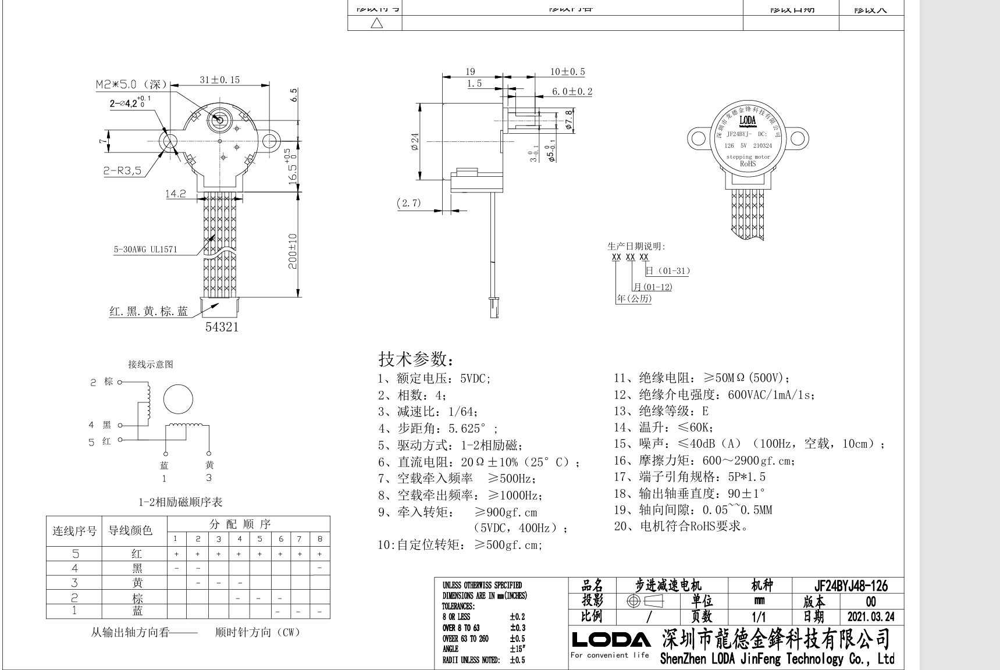
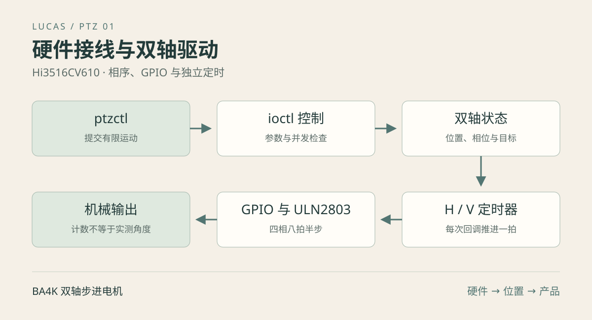

把云台电机转起来，需要贯通机械接线、功率驱动、GPIO 复用和软件时序。GPIO 顺序正确却没有扭矩，可能是供电或相序；空载正常、视频运行后失步，可能与负载和调度有关；模块加载成功，也不代表加载的是正确板级设备树。

本系列记录 BA4K / Hi3516CV610 的实际实现。本篇完成从硬件到内核驱动的小步运动；[第二篇](/posts/hi3516cv610-ptz-02-control.html)解释位置、行程、命令替换和归零；[第三篇](/posts/hi3516cv610-ptz-03-integration.html)接入应用和产测工具。三篇中的“位置”默认指已输出相序的计数，不是编码器测量值。

[下载本篇源码](/posts/hi3516cv610-ptz-01-driver/code/experiments.tar.gz) · [查看完整驱动](/posts/hi3516cv610-ptz-01-driver/code/tuling_ptzmotor.c.html)

## 一 最终接口和准备条件

| 项目 | 当前实现 |
| --- | --- |
| 硬件 | BA4K，Hi3516CV610，双轴四相步进电机，ULN2803 驱动输入 |
| 电机标注 | JF24BYJ48-126，5V，1/64 减速，1-2 相励磁 |
| 内核 | 厂商适配 Linux 5.10.221，32 位 ARM |
| 模块 | `tuling_ptzmotor.ko` |
| 设备节点 | `/dev/tuling_ptz`，权限 0600 |
| 调试工具 | `ptzctl`，GPIO 接线测试用 `ptz.sh` 与 `ptz_gpio_mux` |
| 运动模式 | 有限步数、恒速、双轴独立定时、到位释放线圈 |
| 反馈能力 | 无编码器、无限位输入、无堵转检测 |

工程根目录包含 `SDK/`、`application/` 和 `GenerateTestTools/`。主机需要已有 SDK 源码、交叉工具链及内核构建环境；下载包不包含厂商 SDK。板端需要匹配固件和可用的传输方式。

本篇不会把加载模块和开始运动绑定在一起。先确认设备节点和状态，再明确配置测试坐标与范围，最后执行小步运动。冷启动电气状态、机械余量和真实方向需要实物确认。

## 二 从电机结构理解相序

### 五根线与四路控制



项目中的电机图标明红线为公共连接，其他四根线为受控绕组端。结合 ULN2803 低侧驱动，GPIO 控制其输入，导通的输出为相应绕组提供到地的电流路径。GPIO 不是线圈电源，不能直接带动电机绕组。

复现时检查电机公共线供电、驱动器地、SoC 地以及驱动器续流连接。额定电机电压为 5V，不代表可以把 5V 接到 SoC GPIO；逻辑输入电平和电机供电是不同电气接口。ULN2803 的输入、电流和保护连接应根据实际器件型号及原理图确认。以 ST ULN2803A 为例，官方资料描述了共发射极达林顿阵列及感性负载抑制二极管；这可用于理解电路，但不能代替核对板上实际料号与工作条件。[器件资料](https://www.st.com/en/interfaces-and-transceivers/uln2803a.html)

### 八拍半步怎样对应 GPIO

驱动把每轴四路控制线依次看作 bit0～bit3，半步表为：

```c
static const unsigned char ptz_phases[8] = {1, 3, 2, 6, 4, 12, 8, 9};
```

| 相序索引 | 十进制 | bit3～bit0 | 导通路数 |
| --- | --- | --- | --- |
| 0 | 1 | 0001 | 第 1 路 |
| 1 | 3 | 0011 | 第 1、2 路 |
| 2 | 2 | 0010 | 第 2 路 |
| 3 | 6 | 0110 | 第 2、3 路 |
| 4 | 4 | 0100 | 第 3 路 |
| 5 | 12 | 1100 | 第 3、4 路 |
| 6 | 8 | 1000 | 第 4 路 |
| 7 | 9 | 1001 | 第 4、1 路 |

一相与两相交替励磁，使相邻稳定位置之间插入半步。正向推进索引加 1，反向推进加 7 再对 8 取模：

```c
return (phase + (direction > 0 ? 1 : 7)) & 7;
```

这个“正向”只是相序索引方向。装配方向、绕组排列和传动关系决定最终是左、右、上还是下。不能因为变量叫 `forward` 就认定它是摄像头向右。

运行中反转保留当前相位，从当前位置倒序推进，而不是每次命令都把 phase 清零。重新从固定相位开始，可能引入跨相跳变。但停止后释放线圈，机械轴可能受外力移动，因此保留软件 phase 也不能保证重新通电时没有对齐误差。

### 步数和速度的物理含义

根据本电机图中的 5.625° 步距及 1/64 减速标称值，项目采用：

```text
输出轴每半步 ≈ 5.625° / 64 = 0.087890625°
输出轴一圈 ≈ 4096 半步
标称角度 = 半步数 × 360 / 4096
```

例如 32 半步约 2.8125°，64 半步约 5.625°。这个换算依赖规格所采用的励磁方式及传动假设，不应再机械地套一次“半步乘二”。不同电机的规格定义可能不同，应以其相序和实测一圈计数核实。

项目记录的云台行程为水平约 355°、垂直约 90°；若与电机输出轴为 1:1，约为 4039、1024 半步。这是整段行程，不是中心到单侧的角度，也不是已经标定好的通用限位值。

速度单位是半步/秒。CLI 的 1～5 档对应 100、200、300、400、500 半步/秒。驱动接受 1～625 半步/秒，625 是软件上限；当前没有加减速，高速启动或直接反向可能失步，需要实测带载能力。

## 三 还原本板接线

| 轴 | 控制输入 | 线色 | GPIO | 本板数字编号 |
| --- | --- | --- | --- | --- |
| 垂直 | M_IN1 | 蓝 | GPIO0_0 | 0 |
| 垂直 | M_IN2 | 棕 | GPIO9_2 | 74 |
| 垂直 | M_IN3 | 黄 | GPIO9_5 | 77 |
| 垂直 | M_IN4 | 黑 | GPIO9_3 | 75 |
| 水平 | M_IN5 | 蓝 | GPIO10_0 | 80 |
| 水平 | M_IN6 | 棕 | GPIO10_2 | 82 |
| 水平 | M_IN7 | 黄 | GPIO9_4 | 76 |
| 水平 | M_IN8 | 黑 | GPIO10_1 | 81 |

表内数字编号来自本板每组 8 路的编号方式，只用于理解旧 GPIO 调试脚本。正式设备树通过控制器和组内偏移定位引脚。四路线色顺序是相序输入顺序，不能按 GPIO 数字从小到大重新排列。

M_IN1 已飞线到 GPIO0_0，原升级功能外部电路已断开。该 GPIO 属于 FLASH 电源域，冷启动时的电平、1.8V/3.3V 实际逻辑电平能否可靠驱动当前输入，仍需硬件确认。运行期把 mux 改为 GPIO，不会改变上电采样阶段的电路行为。

历史设备树曾把两轴名称对调。更新用户态表格不足以修正内核驱动，必须更新实际启动的设备树，再以小步观察确定物理轴和方向。

## 四 设备树与内核配置

长期维护的文件是：

```text
SDK/local/linux/arch/arm/configs/hi3516cv610_defconfig
SDK/local/linux/arch/arm/boot/dts/hi3516cv610-demb-flash.dts
SDK/Drivers/PtzMotor/
```

不要只修改 `SDK/build/` 下的临时副本。项目内核脚本会覆盖本地配置并重新配置内核。

构建脚本检查三项：

```text
CONFIG_HIGH_RES_TIMERS=y
CONFIG_OF_GPIO=y
CONFIG_PINCTRL_SINGLE=y
```

原先以 100Hz 低精度节拍运行时，10ms 级粒度不适合多个毫秒的相序周期。500 半步/秒要求约 2ms 一拍，因此启用高精度定时器。hrtimer 的时间表达不依赖普通 jiffies 粒度，但启用它不等于获得硬实时调度保证；具体仍取决于 clockevent、clocksource、中断延迟和负载。[Linux hrtimer 文档](https://docs.kernel.org/timers/hrtimers.html)解释了它与普通定时器的设计区别。

设备树中的轴定义如下：

```dts
&spi_bus1 { status = "disabled"; };
&gpio_chip0 { gpio-controller; };
&gpio_chip9 { gpio-controller; };
&gpio_chip10 { gpio-controller; };

/ {
    ptzmotor {
        compatible = "tuling,ba4k-ptzmotor";
        status = "okay";
        vertical-gpios = <&gpio_chip0 0 0>, <&gpio_chip9 2 0>,
                         <&gpio_chip9 5 0>, <&gpio_chip9 3 0>;
        horizontal-gpios = <&gpio_chip10 0 0>, <&gpio_chip10 2 0>,
                           <&gpio_chip9 4 0>, <&gpio_chip10 1 0>;
    };
};
```

每个轴必须恰好有四路 GPIO，顺序与相序表 bit0～bit3 一致。flags 为 0，当前驱动只接受本板的高有效配置。关闭 SPI1 是为了释放对应复用引脚，不能同时让 SPI 驱动和电机驱动占用它们。

pinmux 分成两块：GPIO0_0 使用 `0x10260000`；其余绕组使用从 `0x17940058` 开始的寄存器区间。`pinctrl-single,function-mask = <0xf>` 只修改低 4 位复用字段，保留其他电气配置。配套 `ptz-board.dtsi` 给出完整温度无关的云台片段，需合入已有板级 DTS，避免重复节点。

本驱动在模块初始化时通过 `of_find_compatible_node()` 寻找节点，再逐个申请 GPIO，最后注册 misc 设备；它不是带 `.probe` 的 platform driver。当前 pinctrl 节点拥有自己的 default state，由 pinctrl 绑定应用复用。阅读或移植时不能把它解释成 PTZ platform probe 自动选择了 pinctrl。

这是现有 5.10 板级实现。新设计可考虑 platform driver 和 GPIO descriptor API，以更自然地处理设备生命周期与 probe defer；不要在仅复现当前版本时混用两套资源管理方式。Linux 的 [GPIO consumer 文档](https://docs.kernel.org/driver-api/gpio/consumer.html)介绍了 descriptor 接口与可睡眠 GPIO 的区别。

## 五 双轴驱动内部怎样工作



每轴有独立的 `hrtimer`、自旋锁、四路 GPIO、phase、间隔、位置、行程和运动状态；两轴共享 ioctl 控制互斥锁。

### 定时回调每次只推进一拍

核心流程可以写成：

```text
锁住当前轴
  remaining == 0 → 四路输出低 → running = 0 → 停止定时器
  否则：
    更新软件位置
    推进 phase
    输出半步相序
    done 加 1，remaining 减 1
    推进下一次超时时间
解锁
```

实际输出函数先关闭新相序不需要的输入，再打开需要的输入，避免切换过程中短暂多导通额外绕组。四次 GPIO 写并非硬件同步更新，应通过波形观察相间切换，而不是假设它们在同一纳秒变化。

### 最后一拍为什么还要等一次回调

当最后一拍输出时，remaining 已减为 0，但 running 仍为 1。下一次定时回调才释放线圈，使最后一拍在正常调度下至少经历相应的保持阶段。若刚输出最后一拍就立即清零 GPIO，机械系统未必来得及完成该步。

因此 `remaining=0` 不一定等于已经释放；判断运动结束要看 `running=0`。`done` 是最近一次命令实际输出的相序次数，不是累计总里程，也不是位置反馈。

### 延迟后不突发补步

速度换算为：

```c
a->interval = div_u64(NSEC_PER_SEC, m.speed);
hrtimer_forward_now(timer, ns_to_ktime(a->interval));
```

回调迟到时不会用一个循环瞬间补齐错过的多拍。那样电信号计数虽然“追上了时间”，转子却无法跟上。当前策略允许运动总耗时增长，每次回调仍只输出一步。它不能消除调度抖动，也不能保证所有迟到后的相间间隔完全一致。

### 为什么有 mutex 和 spinlock 两种锁

`control_lock` 串行化用户态控制命令，保护命令序列检查与修改的整体过程。每轴 spinlock 则协调进程上下文与定时回调对运动状态的访问。

停止操作先调用 `hrtimer_cancel()`，然后持有轴锁清零输出。不能拿着回调也需要的轴锁去等待回调结束，否则可能互相等待。`copy_from_user()` 在进入轴自旋锁之前完成，避免在不可睡眠区间访问用户态内存。

GPIO 初始化会拒绝 `gpio_cansleep()` 为真的控制器，因为当前回调直接调用 `gpio_set_value()`，不能在其中等待 I²C 等可睡眠扩展 GPIO。迁移到扩展芯片时需要重做输出架构，不能只替换 GPIO 编号。

### 初始化和退出的资源顺序

初始化先准备两轴锁和定时器，再读取设备树，逐个申请 GPIO 并设为低，最后注册关机通知和 misc 设备。`acquired` 记录已申请数量，任何中途失败都能按实际取得的资源清理。

正常加载、stop、到位、正常关机通知和卸载都释放线圈。释放意味着没有保持力；垂直机构可能受重力或外力影响，软件坐标未必仍可信。

每次 open 分配一个客户端对象保存命令保护状态；close 释放对象，不停止已经提交的运动。模块文件操作设置了 owner，正常使用中的引用也参与模块卸载管理。驱动没有“进程退出必停”的约定，产品层需要显式清理。

## 六 接线调试脚本和正式驱动的边界

`ptz.sh` 是早期接线测试工具：通过旧 sysfs GPIO 输出相序，请求每拍等待 20ms，标称约 50 半步/秒，单次限制 1～128 半步。Shell 和 sysfs 开销会增加实际周期，不能用它测定正式驱动的时序性能。

它使用 `/run/ptz-gpio-test.lock` 避免脚本自身重复运行，通过 trap 在常规退出、INT、TERM、HUP 时将输出置低，并释放自己 export 的 GPIO。已经由别的用户态程序 export 的 GPIO 会被复用，因此该锁不能防住所有控制者；SIGKILL 也不能执行 trap。

`ptz_gpio_mux` 使用 `/dev/mem` 修改指定引脚 mux 低 4 位，并读回检查。它是明确面向本板的调试工具，既不配置整个电源域，也不会在退出时还原原复用值。正式路径通过设备树维护复用，不应把寄存器调试命令塞进日常启动流程。

仅在已经停止其他使用者、内核电机模块未占用 GPIO、确认线圈供电与机械余量时，才能用以下板端命令观察相序：

```sh
# 板端，两个工具位于同一目录；这条命令会实际运动
sh ./ptz.sh h forward 8
```

先确认移动的是水平轴且方向符合观察，再决定是否测试另一轴。脚本失败时检查 GPIO 占用、`usleep` 支持、helper 文件、`/dev/mem` 权限和设备树；不要强行抢占其他驱动。

## 七 构建与部署

### 在完整工程中构建

```sh
# 主机，工程根目录
bash SDK/Build.sh l
bash SDK/Build.sh ptz
```

第二条等价于 `bash SDK/Drivers/PtzMotor/Build.sh`。首次启用高精度定时或修改设备树时需要构建并更新匹配内核；仅改驱动源码且内核未变化时，可以只重编 PTZ。

内核构建依赖 SDK 已准备的源码、工具链和 `mkimage`。缺少封装工具时按项目流程先构建 U-Boot，例如 `bash SDK/Build.sh u`。驱动脚本检查配置和 `Module.symvers`，在 SDK/build 下构建外部模块，并静态编译两个 C 工具。

```text
SDK/output/ptzmotor/
├── tuling_ptzmotor.ko
├── ptzctl
├── ptz_gpio_mux
└── ptz.sh
```

静态链接 CLI 减少用户态运行库依赖，但 `.ko` 仍必须匹配运行内核。构建成功不会烧录、不会自动运动，也不会自动同步应用 Runtime 目录。

### 下载包的独立构建

```sh
# 主机，下载包解压目录；替换绝对路径
export KERNEL_DIR=/absolute/path/to/built/linux
export CROSS_COMPILE=/absolute/path/to/arm-linux-musleabi-
bash build.sh
bash run-tests.sh
```

内核目录必须已完成匹配配置的构建，包含生成头文件和 `Module.symvers`。本篇测试脚本只运行主机逻辑测试，不访问真实电机。

### 首次更新内核和设备树

当前内核产物在 `SDK/output/linux/`，板级 DTB 为 `hi3516cv610-demb-flash.dtb`。按 `application/Upgrade/README.md` 的产品流程更新匹配的 FIT 内核镜像，核对实际启动槽位；不要脱离分区表照抄擦写地址。

重启后在板端检查：

```sh
uname -a
ls /proc/device-tree/ptzmotor
tr -d '\000' < /proc/device-tree/ptzmotor/compatible
```

预期 compatible 为 `tuling,ba4k-ptzmotor`。检查主机 `.config` 中的三项配置，并结合运行内核日志核对，不要只看目录存在就断定所有引脚配置正确。

### 传输和加载

```sh
# 主机，工程根目录；按实际设备修改地址
BOARD_ADDR=192.168.8.214
ssh "root@$BOARD_ADDR" 'mkdir -p /tmp/ptz-test'
scp SDK/output/ptzmotor/tuling_ptzmotor.ko SDK/output/ptzmotor/ptzctl \
    "root@$BOARD_ADDR:/tmp/ptz-test/"
sha256sum SDK/output/ptzmotor/tuling_ptzmotor.ko SDK/output/ptzmotor/ptzctl
```

```sh
# 板端
cd /tmp/ptz-test
sha256sum tuling_ptzmotor.ko ptzctl
insmod ./tuling_ptzmotor.ko
ls -l /dev/tuling_ptz
./ptzctl status
```

先比较两个端点的同名文件校验值。已有旧模块时先停止业务控制者，执行 `ptzctl stop`，确认不再运动并关闭使用者后卸载旧模块，再加载新的；不要让新工具调用旧 ABI。

正常初始状态为停止、position 为 0、max_steps 为 0。这个 0 只是内存初值，尚未建立机械零点。

## 八 完成第一次受控小步运动

选定水平轴处于行程中部，人工确认两边都有足够余量，停止其他控制者。下面建立的是**临时局部测试坐标**，不宣称机械归零，不用于产品正常控制。

```sh
# 板端；每一步成功后继续
./ptzctl stop h
./ptzctl set-position h 0 1
./ptzctl set-travel h 64
./ptzctl set-position h 32 1
./ptzctl move-to h 40 1
./ptzctl status
```

这里把实物当前位置声明为 32，目标 40，只计划输出 8 半步。`positive_direction=1` 只用于观察原始正方向。status 确认 running 变为 0 后，再返回目标 32：

```sh
./ptzctl move-to h 32 1
./ptzctl status
./ptzctl stop
```

观察电机是否平稳、实际轴是否正确、往返方向是否相反。软件 position 回到 32 只证明计数返回，不证明机械无齿隙或无失步。调试完应丢弃这个临时参考，由产品流程重新建立零点和正常行程。

CLI 普通 move-to 提交后立即退出，不能靠 Ctrl+C 停止已提交动作；需要执行 stop。出现抖动不转时先检查相序、接线和供电，不要先提高档位。

## 九 排障与验证边界

| 现象 | 检查方向 |
| --- | --- |
| 没有设备节点 | 模块日志、设备树 compatible、GPIO 申请失败 |
| GPIO busy | SPI1、其他驱动、遗留 sysfs export 的占用 |
| 云台轴反了 | horizontal/vertical 列表和实际启动 DTB |
| 抖动不转 | 四路相序顺序、缺相、电源、负载 |
| 低速正常高速失步 | 恒速起动、转矩、负载、电源和定时波形 |
| 到位后可被推动 | 当前设计释放线圈，没有保持力 |
| 进程退出仍运动 | 异步接口约定，显式停止 |
| 重启方向或坐标变化 | 临时参数仅在内存，应用参考需重建 |
| 参数正确但不接受运动 | 行程未配置、目标越界、速度或时长限制 |

项目 2026-10-11 的记录包含双轴 1～5 档、每档三次 32 半步往返和命令边界测试通过；不等于角度标定、完整归零或长期负载可靠性通过。本次教程构建和测试结果见[验证记录](/posts/hi3516cv610-ptz-01-driver/code/verification.md.html)。

继续验证时，应同时记录固件版本、模块哈希、供电、机械负载、步频波形、错误率和实际角度。视频与 AI 负载下的长期测试、冷启动电气行为、正反转失步以及断电后的参考恢复都需要单独覆盖。

下一篇沿用这个驱动，解释为什么一个 move-to 需要软件范围、方向映射和命令序列保护：[位置控制与用户态归零](/posts/hi3516cv610-ptz-02-control.html)。
