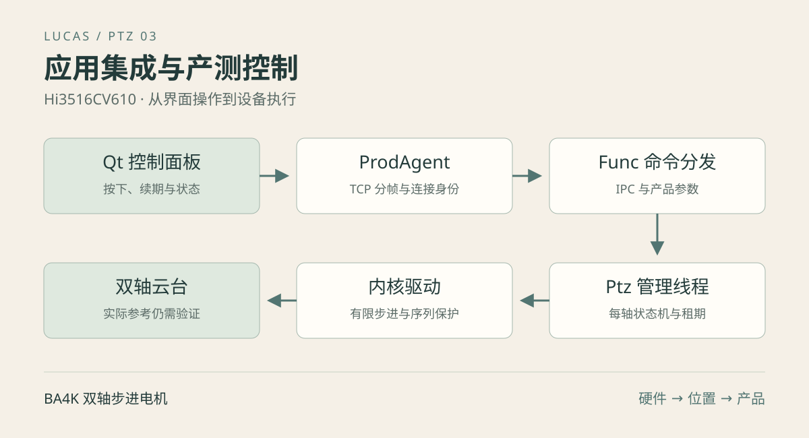

[第一篇](/posts/hi3516cv610-ptz-01-driver.html)实现 GPIO 与双轴定时，[第二篇](/posts/hi3516cv610-ptz-02-control.html)建立位置、行程和命令保护。要把它们放入产品，还需要解决谁管理驱动、怎样判断参考可信、界面断线后何时停止、保存参数失败如何处理，以及进程重启后怎样恢复。

本篇以当前 `application/Middleware/Ptz` 和 GenerateTestTools 为例，贯通 Qt 界面、TCP、ProdAgent、IPC、Func、管理线程与内核驱动。当前没有接入 AI 自动追踪，也没有开机自动撞限位归零。

[下载配套源码与测试](/posts/hi3516cv610-ptz-03-integration/code/experiments.tar.gz) · [查看管理器实现](/posts/hi3516cv610-ptz-03-integration/code/Ptz.cpp.html)

下载包包含可独立执行的管理器模拟测试和只读状态查询工具；`integration/` 为实际项目接入源码快照，依赖原工程的 IPC、参数、Qt 等模块，不是另一个脱离工程的完整产品。

## 一 明确控制链路与职责



```text
Qt PtzPanel
  → DeviceTcpManager
  → TCP 长度前缀与 JSON
  → ProdAgent 分配连接身份并转发 IPC
  → Func 校验和分发短命令
  → Middleware/Ptz 的 FuncPtz 工作线程
  → ioctl /dev/tuling_ptz
  → 双轴内核定时器
```

只有 Func 调用 `PtzInit()` 与 `PtzDeinit()` 管理生命周期。Func 内业务可以使用公共接口，其他进程经现有 IPC 调用；不要每个进程各自初始化一套长期管理器。

底层驱动仍允许其他句柄控制，例如维护时使用 ptzctl。管理器通过 GUARD 检测控制权被替换，将对应轴参考判为不可信，而不是假设产品启动后绝对没有外部调用者。

| 层 | 主要文件 | 负责的工作 |
| --- | --- | --- |
| 公共接口 | `application/Interfaces/Middleware/Ptz.h` | 轴、配置、状态与操作声明 |
| 管理器 | `application/Middleware/Ptz/Ptz.cpp` | 线程、状态机、驱动操作、手动会话 |
| Func 适配 | `application/Apps/Func/Src/Ptz/FuncPtz.cpp` | 参数读取、命令到公共接口、配置事务 |
| 命令分发 | `application/Apps/Func/Src/FuncMessage.cpp` | IPC 接收及独立配置队列 |
| TCP 网关 | `application/Apps/ProdAgent/Src/ProdAgentTcp.cpp` | 分帧、身份、请求关联与转发 |
| 控制面板 | `GenerateTestTools/src/device/ui/ptzpanel.cpp` | 按键、续期、状态和参数编辑 |

## 二 先设计每轴状态

`PtzAxisState` 同时维护位置、目标、范围、速度、running、calibrated、parametersConfirmed、phase 和 error。这些字段表达不同事实，不能合并成一个“是否可用”。

| 字段 | 表达的事实 |
| --- | --- |
| supported | 当前产品构建是否包含功能，由接口应答报告 |
| available | 管理器是否已成功接通驱动 |
| parametersConfirmed | 产品参数是否允许执行归零 |
| calibrated | 应用是否认为已经建立可信参考 |
| running | 内核当前是否仍在执行步进阶段 |
| phase | 未校准、寻找、回中、正常或故障阶段 |
| error | 当前轴的错误状态 |

`ready` 不等于静止：正常 move-to 也可以处于 ready 且 running=true。`centering` 时可以 calibrated=true 且 running=true，因为参考已经建立，只是尚未回到中间。

### 每轴状态转移

```text
初始化 → uncalibrated
  参数确认并收到 home → seeking
  寻找计数到 0，恢复正常范围 → calibrated=true → centering
  回中完成 → ready

seeking 被显式停止 → uncalibrated
centering 被显式停止且参考仍有效 → ready，保留 calibrated
驱动错误或外部命令替换 → fault，清除 calibrated
```

状态机假定归零机械策略成立，无法弥补无位置传感器的限制。parametersConfirmed=true 是允许使用配置的业务开关，不是出厂精度或全行程归零已验证的证明。

H、V 分别维护状态。一个轴失败不应自动被解释为另一个轴的参考也丢失；但针对 Both 的操作涉及两轴，应遵循它自己的失败处理逻辑。

## 三 用一个工作线程串行处理驱动操作

### 调用接口等待的是接受结果

业务接口向工作线程提交短任务，通过 promise/future 得到执行结果。任务队列最多 32 项，过满返回 EBUSY，避免无限堆积过时控制。

```text
业务线程调用 PtzMoveTo
  → 入队并唤醒工作线程
  → 工作线程检查校准与范围，提交 ioctl
  → 返回接受或拒绝
  → 内核继续运动
  → 后续通过 PtzGetStatus 查询
```

所以接口不是“完全不等待”的 fire-and-forget：调用者仍会等短任务排队和 ioctl 完成，但不会等电机走到目标。排队时间与调度相关，不能承诺固定毫秒内返回。

当前代码使用 `cv.wait_for(..., 20ms, ...)`，每轮执行一个短任务后调用 poll。即使空闲，也会周期唤醒查询；有任务或退出请求则可提前唤醒。文档中将其简写为“空闲条件等待”容易让人误以为完全无周期唤醒，这里以实际代码为准。

### 为什么每轴使用保护句柄

管理器保存一个普通 control 句柄和两个按轴保护句柄。普通句柄用于明确的停止控制；归零、运动和错误清理使用对应轴的保护句柄。

明确的用户 Stop 应当能停止当前运动，因此走 control。旧流程发生错误后的清理只应清理自己，走保护句柄；如果外部命令已替换它，ESTALE 会阻止误停新动作。两种停止意图不能混成一个无条件 STOP。

### 初始化与退出

工作线程启动后先打开设备、停止两轴遗留运动，再建立各轴保护句柄，初始状态设为未校准。Func 重启不会把内核里残留的 position 直接当成可信参考。

Func 通过 `REGISTER_TASK_INTERVAL(FuncPtzInitTask, 5)` 注册初始化重试，首次调度立即尝试，成功后后续调用直接返回。主循环约每 500ms 检查任务，其他同步维护会影响真实时刻，这不是硬实时调度。

退出顺序为停止接收命令、结束相关配置任务、显式 `StopFuncPtz()`、等待线程清理，再关闭 IPC。信号处理函数只置退出标志，在正常上下文执行加锁、停止和 join。正常退出能停止电机；SIGKILL 无法保证用户态清理执行，已经提交的有限动作仍可能继续。

## 四 公共接口的正确用法

| 接口 | 主要用途 |
| --- | --- |
| PtzInit / PtzDeinit | Func 管理生命周期 |
| PtzMoveTo | 已校准轴的绝对目标 |
| PtzHome | 显式开始归零和回中 |
| PtzCenter | 移到各轴自己的中心 |
| PtzStop | 取消该轴后续阶段并停止 |
| PtzGetStatus | 获取每轴状态 |
| PtzManual / PtzRelease | 按住方向键与释放 |
| PtzDisconnect | 清理断开连接的手动动作 |
| PtzPrepareTravel / PtzFinishTravel | 修改行程的准备与提交或回退 |

以下只是 Func 内部已完成初始化后的调用片段：

```cpp
PtzState state;
int rc = PtzGetStatus(state);
if (rc == 0 && state.axis[0].calibrated) {
    // 本调用会提交实际运动；level=1 对应 100 半步/秒。
    rc = PtzCenter(PtzAxis::H, 1);
}
// 不能用 rc == 0 判断到位，需要继续查询 running 与 position。
```

`PtzMoveTo(Both, target, level)` 给两轴同一个目标值，而 `PtzCenter(Both, level)` 分别计算两个中心。H、V 行程不同，不能把水平中心 2020 作为 Both 的通用目标。

Both 的运动在管理器中先预校验，再逐轴提交，不是硬件同步触发，也不是所有底层失败情况下的原子双轴事务。若第一轴提交后第二轴 ioctl 失败，应结合两轴状态判断结果，不能把返回错误简单理解为“任何轴都没有动”。

## 五 归零状态机与 CLI 的关系

管理器沿用第二篇的有限寻找流程：停止 → 临时位置 0 → 寻找范围 → 假定位置 seekSteps → move-to 0 → 查询完成 → 正常范围 → 建立参考 → 回中。

差别在于 CLI 的 home 在命令进程里等待，产品管理器则在轮询中推进阶段，可以继续接受停止和状态查询，两个轴也分别管理。超时采用 steady_clock，避免系统时间校准影响运动超时。

`PtzHome(axis, 0)` 使用各轴配置的 homeLevel；1～5 则覆盖本轮寻找和回中的档位。运行中改界面档位不会自动改变已经开始的归零参数。

寻找前被停止不能进入普通运行；建立参考后回中被显式停止可保留参考。发生驱动错误、外部替换或参考不明的情况则进入 fault。故障不会盲目写回旧位置和范围，因为它们可能已经失效，或者属于外部控制者的新动作。

目前真实完整撞限位归零和回中效果仍待机械验证。主机模拟中的归零成功用于验证状态转移，不能替代端点、寻找余量或真实角度的测试。

## 六 TCP 与 IPC 如何传递命令

### 长度前缀解决消息边界

产测协议使用 4 字节网络序长度加 JSON 正文，magic 为 `TL_PROD`。当前实现限定单帧不超过 64KiB。TCP 是字节流，一次 recv 不保证正好得到一帧；必须先读满长度，再按声明长度读正文，并保留后续帧。

```text
4 字节大端正文长度 | UTF-8 JSON 正文
```

最小状态请求：

```json
{"magic":"TL_PROD","cmd":"ptz_status","params":{}}
```

ProdAgent 为连接生成 owner，将命令参数中的 `_owner` 改写为服务端分配的值，再通过 IPC 转发到 Func。客户端不能通过填写另一个 owner 冒充已有手动会话；但这不是完整的网络认证机制，不应把会话归属校验误认为用户登录授权。

当前产测测试默认 TCP 端口为 8899，实际部署要核对设备配置和监听状态。

### 接受命令与完成动作的区别

应答命令名为原命令加 `_ack`，result 为 ok 或 fail，失败有 error_msg。普通运动与停止成功时，phase=submitted、accepted=true 表示已接收和提交；不是到位。

`ptz_status_ack` 的 phase=completed 表示状态查询完成，也不是电机一定停止。应读取 ptz.h/v 中的 running、position、target、calibrated、phase 和 error。

配置保存具有独立的 accepted 和 completed/failed 阶段，后面还要检查 saved 与 applied。界面不能把任何一个 ok 都显示为“保存成功”。

### 协议命令表

| cmd | 主要 params | 作用 |
| --- | --- | --- |
| ptz_status | 空对象 | 查询状态 |
| ptz_move_to | axis、position、level | 绝对运动 |
| ptz_center | axis、level | 回到各轴中心 |
| ptz_stop | axis | 停止，可用 both |
| ptz_home | axis、可选 level | 归零回中 |
| ptz_manual | axis、increasing、level、token、renew | 建立或续期手动动作 |
| ptz_release | axis、token | 释放对应按键会话 |
| ptz_get_config | 空对象 | 读取行程配置及 revision |
| ptz_set_config | expected、h、v | 条件保存并应用行程 |

普通 axis 为 h、v 或 both；manual 只接受 h 或 v。ptz_disconnect 是 ProdAgent 在连接关闭时产生的内部事件，PC 不需要自己发送。

### 不发运动的独立查询工具

配套 `status_client.py` 只允许 status 与 get-config，使用 Python 标准库处理网络序和分段接收，不发送停止、归零或运动：

```sh
# 主机，下载包解压目录；设备地址按实际修改
python3 status_client.py 192.168.8.214 status
python3 status_client.py 192.168.8.214 get-config
```

它适合先验证 TCP → ProdAgent → IPC → Func 的查询链路。available=false 时先检查驱动和管理器；supported=false 时先检查构建开关。查询成功后再使用产测界面验证实际控制。

## 七 按住运动为什么需要续期和 token

仅实现“按下开始、松开发 stop”会遇到窗口关闭、网络断开、松开包丢失等情况。当前方案为每次按下创建 token，结合连接 owner 与租期维护动作。

```text
按下：renew=false，建立 owner + token 的动作
按住：每约 200ms renew=true，延长租期
松开：release，只结束匹配 token 的动作
断线：ProdAgent 通知释放该 owner 的手动动作
无续期：超过 800ms 后管理线程停止该动作
```

开始手动动作时实际提交的是到当前方向软件端点的有限 MOVE_TO，续期只延长会话，不重复启动新运动。旧 token 的续期返回 ESTALE，不能让已经结束的动作复活。

例如按键 A 的网络包迟到，而用户已按下 B：A 的 release 不应停止 B。owner 和 token 匹配限制了清理的作用范围，类似第二篇 generation 保护在不同层次上的对应。

800ms 是租期阈值，实际停机还受线程调度、轮询和 ioctl 延迟影响，不应写成严格 800ms 的硬实时保证。网络断开事件提供更直接的清理路径；如果设备进程本身被强杀，租期管理线程也不会继续执行，需要依赖进程恢复和有限底层命令的约束。

### 界面刷新与禁用规则

Qt 每约 200ms 续期，约 600ms 刷新状态。状态超过 2 秒未更新时停止续期并禁用运动按钮；未校准时禁用方向、绝对位置和回中；参数未确认时禁用归零。停止入口仍应可用。

隐藏面板释放正在按住的动作，关闭控制窗口发送双轴停止。窗口关闭是明确停止请求，作用范围比只释放本连接某个 token 更广；多控制端设计时应了解这个产品语义。

## 八 产品参数与运行状态分开保存

当前默认参数来自：

```text
application/Platform/Params/HI3516CV610_00S/projects/BA4K/config_table.json
```

其中 sys.ptz 的产品配置为：

```json
{
  "defaultLevel": 1,
  "h": {
    "maxSteps": 4039, "seekSteps": 4200,
    "positiveDirection": -1, "homeLevel": 1,
    "parametersConfirmed": true
  },
  "v": {
    "maxSteps": 1024, "seekSteps": 1100,
    "positiveDirection": 1, "homeLevel": 1,
    "parametersConfirmed": true
  }
}
```

这段是当前产品配置记录，不是推荐直接移植到所有机构的通用参数。尤其寻找余量和完整回中还需实物验证；新产品未确认时应保持参数确认门槛。

参数读取优先使用共享内存中的持久化 sys.ptz。旧参数表没有该段时，才回退读取 `/usr/app/Bin/config_table.json` 的默认段。已有参数非法则报错，不静默用默认值掩盖问题。

设备保存的配置覆盖打包默认值。因此修改源码 JSON 后重新打包，并不一定覆盖设备已经保存的 sys.ptz。不要为了更新一个 PTZ 字段把整张设备参数表恢复默认。

位置和 calibrated 不写入闪存作为重启恢复依据。参数能够持久保存，不代表断电后机械坐标仍可靠。

## 九 实时修改行程如何保持一致

### 角度转步数

产测界面编辑最大角度，设备保存的是 `round(angle * 4096 / 360)` 半步。例如输入 355° 得到 4039 步，读回角度约 354.99°；这种差异来自离散化，不是保存失败。

seekSteps 独立于 maxSteps：缩小正常范围不自动缩小寻找范围。方向、默认档位、归零速度等参数在这个接口中原样保留；修改它们需要另外的产品配置流程，当前通常重启 Func 生效。

### 保存事务的步骤

```text
读取设备配置和 revision
  → 用户修改角度与 seekSteps
  → 提交 expected 快照
  → 检查运行配置、持久配置和版本一致
  → PtzPrepareTravel 验证两轴静止和新范围
  → 对已校准轴暂时更新驱动范围
  → 参数客户端 compareSet 条件保存
  → 成功：PtzFinishTravel(true)
  → 失败或未确认：PtzFinishTravel(false)，尝试回退
  → 应答 saved / applied 和当前配置
```

配置队列与运动短命令分开，避免磁盘保存阻塞查询和停止。准备阶段检查两轴，保存期间拒绝新运动，允许状态和停止。新范围必须包含当前位置，寻找范围不能小于正常范围，还需满足速度与时长限制。

未校准轴只更新应用范围，等下次归零再建立驱动范围，不通过 set-position 伪造校准。已校准且静止的轴可以修改范围而保持已有参考，中心按新上限重新计算，但保存本身不移动电机。

### 两类并发校验

revision 是从相关运行配置字段构造的比较标记；它用于拒绝旧页面覆盖更新后的值。参数服务的 compareSet 再比较持久表当前内容与 expected，避免检查后又被另一个写入者修改。

旧设备缺少 sys.ptz 时，会对整个 sys 做条件更新并保留其他字段，而不是无条件覆盖整段。IPC 载荷大小也有限制，过大请求明确返回错误。

### 超时不能直接判定没有保存

compareSet 的应答丢失时，数据可能已经落盘。当前代码再读取确认是否等于预期；确认后才报告 saved=true。无法确认则报“保存结果未确认，请重新读取设备配置”，并尝试回退运行范围，不假装一定成功或一定未保存。

如果保存已成功但运行应用失败，应区分 saved 与 applied。后续读取发现保存参数与运行配置不一致时，会提示重启 Func 后重新读取。回退也可能失败，此时进入故障并要求重新建立参考，不能宣称获得了跨闪存与驱动的绝对原子事务。

## 十 编译 打包和启动

### 同步驱动与 ABI

```sh
# 主机，工程根目录；第一篇驱动已编译
cp SDK/output/ptzmotor/tuling_ptzmotor.ko \
   application/Platform/Runtime/HI3516CV610_00S/ko/ptzmotor/
diff -u SDK/Drivers/PtzMotor/ptz_ioctl.h application/Middleware/Ptz/ptz_ioctl.h
```

当前 diff 仅有排版变化，不能据非零退出码直接断定 ABI 不兼容；要检查字段、大小、对齐和命令编码。结构调整则需同步并重编两端。

### 开启应用功能

```sh
# 主机
cd application
./AppBuild.sh config
# Hardware Features → PTZ Options → PTZ control in Func
bash Scripts/Config/GenerateConfig.sh
./AppBuild.sh make HI3516CV610_00S.mk
cat Pack/app/Bin/ptz-features.conf
ls -l Pack/app/ko/ptzmotor/
```

预期 `PTZ_ENABLED=1`，模块目录包含 tuling_ptzmotor.ko。GenerateConfig 依赖 Python 与 kconfiglib，应用构建应重新配置 CMake。make 负责构建打包，不自动部署。

CONFIG_PTZ 同时控制管理器编译、模块安装和启动配置。关闭后安装阶段删除复用目录的旧模块，生成 `PTZ_ENABLED=0`，产测返回 supported=false。应用开关不重写内核设备树，也不会立即卸载正在运行的旧模块，应部署后重启验收。

### 启动仅加载 不自动归零

板端 `app_launch.sh` 读取 `/usr/app/Bin/ptz-features.conf`，开启且模块未加载时执行 insmod；失败输出告警并继续其他应用。没有配置文件则默认关闭。

```sh
# 板端，部署并重启后
cat /usr/app/Bin/ptz-features.conf
ls /sys/module/tuling_ptzmotor
ls -l /dev/tuling_ptz
```

模块加载不代表 Func 已启动，也不意味着管理器已经建立参考。项目启动脚本保留了开发入口和守护启动设置，需按设备实际运行模式检查 Func、ProdAgent、ProcessGuard，不能仅凭本段模块加载逻辑断定整套应用已自动拉起。

## 十一 分层验证整条链路

### 管理器主机测试

```sh
# 主机，下载包解压目录
bash run-tests.sh
```

脚本用 `--wrap=open/close/ioctl` 模拟驱动，覆盖归零完成、中断、回中保留参考、双轴独立、范围校验、手动租期、旧 token、断线、外部替换、退出以及行程变更回退等逻辑。不连接真实设备，不输出 GPIO。

下载包中的 Ptz.cpp、Ptz.h 和 ioctl 头自足，能够独立编译这组测试；`integration/` 的 Func 和 Qt 文件必须放回完整项目才能构建。配套 README 列明路径映射。

### Qt 界面测试

完整 GenerateTestTools 依赖 Qt6、项目媒体与设备模块。已有正确配置的 build-linux 时可执行：

```sh
# 主机，工程根目录
cmake --build GenerateTestTools/build-linux --target gtt-ptz-test -j4
QT_QPA_PLATFORM=offscreen ctest --test-dir GenerateTestTools/build-linux \
    -R '^gtt-ptz-test$' --output-on-failure
```

没有构建目录时先按 GenerateTestTools/README.md 配置 Qt 和项目依赖，不要把 build-linux 当成所有机器自带的目录。界面测试检查按下、续期、松开、关闭和参数显示，不替代实机通信。

### 真实通信先查状态

先运行配套只读 Python 查询，确认 supported、available 和两个轴的状态。项目还提供 `gtt-ptz-device-smoke <IP> <截图文件>`，它查询并发送双轴停止，虽然不启动新运动，也会改变正在运行的动作；应在允许停止的测试窗口执行。

### 实际运动的验收顺序

1. 核对固件、运行可执行文件与模块校验值，确认实际启动版本。
2. 查询状态，验证未校准时普通运动被拒绝，停止仍可用。
3. 按第一篇完成物理方向和小步测试，确认产品参数与机构匹配。
4. 在具备机械验证条件后，逐轴验证归零与回中，不直接从双轴全行程开始。
5. 验证按住、松开、旧 token、网络断开和窗口关闭行为。
6. 静止时修改行程，验证保存、读回、即时应用、重启保留和过小范围拒绝。
7. 加入视频和推理负载，记录控制延迟、波形、丢步和温升。

模拟测试能验证零点状态何时置位，实机测试才可能检验归零假设是否成立。分开记录两类结果。

## 十二 常见故障与验证现状

| 现象 | 检查位置 |
| --- | --- |
| supported=false | Kconfig 与实际应用构建版本 |
| supported=true 但 unavailable | 设备节点、模块、初始化日志和重试 |
| 方向按钮禁用 | 校准状态或状态是否超时 |
| home 被拒绝 | 参数确认标志、寻找距离和速度时长限制 |
| 松开没有停 | token/owner 匹配、网络、管理线程租期处理 |
| 外部 ptzctl 后进入 fault | GUARD 检测控制权变化，需重新建立参考 |
| 保存要求重新读取 | revision 或持久参数被其他写入者修改 |
| 默认 JSON 改了但设备不变 | 持久化 sys.ptz 优先于打包默认值 |
| 范围已保存但未应用 | 查看 saved/applied、驱动错误和运行配置一致性 |
| Func 重启后需要校准 | 位置参考不跨进程重启信任，属于当前策略 |

项目 2026-10-11 记录了真实 TCP → ProdAgent → IPC → Func 的状态与停止验证，以及配置保存、即时应用、恢复、非法范围与旧版本拒绝通过。驱动短程运动回归也通过，但不等于已经跑通应用层完整撞限位归零。

同次记录的 Func SIGTERM 退出耗时约 0.68 秒是特定环境下的一次观察，不是所有负载下的退出时限。完整机械归零、真实角度与长期负载仍待验证。本次教程所执行的测试详见[验证记录](/posts/hi3516cv610-ptz-03-integration/code/verification.md.html)。

维护时保留三类资料：硬件和参数依据、可构建源码与 ABI、注明环境和范围的测试记录。这样出现位置偏差时可以先判定是机械参考、驱动输出还是应用状态，而不是只在界面上反复改角度值。
