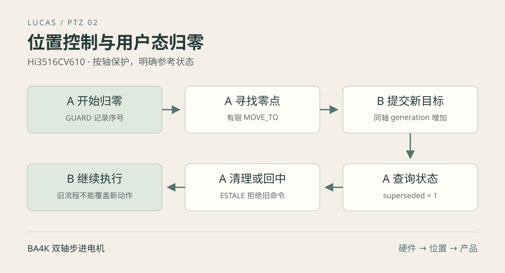

[第一篇](/posts/hi3516cv610-ptz-01-driver.html)已经完成接线、内核适配和小步运动。接下来要解决的是：位置如何表示，目标能否在运动中改变，两个进程同时控制怎么办，归零被打断后还能否继续使用坐标。

本篇围绕 `ptz_ioctl.h`、`ptz_motion.h` 和 `ptzctl.c` 展开。内核负责输出有限步数、维护软件计数和执行命令约束；归零策略和参考是否可信由用户态决定。[第三篇](/posts/hi3516cv610-ptz-03-integration.html)再把这些能力组合成产品状态机。

[下载本篇源码和测试](/posts/hi3516cv610-ptz-02-control/code/experiments.tar.gz) · [查看 CLI 完整实现](/posts/hi3516cv610-ptz-02-control/code/ptzctl.c.html)

## 一 先区分位置 方向和校准

### 软件位置究竟是什么

驱动每输出一次相序，就按方向给 position 加一或减一。因此 position 是“已经发出的半步计数”。没有编码器时，驱动不知道转子是否真的跟上；电机卡住、齿隙、释放线圈后的回落都可能让软件计数与实际角度分离。

模块加载时 position=0、positive_direction=1、max_steps=0。这里 position=0 不表示电机在机械零点；max_steps=0 表示行程尚未配置。模块重载或重启会丢失这些内存状态。

`set-position` 只是给当前位置指定一个坐标，不产生运动。不能在未知位置执行 `set-position h 0 -1`，然后宣称机械已经回到最右端。

### 原始方向与逻辑方向

`direction=+1/-1` 表示相序索引的增减，`positive_direction` 表示哪种原始方向使逻辑位置增加。计数函数使用：

```c
int delta = direction == p->positive_direction ? 1 : -1;
p->position += delta;
```

项目采用水平最右为 0、向左增加；垂直最上为 0、向下增加。2026-10-11 的小步观察记录确认：当前装配原始正向为水平向摄像头自身右侧、垂直低头，因此产品参数为水平 -1、垂直 +1。换线或改变装配方向后需重新验证，观察方向应说明是从摄像头自身还是面对摄像头。

| 轴 | 逻辑零点 | 逻辑增加方向 | 当前产品 positive_direction |
| --- | --- | --- | --- |
| H | 最右 | 向左 | -1 |
| V | 最上 | 向下 | +1 |

### 软件行程与机械行程

正常范围是闭区间 `[0, max_steps]`，当前位置和目标都必须在范围内。参考示例 H=4039、V=1024 来自标称角度换算；不能仅凭计数限制证明电机不会碰到实物端点。真正限位需在参考、传动和实际行程确认后保留机械余量。

中心位置采用 `(max_steps + 1) / 2`：4039 对应 2020，1024 对应 512。奇数行程上限有两个相邻整数中心候选，这里取较大的一个。

## 二 ioctl 接口如何设计

设备节点为 `/dev/tuling_ptz`。每个命令传入明确的数据结构，使用固定宽度 `__u32`、`__s64` 等类型；64 位位置和命令序号显式按 8 字节对齐。

| 命令 | 作用 | 主要约束 |
| --- | --- | --- |
| PTZ_STATUS | 两轴运行状态 | 每轴分别一致快照 |
| PTZ_GET_POSITION | 位置与方向映射 | 查询不改变运动 |
| PTZ_SET_POSITION | 指定当前坐标与方向 | 轴停止；已有范围时位置必须合法 |
| PTZ_GET_TRAVEL | 读取两轴范围 | 0 表示未配置 |
| PTZ_SET_TRAVEL | 设置单轴上限 | 停止、非零、包含当前位置 |
| PTZ_MOVE_TO | 异步移动到绝对目标 | 范围、速度、距离合法 |
| PTZ_STOP | 停一个或两个轴 | 掩码 1=H、2=V、3=两轴 |
| PTZ_GUARD | 开启句柄的按轴序列保护 | 失效轴不能在原句柄重新保护 |

MOVE_TO 的 axis 使用 0=H、1=V；STOP 和 GUARD 使用位掩码。这两类值不能混用。第三篇 C++ 的 `PtzAxis::H=1` 是应用掩码，管理器内部再转换成内核轴索引。

### 为什么 ABI 要固定类型与对齐

```c
struct ptz_move_to {
    __u32 axis;
    __u32 speed;
    __s64 target __attribute__((aligned(8)));
};
#define PTZ_MOVE_TO _IOW('P', 8, struct ptz_move_to)
```

`_IOW` 从用户向内核传数据，`_IOR` 从内核向用户返回数据，命令编码还包含结构体大小。第三个参数应传类型，不是 `sizeof(类型)`。内核通过 `copy_from_user()`、`copy_to_user()` 访问指针，不能直接解引用用户地址。[Linux ioctl 文档](https://docs.kernel.org/driver-api/ioctl.html)说明了这类接口的兼容性要求。

当前项目仅承诺 32 位 ARM 目标，未实现通用 compat ioctl 路径。主机结构体大小检查有助于发现布局问题，但不能据此声称支持任意 32/64 位内核组合。SDK 与应用的 ABI 头文件当前只有格式差异，字段、对齐和命令定义一致；更新结构体后应配套更新驱动、CLI、应用和测试。

旧 MOVE 命令号 1、JOG 命令号 9、内核归零命令号 10/11 已移除，返回 `ENOTTY`。正常运动和调试运动统一走有范围检查的 MOVE_TO，不再留下无限 jog 的旁路。

## 三 把绝对目标转换为有限运动

`ptz_plan_absolute()` 根据同一轴锁保护下的当前位置快照计算计划，不产生副作用：

```text
验证轴索引和速度
确认 max_steps 非零
检查方向映射为 +1 或 -1
检查当前位置与目标均在范围内
distance = target - position
direction = distance < 0 ? -positive_direction : positive_direction
steps = abs(distance)
检查 steps <= speed × 120
```

当前位置和目标先被限制到 `[0, UINT32_MAX]`，再用有符号 64 位数相减，避免在 unsigned 减法中下溢。先取绝对值、后检查范围的写法则容易引入溢出问题。

单次计划最多名义 120 秒，即 `steps <= speed * PTZ_MAX_SECONDS`。调度延迟会延长墙上时间，所以这不是超时自动停机的硬实时承诺；用户态等待另设截止时间。

例如 position=1000、target=1200、positive_direction=-1、speed=100，则计划输出 200 半步，原始 direction=-1，名义约 2 秒。逻辑坐标增加，不代表原始相序一定正向。

### 零距离与非法命令

目标等于当前位置时，驱动停止该轴并释放线圈。非法目标或速度则返回错误，保留原来的运动，不会先停再发现参数不合法。这一点使上层误发越界指令时不至于破坏当前有效操作。

配置位置或行程只能在停止时执行，运动中返回 `EBUSY`。查询始终允许；两轴 STATUS 是分别加锁读取，不能理解为严格同一时刻的双轴快照。

## 四 运动中替换目标

新 MOVE_TO 在轴锁内重新从当前计数位置计算距离，替换 remaining、direction、speed 和 target，并将本次 done 清零。phase 保持连续。

如果原本已在运动，不取消并重新启动定时器，而由下一次回调使用新计划。这减少了取消再启动的控制缝隙，但新速度或方向不会在 ioctl 返回的一瞬间改变相序：通常等待原先已经排定的下一拍，实际还受调度延迟影响。

```text
当前计数 1000，目标 1500
  已输出到 1100
  新命令目标 900
  重新计划：从 1100 向 900 输出 200 半步
```

目标不是“在旧剩余步数上再减多少”，因此连续拖动目标更容易理解。恒速直接反向仍可能导致机械失步，软件逻辑正确并不等于所有速度下机械跟随可靠。

成功修改该轴的命令会增加 generation。这里包括停止、修改位置或行程，不仅是开始运动；参数校验失败不应被当成成功的新命令。

## 五 用命令序列保护多阶段流程



考虑两个控制者：A 正在归零，B 发来新的目标。如果 A 只是轮询到“不再运动”，就继续下发回中，它可能把 B 的新动作覆盖；如果 A 退出时无条件 stop，又可能把 B 刚开始的运动停掉。

PTZ_GUARD 为每个打开的句柄记录所选轴的 generation。该句柄自己的成功修改同步更新记录；其他句柄成功修改同一轴后，旧句柄的记录与轴上当前 generation 不再相等。

### 一个具体时序

| 时刻 | 操作 | 结果 |
| --- | --- | --- |
| T0 | A 对水平开启保护 | 记住水平 generation |
| T1 | A 发起寻找零点 | 当前 generation 与 A 记录一起更新 |
| T2 | B 打开新句柄并提交水平新目标 | 水平 generation 增加，A 记录变旧 |
| T3 | A 查询 STATUS | 水平 superseded=1 |
| T4 | A 尝试回中或清理 STOP H | 返回 ESTALE，不改动 B 的命令 |

这不是独占锁。B 仍有权替换目标或停止，保护只是阻止 A 在失去控制权后继续操作。

### 必须把检查和修改放在同一锁内

如果先检查 generation，再释放锁，最后执行命令，B 可能在两者之间修改轴，A 的旧命令仍会落地。驱动使用 `control_lock` 将检查与修改作为一个不可交错的控制操作。

保护按轴独立：水平失效后，A 仍能查询两轴，也能控制没有失效的垂直轴。若 STOP 掩码同时包含失效水平和有效垂直，则整条命令拒绝，不执行一半。要停止仍有效的垂直，可以只发 STOP V；全局人工停止可新开无旧保护状态的句柄发 STOP ALL。

失效轴不能在原句柄重新 GUARD 来消除失效，需要新开句柄开始新的控制流程。这个约束避免旧流程把自己的权限悄悄恢复。

### 查询结果与句柄有关

superseded 是“这个句柄所保护的轴是否被替换”，不是轴的永久全局故障。一个新打开、未保护的 `ptzctl status` 句柄通常不会显示其他旧句柄的失效状态。排障时必须明确查询来自哪个控制者。

## 六 CLI 命令的实际使用

在已建立可信参考、设置好方向和范围的前提下：

```sh
# 板端；下列 move-to 会实际运动
./ptzctl levels
./ptzctl position
./ptzctl travel
./ptzctl move-to h 2020 1
./ptzctl status
./ptzctl stop h
./ptzctl stop v
./ptzctl stop
```

目标 2020 只适用于相应软件范围和实际参考，不能用于未知位置的首次接线测试。首次小步操作见第一篇。

普通 move-to 异步返回，CLI 进程结束不会等待到位，也不会停止运动。重新打开的 status 查询显示的是查询时刻状态；业务要轮询 running 和 position，而不是把 exit code 0 当成到位。

## 七 归零为何放在用户态

内核不知道机构是否允许碰限位，也不知道“最右”和“最上”的产品意义。归零需要选择方向、临时寻找范围、等待、建立参考、回中和处理中断，属于多阶段策略。

当前驱动不存储 calibrated；只要行程和目标合法就可以运动。CLI 也不持久维护产品校准状态。第三篇的管理器才会拒绝未校准的普通业务运动。

### 当前方案如何寻找零点

当前没有限位开关反馈，home 按指定方向输出足够多的寻找步数，假设机构最终到达机械端点，再把那里作为 0。这种策略依赖机构允许相应的端点动作、方向正确、余量合适以及供电可靠。

**本项目尚未完成真实完整撞限位归零验证。** 下列格式用于理解实现与组织实测，不能把示例参数当成任何机构都可执行的已验证值。

```text
ptzctl home h|v forward|reverse TRAVEL SEEK_STEPS LEVEL
```

TRAVEL 是正常软件范围，SEEK_STEPS 是寻找距离，必须不小于 TRAVEL，并满足当前档位的 120 秒名义时长限制。CLI 还限制输入不大于 75000；实际 5 档最高 500 半步/秒时，时长限制进一步收紧至 60000。

`forward|reverse` 指**朝机械零点的原始方向**，不是 positive_direction。朝零点移动时逻辑坐标应减小，所以 CLI 将二者反向映射：forward 对应 positive_direction=-1，reverse 对应 +1。

根据当前装配的方向记录，水平朝右零点用原始 forward，垂直朝上零点用原始 reverse。只有机械端点能力与寻找余量另行确认后，才可考虑以下示例：

```sh
# 板端，需先确认机构条件；完整寻找并回中，会产生实际运动
./ptzctl home h forward 4039 4200 1
./ptzctl home v reverse 1024 1100 1
```

历史 README 另有相反方向的“格式示例”，它明确注明方向待确认；不要把那组示例当作最终装配方向。此处依据后续产品方向记录解释，仍不能替代当前实物核验。

### 逐步拆解 run_home

| 阶段 | ioctl 或判断 | 为什么这样做 |
| --- | --- | --- |
| 保护 | GUARD 选中轴 | 防止旧流程覆盖其他控制者 |
| 停止 | STOP 选中轴 | 配置操作要求静止 |
| 临时清零 | SET_POSITION 0 | 让旧范围下的位置允许后续重设 |
| 扩大寻找范围 | SET_TRAVEL SEEK_STEPS | 寻找阶段使用独立范围 |
| 假定起点 | SET_POSITION SEEK_STEPS | 明确本轮要向 0 输出多少步 |
| 寻找 | MOVE_TO 0 | 输出有限寻找步数 |
| 等待 | running=0 且 position=0 | 确认软件命令结束，没有实际限位反馈 |
| 建立正常坐标 | SET_POSITION 0，SET_TRAVEL TRAVEL | 结束临时寻找范围 |
| 回中 | MOVE_TO `(TRAVEL+1)/2` | 移动到正常范围中心 |
| 等待完成 | 状态与目标检查 | 成功结束 CLI 流程 |

临时写入 SEEK_STEPS 是算法假设，并非测得的实际起点。碰到端点后的多余相序仍会输出，计数继续减小。home 返回成功只能证明软件序列执行结束，不证明实际端点和中心正确。

### 等待和信号处理

`wait_target()` 使用单调时钟、约 20ms 轮询和约 130 秒的等待保护，检查信号中断、superseded、running 和最终 position。CLI 中 SIGINT/SIGTERM 处理函数只置 `sig_atomic_t` 标志，正常控制流再执行停止。

home 会等待两个运动阶段，普通 move-to 不会。对 home 按 Ctrl+C 通常能进入清理流程；SIGKILL 无法执行用户态清理，已经交给内核的有限动作仍会继续，后续回中阶段不会执行。

### 被打断后不要盲目恢复旧参数

寻找途中停止时，坐标仍可能是寻找阶段的假定值；不能按“距离中心还有多少”立即继续业务运动。外部命令替换后，旧流程也不能把自己备份的范围写回，否则又会覆盖新控制者。

应用需要按轴记录参考是否可信：寻找零点之前中断应保持未校准；正常建立零点后回中被显式停止，可以保留参考；外部重新设位置、故障或控制权被替换时，应重新判断。CLI 不维护这些长期产品状态，必须由上层接管。

## 八 主机测试怎样覆盖控制逻辑

下载包包含全部本篇依赖，不依赖第一篇的 code 目录：

```sh
# 主机，下载包解压目录
bash run-tests.sh
```

`absolute_test.c` 直接测试绝对运动计划：正负方向、目标替换、零距离、未设行程、越界和速度边界。它验证计算函数，不模拟真实内核定时。

`home_test.c` 将 `ptzctl.c` 编入测试，使用链接器 `--wrap=ioctl` 替换 ioctl，向每个阶段注入失败、中断和旧序列失效。这可以验证“被替换后不继续回中、不误停新命令”等顺序性质，却无法证明真实驱动锁没有竞争，也无法测量电机角度。

不要给这些断言测试加 `-DNDEBUG`，否则 assert 检查可能被移除，产生虚假的通过。

## 九 板端回归怎样执行

`board_test.c` 才是访问真实 `/dev/tuling_ptz` 的回归程序。它要求两个轴均静止、范围已配置，且从当前计数增加 64 半步仍在范围内。软件范围检查之外，还必须人工确认真实机械余量。

```sh
# 主机，下载包解压目录
export CROSS_COMPILE=/absolute/path/to/arm-linux-musleabi-
"${CROSS_COMPILE}gcc" -std=c99 -Wall -Wextra -Werror -static \
    board_test.c -o ptz-board-test
```

复制到板端后，仅在上述条件满足且其他控制者已停止时运行：

```sh
# 板端，会实际移动两个轴
./ptz-board-test --run
```

程序通过两个句柄测试：同句柄保护两轴、另一句柄替换水平、旧水平修改被拒绝、旧句柄仍能控制垂直、越界和运动中配置拒绝、旧 JOG 命令拒绝，以及不同速度的短程往返。失败时用独立句柄停止两轴；不进行归零，不修改参考位置。

“返回原起点”指软件计数。测试后仍需观察机械状态，并重新评估业务参考是否可信。不要把该程序加入无人值守的通用主机测试命令中。

## 十 常见错误和验收记录

| 错误或现象 | 含义与处理 |
| --- | --- |
| ENODATA | 未设软件范围；应用层也可能表示未校准 |
| ERANGE | 当前或目标越界，或距离超过速度对应的时长上限 |
| EBUSY | 运动中配置位置或范围；先停止并确认状态 |
| ESTALE | 当前保护句柄已被其他命令替换；结束旧流程 |
| ENOTTY | 命令不存在或 ABI 不匹配；核对模块与工具 |
| EINVAL | 轴、掩码、速度、方向或参数不合法 |
| remaining=0 但 running=1 | 正在保持最后一拍，等待释放回调 |
| 新 status 看不到 superseded | 新句柄没有旧流程的保护记录 |
| home 退出后范围仍是寻找范围 | 流程在恢复正常范围前中断，参考需重新建立 |

项目 2026-10-11 板端回归记录显示，双轴五档短程往返、目标替换、单轴保护、停止和参数边界通过；末次记录的 H=1908、V=635 是测试结束的软件状态，不是其他设备应复制的初值。

完整撞限位归零、角度测量、失步统计和长期带载尚未由该记录证明。本次教程的主机测试与编译结果见[验证记录](/posts/hi3516cv610-ptz-02-control/code/verification.md.html)。

下一篇把每轴参考状态、异步命令、手动会话与参数保存组合到实际产品链路：[应用集成与产测控制](/posts/hi3516cv610-ptz-03-integration.html)。
