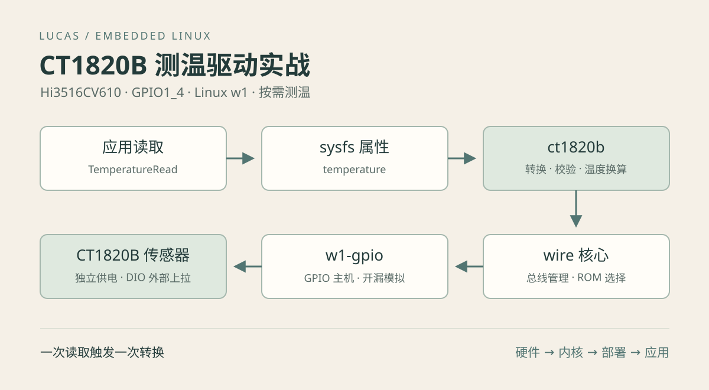

接入一个温度传感器，最终看到一个温度数字只是第一步。真正需要保留下来的，是怎样确认接线、怎样把芯片协议放进 Linux 驱动框架、怎样处理错误，以及怎样让编译、打包和启动流程保持一致。这样换一台电脑、重新制作固件，或者隔几个月再维护时，才能按步骤重做。

本篇以 BA4K 板上的 Hi3516CV610 和 CT1820B 为例。最终接口是一个只读 sysfs 属性：

```sh
# 板端执行，驱动加载并发现设备后
cat /sys/bus/w1/devices/28-*/temperature
```

示例输出 `26625`，表示 **26.625℃**。每次重新读取都发起一次转换；读取失败通过错误码报告，不用旧温度或 0℃冒充有效数据。

正文分为硬件、内核、部署和应用四段。已有完整工程时可按正文命令复现；只有文章下载包时，可用配套构建脚本编译模块和最小调用程序，但仍需自行准备匹配的厂商内核、工具链和板级固件。

[下载全部配套代码](/posts/hi3516cv610-ct1820b-driver/code/experiments.tar.gz) · [查看驱动源码](/posts/hi3516cv610-ct1820b-driver/code/ct1820b.c.html) · [查看应用读取实现](/posts/hi3516cv610-ct1820b-driver/code/Temperature.cpp.html)

## 一 目标环境与实现边界

| 项目 | 本次实现 |
| --- | --- |
| 开发板 | BA4K，Hi3516CV610 |
| 内核 | 海思适配的 Linux 5.10.221 |
| GPIO | GPIO1_4，对应本板 M2 管脚；测试日志中的编号为 GPIO12 |
| 供电方式 | CT1820B 独立供电，DIO 外部上拉 |
| 驱动结构 | 内核 wire、w1-gpio，加项目自定义 ct1820b |
| 数据接口 | `/sys/bus/w1/devices/28-<序列号>/temperature` |
| 数据单位 | 毫摄氏度，带符号十进制整数和换行 |
| 应用接口 | `int TemperatureRead(int *temperatureMilliC)` |
| 工具链 | 项目自带 ARM musl 交叉工具链 |

本驱动只处理按需测温，不写配置寄存器或 EEPROM，不配置报警阈值，不支持寄生供电，也不启动周期采集线程。内核 w1 核心仍会自动搜索设备，搜索产生的总线活动不等于周期测温。

应用封装要求系统中恰好存在一个带 `temperature` 属性的 `28-*` 设备。内核层按设备提供节点；如果以后接入多颗传感器，需要把应用接口扩展为按 ROM 或业务位置选择设备。

以下主机命令除特别说明外，均从包含 `SDK/` 和 `application/` 的工程根目录执行。板端命令单独标注。文中的地址、GPIO 和 pinmux 值只适用于本板，迁移到其他板卡时必须重新确认。

## 二 先确认硬件连接

### 认识三种不同的管脚标识

`M2` 是芯片封装管脚位置，`GPIO1_4` 是 GPIO 控制器组内编号，`GPIO12` 是本次系统日志中的 GPIO 编号。它们描述同一条线的不同层次。

本板采用每组 8 路的编号关系，组 1 的第 4 路对应 `1 × 8 + 4 = 12`。这个结果用于理解当前日志，不能把 Linux 全局 GPIO 编号当成所有平台的固定规则。设备树应通过 GPIO 控制器引用和组内偏移定位管脚。

项目硬件记录指出，原理图中的 `ADC_NTC` 经 R4 接至 J1 第 5 脚；R6 标为接到 1.8V 的 `NC_1K` 预留。网络名称中带有 ADC，并不意味着本次必须使用 ADC：当前使用的是该管脚的 GPIO 功能和数字单总线协议。

需要在实物上确认 R4、R6 的装配状态、探头接线和实际上拉电源。记录中的空闲电压约为 3.3V，但不能仅凭这个电压推断上拉阻值，也不能把预留电阻当成已经焊接。

### 独立供电和外部上拉

连接关系可概括为：

```text
合法的总线上拉电源
        │
       Rpullup
        │
SoC GPIO1_4 ───────────── CT1820B DIO
传感器供电 ───────────── CT1820B VCC
板端 GND ─────────────── CT1820B GND
```

单总线指只有一根数据信号线，不代表只接一根线。独立供电仍需要 VCC 和公共地。传感器封装不同，管脚排列也可能不同，应根据手中器件对应的封装图核对，不能只看器件平面方向猜引脚。

手册连接示意给出 1kΩ～3kΩ 的上拉范围，具体选值仍要结合总线长度、电容、工作电压和低电平灌电流。本文不把示意范围当成本板已安装电阻的测量结果。上拉电压必须同时满足传感器与 SoC 对应 IO 域的电气限制。

### 为什么采用开漏模拟

单总线允许主机和从机轮流拉低同一条线。主机输出低时主动拉低；发送高或等待从机回应时，主机释放线路，由外部电阻上拉。

当前 `w1-gpio` 路径使用 GPIO 输出低和切换输入来模拟开漏。不能把“发送 1”理解成 GPIO 推挽输出高，否则从机拉低时会与主机争用。Linux 对单总线及开漏通信的整体说明见 [w1 子系统文档](https://docs.kernel.org/w1/w1-generic.html)。

测试日志中的 `GPIO12 enforced open drain` 表示框架强制采用开漏语义。当前设备树的 GPIO 标志为普通 active-high，没有显式声明 open-drain，因此出现提示；本次读取成功。这个提示本身不能证明接线错误，也不能证明外部上拉符合要求。

### 硬件阶段如何验收

上电前确认供电、地、DIO 和器件封装方向；上电后确认 VCC 与空闲 DIO 电平合理。发起通信时，示波器或逻辑分析仪应能看到主机复位、从机存在脉冲和后续数据时隙。持续低电平优先检查短路、供电和 GPIO 驱动方向；一直高电平且没有存在脉冲，优先检查管脚复用、连通性和器件供电。

如果尚未看到设备目录，先完成这层检查，不要从温度换算公式开始排查。

## 三 从协议到 Linux 驱动分层

### 一次通信需要哪些步骤

CT1820B 的通信通常包含总线复位、从机存在响应、ROM 命令、功能命令和数据传输。ROM 命令负责找到或选择器件，功能命令负责执行转换、读寄存器等操作。

每颗器件有 64 位 ROM：8 位家族码、48 位序列号和 8 位 CRC。CT1820B 的家族码为 `0x28`，所以设备目录通常呈现为 `28-xxxxxxxxxxxx`。目录名不是完整 64 位 ROM 的逐字节原样打印，应用无需手动拼接 ROM 命令。

| 命令 | 数值 | 本实现的使用方式 |
| --- | --- | --- |
| Search ROM | `0xf0` | w1 核心搜索器件 |
| Match ROM | `0x55` | w1 辅助函数按 ROM 选择器件 |
| Skip ROM | `0xcc` | 当前内核在只登记一个从机时采用 |
| Read Power Supply | `0xb4` | 检查是否为独立供电 |
| Convert Temperature | `0x44` | 发起新一轮转换 |
| Read Registers | `0xbe` | 读取 8 字节寄存器和 1 字节 CRC |

本地 Linux 5.10 的 `w1_reset_select_slave()` 在已登记从机数为 1 时使用 Skip ROM，否则发送 Match ROM 和对应 ROM。因此调用者不应假设函数永远发送 Match ROM；总线上的器件必须被正确发现。

### 各层职责



```text
业务调用 TemperatureRead
            │ open / read / close
            ▼
sysfs temperature 属性
            │ temperature_show
            ▼
ct1820b 家族驱动
  芯片命令、供电检查、轮询、CRC、温度换算
            │ w1_reset_select_slave / w1_write_8 / w1_read_block
            ▼
wire 模块中的 w1 核心
  总线对象、设备搜索、ROM 选择和通信辅助函数
            ▼
w1-gpio 主机驱动
  通过 GPIO 提供底层总线访问
            ▼
GPIO1_4 与 CT1820B
```

复用内核 w1 框架以后，自定义驱动不需要自行创建 GPIO 用户态接口，也无需重新编写用户态微秒延时循环。芯片专有逻辑集中在家族驱动，设备发现和底层 GPIO 通信由已有框架承担。

### 为什么不能同时使用 w1_therm

自定义驱动注册 `0x28` 家族，而 `w1_therm` 也处理这个家族。两者不能同时争用该家族的绑定。

家族码表示协议家族，不是可靠的厂商或型号鉴别信息。这个驱动用于明确接入 CT1820B 的总线；不能因为另一颗器件也显示为 `28-*`，就宣称完全兼容。尤其不能直接照搬其他温度芯片的配置写入流程：CT1820B 手册明确将 CONFIG 定义为只读。

## 四 内核配置和设备树

### 修改可维护的源文件

项目中的长期修改位置是：

```text
SDK/local/linux/arch/arm/configs/hi3516cv610_defconfig
SDK/local/linux/arch/arm/boot/dts/hi3516cv610-demb-flash.dts
SDK/Drivers/Ct1820b/ct1820b.c
SDK/Drivers/Ct1820b/Makefile
SDK/Drivers/Ct1820b/Build.sh
```

`SDK/build/linux-5.10.y-hi3516cv610/` 是实际构建目录。内核构建脚本会覆盖本地文件并重新配置，不应只修改 build 目录中的 DTS 或 `.config`，否则下次构建可能丢失修改。

### 必需的内核选项

```text
CONFIG_W1=m
CONFIG_W1_MASTER_GPIO=m
# CONFIG_W1_SLAVE_THERM is not set
```

`m` 表示编译为可加载模块。前两个配置分别生成 w1 核心和 GPIO 主机驱动。GPIO、OF、pinctrl 等基础能力由本板既有内核配置提供；迁移到精简内核时还需检查这些依赖。

构建后检查真正参与编译的配置：

```sh
# 主机，项目根目录
grep -E 'CONFIG_W1(=|_)' SDK/build/linux-5.10.y-hi3516cv610/.config
```

如果 `CONFIG_W1_SLAVE_THERM=y`，仅在板端执行 `rmmod` 无法移除内建驱动，需要重新配置内核。项目的驱动构建脚本会主动拒绝这种冲突配置。

### 温度相关设备树片段

以下片段来自本板配置；完整工程中已存在时不要重复添加：

```dts
&gpio_chip1 { gpio-controller; };

/ {
    w1_temperature {
        compatible = "w1-gpio";
        gpios = <&gpio_chip1 4 0>;
        pinctrl-names = "default";
        pinctrl-0 = <&ct1820_dio_pin>;
        status = "okay";
    };

    ct1820_pinmux: pinctrl@11130004 {
        compatible = "pinctrl-single";
        reg = <0x11130004 0x4>;
        #pinctrl-cells = <1>;
        pinctrl-single,register-width = <32>;
        pinctrl-single,function-mask = <0xf>;
        ct1820_dio_pin: ct1820-dio-pin {
            pinctrl-single,pins = <0x0 0x0>;
        };
    };
};
```

`gpios` 引用 GPIO1 控制器的第 4 路。`pinctrl-0` 把该设备的默认 pinmux 关联到 M2 管脚。`reg` 指定本板复用寄存器地址，`function-mask = <0xf>` 限制只修改低 4 位复用字段，保留其他电气配置。

这里没有把上拉、驱动能力等字段整体覆盖成某个“经验值”。管脚切换为 GPIO 与电气参数设置是两件事；外部上拉也不会因为写了 `compatible = "w1-gpio"` 自动出现。

配套的 `ct1820b-board.dtsi` 仅包含温度片段，需合入已有板级 DTS；其地址格式依赖当前父节点的地址单元设置，不能直接当成其他 SoC 的通用配置。

## 五 按需测温驱动的实现

### 用只读属性暴露结果

驱动通过 `DEVICE_ATTR_RO(temperature)` 建立只读属性，通过 `ATTRIBUTE_GROUPS(ct1820)` 组成属性组，再挂到 `w1_family_ops.groups`。`module_w1_family()` 完成家族驱动的模块注册和注销。

```c
static DEVICE_ATTR_RO(temperature);

static struct attribute *ct1820_attrs[] = {
    &dev_attr_temperature.attr,
    NULL,
};
ATTRIBUTE_GROUPS(ct1820);

static const struct w1_family_ops ct1820_ops = {
    .groups = ct1820_groups,
};
static struct w1_family ct1820_family = {
    .fid = 0x28,
    .fops = &ct1820_ops,
};
module_w1_family(ct1820_family);
```

读取属性时，sysfs 调用 `temperature_show()` 生成文本。一个属性输出一个整数和换行，便于 shell 与应用使用。sysfs 的属性回调和读取语义见 [Linux sysfs 文档](https://docs.kernel.org/filesystems/sysfs.html)。

已经读到文件末尾后，继续对同一描述符 `read()` 不应被当成下一次采样。当前应用每次调用重新打开文件、读取并关闭；如果另行设计复用描述符的接口，必须正确处理偏移和重新触发读取。

### 完整事务顺序

```text
获取 master->bus_mutex
    ↓
复位并选择器件 → 0xb4 → 读取供电状态
    ↓ 独立供电
复位并选择器件 → 0x44
    ↓
休眠后读取完成位，未完成则继续，设置超时边界
    ↓ 完成
复位并选择器件 → 0xbe → 读取 9 字节
    ↓
CRC → 配置字节 → 有符号温度范围
    ↓
输出毫摄氏度文本
    ↓
释放总线锁
```

所有获得锁后的错误路径也进入统一解锁出口。完整函数见配套 `ct1820b.c`，下面解释影响可靠性的关键决策。

### 为什么整个转换期间都持有锁

```c
ret = mutex_lock_interruptible(&master->bus_mutex);
if (ret)
    return ret;
```

转换命令、等待、读结果共同构成一个硬件事务。如果发完命令就释放锁，设备搜索线程或另一个读取者可能复位总线，破坏正在进行的转换。当前实现因此一直持有总线互斥锁，直到数据读取结束。

互斥锁允许持有者睡眠；不能为了“保护时序”改用自旋锁后继续调用 `msleep_interruptible()`。微秒级总线时隙与毫秒级转换等待属于不同层次，前者由 w1 底层处理，后者通过休眠让出 CPU。

代价是同一总线上的并发读取要排队。这适合低频温度监测，业务层不要在视频采集或推理的实时路径中同步调用测温。

### 先判断供电方式

```c
ret = -ENODEV;
if (w1_reset_select_slave(sl))
    goto out;
w1_write_8(master, 0xb4);
if (!w1_touch_bit(master, 1)) {
    ret = -EOPNOTSUPP;
    goto out;
}
```

`0xb4` 后读取 1 表示独立供电，读取 0 表示寄生供电。寄生供电需要处理转换期间的供电条件，不能简单删掉检查就认为获得了支持。

`w1_touch_bit(master, 1)` 是一个读时隙操作，包含主机发起时隙并采样的语义，不是简单读取某个 GPIO 寄存器。总线故障也可能让读位异常，因此出现供电模式错误时仍要核对实物供电和波形。

### 轮询完成而不是猜一个固定延时

```c
w1_write_8(master, 0x44);
deadline = jiffies + msecs_to_jiffies(1000);
for (;;) {
    if (msleep_interruptible(5)) {
        ret = -EINTR;
        goto out;
    }
    if (w1_touch_bit(master, 1))
        break;
    if (time_after_eq(jiffies, deadline)) {
        ret = -ETIMEDOUT;
        goto out;
    }
}
```

手册给出的转换时间典型值不能直接当成最坏情况上限。当前实现每次请求休眠 5ms，再读取完成位；转换未完成返回 0，完成返回 1。仍未完成且达到截止时间时返回超时。

5ms 是请求的休眠时间，受内核节拍与调度影响，不保证严格每 5ms 采样。1 秒是本次转换轮询的超时策略，也不是整个应用调用的硬实时上限：等待锁、调度和总线操作都会增加耗时；代码还会先读取完成位，再判断未完成是否超时。

时间比较使用 `time_after_eq()`，以符合内核 jiffies 回绕处理方式。收到信号中断休眠则返回 `-EINTR`；锁等待中断可能由内核系统调用层表现为中断或重启语义，不能笼统理解为所有中断路径都返回同一个内部值。

### 读取全部寄存器再做校验

```c
w1_write_8(master, 0xbe);
ret = -EIO;
if (w1_read_block(master, data, sizeof(data)) != sizeof(data))
    goto out;
ret = -EBADMSG;
if (w1_calc_crc8(data, 8) != data[8])
    goto out;
```

| 数组位置 | 含义 | 本驱动用途 |
| --- | --- | --- |
| `data[0]` | 温度低字节 | 合成原始温度 |
| `data[1]` | 温度高字节 | 合成原始温度 |
| `data[2]`、`data[3]` | 高低报警阈值 | 参与 CRC，不修改 |
| `data[4]` | CONFIG | 检查配置值 |
| `data[5]`～`data[7]` | 保留字节 | 参与 CRC |
| `data[8]` | CRC8 | 与前 8 字节计算结果比较 |

只读前两个字节虽然能算出温度，却无法验证整组数据。CT1820B 的 CRC 多项式为 `x^8 + x^5 + x^4 + 1`，当前直接使用 w1 提供的 CRC8 函数，避免重复编写位序算法。

底层读满 9 字节只表示完成了相应读操作，不代表芯片一定在线；浮空线路仍可能采到一串位。因此长度检查后还要检查内容。

### 为什么 CRC 后还检查 CONFIG

```c
ret = -EIO;
if (data[4] != 0x7f && data[4] != 0x6f)
    goto out;
```

CRC 检查数据是否符合校验关系，并不证明它一定来自正常器件。以零初值计算全零数据，结果仍是零；总线卡低时读到的 9 个零可能通过 CRC。检查 CONFIG 可以挡住这类明显异常。

Rev.1.3 手册第 10 页寄存器表写默认值 `0x6f`，第 12 页 CONFIG 定义表写 `0x7f`。驱动接受这两个值，但不尝试写寄存器去“修正”它。这个检查也不是唯一型号识别机制；将来替换芯片批次或型号时仍需重新核对。

### 正负温度与毫摄氏度换算

```c
raw = (s16)((data[1] << 8) | data[0]);
ret = -ERANGE;
if (raw < -50 * 16 || raw > 150 * 16)
    goto out;
ret = sysfs_emit(buf, "%d\n", raw * 1000 / 16);
```

先按高低字节合成 16 位数，再转为 `s16` 解释二进制补码。每个原始计数对应 `1/16℃ = 0.0625℃`。输出采用整数毫摄氏度，便于内核运算，也避免引入浮点。

| 原始 16 位值 | 有符号计数 | 温度 | sysfs 输出 |
| --- | --- | --- | --- |
| `0x0191` | 401 | 25.0625℃ | `25062` |
| `0x0000` | 0 | 0℃ | `0` |
| `0xfff8` | -8 | -0.5℃ | `-500` |
| `0xfe6f` | -401 | -25.0625℃ | `-25062` |
| `0xfce0` | -800 | -50℃ | `-50000` |

整数除法向零截断，25.0625℃ 输出为 25062 毫摄氏度，损失 0.5 毫摄氏度。这是表示方式造成的量化，不是传感器精度。显示三位小数也不意味着测温误差达到 0.001℃。

手册规定工作温度范围为 -50℃～150℃，驱动据此拒绝范围之外的结果。有效的 0℃ 应正常返回，不能用温度是否为零判断成功。

上电温度寄存器默认值为 85℃。当前先转换再读取，以避免直接使用上电初值；如果实测长时间固定 85℃，应检查转换与供电过程。不能一律丢弃 85℃，因为它也可能是真实温度。

### 错误出口也是接口的一部分

| 返回值 | 当前实现中的含义 |
| --- | --- |
| `-ENODEV` | 复位选择失败，或应用未找到设备节点 |
| `-EOPNOTSUPP` | 供电检查不满足独立供电要求 |
| `-ETIMEDOUT` | 转换一直未报告完成 |
| `-EBADMSG` | CRC 不匹配 |
| `-EIO` | 读取长度异常或 CONFIG 不符合预期等 |
| `-ERANGE` | 温度超出范围，或应用解析结果越界 |
| `-EINTR` | 转换等待被信号中断 |

内核属性回调返回负错误码后，用户态 `read()` 返回 -1 并设置 `errno`。应用封装再转成负 errno 返回。错误不能替换成温度 0，也不能在失败后悄悄返回上次结果；业务确实需要缓存时，应额外保留时间戳和有效状态。

## 六 交叉编译与产物确认

### 使用完整工程构建

```sh
# 主机，项目根目录
bash SDK/Build.sh l
bash SDK/Build.sh temperature
```

第二条等价于 `bash SDK/Drivers/Ct1820b/Build.sh`。内核构建依赖 SDK 源码包、工具链和 FIT 封装工具；如果提示缺少 `mkimage`，先按项目流程构建 U-Boot，例如 `bash SDK/Build.sh u`，然后重试内核构建。

当前 `SDK/Build.sh l` 会重新配置并构建内核，不是仅增量编译温度驱动。只有第一次启用 W1、修改内核配置或设备树时才需要这一步；后续只修改 `ct1820b.c`，保持原内核构建树和板端固件匹配，重新执行 temperature 构建即可。

驱动脚本先检查 W1 模块配置和家族冲突，再检查 `Module.symvers`，随后构建内核模块和外部模块。Makefile 的核心只有：

```makefile
obj-m += ct1820b.o
```

它告诉 Kbuild 生成 `ct1820b.ko`。编译命令中的 `-C` 进入内核构建树，`M` 指向外部模块目录，`ARCH=arm` 和 `CROSS_COMPILE` 确定目标架构与工具链。

### 检查产物

```sh
# 主机
ls -l SDK/output/ct1820b/
sha256sum SDK/output/ct1820b/*.ko
file SDK/output/ct1820b/*.ko
```

应有三个模块：

```text
SDK/output/ct1820b/wire.ko
SDK/output/ct1820b/w1-gpio.ko
SDK/output/ct1820b/ct1820b.ko
```

主机具备 `modinfo` 时，还可检查：

```sh
modinfo SDK/output/ct1820b/ct1820b.ko
```

关注架构、vermagic、依赖和作者信息。版本字符串一致只是必要检查之一，不能证明不同配置构建出来的模块一定兼容。应从同一套内核构建产物取得三个模块，并与运行内核匹配；不要用强制加载掩盖不匹配。

### 使用下载包单独构建模块

下载包中的 `build-module.sh` 不依赖原项目目录布局，只要求明确设置两项环境变量：

```sh
# 主机，在下载包解压目录
export KERNEL_DIR=/absolute/path/to/built/linux
export CROSS_COMPILE=/absolute/path/to/arm-linux-musleabi-
bash build-module.sh
```

以上 `/absolute/path/` 是必须替换的占位路径。`KERNEL_DIR` 需要已经完成匹配内核的构建，包含生成头文件、`.config` 和 `Module.symvers`；仅有一份未构建的内核源码不够。

脚本先执行内核 `modules` 构建，确保 W1 导出符号写入 `Module.symvers`，再生成 `ct1820b.ko`。另两个模块取自同一内核树的 `drivers/w1/wire.ko` 和 `drivers/w1/masters/w1-gpio.ko`。仅有一个非空的 `Module.symvers` 仍不够，它可能只有内建内核符号；如果跳过模块构建，可能出现 `w1_register_family` 等 undefined 警告，即使产出 `.ko` 也不能视为构建正确。构建成功并不代表已经更新板端设备树或烧录固件。

## 七 更新内核并进行板端验证

### 首次启用与后续更新的区别

| 修改内容 | 应更新的内容 |
| --- | --- |
| 首次启用 W1 或修改内核配置 | 匹配的内核固件与三个模块 |
| 修改 GPIO 或 pinmux | 实际启动使用的设备树；本项目随 FIT 内核镜像封装 |
| 仅修改 ct1820b.c | 重新构建并替换对应模块 |
| 修改应用封装或功能开关 | 重新配置、编译和打包应用 |

本项目内核产物位于 `SDK/output/linux/`，包含 `zImage`、`hi3516cv610-demb-flash.dtb` 和 `uImage` 等。使用现有升级流程导入、打包和更新固件，检查启动槽位及 meta 状态是否选择了预期镜像。不能仅因为某个分区写入成功，就认定新内核已运行。

具体擦写地址和升级包命令依赖产品分区配置，应以项目 `application/Upgrade/README.md` 为准。本文不提供脱离分区表的通用擦写命令。完成更新并重启后，在板端检查：

```sh
uname -a
ls /proc/device-tree/w1_temperature
tr -d '\000' < /proc/device-tree/w1_temperature/compatible
```

最后一条应显示 `w1-gpio`。节点存在证明运行中的设备树包含它，还需结合 `dmesg` 确认驱动探测成功；若节点不存在，继续反复 `insmod` 无法弥补旧设备树问题。

### 复制模块并核对校验值

下面地址仅为示例，按实际开发板修改；设备需支持相应 SSH/SCP 服务，也可以使用既有 NFS 传输方式。

```sh
# 主机，项目根目录
BOARD_ADDR=192.168.8.214
ssh "root@$BOARD_ADDR" 'mkdir -p /tmp/ct1820-test'
scp SDK/output/ct1820b/wire.ko \
    SDK/output/ct1820b/ct1820b.ko \
    SDK/output/ct1820b/w1-gpio.ko \
    "root@$BOARD_ADDR:/tmp/ct1820-test/"
sha256sum SDK/output/ct1820b/*.ko
```

```sh
# 板端
cd /tmp/ct1820-test
sha256sum *.ko
```

逐个比较同名模块的 SHA256。校验值用于证明传输前后内容相同，不要长期硬编码为某一次构建的值；源码、内核或工具链变化都可能改变产物。

### 加载新模块

首次加载前检查 `lsmod`。如果已加载旧模块，先停止所有温度读取者，再按顺序卸载已加载的模块：

```sh
# 板端，只对确实已加载且允许停止的模块执行
rmmod w1_gpio
rmmod ct1820b
rmmod wire
```

`wire` 可能被其他单总线设备使用；出现“正在使用”时先查使用者，不要强制卸载。模块文件名 `w1-gpio.ko` 与内核模块名 `w1_gpio` 的连字符和下划线不同。

随后在三个新模块所在目录执行，每一步成功后再执行下一步：

```sh
# 板端
cd /tmp/ct1820-test
insmod wire.ko
insmod ct1820b.ko
insmod w1-gpio.ko
lsmod
dmesg | tail -n 60
```

先注册核心，再注册家族驱动，最后注册 GPIO 主机。这样总线开始搜索时家族驱动已经就绪。`insmod` 不会自动帮忙解决所有依赖；某一步失败应先看内核日志。

### 等待发现并读取

```sh
# 板端
ls /sys/bus/w1/devices/
```

正常情况下可看到 `w1_bus_master1` 一类主机目录和 `28-xxxxxxxxxxxx` 从机目录。主机序号及 ROM 不能照抄测试板。自动发现可能需要几秒，刚加载后暂时没有从机不一定是故障。

```sh
cat /sys/bus/w1/devices/28-*/temperature
```

单传感器情况下，预期输出一个带换行的整数。如果接了多颗设备，通配符可能读取多个文件；需要使用具体 ROM 路径区分测量来源。

简单重复读取可用：

```sh
# 板端；每次读取结束后再等待 1 秒
i=0
while [ "$i" -lt 30 ]; do
    if ! cat /sys/bus/w1/devices/28-*/temperature; then
        echo "read failed at sample $i" >&2
        break
    fi
    i=$((i + 1))
    sleep 1
done
```

这不是严格 1Hz 采样：采样间隔包含本次转换耗时和 `sleep 1`。若 `cat` 报错，应记录 stderr 与同一时段的内核日志。

`/tmp/ct1820-test` 是临时验证位置，重启后通常不保留。成功测温后，再进入应用打包与自动加载阶段。

## 八 应用读取接口与最小程序

### 接口约定

```cpp
int TemperatureRead(int *temperatureMilliC);
```

成功返回 0，并写入毫摄氏度；失败返回负 errno，输出变量保持原值。调用者必须先判断返回值，再使用输出变量。

当前实现每次调用都执行以下步骤：

1. 检查输出指针，空指针返回 `-EINVAL`。
2. 用 `glob()` 查找 `/sys/bus/w1/devices/28-*/temperature`。
3. 无匹配返回 `-ENODEV`，多个匹配返回 `-EEXIST`。
4. 用 `O_RDONLY | O_CLOEXEC` 打开唯一节点。
5. 读取一次并保存错误码，然后关闭描述符。
6. 用 `strtol()` 解析，检查范围和尾部字符。
7. 全部成功后才修改调用者的输出。

发现失败、内存不足或底层读错误等还有相应错误分支，完整代码见下载包。每次重新发现设备避免硬编码某块板的 ROM，但也意味着多设备场景需要另行设计接口。

保存 `errno` 后再清理资源，避免后续函数改变它。文本解析也不能使用只做宽松转换的写法：`26625xyz` 不是合法温度，不能被当成 26625 接受。尾部换行和空白允许存在，其他多余字符会被拒绝。

### 编译最小调用程序

配套 `read_temperature.cpp`：

```cpp
#include "Temperature.h"
#include <cstdio>
#include <cstring>

int main()
{
    int temperatureMilliC = 0;
    const int rc = TemperatureRead(&temperatureMilliC);
    if (rc != 0) {
        std::fprintf(stderr, "TemperatureRead: %s (rc=%d)\n",
                     std::strerror(-rc), rc);
        return 1;
    }
    std::printf("%d mC, %.3f C\n", temperatureMilliC,
                temperatureMilliC / 1000.0);
    return 0;
}
```

用户态显示时可以使用浮点除法；驱动的整数接口不受影响。在下载包解压目录执行：

```sh
# 主机，替换为实际工具链前缀
export CROSS_COMPILE=/absolute/path/to/arm-linux-musleabi-
"${CROSS_COMPILE}g++" -std=c++17 -Wall -Wextra -Werror \
    -DCONFIG_SENSOR_CT1820B -I. Temperature.cpp read_temperature.cpp \
    -o read_temperature
file read_temperature
```

头文件仅在定义 `CONFIG_SENSOR_CT1820B` 时声明接口，所以独立编译必须显式传入宏。完整应用工程由配置系统生成对应编译选项。

将程序复制到板端，确保 musl 动态加载器和所需运行库与工具链兼容，然后执行：

```sh
# 板端，程序所在目录
chmod +x read_temperature
./read_temperature
```

可能输出 `26625 mC, 26.625 C`；这只是格式示例，实际数值取决于当时温度。若文件存在却提示无法执行，检查架构、解释器路径和动态库，不要直接认定是传感器驱动问题。

### 业务调用时机

接口是阻塞调用，会等待总线锁和转换结束。建议由业务已有的低频任务或专门工作线程按需求调用；本接口本身不创建线程。

失败时保留输出值是为了避免破坏调用者状态，不代表那个值仍是新鲜测量。业务显示上次值时，应同时显示采样时间或失效状态。当前封装不隐式重试 `EINTR`，重试策略由调用者决定，以免一次业务调用在不知情的情况下触发多轮转换。

## 九 将功能纳入编译和启动流程

### 一个开关控制三条路径

应用 Kconfig 位于 `application/Middleware/Sensor/Kconfig`，选项为 `CONFIG_SENSOR_CT1820B`，依赖 `MODE_HI3516CV610_00S`，默认关闭。

开启后，配置必须同时影响：

| 环节 | 开启 | 关闭 |
| --- | --- | --- |
| C++ 编译 | 编译 Temperature.cpp，声明接口 | 不编译实现，不声明接口 |
| 安装打包 | 安装三个模块 | 清理复用安装目录中的旧模块目录 |
| 启动配置 | `SENSOR_CT1820B_ENABLED=1` | `SENSOR_CT1820B_ENABLED=0` |

不能只关闭 C++ 编译却仍把旧模块装进镜像，也不能只改启动脚本而遗漏打包。当前 `Middleware/Sensor/Install.cmake` 在开启时检查三个模块是否存在，关闭时清理旧安装目录，避免前一次构建残留。

应用 Kconfig 不会自动修改内核配置或设备树。内核提供通用能力，应用开关决定是否把这项功能交付并启用。

### 同步模块并构建应用

```sh
# 主机，项目根目录，驱动构建成功后
cp SDK/output/ct1820b/wire.ko \
   SDK/output/ct1820b/w1-gpio.ko \
   SDK/output/ct1820b/ct1820b.ko \
   application/Platform/Runtime/HI3516CV610_00S/ko/ct1820b/
```

这里是明确更新应用所打包的模块来源。仅重编 `SDK/output/ct1820b` 不会自动替换 Runtime 目录中的旧模块。

```sh
# 主机，进入 application 后
cd application
./AppBuild.sh config
# 在 Hardware → Sensor Options 中开启 CT1820B temperature sensor 并保存
bash Scripts/Config/GenerateConfig.sh
./AppBuild.sh make HI3516CV610_00S.mk
```

配置生成脚本需要 Python 和 `kconfiglib`。构建流程应重新配置 CMake，不能沿用旧配置缓存；`make` 操作完成编译和打包，不等于部署到开发板。

检查安装目录：

```sh
# 主机，application 目录
cat Pack/app/Bin/sensor-features.conf
ls -l Pack/app/ko/ct1820b/
sha256sum Pack/app/ko/ct1820b/*.ko
```

预期配置值为 1，并有三个匹配模块。关闭功能后重新生成配置和打包，预期值为 0，旧的 `Pack/app/ko/ct1820b` 被清理。

### 板端自动加载行为

部署应用镜像后，模块路径为 `/usr/app/ko/ct1820b`。`app_launch.sh` 在启动 ProcessGuard 之前读取 `/usr/app/Bin/sensor-features.conf`，按依赖顺序加载模块。

脚本先确认运行设备树有 `w1_temperature` 节点，检查 `w1_therm` 冲突，再检查模块文件。已加载的模块会跳过；配置文件缺失默认不加载。出现错误时输出告警并继续其他应用启动，不在启动脚本中循环读取温度。

```sh
# 板端，部署并重启后验收
cat /usr/app/Bin/sensor-features.conf
ls /usr/app/ko/ct1820b/
ls /sys/module/ct1820b
ls /sys/bus/w1/devices/
cat /sys/bus/w1/devices/28-*/temperature
```

配置关闭不会主动卸载已经运行的驱动。验证关闭状态应部署关闭版本并重启，再检查是否仍被其他脚本加载。

## 十 按现象定位故障

| 现象 | 优先检查 | 处理方向 |
| --- | --- | --- |
| 构建提示缺少 W1 配置 | build 内核 `.config` | 修改 local defconfig 并重建内核 |
| 缺少 Module.symvers | 内核是否完整构建 | 使用完成构建且匹配的内核树 |
| Invalid module format | `uname -a`、vermagic、架构 | 对齐内核与模块，查看 dmesg 的具体原因 |
| Unknown symbol | 模块依赖和符号版本 | 先加载 wire，使用同一构建的三个模块 |
| 没有 w1 主机目录 | 运行设备树、w1_gpio、probe 日志 | 检查实际启动 DTB、GPIO 申请和 pinmux |
| 有主机但没有 28 设备 | 接线、供电、上拉、复位波形 | 先解决硬件通信和自动发现 |
| 有 28 目录但无 temperature | ct1820b 是否绑定、w1_therm 冲突 | 检查家族驱动，而非温度解析 |
| Operation not supported | 供电状态位、真实接线 | 确认独立供电和总线状态 |
| Connection timed out | 完成位、线路和供电 | 检查转换期间波形，不只增加等待时间 |
| Bad message | CRC 错误 | 检查上拉、线长、干扰和接触问题 |
| Input/output error | CONFIG、读取长度、应用文本 | 按内核和应用两层分别定位 |
| 应用返回 EEXIST | temperature 节点数量 | 明确选择设备或保持单设备约束 |
| 重启后节点消失 | 临时部署、配置文件、启动日志 | 完成持久打包与启动集成 |
| 关闭后仍加载 | 当前内存状态、旧镜像、其他脚本 | 检查部署版本并重启验证 |

常用只读检查命令：

```sh
# 板端
uname -a
lsmod
ls /proc/device-tree/w1_temperature
ls /sys/bus/w1/devices/
dmesg | tail -n 100
```

日志中的错误文字由 libc 和工具决定；排障时保留数字 errno 或应用返回值更清楚。不要因 shell 的一行概括性报错就直接修改驱动。

需要增加调试日志时，可在开发版本输出供电位、9 字节寄存器和计算 CRC，并限制频率。保持正式 `temperature` 属性仍只输出温度整数，避免调试文字破坏应用解析协议。

## 十一 已完成验证与后续测试

### 内核驱动的历史板端记录

2026 年 10 月 10 日，在 BA4K / Hi3516CV610、Linux 5.10.221 上完成三个模块的传输校验、旧模块卸载、新模块加载和 30 次重复读取。每次读取结束后等待 1 秒，全部成功，读数范围为 **26625～26687 毫摄氏度**。

这说明该硬件、供电与固件组合下，正常温度读取链路可以工作。成功返回的每次读数都经过当前实现的供电检查、完成轮询、CRC、CONFIG 和范围检查。

这些记录不等于精度校准，也没有覆盖负温度、断线、寄生供电、持续视频负载和长时间运行。原始测试发生在手工加载阶段；后续应用集成新增的自动加载机制与这次历史测试应分开验收。

### 应用接口验证状态

项目接口文档记录了 CMake 配置、Temperature.cpp 交叉编译、独立 ARM 调用程序编译，以及主机接口测试通过。主机测试覆盖正负温度、无设备、多设备、非法文本、读取返回 EBADMSG 和空指针；安装开关测试覆盖模块清理及配置值更新。

该记录同时注明应用接口上板测试尚未完成。当时的连接阻碍是 SSH 主机密钥变化，不是已经确认的传感器故障。连接恢复后，应在真实固件中调用 `TemperatureRead()`，再验证启动与关闭路径。

本教程新增示例的实际检查记录放在[配套验证说明](/posts/hi3516cv610-ct1820b-driver/code/verification.md.html)，不把编译通过写成已完成硬件测试。

### 建议逐项补齐的测试

| 场景 | 验收重点 |
| --- | --- |
| 冷启动 | 固件版本正确，模块顺序正确，能在发现后读取 |
| 重新加载 | 停止读取者后能卸载和重新加载，无残留绑定 |
| 负温度 | 与参考温度计比较，符号与单位正确 |
| 断开器件 | 报错而非伪造 0℃；重新接入后按发现机制恢复 |
| 电源异常 | 不返回被误认为有效的新鲜数据，记录错误类型 |
| 两个并发读取者 | 无事务交叉，允许等待，观察业务延迟 |
| 多颗器件 | 应用明确返回 EEXIST，不随机选择一颗 |
| 视频和推理负载 | 长期统计成功率、错误率及调用耗时 |
| 关闭后重新打包 | 模块目录清理，配置为 0，重启后不自动加载 |
| 精度验证 | 使用合适参考仪器，在稳定温度条件下比较 |

将复现记录写成“固件版本、模块校验值、接线条件、操作命令、输出、结论”的格式。读到一次合理温度、连续读取稳定和精度达标是三个不同验收目标。

## 十二 复现时保留哪些资料

| 资料 | 本项目位置或用途 |
| --- | --- |
| 驱动源码与构建入口 | `SDK/Drivers/Ct1820b/` |
| 接线与操作说明 | `SDK/Drivers/Ct1820b/README.txt` |
| 原始板端记录 | `SDK/Drivers/Ct1820b/TEST_RESULT.txt` |
| 内核配置和板级 DTS | `SDK/local/linux/arch/arm/` |
| 应用实现 | `application/Middleware/Sensor/Temperature/CT1820B/` |
| 公共接口 | `application/Interfaces/Middleware/Temperature.h` |
| 功能安装逻辑 | `application/Middleware/Sensor/Install.cmake` |
| 启动脚本 | `application/Platform/Bin/scripts/HI3516CV610_00S/app_launch.sh` |
| 应用接口说明 | `application/Doc/CT1820B.txt` |
| 产品升级流程 | `application/Upgrade/README.md` |

芯片协议依据为 SENSYLINK《CT1820B Advanced Datasheet》，Rev.1.3，2021 年 9 月：第 10 页寄存器表，第 11～12 页温度和 CONFIG，第 13～15 页命令、CRC 与 ROM，第 16～19 页总线和接线。项目内文件为 `application/Doc/硬件/BA4K/CT1820B Advanced Datasheet Ver1.3 2021-09-09(1).pdf`。配套下载包不包含该手册和厂商 SDK。

Linux 通用机制可继续阅读 [w1 子系统介绍](https://docs.kernel.org/w1/w1-generic.html) 与 [sysfs 属性说明](https://docs.kernel.org/filesystems/sysfs.html)。具体函数行为以项目使用的 Linux 5.10.221 源码为准，尤其注意 `drivers/w1/w1_io.c`、`drivers/w1/masters/w1-gpio.c` 和 `include/linux/w1.h`。
