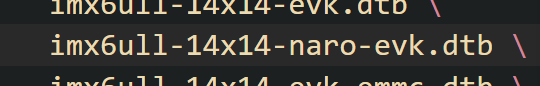

移植版本5.1571
# 1、拿到源码编译测试
* 1、下载源码
* 2、编译
```shell
#!/bin/bash
path="/home/ygc/Desktop/linux-gcc/2021-6ull/gcc-arm-10.3-2021.07-x86_64-arm-none-linux-gnueabihf/bin"
make ARCH=arm CROSS_COMPILE=${path}/arm-none-linux-gnueabihf- distclean
make ARCH=arm CROSS_COMPILE=${path}/arm-none-linux-gnueabihf- imx_v7_defconfig
make ARCH=arm CROSS_COMPILE=${path}/arm-none-linux-gnueabihf- menuconfig
make ARCH=arm CROSS_COMPILE=${path}/arm-none-linux-gnueabihf- all -j16
```
测试编译。链接文件在arch/arm/kernel/vmlinux.lds中。


# 2、添加开发版的默认配置
## 2.1、修改配置文件
在arch/arm/crosstool/目录下，找到文件：
imx_v7_defconfig，imx_v7_defconfig是这款芯片的配置文件。
改个名字，改成自己的名字，比如：imx_v7_naro_defconfig。

## 2.2、添加自己板子的设备树
编译linux的时候会编译出很多的设备树，在arch/arm/boot/dts目录下。
查看makefile，找到：里面全部是参与编译的dts文件。
找到imx6ull-14x14-evk.dts，这个是官方给的设备树。
复制一份，改成自己的名字，比如：imx6ull-14x14-naro-evk.dts。
同时，在makefile中，将imx6ull-14x14-evk.dts改成自己的名字，比如：imx6ull-14x14-naro-evk.dts。或者加上一条也行。
