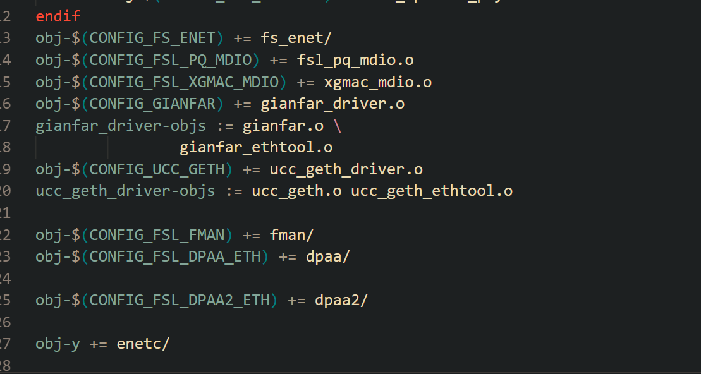

# 下载源码
https://github.com/nxp-imx
nxp官方维护的仓库


#  编译
编译要选择的模板目录载arch/arm/configs/下,
模板选择imx_v6_v7_defconfig

#  tftp
采用网络下载的方法，
```shell
sudo apt-get install tftpd-hpa  # Debian/Ubuntu
```
创建目录
然后修改配置文件
```shell
sudo vim /etc/default/tftpd-hpa
```

下面为配置
```shell
 cat /etc/default/tftpd-hpa
# /etc/default/tftpd-hpa

# 两个配置
TFTP_USERNAME="tftp"
TFTP_DIRECTORY="/home/ygc/Desktop/project/tftp"
TFTP_ADDRESS=":69"
TFTP_OPTIONS="-1 -c -s"


TFTP_USERNAME="tftp"
TFTP_DIRECTORY="/home/tuling/nfs/tftp"
TFTP_ADDRESS=":69"
TFTP_OPTIONS="-1 -c -s"
```

上面不生效，被覆盖了，采用链接的方式链接过去
重启
```shell
sudo systemctl restart tftpd-hpa
```

# 一些说明
linux的移植相比于uboot。直接拷贝arch/arm/configs/里面的配置，自已名字改一份，
比较容易。
而对于驱动，驱动的编译会在makefile里有一个config的选项,如果在.config里开起，就会去编译。

设备树的makefile中，
```makefile
	imx6sx-udoo-neo-full.dtb
dtb-$(CONFIG_SOC_IMX6UL) += \
	imx6ul-14x14-evk.dtb \
	imx6ul-ccimx6ulsbcexpress.dtb \
	imx6ul-ccimx6ulsbcpro.dtb \
	imx6ul-geam.dtb \
	imx6ul-isiot-emmc.dtb \
	imx6ul-isiot-nand.dtb \
	imx6ul-kontron-n6310-s.dtb \
	imx6ul-kontron-n6310-s-43.dtb \
	imx6ul-liteboard.dtb \
	imx6ul-opos6uldev.dtb \
	imx6ul-pico-dwarf.dtb \
	imx6ul-pico-hobbit.dtb \
	imx6ul-pico-pi.dtb \
	imx6ul-phytec-segin-ff-rdk-emmc.dtb \
	imx6ul-phytec-segin-ff-rdk-nand.dtb \
	imx6ul-prti6g.dtb \
	imx6ul-tx6ul-0010.dtb \
	imx6ul-tx6ul-0011.dtb \
	imx6ul-tx6ul-mainboard.dtb \
	imx6ull-14x14-evk.dtb \
	imx6ull-colibri-emmc-eval-v3.dtb \
	imx6ull-colibri-eval-v3.dtb \
	imx6ull-colibri-wifi-eval-v3.dtb \
	imx6ull-jozacp.dtb \
	imx6ull-myir-mys-6ulx-eval.dtb \
	imx6ull-opos6uldev.dtb \
	imx6ull-phytec-segin-ff-rdk-nand.dtb \
	imx6ull-phytec-segin-ff-rdk-emmc.dtb \
	imx6ull-phytec-segin-lc-rdk-nand.dtb \
	imx6ulz-14x14-evk.dtb \
	imx6ulz-bsh-smm-m2.dtb
dtb-$(CONFIG_SOC_IMX6ULL) += \
	imx6ull-naro.dtb 
```

注意最后一项不需要 \。

CONFIG_SOC_IMX6ULL 去deconfig文件中开启，对于图形化配置界面，则使用kconfg界面去开启。

对于deconfig文件和.config文件，两者的差异是：


在 Linux 内核源码中，`arch/arm/configs/` 下的配置文件和源码根目录下的 `.config` 文件虽然都用于配置内核编译选项，但它们的作用和使用场景有所不同。以下是两者的主要区别：

---

### 1. `arch/arm/configs/` 下的配置文件

- **作用**：提供预定义的默认配置模板。
- **类型**：通常是架构相关的配置文件（如 `imx_v6_v7_defconfig`）。
- **用途**：
  - 作为构建 `.config` 的起点。
  - 提供一个特定平台或功能集的标准配置。
- **生成方式**：
  - 用户可以通过 `make ARCH=arm imx_v6_v7_defconfig` 命令将该配置文件复制到源码根目录下，生成 `.config` 文件。
- **特点**：
  - 静态文件，不随编译过程变化。
  - 可以有多个不同的 defconfig 文件，对应不同平台或需求。

示例：
```bash
make ARCH=arm imx_v6_v7_defconfig
```

---

### 2. `.config` 文件（位于源码根目录）

- **作用**：当前内核编译的实际配置文件。
- **内容**：包含了所有选中的内核选项（例如 `CONFIG_SOC_IMX6ULL=y`）。
- **生成方式**：
  - 通常由 `defconfig` 文件生成，也可以通过 `make menuconfig`、`make kconfig` 等图形化工具修改后保存。
- **用途**：
  - 编译时直接被 Kbuild 使用来决定哪些代码需要编译。
  - 所有模块、驱动、功能的启用/禁用都由此文件控制。
- **特点**：
  - 动态文件，会随着用户配置而改变。
  - 是最终生效的配置文件。

示例：
```bash
make menuconfig   # 修改配置后保存，会更新 .config
```

---

### 总结对比

| 特性 | `arch/arm/configs/xxx_defconfig` | `.config` |
|------|----------------------------------|-----------|
| **位置** | 在 configs 目录下 | 在源码根目录 |
| **用途** | 提供默认配置模板 | 实际使用的配置文件 |
| **是否可编辑** | 可以编辑，但一般只读 | 可随时修改 |
| **生成方式** | 用户手动选择或创建 | 由 defconfig 或 menuconfig 生成 |
| **是否生效** | 否，仅作为模板 | 是，直接影响编译结果 |

---

### 应用场景建议

- 如果你是初次移植内核，可以从 `arch/arm/configs/` 中选择一个最接近目标平台的 `defconfig` 文件作为起点。
- 如果你已经有一个 `.config` 文件，并需要微调配置，可以使用 `make menuconfig` 来修改 `.config`。
- 在调试或开发过程中，`.config` 是主要操作对象；而 `defconfig` 更多用于标准化和复用配置。

### 驱动的makefile
一般在当前的驱动源码的makefile中，可以找到的编译选项，然后去.config中开启。


## 对于5.17内核
5.17内核出现的RNG驱动错误。
RNG驱动用于产生随机数，在设备树中注释掉，用不到，后续用到在研究。

```devicetree
		// rngb: rng@2284000 {
			// 	compatible = "fsl,imx6ull-rngb", "fsl,imx25-rngb";
			// 	reg = <0x02284000 0x4000>;
			// 	interrupts = <GIC_SPI 6 IRQ_TYPE_LEVEL_HIGH>;
			// 	clocks = <&clks IMX6UL_CLK_DUMMY>;
			// };

```

# 修改网络
只需修改网络的复位smsc.c 
```c
static int smsc_phy_reset(struct phy_device *phydev)
{
	int err, phy_reset;
	int msec = 1;
	struct device_node *np;
	int timeout = 50000;
	int rc;

	if (phydev->mdio.addr == 0) {
		np = of_find_node_by_path("/soc/aips-bus@02100000/ethernet@02188000");
	} else if (phydev->mdio.addr == 1) {
		np = of_find_node_by_path("/soc/aips-bus@02000000/ethernet@020b4000");
	}

	if (!np) {
		return -1;
	}

	err = of_property_read_u32(np, "phy-reset-duration", &msec);
	if (!err && msec > 1000)
		msec = 1;

	phy_reset = of_get_named_gpio(np, "phy-reset-gpios", 0);
	if (!gpio_is_valid(phy_reset))
		return -1;

	gpio_direction_output(phy_reset, 0);
	gpio_set_value(phy_reset, 0);
	msleep(msec);
	gpio_set_value(phy_reset, 1);
	rc = phy_read(phydev, MII_LAN83C185_SPECIAL_MODES);
	if (rc < 0)
		return rc;
	/* If the SMSC PHY is in power down mode, then set it
	 * in all capable mode before using it.
	 */
	if ((rc & MII_LAN83C185_MODE_MASK) == MII_LAN83C185_MODE_POWERDOWN) {
		/* set "all capable" mode */
		rc |= MII_LAN83C185_MODE_ALL;
		phy_write(phydev, MII_LAN83C185_SPECIAL_MODES, rc);
	}
	/* reset the phy */
	return genphy_soft_reset(phydev);
}
```

# config中开启驱动的支持
```
obj-$(CONFIG_NATIONAL_PHY)	+= national.o
obj-$(CONFIG_NXP_C45_TJA11XX_PHY)	+= nxp-c45-tja11xx.o
obj-$(CONFIG_NXP_TJA11XX_PHY)	+= nxp-tja11xx.o
obj-$(CONFIG_QSEMI_PHY)		+= qsemi.o
obj-$(CONFIG_REALTEK_PHY)	+= realtek.o
obj-$(CONFIG_RENESAS_PHY)	+= uPD60620.o
obj-$(CONFIG_ROCKCHIP_PHY)	+= rockchip.o
obj-$(CONFIG_SMSC_PHY)		+= smsc.o
obj-$(CONFIG_STE10XP)		+= ste10Xp.o
obj-$(CONFIG_TERANETICS_PHY)	+= terane
```
CONFIG_SMSC_PHY 开启支持

# linux移植驱动的时候注意设备树节点
`如imx6ull.h 中定义的节点,不一定和imx6ul.h的移植，同一个名字，寄存器地址可能不一样`

总之就是以imx6ull.h为准，如果没有在从包含的imx6ul.h中找，优先以imx6ull.h为准