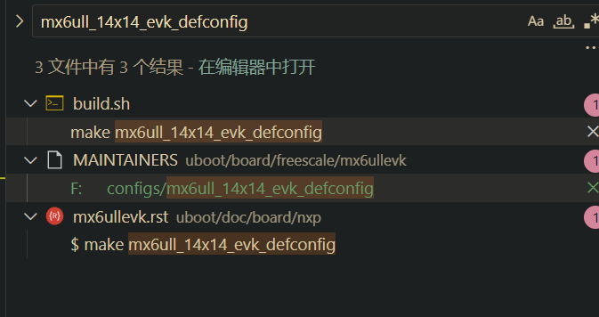

存在的问题，uboot的tftp下载速度太慢


# 移植uboot
https://github.com/nxp-imx
nxp官方维护的仓库
拿到源码，编译。略

编译。
拿到板子， 选一个厂家的板子的配置，编译。
```shell
        make mx6ull_14x14_evk_defconfig
```

编译完成后直接搜索mx6ull_14x14_evk_defconfig


找到配置文件，复制一份。
在配置文件中修改：
```shell
# 板子名字
CONFIG_TARGET_MX6ULL_NARO=y
# CONFIG_LDO_BYPASS_CHECK is not set
CONFIG_SYS_I2C_MXC_I2C1=y
CONFIG_SYS_I2C_MXC_I2C2=y
CONFIG_DM_GPIO=y

# 修改设备树
CONFIG_DEFAULT_DEVICE_TREE="imx6ull-naro"

```

这个文件中最终要的就是指定设备树和boot的dtb文件，以及修改设备树名字。
剩下的就是根据编译过的文件创建一份，准备自己的修改

下面为编译的脚本

```shell

#!/bin/bash
# rm -rf uboot/

test() {
        echo ${1}
        cd uboot
        echo  "Building test..."
        make distclean
        make mx6ull_14x14_evk_defconfig
        # make mx6ull_14x14_evk_emmc_defconfig
        make -j$(nproc)
}

build() {
        export CROSS_COMPILE=/home/ygc/Desktop/linux-gcc/2021-6ull/gcc-arm-10.3-2021.07-x86_64-arm-none-linux-gnueabihf/bin/arm-none-linux-gnueabihf-
        export ARCH=arm

        

        if [ "${1}" == "test" ]; then
                test
        elif [ "${1}" == "build" ] ; then
                echo   "Building uboot..."
                cp -rf ./uboot-revise/* ./uboot
                cd uboot
                make distclean
                make mx6ull_naro_defconfig
                # make mx6ull_14x14_evk_emmc_defconfig
                make -j$(nproc)
        
        elif [ "${1}" == "clean" ]; then
                echo ${1}
                cd uboot
                make distclean
        else 
                echo "Usage: build.sh [test][build|clean]"
        fi


        if [ -f  "u-boot.bin" ]; then

                echo "u-boot.bin exist"
                sudo mkfs.fat -F 32 /dev/sdb1
                ../imxdownload ./u-boot.bin /dev/sdb
        else
                echo "u-boot.bin not exist"
        fi

}

if [ -e "uboot" ]; then
        build ${1}
else 
        echo git clone ......
        git clone https://github.com/nxp-imx/uboot-imx.git uboot
        cd uboot
        git checkout lf_v2024.04
        cd  ../
        build ${1}
fi

```


## 首先改网络
phy芯片用的LAN8720A 以太网 PHY 芯片 
首先要在配置里支持上CONFIG_PHY_SMSC=y
注释# CONFIG_PHY_MICREL=y  # CONFIG_PHY_MICREL_KSZ8XXX=y
不然白扯。

然后改设备树，将fec1相关的全部拷到自己的设备树里。dtsi里的要注释掉，不然编译出错
```


&fec1 {
	pinctrl-names = "default";
	pinctrl-0 = <&pinctrl_enet1>;
	phy-mode = "rmii";
	phy-handle = <&ethphy0>;
	phy-supply = <&reg_peri_3v3>;
	status = "disable";
};

&fec2 {
	pinctrl-names = "default";
	pinctrl-0 = <&pinctrl_enet2>;
	phy-mode = "rmii";
	phy-handle = <&ethphy1>;
	phy-supply = <&reg_peri_3v3>;
	status = "okay";

	mdio {
		#address-cells = <1>;
		#size-cells = <0>;

		ethphy0: ethernet-phy@0 {
			compatible = "ethernet-phy-id0022.1560";
			reg = <0>;
			micrel,led-mode = <1>;
			clocks = <&clks IMX6UL_CLK_ENET_REF>;
			clock-names = "rmii-ref";

		};

		ethphy1: ethernet-phy@1 {
			compatible = "ethernet-phy-id0022.1560";
			reg = <1>;
			micrel,led-mode = <1>;
			clocks = <&clks IMX6UL_CLK_ENET2_REF>;
			clock-names = "rmii-ref";
		};
	};
};


&iomuxc {
	pinctrl_enet1: enet1grp {
		fsl,pins = <
			MX6UL_PAD_ENET1_RX_EN__ENET1_RX_EN	0x1b0b0
			MX6UL_PAD_ENET1_RX_ER__ENET1_RX_ER	0x1b0b0
			MX6UL_PAD_ENET1_RX_DATA0__ENET1_RDATA00	0x1b0b0
			MX6UL_PAD_ENET1_RX_DATA1__ENET1_RDATA01	0x1b0b0
			MX6UL_PAD_ENET1_TX_EN__ENET1_TX_EN	0x1b0b0
			MX6UL_PAD_ENET1_TX_DATA0__ENET1_TDATA00	0x1b0b0
			MX6UL_PAD_ENET1_TX_DATA1__ENET1_TDATA01	0x1b0b0
			MX6UL_PAD_ENET1_TX_CLK__ENET1_REF_CLK1	0x10b0
		>;
	};

	pinctrl_enet2: enet2grp {
		fsl,pins = <
			MX6UL_PAD_GPIO1_IO07__ENET2_MDC		0x1b0b0
			MX6UL_PAD_GPIO1_IO06__ENET2_MDIO	0x1b0b0
			MX6UL_PAD_ENET2_RX_EN__ENET2_RX_EN	0x1b0b0
			MX6UL_PAD_ENET2_RX_ER__ENET2_RX_ER	0x1b0b0
			MX6UL_PAD_ENET2_RX_DATA0__ENET2_RDATA00	0x1b0b0
			MX6UL_PAD_ENET2_RX_DATA1__ENET2_RDATA01	0x1b0b0
			MX6UL_PAD_ENET2_TX_EN__ENET2_TX_EN	0x1b0b0
			MX6UL_PAD_ENET2_TX_DATA0__ENET2_TDATA00	0x1b0b0
			MX6UL_PAD_ENET2_TX_DATA1__ENET2_TDATA01	0x1b0b0
			MX6UL_PAD_ENET2_TX_CLK__ENET2_REF_CLK2	0x4001b031
			MX6UL_PAD_SNVS_TAMPER8__GPIO5_IO08	0x10b0
		>;
	};
};
```

然后在改一个驱动的文件，在uboot/drivers/net/phy/phy.c中，设置一个复位genphy_config_aneg ，进入函数就phy_reset(phydev)

烧写代码，设置mac,注意要设置的是控制器2的mac,

## 修改屏幕参数
也还是设备树中，搜索lcd或者display，找到对应的节点，修改参数，比如分辨率，颜色位数，刷新率等等。
```dts
&lcdif {
	pinctrl-names = "default";
	pinctrl-0 = <&pinctrl_lcdif_dat
		     &pinctrl_lcdif_ctrl>;
	display = <&display0>;
	status = "okay";

	display0: display@0 {
		bits-per-pixel = <24>;
		bus-width = <24>;

		display-timings {
			native-mode = <&timing0>;

			timing0: timing0 {
				clock-frequency = <33000000>;
				hactive = <800>;
				vactive = <480>;
				hfront-porch = <40>;
				hback-porch = <88>;
				hsync-len = <48>;
				vback-porch = <32>;
				vfront-porch = <13>;
				vsync-len = <3>;
				hsync-active = <0>;
				vsync-active = <0>;
				de-active = <1>;
				pixelclk-active = <0>;
			};
		};
	};
};
```

## 修改mmc
使用命令看mmc发现不正常
核对原理图，核对设备树mmc ,mmc1是sdcard,mmc2是emmc,发现emmc好像没用设置重置引脚，所以需要修改,并且emmc的控制
```dts


	reg_sd1_vmmc: regulator-sd1-vmmc {
		compatible = "regulator-fixed";
		regulator-name = "VSD_3V3";
		regulator-min-microvolt = <3300000>;
		regulator-max-microvolt = <3300000>;
		gpio = <&gpio1 9 GPIO_ACTIVE_HIGH>;
		off-on-delay-us = <20000>;
		enable-active-high;
	};
//复制一份sd卡的配置
//改为emmc的配置
//sd卡实际也是emmc的一种
	reg_sd2_vmmc: regulator-sd2-vmmc {
		compatible = "regulator-fixed";
		regulator-name = "+V3.3";
		regulator-min-microvolt = <3300000>;
		regulator-max-microvolt = <3300000>;
		gpio = <&gpio4 10 GPIO_ACTIVE_HIGH>;
		off-on-delay-us = <20000>;
		enable-active-high;
	};

```

上面修改注意regulator-name = "+V3.3";

## 设备
```dts
aliases {
		ethernet0 = &fec1;
		ethernet1 = &fec2;
		gpio0 = &gpio1;
		gpio1 = &gpio2;
		gpio2 = &gpio3;
		gpio3 = &gpio4;
		gpio4 = &gpio5;
		i2c0 = &i2c1;
		i2c1 = &i2c2;
		i2c2 = &i2c3;
		i2c3 = &i2c4;
		mmc0 = &usdhc1;
		mmc1 = &usdhc2;
		serial0 = &uart1;
		serial1 = &uart2;
		serial2 = &uart3;
		serial3 = &uart4;
		serial4 = &uart5;
		serial5 = &uart6;
		serial6 = &uart7;
		serial7 = &uart8;
		sai1 = &sai1;
		sai2 = &sai2;
		sai3 = &sai3;
		spi0 = &ecspi1;
		spi1 = &ecspi2;
		spi2 = &ecspi3;
		spi3 = &ecspi4;
		usb0 = &usbotg1;
		usb1 = &usbotg2;
		usbphy0 = &usbphy1;
		usbphy1 = &usbphy2;
		usbgadget0 = &usbg1;
		usbgadget1 = &usbg2;

```
在设备树中有一个alias 节点，用于定义设备名称,可以根据这个找要修改的设备


# 附录
编译脚本
```shell
#!/bin/bash
# rm -rf uboot/

test() {
        echo ${1}
        cd uboot
        echo  "Building test..."
        make distclean
        make mx6ull_14x14_evk_defconfig
        # make mx6ull_14x14_evk_emmc_defconfig
        make -j$(nproc)
}

build() {
        export CROSS_COMPILE=/home/ygc/Desktop/linux-gcc/2021-6ull/gcc-arm-10.3-2021.07-x86_64-arm-none-linux-gnueabihf/bin/arm-none-linux-gnueabihf-
        export ARCH=arm

        if [ "${1}" == "test" ]; then
                test
        elif [ "${1}" == "build" ] ; then
                echo   "Building uboot..."
                cp -rf ./uboot-revise/* ./uboot
                cd uboot
                make clean
                make distclean
                make mx6ull_naro_defconfig
                # make mx6ull_14x14_evk_emmc_defconfig
                make -j$(nproc)
        
        elif [ "${1}" == "clean" ]; then
                echo ${1}
                cd uboot
                make distclean
        else 
                echo "Usage: build.sh [test][build|clean]"
        fi

        if [ -f  "u-boot.bin" ]; then
                if [ -b "/dev/sdb" ] ; then
                        echo "u-boot.bin exist"
                        sudo mkfs.fat -F 32 /dev/sdb1
                        ../imxdownload ./u-boot.bin /dev/sdb
                else    
                        echo "no /dev/sdb"
                fi
        else
                echo "u-boot.bin not exist"
        fi

}

if [ -e "uboot" ]; then
        build ${1}
else 
        echo git clone ......
        git clone https://github.com/nxp-imx/uboot-imx.git uboot
        cd uboot
        git checkout lf_v2024.04
        cd  ../
        build ${1}
fi
```


最后就是如果要改环境变量，是在板子头文件中