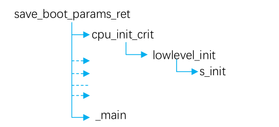
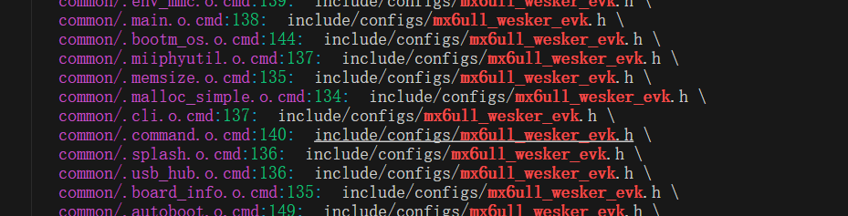

从事嵌入式音视频AI开发中，需要多次使用uboot这个bootleader，
本文用来记述我工作学习中所学到的知识点和心得
本文主要是为了能够运行起uboot，裁减后面有时间再学习。
首先第一步，删除uboot目录下没有用的到的配置文件，太多了，不需要，架构和板子支持的没法动，删除就会出错。
# 链接脚本详解
• 拿到半导体厂商给的uboot，进行第一次编译，编译后得到一个链接文件。从链接文件开始分析，链接的后缀为.lds  
在使用imx6ull进行编译时，要把程序的起点链接到0x878000000     

```
arm-linux-gnueabihf-ld  -Ttext 0X87800000  -o  ledc.elf   $^
```
这样所有文件都会链接到这个地址区。


分析得到uboot程序启动入口为_start。
```
OUTPUT_FORMAT( ("elf32-littlearm", , "elf32-littlearm", , "elf32-littlearm") )
OUTPUT_ARCH(arm)
ENTRY(_start)
```
•上面代码为链接文件的开头。  
而在架构文件中--arch/arm/lib/vectors.S中有这个_start的定义。  
这里的_start里有大量的汇编命令，回顾之前的汇编编写从启动跳入c执行程序   
```

.global _start  		/* 全局标号 */

.global __bss_start
_bss_start:
	.word __bss_start

.global __bss_end
_bss_end:
	.word __bss_end

/*
 * 描述：	_start函数，程序从此函数开始执行，此函数主要功能是设置C
 *		 运行环境。
 */
_start:

	/* 进入SVC模式 */
	mrs r0, cpsr
	bic r0, r0, #0x1f 	/* 将r0寄存器中的低5位清零，也就是cpsr的M0~M4 	*/
	orr r0, r0, #0x13 	/* r0或上0x13,表示使用SVC模式			*/
	msr cpsr, r0		/* 将r0 的数据写入到cpsr_c中 			*/

	/* 清BSS段 */
	ldr r0, _bss_start
	ldr r1, _bss_end
	mov r2,  #0
bss_loop:
	stmia r0!, {r2}		/* 向r0的地址写入0,然后r0寄存器保存的地址值加1 */
	cmp r0, r1  		/* 比较r0和r1，也就是__bss_start和__bss_end的值*/
	ble bss_loop		/* 如果小于等于的话就跳转到bss_loop继续清bss段*/
//cmp和ble一起用，相当于c语言的if
	/* 设置sp指针 */
	ldr sp,=0X80200000	/* 设置栈指针			 */
	b main				/* 跳转到main函数 		 */
	
```
BSS 段通常是指用来存放程序中未初始化的或者初始化为0的全局变量和静态变量的一块内存区域

BSS 段使用前需要清0，通过在这里提供 BSS 段的地址，方便链接时清0


•回归vectors.S  

``` 

.globl _start

/*
 *************************************************************************
 *
 * Vectors have their own section so linker script can map them easily
 *
 *************************************************************************
 */

	.section ".vectors", "ax"  // ax这个代码放到了.vectors这个代码段中
//“ax”表示该段--可执行并且可分配
/*
 *************************************************************************
 *
 * Exception vectors as described in ARM reference manuals
 *
 * Uses indirect branch to allow reaching handlers anywhere in memory.
 *
 *************************************************************************
 */

_start:

#ifdef CONFIG_SYS_DV_NOR_BOOT_CFG
	.word	CONFIG_SYS_DV_NOR_BOOT_CFG
#endif

	b	reset
	ldr	pc, _undefined_instruction
	ldr	pc, _software_interrupt
	ldr	pc, _prefetch_abort
	ldr	pc, _data_abort
	ldr	pc, _not_used
	ldr	pc, _irq
	ldr	pc, _fiq

```
中断单独做一篇分析  

•对以上的分析。
根据vectors存放的信息知道，他需要放在程序的最开始位置。  
查看u-boot.map知道，他被放到了0x878000000的位置上。

```
uboot编译后的链接文件
OUTPUT_FORMAT("elf32-littlearm", "elf32-littlearm", "elf32-littlearm")
OUTPUT_ARCH(arm)
ENTRY(_start)
SECTIONS
{
 . = 0x00000000;
 . = ALIGN(4);
 .text :
 {
  *(.__image_copy_start)
  *(.vectors)
  arch/arm/cpu/armv7/start.o (.text*)
  *(.text*)
 }
```
上面部分解析在uboot中链接文件分析中有解释。


目前先到这，后面吃透有点吃力，我在研究下https://zhuanlan.zhihu.com/p/195706497和读下uboot源码

# 1、uboot初次编译
## 1-1、前提
安装ncurses库
```
sudo apt-get install libncurses5-dev
```

## 1-2、uboot命令
help //bootz命令查看支持的命令

## 1-3、移植
简单来说，修改configs配置文件，修改include/configs配置文件，对板级支持包进行修改（主要添加include/configs配置文件位置），对架构内容修改（架构文件添加板级支持包位置）
这里的编译器无法支持//注释功能，必须使用/**/   

使用grep -nR 去找我们include/configs中添加的.h文件又没有引用	
  

```configs
CONFIG_SYS_EXTRA_OPTIONS="IMX_CONFIG=board/freescale/mx6ull_wesker_evk/imximage.cfg,MX6ULL_EVK_EMMC_REWORK"
CONFIG_ARM=y
CONFIG_ARCH_MX6=y
CONFIG_TARGET_MX6ULL_WESKER_EVK=y   //涉及能否正常编译 是一个编译的条件
CONFIG_CMD_GPIO=y
```

一般 uboot 中修改驱动基本都是在 xxx.h 和 xxx.c 这两个文件中进行的，xxx 为板子名称，
例如imx6ull的就是在include/configs中和board/freescale

# 留一问
怎么通过源码修改默认环境变量

编译uboot生成的文件就在根目录下，和linux内核有点区别
linux编译的在arch/arm/boot下，设备树在arch/arm/boot/dts下