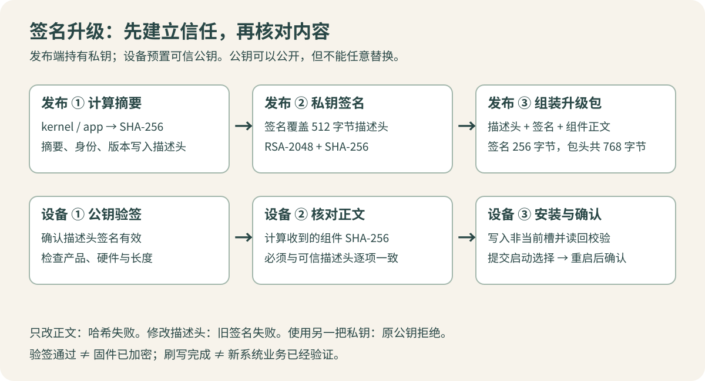

“哈希私钥升级”可以准确地理解为：**用哈希描述固件内容，用私钥给描述信息签名，设备用预置的可信公钥验证签名，再核对实际收到的固件哈希。**

这篇解释原理，并提供可在电脑上独立运行的实验。[第二篇](/posts/firmware-signing-02-release.html)记录当前 HI3516CV610 项目的使用流程、密钥管理和故障处理。本文以 2026-10-12 核对的实现为准，示例不需要开发板，也不使用正式私钥。

## 1. 先分清要解决的三个问题

拿到一个固件文件，至少有三个问题：

1. 文件在下载、传输、存储过程中有没有变化？
2. 文件是否由拥有授权签名密钥的一方发布？
3. 文件是否适合这台设备，且能够正常运行？

哈希主要帮助比较内容；签名在可信公钥的前提下提供来源认证和完整性保护；产品匹配、硬件匹配、镜像格式、容量和启动验证共同处理第三类问题。**签名正确不代表程序没有缺陷，也不保证硬件兼容。**

| 名称 | 做什么 | 放在哪里 | 不能代替什么 |
| --- | --- | --- | --- |
| 固件 | 将要运行的 kernel、app 等内容 | 构建机、升级包、设备 | 不能靠文件名证明来源 |
| SHA-256 | 把任意长度内容映射为 32 字节摘要 | 签名描述头中 | 单独不能证明发布者身份 |
| 私钥 | 生成签名 | 受控签名环境 | 不应进入固件或公开仓库 |
| 公钥 | 验证签名 | 设备可信配置、发布验证端 | 公开不等于可以任意替换 |
| 签名 | 将描述头与对应私钥绑定 | 升级包内 | 不隐藏固件内容 |

公钥可以公开，但它的来源必须可信。如果升级包附带一把新公钥，设备直接拿它验包，攻击者就能自己生成一套密钥并提交自己的固件。“验证成功”只有在**验证用的是预先认可的公钥**时才有授权意义。

## 2. 为什么只有哈希不够

Linux 上可以直接计算文件摘要：

```bash
sha256sum firmware.bin
```

输出的 64 个十六进制字符表示 32 字节，也就是 256 位摘要。同一份字节输入得到同一个摘要；修改一个字节，通常就会得到完全不同的摘要。不同输入理论上可能碰撞，不能说数学上绝对不存在；工程上的安全依赖算法的密码学强度。

假设升级包里只有：

```text
firmware.bin
sha256.txt
```

有人同时替换固件和 `sha256.txt`，接收端重新计算后仍可能得到“哈希一致”。这只说明文件和这份摘要一致，无法说明摘要由谁认可。

从可信渠道独立取得的摘要可以帮助识别下载错误或不一致；把摘要和文件放在同一个可被替换的包里，并不能自动产生来源认证。数字签名就是为这份描述信息加上可以用可信公钥验证的约束。

## 3. 私钥签名、公钥验签分别做什么

当前项目使用 RSA-2048 密钥与 SHA-256。发送方对待签名描述头执行签名，接收方对收到的同一段字节执行验签。

```text
发布端：签名 = Sign(私钥, 描述头)
设备端：Verify(可信公钥, 收到的描述头, 收到的签名)
```

这是接口层面的表达，不是 RSA 算法公式。不要把数字签名简化成“私钥加密、公钥解密”。签名有专门的编码和校验规则；其目的在于认证和完整性，而不是保密。

OpenSSL 的常用操作如下，`manifest.bin` 表示待签名的原始字节：

```bash
openssl dgst -sha256 -sign test-private.pem -out signature.bin manifest.bin
openssl dgst -sha256 -verify test-public.pem -signature signature.bin manifest.bin
```

第一条只应在有权使用私钥的环境执行；第二条只需要公钥。选项含义见 [OpenSSL dgst 文档](https://docs.openssl.org/3.0/man1/openssl-dgst/)。实际执行应检查命令退出状态，不能只匹配终端上的一句文字。

即使两份 JSON 在解析后含义相同，只要签名针对的字节发生变化，例如空格、换行或者字段顺序变化，原签名通常就无法通过。当前项目使用固定布局的二进制描述头，仍然遵循“验证实际字节”的原则。

## 4. 当前项目的升级包怎样绑定固件



当前包布局如下：

```text
偏移 0       512 字节描述头
偏移 512     256 字节 RSA-2048 签名
偏移 768     kernel 内容（若存在）
随后         app 内容（若存在）
```

这里有两个容易混淆的长度：真正参与签名的是前 **512 字节**；传输时用于预检查的完整包头为 **768 字节**，包括描述头和签名。格式标识是 `TLUPG002`，格式版本字段当前为 `1`，不能从标识末尾的数字直接推导字段值。

描述头包含产品、硬件、发布版本，以及 kernel、app 各自的大小、组件版本和 SHA-256 摘要。设备先验证描述头签名，再按照其中的长度接收内容并计算摘要：

```text
可信公钥
   ↓ 验签
可信描述头 → 预期 kernel/app 大小与 SHA-256
                        ↓ 对比
                  实际收到的组件内容
```

由此可以看出两种失败：

- **只修改固件**：原描述头和签名还可能通过，但实际固件哈希与头内记录不一致。
- **同时修改固件和头内哈希**：新的固件哈希可能一致，但描述头变了，旧签名不再有效。

把修改后的描述头用另一把私钥重新签名，也不能通过原设备公钥的验证。只有对应的私钥才能生成该公钥认可的签名；若授权私钥泄露，这道认证约束也随之失去意义。

当前正式打包入口会验证所选私钥和项目公钥是否配对。设备还会检查产品、硬件、长度等条件。因此，“签名有效”只是完整升级判断链中的一环。

## 5. 跑一遍独立实验

配套的 `demo.py` 只使用 Python 标准库和本机 OpenSSL，自动生成两组临时 RSA-2048 测试密钥。它使用很小的文本文件模拟固件，使用 JSON 模拟描述头，便于观察关系；**它不生成可刷入设备的 TLUPG002 升级包。**

环境要求：Python 3、OpenSSL 命令行，以及解压目录的写权限。可先确认：

```bash
python3 --version
openssl version
```

从本文代码区下载并解压后，在解压目录执行：

```bash
python3 demo.py
```

[查看实验源码](/posts/firmware-signing-01-principles/code/demo.py.html) · [下载配套代码](/posts/firmware-signing-01-principles/code/experiments.tar.gz)

实验预期输出六组 `PASS`，其含义如下：

| 实验动作 | 描述头验签 | 内容哈希 | 应理解的结论 |
| --- | --- | --- | --- |
| 原始固件、原始描述头、正确公钥 | 通过 | 一致 | 正常链路 |
| 把验证公钥换成另一组公钥 | 失败 | 无需继续 | 公钥必须配对且可信 |
| 只篡改固件 | 通过 | 不一致 | 验签后仍必须校验内容 |
| 篡改固件并更新描述头哈希，沿用旧签名 | 失败 | 一致 | 哈希一致不能代替验签 |
| 攻击方用自己的私钥重新签名 | 原可信公钥拒绝 | 可以一致 | 不能把包提供的公钥当信任根 |
| 恢复原文件，再给描述头追加空白 | 失败 | 固件未变 | 签名绑定字节，不是抽象语义 |

每次运行都会生成新的教学密钥，正常结束或普通异常退出时自动清理临时目录。强制终止进程或突然断电可能留下 `.signature-demo-*` 目录；其中仍只是随机生成的实验密钥，不应拿去建立任何正式设备的信任关系。

本实验的目标是让各类失败具有确定的预期。它不是生产签名服务，也不验证 NAND 写入、A/B 切换或设备启动。

## 6. 签名、加密、安全启动、防回滚的边界

| 能力 | 回答的问题 | 当前签名升级机制的边界 |
| --- | --- | --- |
| 哈希比较 | 内容是否与期望一致 | 期望摘要必须有可信来源 |
| 数字签名 | 描述信息是否由对应私钥认可 | 私钥泄露或可信公钥被替换会破坏前提 |
| 固件加密 | 未授权者能否读到固件内容 | 当前签名包不因此获得保密性 |
| 安全启动 | 启动链是否只执行受信代码 | 不能由 OTA 验签直接推定已实现 |
| 防回滚 | 是否拒绝旧版本 | 当前实现允许签名有效且内容不同的旧版本 |
| A/B 更新 | 更新失败时如何保留恢复机会 | 仍依赖元数据、存储、启动和确认流程 |

设备公钥位于只读 app 文件系统，可以降低普通运行时误修改的风险，但这与硬件信任根不是同一回事。具有其他刷写或启动控制能力的一方是否能够替换 app，需要结合整机启动链判断。

密码保护私钥文件与加密固件也是不同的事情：前者保护保存的签名凭据，后者保护分发的固件内容。有关固件更新认证与机密性的区分，可参考 [RFC 9019 固件更新架构](https://www.rfc-editor.org/rfc/rfc9019.html)。

## 7. 签名成功之后，还要判断什么

当前设备流程还要确认产品与硬件匹配、包大小合法、实际内容摘要一致、目标槽可以写入，并在写后读回校验。完成这些检查后，才提交启动选择并进入后续重启确认流程。

此外，仍需由发布流程保证以下事实：

- 这个包确实由目标产品的正确源码、配置和依赖构建。
- kernel 与 app 组合能够一起工作。
- 镜像不包含测试凭据、错误配置或已知缺陷。
- 包对应的版本、产物和签名记录可以追溯。
- 新系统启动后的视频、网络、存储、云台等实际业务通过检查。

如果把错误固件标成正确产品，再用正确私钥签名，密码学校验并不会自动理解其中的业务错误。数字签名保护的是“发布者认可了哪些字节”，发布者仍须对那些字节负责。

## 8. 阅读与验证依据

本文的项目行为依据 `application/Upgrade/Scripts/PackageUpgrade.py`、`ReleaseUpgrade.py`、`application/Core/Upgrade/Upgrade.cpp` 和 `LinuxBackend.cpp` 核对。它们分别对应包布局与签名、正式入口密钥配对、设备校验和设备公钥加载。

本篇附带实验可离线重复运行；不会调用项目打包入口、改变发布版本状态或连接设备。接下来按[第二篇：签名升级的使用流程与注意事项](/posts/firmware-signing-02-release.html)完成项目配置、产物准备、离线检查和设备升级。
