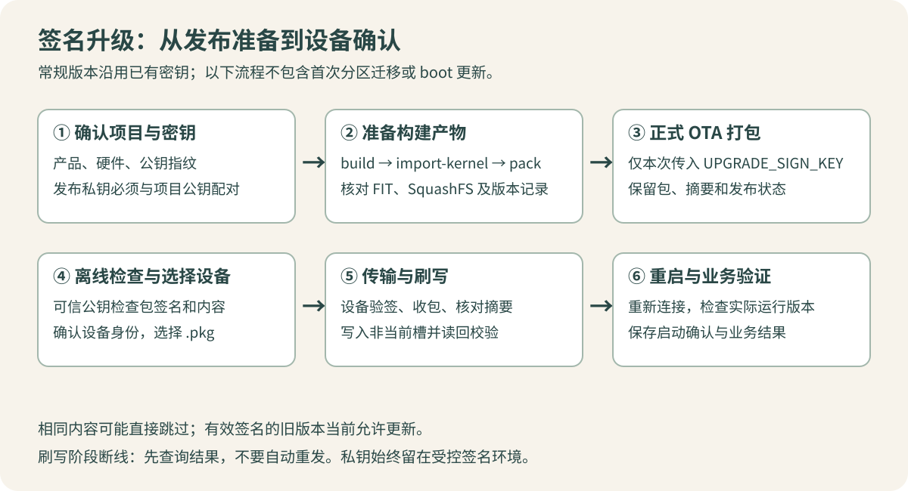

这篇按“以后能照着重新做一遍”的方式记录当前项目的签名升级流程。范围是原理对应到使用方法、发布步骤和注意事项，不展开底层代码实现。[第一篇](/posts/firmware-signing-01-principles.html)解释哈希、公私钥与签名，并提供篡改实验。

以下项目行为以 2026-10-12 核对的实现为准。命令中的 `BA4K`、`HI3516CV610_00S` 是示例产品和硬件组合，必须与实际目标一致。**普通版本发布沿用已有密钥；只有建立新项目的信任关系时才生成新密钥。**

## 1. 先准备对的输入

一次常规 OTA 需要以下条件：

| 输入或条件 | 用途 | 关键判断 |
| --- | --- | --- |
| 已选定的工程产品配置 | 决定应用及升级身份 | 不只看输出文件名 |
| 该产品的项目公钥 | 构建进 app，供设备验签 | 与设备当前信任关系一致 |
| 与之配对的发布私钥 | 生成签名 | 不进入 app、包或公开仓库 |
| 注册导入的 kernel FIT | 提供完整内核及 initramfs | 来源正确、完整、容量合法 |
| 构建并打包的 app SquashFS | 提供只读应用镜像 | 与 kernel 和目标产品匹配 |
| 现有发布状态 | 分配并追踪版本 | 不当作临时缓存清空 |
| 已支持当前升级机制的设备 | 接收并安装升级包 | 启动布局、服务与可信公钥已就绪 |

设备升级不要求签名私钥；设备持有公钥即可。测试工具也不应为了上传 `.pkg` 而索取正式私钥。

## 2. 认清目录与实际设备路径

下面的路径均相对于 `application/`，设备路径除外：

| 路径 | 含义 |
| --- | --- |
| `Platform/Params/HI3516CV610_00S/projects/<PROJECT>/tuling-upgrade-public.pem` | 该项目构建所用公钥源文件 |
| `Upgrade/Keys/` | 本机约定的私钥存放位置；正式文件也可以位于受控外部目录 |
| `Upgrade/Config/Project.json` | 当前升级产品配置；与工程选择同步 |
| `Upgrade/Images/<product>/<hardware>/Kernel/` | 已导入并登记的 kernel 产物 |
| `Upgrade/Images/<product>/<hardware>/App/` | 已生成的 app 产物及记录 |
| `Upgrade/Images/<product>/<hardware>/Boot/` | 工厂或完整 SD 恢复使用的 boot 产物 |
| `Upgrade/State/` | 持久发布状态 |
| `Upgrade/Output/<product>/<hardware>/Ota/<version>/` | OTA 包及本次发布信息 |
| `/usr/app/Bin/tuling-upgrade-public.pem` | 设备运行时验签公钥 |
| `/usr/app/Bin/tuling-upgrade.conf` | 设备升级身份配置 |
| `/run/tuling-upgrade.status` | 设备运行时升级状态诊断文件 |

设备路径里的 `app` 是小写。不要照搬旧说明中的 `/usr/App/Bin`、`Upgrade/bin` 或旧 kernel 目录。

当前忽略规则覆盖 `Upgrade/Keys/`，但忽略规则只是一道防误操作措施，不能替代文件权限、备份与发布审查。将私钥拷到其他目录、下载包、日志附件或固件目录后，原忽略规则不会自动保护它。

## 3. 首次建立密钥：只做一次

已有产品先找到已授权使用的原私钥和项目公钥，确认配对关系，不要因为本机找不到私钥就重新生成并覆盖。

对于全新产品，可以在受保护的位置生成独立密钥。下面使用一个必须不存在的新目录，避免误覆盖既有文件：

```bash
umask 077
mkdir "$HOME/firmware-signing-new-product"
cd "$HOME/firmware-signing-new-product"
openssl genpkey -algorithm RSA -pkeyopt rsa_keygen_bits:2048 -out private.pem
openssl pkey -in private.pem -pubout -out public.pem
openssl pkey -in private.pem -check -noout
openssl pkey -pubin -in public.pem -pubcheck -noout
chmod 600 private.pem
chmod 644 public.pem
```

逐条确认成功再继续。如果 `mkdir` 提示目录已存在，停止并检查，不能继续进入旧目录覆盖文件。上述示例创建未加口令的私钥，文件访问权限和存储环境因此直接承担保护责任。密钥生成与公钥导出选项可查 [OpenSSL genpkey](https://docs.openssl.org/3.0/man1/openssl-genpkey/) 和 [OpenSSL pkey](https://docs.openssl.org/3.0/man1/openssl-pkey/)。

将 `public.pem` 配置到**新产品**对应的项目公钥位置，再构建其初始固件；将私钥放入受控签名环境并做好备份。不要将 `private.pem` 放到 `Platform/Params`、`Build`、rootfs 或 app 打包输入目录。

不同、不允许互刷的产品宜使用独立密钥。即便使用不同密钥，也要检查产品配置和固件来源，不能认为密钥隔离自动消除了构建选错产品的风险。

### 怎样确认私钥与公钥配对

可以分别导出标准公钥 DER 再比较。这里导出的都是公开部分，不是私钥内容：

```bash
SIGN_KEY=/受控目录/该产品私钥.pem
PROJECT_PUB=/工程绝对路径/application/Platform/Params/HI3516CV610_00S/projects/BA4K/tuling-upgrade-public.pem
CHECK_DIR=$(mktemp -d)
openssl pkey -in "$SIGN_KEY" -pubout -outform DER -out "$CHECK_DIR/derived.der"
openssl pkey -pubin -in "$PROJECT_PUB" -outform DER -out "$CHECK_DIR/project.der"
cmp "$CHECK_DIR/derived.der" "$CHECK_DIR/project.der"
openssl dgst -sha256 "$CHECK_DIR/project.der"
```

前两条导出都成功且 `cmp` 退出码为 `0` 才表示匹配。记录的 SHA-256 是公钥指纹，适合核对发布记录；它不是私钥，也不是固件摘要。临时目录只含公钥派生数据，用完可移除。

当前正式 OTA 入口也会做配对检查，并在不匹配时拒绝发布。手工检查有助于提前发现配置问题，但不能代替正式入口的校验。

## 4. 常规发布：从构建到 OTA 包



以下命令都在工程的 `application/` 目录执行。先按照工程已有方式选择正确产品配置，并核对 `.config`。不要仅修改包的产品标签来“适配”另一台设备。

### 第一步：构建应用并同步项目配置

```bash
./AppBuild.sh build HI3516CV610_00S.mk
```

构建入口会把工程选择同步到升级项目配置。随后检查 `Upgrade/Config/Project.json` 的产品和硬件与目标一致，同时确认选中项目的公钥存在。

公钥缺失时，某些编译过程可能仅发出警告，不能因此判断已经具备可发布条件：后续安装打包和设备验签仍需要正确公钥。

### 第二步：导入已经构建好的 kernel

```bash
./AppBuild.sh import-kernel HI3516CV610_00S.mk /绝对路径/SDK/output/linux/uImage
```

这里的输入应是包含所需 initramfs 的完整 FIT 镜像，不是任意名字叫 `uImage` 的文件。当前 kernel 槽容量上限为 8 MiB。

Upgrade 侧负责导入和登记镜像，不会自动进入 SDK 编译内核。内核更新时，应先在 SDK 完成构建，再导入实际产物；没有变更时，也要核实已登记镜像的来源和版本，而非随手复用不明旧文件。

常规 kernel/app OTA 不需要导入 boot。`import-boot` 用于工厂包或完整 SD 恢复，其输入应为带对应启动容器内容的 `boot_image.bin`，不能用裸 `u-boot.bin` 替代。

### 第三步：生成 app 镜像

```bash
env -u UPGRADE_SIGN_KEY ./AppBuild.sh pack HI3516CV610_00S.mk
```

显式移除本条命令环境中的 `UPGRADE_SIGN_KEY`，是为了只生成应用打包产物。当前脚本在环境中发现该变量非空时，普通 `pack` 也会顺带生成 OTA；如果长期在终端里 `export` 此变量，容易在不打算发布时触发签名打包。

OTA 输入使用 app 的 `.squashfs` 内容，不是面向物理分区布局的 `.ubi` 容器。当前 app 有效负载上限按 `184 × 126976` 字节约束，不能用文件系统压缩前目录大小替代检查。

### 第四步：用正式入口签名打包

```bash
UPGRADE_SIGN_KEY="$PWD/Upgrade/Keys/BA4KPrivate.pem" \
  ./AppBuild.sh ota HI3516CV610_00S.mk
```

私钥位置可以更换为受控外部路径。这里只将变量传给这一次命令，不在整个终端会话中持久导出。

入口会检查项目身份、输入镜像记录、容量以及私钥和项目公钥是否配对。缺少私钥时没有默认密钥兜底。不要绕过入口直接调用底层脚本，以免遗漏正式发布检查。

输出在 `Upgrade/Output/<product>/<hardware>/Ota/<version>/`。使用本次输出目录中的 `.pkg` 和发布记录，核对文件大小、产品、硬件、组件版本和摘要。不要根据猜测拼出文件名，也不要只因目录里“有一个包”就认为那是刚生成的产物。

### 版本状态为什么不能随便删

当前发布版本按 UTC+8 的日期加当日批次组织，可理解为 `YYYYMMDD × 10000 + 当日序号`；批次范围为 1～9999。脚本会维护状态、检查回退，并避免覆盖已有输出。

`Upgrade/State/` 是发布账本的一部分。删除它、随意复制旧状态或手改版本来复用输出目录，会破坏发布顺序与追溯关系。打包失败也可能已经消耗某个序号，因此版本号不保证连续。

包的发布版本与 kernel/app 各自的组件版本是不同层次。核对组件时，应查看对应产品镜像记录，不要把“最近一次 AppVersion”记录当作所有产品通用的真实版本。

## 5. 上设备前做只读检查

先对待交付的包计算摘要，用于确认传输前后拿到的是同一份文件：

```bash
sha256sum /绝对路径/本次升级包.pkg
```

单独的这个摘要不能替代签名认证。期望摘要也应从可信发布记录获得。

本文提供 `check_package.py`，使用已可信的项目公钥检查当前 TLUPG002 包的签名、身份、长度、保留字段、组件摘要和基本镜像标识。依赖 Python 3 与 OpenSSL 3，不需要私钥：

```bash
python3 check_package.py /绝对路径/本次升级包.pkg \
  --public-key /可信来源/tuling-upgrade-public.pem \
  --model BA4K \
  --hardware HI3516CV610_00S
```

[查看检查脚本](/posts/firmware-signing-02-release/code/check_package.py.html) · [下载检查脚本与说明](/posts/firmware-signing-02-release/code/experiments.tar.gz)

所有检查成功时打印 `PASS` 和组件摘要；失败返回非零退出码。参数中的公钥必须来自受控项目或已确认的设备信任配置，不能随意采用待检包旁边别人提供的公钥。

这个工具不会安装、连接设备或改变版本状态。它只做当前格式的离线检查，不完整解析 FIT/SquashFS，也不验证设备可用内存、闪存健康、启动兼容性或业务行为。正式设备仍会执行自己的完整检查。包格式、算法或容量规则变化后，需要相应更新这个辅助工具。

## 6. 在测试工具里执行设备升级

开始前应确认设备身份、当前版本、连接状态、供电条件和必要的恢复手段。旧启动布局或分区布局需要迁移时，不要默认一个普通 OTA 就能完成迁移。

操作顺序如下：

1. 在测试工具中连接目标设备，确认产品和硬件。
2. 打开“设备控制 → 升级测试…”。
3. 选择本次正式输出的 `.pkg`，不要选择 `.squashfs` 或 `.ubi`。
4. 检查工具显示的文件信息并开始升级。
5. 等待预检查、数据传输和刷写阶段结束。
6. 等待设备重启、重新连接，核对运行版本与启动确认结果。
7. 检查实际业务，例如图像、网络、存储及本产品相关功能，并保存升级记录。

工具本地的结构与长度检查只是提前发现问题，最终签名验证由设备执行。连接使用已有生产测试通道，通过服务转交升级任务，不需要为此把私钥传到设备。

### 各阶段的成功到底代表什么

| 阶段 | 已经确认的事实 | 还不能据此认为 |
| --- | --- | --- |
| 头部预检查通过 | 签名、身份和相关前置条件可接受 | 全部固件内容已验证 |
| 传输完成 | 所需数据已发送或接收 | 已写入并可启动 |
| 内容摘要通过 | 接收内容与签名头一致 | 写入过程一定成功 |
| 写入并读回校验成功 | 目标内容已写入且读回一致 | 新系统业务已正常 |
| 启动选择提交 | 后续启动目标已更新 | 重启确认已经完成 |
| 重启后确认 | 实际启动状态满足确认流程 | 所有业务测试自动通过 |

当前实现先接收完整有效负载并核对哈希，再进入实际写入流程。它会考虑可用内存及预留空间，不依赖 SD 卡存放升级包。预检查或准备阶段出现内存不足，不能简单归结为网络失败。

更新会写入发生变化组件的非当前槽，并在读回校验后提交相关元数据和启动选择。A/B 保留恢复机会，但不能据此承诺任何断电、闪存故障下都绝不会损坏系统。

### 取消和断线如何处理

传输阶段允许取消，工具可以关闭传输连接。进入 `Finish` 后的刷写阶段，不能把“关闭窗口”当作安全取消方式，应该等待设备处理完成。

如果此时断线或超时，工具可能提示“刷写结果未确认”。这表示缺少最终确认，不等于肯定没写，也不等于肯定成功。先观察设备是否重启、重新连接并查询状态和版本，必要时查看 `/run/tuling-upgrade.status`；不要立即自动重发同一升级任务。

## 7. 当前实现的几个特殊行为

### 相同内容会跳过

组件是否需要更新主要比较签名头中的大小、哈希与已记录的当前槽信息。不能把它描述为“每次升级都重新读取当前槽全部内容计算哈希”。

若所有待更新组件内容都相同，会直接返回已是相同内容，不继续传输正文，也不需要重启。即使包的发布版本变了，也可能出现此结果。元数据缺失时则不能依靠原记录完成同样判断，相关流程会按实现进行恢复和重新写入。

### 允许有效签名的旧版本

当前策略不因为发布版本或组件版本更低就一律拒绝。内容不同、签名有效并满足其他校验的旧版本可以被接受。**不要把签名机制写成已经具备防回滚。**

描述头保留有最低配套版本相关字段，但当前实现不以这些字段实施版本下限约束。kernel/app 的配套兼容性仍需在发布验证中负责，不能仅填写字段就认为设备会拦截不兼容组合。

### 空白或异常元数据不是免验签入口

新机初始化与元数据恢复也必须保留身份、签名等约束，并结合实际运行槽处理状态。不能因为元数据异常就提供“跳过签名强刷”的普通使用步骤。

启动确认由设备端相关服务在启动后处理，并与运行槽状态关联；它不等价于视频、NPU、云台、存储等所有业务已经测试通过。

## 8. OTA、工厂包、SD 恢复包别混用

| 产物用途 | 当前主要内容或行为 | 使用边界 |
| --- | --- | --- |
| OTA | 签名 kernel/app 包，走设备在线升级流程 | 常规版本更新，不负责 boot/分区迁移 |
| Factory | boot、双份 kernel/app、初始化元数据等；重置环境 | 初始烧录，按工厂流程使用 |
| SD Recovery | kernel/app 与初始化元数据；保留启动环境 | 按既定 SD 恢复流程使用 |
| SD Recovery Full | 恢复内容额外包含 boot；保留启动环境 | 必须确认 boot 和设备匹配 |

工厂或 SD 产物中的 `SHA256SUMS` 可以用于检查文件一致性，不能自动等同于在线 OTA 的可信公钥验签机制。也不能从上述表格推导这些流程完全无损：实际操作仍须按对应布局和恢复说明进行。

## 9. 密钥管理：备份、丢失、泄露和轮换

### 备份什么

私钥应限制访问，保留受控离线备份，并验证备份能读取、能导出正确公钥。备份同时记录产品、硬件、对应公钥指纹、建立时间和授权用途。恢复演练使用独立测试流程，不要为了“验证备份”随意发正式版本。

发布侧还应保存公钥、构建来源、工具版本、产物记录、包摘要和持久发布状态。只有私钥却无法解释某个包由哪些代码生成，同样难以追溯。

给私钥文件加口令可以加强静态存储保护，但无人值守发布如何提供口令需要专门设计。不要把口令写进源码、命令记录或博客示例，也不要把“私钥已加密保存”误写成“固件传输已加密”。

### 私钥丢失

已有设备仍然信任原公钥，新生成的私钥无法替代原私钥给它们签发可接受的包。先恢复受控备份；没有备份时，只能评估已经设计好的恢复、重刷或其他受信迁移路径，不能通过把本地项目公钥换掉解决存量设备问题。

### 私钥泄露

拥有该私钥的人可以签出对应公钥认可的内容。此时应按实际发布渠道与设备能力处理密钥撤换和受影响版本，不能只删除仓库里的文件就认为风险消失。审查泄露范围时还应考虑旧备份、构建日志、共享压缩包和分发历史。

### 为什么不能直接替换项目公钥完成轮换

当前项目没有可直接当作通用使用功能的自动密钥轮换协议。设备当前公钥必须能验证迁移包，因此常见设计方向是由旧密钥签发过渡版本，再在受控流程中建立新信任关系，但这需要专门实现和验证。

尤其要考虑 A/B：新槽可能包含新公钥，回退到旧槽后却恢复旧公钥。双钥过渡、失败恢复、旧包处理和旧钥撤销都需要明确策略，不能只在一次构建里换掉 PEM 文件。原私钥已经泄露时，旧钥签过的过渡包也不能单独证明它优于攻击者的包，还需要额外可信的交付与迁移约束。

## 10. 常见问题按现象排查

| 现象 | 优先检查 |
| --- | --- |
| OTA 提示没有签名私钥 | 本次命令是否传入 `UPGRADE_SIGN_KEY`，路径和读取权限是否正确 |
| 私钥与项目公钥不匹配 | 工程所选产品、项目公钥、发布私钥是否属于同一套 |
| 构建通过但安装打包失败 | 项目公钥等安装输入是否缺失，不能仅看编译结果 |
| 设备拒绝签名 | 包是否损坏，设备当前公钥是否与发布使用的密钥匹配 |
| 产品或硬件不匹配 | 工程配置、包身份和目标设备身份是否一致 |
| 包头通过但最终哈希失败 | 正文传输、文件内容、长度和发布产物是否一致 |
| 内存或容量不足 | 完整负载与可用内存、预留量、目标槽容量是否符合要求 |
| 相同内容直接结束 | 查看组件大小和哈希，不只看包版本号 |
| 旧版本也能升级 | 当前允许有效签名的不同内容旧版本，并未实现版本下限防回滚 |
| 发布版本异常或目录冲突 | 保留现场，检查状态、时间和已有产物，不随意删除账本重试 |
| 刷写结果未确认 | 先重新查询设备与重启结果，避免自动再次发送 |
| 能启动但业务异常 | 检查 kernel/app 配套、配置和业务日志；签名不验证业务正确性 |

## 11. 发布时留下哪些记录

一次可追溯的升级记录至少应包含：目标产品与硬件、代码和配置来源、kernel/app 版本及哈希、公钥指纹、包发布版本与摘要、设备标识、升级前后版本、刷写结果、重启确认和业务检查结果。

本文配套脚本用于只读离线校验；验证脚本使用临时生成的测试密钥和合成镜像，不代表真实 NAND、断电恢复、设备重启或业务验证已经通过。正式上线仍应记录对应设备实测结果。

项目使用行为主要依据 `application/Upgrade/README.md`、`AppBuild.sh`、`Upgrade/Scripts/ReleaseUpgrade.py`、`PackageUpgrade.py`、`Core/Upgrade/Upgrade.cpp`、`LinuxBackend.cpp` 及 `GenerateTestTools/doc/升级测试.md`。命令入口、设备路径和特殊行为应优先与当前实现核对，旧文档中的目录不能直接照搬。
