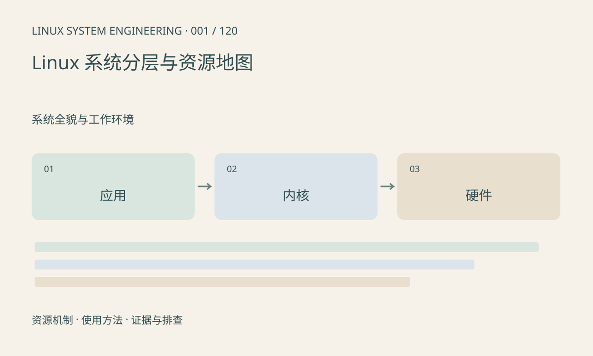

> 第 1 / 120 课 · 系统全貌与工作环境。返回[课程合集](/series/embedded-linux-system-engineering/)。

## 机制与资源关系

摄像头程序调用库，库通过系统调用请求内核，驱动再管理硬件。厂商 SDK 可能同时包含用户库、内核模块和固件，不能把整个 SDK 当作单独的一层。

一次取帧至少涉及设备句柄、驱动队列、DMA 缓冲和应用线程。资源地图要标出申请者、消费者、释放者及错误返回，而不只是芯片框图。



## 实际用法与观察入口

以下是操作说明；先确认执行环境、工具帮助和目标对象。设备名、PID、地址及项目名示例需要按实际替换，不能将整段命令当通用板端脚本执行。

```sh
uname -a
cat /proc/version
cat /proc/mounts
```

## 输出解读与排查顺序

先固定内核、根文件系统、设备树和 SDK 四个版本，再沿出错调用定位边界。应用返回超时并不能证明 sensor 未出流，也可能是缓冲耗尽或线程没有及时消费。

### 情境推演

假设应用报取帧超时，但接收端中断持续增长。此时“sensor 完全没出流”的假设已减弱；继续检查 DMA 完成、驱动出队与应用消费。中断统计和缓冲状态属于不同证据，不能互相替代。

## 练习与参考分析

画出 sensor→驱动→SDK→应用的一条数据路径，每条边注明格式和所有权。参考结论：硬件有帧、驱动有帧、应用收到帧是三个独立的检查点。

本课练习属于阅读、分析或板端观察。未在目标开发板执行，记录时应写明板型、内核配置、工具版本和原始输出。

## 学习路线与完整目录

本系列承接[SoC 与接口课程](/series/embedded-soc-interfaces/)，以 Linux 的资源管理、程序接口和排障为主。主机实验与真实板端能力分开验证；硬件时序仍以芯片手册和实际 BSP 为准。综合速查表与报告模板见[第 120 课](/posts/linux-sys-120.html)。

### 01 · 系统全貌与工作环境

- [001 Linux 系统分层与资源地图](/posts/linux-sys-001.html)
- [002 主机、目标板与交叉开发](/posts/linux-sys-002.html)
- [003 架构、ABI、大小端与工具链](/posts/linux-sys-003.html)
- [004 Shell、管道、重定向与退出码](/posts/linux-sys-004.html)
- [005 BusyBox 与 GNU 工具差异](/posts/linux-sys-005.html)
- [006 目录结构与虚拟文件系统](/posts/linux-sys-006.html)
- [007 串口、SSH 与开发网络](/posts/linux-sys-007.html)
- [008 建立开发板信息与版本基线](/posts/linux-sys-008.html)

### 02 · 启动与系统构建

- [009 从 Boot ROM 到用户空间](/posts/linux-sys-009.html)
- [010 U-Boot 环境与内核启动参数](/posts/linux-sys-010.html)
- [011 内核配置、编译与模块](/posts/linux-sys-011.html)
- [012 设备树编译、加载与生效确认](/posts/linux-sys-012.html)
- [013 根文件系统与 initramfs](/posts/linux-sys-013.html)
- [014 BusyBox init、启动脚本与 systemd](/posts/linux-sys-014.html)
- [015 Buildroot 工程构建与定制](/posts/linux-sys-015.html)
- [016 Yocto 的 layer、recipe 与镜像](/posts/linux-sys-016.html)

### 03 · 系统观察与证据采集

- [017 读懂 procfs 的系统与进程信息](/posts/linux-sys-017.html)
- [018 sysfs：设备、属性与拓扑](/posts/linux-sys-018.html)
- [019 设备节点、设备号与动态管理](/posts/linux-sys-019.html)
- [020 debugfs、tracefs 与配置依赖](/posts/linux-sys-020.html)
- [021 内核日志、用户日志与时间线](/posts/linux-sys-021.html)
- [022 uptime、负载与基础状态](/posts/linux-sys-022.html)
- [023 系统快照与版本对照](/posts/linux-sys-023.html)
- [024 工具、权限和内核能力的辨别](/posts/linux-sys-024.html)

### 04 · 进程、线程与调度

- [025 进程生命周期与状态](/posts/linux-sys-025.html)
- [026 线程、TID 与共享资源](/posts/linux-sys-026.html)
- [027 调度策略、nice 与实时优先级](/posts/linux-sys-027.html)
- [028 CPU 亲和性与多核](/posts/linux-sys-028.html)
- [029 上下文切换、抢占与唤醒延迟](/posts/linux-sys-029.html)
- [030 信号与有序退出](/posts/linux-sys-030.html)
- [031 僵尸进程与子进程回收](/posts/linux-sys-031.html)
- [032 高 CPU、低 CPU 卡顿与 D 状态](/posts/linux-sys-032.html)

### 05 · 内存管理与排查

- [033 虚拟地址、物理内存与映射](/posts/linux-sys-033.html)
- [034 栈、堆、malloc 与 mmap](/posts/linux-sys-034.html)
- [035 RSS、PSS 与共享内存统计](/posts/linux-sys-035.html)
- [036 页缓存、回收、swap 与内存压力](/posts/linux-sys-036.html)
- [037 slab 与内核内存](/posts/linux-sys-037.html)
- [038 CMA、保留内存与厂商缓冲池](/posts/linux-sys-038.html)
- [039 OOM、碎片与分配失败](/posts/linux-sys-039.html)
- [040 内存泄漏、越界与峰值](/posts/linux-sys-040.html)

### 06 · 文件、存储与持久化

- [041 文件描述符与打开文件状态](/posts/linux-sys-041.html)
- [042 权限、属主、umask 与链接](/posts/linux-sys-042.html)
- [043 VFS、挂载点与文件系统](/posts/linux-sys-043.html)
- [044 块设备、分区、eMMC 与 SD](/posts/linux-sys-044.html)
- [045 MTD、NOR、NAND、UBI 与 UBIFS](/posts/linux-sys-045.html)
- [046 SquashFS、OverlayFS 与只读系统](/posts/linux-sys-046.html)
- [047 缓冲写入、fsync 与掉电一致性](/posts/linux-sys-047.html)
- [048 空间满、inode 耗尽与 I/O 慢](/posts/linux-sys-048.html)

### 07 · 并发、IPC 与异步 I/O

- [049 阻塞、非阻塞与短读写](/posts/linux-sys-049.html)
- [050 select、poll 与 epoll](/posts/linux-sys-050.html)
- [051 pipe、FIFO 与 Unix socket](/posts/linux-sys-051.html)
- [052 共享内存与消息队列](/posts/linux-sys-052.html)
- [053 mutex、条件变量与信号量](/posts/linux-sys-053.html)
- [054 原子操作、内存序与数据竞争](/posts/linux-sys-054.html)
- [055 eventfd、timerfd 与 signalfd](/posts/linux-sys-055.html)
- [056 死锁、优先级反转与队列背压](/posts/linux-sys-056.html)

### 08 · 驱动模型与硬件资源

- [057 device、driver、bus 与绑定](/posts/linux-sys-057.html)
- [058 platform、设备树与 probe](/posts/linux-sys-058.html)
- [059 模块、固件加载与版本匹配](/posts/linux-sys-059.html)
- [060 MMIO 与资源申请](/posts/linux-sys-060.html)
- [061 IRQ、软中断与工作队列](/posts/linux-sys-061.html)
- [062 GPIO、pinctrl 与有效电平](/posts/linux-sys-062.html)
- [063 clock、reset、regulator 与生命周期](/posts/linux-sys-063.html)
- [064 DMA、IOMMU 与缓存所有权](/posts/linux-sys-064.html)

### 09 · 常见外设的 Linux 用法

- [065 UART、termios 与串口使用](/posts/linux-sys-065.html)
- [066 I²C 设备、事务与访问工具](/posts/linux-sys-066.html)
- [067 SPI、spidev 与传输](/posts/linux-sys-067.html)
- [068 GPIO 字符设备与事件](/posts/linux-sys-068.html)
- [069 PWM、定时器与控制输出](/posts/linux-sys-069.html)
- [070 ADC、传感器与 IIO](/posts/linux-sys-070.html)
- [071 input、按键与触摸事件](/posts/linux-sys-071.html)
- [072 CAN、SocketCAN 与错误状态](/posts/linux-sys-072.html)

### 10 · USB、PCIe 与多媒体

- [073 USB 枚举、描述符与端点](/posts/linux-sys-073.html)
- [074 USB Host、Gadget 与 UVC](/posts/linux-sys-074.html)
- [075 PCIe 枚举、BAR、MSI 与 DMA](/posts/linux-sys-075.html)
- [076 V4L2 采集与缓冲队列](/posts/linux-sys-076.html)
- [077 Media Controller 与摄像头拓扑](/posts/linux-sys-077.html)
- [078 ALSA、PCM 与音频欠载](/posts/linux-sys-078.html)
- [079 DRM、KMS 与显示缓冲](/posts/linux-sys-079.html)
- [080 厂商视频 SDK 与 NPU 资源](/posts/linux-sys-080.html)

### 11 · 网络配置与排障

- [081 网卡、MAC、PHY 与链路状态](/posts/linux-sys-081.html)
- [082 IP、子网、路由与邻居表](/posts/linux-sys-082.html)
- [083 DHCP、DNS 与时间同步](/posts/linux-sys-083.html)
- [084 TCP、UDP 与 socket 缓冲](/posts/linux-sys-084.html)
- [085 ss、抓包与协议分析](/posts/linux-sys-085.html)
- [086 吞吐、重传、MTU 与延迟](/posts/linux-sys-086.html)
- [087 Wi-Fi、蜂窝模块与重连](/posts/linux-sys-087.html)
- [088 防火墙、转发、NAT 与隔离](/posts/linux-sys-088.html)

### 12 · 应用开发与部署

- [089 交叉编译、sysroot 与 pkg-config](/posts/linux-sys-089.html)
- [090 Make、CMake 与可重复构建](/posts/linux-sys-090.html)
- [091 ELF、库与动态加载器](/posts/linux-sys-091.html)
- [092 程序无法启动的分层排查](/posts/linux-sys-092.html)
- [093 配置、日志与错误处理](/posts/linux-sys-093.html)
- [094 服务管理、依赖与恢复](/posts/linux-sys-094.html)
- [095 capabilities 与设备访问](/posts/linux-sys-095.html)
- [096 软件包、升级与回退](/posts/linux-sys-096.html)

### 13 · 调试与性能工具

- [097 strace 定位系统调用问题](/posts/linux-sys-097.html)
- [098 GDB 与 gdbserver](/posts/linux-sys-098.html)
- [099 core dump、符号与回溯](/posts/linux-sys-099.html)
- [100 ASan、UBSan 与内存错误](/posts/linux-sys-100.html)
- [101 perf 与采样分析](/posts/linux-sys-101.html)
- [102 ftrace、tracepoints 与时序](/posts/linux-sys-102.html)
- [103 eBPF 的用途、条件与替代方案](/posts/linux-sys-103.html)
- [104 联合定位性能瓶颈](/posts/linux-sys-104.html)

### 14 · 内核故障、实时性与可靠性

- [105 Oops、panic 与内核调用栈](/posts/linux-sys-105.html)
- [106 hung task、soft lockup 与 hard lockup](/posts/linux-sys-106.html)
- [107 锁检查与内核调试配置](/posts/linux-sys-107.html)
- [108 PREEMPT_RT 与实时延迟](/posts/linux-sys-108.html)
- [109 时钟源、时间戳与对齐](/posts/linux-sys-109.html)
- [110 频率、温度与降频](/posts/linux-sys-110.html)
- [111 suspend、runtime PM 与唤醒](/posts/linux-sys-111.html)
- [112 watchdog、pstore 与故障现场](/posts/linux-sys-112.html)

### 15 · 隔离与综合工程案例

- [113 cgroups、限制与资源压力](/posts/linux-sys-113.html)
- [114 namespaces、容器与设备访问](/posts/linux-sys-114.html)
- [115 案例：启动和根文件系统失败](/posts/linux-sys-115.html)
- [116 案例：摄像头无图、花屏与丢帧](/posts/linux-sys-116.html)
- [117 案例：NPU 变慢与缓冲分配失败](/posts/linux-sys-117.html)
- [118 案例：网络视频卡顿与帧龄](/posts/linux-sys-118.html)
- [119 案例：长期运行的内存与句柄增长](/posts/linux-sys-119.html)
- [120 整机验收与故障报告](/posts/linux-sys-120.html)

## 官方资料与版本边界

- [本课参考资料](https://docs.kernel.org/admin-guide/index.html)

内核、工具和厂商 BSP 的支持范围需分别核对。参考资料可能对应较新版本；不要据此推定旧 BSP 支持所有接口。

[下一课：主机、目标板与交叉开发](/posts/linux-sys-002.html)
