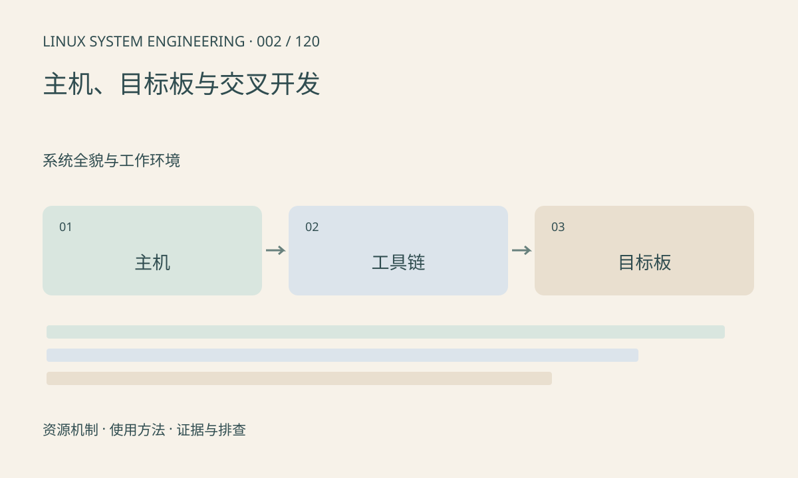

> 第 2 / 120 课 · 系统全貌与工作环境。返回[课程合集](/series/embedded-linux-system-engineering/)。

## 机制与资源关系

编译发生在主机，程序运行在目标板；交叉编译器的目标三元组描述目标环境。主机头文件和库不能因为名字相同就拿来链接目标程序。sysroot 用于隔离目标头文件与库，部署目录用于保存运行产物，两者职责不同。



## 实际用法与观察入口

以下是操作说明；先确认执行环境、工具帮助和目标对象。设备名、PID、地址及项目名示例需要按实际替换，不能将整段命令当通用板端脚本执行。

```sh
uname -m
command -v cc
cc -dumpmachine
cc --print-sysroot
```

## 输出解读与排查顺序

这些命令在主机执行。记录输出属于哪台机器；本机 cc 的目标不代表开发板架构。程序无法执行时先检查 ELF，再查加载器和依赖，不要立即修改文件权限。

### 情境推演

主机是 x86_64，板子是 AArch64，编译日志却出现 /usr/lib/x86_64-linux-gnu。即使链接还没报错也应检查搜索路径。先确认编译器目标，再确认每个依赖库的 ELF Machine。

## 练习与参考分析

建立主机/目标板对照表：架构、libc、工具链、sysroot、内核和部署路径。参考结论：同为 ARM 也可能因位数、浮点 ABI 或 libc 不同而不兼容。

本课练习属于阅读、分析或板端观察。未在目标开发板执行，记录时应写明板型、内核配置、工具版本和原始输出。

## 官方资料与版本边界

- [本课参考资料](https://gcc.gnu.org/onlinedocs/gcc/Directory-Options.html)

内核、工具和厂商 BSP 的支持范围需分别核对。参考资料可能对应较新版本；不要据此推定旧 BSP 支持所有接口。

[上一课：Linux 系统分层与资源地图](/posts/linux-sys-001.html) · [下一课：架构、ABI、大小端与工具链](/posts/linux-sys-003.html)
