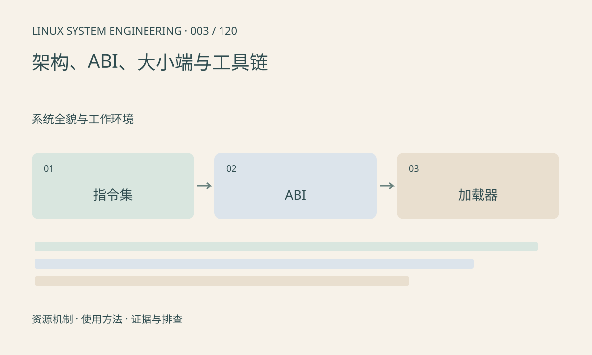

> 第 3 / 120 课 · 系统全貌与工作环境。返回[课程合集](/series/embedded-linux-system-engineering/)。

## 机制与资源关系

指令集决定 CPU 能解码什么，ABI 约定参数、寄存器、数据布局和链接规则。ELF 位数、字节序、目标机器、ARM 浮点调用约定都需要匹配。内核支持某种兼容模式，不代表根文件系统已经提供对应用户库。



## 实际用法与观察入口

以下是操作说明；先确认执行环境、工具帮助和目标对象。设备名、PID、地址及项目名示例需要按实际替换，不能将整段命令当通用板端脚本执行。

```sh
# 在主机检查你自己的目标程序
file ./app
readelf -h ./app
readelf -A ./app
readelf -l ./app
```

## 输出解读与排查顺序

先看 Machine、Class 和 Data，再看程序解释器路径；ARM 属性只在适用架构有意义。Exec format error 常提示格式或架构问题；文件存在却报不存在，还要检查解释器。

### 情境推演

假设 app 为 ELF32 ARM、目标用户空间只有 AArch64 加载器。CPU 支持 AArch32 仍不够，还需要内核兼容支持和对应用户运行时。不要直接修改 ELF 的解释器字符串来“修复”架构不兼容。

## 练习与参考分析

比较本机和交叉编译出的同一个 hello 程序。参考结论：源代码相同不能证明二进制兼容，至少保留 ELF 头和工具链版本作为证据。

本课练习属于阅读、分析或板端观察。未在目标开发板执行，记录时应写明板型、内核配置、工具版本和原始输出。

## 官方资料与版本边界

- [本课参考资料](https://man7.org/linux/man-pages/man5/elf.5.html)

内核、工具和厂商 BSP 的支持范围需分别核对。参考资料可能对应较新版本；不要据此推定旧 BSP 支持所有接口。

[上一课：主机、目标板与交叉开发](/posts/linux-sys-002.html) · [下一课：Shell、管道、重定向与退出码](/posts/linux-sys-004.html)
