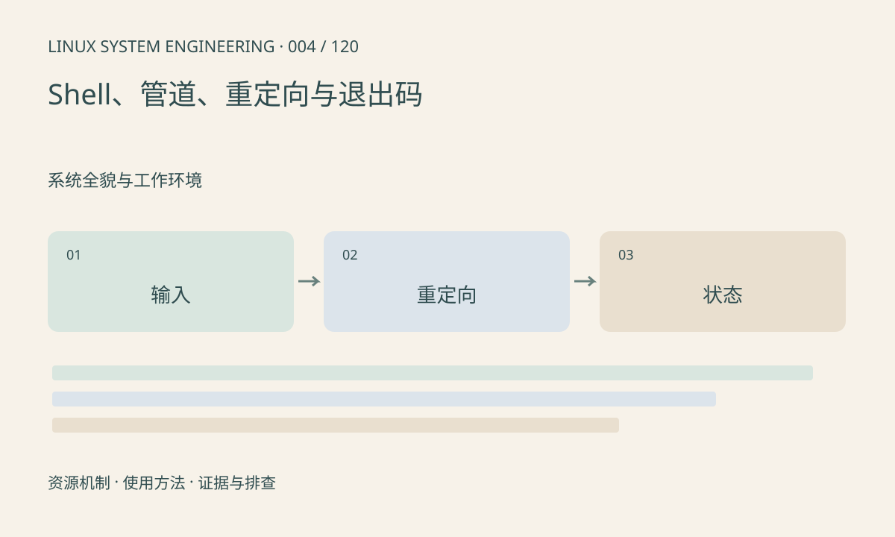

> 第 4 / 120 课 · 系统全貌与工作环境。返回[课程合集](/series/embedded-linux-system-engineering/)。

## 机制与资源关系

标准输入、输出、错误分别是文件描述符 0、1、2。重定向按从左到右执行，2>&1 是复制当时的输出目标。普通 POSIX Shell 的管道状态通常取最后一个命令，不能默认支持 pipefail，也不能默认启用它。



## 实际用法与观察入口

以下是操作说明；先确认执行环境、工具帮助和目标对象。设备名、PID、地址及项目名示例需要按实际替换，不能将整段命令当通用板端脚本执行。

```sh
sh -c 'printf "normal\n"; printf "error\n" >&2'
sh -c 'exit 7'
printf 'previous status=%s\n' "$?"
```

## 输出解读与排查顺序

失败命令之后立即保存 $?，否则后面的 echo 会覆盖它。涉及空格的路径始终引用变量；用 sh -n 做语法检查，但它不能证明运行时逻辑正确。

### 情境推演

false 经过管道连接到成功退出的 cat 后，普通 Shell 可能返回 0。这只表示管道最终状态的规则，不表示前面的工作成功。对关键步骤可拆开执行并保存各自状态。

## 练习与参考分析

运行配套重定向实验，比较两种顺序生成的文件。参考结论：cmd >out 2>&1 合并两路输出，cmd 2>&1 >out 的错误仍指向原来的输出位置。

### 独立实验包

主机临时目录内验证重定向和退出码；不修改系统配置。 默认入口、源文件和实际运行记录都在下载包中。

```experiment
practice
```

## 官方资料与版本边界

- [本课参考资料](https://man7.org/linux/man-pages/man1/sh.1p.html)

内核、工具和厂商 BSP 的支持范围需分别核对。参考资料可能对应较新版本；不要据此推定旧 BSP 支持所有接口。

[上一课：架构、ABI、大小端与工具链](/posts/linux-sys-003.html) · [下一课：BusyBox 与 GNU 工具差异](/posts/linux-sys-005.html)
