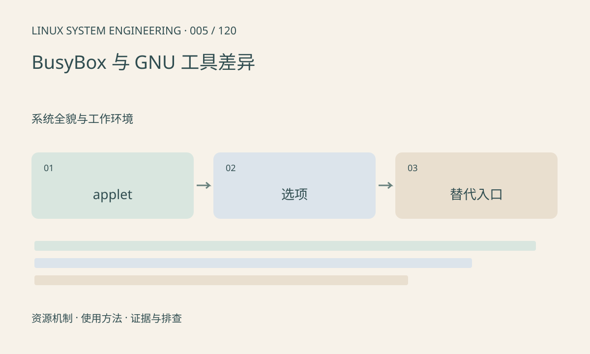

> 第 5 / 120 课 · 系统全貌与工作环境。返回[课程合集](/series/embedded-linux-system-engineering/)。

## 机制与资源关系

BusyBox 把多个 applet 编进一个可执行文件，命令是否存在、支持哪些选项都受构建配置影响。Ubuntu 上能用的 ps -eLf、date 格式和 timeout 选项，在裁剪板上可能不同。工具能力是运行环境的一部分。



## 实际用法与观察入口

以下是操作说明；先确认执行环境、工具帮助和目标对象。设备名、PID、地址及项目名示例需要按实际替换，不能将整段命令当通用板端脚本执行。

```sh
command -v busybox
# 仅在安装了 BusyBox 时执行
busybox --list
busybox ps --help
```

## 输出解读与排查顺序

先看目标机帮助，再写脚本。命令不存在时区分 PATH、软链接缺失和 applet 未编入；功能少时可以读 /proc 或交叉编译所需工具，不能把不支持的选项解释成没有进程。

### 情境推演

桌面命令 ps -eLf 在板上提示 invalid option。下一步是查看 busybox ps --help；若无法逐线程显示，可读取 /proc/PID/task。不要把工具参数错误写进“线程不存在”的结论。

## 练习与参考分析

为 ps、top、find、timeout 制作目标板支持表。参考结论：工具同名不保证参数一致，实验应记录实现和版本，而不是仅写“Linux”。

本课练习属于阅读、分析或板端观察。未在目标开发板执行，记录时应写明板型、内核配置、工具版本和原始输出。

## 官方资料与版本边界

- [本课参考资料](https://busybox.net/downloads/BusyBox.html)

内核、工具和厂商 BSP 的支持范围需分别核对。参考资料可能对应较新版本；不要据此推定旧 BSP 支持所有接口。

[上一课：Shell、管道、重定向与退出码](/posts/linux-sys-004.html) · [下一课：目录结构与虚拟文件系统](/posts/linux-sys-006.html)
