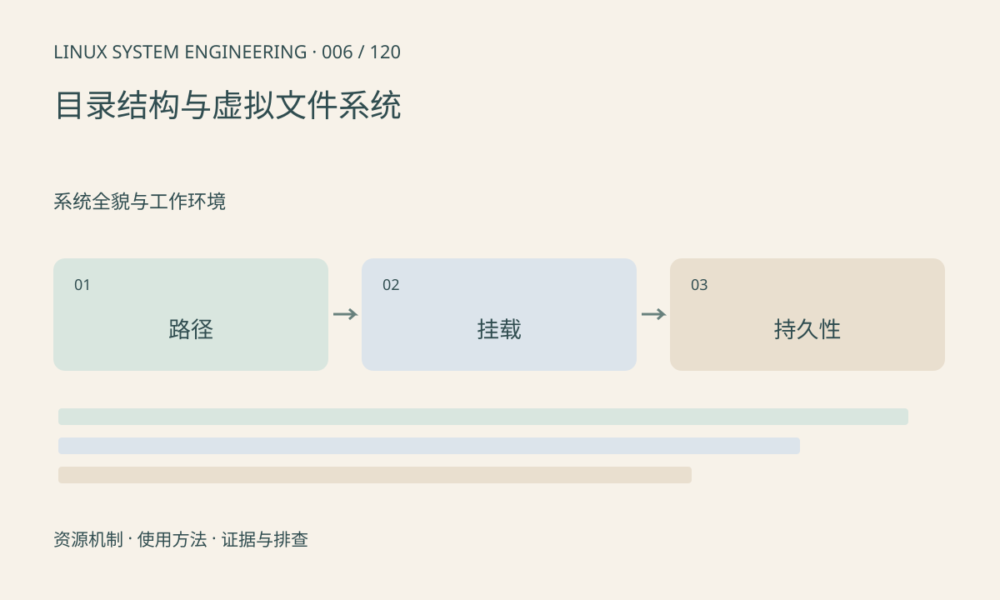

> 第 6 / 120 课 · 系统全貌与工作环境。返回[课程合集](/series/embedded-linux-system-engineering/)。

## 机制与资源关系

/proc 和 /sys 主要反映内核对象，/dev 提供设备访问入口，/run 常放本次启动的运行状态。目录名字本身不能证明它属于何种文件系统；容器、initramfs 和厂商启动脚本都可能改变挂载布局。

读取这些文件往往在读取时生成内容，显示大小为零也可能读出数据。



## 实际用法与观察入口

以下是操作说明；先确认执行环境、工具帮助和目标对象。设备名、PID、地址及项目名示例需要按实际替换，不能将整段命令当通用板端脚本执行。

```sh
cat /proc/mounts
cat /proc/self/mountinfo
ls -ld /proc /sys /dev /run /tmp
```

## 输出解读与排查顺序

先查挂载类型再判断空间和持久性。tmpfs 会占用内存且可涉及交换，不能把 /tmp 默认当持久存储。向 sysfs 属性写值可能改变设备状态，与编辑普通文本完全不同。

### 情境推演

假设应用写入 /etc/config 成功，但重启恢复旧值。先看 /etc 是否经过 OverlayFS，以及 upper 是否为 tmpfs。写调用成功只说明本次运行可见，不说明配置已进入持久层。

## 练习与参考分析

给五个目录填入文件系统类型、是否持久化和谁创建。参考结论：重启后丢失的配置若放在 tmpfs，应修正配置持久化位置，而不是反复恢复现场。

本课练习属于阅读、分析或板端观察。未在目标开发板执行，记录时应写明板型、内核配置、工具版本和原始输出。

## 官方资料与版本边界

- [本课参考资料](https://man7.org/linux/man-pages/man5/proc_mounts.5.html)

内核、工具和厂商 BSP 的支持范围需分别核对。参考资料可能对应较新版本；不要据此推定旧 BSP 支持所有接口。

[上一课：BusyBox 与 GNU 工具差异](/posts/linux-sys-005.html) · [下一课：串口、SSH 与开发网络](/posts/linux-sys-007.html)
