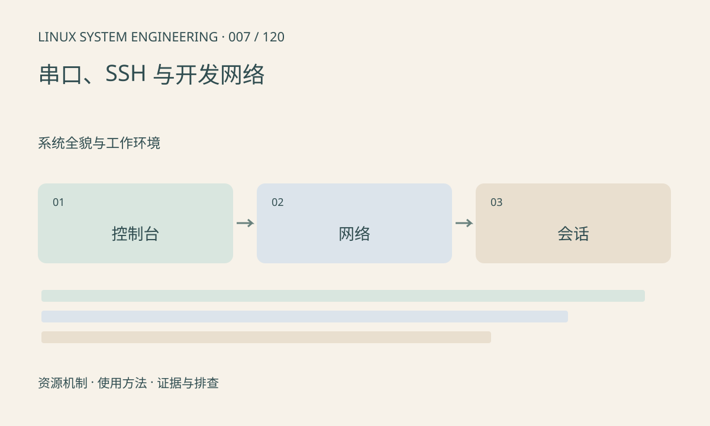

> 第 7 / 120 课 · 系统全貌与工作环境。返回[课程合集](/series/embedded-linux-system-engineering/)。

## 机制与资源关系

串口控制台独立于 IP 网络，适合记录启动早期故障。SSH 依赖网络、服务、身份和算法支持。文件传输还取决于目标 SSH 服务是否支持所用协议，不能把所有 scp 故障归为线路问题。

串口电平、波特率和流控必须匹配；接口外形不能证明电压兼容。



## 实际用法与观察入口

以下是操作说明；先确认执行环境、工具帮助和目标对象。设备名、PID、地址及项目名示例需要按实际替换，不能将整段命令当通用板端脚本执行。

```sh
ip address show
ip route show
command -v ssh
# 主机连接已配置的板子；替换用户名和地址
ssh -v user@192.0.2.10
```

## 输出解读与排查顺序

192.0.2.10 是文档示例地址。分层确认链路、IP、路由、端口和认证；保留主机密钥校验。乱码先检查串口参数和接地，不要在没有电平依据时换线短接。

### 情境推演

串口能登录、SSH 报 Connection refused，通常应先检查目标地址是否正确和目标端口是否监听。与连接超时相比，拒绝响应更接近端口或显式过滤问题，但仍需确认响应来自预期设备。

## 练习与参考分析

分别记录串口、网络地址和软件版本，模拟“串口正常但 SSH 不通”的纸面排障。参考顺序：地址/路由→服务监听→防火墙→认证。

本课练习属于阅读、分析或板端观察。未在目标开发板执行，记录时应写明板型、内核配置、工具版本和原始输出。

## 官方资料与版本边界

- [本课参考资料](https://man.openbsd.org/ssh)

内核、工具和厂商 BSP 的支持范围需分别核对。参考资料可能对应较新版本；不要据此推定旧 BSP 支持所有接口。

[上一课：目录结构与虚拟文件系统](/posts/linux-sys-006.html) · [下一课：建立开发板信息与版本基线](/posts/linux-sys-008.html)
