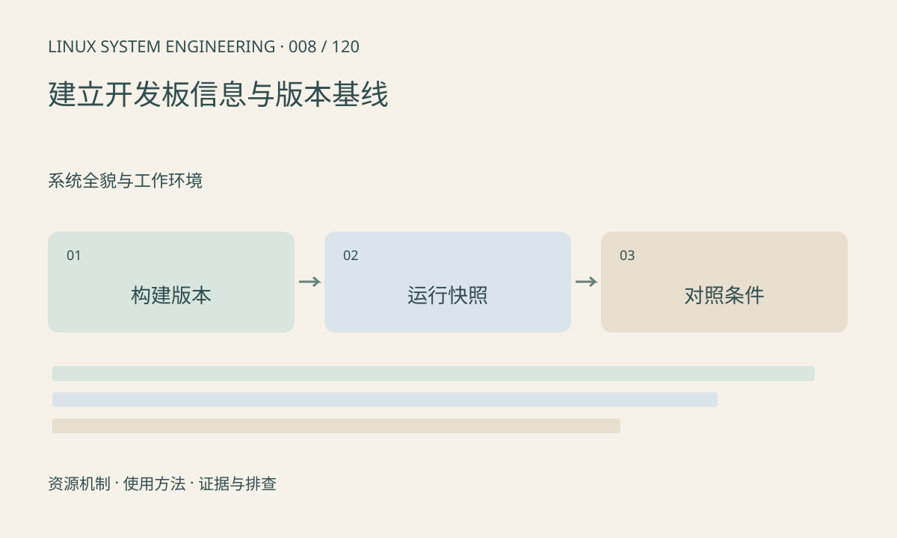

> 第 8 / 120 课 · 系统全貌与工作环境。返回[课程合集](/series/embedded-linux-system-engineering/)。

## 机制与资源关系

可复现问题需要把固件、设备树、模型、配置和硬件编号关联起来。uname 只能描述运行内核的一部分信息，不能唯一代表整套固件。版本基线应由构建产物清单和运行时快照共同组成。



## 实际用法与观察入口

以下是操作说明；先确认执行环境、工具帮助和目标对象。设备名、PID、地址及项目名示例需要按实际替换，不能将整段命令当通用板端脚本执行。

```sh
uname -a
cat /proc/version
cat /proc/uptime
cat /proc/meminfo
cat /proc/modules
```

## 输出解读与排查顺序

采集缺失项时保留“不可读”或“未挂载”，不要输出空字符串后当作正常。日志可能包含设备标识和路径，分享前核对内容；采集脚本应只读且有边界，不能无限遍历 sysfs。

### 情境推演

两次测试都显示相同 uname，但模型和根文件系统不同。不能据此说“环境完全一致”。基线应额外记录模型校验、SDK 版本、配置和板卡修订，运行快照只覆盖其中一部分。

## 练习与参考分析

运行本课采集脚本并与另一版本比较。参考结论：先区分环境变化和业务变化，再讨论性能回归。真实 SDK 和硬件编号仍需人工补充。

### 独立实验包

只读采集本机固定 /proc 项，输出行数有界；不连接板子，不采集完整命令行或环境变量。 默认入口、源文件和实际运行记录都在下载包中。

```experiment
practice
```

## 官方资料与版本边界

- [本课参考资料](https://docs.kernel.org/admin-guide/reporting-issues.html)

内核、工具和厂商 BSP 的支持范围需分别核对。参考资料可能对应较新版本；不要据此推定旧 BSP 支持所有接口。

[上一课：串口、SSH 与开发网络](/posts/linux-sys-007.html) · [下一课：从 Boot ROM 到用户空间](/posts/linux-sys-009.html)
