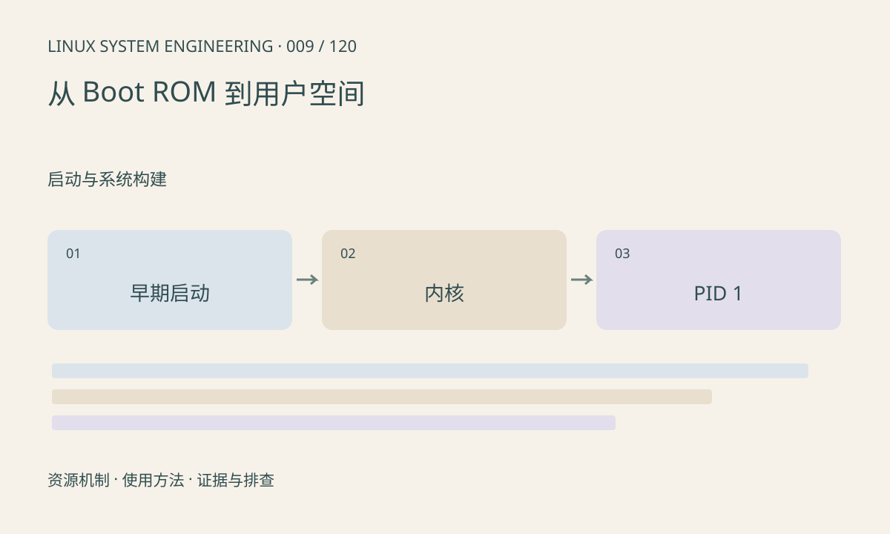

> 第 9 / 120 课 · 启动与系统构建。返回[课程合集](/series/embedded-linux-system-engineering/)。

## 机制与资源关系

启动链逐步建立运行条件：早期代码初始化存储和内存，Bootloader 加载内核与设备树，内核初始化驱动并挂载根文件系统，最后启动 PID 1。各平台阶段名称不同，必须按实际启动日志划分边界。



## 实际用法与观察入口

以下是操作说明；先确认执行环境、工具帮助和目标对象。设备名、PID、地址及项目名示例需要按实际替换，不能将整段命令当通用板端脚本执行。

```sh
cat /proc/cmdline
cat /proc/version
cat /proc/1/status
```

## 输出解读与排查顺序

最后一条串口日志不一定就是出错位置，也可能是控制台切换或日志尚未输出。无串口、内核异常、根分区失败、init 失败分别采用不同证据链，避免一律重刷固件。

### 情境推演

日志从 U-Boot 跳转后不再输出，可能是内核没运行，也可能是 console 指向另一串口。先核对启动地址、DTB 和 console，再考虑启用平台支持的早期日志，不能只凭静默判定 DDR 坏了。

## 练习与参考分析

把一份启动日志按阶段标注，并记录每阶段进入和退出的证据。参考结论：出现内核解压信息只能证明启动推进到该位置，不能证明根文件系统可用。

本课练习属于阅读、分析或板端观察。未在目标开发板执行，记录时应写明板型、内核配置、工具版本和原始输出。

## 官方资料与版本边界

- [本课参考资料](https://docs.kernel.org/admin-guide/init.html)

内核、工具和厂商 BSP 的支持范围需分别核对。参考资料可能对应较新版本；不要据此推定旧 BSP 支持所有接口。

[上一课：建立开发板信息与版本基线](/posts/linux-sys-008.html) · [下一课：U-Boot 环境与内核启动参数](/posts/linux-sys-010.html)
